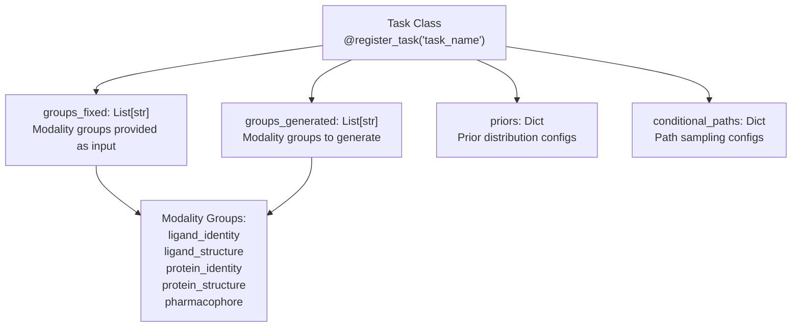
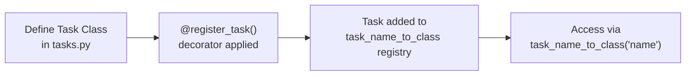
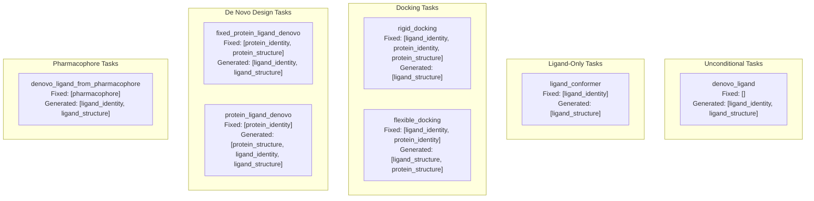
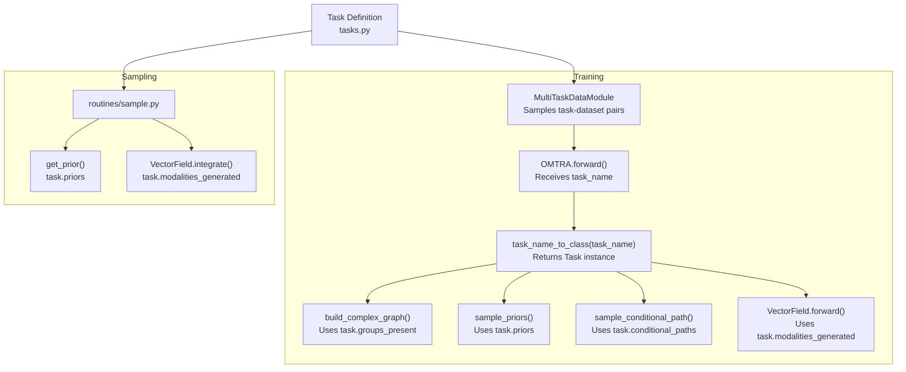

# Creating Custom Tasks

<details>
<summary>Relevant source files</summary>

The following files were used as context for generating this wiki page:

- [omtra/dataset/pharmit.py](omtra/dataset/pharmit.py)
- [omtra/dataset/plinder.py](omtra/dataset/plinder.py)
- [omtra/models/omtra.py](omtra/models/omtra.py)
- [omtra/models/self_conditioning.py](omtra/models/self_conditioning.py)
- [omtra/models/vector_field.py](omtra/models/vector_field.py)
- [omtra/tasks/tasks.py](omtra/tasks/tasks.py)

</details>


This page explains how to define new tasks in OMTRA. Tasks specify what the model generates versus what is provided as input conditioning information. For general concepts about tasks and modalities, see [Tasks and Modalities](#3.1). For information about configuring training with multiple tasks, see [Multi-Task Learning](#7.3).

## Overview

Tasks in OMTRA define the boundary between conditional inputs (fixed modalities) and generated outputs (generated modalities). Each task is a class that specifies which molecular properties are provided to the model and which the model should generate. For example, `rigid_docking` takes a fixed protein structure and ligand identity as input and generates ligand 3D coordinates, while `denovo_ligand` generates both ligand identity and structure from scratch.

Tasks are implemented as Python classes in [omtra/tasks/tasks.py:1-226]() and registered using decorators. The system supports multi-task training where a single model learns to perform multiple related tasks simultaneously.

## Task Anatomy

### Core Components

Every task class inherits from `Task` and defines four key attributes:

**Diagram: Task Class Structure**


Sources: [omtra/tasks/tasks.py:1-226]()

| Attribute | Type | Purpose |
|-----------|------|---------|
| `groups_fixed` | `List[str]` | Modality groups that are provided as conditioning input (not generated) |
| `groups_generated` | `List[str]` | Modality groups that the model should generate |
| `priors` | `Dict` | Configuration for sampling prior distributions (x_0) for each modality |
| `conditional_paths` | `Dict` | Configuration for conditional path functions that interpolate from x_0 to x_1 |

Sources: [omtra/tasks/tasks.py:13-27](), [omtra/tasks/base_task.py]()

### Modality Groups

Tasks operate at the level of **modality groups**, which are collections of related modalities. The available groups are:

| Group | Modalities Included | Description |
|-------|---------------------|-------------|
| `ligand_identity` | `lig_a`, `lig_c`, `lig_e` | Ligand atom types, charges, bond orders |
| `ligand_identity_condensed` | `lig_cond_a`, `lig_e_condensed` | Condensed ligand atom representation |
| `ligand_structure` | `lig_x` | Ligand 3D coordinates |
| `protein_identity` | `prot_atom_a`, `prot_res_a` | Protein atom/residue types |
| `protein_structure` | `prot_atom_x`, `prot_res_x` | Protein 3D coordinates |
| `pharmacophore` | `pharm_x`, `pharm_a`, `pharm_v` | Pharmacophore positions, types, vectors |

The `groups_present` property (derived from `groups_fixed + groups_generated`) determines which modalities appear in the graph and which edges are built.

Sources: [omtra/tasks/modalities.py](), [omtra/tasks/base_task.py]()

## Defining a New Task

### Step 1: Choose Modality Groups

Decide which modality groups should be:
- **Fixed** (provided as input, conditioned on)
- **Generated** (predicted by the model)

For example, to create a task that generates pharmacophores from a fixed ligand:
- Fixed: `ligand_identity`, `ligand_structure`
- Generated: `pharmacophore`

### Step 2: Create Task Class

Create a new class in [omtra/tasks/tasks.py]():

```python
@register_task("ligand_to_pharmacophore")
class LigandToPharmacophore(Task):
    groups_fixed = ['ligand_identity', 'ligand_structure']
    groups_generated = ['pharmacophore']
    
    priors = pc.denovo_pharmacophore
    conditional_paths = cpc.denovo_pharmacophore
```

**Diagram: Task Registration Flow**


Sources: [omtra/tasks/tasks.py:13-27](), [omtra/tasks/register.py]()

### Step 3: Configure Priors

Priors define the initial distribution (x_0) for each generated modality. Reference a prior collection or create a custom dictionary:

```python
# Option 1: Use existing prior collection
priors = pc.denovo_ligand

# Option 2: Define custom priors
priors = {
    'lig_x': {
        'type': 'gaussian',
        'mean': 0.0,
        'std': 1.0
    },
    'lig_a': {
        'type': 'ctmc_masked',
        'mask_token_idx': len(lig_atom_type_map)
    },
    'lig_c': {
        'type': 'ctmc_masked',
        'mask_token_idx': len(charge_map)
    },
    'lig_e': {
        'type': 'ctmc_masked',
        'mask_token_idx': 4
    }
}

# Option 3: Extend existing priors
priors = deepcopy(pc.ligand_conformer)
priors['prot_atom_x'] = {
    'type': 'target_dependent_gaussian'
}
```

Available prior types include:
- `gaussian`: Standard Gaussian noise
- `ctmc_masked`: Categorical mask token (for discrete features)
- `target_dependent_gaussian`: Gaussian centered on target values
- `apo_exp`: Use experimental apo structure
- `apo_pred`: Use predicted apo structure

Sources: [omtra/tasks/tasks.py:40-59](), [omtra/priors/prior_factory.py]()

### Step 4: Configure Conditional Paths

Conditional paths define how to interpolate from x_0 to x_1 during training. Reference a collection or define custom paths:

```python
# Reference conditional path collections
conditional_paths = dict(
    **cpc.denovo_ligand,    # Ligand conditional paths
    **cpc.protein           # Protein conditional paths
)
```

Common conditional path types:
- `continuous_linear`: Linear interpolation for continuous features (positions)
- `ctmc_masked`: Masking schedule for categorical features
- `vpsde`: Variance-preserving SDE for continuous features

Sources: [omtra/tasks/tasks.py:44-69](), [omtra/models/conditional_paths/path_factory.py]()

### Step 5: Register and Use

The `@register_task()` decorator automatically registers your task. It can then be referenced in configuration files:

```yaml
task_phases:
  - tasks:
      - ligand_to_pharmacophore
    start_step: 0
    end_step: 100000
```

Sources: [omtra/tasks/register.py](), [configs/config.yaml]()

## Task Examples

**Diagram: Common Task Configurations**


Sources: [omtra/tasks/tasks.py:13-184]()

### Example 1: De Novo Ligand Generation

```python
@register_task("denovo_ligand")
class DeNovoLigand(Task):
    groups_fixed = []
    groups_generated = ['ligand_identity', 'ligand_structure']

    priors = pc.denovo_ligand
    conditional_paths = cpc.denovo_ligand
```

This task generates ligands from scratch with no conditioning information.

Sources: [omtra/tasks/tasks.py:13-20]()

### Example 2: Rigid Docking

```python
@register_task("rigid_docking")
class RigidDocking(Task):
    groups_fixed = ["ligand_identity", "protein_identity", "protein_structure"]
    groups_generated = ["ligand_structure"]

    priors = deepcopy(pc.ligand_conformer)
    priors["npnde_x"] = {
        "type": "target_dependent_gaussian",
    }
    conditional_paths = dict(**cpc.ligand_conformer, **cpc.protein)
```

This task places a known ligand into a fixed protein structure, generating only the ligand coordinates.

Sources: [omtra/tasks/tasks.py:33-44]()

### Example 3: Apo-Conditioned Design

```python
@register_task("exp_apo_conditioned_denovo_ligand")
class ExpApoDeNovoLigand(Task):
    groups_fixed = ['protein_identity']
    groups_generated = ['ligand_identity', 'ligand_structure', 'protein_structure']

    priors = deepcopy(pc.denovo_ligand)
    priors['prot_atom_x'] = {
        'type': 'apo_exp',  # Use experimental apo structure as prior
    }
    priors['npnde_x'] = {
        'type': 'target_dependent_gaussian',
    }
    conditional_paths = dict(**cpc.denovo_ligand, **cpc.protein)
```

This task generates ligands while allowing protein flexibility, starting from an experimental apo structure.

Sources: [omtra/tasks/tasks.py:86-98]()

## How Tasks Interact with the System

**Diagram: Task Usage Throughout System**


Sources: [omtra/models/omtra.py:386-516](), [omtra/models/vector_field.py:360-564](), [routines/sample.py]()

### Task Properties

The `Task` base class provides derived properties:

| Property | Description | Example |
|----------|-------------|---------|
| `groups_present` | `groups_fixed + groups_generated` | All modality groups in the graph |
| `modalities_fixed` | Modality objects for fixed groups | `[Modality('lig_a'), ...]` |
| `modalities_generated` | Modality objects for generated groups | `[Modality('lig_x'), ...]` |
| `modalities_present` | All modality objects | Union of fixed and generated |
| `unconditional` | `len(groups_fixed) == 0` | True for de novo tasks |

These properties are used throughout the codebase to determine graph structure, prior sampling, and loss computation.

Sources: [omtra/tasks/base_task.py](), [omtra/models/omtra.py:236-240]()

## Advanced Task Configuration

### Conditional Edge Building

Tasks determine which edges are built in the graph through the `groups_present` property. The graph configuration file specifies edge builders for different node type combinations, and tasks control which are activated:

```python
# In graph_config
edges:
  lig_to_prot_atom:
    builder: knn
    params: {k: 16}
  prot_atom_to_prot_atom:
    builder: radius
    params: {r: 4.5}
```

If a task has both `ligand_structure` and `protein_structure` in `groups_present`, then `lig_to_prot_atom` edges are built. If only `ligand_structure` is present, protein-related edges are skipped.

Sources: [omtra/tasks/utils.py](), [omtra/data/graph/build.py](), [configs/config.yaml]()

### Multi-Phase Training

Tasks can be trained in phases with different dataset coupling and sampling probabilities:

```yaml
task_phases:
  - tasks:
      - denovo_ligand
      - ligand_conformer
    start_step: 0
    end_step: 50000
  - tasks:
      - rigid_docking
      - flexible_docking
    start_step: 50000
    end_step: 100000
```

This allows curriculum learning where simpler tasks are learned first.

Sources: [omtra/load/conf.py](), [configs/config.yaml]()

### Custom Prior Distributions

For specialized tasks, implement custom prior sampling functions:

```python
# In omtra/priors/sample.py or custom module
def custom_prior_fn(g, modality, com=None, training=True, **kwargs):
    """Custom prior sampling logic"""
    ntype = modality.entity_name
    n_nodes = g.num_nodes(ntype)
    
    # Your custom sampling logic here
    x_0 = torch.randn(n_nodes, 3) * custom_scale
    
    g.nodes[ntype].data[f'{modality.data_key}_0'] = x_0
    return g

# In task definition
priors = {
    'lig_x': {
        'type': 'custom',
        'fn': custom_prior_fn,
        'custom_scale': 2.0
    }
}
```

Sources: [omtra/priors/sample.py](), [omtra/priors/prior_factory.py]()

## Best Practices

1. **Name tasks descriptively**: Use names that clearly indicate what is fixed vs generated (e.g., `fixed_protein_ligand_denovo`)

2. **Reuse prior collections**: Import and extend existing collections rather than redefining from scratch

3. **Consider data availability**: Only define tasks for which you have appropriate training data in your datasets

4. **Test incrementally**: Start with simple tasks and add complexity gradually

5. **Document expected inputs**: Add docstrings explaining what conditional information is required

6. **Validate modality compatibility**: Ensure all modalities in your groups are compatible (e.g., don't mix condensed and non-condensed ligand representations)

Sources: [omtra/tasks/tasks.py:1-226]()

---