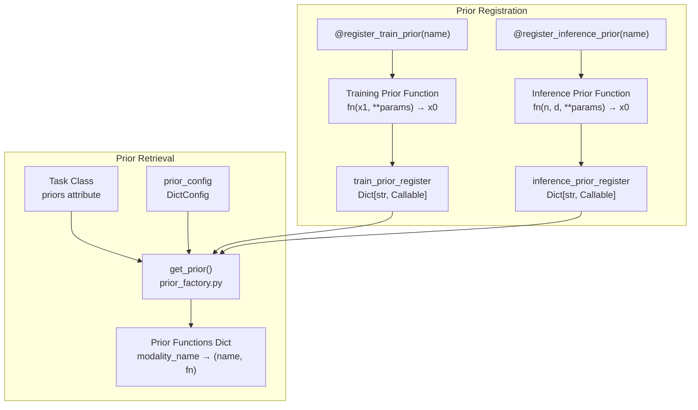
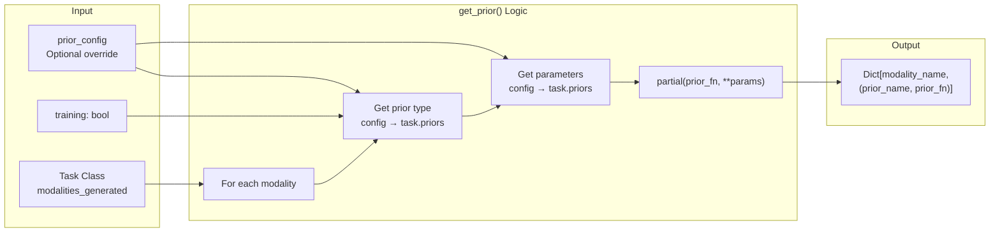
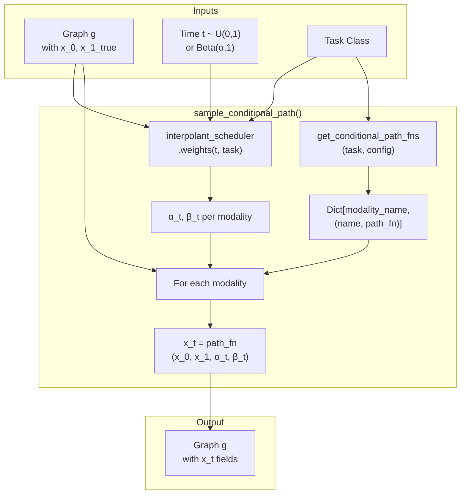
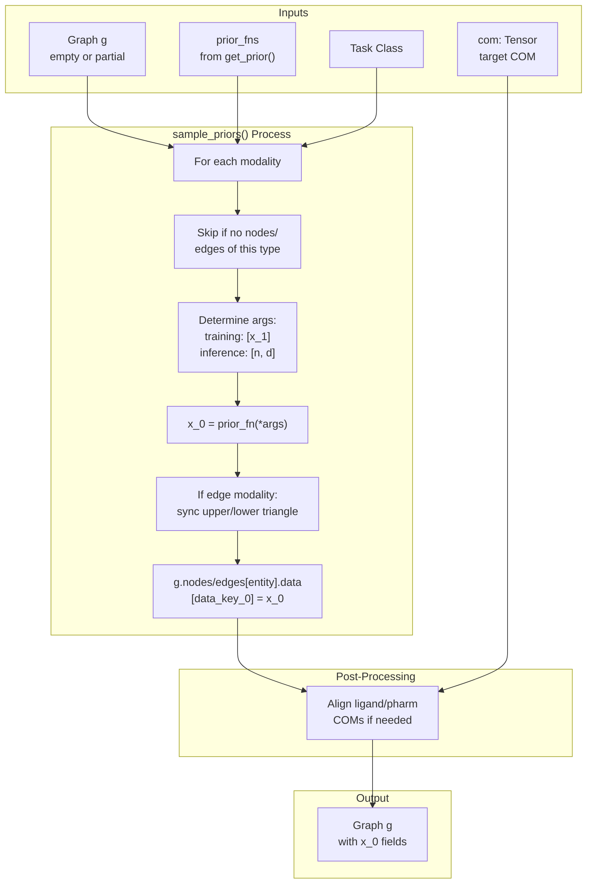

# Custom Priors and Conditional Paths

<details>
<summary>Relevant source files</summary>

The following files were used as context for generating this wiki page:

- [configs/graph/default.yaml](configs/graph/default.yaml)
- [omtra/data/graph/__init__.py](omtra/data/graph/__init__.py)
- [omtra/data/graph/edge_builders.py](omtra/data/graph/edge_builders.py)
- [omtra/data/graph/edge_factory.py](omtra/data/graph/edge_factory.py)
- [omtra/data/graph/register.py](omtra/data/graph/register.py)
- [omtra/models/omtra.py](omtra/models/omtra.py)
- [omtra/models/self_conditioning.py](omtra/models/self_conditioning.py)
- [omtra/models/vector_field.py](omtra/models/vector_field.py)
- [omtra/priors/prior_factory.py](omtra/priors/prior_factory.py)
- [omtra/priors/priors.py](omtra/priors/priors.py)
- [omtra/priors/sample.py](omtra/priors/sample.py)
- [omtra/tasks/utils.py](omtra/tasks/utils.py)

</details>


## Purpose and Scope

This page explains how to implement custom prior distributions and conditional path functions in OMTRA. Priors define the initial state (x₀) of features during generation, while conditional paths define the interpolation between x₀ and x₁ during training.

For information about using existing priors during sampling, see [Prior Distributions](#8.2). For foundational concepts about flow matching, see [Flow Matching for Molecules](#3.2).

---

## Overview

OMTRA's generative process requires two key functions for each modality:

1. **Prior distributions**: Sample the initial state x₀ at time t=0
2. **Conditional paths**: Define the trajectory x_t = α_t·x₀ + β_t·x₁ between x₀ and x₁

Both systems use a registration pattern that allows you to define custom implementations and reference them by name in configuration files.

### Prior vs Conditional Path Responsibilities

| Component | Purpose | When Applied | Examples |
|-----------|---------|--------------|----------|
| **Prior** | Generates x₀ values | Before integration begins (t=0) | Gaussian noise, masked tokens, target-dependent |
| **Conditional Path** | Interpolates x_t given x₀, x₁, α_t, β_t | Every training step (random t) | Linear interpolation, CTMC masking |

**Sources**: [omtra/priors/sample.py:10-113](), [omtra/models/omtra.py:542-600]()

---

## Prior System Architecture

### Registration System

OMTRA uses a decorator-based registration system to manage prior implementations. Each prior must be registered separately for training and inference.



**Sources**: [omtra/priors/prior_factory.py:1-34](), [omtra/priors/priors.py:7-102]()

### Train vs Inference Priors

Prior functions have different signatures for training and inference:

| Mode | Function Signature | Purpose |
|------|-------------------|---------|
| **Training** | `fn(x1: Tensor, **params) → x0: Tensor` | Generate x₀ given the target x₁ (for optimal transport, alignment, etc.) |
| **Inference** | `fn(n: int, d: int\|List[int], **params) → x0: Tensor` | Generate x₀ from scratch without knowing x₁ |

**Example: Gaussian Prior**

```python
# Training: can align to target
@register_train_prior("gaussian")
def gaussian_train(x1: torch.Tensor, std: float = 1.0, 
                   ot=False, rigid_body=True, ...):
    x0 = torch.randn_like(x1) * std
    if ot:
        x0 = align_prior(x0, x1, rigid_body=rigid_body)
    return x0

# Inference: no target available
@register_inference_prior("gaussian")
def gaussian_inference(n: int, d: Union[int, List[int]], 
                       std: float = 1.0, **kwargs):
    if isinstance(d, int):
        x0 = torch.randn(n, d) * std
    else:
        x0 = torch.randn(n, *d) * std
    return x0
```

**Sources**: [omtra/priors/priors.py:11-53]()

### Prior Factory Pattern

The `get_prior()` function retrieves the appropriate prior for each modality:



**Sources**: [omtra/priors/prior_factory.py:5-34]()

---

## Implementing Custom Priors

### Step 1: Define Prior Functions

Create two functions—one for training, one for inference:

```python
from omtra.priors.register import register_train_prior, register_inference_prior
import torch

@register_train_prior("my_custom_prior")
def my_custom_prior_train(x1: torch.Tensor, 
                          my_param: float = 1.0,
                          **kwargs):
    """
    Training prior with access to target x1.
    
    Args:
        x1: Target features, shape (n_nodes, feature_dim)
        my_param: Custom parameter
        **kwargs: Additional parameters
        
    Returns:
        x0: Prior samples, same shape as x1
    """
    # Your implementation here
    x0 = custom_sampling_logic(x1, my_param)
    return x0

@register_inference_prior("my_custom_prior")
def my_custom_prior_inference(n: int, 
                               d: Union[int, List[int]], 
                               my_param: float = 1.0,
                               **kwargs):
    """
    Inference prior without access to target.
    
    Args:
        n: Number of samples to generate
        d: Dimensionality (int or list for multi-dim)
        my_param: Custom parameter
        
    Returns:
        x0: Prior samples, shape (n, d) or (n, *d)
    """
    if isinstance(d, int):
        x0 = torch.randn(n, d) * my_param
    else:
        x0 = torch.randn(n, *d) * my_param
    return x0
```

**Important Notes**:
- Both functions must accept `**kwargs` to handle extra parameters
- Return tensors must match expected shapes
- For categorical features, return long tensors with integer indices
- For continuous features, return float tensors

**Sources**: [omtra/priors/priors.py:11-102]()

### Step 2: Handle Categorical vs Continuous Features

The prior sampling logic automatically detects feature types based on modality:

| Feature Type | Expected Return | Example Modalities |
|--------------|-----------------|-------------------|
| **Categorical** | `torch.Tensor` (dtype=long), values in `[0, n_categories]` | `lig_a`, `lig_c`, `lig_e`, `pharm_a` |
| **Continuous (positions)** | `torch.Tensor` (dtype=float), shape `(n, 3)` | `lig_x`, `prot_atom_x`, `pharm_x` |
| **Continuous (vectors)** | `torch.Tensor` (dtype=float), shape `(n, n_vecs, 3)` | `pharm_v` |

**Example: Categorical Prior (CTMC Masked)**

```python
@register_train_prior("masked")
def ctmc_masked_train(x1: torch.Tensor, n_categories: int):
    """All samples assigned mask token (= n_categories)."""
    n = x1.shape[0]
    p = torch.ones(n, dtype=torch.long) * n_categories
    return p.to(x1.device)

@register_inference_prior("masked")
def ctmc_masked_inference(n: int, d: int):
    """d is n_categories; return mask token for all."""
    p = torch.ones(n, dtype=torch.long) * d
    return p
```

**Sources**: [omtra/priors/priors.py:56-72]()

### Step 3: Configure in Task or YAML

Reference your custom prior in task configuration:

```python
# In your Task class definition
class MyTask(Task):
    priors = {
        'lig_x': {
            'type': 'my_custom_prior',
            'params': {'my_param': 2.0}
        },
        'lig_a': {
            'type': 'masked',
            'params': {}
        }
    }
```

Or override via `prior_config` in YAML:

```yaml
prior_config:
  my_task_name:
    lig_x:
      type: my_custom_prior
      params:
        my_param: 2.0
```

**Sources**: [omtra/priors/prior_factory.py:19-32]()

---

## Built-in Prior Types

### Gaussian Prior

Samples from a Gaussian distribution with optional optimal transport alignment.

**Parameters**:
- `std` (float): Standard deviation of Gaussian noise
- `ot` (bool): Whether to apply optimal transport alignment to x₁
- `rigid_body` (bool): If True, use rigid body alignment; otherwise permutation only
- `permutation` (bool): Allow permutation during OT alignment
- `translation` (bool): Translate x₀ to same COM as x₁
- `offset_std` (float): Add random offset with this std

**Usage**:
```yaml
lig_x:
  type: gaussian
  params:
    std: 1.0
    ot: true
    rigid_body: true
```

**Sources**: [omtra/priors/priors.py:11-53]()

### Masked Prior (CTMC)

For categorical features in continuous-time Markov chain (CTMC) framework. All features start as a mask token.

**Parameters**: None (implicitly uses `n_categories` from modality)

**Usage**:
```yaml
lig_a:
  type: masked
  params: {}
```

**Sources**: [omtra/priors/priors.py:56-72]()

### Target-Dependent Gaussian

Uses the target value plus Gaussian noise. Useful for refinement tasks.

**Parameters**:
- `std` (float): Standard deviation of added noise

**Usage**:
```yaml
prot_atom_x:
  type: target_dependent_gaussian
  params:
    std: 0.5
```

**Sources**: [omtra/priors/priors.py:74-82]()

### Apo-based Priors

Use unbound (apo) protein structures as priors, with optional noise.

| Prior Type | Data Source | Use Case |
|------------|-------------|----------|
| `apo_exp` | Experimental apo structure (`x_0` field) | When experimental apo available |
| `apo_pred` | AlphaFold predicted apo (`x_0` field) | When only predicted apo available |

**Parameters**:
- `std` (float): Noise to add to apo structure

**Usage**:
```yaml
prot_atom_x:
  type: apo_exp
  params:
    std: 0.2
```

**Sources**: [omtra/priors/priors.py:85-101]()

---

## Conditional Path System

Conditional paths define how features interpolate between x₀ and x₁ during training.

### Path Function Interface

A conditional path function has the signature:

```python
def conditional_path_fn(
    source: torch.Tensor,      # x_0
    target: torch.Tensor,      # x_1
    alpha_t: torch.Tensor,     # Interpolation weight for x_0
    beta_t: torch.Tensor,      # Interpolation weight for x_1
    **kwargs                   # Additional parameters (e.g., ue_mask)
) -> torch.Tensor:             # x_t
    """Compute x_t along the path from x_0 to x_1."""
    pass
```

**Sources**: [omtra/models/omtra.py:556-590]()

### Path Sampling in Training

During each training step, the conditional path is sampled:



**Sources**: [omtra/models/omtra.py:542-600]()

### Implementing Custom Conditional Paths

The conditional path factory is referenced but the implementation is in `omtra/models/conditional_paths/path_factory.py` (not provided in files). Based on usage patterns, custom paths follow this structure:

**Example: Linear Interpolation (Continuous)**

```python
def linear_path(source, target, alpha_t, beta_t, **kwargs):
    """Standard linear interpolation for continuous features."""
    return alpha_t * source + beta_t * target
```

**Example: CTMC Path (Categorical)**

```python
def ctmc_masked_path(source, target, alpha_t, beta_t, 
                     ue_mask=None, **kwargs):
    """
    CTMC path: either keep mask token or reveal true value.
    
    source: mask token indices (all = n_categories)
    target: true category indices
    alpha_t, beta_t: interpolation weights
    """
    # Probability of unmasking
    p_unmask = beta_t
    
    # Sample whether to unmask each element
    unmask = torch.rand_like(p_unmask) < p_unmask
    
    # Where unmasked, use target; else use source (mask)
    x_t = torch.where(unmask, target, source)
    
    return x_t
```

### Path Configuration

Paths are configured via the `conditional_paths` section in YAML:

```yaml
conditional_paths:
  # Continuous features typically use linear interpolation
  continuous:
    type: linear
    
  # Categorical features use CTMC masking
  categorical:
    type: ctmc_masked
    
  # Can override per-modality if needed
  lig_x:
    type: custom_path
    params:
      custom_param: value
```

**Sources**: [omtra/models/omtra.py:62-63, 93, 556-559]()

---

## Integration with Sampling

### Prior Sampling Process

The `sample_priors()` function applies priors to a graph during generation:



**Key Behaviors**:

1. **Modality-specific sampling**: Each modality gets its own prior
2. **Edge synchronization**: For `lig_to_lig` edges, upper and lower triangle are kept identical
3. **COM alignment**: During inference, ligand/pharmacophore priors are moved to specified COM
4. **Training vs inference**: Different argument handling based on mode

**Sources**: [omtra/priors/sample.py:10-113]()

### Integration in OMTRA.sample()

During generation, priors are sampled once before integration begins:

```python
# In OMTRA.sample()
prior_fns = get_prior(task, self.prior_config, training=False)
g = sample_priors(
    g, 
    task, 
    prior_fns, 
    training=False, 
    com=com_batch,
    fake_atoms=self.use_fake_atoms
)
```

Then the VectorField integrates from x₀ to x₁:

```python
samples = self.vector_field.integrate(
    g, task, n_timesteps=n_timesteps, ...
)
```

**Sources**: [omtra/models/omtra.py:859-867]()

---

## Complete Example: Custom Prior for Pharmacophores

Here's a complete example implementing a custom prior that places pharmacophore points around a predicted binding site:

```python
import torch
from omtra.priors.register import (
    register_train_prior, 
    register_inference_prior
)

@register_train_prior("binding_site_gaussian")
def binding_site_gaussian_train(
    x1: torch.Tensor,
    std: float = 1.0,
    pocket_radius: float = 5.0,
    **kwargs
):
    """
    Sample around the true binding site with Gaussian noise.
    
    Args:
        x1: True pharmacophore positions (n_pharm, 3)
        std: Standard deviation of Gaussian noise
        pocket_radius: Radius of initial scatter
    """
    # Compute COM of true pharmacophores
    com = x1.mean(dim=0, keepdim=True)
    
    # Sample uniform in sphere around COM
    n = x1.shape[0]
    directions = torch.randn(n, 3)
    directions = directions / directions.norm(dim=1, keepdim=True)
    radii = torch.rand(n, 1) * pocket_radius
    
    x0 = com + directions * radii
    
    # Add Gaussian noise
    x0 = x0 + torch.randn_like(x0) * std
    
    return x0.to(x1.device)

@register_inference_prior("binding_site_gaussian")
def binding_site_gaussian_inference(
    n: int,
    d: int,
    std: float = 1.0,
    pocket_radius: float = 5.0,
    **kwargs
):
    """
    Sample in a sphere (will be moved to correct COM later).
    
    Args:
        n: Number of pharmacophore points
        d: Dimension (should be 3)
        std: Standard deviation of Gaussian noise
        pocket_radius: Radius of initial scatter
    """
    assert d == 3, "Pharmacophore positions must be 3D"
    
    # Sample uniform in sphere
    directions = torch.randn(n, 3)
    directions = directions / directions.norm(dim=1, keepdim=True)
    radii = torch.rand(n, 1) * pocket_radius
    
    x0 = directions * radii
    x0 = x0 + torch.randn_like(x0) * std
    
    return x0

# Usage in task configuration
class PharmacophoreTask(Task):
    name = "custom_pharm_task"
    # ... other attributes ...
    
    priors = {
        'pharm_x': {
            'type': 'binding_site_gaussian',
            'params': {
                'std': 0.5,
                'pocket_radius': 8.0
            }
        },
        'pharm_a': {
            'type': 'masked',
            'params': {}
        }
    }
```

**Sources**: [omtra/priors/priors.py:11-102](), [omtra/priors/sample.py:82-111]()

---

## Summary

### Prior Checklist

To implement a custom prior:

- [ ] Define training prior function with signature `fn(x1, **params) → x0`
- [ ] Define inference prior function with signature `fn(n, d, **params) → x0`
- [ ] Decorate both with `@register_train_prior(name)` and `@register_inference_prior(name)`
- [ ] Handle categorical vs continuous features appropriately
- [ ] Accept `**kwargs` for compatibility
- [ ] Reference by name in task or config

### Conditional Path Checklist

To implement a custom conditional path:

- [ ] Define path function with signature `fn(source, target, alpha_t, beta_t, **kwargs) → x_t`
- [ ] Register in path factory (implementation-specific)
- [ ] Handle edge masking for edge features if needed
- [ ] Configure in `conditional_paths` section of YAML

### Key Files

| File | Purpose |
|------|---------|
| [omtra/priors/priors.py]() | Built-in prior implementations |
| [omtra/priors/register.py]() | Registration decorators and registries |
| [omtra/priors/prior_factory.py]() | `get_prior()` factory function |
| [omtra/priors/sample.py]() | `sample_priors()` application logic |
| [omtra/models/omtra.py:542-600]() | `sample_conditional_path()` integration |
| [omtra/models/conditional_paths/path_factory.py]() | Conditional path factory (not shown) |

**Sources**: All files listed in the table above.

---