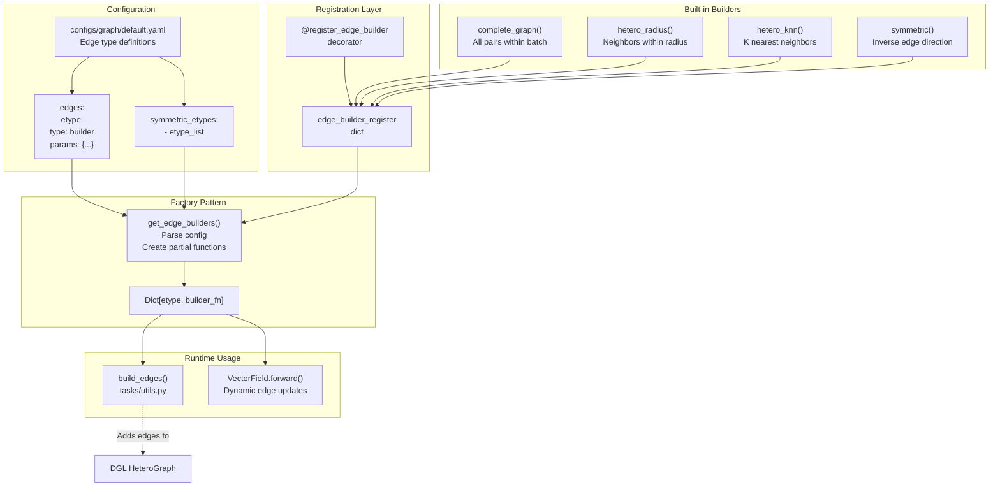
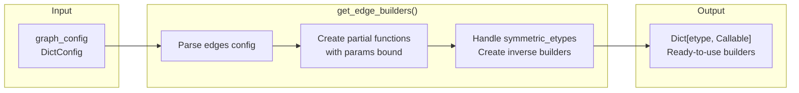
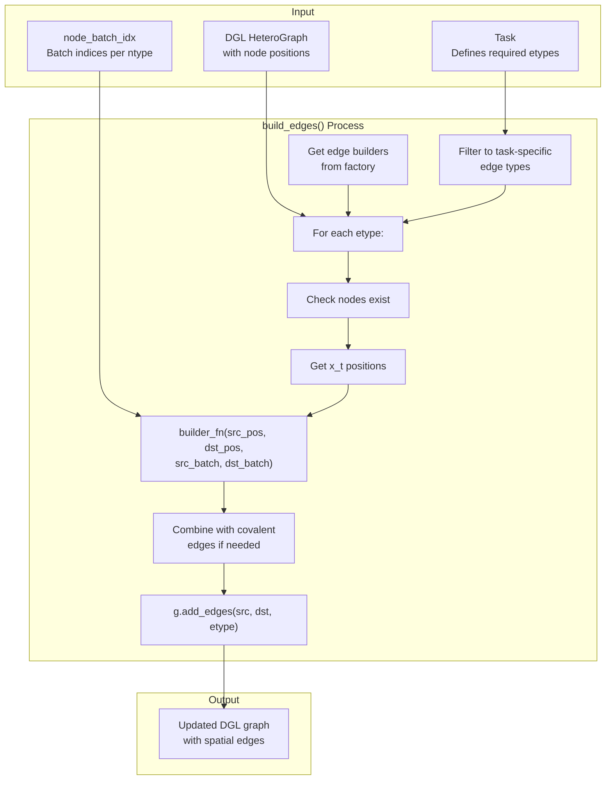

# Custom Edge Builders

<details>
<summary>Relevant source files</summary>

The following files were used as context for generating this wiki page:

- [configs/graph/default.yaml](configs/graph/default.yaml)
- [omtra/data/graph/__init__.py](omtra/data/graph/__init__.py)
- [omtra/data/graph/edge_builders.py](omtra/data/graph/edge_builders.py)
- [omtra/data/graph/edge_factory.py](omtra/data/graph/edge_factory.py)
- [omtra/data/graph/register.py](omtra/data/graph/register.py)
- [omtra/priors/prior_factory.py](omtra/priors/prior_factory.py)
- [omtra/priors/priors.py](omtra/priors/priors.py)
- [omtra/priors/sample.py](omtra/priors/sample.py)
- [omtra/tasks/utils.py](omtra/tasks/utils.py)

</details>


## Purpose and Scope

This document explains how to create custom edge construction methods for building heterogeneous molecular graphs in OMTRA. Edge builders are functions that determine which nodes should be connected based on spatial relationships and graph configuration. 

For information about the overall graph representation system, see [Graph Representation](#3.3). For details on how graphs are constructed from dataset features, see [Graph Construction](#5.5).

## Overview

Edge builders are registered functions that construct edges between nodes in DGL heterogeneous graphs. During model training and inference, edges must be dynamically constructed based on node positions, which change as molecules are generated through the flow matching process. The edge builder system provides a flexible, extensible way to define different connectivity patterns for different edge types.

**Key Responsibilities:**
- Compute edge connectivity based on node positions
- Support batched operations across multiple graphs
- Handle heterogeneous edge types (e.g., `lig_to_prot_atom`, `prot_atom_to_prot_atom`)
- Enable task-specific and configurable graph topologies

Sources: [omtra/data/graph/edge_builders.py:1-32](), [omtra/data/graph/register.py:1-11]()

## Architecture



Sources: [omtra/data/graph/edge_builders.py:1-32](), [omtra/data/graph/register.py:1-11](), [omtra/data/graph/edge_factory.py:1-32]()

## Built-in Edge Builders

OMTRA provides four built-in edge builder types:

| Builder Type | Function | Description | Parameters |
|--------------|----------|-------------|------------|
| `complete` | `complete_graph()` | Fully connected graph within each batch | None |
| `radius` | `hetero_radius()` | Edges to all neighbors within distance threshold | `r`: radius threshold<br/>`max_num_neighbors`: limit |
| `knn` | `hetero_knn()` | Edges to k nearest neighbors | `k`: number of neighbors |
| `symmetric` | `symmetric()` | Inverts another builder's edge direction | Wraps another builder |

### Complete Graph Builder

Connects every source node to every destination node within the same batch element. Internally implemented using `hetero_radius()` with infinite radius.

```python
# Usage in edge_builders.py:13-16
@register_edge_builder("complete")
def complete_graph(src_pos, dst_pos, src_batch_idx, dst_batch_idx):
    edge_idxs = hetero_radius(src_pos, dst_pos, src_batch_idx, dst_batch_idx, r=float("Inf"))
    return edge_idxs
```

**Common Use Cases:** 
- `lig_to_lig`: All ligand atoms connected
- `pharm_to_pharm`: All pharmacophore features connected

Sources: [omtra/data/graph/edge_builders.py:13-16]()

### Radius Graph Builder

Connects nodes within a specified distance threshold. Uses `torch_cluster.radius()` for efficient batched computation.

```python
# Signature from edge_builders.py:18-21
@register_edge_builder("radius")
def hetero_radius(src_pos, dst_pos, src_batch_idx, dst_batch_idx, r, max_num_neighbors=1000):
    edge_idxs = tc.radius(x=dst_pos, y=src_pos, batch_x=dst_batch_idx, 
                          batch_y=src_batch_idx, r=r, max_num_neighbors=max_num_neighbors)
    return edge_idxs
```

**Parameters:**
- `r`: Maximum distance for edge creation (in Angstroms)
- `max_num_neighbors`: Safety limit to prevent memory issues

**Common Use Cases:**
- `prot_atom_to_prot_atom` (r=4.5): Protein local structure
- `prot_atom_to_lig` (r=8.0): Protein-ligand binding interactions
- `prot_atom_to_pharm` (r=8.0): Protein-pharmacophore relationships

Sources: [omtra/data/graph/edge_builders.py:18-21](), [configs/graph/default.yaml:22-29]()

### KNN Graph Builder

Connects each source node to its k nearest destination nodes. Uses `torch_cluster.knn()` for efficient nearest neighbor search.

```python
# Signature from edge_builders.py:23-26
@register_edge_builder("knn")
def hetero_knn(src_pos, dst_pos, src_batch_idx, dst_batch_idx, k):
    edge_idxs = tc.knn(x=dst_pos, y=src_pos, batch_x=dst_batch_idx, 
                       batch_y=src_batch_idx, k=k)
    return edge_idxs
```

**Parameters:**
- `k`: Number of nearest neighbors to connect

**Common Use Cases:**
- `lig_to_prot_atom` (k=5): Ligand to nearby protein atoms
- `lig_to_pharm` (k=3): Ligand to relevant pharmacophores
- `pharm_to_prot_atom` (k=5): Pharmacophore to nearby protein

Sources: [omtra/data/graph/edge_builders.py:23-26](), [configs/graph/default.yaml:10-13]()

### Symmetric Edge Builder

Inverts the edge direction of another builder. Used to create bidirectional edges from a single configuration.

```python
# Implementation from edge_builders.py:28-31
@register_edge_builder("symmetric")
def symmetric(builder_fn, src_pos, dst_pos, src_batch_idx, dst_batch_idx):
    edge_idxs = builder_fn(dst_pos, src_pos, dst_batch_idx, src_batch_idx)
    return edge_idxs[[1,0]]
```

This builder is automatically applied to edge types listed in `symmetric_etypes` configuration.

Sources: [omtra/data/graph/edge_builders.py:28-31](), [configs/graph/default.yaml:73-77]()

## Creating a Custom Edge Builder

### Step 1: Define the Builder Function

Create a function that takes source and destination positions and batch indices, and returns edge indices:

```python
# Function signature
def my_custom_builder(src_pos, dst_pos, src_batch_idx, dst_batch_idx, **params):
    """
    Args:
        src_pos: torch.Tensor [N_src, 3] - Source node positions
        dst_pos: torch.Tensor [N_dst, 3] - Destination node positions  
        src_batch_idx: torch.Tensor [N_src] - Batch index for each source node
        dst_batch_idx: torch.Tensor [N_dst] - Batch index for each destination node
        **params: Additional parameters from config
        
    Returns:
        edge_idxs: torch.Tensor [2, N_edges] - Edge indices [src_idx, dst_idx]
    """
    # Your edge construction logic here
    # Must handle batched graphs correctly
    
    return edge_idxs
```

**Key Requirements:**
1. Return shape `[2, N_edges]` where `edge_idxs[0]` contains source indices and `edge_idxs[1]` contains destination indices
2. Edge indices reference positions in the full node tensor (across all batch elements)
3. Only create edges between nodes in the same batch element
4. Use `torch_cluster` functions when possible for efficiency

Sources: [omtra/data/graph/edge_builders.py:14-31]()

### Step 2: Register the Builder

Use the `@register_edge_builder` decorator to make your builder available to the system:

```python
from omtra.data.graph.register import register_edge_builder

@register_edge_builder("my_custom_builder")
def my_custom_builder(src_pos, dst_pos, src_batch_idx, dst_batch_idx, **params):
    # Implementation
    pass
```

The decorator adds your function to `edge_builder_register` dictionary with the specified name.

Sources: [omtra/data/graph/register.py:3-8]()

### Step 3: Example - Distance Threshold with Limit

Here's an example custom builder that combines radius and knn concepts:

```python
import torch_cluster as tc
from omtra.data.graph.register import register_edge_builder

@register_edge_builder("radius_limited_knn")
def radius_limited_knn(src_pos, dst_pos, src_batch_idx, dst_batch_idx, r, k):
    """
    Connect to k nearest neighbors, but only if within radius r.
    Useful for sparse protein graphs with distance constraints.
    """
    # First get knn edges
    knn_edges = tc.knn(x=dst_pos, y=src_pos, batch_x=dst_batch_idx, 
                       batch_y=src_batch_idx, k=k)
    
    # Compute distances for knn edges
    src_nodes = knn_edges[0]
    dst_nodes = knn_edges[1]
    distances = torch.norm(src_pos[src_nodes] - dst_pos[dst_nodes], dim=-1)
    
    # Filter by radius
    within_radius = distances <= r
    filtered_edges = knn_edges[:, within_radius]
    
    return filtered_edges
```

Sources: [omtra/data/graph/edge_builders.py:5-26]()

## Configuration

### Basic Edge Configuration

Edge builders are configured in the graph configuration YAML file. Each edge type specifies a builder type and its parameters:

```yaml
# configs/graph/default.yaml format
edges:
  edge_type_name:
    type: builder_name      # Registered builder name
    params:                 # Builder-specific parameters
      param1: value1
      param2: value2
```

**Example configurations:**

```yaml
edges:
  # Complete graph
  lig_to_lig:
    type: complete
  
  # Radius-based edges
  prot_atom_to_prot_atom:
    type: radius
    params:
      r: 4.5
  
  # KNN edges  
  lig_to_prot_atom:
    type: knn
    params:
      k: 5
```

Sources: [configs/graph/default.yaml:1-69]()

### Symmetric Edge Types

To automatically create inverse edges, list edge types in `symmetric_etypes`:

```yaml
symmetric_etypes:
  - lig_to_pharm      # Automatically creates pharm_to_lig
  - npnde_to_pharm    # Automatically creates pharm_to_npnde
  - lig_to_npnde      # Automatically creates npnde_to_lig
```

The system automatically:
1. Creates a symmetric builder wrapping the original
2. Registers the inverse edge type
3. Applies the symmetric builder when constructing the inverse edge

Sources: [configs/graph/default.yaml:73-77](), [omtra/data/graph/edge_factory.py:26-29]()

### Special Edge Types

**Covalent Edges:**
Covalent protein bonds are handled specially and computed once during initial graph construction:

```yaml
cov_prot_edges: true  # Enable covalent protein edge inference
```

These edges are stored as `prot_atom_covalent_prot_atom` and combined with dynamic spatial edges during forward passes.

Sources: [omtra/data/graph/__init__.py:122-137](), [configs/graph/default.yaml:80]()

## Integration with Graph Construction

### Edge Builder Factory

The `get_edge_builders()` function creates a dictionary of edge building functions from configuration:



**Implementation details:**
- Uses `functools.partial` to bind parameters to builder functions
- Caches results with `@functools.lru_cache()` for performance
- Handles symmetric edges by wrapping with `symmetric()` builder

Sources: [omtra/data/graph/edge_factory.py:6-31]()

### Runtime Edge Construction

During training and sampling, edges are dynamically constructed using `build_edges()`:



**Key behaviors:**
1. Skips predetermined edges (`lig_to_lig`, `npnde_to_npnde`, covalent edges)
2. Only constructs edges for node types present in the graph
3. Uses `x_t` positions (current positions during flow matching)
4. Updates batch metadata for edge counts

Sources: [omtra/tasks/utils.py:16-63]()

### Edge Building in VectorField

The `VectorField` architecture rebuilds edges at each message passing step:

**Pattern:**
1. Remove dynamic edges: `remove_edges()`
2. Perform message passing layer
3. Update node positions based on predictions
4. Rebuild edges: `build_edges()` with updated `x_t`
5. Repeat for next layer

This ensures graph connectivity reflects current molecular geometry during generation.

Sources: [omtra/tasks/utils.py:65-92]()

## Common Patterns

### Pattern 1: Asymmetric Directional Edges

When different edge directions need different connectivity:

```yaml
edges:
  # Ligand finds nearest protein atoms
  lig_to_prot_atom:
    type: knn
    params:
      k: 5
  
  # Protein atoms find all nearby ligands
  prot_atom_to_lig:
    type: radius
    params:
      r: 8.0
```

### Pattern 2: Multi-Scale Protein Graph

Combining covalent and spatial edges:

```yaml
edges:
  prot_atom_to_prot_atom:
    type: radius
    params:
      r: 4.5  # Spatial edges

cov_prot_edges: true  # Adds covalent bond edges
```

Runtime combines both: [omtra/tasks/utils.py:53-54]()

### Pattern 3: Symmetric Ligand-Pharmacophore

Using symmetric edges for bidirectional information flow:

```yaml
edges:
  lig_to_pharm:
    type: knn
    params:
      k: 3

symmetric_etypes:
  - lig_to_pharm  # Creates pharm_to_lig with k=3
```

Sources: [configs/graph/default.yaml:1-77]()

## Edge Type Registry

All possible edge types are defined in `omtra/data/graph/__init__.py`:

```python
# Node types
node_types = ['lig', 'prot_atom', 'prot_res', 'pharm', 'npnde']

# Standard edge types (all permutations)
# e.g., 'lig_to_lig', 'lig_to_prot_atom', 'prot_atom_to_lig', etc.

# Covalent edge types (special handling)
covalent_etypes = [
    "prot_atom_covalent_lig", 
    "prot_atom_covalent_npnde",
    "prot_res_covalent_lig", 
    "prot_res_covalent_npnde"
]
```

**Helper functions:**
- `to_canonical_etype(etype)`: Converts string to tuple format `(src_ntype, etype, dst_ntype)`
- `get_inv_edge_type(etype)`: Returns inverse edge type name
- `get_edges_for_task(task, graph_config)`: Filters edge types based on task requirements

Sources: [omtra/data/graph/__init__.py:13-72]()

## Best Practices

### Performance Considerations

1. **Use torch_cluster functions**: They are optimized for batched operations
2. **Limit max_num_neighbors**: Prevents memory issues with dense graphs
3. **Cache builders**: The factory uses `@lru_cache()` to avoid repeated instantiation
4. **Batch-aware**: Always respect `batch_idx` to avoid cross-batch edges

### Debugging Custom Builders

**Check edge counts:**
```python
# In build_edges(), after adding edges
print(f"Added {g.num_edges(etype)} edges for {etype}")
```

**Verify batch separation:**
```python
# Ensure no cross-batch edges
src_batch = src_batch_idx[edge_idxs[0]]
dst_batch = dst_batch_idx[edge_idxs[1]]
assert (src_batch == dst_batch).all(), "Cross-batch edges detected!"
```

**Approximate edge counts:**
The function `approx_n_edges()` estimates edge counts for memory allocation. If you create a custom builder, you may need to extend this function.

Sources: [omtra/data/graph/__init__.py:157-203](), [omtra/tasks/utils.py:16-63]()

---