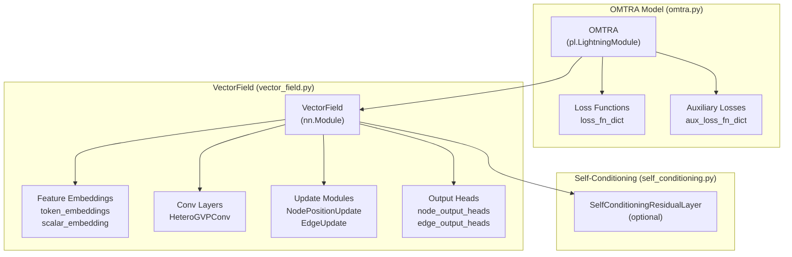
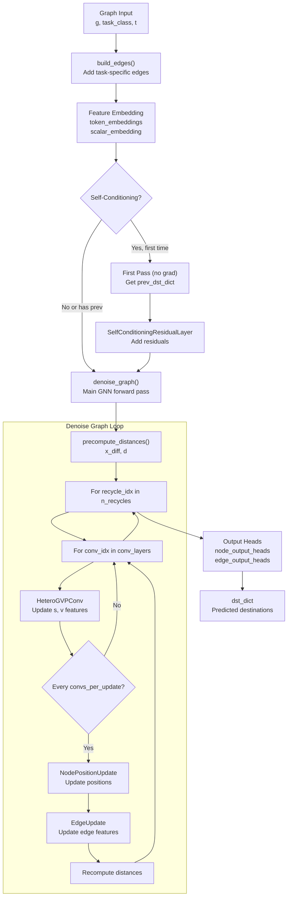
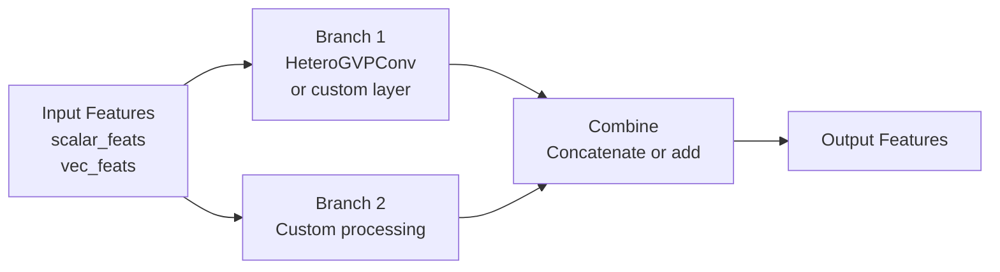
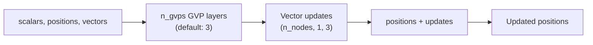
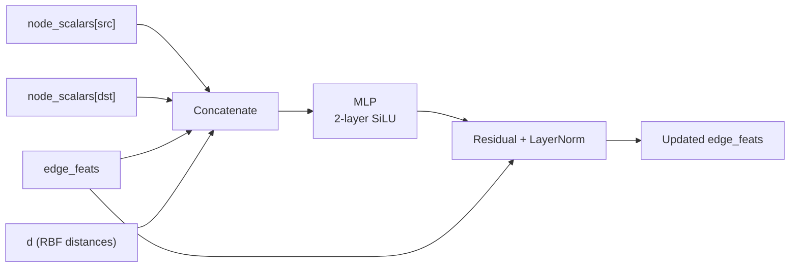
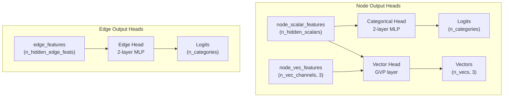
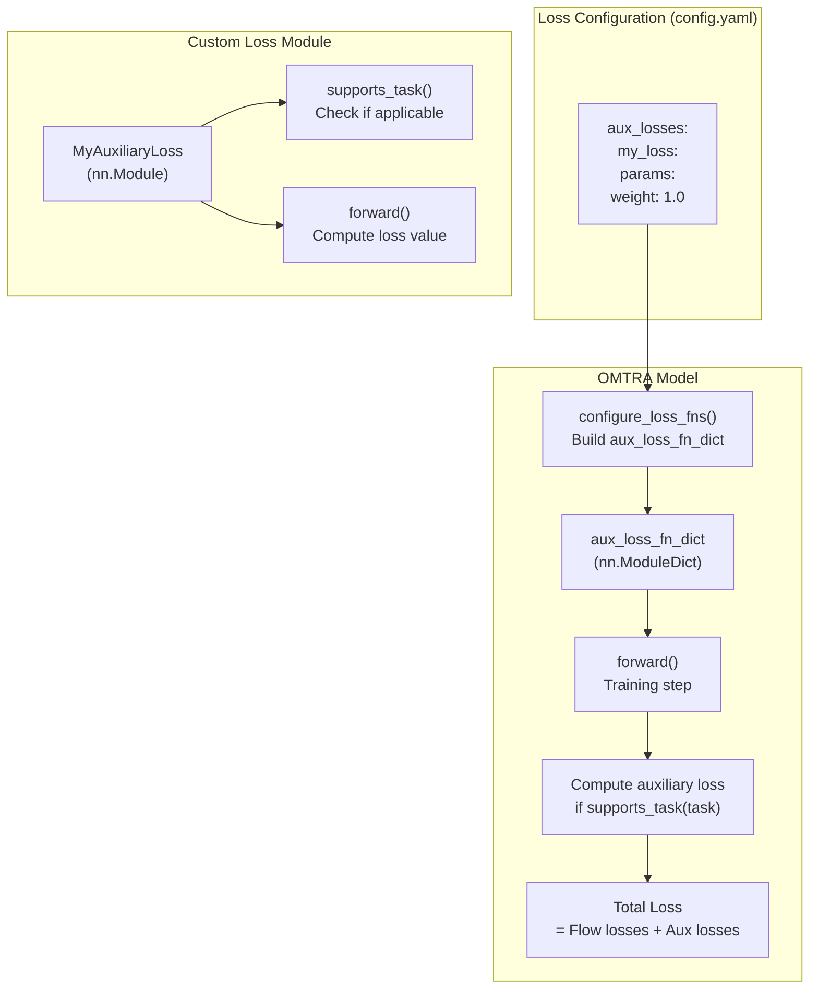
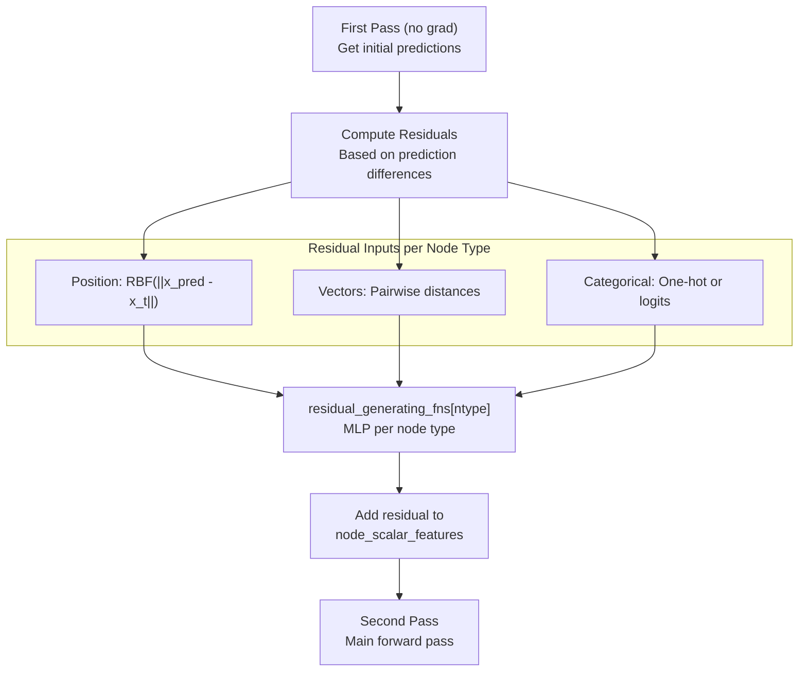

# Extending the Model Architecture

<details>
<summary>Relevant source files</summary>

The following files were used as context for generating this wiki page:

- [omtra/models/omtra.py](omtra/models/omtra.py)
- [omtra/models/self_conditioning.py](omtra/models/self_conditioning.py)
- [omtra/models/vector_field.py](omtra/models/vector_field.py)

</details>


This guide covers how to extend and customize the neural network architecture in OMTRA. It explains how to add new GNN layers, modify the VectorField, add custom output heads, and implement auxiliary losses. For creating custom tasks that define what the model generates, see [Creating Custom Tasks](#10.1). For implementing custom prior distributions, see [Custom Priors and Conditional Paths](#10.2).

## Architecture Overview

The OMTRA model consists of several modular components that can be extended independently:



**Sources:** [omtra/models/omtra.py:55-172](), [omtra/models/vector_field.py:40-358](), [omtra/models/self_conditioning.py:18-85]()

The main components are:

| Component | File | Purpose | Extension Point |
|-----------|------|---------|-----------------|
| `VectorField` | `vector_field.py` | Core GNN architecture | Add layers, modify architecture |
| `HeteroGVPConv` | `gvp.py` | GNN convolution layers | Replace with custom convs |
| `NodePositionUpdate` | `vector_field.py:1181-1211` | Update node positions | Modify update mechanism |
| `EdgeUpdate` | `vector_field.py:1213-1247` | Update edge features | Modify edge updates |
| Output Heads | `vector_field.py:302-344` | Predict final values | Add custom heads |
| Auxiliary Losses | `aux_losses/` | Additional training objectives | Add custom losses |
| `SelfConditioningResidualLayer` | `self_conditioning.py` | Refinement mechanism | Modify residual connections |

## VectorField Architecture Flow

The `VectorField` is the core neural network that predicts trajectory destinations. Understanding its flow is essential for extensions.



**Sources:** [omtra/models/vector_field.py:359-564](), [omtra/models/vector_field.py:567-741]()

## Adding New GNN Layers

### Replacing HeteroGVPConv

The `VectorField` uses `HeteroGVPConv` layers by default. To use a different GNN layer:

**1. Define your custom layer:**

Create a new module that matches the expected interface:

```python
# In omtra/models/my_custom_conv.py
class MyCustomHeteroConv(nn.Module):
    def __init__(
        self,
        node_types: List[str],
        edge_types: List[str],
        scalar_size: int,
        vector_size: int,
        edge_feat_size: Dict[str, int],
        # ... other params
    ):
        super().__init__()
        # Your implementation
    
    def forward(
        self,
        g: dgl.DGLGraph,
        scalar_feats: Dict[str, torch.Tensor],
        coord_feats: Dict[str, torch.Tensor],
        vec_feats: Dict[str, torch.Tensor],
        edge_feats: Dict[str, torch.Tensor],
        x_diff: Dict[str, torch.Tensor],
        d: Dict[str, torch.Tensor],
    ) -> Tuple[Dict[str, torch.Tensor], Dict[str, torch.Tensor]]:
        # Return updated (scalar_feats, vec_feats)
        pass
```

**2. Modify VectorField to use your layer:**

In [omtra/models/vector_field.py:224-250](), replace the instantiation:

```python
# Instead of HeteroGVPConv
from omtra.models.my_custom_conv import MyCustomHeteroConv

self.conv_layers = []
for conv_idx in range(convs_per_update * n_molecule_updates):
    self.conv_layers.append(
        MyCustomHeteroConv(
            node_types=self.node_types,
            edge_types=self.edge_types,
            scalar_size=n_hidden_scalars,
            vector_size=n_vec_channels,
            edge_feat_size=self.edge_feat_sizes,
            # ... your params
        )
    )
self.conv_layers = nn.ModuleList(self.conv_layers)
```

**Key requirements for custom convolution layers:**
- Must handle heterogeneous graphs with multiple node and edge types
- Must accept and return both scalar and vector features per node type
- Must preserve the dictionary structure: `Dict[str, torch.Tensor]`
- Should handle the case where some node types have 0 nodes

**Sources:** [omtra/models/vector_field.py:224-250](), [omtra/models/vector_field.py:584-593]()

### Adding Parallel Convolution Branches

To add parallel processing branches (e.g., separate pathways for different modalities):



Modify [omtra/models/vector_field.py:584-593]():

```python
# In denoise_graph method
for conv_idx, conv in enumerate(self.conv_layers):
    # Main branch
    node_scalar_features, node_vec_features = conv(
        g, scalar_feats=node_scalar_features,
        coord_feats=node_positions,
        vec_feats=node_vec_features,
        edge_feats=edge_features,
        x_diff=x_diff, d=d,
    )
    
    # Add parallel branch processing
    if hasattr(self, 'parallel_branch'):
        parallel_scalars = self.parallel_branch(node_scalar_features)
        for ntype in node_scalar_features:
            node_scalar_features[ntype] = node_scalar_features[ntype] + parallel_scalars[ntype]
```

**Sources:** [omtra/models/vector_field.py:567-665]()

## Modifying Update Mechanisms

### Customizing NodePositionUpdate

The `NodePositionUpdate` module updates node positions between convolutions. To customize:

**Current implementation:**



**Sources:** [omtra/models/vector_field.py:1181-1210]()

**Customization options:**

1. **Change the number of GVP layers:** Modify `n_gvps` parameter in [omtra/models/vector_field.py:270-277]()

2. **Add residual connections:**

```python
class CustomNodePositionUpdate(nn.Module):
    def forward(self, scalars, positions, vectors):
        _, vector_updates = self.gvps((scalars, vectors))
        
        # Add residual scaling
        scale = torch.sigmoid(self.scale_mlp(scalars))
        scaled_updates = vector_updates.squeeze(1) * scale.unsqueeze(-1)
        
        return positions + scaled_updates
```

3. **Add constraints:** E.g., to keep positions near center of mass:

```python
def forward(self, scalars, positions, vectors):
    _, vector_updates = self.gvps((scalars, vectors))
    new_positions = positions + vector_updates.squeeze(1)
    
    # Constrain to zero COM
    com = new_positions.mean(dim=0, keepdim=True)
    return new_positions - com
```

**Integration:** Replace in [omtra/models/vector_field.py:616-623]()

**Sources:** [omtra/models/vector_field.py:1181-1210](), [omtra/models/vector_field.py:260-277]()

### Customizing EdgeUpdate

The `EdgeUpdate` module updates edge features. Current architecture:



**Sources:** [omtra/models/vector_field.py:1213-1247]()

**Customization example - Add attention:**

```python
class AttentionEdgeUpdate(nn.Module):
    def __init__(self, n_node_scalars, n_edge_feats, rbf_dim):
        super().__init__()
        
        self.attention = nn.MultiheadAttention(
            embed_dim=n_node_scalars,
            num_heads=4,
            batch_first=True
        )
        
        self.edge_update_fn = nn.Sequential(
            nn.Linear(n_node_scalars * 2 + n_edge_feats + rbf_dim, n_edge_feats),
            nn.SiLU(),
        )
        self.edge_norm = nn.LayerNorm(n_edge_feats)
    
    def forward(self, g, node_scalars, edge_feats, d, etype):
        src_ntype, _, dst_ntype = to_canonical_etype(etype)
        src_idxs, dst_idxs = g.edges(etype=etype)
        
        # Apply attention
        src_feats_attended, _ = self.attention(
            node_scalars[src_ntype][src_idxs].unsqueeze(1),
            node_scalars[dst_ntype][dst_idxs].unsqueeze(1),
            node_scalars[dst_ntype][dst_idxs].unsqueeze(1)
        )
        
        mlp_inputs = [
            src_feats_attended.squeeze(1),
            node_scalars[dst_ntype][dst_idxs],
            edge_feats,
            d
        ]
        
        edge_feats = self.edge_norm(
            edge_feats + self.edge_update_fn(torch.cat(mlp_inputs, dim=-1))
        )
        return edge_feats
```

**Sources:** [omtra/models/vector_field.py:1213-1247](), [omtra/models/vector_field.py:640-656]()

## Adding Custom Output Heads

Output heads convert the final GNN features to predictions for each modality. The system automatically creates heads for all modalities being generated.

### Output Head Architecture



**Sources:** [omtra/models/vector_field.py:302-344](), [omtra/models/vector_field.py:666-730]()

### Adding a Custom Output Head

**1. Define the modality** (if not already defined - see [Creating Custom Tasks](#10.1))

**2. Add the output head in VectorField initialization:**

In [omtra/models/vector_field.py:302-332](), add your custom head:

```python
# Example: Add a custom head for a new continuous node feature
for m in modalities_generated_cls:
    is_node = m.graph_entity == "node"
    if not is_node:
        continue
    
    if m.name == "my_custom_feature":
        # Custom architecture for your feature
        self.node_output_heads[m.name] = nn.Sequential(
            GVP(
                dim_feats_in=n_hidden_scalars,
                dim_vectors_in=n_vec_channels,
                dim_feats_out=n_hidden_scalars // 2,
                dim_vectors_out=n_vec_channels // 2,
            ),
            nn.Linear(n_hidden_scalars // 2, my_custom_output_dim)
        )
```

**3. Add prediction logic in denoise_graph:**

In [omtra/models/vector_field.py:666-730](), add how to compute predictions:

```python
for m in task_class.modalities_generated:
    # ... existing code ...
    
    elif m.name == "my_custom_feature":
        ntype = m.entity_name
        s_in = node_scalar_features[ntype]
        v_in = node_vec_features[ntype]
        
        # Use your custom head
        custom_output = self.node_output_heads[m.name]((s_in, v_in))
        dst_dict[m.name] = custom_output
```

### Multi-Head Output Example

For features requiring multiple prediction heads (e.g., mean and variance):

```python
class MultiHeadOutput(nn.Module):
    def __init__(self, input_dim, output_dim):
        super().__init__()
        self.mean_head = nn.Linear(input_dim, output_dim)
        self.var_head = nn.Sequential(
            nn.Linear(input_dim, output_dim),
            nn.Softplus()  # Ensure positive variance
        )
    
    def forward(self, x):
        mean = self.mean_head(x)
        var = self.var_head(x)
        return mean, var
```

**Sources:** [omtra/models/vector_field.py:302-344](), [omtra/models/vector_field.py:709-730]()

## Adding Auxiliary Losses

Auxiliary losses supplement the main flow matching losses with additional training objectives. The system supports modular auxiliary losses that can be enabled/disabled via configuration.

### Auxiliary Loss Integration



**Sources:** [omtra/models/omtra.py:226-266](), [omtra/models/omtra.py:501-514]()

### Implementing a Custom Auxiliary Loss

**1. Create the loss class:**

Create a new file in `omtra/aux_losses/my_custom_loss.py`:

```python
import torch
import torch.nn as nn
from typing import Dict
import dgl
from omtra.tasks.tasks import Task

class MyCustomAuxiliaryLoss(nn.Module):
    """
    Description of what this loss does and why it's useful.
    """
    
    def __init__(self, weight: float = 1.0, **kwargs):
        super().__init__()
        self.weight = weight
        # Initialize any learnable parameters or constants
    
    def supports_task(self, task: Task) -> bool:
        """
        Determine if this loss applies to the given task.
        
        Args:
            task: The Task being trained
            
        Returns:
            True if this loss should be computed for this task
        """
        # Example: only apply if generating ligand structure
        return 'ligand_structure' in task.groups_generated
    
    def forward(
        self,
        g: dgl.DGLHeteroGraph,
        vf_output: Dict[str, torch.Tensor],
        task: Task,
        node_batch_idxs: Dict[str, torch.Tensor],
        lig_ue_mask: torch.Tensor,
        time_weights: Optional[torch.Tensor] = None,
    ) -> torch.Tensor:
        """
        Compute the auxiliary loss.
        
        Args:
            g: Input graph with ground truth data
            vf_output: Predictions from VectorField (dst_dict)
            task: The current task
            node_batch_idxs: Batch indices for each node type
            lig_ue_mask: Upper edge mask for ligand edges
            time_weights: Optional time-dependent loss weights
            
        Returns:
            Loss value (scalar tensor)
        """
        # Example: Penalize unrealistic bond lengths
        if g.num_nodes('lig') == 0:
            return torch.tensor(0.0, device=g.device)
        
        predicted_positions = vf_output['lig_x']
        
        # Compute pairwise distances
        src_idxs, dst_idxs = g.edges(etype='lig_to_lig')
        edge_mask = lig_ue_mask  # Only upper triangle
        
        src_pos = predicted_positions[src_idxs[edge_mask]]
        dst_pos = predicted_positions[dst_idxs[edge_mask]]
        distances = torch.norm(src_pos - dst_pos, dim=-1)
        
        # Penalize distances outside reasonable range (e.g., 0.8-2.0 Å)
        min_dist = 0.8
        max_dist = 2.0
        
        too_short = torch.relu(min_dist - distances)
        too_long = torch.relu(distances - max_dist)
        
        loss = (too_short.pow(2).mean() + too_long.pow(2).mean()) * self.weight
        
        # Apply time weighting if provided
        if time_weights is not None:
            time_w = time_weights[node_batch_idxs['lig']]
            loss = (loss * time_w).mean()
        
        return loss
```

**2. Register the loss:**

In `omtra/aux_losses/register.py`:

```python
from omtra.aux_losses.my_custom_loss import MyCustomAuxiliaryLoss

AUX_LOSS_REGISTRY = {
    # ... existing losses ...
    "my_custom_loss": MyCustomAuxiliaryLoss,
}

def aux_loss_name_to_class(name: str):
    if name not in AUX_LOSS_REGISTRY:
        raise ValueError(f"Unknown auxiliary loss: {name}")
    return AUX_LOSS_REGISTRY[name]
```

**3. Add to configuration:**

In `configs/config.yaml` or your custom config:

```yaml
model:
  aux_losses:
    my_custom_loss:
      params:
        weight: 0.5
```

**Key points for auxiliary losses:**
- Must inherit from `nn.Module`
- Must implement `supports_task(task: Task) -> bool`
- Must implement `forward()` with the signature shown above
- Should return a scalar tensor
- Should handle cases where relevant nodes/edges don't exist
- Can use `time_weights` for time-scaled loss if needed

**Sources:** [omtra/models/omtra.py:260-266](), [omtra/models/omtra.py:501-514](), [omtra/aux_losses/register.py]()

### Common Auxiliary Loss Patterns

| Loss Type | Purpose | Key Access Patterns |
|-----------|---------|-------------------|
| Geometry | Enforce physical constraints | `vf_output['lig_x']`, compute distances |
| Chemistry | Enforce chemical rules | `vf_output['lig_a']`, `vf_output['lig_e']` |
| Consistency | Match related features | Compare multiple modalities in `vf_output` |
| Regularization | Control model behavior | Use `g.nodes[ntype].data` for intermediate features |
| Reconstruction | Match ground truth | Compare `vf_output` to `g.nodes[ntype].data['*_1_true']` |

## Modifying Self-Conditioning

The `SelfConditioningResidualLayer` adds residual connections based on a first-pass prediction. This can improve generation quality.

### Self-Conditioning Flow



**Sources:** [omtra/models/self_conditioning.py:86-199](), [omtra/models/vector_field.py:489-541]()

### Customizing Residual Computation

To modify how residuals are computed from predictions:

In [omtra/models/self_conditioning.py:100-152](), the residuals are built per modality:

```python
# Example: Add custom residual for a new modality
if m.name == "my_custom_feature":
    if m_generated:
        # Compute difference between prediction and current state
        diff = dst_dict[m.name] - g.nodes[ntype].data[f'{m.data_key}_t']
        
        # Transform to residual input
        # Option 1: Direct difference
        node_res_input = diff
        
        # Option 2: Norm of difference
        node_res_input = torch.norm(diff, dim=-1, keepdim=True)
        
        # Option 3: Custom transformation
        node_res_input = self.my_transform_fn(diff)
    else:
        # Feature not generated, use zeros
        node_res_input = torch.zeros(...)
    
    node_residual_inputs[ntype].append(node_res_input)
```

### Adding Cross-Modality Residuals

To add residuals that combine information across modalities:

```python
class EnhancedSelfConditioningLayer(SelfConditioningResidualLayer):
    def __init__(self, *args, **kwargs):
        super().__init__(*args, **kwargs)
        
        # Add cross-modality transformer
        self.cross_modality_attention = nn.MultiheadAttention(
            embed_dim=self.node_embedding_dim,
            num_heads=4
        )
    
    def forward(self, g, task, s_t, x_t, v_t, e_t, dst_dict, node_batch_idx, upper_edge_mask):
        # Compute base residuals
        node_feats_out, positions_out, vectors_out, edge_feats_out = super().forward(
            g, task, s_t, x_t, v_t, e_t, dst_dict, node_batch_idx, upper_edge_mask
        )
        
        # Add cross-modality attention for ligand nodes
        if 'lig' in node_feats_out and 'prot_atom' in node_feats_out:
            lig_feats_attended, _ = self.cross_modality_attention(
                node_feats_out['lig'].unsqueeze(1),
                node_feats_out['prot_atom'].unsqueeze(1),
                node_feats_out['prot_atom'].unsqueeze(1)
            )
            node_feats_out['lig'] = node_feats_out['lig'] + lig_feats_attended.squeeze(1)
        
        return node_feats_out, positions_out, vectors_out, edge_feats_out
```

**Sources:** [omtra/models/self_conditioning.py:86-199]()

## Configuration Patterns

### Configuring Architecture via Hydra

The model architecture is configured through Hydra configs. Key configuration locations:

```yaml
# In configs/model/vector_field.yaml
vector_field:
  _target_: omtra.models.vector_field.VectorField
  n_hidden_scalars: 64
  n_vec_channels: 16
  n_recycles: 1
  n_molecule_updates: 3
  convs_per_update: 2
  n_message_gvps: 3
  n_update_gvps: 3
  attention: false
  dropout: 0.1
  self_conditioning: true
  rebuild_edges: false

# In configs/config.yaml
model:
  _target_: omtra.models.omtra.OMTRA
  vector_field: ${model.vector_field}
  aux_losses:
    my_custom_loss:
      params:
        weight: 0.5
```

### Adding Configurable Components

To make your extensions configurable:

```python
# In your custom module
class MyCustomComponent(nn.Module):
    def __init__(
        self,
        input_dim: int,
        output_dim: int,
        n_layers: int = 3,
        activation: str = "silu",
        use_layer_norm: bool = True,
    ):
        super().__init__()
        
        activation_fn = {
            "silu": nn.SiLU(),
            "relu": nn.ReLU(),
            "gelu": nn.GELU(),
        }[activation]
        
        layers = []
        for i in range(n_layers):
            layers.append(nn.Linear(input_dim, output_dim))
            layers.append(activation_fn)
            if use_layer_norm:
                layers.append(nn.LayerNorm(output_dim))
        
        self.mlp = nn.Sequential(*layers)
```

Then in your config:

```yaml
my_component:
  _target_: omtra.models.my_module.MyCustomComponent
  input_dim: 64
  output_dim: 64
  n_layers: 3
  activation: silu
  use_layer_norm: true
```

**Sources:** [omtra/models/omtra.py:56-84](), [omtra/models/vector_field.py:41-76]()

## Testing Your Extensions

When extending the architecture, ensure your modifications:

1. **Maintain heterograph compatibility**: Handle `Dict[str, torch.Tensor]` for node/edge features
2. **Handle empty graphs**: Check for `g.num_nodes(ntype) == 0` or `g.num_edges(etype) == 0`
3. **Support all tasks**: Test with different task configurations from your `td_coupling`
4. **Work with time-scaled loss**: If applicable, handle the `time_weights` parameter
5. **Are device-agnostic**: Use `device=g.device` for tensor creation

### Example Testing Pattern

```python
# Test your extension
def test_my_custom_loss():
    from omtra.tasks.tasks import DeNovoLigand
    import dgl
    
    # Create a minimal graph
    g = build_complex_graph(
        node_data={'lig': {'x_1_true': torch.randn(10, 3)}},
        edge_idxs={'lig_to_lig': (src_ids, dst_ids)},
        edge_data={}
    )
    
    # Create mock predictions
    vf_output = {'lig_x': torch.randn(10, 3)}
    
    # Instantiate your loss
    loss_fn = MyCustomAuxiliaryLoss(weight=1.0)
    
    # Check it supports the task
    task = DeNovoLigand
    assert loss_fn.supports_task(task)
    
    # Compute loss
    node_batch_idxs = {'lig': torch.zeros(10, dtype=torch.long)}
    lig_ue_mask = torch.ones(g.num_edges('lig_to_lig'), dtype=torch.bool)
    
    loss = loss_fn(g, vf_output, task, node_batch_idxs, lig_ue_mask)
    
    assert loss.shape == torch.Size([])
    assert loss.requires_grad
```

**Sources:** [omtra/models/omtra.py:386-515]()

---