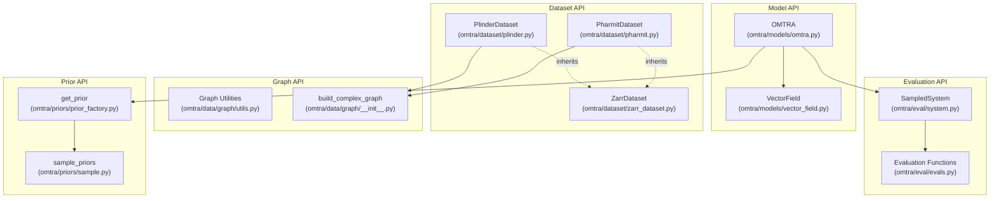
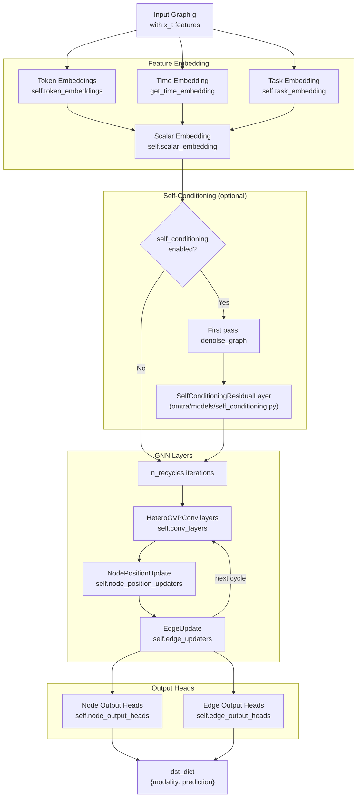
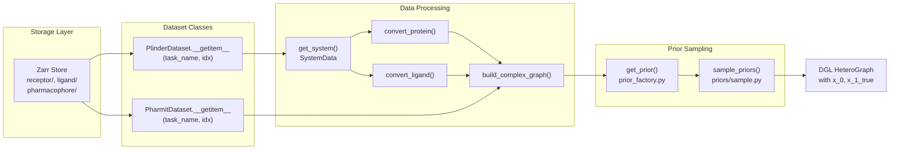
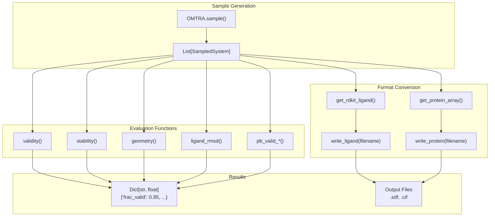
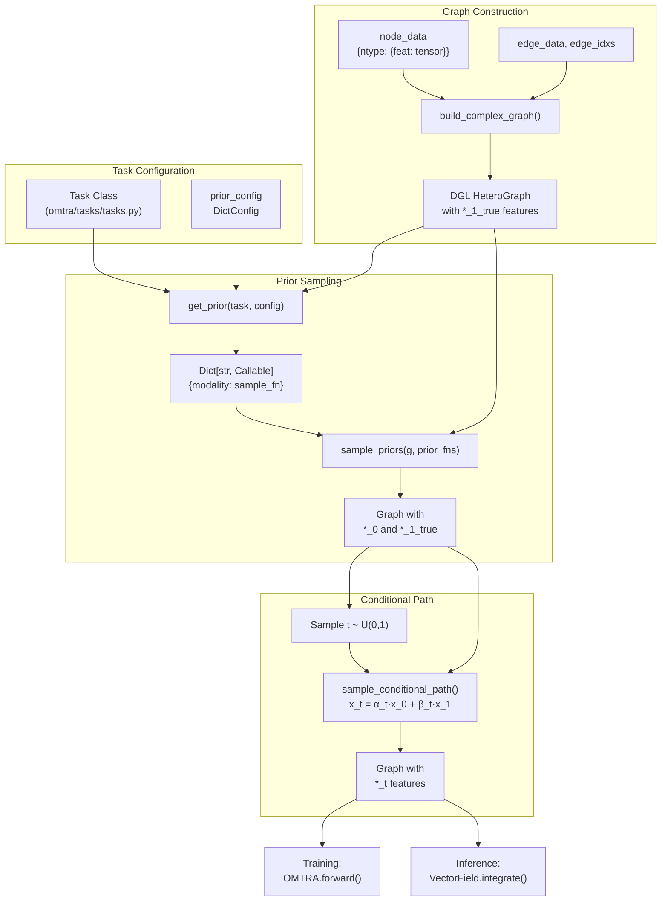

# API Reference

<details>
<summary>Relevant source files</summary>

The following files were used as context for generating this wiki page:

- [configs/eval/default.yaml](configs/eval/default.yaml)
- [omtra/data/graph/utils.py](omtra/data/graph/utils.py)
- [omtra/dataset/pharmit.py](omtra/dataset/pharmit.py)
- [omtra/dataset/plinder.py](omtra/dataset/plinder.py)
- [omtra/eval/evals.py](omtra/eval/evals.py)
- [omtra/eval/system.py](omtra/eval/system.py)
- [omtra/eval/utils.py](omtra/eval/utils.py)
- [omtra/models/omtra.py](omtra/models/omtra.py)
- [omtra/models/self_conditioning.py](omtra/models/self_conditioning.py)
- [omtra/models/vector_field.py](omtra/models/vector_field.py)
- [omtra/tasks/tasks.py](omtra/tasks/tasks.py)
- [routines/sample.py](routines/sample.py)

</details>


This page provides comprehensive API documentation for the core classes, functions, and interfaces in OMTRA. It covers the programmatic interfaces for model initialization, data loading, sampling, and evaluation. For higher-level conceptual information about these components, see [Overview](#1). For practical usage examples, see [Quick Start Examples](#2.3).

## API Organization

The OMTRA API is organized into four main areas:

- **Core Model API** ([11.1](#11.1)): Model classes for training and inference
- **Dataset API** ([11.2](#11.2)): Data loading and graph construction
- **Evaluation API** ([11.3](#11.3)): System output and metric computation
- **Graph and Prior APIs** ([11.4](#11.4)): Graph utilities and prior sampling

## Primary API Entry Points



**Sources:** [omtra/models/omtra.py:55-1191](), [omtra/models/vector_field.py:40-752](), [omtra/dataset/plinder.py:53-808](), [omtra/dataset/pharmit.py:24-287](), [omtra/eval/system.py:38-871]()

---

## Core Model Classes and Methods

### OMTRA Class

The main generative model class that orchestrates training and sampling.

**Location:** [omtra/models/omtra.py:55-1191]()

#### Constructor

```python
class OMTRA(pl.LightningModule):
    def __init__(
        self,
        task_phases: Dict,
        task_dataset_coupling: TaskDatasetCoupling,
        dists_file: str,
        graph_config: DictConfig,
        conditional_paths: DictConfig,
        optimizer: DictConfig,
        vector_field: DictConfig,
        aux_losses: DictConfig,
        total_loss_weights: Dict[str, float] = {},
        ligand_encoder: DictConfig = DictConfig({}),
        ligand_encoder_checkpoint: Optional[str] = None,
        prior_config: Optional[DictConfig] = None,
        k_checkpoints: int = 20,
        checkpoint_interval: int = 1000,
        og_run_dir: Optional[str] = None,
        fake_atom_p: float = 0.0,
        distort_p: float = 0.0,
        eval_config: Optional[DictConfig] = None,
        zero_bo_loss_weight: float = 1.0,
        train_t_dist: str = 'uniform',
        t_alpha: float = 1.8,
        cat_loss_weight: float = 1.0,
        time_scaled_loss: bool = False,
        pharm_var: float = 0.0,
        lr_warmup_steps: int = 0,
    )
```

**Key Parameters:**

| Parameter | Type | Description |
|-----------|------|-------------|
| `task_phases` | `Dict` | Task phase configuration for multi-task training |
| `task_dataset_coupling` | `TaskDatasetCoupling` | Mapping between tasks and datasets |
| `graph_config` | `DictConfig` | Configuration for graph construction (edge types, builders) |
| `conditional_paths` | `DictConfig` | Configuration for conditional path sampling functions |
| `vector_field` | `DictConfig` | Configuration for instantiating the VectorField GNN |
| `prior_config` | `DictConfig` | Configuration for prior distributions per modality |
| `fake_atom_p` | `float` | Probability of adding fake atoms (0.0-1.0) |
| `time_scaled_loss` | `bool` | Whether to apply time-dependent loss scaling |

#### Key Methods

##### forward

```python
def forward(
    self, 
    g: dgl.DGLHeteroGraph, 
    task_name: str
) -> Dict[str, torch.Tensor]
```

Performs a single forward pass for training. Samples time `t`, applies conditional path sampling, runs VectorField, and computes losses.

**Parameters:**
- `g`: Batched heterogeneous graph with ground truth features
- `task_name`: Name of the task (e.g., `"denovo_ligand"`)

**Returns:** Dictionary mapping modality names to loss values

**Sources:** [omtra/models/omtra.py:386-516]()

##### sample

```python
@torch.no_grad()
def sample(
    self,
    task_name: str,
    g_list: Optional[List[dgl.DGLHeteroGraph]] = None,
    n_replicates: int = 1,
    coms: Optional[torch.Tensor] = None,
    unconditional_n_atoms_dist: str = None,
    n_timesteps: int = None,
    device: Optional[torch.device] = None,
    visualize: bool = False,
    extract_latents_for_confidence: bool = False,
    time_spacing: str = "even",
    stochastic_sampling: bool = False,
    noise_scaler: float = 1.0,
    eps: float = 0.01,
    n_lig_atom_margin: Union[float, None] = None,
    n_lig_atoms_mean: Union[float, None] = None,
    n_lig_atoms_std: Union[float, None] = None,
) -> List[SampledSystem]
```

Generates samples by integrating the vector field from `t=0` to `t=1`.

**Parameters:**

| Parameter | Type | Description |
|-----------|------|-------------|
| `task_name` | `str` | Task to sample for |
| `g_list` | `List[dgl.DGLHeteroGraph]` | Conditional graphs (None for unconditional tasks) |
| `n_replicates` | `int` | Number of samples per conditioning input |
| `n_timesteps` | `int` | Number of integration steps |
| `stochastic_sampling` | `bool` | Enable stochastic sampling with noise injection |
| `n_lig_atom_margin` | `float` | Margin for sampling n_atoms near ground truth |
| `visualize` | `bool` | Store intermediate trajectory states |

**Returns:** List of `SampledSystem` objects

**Sources:** [omtra/models/omtra.py:602-1001]()

##### sample_conditional_path

```python
def sample_conditional_path(
    self,
    g: dgl.DGLHeteroGraph,
    task_class: Task,
    t: torch.Tensor,
    node_batch_idxs: Dict[str, torch.Tensor],
    edge_batch_idxs: Dict[str, torch.Tensor],
    lig_ue_mask: torch.Tensor,
) -> dgl.DGLHeteroGraph
```

Samples intermediate states `x_t` along conditional paths between `x_0` (prior) and `x_1` (target).

**Returns:** Graph with `*_t` features added for all modalities

**Sources:** [omtra/models/omtra.py:542-600]()

---

### VectorField Class

The GNN architecture that predicts trajectory destinations.

**Location:** [omtra/models/vector_field.py:40-752]()

#### Constructor

```python
class VectorField(nn.Module):
    def __init__(
        self,
        interpolant_scheduler: InterpolantScheduler,
        td_coupling: TaskDatasetCoupling,
        graph_config: DictConfig,
        n_pharmvec_channels: int = 4,
        n_vec_channels: int = 16,
        n_cp_feats: int = 0,
        n_hidden_scalars: int = 64,
        n_hidden_edge_feats: int = 64,
        n_recycles: int = 1,
        n_molecule_updates: int = 1,
        convs_per_update: int = 2,
        n_message_gvps: int = 3,
        n_update_gvps: int = 3,
        n_expansion_gvps: int = 3,
        separate_mol_updaters: bool = True,
        message_norm: Union[float, str] = 100,
        rbf_dmax: int = 18,
        rbf_dim: int = 32,
        time_embedding_dim: int = 64,
        token_dim: int = 64,
        attention: bool = False,
        att_type: str = 'crosstype',
        n_heads: int = 1,
        s_message_dim: Optional[int] = None,
        v_message_dim: Optional[int] = None,
        dropout: float = 0.0,
        has_mask: bool = True,
        self_conditioning: bool = False,
        use_dst_feats: bool = False,
        dst_feat_msg_reduction_factor: float = 4,
        rebuild_edges: bool = False,
        fake_atoms: bool = False,
        res_id_embed_dim: int = 64
    )
```

**Key Parameters:**

| Parameter | Type | Description |
|-----------|------|-------------|
| `n_recycles` | `int` | Number of times to recycle through conv layers |
| `n_molecule_updates` | `int` | Number of position/edge update steps |
| `convs_per_update` | `int` | Conv layers between position updates |
| `n_hidden_scalars` | `int` | Dimension of node scalar features |
| `n_vec_channels` | `int` | Number of vector channels per node |
| `self_conditioning` | `bool` | Enable self-conditioning mechanism |
| `rbf_dim` | `int` | Dimension of RBF distance encoding |
| `token_dim` | `int` | Dimension of token embeddings |

#### Key Methods

##### forward

```python
def forward(
    self,
    g: dgl.DGLGraph,
    task_class: Task,
    t: torch.Tensor,
    node_batch_idx: Dict[str, torch.Tensor],
    upper_edge_mask: Dict[str, torch.Tensor],
    apply_softmax: bool = False,
    remove_com: bool = False,
    prev_dst_dict: Optional[Dict] = None,
    extract_latents_for_confidence: bool = False,
) -> Dict[str, torch.Tensor]
```

Predicts trajectory destination `x_1` given current state `x_t` at time `t`.

**Parameters:**
- `g`: Graph with `*_t` features populated
- `task_class`: Task defining modalities present/generated
- `t`: Time values for each graph in batch
- `node_batch_idx`: Batch indices for each node type
- `upper_edge_mask`: Mask for upper triangle edges per edge type
- `prev_dst_dict`: Previous predictions for self-conditioning

**Returns:** Dictionary mapping modality names to predictions (logits for categorical, coordinates for continuous)

**Sources:** [omtra/models/vector_field.py:359-564]()

##### integrate

```python
def integrate(
    self,
    g: dgl.DGLHeteroGraph,
    task_class: Task,
    n_timesteps: int,
    stochastic: bool = False,
    visualize: bool = False,
    **kwargs
) -> Tuple[dgl.DGLHeteroGraph, Optional[Dict]]
```

Integrates the vector field from `t=0` to `t=1` using Euler steps.

**Returns:** Final graph and optional trajectory dictionary

**Sources:** [omtra/models/vector_field.py:1003-1191]()

---

## VectorField Architecture Diagram



**Sources:** [omtra/models/vector_field.py:359-730](), [omtra/models/self_conditioning.py:18-229]()

---

## Dataset API Classes

### Base ZarrDataset

Abstract base class for Zarr-backed datasets.

**Location:** [omtra/dataset/zarr_dataset.py]()

#### Key Methods

```python
def slice_array(
    self, 
    path: str, 
    start: Optional[int] = None, 
    end: Optional[int] = None
) -> np.ndarray
```

Efficiently slices a Zarr array, utilizing chunk caching.

---

### PlinderDataset

Dataset for protein-ligand complexes from the Plinder database.

**Location:** [omtra/dataset/plinder.py:53-808]()

#### Constructor

```python
class PlinderDataset(ZarrDataset):
    def __init__(
        self,
        link_version: str,
        split: str,
        processed_data_dir: str,
        graph_config: Optional[DictConfig] = None,
        prior_config: Optional[DictConfig] = None,
        fake_atom_p: float = 0.0,
        pskip_factor: float = 0.0,
        res_id_embed_dim: int = 64,
        max_pharms_sampled: int = 8,
    )
```

**Parameters:**

| Parameter | Type | Description |
|-----------|------|-------------|
| `link_version` | `str` | Version of Plinder links (e.g., `"2024-06"`) |
| `split` | `str` | Data split: `"train"`, `"val"`, or `"test"` |
| `processed_data_dir` | `str` | Path to processed Zarr store |
| `pskip_factor` | `float` | Weighted sampling factor (0.0 = uniform) |
| `max_pharms_sampled` | `int` | Maximum pharmacophores to sample per system |

#### Key Methods

##### \_\_getitem\_\_

```python
def __getitem__(
    self, 
    index: Tuple[str, int]
) -> dgl.DGLHeteroGraph
```

Returns a graph for the given task and system index. The graph contains:
- Node features: `x_1_true`, `a_1_true`, `c_1_true`, etc.
- Edge features: `e_1_true` for bond types
- Prior samples: `x_0`, `a_0`, etc.

**Parameters:**
- `index`: Tuple of `(task_name, system_idx)`

**Returns:** Heterogeneous DGL graph ready for training

**Sources:** [omtra/dataset/plinder.py:690-808]()

##### get_system

```python
def get_system(
    self,
    index: int,
    include_pharmacophore: bool,
    include_protein: bool,
    include_extra_feats: bool,
    condensed_atom_typing: bool
) -> SystemData
```

Retrieves raw system data from Zarr store.

**Returns:** `SystemData` object with ligand, protein, pharmacophore data

**Sources:** [omtra/dataset/plinder.py:172-430]()

---

### PharmitDataset

Dataset for ligand conformers and pharmacophores from Pharmit.

**Location:** [omtra/dataset/pharmit.py:24-287]()

#### Constructor

```python
class PharmitDataset(ZarrDataset):
    def __init__(
        self, 
        split: str,
        processed_data_dir: str,
        graph_config: DictConfig,
        prior_config: DictConfig,
        fake_atom_p: float = 0.0,
        max_pharms_sampled: int = 8,
    )
```

#### Key Methods

##### \_\_getitem\_\_

```python
def __getitem__(
    self, 
    index: Tuple[str, int]
) -> dgl.DGLHeteroGraph
```

Returns a graph containing ligand and optional pharmacophore data.

**Sources:** [omtra/dataset/pharmit.py:74-231]()

---

## Dataset API Data Flow



**Sources:** [omtra/dataset/plinder.py:690-808](), [omtra/dataset/pharmit.py:74-231](), [omtra/priors/prior_factory.py](), [omtra/priors/sample.py]()

---

## Evaluation API

### SampledSystem Class

Container for generated molecular systems with conversion utilities.

**Location:** [omtra/eval/system.py:38-871]()

#### Constructor

```python
class SampledSystem:
    def __init__(
        self,
        g: dgl.DGLHeteroGraph,
        task: Task,
        traj: Dict[str, torch.Tensor] = None,
        fake_atoms: bool = False,
        ctmc_mol: bool = True,
        exclude_charges: bool = False,
        ligand_atom_type_map: List[str] = lig_atom_type_map,
        npnde_atom_type_map: List[str] = npnde_atom_type_map,
        protein_atom_type_map: List[str] = protein_atom_map,
        residue_map: List[str] = residue_map,
        bond_type_map: List[str] = bond_type_map,
        charge_map: List[int] = charge_map,
        protein_element_map: List[str] = protein_element_map,
        cond_a_typer: CondensedAtomTyper = None
    )
```

**Parameters:**
- `g`: Graph with generated features (`*_1` suffix)
- `task`: Task that generated this system
- `traj`: Optional trajectory dictionary for visualization
- `fake_atoms`: Whether fake atoms are present
- `cond_a_typer`: For decoding condensed atom types

#### Key Methods

##### get_rdkit_ligand

```python
def get_rdkit_ligand(
    self,
    reference: bool = False,
    add_hs: bool = False,
    show_fake_atoms: bool = False
) -> Chem.Mol
```

Converts ligand graph to RDKit molecule.

**Parameters:**
- `reference`: Use `*_1_true` (ground truth) instead of `*_1` (generated)
- `add_hs`: Add explicit hydrogens
- `show_fake_atoms`: Include fake atoms in output

**Returns:** RDKit `Mol` object or `None` if conversion fails

**Sources:** [omtra/eval/system.py:502-632]()

##### get_protein_array

```python
def get_protein_array(
    self,
    g: Optional[dgl.DGLHeteroGraph] = None,
    reference: bool = False,
    include_bonds: bool = True
) -> struc.AtomArray
```

Converts protein graph to Biotite AtomArray.

**Returns:** Biotite `AtomArray` with coordinates, residue info, bonds

**Sources:** [omtra/eval/system.py:373-406]()

##### write_ligand

```python
def write_ligand(
    self,
    filename: Union[str, Path],
    trajectory: bool = False,
    endpoint: bool = False,
    ground_truth: bool = False,
    g: Optional[dgl.DGLHeteroGraph] = None,
)
```

Writes ligand to SDF file.

**Parameters:**
- `trajectory`: Write full trajectory if available
- `endpoint`: If trajectory mode, write predicted endpoint (x_hat) vs observed (x_t)
- `ground_truth`: Write ground truth structure

**Sources:** [omtra/eval/system.py:703-770]()

##### write_protein

```python
def write_protein(
    self,
    filename: Union[str, Path],
    trajectory: bool = False,
    endpoint: bool = False,
    ground_truth: bool = False
)
```

Writes protein to CIF file.

**Sources:** [omtra/eval/system.py:772-814]()

---

### Evaluation Functions

Registered evaluation functions in [omtra/eval/evals.py:1-329]().

#### Function Registration

All evaluation functions are registered using the `@register_eval` decorator:

```python
from omtra.eval.register import register_eval

@register_eval("validity")
def validity(
    sampled_systems: List[SampledSystem], 
    params: Dict[str, Any]
) -> Dict[str, Any]:
    ...
```

#### Available Evaluation Functions

| Function Name | Purpose | Returns |
|---------------|---------|---------|
| `validity` | RDKit sanitization success rate | `frac_valid_mols`, `frac_connected`, `avg_num_components` |
| `stability` | Atom valency validity | `frac_atoms_stable`, `frac_mols_stable_valence` |
| `reos_and_rings` | REOS filter violations, ring system OOD | `flag_rate`, `ood_rate` |
| `geometry` | Bond/angle validity via PoseBusters | `geometry_frac_valid_bonds`, `geometry_frac_valid_angles` |
| `flatness` | Ring planarity | `flatness_max_distance_from_plane` |
| `intermolecular_distance` | Protein-ligand clash detection | `intermolecular_distance_smallest` |
| `ligand_rmsd` | RMSD to reference | `ligand_rmsd`, `ligand_kabsch_rmsd` |
| `volume_overlap` | Protein-ligand volume overlap | `volume_overlap` |
| `pb_valid_unconditional` | PoseBusters checks (no protein) | `pb_valid`, per-check metrics |
| `pb_valid_pocket` | PoseBusters checks (with protein) | `pb_valid_pocket` |
| `pb_valid_conformer` | PoseBusters for conformer generation | Per-check metrics |
| `pharm_match` | Pharmacophore matching rate | `pharm_match_rate` |

**Sources:** [omtra/eval/evals.py:37-329](), [configs/eval/default.yaml:1-730]()

#### Usage Example

```python
from omtra.eval.register import get_eval

# Get evaluation function
eval_fn = get_eval("validity")

# Compute metrics
metrics = eval_fn(sampled_systems, params={})
# Returns: {'frac_valid_mols': 0.95, 'frac_connected': 0.92, ...}
```

**Sources:** [omtra/eval/register.py]()

---

## Evaluation Pipeline Diagram



**Sources:** [omtra/eval/system.py:38-871](), [omtra/eval/evals.py:1-329](), [routines/sample.py:273-498]()

---

## Graph and Prior APIs

### Graph Construction

#### build_complex_graph

**Location:** [omtra/data/graph/__init__.py]()

```python
def build_complex_graph(
    node_data: Dict[str, Dict[str, torch.Tensor]],
    edge_idxs: Dict[str, torch.Tensor],
    edge_data: Dict[str, Dict[str, torch.Tensor]],
    task: Optional[Task] = None,
    graph_config: Optional[DictConfig] = None,
) -> dgl.DGLHeteroGraph
```

Constructs a heterogeneous DGL graph from node and edge data.

**Parameters:**
- `node_data`: Dict of `{ntype: {feature_name: tensor}}`
- `edge_idxs`: Dict of `{etype: edge_index_tensor}`
- `edge_data`: Dict of `{etype: {feature_name: tensor}}`
- `task`: Task object for determining edge types to build
- `graph_config`: Configuration for edge builders

**Returns:** `dgl.DGLHeteroGraph` with all node/edge features populated

**Sources:** [omtra/data/graph/__init__.py]()

#### Graph Utility Functions

**Location:** [omtra/data/graph/utils.py:1-150]()

```python
def get_upper_edge_mask(
    g: dgl.DGLHeteroGraph, 
    etype: str
) -> torch.Tensor
```

Returns boolean mask for upper triangle edges (where `src < dst`).

**Sources:** [omtra/data/graph/utils.py:36-38]()

```python
def get_batch_idxs(
    g: dgl.DGLHeteroGraph
) -> Tuple[Dict[str, torch.Tensor], Dict[str, torch.Tensor]]
```

Returns batch indices for nodes and edges.

**Returns:** `(node_batch_idxs, edge_batch_idxs)` dicts

**Sources:** [omtra/data/graph/utils.py:69-73]()

```python
def copy_graph(
    g: dgl.DGLHeteroGraph, 
    n_copies: int
) -> List[dgl.DGLHeteroGraph]
```

Creates independent copies of a graph with cloned features.

**Sources:** [omtra/data/graph/utils.py:101-138]()

```python
def build_lig_edge_idxs(
    n_atoms: int
) -> torch.Tensor
```

Generates fully-connected edge indices for ligand atoms (upper + lower triangle).

**Returns:** Tensor of shape `(2, 2*n_edges)` with edge indices

**Sources:** [omtra/data/graph/utils.py:141-149]()

---

### Prior Sampling

#### get_prior

**Location:** [omtra/priors/prior_factory.py]()

```python
def get_prior(
    task: Task,
    prior_config: DictConfig,
    training: bool = True
) -> Dict[str, Callable]
```

Factory function that returns prior sampling functions for each modality.

**Parameters:**
- `task`: Task defining which modalities need priors
- `prior_config`: Configuration specifying prior types per modality
- `training`: Whether priors are for training (affects some behaviors)

**Returns:** Dict mapping modality names to prior sampling functions

**Sources:** [omtra/priors/prior_factory.py]()

#### sample_priors

**Location:** [omtra/priors/sample.py]()

```python
def sample_priors(
    g: dgl.DGLHeteroGraph,
    task: Task,
    prior_fns: Dict[str, Callable],
    training: bool = True,
    com: Optional[torch.Tensor] = None,
    fake_atoms: bool = False
) -> dgl.DGLHeteroGraph
```

Populates graph with sampled prior values (`*_0` features).

**Parameters:**
- `g`: Graph to populate (modified in-place)
- `task`: Task defining modalities
- `prior_fns`: Dict from `get_prior()`
- `com`: Center of mass for positioning priors
- `fake_atoms`: Whether fake atoms are used

**Returns:** Modified graph with `*_0` features added

**Sources:** [omtra/priors/sample.py]()

#### Prior Types

Available prior types (configured in task definitions):

| Prior Type | Description | Used For |
|------------|-------------|----------|
| `gaussian` | Isotropic Gaussian | Ligand/protein positions |
| `ctmc_masked` | Categorical masked token | Atom types, bond orders |
| `target_dependent_gaussian` | Gaussian centered on target | Protein flexibility |
| `apo_exp` | Experimental apo structure | Apo-conditioned tasks |
| `apo_pred` | Predicted apo structure | Apo-conditioned tasks |

**Sources:** [omtra/tasks/tasks.py:1-226](), [omtra/priors/]()

---

## Prior and Graph API Flow



**Sources:** [omtra/priors/prior_factory.py](), [omtra/priors/sample.py](), [omtra/data/graph/__init__.py](), [omtra/models/omtra.py:542-600]()

---

## Task API

### Task Class

Base class for defining molecular generation tasks.

**Location:** [omtra/tasks/base_task.py]()

#### Task Attributes

All task classes define:

```python
class Task:
    groups_fixed: List[str]      # Modality groups held constant
    groups_generated: List[str]  # Modality groups to generate
    priors: Dict[str, Dict]      # Prior configuration per modality
    conditional_paths: Dict[str, str]  # Conditional path functions
```

#### Example Tasks

**Location:** [omtra/tasks/tasks.py:1-226]()

```python
@register_task("denovo_ligand")
class DeNovoLigand(Task):
    groups_fixed = []
    groups_generated = ['ligand_identity', 'ligand_structure']
    
@register_task("rigid_docking")
class RigidDocking(Task):
    groups_fixed = ["ligand_identity", "protein_identity", "protein_structure"]
    groups_generated = ["ligand_structure"]
    
@register_task("flexible_docking")
class FlexibleDocking(Task):
    groups_fixed = ['ligand_identity', 'protein_identity']
    groups_generated = ['ligand_structure', 'protein_structure']
```

#### Task Properties

```python
@property
def modalities_present(self) -> List[Modality]:
    """All modalities (fixed + generated)"""
    
@property
def modalities_generated(self) -> List[Modality]:
    """Only modalities being generated"""
    
@property
def modalities_fixed(self) -> List[Modality]:
    """Only modalities held fixed"""
```

**Sources:** [omtra/tasks/base_task.py](), [omtra/tasks/tasks.py:1-226]()

#### Accessing Tasks

```python
from omtra.tasks.register import task_name_to_class

task_class = task_name_to_class("rigid_docking")
print(task_class.groups_generated)  # ['ligand_structure']
```

**Sources:** [omtra/tasks/register.py]()

---

## Quick Loading Utilities

For convenient model and data loading.

**Location:** [omtra/load/quick.py]()

### omtra_from_checkpoint

```python
def omtra_from_checkpoint(
    checkpoint_path: Union[str, Path]
) -> OMTRA
```

Loads a trained OMTRA model from checkpoint.

**Parameters:**
- `checkpoint_path`: Path to `.ckpt` file

**Returns:** Loaded `OMTRA` model

**Sources:** [omtra/load/quick.py]()

### load_trained_model_cfg

```python
def load_trained_model_cfg(
    config_path: Union[str, Path]
) -> DictConfig
```

Loads the Hydra configuration from a trained model's directory.

**Parameters:**
- `config_path`: Path to `config.yaml` (typically in `.hydra/` subdirectory)

**Returns:** `OmegaConf` configuration object

**Sources:** [omtra/load/quick.py]()

---

## Constants and Mappings

Common constant definitions used throughout the API.

**Location:** [omtra/constants.py]()

### Atom Type Maps

```python
lig_atom_type_map: List[str]        # Ligand element symbols
npnde_atom_type_map: List[str]      # Non-polymer entity elements
protein_element_map: List[str]      # Protein element symbols
protein_atom_map: List[str]         # Protein atom names (CA, CB, etc.)
residue_map: List[str]              # Amino acid 3-letter codes
```

### Feature Maps

```python
bond_type_map: List[str]            # Bond types (SINGLE, DOUBLE, etc.)
charge_map: List[int]               # Formal charge values
ph_idx_to_type: Dict[int, str]      # Pharmacophore type mapping
```

### Distance Parameters

```python
DEFAULT_DISTANCE_RANGE: Dict[Tuple[str, str], Tuple[float, float]]
# Element-pair to (min_distance, max_distance) for covalent bonds
```

**Sources:** [omtra/constants.py]()

---

This API reference provides the core interfaces for using OMTRA programmatically. For conceptual overviews, see [Core Concepts](#3). For practical examples, see [Quick Start Examples](#2.3) and [Sampling and Inference](#8).

---