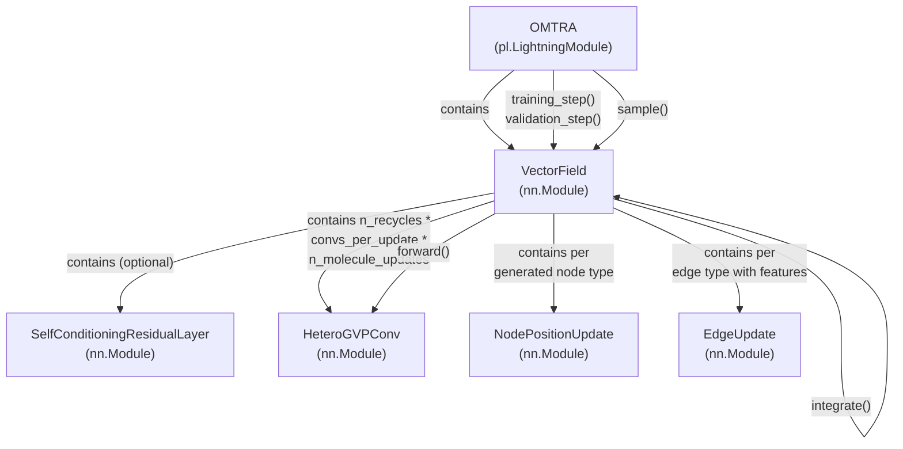
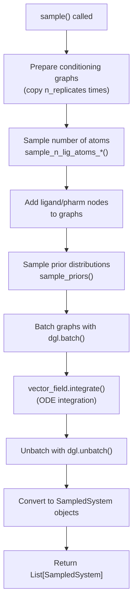
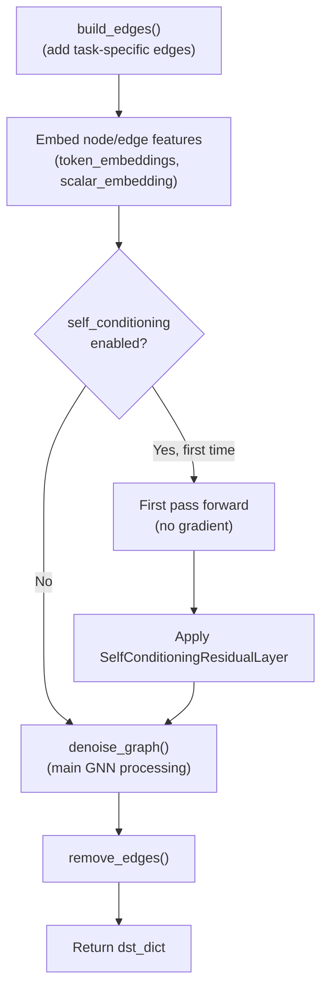
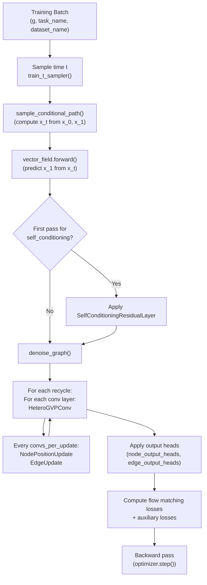

# Core Model API

<details>
<summary>Relevant source files</summary>

The following files were used as context for generating this wiki page:

- [omtra/models/omtra.py](omtra/models/omtra.py)
- [omtra/models/self_conditioning.py](omtra/models/self_conditioning.py)
- [omtra/models/vector_field.py](omtra/models/vector_field.py)

</details>


This page provides a comprehensive API reference for the core model components in OMTRA. It documents the class signatures, methods, and interfaces for the main generative model (`OMTRA`), the vector field architecture (`VectorField`), and supporting components.

For conceptual explanations of how these components work together, see [OMTRA Generative Model](#4.1), [VectorField Architecture](#4.2), and [Self-Conditioning Mechanism](#4.3). For information about loading and using trained models for inference, see [Sampling Pipeline](#8.1).

---

## Overview of Core Model Classes

The core model system consists of three primary classes:

| Class | File | Purpose |
|-------|------|---------|
| `OMTRA` | `omtra/models/omtra.py` | Main PyTorch Lightning module for training and sampling |
| `VectorField` | `omtra/models/vector_field.py` | GNN architecture that predicts trajectory destinations |
| `SelfConditioningResidualLayer` | `omtra/models/self_conditioning.py` | Optional self-conditioning mechanism for improved generation |

**Class Hierarchy and Relationships**



Sources: [omtra/models/omtra.py:55-186](), [omtra/models/vector_field.py:40-358](), [omtra/models/self_conditioning.py:18-85]()

---

## OMTRA Class

The `OMTRA` class is the main entry point for training and sampling. It inherits from `pytorch_lightning.LightningModule` and orchestrates the entire flow matching training loop.

### Constructor

```python
class OMTRA(pl.LightningModule):
    def __init__(
        self,
        task_phases,
        task_dataset_coupling,
        dists_file: str,
        graph_config: DictConfig,
        conditional_paths: DictConfig,
        optimizer: DictConfig,
        vector_field: DictConfig,
        aux_losses: DictConfig,
        total_loss_weights: Dict[str, float] = {},
        ligand_encoder: DictConfig = DictConfig({}),
        ligand_encoder_checkpoint: Optional[str] = None,
        prior_config: Optional[DictConfig] = None,
        k_checkpoints: int = 20,
        checkpoint_interval: int = 1000,
        og_run_dir: Optional[str] = None,
        fake_atom_p: float = 0.0,
        distort_p: float = 0.0,
        eval_config: Optional[DictConfig] = None,
        zero_bo_loss_weight: float = 1.0,
        train_t_dist: str = 'uniform',
        t_alpha: float = 1.8,
        cat_loss_weight: float = 1.0,
        time_scaled_loss: bool = False,
        pharm_var: float = 0.0,
        lr_warmup_steps: int = 0,
    )
```

**Key Parameters:**

| Parameter | Type | Description |
|-----------|------|-------------|
| `task_phases` | - | Task phase configuration for multi-task learning |
| `task_dataset_coupling` | - | Defines task-dataset pairings and probabilities |
| `graph_config` | `DictConfig` | Configuration for graph construction (edge types, builders) |
| `conditional_paths` | `DictConfig` | Configuration for conditional path functions per modality |
| `vector_field` | `DictConfig` | Hydra config for instantiating the `VectorField` |
| `prior_config` | `DictConfig` | Configuration for prior distributions |
| `time_scaled_loss` | `bool` | Whether to apply time-weighted loss scaling |
| `fake_atom_p` | `float` | Probability of adding fake atoms (0.0-1.0) |
| `train_t_dist` | `str` | Time sampling distribution: `'uniform'` or `'beta'` |

Sources: [omtra/models/omtra.py:56-84]()

### Key Methods

#### forward()

Performs a single training forward pass with flow matching loss computation.

```python
def forward(
    self, 
    g: dgl.DGLHeteroGraph, 
    task_name: str
) -> Dict[str, torch.Tensor]
```

**Returns:** Dictionary mapping modality names to their loss values.

**Workflow:**
1. Samples time `t` from the configured distribution
2. Samples conditional path using `sample_conditional_path()`
3. Calls `vector_field.forward()` to predict destinations
4. Computes flow matching losses for all generated modalities
5. Computes auxiliary losses

Sources: [omtra/models/omtra.py:386-516]()

#### sample()

Generates samples for a given task, either unconditionally or conditioned on provided graphs.

```python
@torch.no_grad()
def sample(
    self,
    task_name: str,
    g_list: Optional[List[dgl.DGLHeteroGraph]] = None,
    n_replicates: int = 1,
    coms: Optional[torch.Tensor] = None,
    unconditional_n_atoms_dist: str = None,
    n_timesteps: int = None,
    device: Optional[torch.device] = None,
    visualize: bool = False,
    extract_latents_for_confidence: bool = False,
    time_spacing: str = "even",
    stochastic_sampling: bool = False,
    noise_scaler: float = 1.0,
    eps: float = 0.01,
    n_lig_atom_margin: Union[float, None] = None,
    n_lig_atoms_mean: Union[float, None] = None,
    n_lig_atoms_std: Union[float, None] = None,
) -> List[SampledSystem]
```

**Key Parameters:**

| Parameter | Type | Description |
|-----------|------|-------------|
| `task_name` | `str` | Name of the task to sample (e.g., `'denovo_ligand'`) |
| `g_list` | `List[DGLGraph]` | Conditional graphs (None for unconditional tasks) |
| `n_replicates` | `int` | Number of samples per conditioning input |
| `n_timesteps` | `int` | Number of integration steps (default handled by VectorField) |
| `n_lig_atom_margin` | `float` | Margin for sampling ligand size near ground truth |
| `visualize` | `bool` | Whether to record trajectory frames |

**Returns:** List of `SampledSystem` objects containing generated molecules.

**Workflow:**



Sources: [omtra/models/omtra.py:602-940]()

#### sample_in_batches()

Memory-efficient batch sampling for large-scale generation.

```python
@torch.no_grad()
def sample_in_batches(
    self,
    task_name: str,
    g_list: Optional[List[dgl.DGLHeteroGraph]] = None,
    n_replicates: int = 1,
    max_batch_size: int = 500,
    # ... same parameters as sample()
) -> List[SampledSystem]
```

Splits sampling into chunks of size `max_batch_size` to avoid OOM errors.

Sources: [omtra/models/omtra.py:942-1036]()

#### training_step()

PyTorch Lightning training step.

```python
def training_step(
    self, 
    batch_data, 
    batch_idx
) -> torch.Tensor
```

Unpacks batch as `(g, task_name, dataset_name)`, calls `forward()`, logs metrics, and returns total loss.

Sources: [omtra/models/omtra.py:269-322]()

#### validation_step()

PyTorch Lightning validation step that samples and evaluates.

```python
def validation_step(
    self, 
    batch_data, 
    batch_idx
) -> float
```

Sources: [omtra/models/omtra.py:324-383]()

---

## VectorField Class

The `VectorField` class implements the heterogeneous GNN architecture that predicts trajectory destinations given the current state.

### Constructor

```python
class VectorField(nn.Module):
    def __init__(
        self,
        interpolant_scheduler: InterpolantScheduler,
        td_coupling: TaskDatasetCoupling,
        graph_config: DictConfig,
        n_pharmvec_channels: int = 4,
        n_vec_channels: int = 16,
        n_cp_feats: int = 0,
        n_hidden_scalars: int = 64,
        n_hidden_edge_feats: int = 64,
        n_recycles: int = 1,
        n_molecule_updates: int = 1,
        convs_per_update: int = 2,
        n_message_gvps: int = 3,
        n_update_gvps: int = 3,
        n_expansion_gvps: int = 3,
        separate_mol_updaters: bool = True,
        message_norm: Union[float, str] = 100,
        rbf_dmax: int = 18,
        rbf_dim: int = 32,
        time_embedding_dim: int = 64,
        token_dim: int = 64,
        attention: bool = False,
        att_type: str = 'crosstype',
        n_heads: int = 1,
        s_message_dim: Optional[int] = None,
        v_message_dim: Optional[int] = None,
        dropout: float = 0.0,
        has_mask: bool = True,
        self_conditioning: bool = False,
        use_dst_feats: bool = False,
        dst_feat_msg_reduction_factor: float = 4,
        rebuild_edges: bool = False,
        fake_atoms: bool = False,
        res_id_embed_dim: int = 64
    )
```

**Key Architecture Parameters:**

| Parameter | Type | Description |
|-----------|------|-------------|
| `n_recycles` | `int` | Number of times to recycle through all conv layers |
| `n_molecule_updates` | `int` | Number of position/edge update cycles |
| `convs_per_update` | `int` | GNN convolutions between position updates |
| `n_hidden_scalars` | `int` | Dimension of node scalar features |
| `n_vec_channels` | `int` | Number of vector channels per node |
| `token_dim` | `int` | Dimension of categorical token embeddings |
| `self_conditioning` | `bool` | Whether to use self-conditioning |

**Total number of convolutions:** `n_recycles * n_molecule_updates * convs_per_update`

Sources: [omtra/models/vector_field.py:41-76]()

### Key Methods

#### forward()

Predicts trajectory destinations given current state `x_t`.

```python
def forward(
    self,
    g: dgl.DGLGraph,
    task_class: Task,
    t: torch.Tensor,
    node_batch_idx: Dict[str, torch.Tensor],
    upper_edge_mask: Dict[str, torch.Tensor],
    apply_softmax: bool = False,
    remove_com: bool = False,
    prev_dst_dict: Optional[Dict] = None,
    extract_latents_for_confidence: bool = False,
) -> Dict[str, torch.Tensor]
```

**Returns:** Dictionary `dst_dict` mapping modality names to predicted destinations.

**Workflow:**



Sources: [omtra/models/vector_field.py:359-564]()

#### denoise_graph()

The core GNN processing loop.

```python
def denoise_graph(
    self,
    g: dgl.DGLHeteroGraph,
    task_class: Task,
    node_scalar_features: Dict[str, torch.Tensor],
    node_vec_features: Dict[str, torch.Tensor],
    node_positions: Dict[str, torch.Tensor],
    edge_features: Dict[str, torch.Tensor],
    node_batch_idx: Dict[str, torch.Tensor],
    upper_edge_mask: Dict[str, torch.Tensor],
    apply_softmax: bool = False,
    remove_com: bool = False,
    extract_latents_for_confidence: bool = False,
) -> Dict[str, torch.Tensor]
```

**Processing Loop:**
1. Precompute pairwise distances
2. For each recycle:
   - For each conv layer:
     - Apply `HeteroGVPConv`
     - Every `convs_per_update` convolutions:
       - Update node positions with `NodePositionUpdate`
       - Update edge features with `EdgeUpdate`
       - Recompute distances
3. Apply output heads to get final predictions

Sources: [omtra/models/vector_field.py:567-741]()

#### integrate()

Integrates the ODE from time 0 to 1 to generate samples.

```python
def integrate(
    self,
    g: dgl.DGLHeteroGraph,
    task: Task,
    upper_edge_mask: Dict[str, torch.Tensor],
    n_timesteps: int = 250,
    stochasticity: float = 30.0,
    cat_temp_func: Optional[Callable] = None,
    tspan: Optional[torch.Tensor] = None,
    visualize: bool = False,
    extract_latents_for_confidence: bool = False,
    time_spacing: str = "even",
    **kwargs,
) -> Union[dgl.DGLHeteroGraph, Tuple[dgl.DGLHeteroGraph, List[Dict]]]
```

**Parameters:**

| Parameter | Type | Description |
|-----------|------|-------------|
| `n_timesteps` | `int` | Number of integration steps |
| `stochasticity` | `float` | Stochasticity parameter for categorical sampling |
| `time_spacing` | `str` | `"even"` or `"uneven"` (log-dense near t=1) |
| `visualize` | `bool` | Whether to record trajectory |

**Returns:** Graph with final state, optionally with trajectory data.

**Integration Scheme:**
- For continuous features: Euler integration with optional stochasticity
- For categorical features: Campbell step with purity sampling

Sources: [omtra/models/vector_field.py:778-932]()

#### step()

Performs a single integration step from time `t` to `s`.

```python
def step(
    self,
    g: dgl.DGLGraph,
    task: Task,
    s_i: torch.Tensor,
    t_i: torch.Tensor,
    alpha_t_i: Dict[str, torch.Tensor],
    alpha_s_i: Dict[str, torch.Tensor],
    alpha_t_prime_i: Dict[str, torch.Tensor],
    beta_t_i: Dict[str, torch.Tensor],
    beta_s_i: Dict[str, torch.Tensor],
    beta_t_prime_i: Dict[str, torch.Tensor],
    node_batch_idxs: Dict[str, torch.Tensor],
    edge_batch_idxs: Dict[str, torch.Tensor],
    upper_edge_mask: Dict[str, torch.Tensor],
    cat_temp_func: Callable,
    prev_dst_dict: Optional[Dict] = None,
    stochasticity: float = 8.0,
    last_step: bool = False,
    extract_latents_for_confidence: bool = False,
    stochastic_sampling: bool = False,
    noise_scaler: float = 1.0,
    eps: float = 0.01,
) -> Tuple[dgl.DGLGraph, Dict[str, torch.Tensor]]
```

**Update Equations:**

For continuous features:
- Deterministic: `x_s = x_t + dt * vf(x_t, x_1)`
- Stochastic: `x_s = x_t + (vf + g_t * score) * dt + sqrt(2 * dt * g_s) * noise`

For categorical features:
- Uses `campbell_step()` with purity sampling

Sources: [omtra/models/vector_field.py:934-1094]()

#### vector_field()

Computes the vector field given current state and predicted destination.

```python
def vector_field(
    self, 
    x_t: torch.Tensor, 
    x_1: torch.Tensor, 
    alpha_t: torch.Tensor, 
    alpha_t_prime: torch.Tensor, 
    beta_t: torch.Tensor, 
    beta_t_prime: torch.Tensor
) -> torch.Tensor
```

**Formula:**
```
vf = (alpha_t_prime / alpha_t) * x_t + ((alpha_t * beta_t_prime - beta_t * alpha_t_prime) / alpha_t) * x_1
```

Sources: [omtra/models/vector_field.py:1156-1160]()

---

## Self-Conditioning Components

### SelfConditioningResidualLayer

Computes residual features based on predicted destinations to improve generation quality.

```python
class SelfConditioningResidualLayer(nn.Module):
    def __init__(
        self,
        td_coupling: TaskDatasetCoupling,
        node_embedding_dim: int,
        edge_embedding_dim: int,
        rbf_dim: int,
        rbf_dmax: int,
        res_id_embed_dim: int,
        n_pharmvec_channels: int = 4,
        fake_atoms: bool = False,
    )
```

#### forward()

```python
def forward(
    self,
    g: dgl.DGLGraph,
    task: Task,
    s_t: Dict[str, torch.Tensor],  # node scalar features
    x_t: Dict[str, torch.Tensor],  # node positions
    v_t: Dict[str, torch.Tensor],  # node vector features
    e_t: Dict[str, torch.Tensor],  # edge features
    dst_dict: Dict[str, torch.Tensor],  # predicted destinations
    node_batch_idx: Dict[str, torch.Tensor],
    upper_edge_mask: Dict[str, torch.Tensor],
) -> Tuple[Dict, Dict, Dict, Dict]
```

**Returns:** Updated `(s_t, x_t, v_t, e_t)` with residual features.

**Residual Computation:**

For each modality type:
- **Positions (`x`)**: Encode distance to predicted position as RBF, add displacement vector to vector features
- **Vectors (`v`)**: Encode pairwise distances between predicted and current vectors
- **Categorical (`a`, `c`, `e`)**: Concatenate predicted logits or one-hot encodings
- **Edges (`lig_to_lig`)**: Encode change in edge length between current and predicted positions

Sources: [omtra/models/self_conditioning.py:18-199]()

---

## Supporting Components

### NodePositionUpdate

Updates node positions using GVP layers.

```python
class NodePositionUpdate(nn.Module):
    def __init__(
        self, 
        n_scalars: int, 
        n_vec_channels: int, 
        n_gvps: int = 3, 
        n_cp_feats: int = 0
    )
    
    def forward(
        self, 
        scalars: torch.Tensor, 
        positions: torch.Tensor, 
        vectors: torch.Tensor
    ) -> torch.Tensor
```

**Returns:** Updated positions (`positions + vector_updates`)

Sources: [omtra/models/vector_field.py:1181-1210]()

### EdgeUpdate

Updates edge features using MLP on concatenated node and edge features.

```python
class EdgeUpdate(nn.Module):
    def __init__(
        self,
        n_node_scalars: int,
        n_edge_feats: int,
        rbf_dim: int = 16,
    )
    
    def forward(
        self, 
        g: dgl.DGLGraph, 
        node_scalars: Dict[str, torch.Tensor], 
        edge_feats: torch.Tensor, 
        d: torch.Tensor, 
        etype: str
    ) -> torch.Tensor
```

**Input:** Concatenation of `[src_node_scalars, dst_node_scalars, edge_feats, distance_rbf]`

**Returns:** Updated edge features with residual connection.

Sources: [omtra/models/vector_field.py:1213-1247]()

---

## Component Interaction Diagram

**Flow Matching Training Step**



Sources: [omtra/models/omtra.py:269-322](), [omtra/models/omtra.py:386-516](), [omtra/models/vector_field.py:359-741]()

---

## Usage Patterns

### Loading a Model from Checkpoint

```python
from omtra.models.omtra import OMTRA

# Load model
model = OMTRA.load_from_checkpoint("path/to/checkpoint.ckpt")
model.eval()
model.to(device)
```

### Sampling with a Loaded Model

```python
# Prepare conditional graphs (or None for unconditional)
g_list = [...]  # List[dgl.DGLHeteroGraph]

# Generate samples
samples = model.sample(
    task_name="denovo_ligand",
    g_list=g_list,
    n_replicates=10,
    n_timesteps=250,
    device="cuda",
)

# samples is List[SampledSystem]
for sample in samples:
    mol = sample.rdkit_mol  # RDKit molecule
    protein = sample.protein_atom_array  # Biotite AtomArray
```

### Accessing Model Components

```python
# Access vector field
vf = model.vector_field

# Access self-conditioning layer (if enabled)
if model.vector_field.self_conditioning:
    sc_layer = model.vector_field.self_conditioning_residual_layer

# Access GNN convolution layers
conv_layers = model.vector_field.conv_layers  # nn.ModuleList

# Access output heads
node_heads = model.vector_field.node_output_heads  # nn.ModuleDict
edge_heads = model.vector_field.edge_output_heads  # nn.ModuleDict
```

### Customizing Integration Parameters

```python
samples = model.sample(
    task_name="denovo_ligand",
    g_list=g_list,
    n_timesteps=500,  # More integration steps
    time_spacing="uneven",  # Log-dense near t=1
    stochastic_sampling=True,  # Add noise during integration
    noise_scaler=1.5,  # Scale stochastic noise
)
```

Sources: [omtra/models/omtra.py:602-940](), [omtra/models/vector_field.py:778-932]()

---

## Key Data Structures

### dst_dict

Dictionary returned by `VectorField.forward()` and used throughout the model.

**Structure:**
```python
dst_dict = {
    "lig_x": torch.Tensor,        # Shape: (n_lig_atoms, 3)
    "lig_a": torch.Tensor,        # Shape: (n_lig_atoms, n_atom_types)
    "lig_c": torch.Tensor,        # Shape: (n_lig_atoms, n_charges)
    "lig_e": torch.Tensor,        # Shape: (n_upper_edges, 4)
    "pharm_x": torch.Tensor,      # Shape: (n_pharms, 3)
    "pharm_a": torch.Tensor,      # Shape: (n_pharms, n_pharm_types)
    "pharm_v": torch.Tensor,      # Shape: (n_pharms, 4, 3)
    # ... other modalities
}
```

Each key is a modality name from the task's `modalities_generated`.

Sources: [omtra/models/vector_field.py:709-730]()

### node_batch_idx and edge_batch_idx

Dictionaries mapping node/edge types to batch indices.

```python
node_batch_idx = {
    "lig": torch.Tensor,         # Shape: (n_lig_atoms,)
    "prot_atom": torch.Tensor,   # Shape: (n_prot_atoms,)
    "pharm": torch.Tensor,       # Shape: (n_pharms,)
}

edge_batch_idx = {
    "lig_to_lig": torch.Tensor,  # Shape: (n_lig_edges,)
}
```

Values indicate which graph in the batch each node/edge belongs to.

Sources: [omtra/data/graph/utils.py]()

### upper_edge_mask

Dictionary mapping symmetric edge types to boolean masks indicating upper-triangular edges.

```python
upper_edge_mask = {
    "lig_to_lig": torch.BoolTensor,  # Shape: (n_lig_edges,)
}
```

Used to avoid double-counting edges in loss computation and ensure symmetric edge features.

Sources: [omtra/data/graph/utils.py]()

---

## Model Configuration Example

Example Hydra configuration for instantiating `VectorField`:

```yaml
vector_field:
  _target_: omtra.models.vector_field.VectorField
  n_hidden_scalars: 128
  n_vec_channels: 32
  n_recycles: 2
  n_molecule_updates: 3
  convs_per_update: 2
  n_message_gvps: 3
  n_update_gvps: 3
  token_dim: 64
  time_embedding_dim: 64
  rbf_dim: 32
  rbf_dmax: 18
  self_conditioning: true
  attention: false
```

This creates a VectorField with:
- 2 recycles × 3 updates × 2 convs = 12 total `HeteroGVPConv` layers
- Self-conditioning enabled
- 128-dimensional node scalar features
- 32 vector channels per node

Sources: [omtra/models/vector_field.py:41-76]()

---