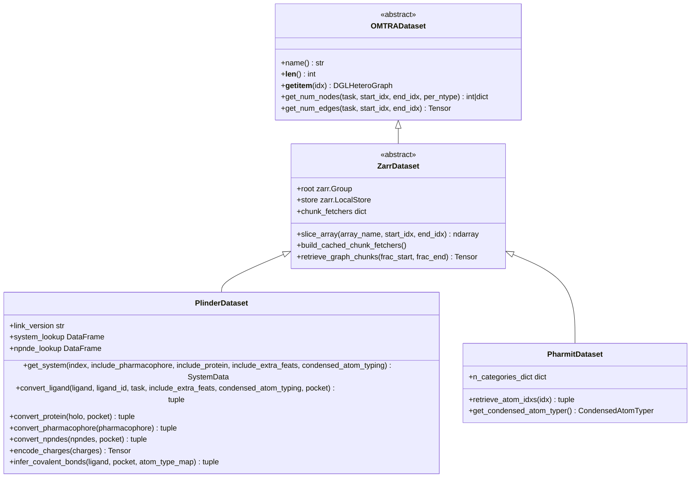
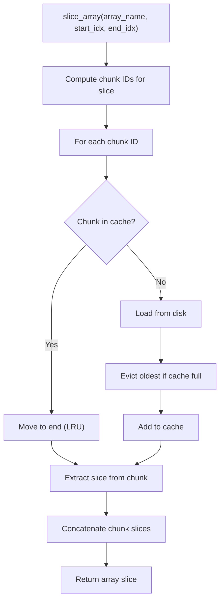
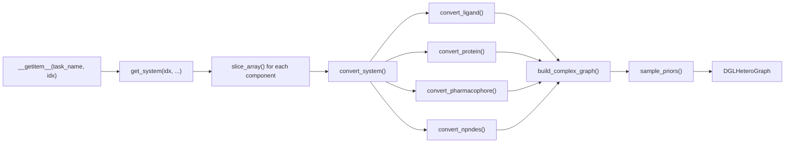
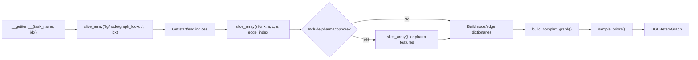
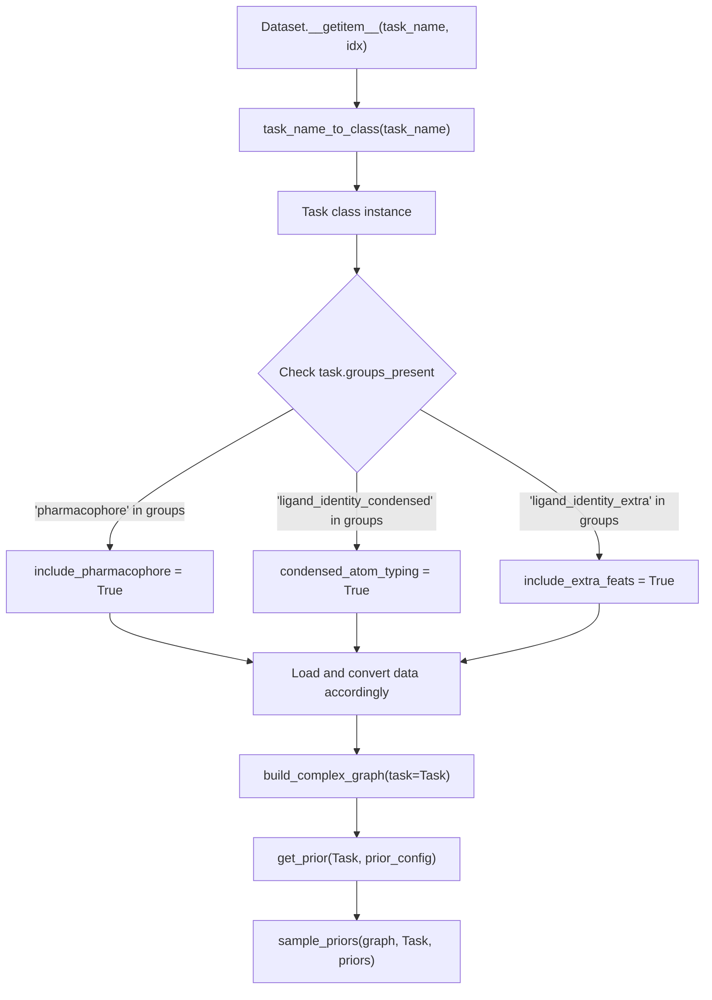

# Dataset API

<details>
<summary>Relevant source files</summary>

The following files were used as context for generating this wiki page:

- [notebooks/working_with_graphs.ipynb](notebooks/working_with_graphs.ipynb)
- [notebooks/zarr_dev.ipynb](notebooks/zarr_dev.ipynb)
- [notebooks/zarr_memory_investigation.ipynb](notebooks/zarr_memory_investigation.ipynb)
- [omtra/dataset/dataset.py](omtra/dataset/dataset.py)
- [omtra/dataset/pharmit.py](omtra/dataset/pharmit.py)
- [omtra/dataset/plinder.py](omtra/dataset/plinder.py)
- [omtra/dataset/zarr_dataset.py](omtra/dataset/zarr_dataset.py)
- [omtra/tasks/tasks.py](omtra/tasks/tasks.py)

</details>


This page provides a technical reference for the dataset classes and interfaces used in OMTRA. For high-level overview of available datasets and their purposes, see [Dataset Overview](#5.1). For detailed guides on using specific datasets, see [Plinder Dataset](#5.2) and [Pharmit Dataset](#5.3).

## Dataset Class Hierarchy

OMTRA uses an inheritance-based architecture for datasets, with abstract base classes providing common functionality and concrete implementations handling dataset-specific logic.



**Sources:** [omtra/dataset/dataset.py:7-56](), [omtra/dataset/zarr_dataset.py:14-117](), [omtra/dataset/plinder.py:53-1706](), [omtra/dataset/pharmit.py:24-287]()

## Base Classes

### OMTRADataset

`OMTRADataset` is the abstract base class defining the interface all datasets must implement.

| Method | Return Type | Description |
|--------|-------------|-------------|
| `name()` | `str` | Class property returning dataset name |
| `__len__()` | `int` | Number of examples in dataset |
| `__getitem__(idx)` | `DGLHeteroGraph` | Retrieve single example as graph |
| `get_num_nodes(task, start_idx, end_idx, per_ntype=False)` | `int` or `dict` | Count nodes for batch planning |
| `get_num_edges(task, start_idx, end_idx)` | `Tensor` | Estimate edge counts for batch planning |

The `get_num_nodes()` and `get_num_edges()` methods support efficient batching by allowing the sampler to estimate graph sizes before loading them.

**Sources:** [omtra/dataset/dataset.py:7-56]()

### ZarrDataset

`ZarrDataset` extends `OMTRADataset` with Zarr-specific functionality, particularly chunk-based caching for efficient data access.

| Attribute | Type | Description |
|-----------|------|-------------|
| `store_path` | `Path` | Path to Zarr store |
| `store` | `zarr.LocalStore` | Zarr storage backend |
| `root` | `zarr.Group` | Root Zarr group |
| `chunk_fetchers` | `dict[str, ChunkFetcher]` | LRU cache for each array |

#### Chunk-Cached Array Access

The key innovation of `ZarrDataset` is the `slice_array()` method, which implements intelligent chunk caching:



The `ChunkFetcher` class maintains an LRU cache of size `n_chunks_cache` (default 4) for each array. This significantly reduces disk I/O when accessing sequential or nearby indices.

**Sources:** [omtra/dataset/zarr_dataset.py:14-117]()

## PlinderDataset

`PlinderDataset` provides access to protein-ligand complexes from the Plinder database. It supports multiple link types (holo, apo, pred) and handles complex molecular structures.

### Initialization Parameters

| Parameter | Type | Default | Description |
|-----------|------|---------|-------------|
| `link_version` | `str` | - | Plinder link version identifier |
| `split` | `str` | - | Train/val/test split |
| `processed_data_dir` | `str` | - | Path to processed Zarr store |
| `graph_config` | `DictConfig` | `None` | Edge building configuration |
| `prior_config` | `DictConfig` | `None` | Prior sampling configuration |
| `fake_atom_p` | `float` | `0.0` | Probability of adding fake atoms |
| `pskip_factor` | `float` | `0.0` | Weighted sampling factor for clusters |
| `res_id_embed_dim` | `int` | `64` | Residue ID embedding dimension |
| `max_pharms_sampled` | `int` | `8` | Maximum pharmacophores to sample |

**Sources:** [omtra/dataset/plinder.py:54-101]()

### Data Retrieval Flow



**Sources:** [omtra/dataset/plinder.py:1470-1706]()

### Key Methods

#### get_system()

Retrieves raw molecular data from Zarr arrays and constructs `SystemData` object.

```python
def get_system(self, index: int, 
               include_pharmacophore: bool,
               include_protein: bool,
               include_extra_feats: bool,
               condensed_atom_typing: bool) -> SystemData
```

Returns a `SystemData` containing:
- `ligand`: `LigandData` with coordinates, atom types, charges, bonds
- `receptor`: `StructureData` (full protein)
- `pocket`: `StructureData` (pocket atoms only)
- `pharmacophore`: `PharmacophoreData` (if requested)
- `npndes`: `Dict[str, LigandData]` (non-polymer entities)
- `link`: `StructureData` (apo or predicted structure if available)

**Sources:** [omtra/dataset/plinder.py:172-430]()

#### Conversion Methods

The `convert_*()` methods transform raw data into graph-compatible dictionaries:

| Method | Input | Output |
|--------|-------|--------|
| `convert_ligand()` | `LigandData` | `(node_data, edge_idxs, edge_data)` |
| `convert_protein()` | `StructureData` | `(node_data, edge_idxs, edge_data, masks)` |
| `convert_pharmacophore()` | `PharmacophoreData` | `(node_data, edge_idxs, edge_data)` |
| `convert_npndes()` | `Dict[str, LigandData]` | `(node_data, edge_idxs, edge_data)` |

Each returns dictionaries with keys like:
- `node_data`: `{"lig": {"x_1_true": Tensor, "a_1_true": Tensor, ...}}`
- `edge_idxs`: `{"lig_to_lig": Tensor, ...}`
- `edge_data`: `{"lig_to_lig": {"e_1_true": Tensor}}`

**Sources:** [omtra/dataset/plinder.py:667-900]()

#### Encoding Methods

PlinderDataset includes specialized encoding methods for protein features:

```python
def encode_atom_names(self, atom_names, elements, res_names) -> ndarray
def encode_elements(self, elements) -> ndarray  
def encode_res_names(self, res_names) -> ndarray
def encode_charges(self, charges) -> Tensor
```

These use vectorized lookups against predefined vocabularies (`protein_atom_map`, `protein_element_map`, `residue_map`, `charge_map`).

**Sources:** [omtra/dataset/plinder.py:432-584]()

## PharmitDataset

`PharmitDataset` provides access to ligand conformers and pharmacophores from the Pharmit database. It has a simpler structure than PlinderDataset since it doesn't handle proteins.

### Initialization Parameters

| Parameter | Type | Default | Description |
|-----------|------|---------|-------------|
| `split` | `str` | - | Train/val/test split |
| `processed_data_dir` | `str` | - | Path to processed Zarr store |
| `graph_config` | `DictConfig` | - | Edge building configuration |
| `prior_config` | `DictConfig` | - | Prior sampling configuration |
| `fake_atom_p` | `float` | `0.0` | Probability of adding fake atoms |
| `max_pharms_sampled` | `int` | `8` | Maximum pharmacophores to sample |

**Sources:** [omtra/dataset/pharmit.py:24-52]()

### Data Access Pattern

PharmitDataset directly slices molecular features from Zarr arrays without intermediate conversion:



**Sources:** [omtra/dataset/pharmit.py:74-231]()

### Graph Chunking

PharmitDataset implements `retrieve_graph_chunks()` for distributed training support:

```python
def retrieve_graph_chunks(self, frac_start: float, frac_end: float) -> Tensor
```

Returns a `(n_chunks, 2)` tensor where each row is `[start_idx, end_idx]` for a chunk of graphs. This allows workers in distributed training to process non-overlapping subsets.

**Sources:** [omtra/dataset/pharmit.py:237-260]()

## Data Structures

### Molecular Data Classes

These dataclasses (from `omtra.data.plinder`) hold raw molecular information:

| Class | Key Attributes | Purpose |
|-------|----------------|---------|
| `LigandData` | `coords`, `atom_types`, `atom_charges`, `bond_types`, `bond_indices`, `is_covalent` | Small molecule representation |
| `StructureData` | `coords`, `atom_names`, `elements`, `res_ids`, `res_names`, `chain_ids`, `backbone` | Protein structure |
| `PharmacophoreData` | `coords`, `types`, `vectors`, `interactions` | Pharmacophore features |
| `BackboneData` | `coords`, `res_ids`, `res_names`, `chain_ids` | Backbone-only representation |
| `SystemData` | `ligand`, `receptor`, `pocket`, `pharmacophore`, `npndes`, `link` | Complete complex |

**Sources:** [omtra/dataset/plinder.py:26-32]()

### MolXACE Representation

The `MolXACE` class represents ligands in the XACE (x, a, c, e) format:

| Attribute | Description |
|-----------|-------------|
| `x` | Atomic coordinates (N, 3) |
| `a` | Atom types (N,) |
| `c` | Formal charges (N,) |
| `e` | Bond orders (E,) |
| `edge_idxs` | Bond connectivity (E, 2) |
| `cond_a` | Condensed atom types (optional) |
| `impl_H`, `aro`, `hyb`, `ring`, `chiral` | Extra features (optional) |

PharmitDataset and PlinderDataset both convert ligands to `MolXACE` format before graph construction.

**Sources:** [omtra/dataset/plinder.py:680-681](), [omtra/dataset/pharmit.py:137-143]()

## Integration with Tasks

Datasets use the `Task` system to determine what data to load and how to process it:



Tasks control:
- Which modalities are loaded (`groups_present`)
- Which modalities are fixed vs. generated (`groups_fixed`, `groups_generated`)
- Graph edge types (via `task.groups_present`)
- Prior distributions (via `task.priors`)

**Sources:** [omtra/dataset/plinder.py:1470-1490](), [omtra/dataset/pharmit.py:76-88]()

## Batching Support

Datasets provide methods to support efficient batching:

### Node Counting

```python
def get_num_nodes(self, task: Task, start_idx: int, end_idx: int, per_ntype: bool = False)
```

Returns node counts for graphs `[start_idx, end_idx)`. If `per_ntype=True`, returns a dict mapping node types to counts. Used by `MultiTaskSampler` to construct batches with controlled sizes.

**Sources:** [omtra/dataset/pharmit.py:262-287](), [omtra/dataset/dataset.py:27-29]()

### Edge Estimation

```python
def get_num_edges(self, task: Task, start_idx: int, end_idx: int) -> Tensor
```

Estimates edge counts using `approx_n_edges()` based on graph configuration and node counts. Cached with LRU cache for performance.

**Sources:** [omtra/dataset/dataset.py:32-55]()

## Weighted Sampling (PlinderDataset)

PlinderDataset supports cluster-based weighted sampling controlled by `pskip_factor`:

- `pskip_factor = 0.0`: Uniform sampling
- `pskip_factor = 1.0`: Sample uniformly across clusters (downweight large clusters)

When enabled, the `system_lookup` DataFrame gains a `pskip` column with skip probabilities, computed by `compute_pskip()`.

**Sources:** [omtra/dataset/plinder.py:62-93]()

---