# Evaluation API

<details>
<summary>Relevant source files</summary>

The following files were used as context for generating this wiki page:

- [configs/eval/default.yaml](configs/eval/default.yaml)
- [notebooks/docking_evaluation.ipynb](notebooks/docking_evaluation.ipynb)
- [omtra/data/graph/utils.py](omtra/data/graph/utils.py)
- [omtra/eval/evals.py](omtra/eval/evals.py)
- [omtra/eval/system.py](omtra/eval/system.py)
- [omtra/eval/utils.py](omtra/eval/utils.py)
- [omtra_pipelines/docking_eval/docking_eval.py](omtra_pipelines/docking_eval/docking_eval.py)
- [omtra_pipelines/docking_eval/gen_eval_cmds.py](omtra_pipelines/docking_eval/gen_eval_cmds.py)
- [omtra_pipelines/docking_eval/sampleblaster.py](omtra_pipelines/docking_eval/sampleblaster.py)
- [routines/sample.py](routines/sample.py)

</details>


This page documents the API for evaluating generated molecular systems in OMTRA. The evaluation API consists of the `SampledSystem` class for converting DGL graphs to evaluation-ready formats, a collection of registered evaluation functions for computing metrics, and utility functions for specific metric calculations.

For information about the sampling process that produces systems to evaluate, see [Sampling and Inference](#8). For details on the docking evaluation pipeline script, see [Docking Evaluation Pipeline](#9.2).

## Overview

The evaluation API provides three main components:

1. **`SampledSystem` class** - Converts DGL heterogeneous graphs into molecular formats (RDKit molecules, Biotite atom arrays) suitable for evaluation
2. **Registered evaluation functions** - Task-specific metric computation functions decorated with `@register_eval`
3. **Docking evaluation utilities** - Comprehensive evaluation pipeline with PoseBusters, GNINA, PoseCheck, and pharmacophore matching

The evaluation workflow typically follows this pattern:

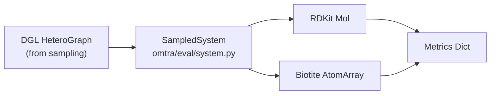

**Sources:** [omtra/eval/system.py:1-1000](), [routines/sample.py:1-503]()

## SampledSystem Class

The `SampledSystem` class is the central interface for converting generated molecular systems into evaluation-ready formats. It handles both ligands and proteins, supporting various atom typing schemes including condensed atom types.

### Class Structure

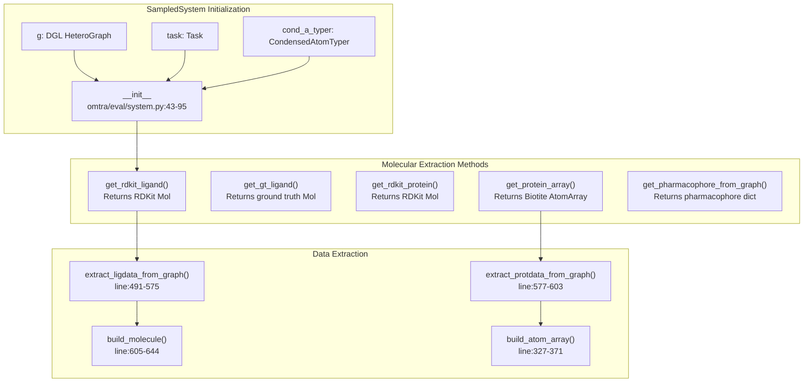

**Sources:** [omtra/eval/system.py:38-95](), [omtra/eval/system.py:400-450]()

### Key Methods

| Method | Return Type | Description |
|--------|-------------|-------------|
| `get_rdkit_ligand()` | `Chem.Mol` | Returns generated ligand as RDKit molecule |
| `get_gt_ligand()` | `Chem.Mol` | Returns ground truth ligand from graph |
| `get_rdkit_ref_ligand()` | `Chem.Mol` | Returns reference ligand (for comparison) |
| `get_rdkit_protein()` | `Chem.Mol` | Returns generated protein as RDKit molecule |
| `get_protein_array()` | `struc.AtomArray` | Returns protein as Biotite AtomArray |
| `get_pharmacophore_from_graph()` | `Dict` | Returns pharmacophore coordinates and types |
| `get_n_lig_atoms()` | `int` | Returns number of ligand atoms (excluding fake) |
| `write_ligand()` | `None` | Writes ligand to SDF file |
| `write_protein()` | `None` | Writes protein to CIF/PDB file |

**Sources:** [omtra/eval/system.py:128-450]()

### Internal Data Extraction

The `SampledSystem` class extracts molecular data from DGL graphs in two stages:

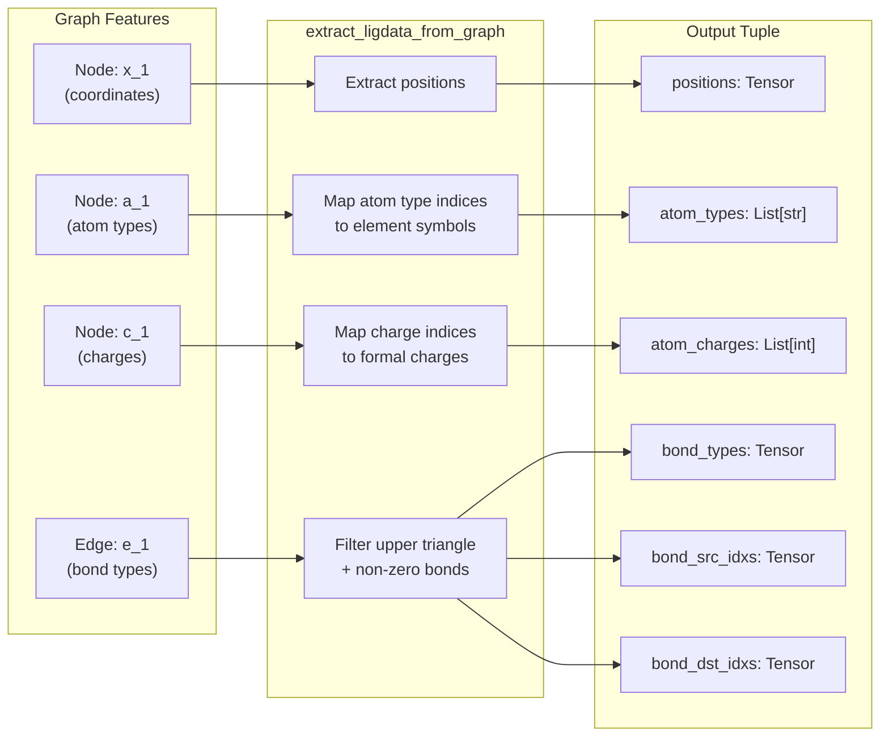

**Sources:** [omtra/eval/system.py:491-575](), [omtra/data/graph/utils.py:36-38]()

### Molecule Construction

The `build_molecule` method constructs RDKit molecules from extracted graph data:

**Key Steps:**
1. Create empty `RWMol` object
2. Add atoms with element types and formal charges
3. Add bonds between atoms using upper triangle indices
4. Set 3D coordinates from positions tensor
5. Convert to immutable `Mol` object

**Sources:** [omtra/eval/system.py:605-644]()

### Condensed Atom Type Decoding

For tasks using condensed atom types (e.g., `ligand_identity_condensed`), the class automatically decodes them:

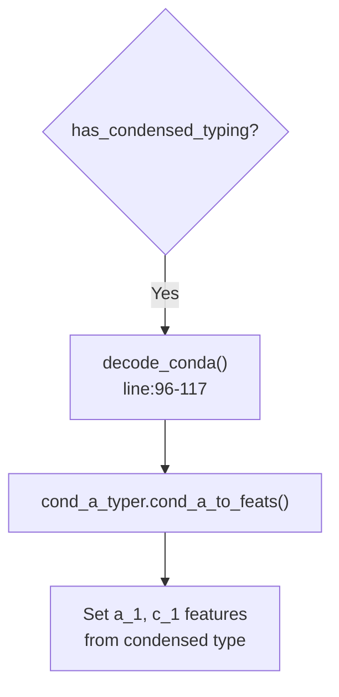

**Sources:** [omtra/eval/system.py:87-117]()

## Built-in Evaluation Functions

OMTRA provides a set of registered evaluation functions that can be applied to lists of `SampledSystem` objects. These are registered using the `@register_eval` decorator and configured per-task in [configs/eval/default.yaml]().

### Evaluation Function Registry

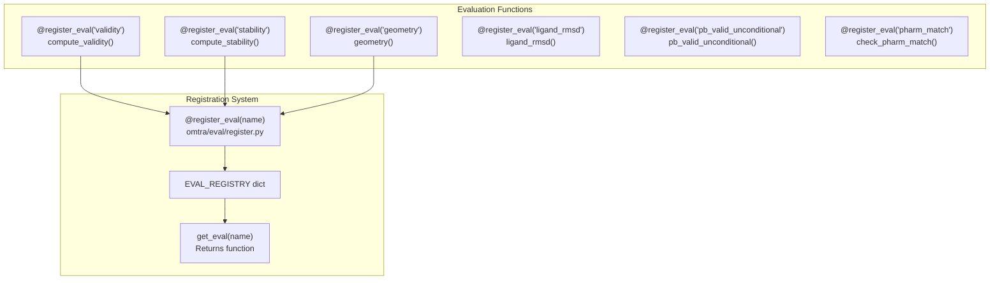

**Sources:** [omtra/eval/evals.py:1-329]()

### Available Metrics

| Metric Name | Function | Description | Key Output |
|-------------|----------|-------------|------------|
| `validity` | `validity()` | RDKit sanitization and connectivity | `frac_valid_mols`, `frac_connected` |
| `stability` | `stability()` | Atom valence stability | `frac_atoms_stable`, `frac_mols_stable_valence` |
| `reos_and_rings` | `check_reos_and_rings()` | REOS filter violations and OOD ring systems | `flag_rate`, `ood_rate` |
| `geometry` | `geometry()` | Bond length/angle validity | `geometry_frac_valid_bonds`, `geometry_frac_valid_angles` |
| `flatness` | `flatness()` | Aromatic ring planarity | `flatness_max_distance_from_plane` |
| `intermolecular_distance` | `intermolecular_distance()` | Ligand-protein clash detection | `intermolecular_distance_smallest` |
| `ligand_rmsd` | `ligand_rmsd()` | RMSD to ground truth | `ligand_rmsd`, `ligand_kabsch_rmsd` |
| `volume_overlap` | `volume_overlap()` | Protein-ligand overlap | `volume_overlap` |
| `pb_valid_unconditional` | `pb_valid_unconditional()` | PoseBusters validation (no protein) | `pb_valid`, individual PB checks |
| `pb_valid_pocket` | `pb_valid_pocket()` | PoseBusters validation (with protein) | `pb_valid_pocket` |
| `pb_valid_conformer` | `pb_valid_conformer()` | PoseBusters conformer validation | `pb_conformer_*` metrics |
| `pharm_match` | `check_pharm_match()` | Pharmacophore matching | `perfect_pharm_match`, `frac_true_pharms_matched` |

**Sources:** [omtra/eval/evals.py:37-329](), [configs/eval/default.yaml:1-684]()

### Usage Pattern

```python
from omtra.eval.register import get_eval

# Get evaluation function
validity_fn = get_eval("validity")

# Compute metrics on list of SampledSystem objects
metrics = validity_fn(sampled_systems, params={})
# Returns: {"frac_valid_mols": 0.95, "frac_connected": 0.92, ...}
```

**Sources:** [routines/sample.py:483-497]()

## Utility Functions

The [omtra/eval/utils.py]() file provides lower-level utility functions used by the registered evaluation functions.

### Validity Computation

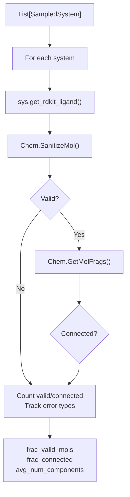

**Sources:** [omtra/eval/utils.py:25-106]()

### Stability Computation

Validates atom valencies against a pre-computed valency table:

**Key Functions:**
- `compute_stability()` - Computes fraction of stable atoms/molecules
- `check_stability()` - Validates individual molecule valencies
- `get_valid_valency_table()` - Loads allowed valencies from YAML

**Sources:** [omtra/eval/utils.py:109-192]()

### REOS and Ring System Analysis

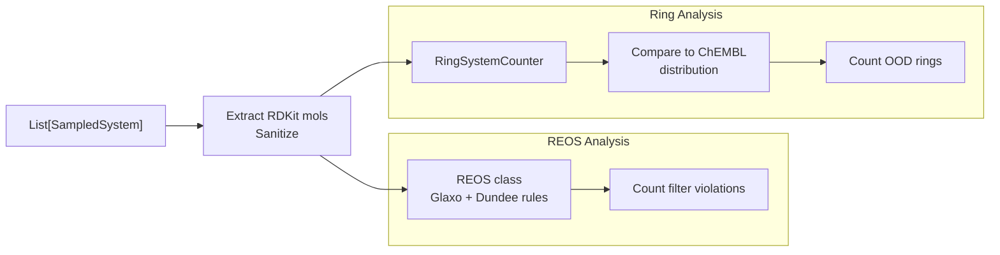

**Sources:** [omtra/eval/utils.py:194-239]()

### PoseBusters Integration

The utility functions provide wrappers for PoseBusters validation:

- `bust_redock()` - For cognate receptor docking
- `bust_dock()` - For de novo or non-cognate docking
- `bust_mol()` - For molecule-only validation

**Sources:** [omtra/eval/utils.py:279-337]()

## Docking Evaluation Pipeline

The [omtra_pipelines/docking_eval/docking_eval.py]() script provides a comprehensive evaluation pipeline that combines sampling, file writing, and metric computation.

### Pipeline Architecture

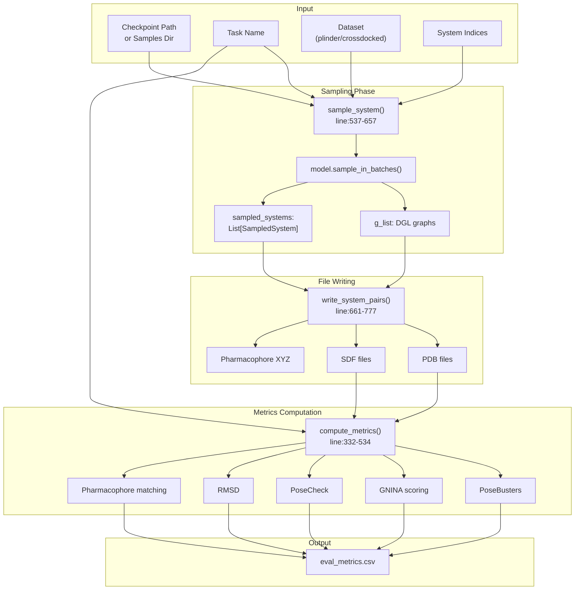

**Sources:** [omtra_pipelines/docking_eval/docking_eval.py:1-1400]()

### Key Pipeline Functions

| Function | Lines | Description |
|----------|-------|-------------|
| `parse_args()` | 39-94 | Argument parsing for sampling/evaluation options |
| `sample_system()` | 537-657 | Loads model, dataset, and generates samples |
| `write_system_pairs()` | 661-777 | Writes generated and ground truth files |
| `system_pairs_from_path()` | 780-868 | Loads existing samples from directory |
| `compute_metrics()` | 332-534 | Computes all requested metrics |

**Sources:** [omtra_pipelines/docking_eval/docking_eval.py:39-868]()

### Metric Functions

The pipeline includes specialized metric computation functions:

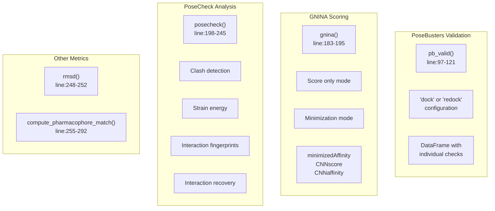

**Sources:** [omtra_pipelines/docking_eval/docking_eval.py:97-292]()

### System Pairs Structure

The pipeline organizes data into "system pairs" for evaluation:

```python
system_pairs = {
    'sys_0_gt': {
        'pair_0': {
            'gen_ligs': [rdkit_mol, ...],          # Generated ligands
            'gen_ligs_file': Path('gen_ligands.sdf'),
            'gen_ligs_ids': ['gen_ligands_0', ...],
            'true_lig': rdkit_mol,                  # Ground truth ligand
            'true_lig_file': Path('ligand.sdf'),
            'gen_prot_file': Path('protein_0.pdb'), # Generated protein
            'gen_prot_id': 'protein_0',
            'true_prot_file': Path('protein_0.pdb'),# Ground truth protein
            'true_prot_id': 'protein_0',
            'true_pharm': {...}                     # Pharmacophore dict
        }
    }
}
```

**Sources:** [omtra_pipelines/docking_eval/docking_eval.py:677-776]()

### Timeout Handling

The pipeline includes timeout protection for long-running metrics:

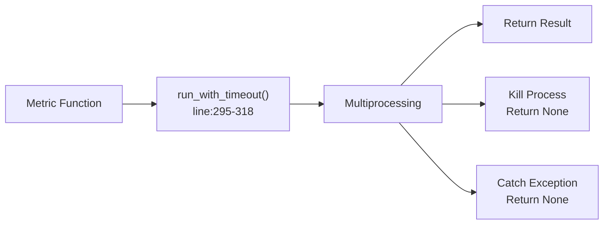

**Sources:** [omtra_pipelines/docking_eval/docking_eval.py:295-318]()

## Output Formats

### File Writing Functions

The `SampledSystem` class provides methods to write molecules to standard file formats:

| Method | File Format | Description |
|--------|-------------|-------------|
| `write_ligand()` | SDF | Writes ligand to SDF file via `write_mols_to_sdf()` |
| `write_protein()` | CIF | Writes protein to CIF file via `write_arrays_to_cif()` |
| `write_protein_pdb()` | PDB | Writes protein to PDB file via `write_arrays_to_pdb()` |
| `write_pharmacophore()` | XYZ | Writes pharmacophore points with element labels |

**Sources:** [omtra/eval/system.py:733-830]()

### Helper Functions

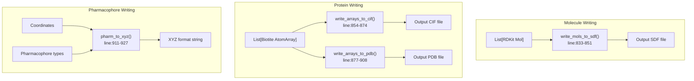

**Sources:** [omtra/eval/system.py:833-927]()

## Configuration

Evaluation metrics are configured per-task in [configs/eval/default.yaml](). Each task specifies which metrics to run and their parameters:

```yaml
rigid_docking_condensed:
  - stability:
      train: true
      params: {}
  - reos_and_rings:
      train: true
      params: {}
  - intermolecular_distance:
      train: true
      params:
        clash_cutoff: 0.05
  - ligand_rmsd:
      train: true
      params:
        rmsd_threshold: 2.0
  - pb_valid_unconditional:
      train: true
      params:
        max_workers: 0
```

**Sources:** [configs/eval/default.yaml:180-206]()

## Usage Examples

### Basic Evaluation in Sampling Script

```python
# From routines/sample.py
from omtra.eval.register import get_eval

# Load evaluation configuration
default_eval_cfg = OmegaConf.load('configs/eval/default.yaml')

metrics = {}
for eval_entry in default_eval_cfg[task_name]:
    for eval_name, config in eval_entry.items():
        # Get registered evaluation function
        eval_fn = get_eval(eval_name)
        # Compute metrics
        result = eval_fn(sampled_systems, config.get("params", {}))
        metrics.update(result)

# Write metrics to file
with open('metrics.json', 'w') as f:
    json.dump(metrics, f)
```

**Sources:** [routines/sample.py:483-497]()

### Comprehensive Docking Evaluation

```bash
python omtra_pipelines/docking_eval/docking_eval.py \
  --ckpt_path /path/to/checkpoint.ckpt \
  --task rigid_docking_condensed \
  --dataset plinder \
  --n_samples 100 \
  --n_replicates 5 \
  --n_timesteps 250 \
  --output_dir /path/to/output
```

**Sources:** [omtra_pipelines/docking_eval/docking_eval.py:39-94]()

### Converting Graph to RDKit Molecule

```python
from omtra.eval.system import SampledSystem
from omtra.data.condensed_atom_typing import CondensedAtomTyper

# Create SampledSystem from DGL graph
cond_a_typer = CondensedAtomTyper(fake_atoms=False)
sys = SampledSystem(
    g=graph,
    task=task,
    fake_atoms=False,
    cond_a_typer=cond_a_typer
)

# Get RDKit molecule
rdkit_mol = sys.get_rdkit_ligand()

# Get ground truth for comparison
gt_mol = sys.get_gt_ligand(g=graph)

# Get protein as Biotite AtomArray
protein_arr = sys.get_protein_array()
```

**Sources:** [omtra/eval/system.py:38-450]()

---