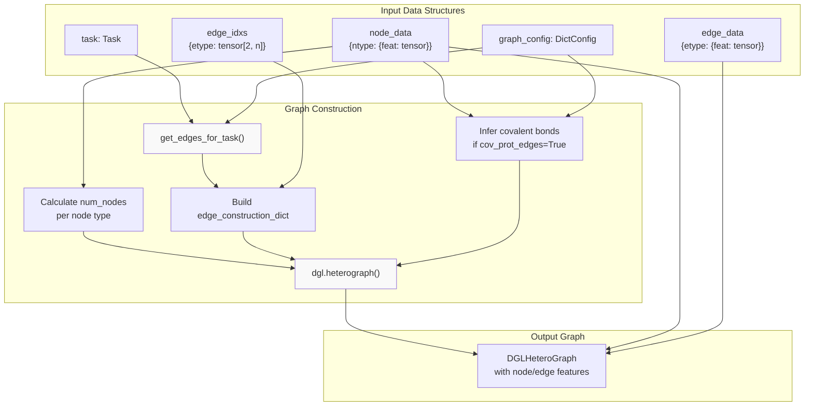
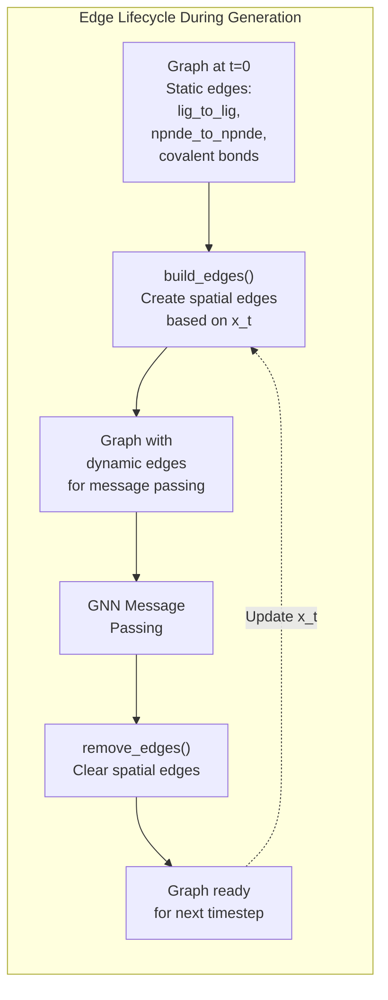
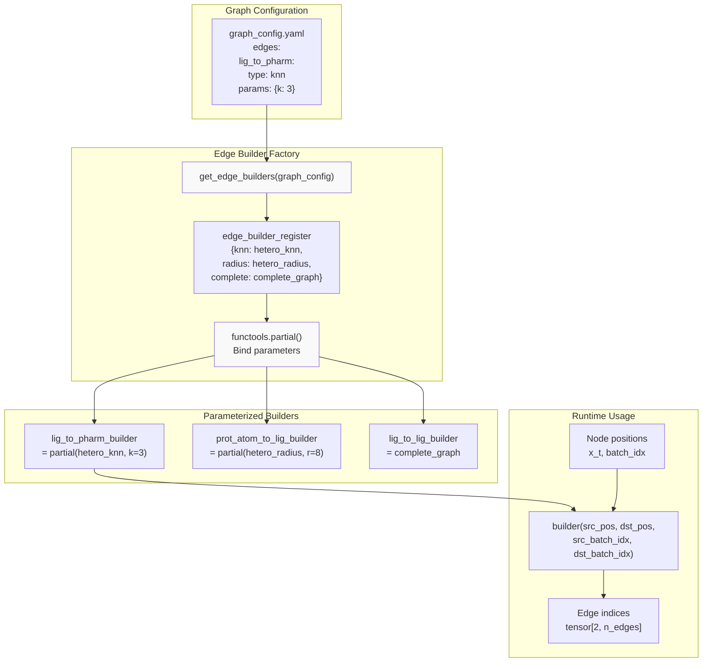
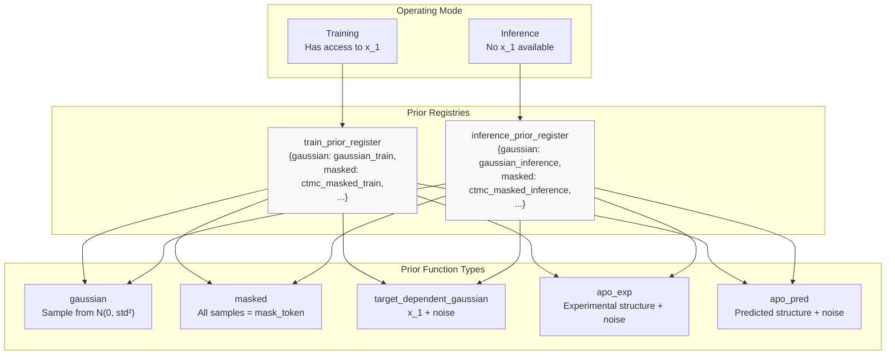
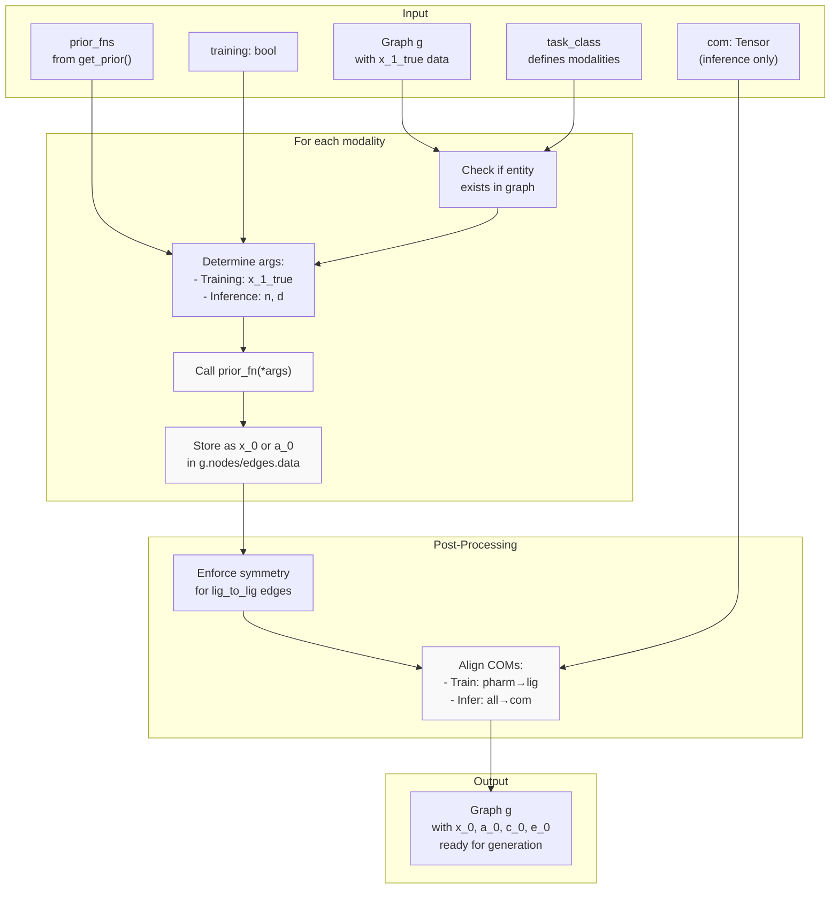

# Graph and Prior APIs

<details>
<summary>Relevant source files</summary>

The following files were used as context for generating this wiki page:

- [configs/graph/default.yaml](configs/graph/default.yaml)
- [omtra/data/graph/__init__.py](omtra/data/graph/__init__.py)
- [omtra/data/graph/edge_builders.py](omtra/data/graph/edge_builders.py)
- [omtra/data/graph/edge_factory.py](omtra/data/graph/edge_factory.py)
- [omtra/data/graph/register.py](omtra/data/graph/register.py)
- [omtra/priors/prior_factory.py](omtra/priors/prior_factory.py)
- [omtra/priors/priors.py](omtra/priors/priors.py)
- [omtra/priors/sample.py](omtra/priors/sample.py)
- [omtra/tasks/utils.py](omtra/tasks/utils.py)

</details>


## Purpose and Scope

This document provides a comprehensive API reference for graph construction and prior sampling systems in OMTRA. These APIs define how molecular systems are represented as heterogeneous graphs and how initial states (`x_0`) are sampled from prior distributions during generation.

For conceptual understanding of graph representations, see [Graph Representation](#3.3). For information on how graphs are constructed from dataset files, see [Graph Construction](#5.5). For task-specific usage of priors, see [Prior Distributions](#8.2).

This page focuses on the programmatic interfaces: function signatures, parameters, return types, and usage patterns.

---

## Graph Construction API

### Node and Edge Type Definitions

OMTRA uses a fixed set of node and edge types defined in [omtra/data/graph/\_\_init\_\_.py:13-18]().

**Node Types:**
```python
node_types = ['lig', 'prot_atom', 'prot_res', 'pharm', 'npnde']
```

**Edge Type Naming Convention:**

| Pattern | Example | Description |
|---------|---------|-------------|
| `{ntype}_to_{ntype}` | `lig_to_lig` | Standard edges between node types |
| `{src}_covalent_{dst}` | `prot_atom_covalent_lig` | Covalent bond edges |

All edge types are enumerated in `all_edge_types` [omtra/data/graph/\_\_init\_\_.py:16-18](), including symmetric pairs.

**Canonical Edge Type Format:**

The function `to_canonical_etype(etype: str)` [omtra/data/graph/\_\_init\_\_.py:20-26]() converts edge type strings to DGL's canonical tuple format `(src_ntype, etype, dst_ntype)`.

```python
# Example usage:
to_canonical_etype("lig_to_pharm")  # → ('lig', 'lig_to_pharm', 'pharm')
to_canonical_etype("prot_atom_covalent_lig")  # → ('prot_atom', 'prot_atom_covalent_lig', 'lig')
```

Sources: [omtra/data/graph/\_\_init\_\_.py:13-36]()

---

### Core Graph Construction Function

#### `build_complex_graph`

The primary function for constructing heterogeneous DGL graphs from molecular data.

**Signature:**
```python
def build_complex_graph(
    node_data: Dict[str, Dict[str, torch.Tensor]],
    edge_idxs: Dict[str, torch.Tensor],
    edge_data: Dict[str, Dict[str, torch.Tensor]],
    task: Task = None,
    graph_config: DictConfig = None,
) -> dgl.DGLHeteroGraph
```

**Parameters:**

| Parameter | Type | Description |
|-----------|------|-------------|
| `node_data` | `Dict[str, Dict[str, torch.Tensor]]` | Nested dict: `{ntype: {feature_name: tensor}}` |
| `edge_idxs` | `Dict[str, torch.Tensor]` | Edge indices: `{etype: tensor([src_indices], [dst_indices])}` |
| `edge_data` | `Dict[str, Dict[str, torch.Tensor]]` | Nested dict: `{etype: {feature_name: tensor}}` |
| `task` | `Task` | Optional task to filter edge types |
| `graph_config` | `DictConfig` | Optional config for edge construction parameters |

**Returns:** `dgl.DGLHeteroGraph` with node and edge features attached

**Edge Type Filtering:**

When `task` and `graph_config` are provided, the function uses `get_edges_for_task(task, graph_config)` [omtra/data/graph/\_\_init\_\_.py:46-72]() to determine which edge types to include based on:
1. Node types present in the task's modalities
2. Edge types specified in `graph_config.edges`
3. Symmetric edge type declarations

**Protein Covalent Bond Inference:**

If `graph_config.cov_prot_edges` is `True` and protein atoms are present, covalent bonds are automatically inferred using a radius graph with `r=2.1 Å` [omtra/data/graph/\_\_init\_\_.py:122-137]().

Sources: [omtra/data/graph/\_\_init\_\_.py:74-155]()



Sources: [omtra/data/graph/\_\_init\_\_.py:74-155]()

---

### Dynamic Edge Construction

During model execution, edges are built dynamically based on current node positions using `build_edges` and removed using `remove_edges`.

#### `build_edges`

**Signature:**
```python
def build_edges(
    g: dgl.DGLHeteroGraph, 
    task: Task, 
    node_batch_idx: Dict[str, torch.Tensor], 
    graph_config: DictConfig,
    etype_subset: List[str] = None,
    lig_only: bool = False,
) -> dgl.DGLHeteroGraph
```

**Parameters:**

| Parameter | Type | Description |
|-----------|------|-------------|
| `g` | `dgl.DGLHeteroGraph` | Graph to add edges to |
| `task` | `Task` | Task defining valid edge types |
| `node_batch_idx` | `Dict[str, torch.Tensor]` | Batch index for each node type |
| `graph_config` | `DictConfig` | Configuration for edge builders |
| `etype_subset` | `List[str]` | Optional subset of edge types to build |
| `lig_only` | `bool` | If `True`, only build edges involving ligand nodes |

**Behavior:**
- Uses `x_t` positions from `g.nodes[ntype].data["x_t"]` [omtra/tasks/utils.py:46]()
- Skips predetermined edge types (`lig_to_lig`, `npnde_to_npnde`) [omtra/tasks/utils.py:27-28]()
- Skips covalent edges (already in graph)
- For `prot_atom_to_prot_atom`, combines radius-based edges with covalent edges [omtra/tasks/utils.py:53-54]()

#### `remove_edges`

**Signature:**
```python
def remove_edges(
    g: dgl.DGLHeteroGraph, 
    lig_only: bool = False
) -> dgl.DGLHeteroGraph
```

Removes all non-predetermined edges (inverse of `build_edges`).

Sources: [omtra/tasks/utils.py:16-107]()



Sources: [omtra/tasks/utils.py:16-92]()

---

### Edge Builder Functions

Edge builders are registered functions that create edges between nodes based on spatial criteria. They are accessed via the factory pattern.

#### Registration System

**Decorator:**
```python
@register_edge_builder(name: str)
def builder_function(src_pos, dst_pos, src_batch_idx, dst_batch_idx, **params):
    ...
```

Sources: [omtra/data/graph/register.py:1-11]()

#### Built-in Edge Builders

| Builder | Registration Name | Parameters | Description |
|---------|------------------|------------|-------------|
| `complete_graph` | `"complete"` | None | Fully connected (excluding self-loops) |
| `hetero_radius` | `"radius"` | `r`, `max_num_neighbors` | Edges within radius `r` |
| `hetero_knn` | `"knn"` | `k` | K-nearest neighbors |
| `symmetric` | `"symmetric"` | `builder_fn` | Inverse edges of another builder |

**Function Signatures:**

```python
# Complete graph (all-to-all)
def complete_graph(src_pos, dst_pos, src_batch_idx, dst_batch_idx) -> torch.Tensor
    # Returns: tensor([src_indices], [dst_indices])

# Radius-based edges
def hetero_radius(
    src_pos, dst_pos, 
    src_batch_idx, dst_batch_idx, 
    r: float, 
    max_num_neighbors: int = 1000
) -> torch.Tensor

# K-nearest neighbors
def hetero_knn(
    src_pos, dst_pos, 
    src_batch_idx, dst_batch_idx, 
    k: int
) -> torch.Tensor

# Symmetric edges
def symmetric(
    builder_fn, 
    src_pos, dst_pos, 
    src_batch_idx, dst_batch_idx
) -> torch.Tensor
```

Sources: [omtra/data/graph/edge_builders.py:1-32]()

#### `get_edge_builders`

Factory function that creates edge builder functions with parameters bound.

**Signature:**
```python
@functools.lru_cache()
def get_edge_builders(graph_config: DictConfig) -> Dict[str, Callable]
```

**Returns:** Dictionary mapping edge type strings to parameterized builder functions

**Example Configuration (YAML):**
```yaml
edges:
  lig_to_pharm:
    type: knn
    params:
      k: 3
  prot_atom_to_lig:
    type: radius
    params:
      r: 8
```

This creates builders accessible as:
```python
builders = get_edge_builders(graph_config)
lig_to_pharm_builder = builders["lig_to_pharm"]  # knn with k=3
prot_atom_to_lig_builder = builders["prot_atom_to_lig"]  # radius with r=8
```

Sources: [omtra/data/graph/edge_factory.py:1-32](), [configs/graph/default.yaml:1-80]()



Sources: [omtra/data/graph/edge_factory.py:1-32](), [omtra/data/graph/register.py:1-11]()

---

### Edge Count Approximation

#### `approx_n_edges`

Estimates the number of edges for memory allocation and batching purposes.

**Signature:**
```python
def approx_n_edges(
    etype: str, 
    graph_config: DictConfig, 
    num_nodes_dict: Dict[str, int]
) -> Union[int, torch.Tensor]
```

**Approximation Logic:**

| Edge Type | Formula |
|-----------|---------|
| `complete` | `n_src * (n_src - 1)` |
| `knn` | `n_src * k` |
| `radius` | Uses learned MLP approximator |

For radius graphs, the system uses pre-trained MLPs [omtra/data/graph/\_\_init\_\_.py:206-209]() that predict edge counts based on `(radius, n_src, n_dst)`.

Sources: [omtra/data/graph/\_\_init\_\_.py:157-209]()

---

## Prior Sampling API

### Prior Distribution Functions

Prior functions generate initial states (`x_0`) for modalities during training and inference. They are registered using decorators.

#### Registration Decorators

```python
@register_train_prior(name: str)  # For training mode
@register_inference_prior(name: str)  # For inference mode
```

#### Built-in Prior Functions

**Gaussian Priors:**

```python
@register_train_prior("gaussian")
def gaussian_train(
    x1: torch.Tensor,  # Target data
    std: float = 1.0,
    ot: bool = False,  # Optimal transport alignment
    rigid_body: bool = True,
    permutation: bool = True,
    translation: bool = False,
    offset_std: float = 0.0
) -> torch.Tensor

@register_inference_prior("gaussian")
def gaussian_inference(
    n: int,  # Number of samples
    d: Union[int, List[int]],  # Dimensions
    std: float = 1.0,
    **kwargs
) -> torch.Tensor
```

**Key Parameters:**
- `ot=True`: Align `x_0` to `x_1` using optimal transport (during training)
- `translation=True`: Match center of mass to `x_1`
- `offset_std > 0`: Add random offset to center of mass

**Masked CTMC Prior:**

```python
@register_train_prior("masked")
def ctmc_masked_train(
    x1: torch.Tensor,
    n_categories: int
) -> torch.Tensor

@register_inference_prior("masked")
def ctmc_masked_inference(
    n: int,
    d: int  # Number of categories
) -> torch.Tensor
```

Returns all samples as the mask token (index `d`).

**Target-Dependent Prior:**

```python
@register_train_prior("target_dependent_gaussian")
@register_inference_prior("target_dependent_gaussian")
def target_dependent_gaussian_prior(
    x1: torch.Tensor,
    std: float = 1.0
) -> torch.Tensor
```

Returns `x_1 + noise`, useful for denoising tasks.

**Apo Structure Priors:**

```python
@register_train_prior("apo_exp")
@register_inference_prior("apo_exp")
def exp_prior(
    x0: torch.Tensor,  # Experimental apo structure
    std: float = 1.0
) -> torch.Tensor

@register_train_prior("apo_pred")
@register_inference_prior("apo_pred")
def pred_prior(
    x0: torch.Tensor,  # Predicted apo structure
    std: float = 1.0
) -> torch.Tensor
```

Sources: [omtra/priors/priors.py:1-102]()



Sources: [omtra/priors/priors.py:1-102](), [omtra/priors/register.py]()

---

### Prior Factory

#### `get_prior`

Factory function that retrieves and configures prior functions for all modalities in a task.

**Signature:**
```python
def get_prior(
    task_cls: Task, 
    config_prior: DictConfig = None, 
    training: bool = False
) -> Dict[str, Tuple[str, Callable]]
```

**Parameters:**

| Parameter | Type | Description |
|-----------|------|-------------|
| `task_cls` | `Task` | Task class defining modalities |
| `config_prior` | `DictConfig` | Optional configuration override |
| `training` | `bool` | If `True`, use training priors; else inference priors |

**Returns:** Dictionary mapping modality names to `(prior_name, prior_function)` tuples

**Configuration Lookup:**

1. Check `config_prior[task_name][modality_name]` (if provided)
2. Fall back to `task_cls.priors[modality_name]`

**Example:**

```python
task = DeNovoLigand()
prior_fns = get_prior(task, config_prior=None, training=True)
# Returns:
# {
#   'lig_x': ('gaussian', partial(gaussian_train, std=1.0, ot=True)),
#   'lig_a': ('masked', partial(ctmc_masked_train)),
#   ...
# }
```

Sources: [omtra/priors/prior_factory.py:1-34]()

---

### Sampling Priors on Graphs

#### `sample_priors`

Main function for sampling prior values and attaching them to graph nodes/edges.

**Signature:**
```python
def sample_priors(
    g: dgl.DGLHeteroGraph, 
    task_class: Task, 
    prior_fns: dict,  # Output from get_prior()
    training: bool, 
    com: torch.Tensor = None,  # Center of mass for inference
    fake_atoms: bool = False
) -> dgl.DGLHeteroGraph
```

**Parameters:**

| Parameter | Type | Description |
|-----------|------|-------------|
| `g` | `dgl.DGLHeteroGraph` | Graph to add priors to |
| `task_class` | `Task` | Task defining modalities |
| `prior_fns` | `dict` | Prior functions from `get_prior()` |
| `training` | `bool` | Training vs inference mode |
| `com` | `torch.Tensor` | Target center of mass `[batch_size, 3]` (inference only) |
| `fake_atoms` | `bool` | Add extra category for fake atoms |

**Behavior:**

1. **For each modality in `prior_fns`:**
   - Skip if entity not present in graph [omtra/priors/sample.py:25-28]()
   - Determine argument structure based on prior type [omtra/priors/sample.py:48-66]()
   - Call prior function and store result as `{data_key}_0` [omtra/priors/sample.py:69-79]()

2. **Edge symmetry enforcement:**
   - For `lig_to_lig` edges, ensure upper/lower triangle consistency [omtra/priors/sample.py:74-76]()

3. **Center of mass adjustments:**
   - Training: If both ligand and pharmacophore are generated, align their COMs [omtra/priors/sample.py:87-97]()
   - Inference: Move generated entities to specified `com` [omtra/priors/sample.py:99-111]()

**Data Key Mapping:**

| Modality Type | `data_key` | Storage Location | Prior Dimensions |
|---------------|------------|------------------|------------------|
| Position | `x` | `g.nodes[ntype].data['x_0']` | `[n, 3]` |
| Atom type | `a` | `g.nodes[ntype].data['a_0']` | `[n]` (categorical) |
| Charge | `c` | `g.nodes[ntype].data['c_0']` | `[n]` (categorical) |
| Bond order | `e` | `g.edges[etype].data['e_0']` | `[n]` (categorical) |
| Vectors | `v` | `g.nodes[ntype].data['v_0']` | `[n, 4, 3]` |

Sources: [omtra/priors/sample.py:10-113]()



Sources: [omtra/priors/sample.py:10-113]()

---

## Summary Tables

### Graph API Quick Reference

| Function | Purpose | Location |
|----------|---------|----------|
| `build_complex_graph` | Create heterogeneous graph from data dicts | [omtra/data/graph/\_\_init\_\_.py:74-155]() |
| `build_edges` | Add spatial edges to existing graph | [omtra/tasks/utils.py:16-63]() |
| `remove_edges` | Remove spatial edges from graph | [omtra/tasks/utils.py:65-92]() |
| `get_edges_for_task` | Filter edge types for task | [omtra/data/graph/\_\_init\_\_.py:46-72]() |
| `get_edge_builders` | Factory for parameterized builders | [omtra/data/graph/edge_factory.py:7-32]() |
| `approx_n_edges` | Estimate edge count | [omtra/data/graph/\_\_init\_\_.py:157-209]() |

### Prior API Quick Reference

| Function | Purpose | Location |
|----------|---------|----------|
| `get_prior` | Factory for prior functions | [omtra/priors/prior_factory.py:5-34]() |
| `sample_priors` | Sample and attach priors to graph | [omtra/priors/sample.py:10-113]() |
| `gaussian_train` | Gaussian prior (training) | [omtra/priors/priors.py:12-42]() |
| `gaussian_inference` | Gaussian prior (inference) | [omtra/priors/priors.py:45-53]() |
| `ctmc_masked_train` | Masked prior (training) | [omtra/priors/priors.py:57-64]() |
| `ctmc_masked_inference` | Masked prior (inference) | [omtra/priors/priors.py:67-72]() |

### Edge Builder Types

| Type | Use Case | Configuration Example |
|------|----------|----------------------|
| `complete` | Fully connected same-type nodes | `type: complete` |
| `knn` | K-nearest spatial neighbors | `type: knn`<br/>`params: {k: 5}` |
| `radius` | All neighbors within distance | `type: radius`<br/>`params: {r: 8.0}` |
| `symmetric` | Inverse of another edge type | Declared in `symmetric_etypes` |

Sources: [omtra/data/graph/edge_builders.py:1-32](), [configs/graph/default.yaml:1-80]()