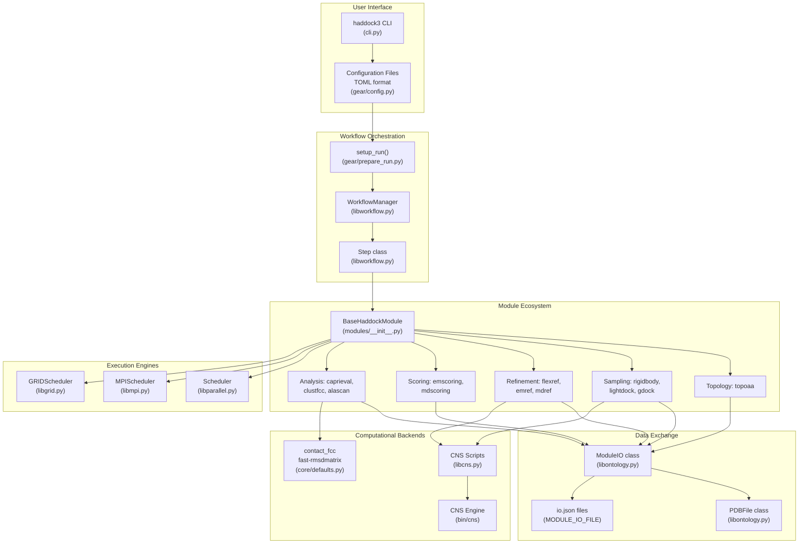
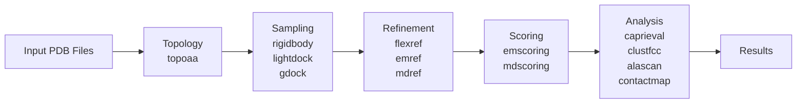
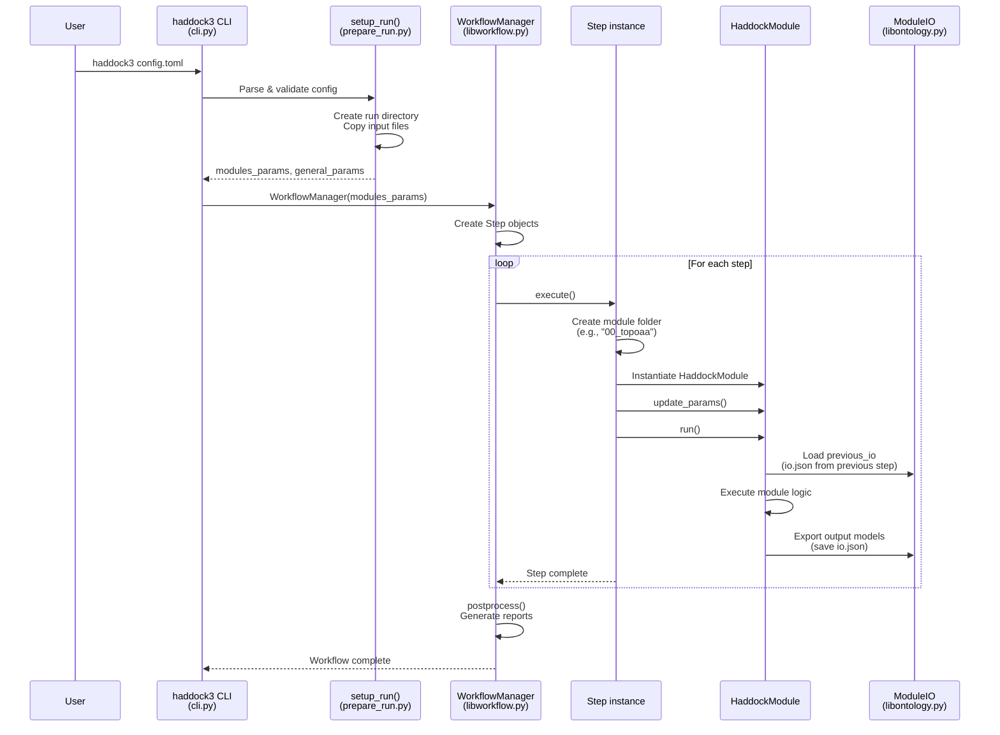
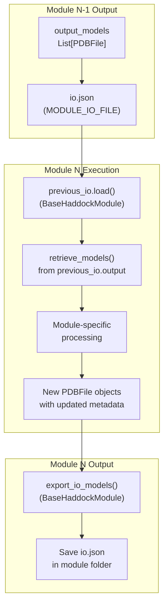

# Overview

<details>
<summary>Relevant source files</summary>

The following files were used as context for generating this wiki page:

- [CHANGELOG.md](CHANGELOG.md)
- [DEVELOPMENT.md](DEVELOPMENT.md)
- [README.md](README.md)
- [docs/INSTALL.md](docs/INSTALL.md)
- [notebooks/HADDOCK3-antibody-antigen.ipynb](notebooks/HADDOCK3-antibody-antigen.ipynb)
- [notebooks/README.md](notebooks/README.md)
- [pyproject.toml](pyproject.toml)
- [src/haddock/__init__.py](src/haddock/__init__.py)
- [src/haddock/clis/cli.py](src/haddock/clis/cli.py)
- [src/haddock/clis/wrapper_haddock_restraints.py](src/haddock/clis/wrapper_haddock_restraints.py)
- [src/haddock/core/defaults.py](src/haddock/core/defaults.py)
- [src/haddock/gear/config.py](src/haddock/gear/config.py)
- [src/haddock/gear/prepare_run.py](src/haddock/gear/prepare_run.py)
- [src/haddock/gear/zerofill.py](src/haddock/gear/zerofill.py)
- [src/haddock/libs/libnotebooks.py](src/haddock/libs/libnotebooks.py)
- [src/haddock/libs/libutil.py](src/haddock/libs/libutil.py)
- [src/haddock/libs/libworkflow.py](src/haddock/libs/libworkflow.py)
- [src/haddock/modules/__init__.py](src/haddock/modules/__init__.py)
- [tests/test_gear_config.py](tests/test_gear_config.py)
- [tests/test_gear_prepare_run.py](tests/test_gear_prepare_run.py)
- [tests/test_gear_zerofill.py](tests/test_gear_zerofill.py)
- [tests/test_libutil.py](tests/test_libutil.py)

</details>


This page provides a high-level introduction to HADDOCK3, its architecture, and core design principles. It describes the purpose of the system, its main components, and how they interact to enable integrative biomolecular modeling.

For installation instructions, see [Installation](#2.1). For a tutorial on running your first workflow, see [Quick Start Tutorial](#2.2). For details on the workflow execution system, see [Workflow System](#3.1).

---

## Purpose and Scope

HADDOCK3 is a modular software platform for integrative modeling of biomolecular complexes through computational docking. It combines molecular structure data with experimental information (such as NMR restraints, cross-linking data, or mutagenesis results) to predict how proteins, nucleic acids, and other biomolecules interact.

HADDOCK3 represents a complete redesign of the HADDOCK2.X series, transitioning from a rigid three-stage pipeline to a flexible, user-configurable workflow system where users can combine independent computational modules to create custom docking protocols.

**Sources:** [README.md:20-23](), [notebooks/HADDOCK3-antibody-antigen.ipynb:73-146]()

---

## System Architecture

HADDOCK3 is organized into seven major subsystems that work together to execute biomolecular docking workflows:



**Key Components:**

| Component | Code Location | Purpose |
|-----------|---------------|---------|
| `haddock3` CLI | [src/haddock/clis/cli.py]() | Main entry point for executing workflows |
| `WorkflowManager` | [src/haddock/libs/libworkflow.py:23-96]() | Orchestrates workflow step execution |
| `setup_run()` | [src/haddock/gear/prepare_run.py:214-430]() | Validates configuration, prepares run directory |
| `BaseHaddockModule` | [src/haddock/modules/__init__.py:115-394]() | Base class for all HADDOCK3 modules |
| `ModuleIO` | [src/haddock/libs/libontology.py]() | Handles data exchange between modules |
| Configuration parser | [src/haddock/gear/config.py:116-236]() | Reads TOML-like configuration files |

**Sources:** [pyproject.toml:1-114](), [src/haddock/clis/cli.py:1-218](), [src/haddock/libs/libworkflow.py:1-191](), [src/haddock/modules/__init__.py:1-522]()

---

## Module-Based Design

HADDOCK3's core innovation is its modular architecture. Unlike HADDOCK2.X's fixed three-stage pipeline (it0 → it1 → itw), HADDOCK3 allows users to construct workflows by chaining independent modules.

### Module Categories

Modules are organized into five functional categories:



The category hierarchy is defined in [src/haddock/modules/__init__.py:53-60]():

```python
category_hierarchy = [
    "topology",
    "sampling",
    "refinement",
    "scoring",
    "analysis",
    "extras",
]
```

### Module Discovery

Modules are automatically discovered using the directory structure under `src/haddock/modules/`. The `modules_category` dictionary ([src/haddock/modules/__init__.py:43-49]()) maps each module name to its category:

```python
modules_category = {
    module.name: category.name
    for category in modules_folder.glob(_folder_match_regex)
    for module in category.glob(_folder_match_regex)
}
```

This allows dynamic detection of available modules without hardcoding module lists.

**Sources:** [src/haddock/modules/__init__.py:40-101](), [src/haddock/core/defaults.py:39-40](), [notebooks/HADDOCK3-antibody-antigen.ipynb:109-146]()

---

## Workflow Execution Model

A HADDOCK3 workflow executes as a series of steps, each corresponding to a module instance. The execution flow follows this pattern:



### Step Folder Naming

Each step creates a zero-filled numbered directory. The `zero_fill` singleton ([src/haddock/gear/zerofill.py:102]()) manages folder naming:

- For workflows with ≤9 steps: `0_topoaa`, `1_rigidbody`, `2_flexref`
- For workflows with 10-99 steps: `00_topoaa`, `01_rigidbody`, `02_flexref`
- For workflows with ≥100 steps: `000_topoaa`, `001_rigidbody`, `002_flexref`

The zero-fill number is calculated in [src/haddock/gear/zerofill.py:116-130]():

```python
def get_zerofill_for_modules(modules: Sized) -> int:
    """Get the prefix zerofill for modules."""
    return get_number_of_digits(len(modules) - 1)
```

**Sources:** [src/haddock/libs/libworkflow.py:23-191](), [src/haddock/gear/zerofill.py:1-136](), [src/haddock/clis/cli.py:81-214]()

---

## Configuration System

HADDOCK3 workflows are defined in TOML-like configuration files that specify:

1. **Global parameters**: Run directory, input molecules, execution mode
2. **Module definitions**: Which modules to run and their parameters

### Configuration File Structure

```toml
# Global parameters
run_dir = "my_docking_run"
molecules = ["protein.pdb", "ligand.pdb"]
mode = "local"
ncores = 8

# Module definitions (order matters)
[topoaa]
autohis = true

[rigidbody]
sampling = 1000

[caprieval]
reference_fname = "reference.pdb"
```

The configuration parser ([src/haddock/gear/config.py:145-236]()) handles:

- Repeated module headers (automatically numbered: `caprieval.1`, `caprieval.2`)
- Path conversion for file parameters
- Boolean normalization (uppercase to lowercase)
- Sub-section definitions

### Parameter Validation

The `setup_run()` function ([src/haddock/gear/prepare_run.py:214-430]()) performs extensive validation:

1. Module name spelling check ([src/haddock/gear/prepare_run.py:289]())
2. Module installation verification ([src/haddock/gear/prepare_run.py:870-893]())
3. Parameter type and range validation ([src/haddock/gear/prepare_run.py:633-686]())
4. Expandable parameter population ([src/haddock/gear/prepare_run.py:590-631]())

**Sources:** [src/haddock/gear/config.py:1-339](), [src/haddock/gear/prepare_run.py:214-430](), [docs/INSTALL.md:1-151]()

---

## Data Flow Through Modules

Data passes between modules through the `ModuleIO` system, which serializes and deserializes structural models:



The `PDBFile` class progressively accumulates metadata through the workflow:

| Stage | Added Attributes | Source Module |
|-------|------------------|---------------|
| Topology | `topology`, `seed`, `restr_fname` | topoaa |
| Sampling | `score` | rigidbody/lightdock |
| Scoring | `haddock_score`, energy terms | emscoring/mdscoring |
| Clustering | `clt_id`, `clt_rank`, `clt_model_rank` | clustfcc/clustrmsd |
| Evaluation | `capri_ss`, `caprieval_rank` | caprieval |

The `MODULE_IO_FILE` constant ([src/haddock/core/defaults.py:22-23]()) defines the filename used for inter-module communication:

```python
MODULE_IO_FILE = "io.json"
```

**Sources:** [src/haddock/modules/__init__.py:271-310](), [src/haddock/modules/__init__.py:320-336](), [src/haddock/core/defaults.py:22-23]()

---

## Execution Modes

HADDOCK3 supports three execution modes, selected via the `mode` parameter:

### Local Execution

Uses Python's `multiprocessing` to parallelize jobs across CPU cores:

- Implementation: [src/haddock/libs/libparallel.py]()
- Engine class: `Scheduler`
- Parameters: `ncores`, `max_cpus`

### MPI Execution

Distributes jobs across multiple nodes using MPI:

- Implementation: [src/haddock/libs/libmpi.py]()
- Engine class: `MPIScheduler`
- Requires: `mpi4py` library ([pyproject.toml:73]())
- CLI: `haddock3-mpitask` ([pyproject.toml:85]())

### Grid Execution

Submits jobs to DIRAC-based grid infrastructure:

- Implementation: [src/haddock/libs/libgrid.py]()
- Engine class: `GRIDScheduler`
- Features: Job batching, probing, payload preparation

The engine selection happens in [src/haddock/modules/__init__.py:399-443]():

```python
def get_engine(mode: str, params: dict[Any, Any]) -> partial[...]:
    """Create an engine to run the jobs."""
    if mode == "batch":
        return partial(HPCScheduler, ...)
    elif mode == "local":
        return partial(Scheduler, ...)
    elif mode == "mpi":
        return partial(MPIScheduler, ...)
    elif mode == "grid":
        return partial(GRIDScheduler, ...)
```

**Sources:** [src/haddock/modules/__init__.py:396-443](), [pyproject.toml:73-97](), [CHANGELOG.md:3]()

---

## Key Subsystems

HADDOCK3 is composed of several interconnected subsystems. This section provides brief overviews with links to detailed documentation:

### Topology Generation
Prepares molecular structures for docking by generating CNS-compatible topologies, building missing atoms, and handling histidine protonation states.

**Details:** [Topology Modules](#4.1)

### Sampling and Refinement
Explores conformational space through rigid-body docking, followed by flexible refinement using molecular dynamics or energy minimization.

**Details:** [Sampling Modules](#4.2), [Refinement Modules](#4.3)

### Analysis and Evaluation
Evaluates docking results using CAPRI metrics, clusters similar structures, and performs interface analysis including alanine scanning.

**Details:** [Analysis Modules](#4.5), [CAPRI Evaluation](#4.5.1), [Clustering](#4.5.2)

### PDB Preprocessing
Sanitizes and validates PDB files through a three-stage pipeline of line-by-line corrections, whole-PDB validations, and combined-PDB checks.

**Details:** [PDB Preprocessing](#7.1)

### CNS Integration
Generates CNS input scripts, manages CNS execution, and processes CNS outputs for structure generation and refinement.

**Details:** [CNS Integration](#7.2)

### Build and Deployment
Compiles C/C++ binaries, downloads platform-specific executables (CNS, haddock-restraints), and manages installation across different environments.

**Details:** [Build System](#8.1)

**Sources:** [README.md:20-109](), [src/haddock/modules/__init__.py:1-522](), [pyproject.toml:1-114]()

---

## Package Structure

HADDOCK3 follows a well-organized package structure:

```
haddock3/
├── src/haddock/
│   ├── __init__.py              # Package initialization, logging setup
│   ├── clis/                    # Command-line interfaces
│   │   ├── cli.py               # Main haddock3 command
│   │   ├── cli_analyse.py       # Analysis report generation
│   │   ├── cli_cfg.py           # Config file utilities
│   │   └── ...
│   ├── modules/                 # Module ecosystem
│   │   ├── __init__.py          # BaseHaddockModule, module discovery
│   │   ├── defaults.yaml        # Global default parameters
│   │   ├── topology/topoaa/     # Topology generation
│   │   ├── sampling/            # Sampling modules
│   │   ├── refinement/          # Refinement modules
│   │   ├── scoring/             # Scoring modules
│   │   └── analysis/            # Analysis modules
│   ├── gear/                    # Workflow preparation & utilities
│   │   ├── prepare_run.py       # Setup and validation
│   │   ├── config.py            # Configuration parser
│   │   ├── zerofill.py          # Folder naming logic
│   │   └── ...
│   ├── libs/                    # Core libraries
│   │   ├── libworkflow.py       # WorkflowManager, Step
│   │   ├── libontology.py       # ModuleIO, PDBFile
│   │   ├── libparallel.py       # Scheduler (local execution)
│   │   ├── libmpi.py            # MPIScheduler
│   │   ├── libgrid.py           # GRIDScheduler
│   │   ├── libcns.py            # CNS interface
│   │   └── ...
│   ├── core/                    # Core constants and types
│   │   ├── defaults.py          # System-wide defaults
│   │   └── mandatory.yaml       # Required parameters
│   ├── cns/                     # CNS protocols and topology files
│   └── bin/                     # Compiled binaries
│       ├── cns                  # CNS executable
│       ├── contact_fcc          # FCC clustering binary
│       ├── fast-rmsdmatrix      # RMSD matrix calculation
│       └── haddock-restraints   # Restraints generation tool
├── tests/                       # Unit tests
├── integration_tests/           # Integration tests
├── examples/                    # Example workflows
├── notebooks/                   # Jupyter tutorials
└── docs/                        # Documentation
```

Package entry points are defined in [pyproject.toml:83-97]():

```toml
[project.scripts]
haddock3 = "haddock.clis.cli:maincli"
haddock3-mpitask = "haddock.clis.cli_mpi:maincli"
haddock3-analyse = "haddock.clis.cli_analyse:maincli"
haddock3-restraints = "haddock.clis.cli_restraints:maincli"
# ... and more
```

**Sources:** [pyproject.toml:83-114](), [src/haddock/__init__.py:1-48](), [src/haddock/modules/__init__.py:40-101]()

---

## Dependencies

HADDOCK3 has minimal required dependencies and optional dependencies for extended functionality:

### Core Dependencies

| Package | Purpose | Version Constraint |
|---------|---------|-------------------|
| `pdb-tools` | PDB file manipulation | ≥2.5.0 |
| `biopython` | Molecular structure handling | 1.* |
| `jsonpickle` | Object serialization | ≥2.1.0 |
| `numpy` | Numerical arrays | 2.* |
| `scipy` | Scientific computing | ≥1.10.0 |
| `toml` | Configuration parsing | ≥0.10.2 |
| `pandas` | Data tables | 2.* |
| `plotly` | Interactive plots | 6.3.0 |

### Optional Dependencies

- **MPI support** ([pyproject.toml:73]()): `mpi4py>=4.0.2`
- **Development** ([pyproject.toml:54-64]()): pytest, coverage, hypothesis
- **Documentation** ([pyproject.toml:65-72]()): sphinx, sphinx-argparse
- **Notebooks** ([pyproject.toml:75]()): py3Dmol

### External Binaries

HADDOCK3 includes pre-compiled binaries:

- **CNS**: Molecular dynamics engine ([src/haddock/libs/libutil.py:431-481]())
- **contact_fcc**: Fraction of common contacts calculation ([src/haddock/core/defaults.py:14]())
- **fast-rmsdmatrix**: RMSD matrix computation ([src/haddock/core/defaults.py:15]())
- **haddock-restraints**: Restraints generation (Rust binary) ([pyproject.toml:97]())

**Sources:** [pyproject.toml:38-75](), [src/haddock/core/defaults.py:14-15](), [src/haddock/libs/libutil.py:431-481]()

---

## Version and Support

HADDOCK3 version is managed through [pyproject.toml:7]():

```toml
version = "2025.9.0"
```

The version is imported in [src/haddock/__init__.py:43-46]():

```python
version = package_version("haddock3")
v_major, v_minor, v_patch = version.split('.')
```

**Supported Python Versions:** 3.9, 3.10, 3.11, 3.12, 3.13, 3.14 ([pyproject.toml:37]())

**Supported Platforms:**
- Linux (POSIX)
- macOS
- Architecture: x86_64, arm64 (Apple Silicon)

**Sources:** [pyproject.toml:5-37](), [src/haddock/__init__.py:43-48](), [README.md:1-109]()

---