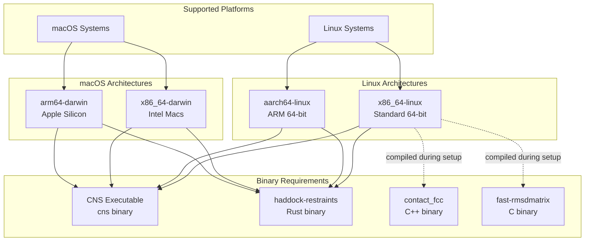
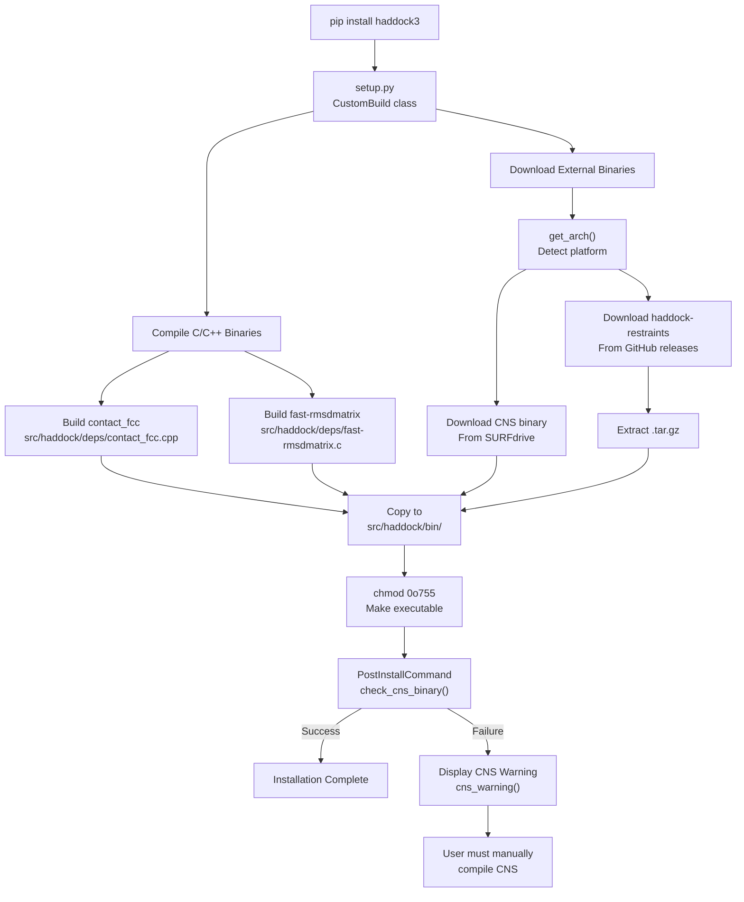
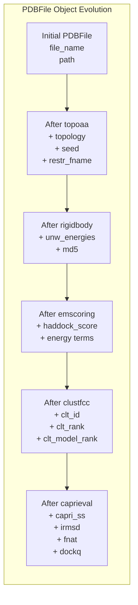
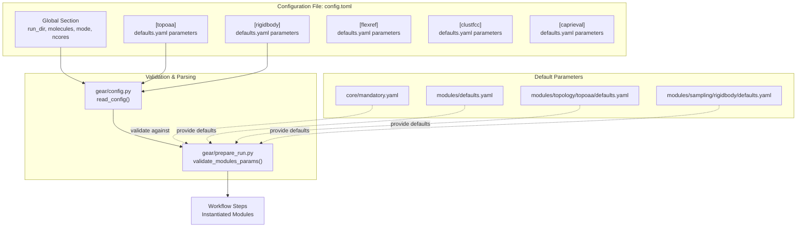
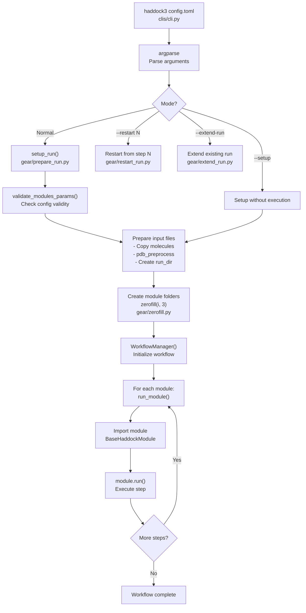
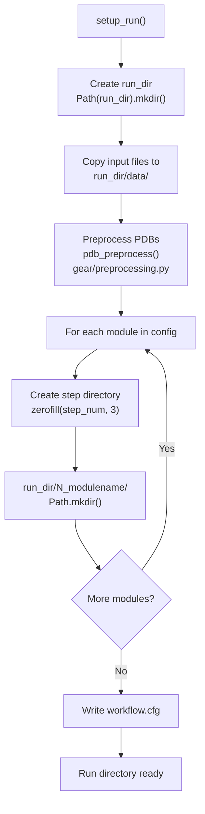

# Getting Started

<details>
<summary>Relevant source files</summary>

The following files were used as context for generating this wiki page:

- [DEVELOPMENT.md](DEVELOPMENT.md)
- [README.md](README.md)
- [devtools/build_defaults_rst.py](devtools/build_defaults_rst.py)
- [docs/INSTALL.md](docs/INSTALL.md)
- [docs/modules/index.rst](docs/modules/index.rst)
- [setup.py](setup.py)
- [src/haddock/modules/_template_cat/README.md](src/haddock/modules/_template_cat/README.md)
- [src/haddock/modules/_template_cat/_template_mod/defaults.yaml](src/haddock/modules/_template_cat/_template_mod/defaults.yaml)

</details>


This page guides you through setting up HADDOCK3 and running your first biomolecular docking workflow. It covers prerequisites, basic installation, configuration file structure, workflow execution, and interpreting results. For detailed installation instructions including troubleshooting, see [Installation](#2.1). For a complete walkthrough with an antibody-antigen example, see [Quick Start Tutorial](#2.2). For comprehensive command-line tool documentation, see [Command Line Interface](#2.3).

## Prerequisites

Before installing HADDOCK3, ensure your system meets these requirements:

| Requirement | Details |
|-------------|---------|
| **Python Version** | 3.9, 3.10, 3.11, 3.12, or 3.13 |
| **Operating System** | Linux (x86_64, aarch64), macOS (x86_64, arm64) |
| **Compilers** | GCC/G++ for building C/C++ binaries |
| **Disk Space** | ~500 MB for installation, additional space for runs |
| **Optional: OpenMPI** | Required only for MPI execution mode |

**System Architecture Compatibility Diagram**



Sources: [setup.py:18-32](), [docs/INSTALL.md:1-20](), [README.md:26]()

## Basic Installation

HADDOCK3 can be installed using Python's package installer `pip`. The installation process automatically downloads platform-specific binaries and compiles required components.

### Standard Installation

```bash
# Create and activate a virtual environment (recommended)
python -m venv .venv
source .venv/bin/activate

# Install HADDOCK3
pip install haddock3
```

### MPI-Enabled Installation

For parallel execution on HPC clusters:

```bash
pip install 'haddock3[mpi]'
```

### Installation from Source

To install the latest development version:

```bash
git clone https://github.com/haddocking/haddock3.git
cd haddock3
pip install .
```

**Installation Process Flow**



Sources: [setup.py:50-296](), [docs/INSTALL.md:8-59](), [README.md:24-48]()

The `CustomBuild` class in `setup.py` handles binary compilation and downloads. The `PostInstallCommand` class validates the CNS executable after installation. If CNS validation fails, users must manually compile CNS following instructions in [docs/CNS.md](). For troubleshooting CNS issues, see [Troubleshooting](#9.3).

## Understanding HADDOCK3 Workflows

HADDOCK3 workflows are composed of sequential **modules** organized into **steps**. Each step performs a specific task in the docking pipeline: topology generation, sampling, refinement, scoring, clustering, or analysis.

**Workflow Module Pipeline**

```mermaid
flowchart LR
    Config["Configuration File<br/>config.toml"] --> Setup["setup_run<br/>gear/prepare_run.py"]
    
    Setup --> WM["WorkflowManager<br/>gear/workflow.py"]
    
    WM --> Step1["Step 0_topoaa<br/>BaseHaddockModule"]
    Step1 --> IO1["ModuleIO<br/>io.json"]
    
    IO1 --> Step2["Step 1_rigidbody<br/>BaseCNSModule"]
    Step2 --> IO2["ModuleIO<br/>io.json"]
    
    IO2 --> Step3["Step 2_flexref<br/>BaseCNSModule"]
    Step3 --> IO3["ModuleIO<br/>io.json"]
    
    IO3 --> Step4["Step 3_caprieval<br/>BaseHaddockModule"]
    Step4 --> IO4["ModuleIO<br/>io.json"]
    
    IO4 --> Report["Analysis Report<br/>HTML/TSV"]
```



Sources: [README.md:55-82]()

### Module Categories

HADDOCK3 organizes modules into six functional categories:

| Category | Purpose | Example Modules | Base Class |
|----------|---------|-----------------|------------|
| **Topology** | Generate molecular topology files | `topoaa` | `BaseHaddockModule` |
| **Sampling** | Explore conformational space | `rigidbody`, `lightdock`, `gdock` | `BaseCNSModule` or module-specific |
| **Refinement** | Improve model quality | `flexref`, `emref`, `mdref` | `BaseCNSModule` |
| **Scoring** | Evaluate structures | `emscoring`, `mdscoring` | `BaseCNSModule` |
| **Analysis** | Calculate metrics and cluster | `caprieval`, `clustfcc`, `alascan` | `BaseHaddockModule` |
| **Extras** | Auxiliary functions | `filter`, `exit` | `BaseHaddockModule` |

Sources: [docs/modules/index.rst:1-25](), [devtools/build_defaults_rst.py:22-46]()

### Data Flow Between Modules

The `ModuleIO` class manages data exchange between workflow steps. Each module exports a list of `PDBFile` objects that are progressively enriched with metadata:



Sources: [README.md:55-82]()

For detailed information on the data flow mechanism, see [Data Flow and ModuleIO](#3.3).

## Your First Configuration File

HADDOCK3 workflows are defined using TOML (Tom's Obvious Minimal Language) configuration files. A configuration file consists of a global section and module-specific sections.

### Basic Configuration Structure

```toml
# run directory configuration
run_dir = "run1-test"

# input molecules
molecules = [
    "data/e2a-hpr_1.pdb",
    "data/e2a-hpr_2.pdb"
]

# general workflow parameters
mode = "local"
ncores = 8

# === Step 1: Topology generation ===
[topoaa]
autohis = true

# === Step 2: Rigid body docking ===
[rigidbody]
sampling = 1000
ambig_fname = "data/e2a-hpr_air.tbl"

# === Step 3: Refinement ===
[flexref]
tolerance = 5

# === Step 4: Clustering ===
[clustfcc]
min_population = 4

# === Step 5: Analysis ===
[caprieval]
reference_fname = "data/e2a-hpr_reference.pdb"
```

**Configuration File Structure Mapping**



Sources: [README.md:55-82](), [src/haddock/modules/_template_cat/_template_mod/defaults.yaml:1-107]()

### Key Configuration Parameters

| Parameter | Type | Description | Example |
|-----------|------|-------------|---------|
| `run_dir` | string | Name of the output directory | `"run1-antibody-antigen"` |
| `molecules` | list | Input PDB file paths | `["protein.pdb", "ligand.pdb"]` |
| `mode` | string | Execution mode: `"local"`, `"mpi"`, or `"batch"` | `"local"` |
| `ncores` | integer | Number of CPU cores for parallel execution | `8` |

Sources: [README.md:55-82]()

Each module section (`[module_name]`) corresponds to a workflow step. Modules are executed in the order they appear in the configuration file. Module parameters are defined in `defaults.yaml` files located in each module's directory (e.g., [src/haddock/modules/topology/topoaa/defaults.yaml]()). Parameters have three expertise levels:

- **easy**: Essential parameters for basic usage
- **expert**: Advanced parameters for fine-tuning
- **guru**: Parameters for experts only

For comprehensive configuration documentation, see [Configuration Files](#5.1) and [Parameter System](#5.2).

## Running Your First Workflow

### Executing with the haddock3 CLI

The primary command-line interface for HADDOCK3 is the `haddock3` executable:

```bash
haddock3 config.toml
```

This command:
1. Parses and validates the configuration file
2. Prepares the run directory with zero-filled module folders (e.g., `0_topoaa`, `1_rigidbody`)
3. Executes modules sequentially via `WorkflowManager`
4. Generates output files in each step directory

**haddock3 CLI Execution Flow**



Sources: [README.md:55-80](), [src/haddock/clis/cli.py]()

### Common CLI Options

The `haddock3` command supports several options:

```bash
haddock3 [-h] [--restart RESTART] [--extend-run EXTEND_RUN] 
         [--setup] [--log-level {DEBUG,INFO,WARNING,ERROR,CRITICAL}] 
         [-v] recipe
```

| Option | Description |
|--------|-------------|
| `recipe` | Path to the configuration file (positional argument) |
| `--restart RESTART` | Restart from a specific step number (deletes subsequent steps) |
| `--extend-run EXTEND_RUN` | Continue from a previously prepared run directory |
| `--setup` | Only setup the run without executing it |
| `--log-level` | Set logging verbosity (`DEBUG`, `INFO`, `WARNING`, `ERROR`, `CRITICAL`) |
| `-v, --version` | Display HADDOCK3 version |
| `-h, --help` | Display help message |

Sources: [README.md:66-80]()

### Execution Modes

HADDOCK3 supports three execution modes configured via the `mode` parameter:

| Mode | Parameter Value | Execution Strategy | Use Case |
|------|----------------|-------------------|----------|
| **Local** | `mode = "local"` | Multiprocessing via `Scheduler` class | Single workstation with multiple cores |
| **MPI** | `mode = "mpi"` | MPI parallel execution via `MPIScheduler` | HPC clusters with MPI support |
| **Batch** | `mode = "batch"` | Grid submission via `GRIDScheduler` | Distributed computing grids (DIRAC) |

For detailed information on execution modes, see [Execution Modes](#6).

## Understanding the Output

HADDOCK3 creates a structured output directory with zero-filled step folders and organized results.

### Output Directory Structure

```
run1-test/
├── 0_topoaa/
│   ├── e2a-hpr_1.psf
│   ├── e2a-hpr_2.psf
│   ├── io.json          # ModuleIO serialization
│   └── topoaa.log
├── 1_rigidbody/
│   ├── rigidbody_1.pdb
│   ├── rigidbody_2.pdb
│   ├── ...
│   ├── rigidbody_1000.pdb
│   ├── rigidbody.out
│   └── io.json
├── 2_flexref/
│   ├── flexref_1.pdb
│   ├── flexref_2.pdb
│   ├── ...
│   └── io.json
├── 3_clustfcc/
│   ├── clustfcc.matrix
│   ├── cluster.out
│   └── io.json
├── 4_caprieval/
│   ├── capri_ss.tsv     # Single structure metrics
│   ├── capri_clt.tsv    # Cluster metrics
│   └── io.json
├── data/                 # Copied input files
│   ├── e2a-hpr_1.pdb
│   ├── e2a-hpr_2.pdb
│   └── e2a-hpr_air.tbl
└── workflow.cfg          # Parsed configuration
```

**Output Directory Generation Process**



Sources: [README.md:55-82]()

### Key Output Files

| File/Directory | Description | Generated By |
|----------------|-------------|--------------|
| `N_modulename/` | Step directory (N is zero-filled) | `zerofill()` in `gear/zerofill.py` |
| `io.json` | Serialized `ModuleIO` containing `PDBFile` objects | `ModuleIO.save()` in each module |
| `*.pdb` | Structure files (models) | CNS execution or analysis modules |
| `*.psf` | Topology files | `topoaa` module |
| `capri_ss.tsv` | Single-structure CAPRI metrics | `caprieval` module |
| `capri_clt.tsv` | Cluster-averaged CAPRI metrics | `caprieval` module |
| `*.log` | Module execution logs | Each module's logging |
| `workflow.cfg` | Expanded configuration with defaults | `setup_run()` |

Sources: [README.md:55-82]()

### The ModuleIO System

The `ModuleIO` class manages data transfer between modules. Each step's `io.json` file contains a serialized list of `PDBFile` objects with accumulated metadata:

```python
# Example PDBFile attributes after clustering and evaluation
{
    "file_name": "flexref_1.pdb",
    "path": "2_flexref/flexref_1.pdb",
    "topology": "0_topoaa/e2a-hpr_complex.psf",
    "unw_energies": {"vdw": -42.3, "elec": -156.7, ...},
    "haddock_score": -123.45,
    "clt_id": 1,
    "clt_rank": 1,
    "clt_model_rank": 1,
    "capri_ss": "medium",
    "irmsd": 2.34,
    "fnat": 0.67,
    "dockq": 0.55
}
```

For comprehensive information on data flow, see [Data Flow and ModuleIO](#3.3).

## Next Steps

Now that you have a basic understanding of HADDOCK3 workflows, explore these resources to deepen your knowledge:

### Tutorials and Examples

- **[Quick Start Tutorial](#2.2)**: Complete antibody-antigen docking example
- **Examples Directory**: [examples/README.md]() contains multiple workflow examples
- **User Manual**: [bonvinlab.org/haddock3-user-manual](https://www.bonvinlab.org/haddock3-user-manual)

### Core Documentation

- **[Workflow System](#3.1)**: Understand `WorkflowManager` and step execution
- **[Module Architecture](#3.2)**: Learn about `BaseHaddockModule` and `BaseCNSModule`
- **[Configuration](#5)**: Master configuration files and the parameter system
- **[Module Reference](#4)**: Comprehensive documentation of all modules

### Advanced Topics

- **[Execution Modes](#6)**: Local, MPI, and grid execution strategies
- **[PDB Preprocessing](#7.1)**: Three-stage preprocessing pipeline
- **[CNS Integration](#7.2)**: How HADDOCK3 interfaces with CNS
- **[Creating New Modules](#8.3)**: Develop custom HADDOCK3 modules

### Getting Help

- **Issues**: Report bugs at [github.com/haddocking/haddock3/issues](https://github.com/haddocking/haddock3/issues)
- **Support**: Ask questions at [ask.bioexcel.eu](https://ask.bioexcel.eu)
- **Troubleshooting**: See [Troubleshooting](#9.3) for common issues

Sources: [README.md:84-134]()

---