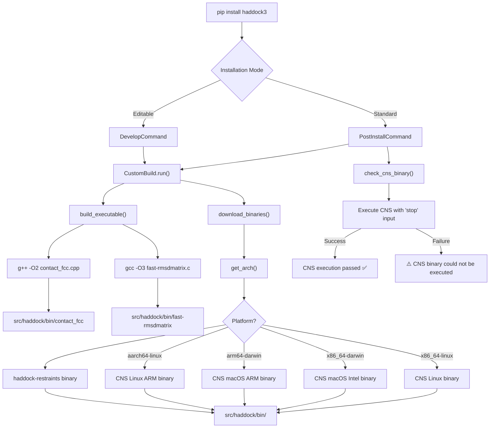
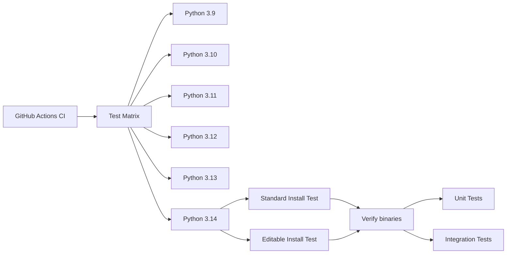

# Installation

<details>
<summary>Relevant source files</summary>

The following files were used as context for generating this wiki page:

- [.github/workflows/ci.yml](.github/workflows/ci.yml)
- [.github/workflows/github-to-gitlab-push-sync.yml](.github/workflows/github-to-gitlab-push-sync.yml)
- [.github/workflows/pages.yml](.github/workflows/pages.yml)
- [.github/workflows/validate_citation.yml](.github/workflows/validate_citation.yml)
- [DEVELOPMENT.md](DEVELOPMENT.md)
- [README.md](README.md)
- [devtools/build_defaults_rst.py](devtools/build_defaults_rst.py)
- [docs/INSTALL.md](docs/INSTALL.md)
- [docs/modules/index.rst](docs/modules/index.rst)
- [setup.py](setup.py)
- [src/haddock/modules/_template_cat/README.md](src/haddock/modules/_template_cat/README.md)
- [src/haddock/modules/_template_cat/_template_mod/defaults.yaml](src/haddock/modules/_template_cat/_template_mod/defaults.yaml)

</details>


## Purpose and Scope

This page provides comprehensive instructions for installing HADDOCK3 across different environments and platforms. It covers system prerequisites, installation methods (standard, editable, and MPI-enabled), the build process including binary compilation and downloads, platform-specific requirements, and troubleshooting common installation issues.

For information about setting up a development environment with additional testing and documentation dependencies, see the development setup process described in [DEVELOPMENT.md:1-136]().

For usage instructions after installation, see [Quick Start Tutorial](#2.2) and [Command Line Interface](#2.3).

---

## System Requirements

HADDOCK3 requires Python 3.9 through 3.13 and several system-level dependencies for compilation and execution.

### Supported Python Versions

| Python Version | Status | CI Testing |
|---------------|--------|------------|
| 3.9 | Supported | Yes |
| 3.10 | Supported | Yes |
| 3.11 | Supported | Yes |
| 3.12 | Supported | Yes |
| 3.13 | Supported | Yes |
| 3.14 | Supported | Yes |

Sources: [.github/workflows/ci.yml:28](), [README.md:26]()

### System Dependencies

**Required for all installations:**
- C/C++ compiler (gcc/g++)
- Standard build tools
- Git (for development installations)

**Required for MPI support:**
- OpenMPI runtime and development libraries (`openmpi-bin`, `libopenmpi3`, `libopenmpi-dev`)

**Ubuntu/Debian installation:**
```bash
sudo apt-get update
sudo apt-get install -y gcc g++ git
sudo apt-get install -y openmpi-bin libopenmpi3 libopenmpi-dev  # For MPI
```

Sources: [.github/workflows/ci.yml:38-41](), [DEVELOPMENT.md:22-33]()

---

## Installation Methods

### Standard Installation

The simplest installation method using pip from PyPI:

```bash
pip install haddock3
```

This installs HADDOCK3 into your Python environment's `site-packages` directory and makes all command-line tools available.

Sources: [README.md:29](), [docs/INSTALL.md:23]()

### Virtual Environment Installation

**Using venv (recommended):**

```bash
python -m venv .venv
source .venv/bin/activate
pip install haddock3
```

**Using conda:**

```bash
conda create -n haddock3 python=3.9
conda activate haddock3
pip install haddock3
```

Sources: [docs/INSTALL.md:8-24](), [DEVELOPMENT.md:70-73]()

### Editable Installation (Development Mode)

For development work where you need live code changes:

```bash
git clone https://github.com/haddocking/haddock3.git
cd haddock3
pip install -e '.[dev,docs]'
```

The `-e` flag creates an editable installation where changes to source files are immediately reflected without reinstalling. The `DevelopCommand` class handles building executables in-place in the source directory.

Sources: [README.md:42-45](), [DEVELOPMENT.md:79-81](), [setup.py:183-221]()

### MPI-Enabled Installation

To enable parallel execution using MPI (requires OpenMPI installed):

```bash
pip install 'haddock3[mpi]'
```

Or for development:

```bash
pip install -e '.[mpi,dev,docs]'
```

This installs the `mpi4py` dependency required for the `MPIScheduler`. For usage instructions, see [MPI Execution](#6.2).

Sources: [README.md:36](), [docs/INSTALL.md:28-30](), [DEVELOPMENT.md:85-87]()

---

## Build System Architecture

The installation process involves compiling C/C++ binaries and downloading platform-specific executables. This is orchestrated by custom build commands in `setup.py`.

**Build System Flow Diagram**



Sources: [setup.py:50-221](), [setup.py:223-287]()

### Build Components

**1. C/C++ Binary Compilation**

The `CustomBuild` class compiles two performance-critical binaries:

- **`contact_fcc`**: C++ implementation for FCC (Fraction of Common Contacts) clustering
  - Compilation command: `g++ -O2 -o contact_fcc src/haddock/deps/contact_fcc.cpp`
  - Sources: [setup.py:56-59](), [setup.py:36-40]()

- **`fast-rmsdmatrix`**: C implementation for fast RMSD matrix calculation
  - Compilation command: `gcc -Wall -O3 -march=native -std=c99 -o fast-rmsdmatrix src/haddock/deps/fast-rmsdmatrix.c -lm`
  - Sources: [setup.py:60-73](), [setup.py:41-46]()

**2. External Binary Downloads**

The build system downloads pre-compiled binaries based on detected platform:

**CNS Executable:**

| Platform | Architecture | Download URL |
|----------|-------------|--------------|
| `x86_64-linux` | Linux x86-64 | `https://surfdrive.surf.nl/.../BWa5OimzbNliTi6/download` |
| `x86_64-darwin` | macOS Intel | `https://surfdrive.surf.nl/.../3Fzzte0Zx0L8GTY/download` |
| `arm64-darwin` | macOS ARM | `https://surfdrive.surf.nl/.../bYB3xPWf7iwo07X/download` |
| `aarch64-linux` | Linux ARM | `https://surfdrive.surf.nl/.../3rHpxcufHGrntHn/download` |

Sources: [setup.py:18-23]()

**haddock-restraints Binary:**

Version: `0.10.0` (from GitHub releases)

| Platform | Binary Archive |
|----------|----------------|
| `x86_64-linux` | `haddock-restraints-v0.10.0-x86_64-unknown-linux-musl.tar.gz` |
| `x86_64-darwin` | `haddock-restraints-v0.10.0-x86_64-apple-darwin.tar.gz` |
| `arm64-darwin` | `haddock-restraints-v0.10.0-aarch64-apple-darwin.tar.gz` |
| `aarch64-linux` | `haddock-restraints-v0.10.0-aarch64-unknown-linux-musl.tar.gz` |

Sources: [setup.py:25-32]()

**3. Platform Detection**

The `get_arch()` method detects the system platform and machine architecture:

```python
system = platform.system().lower()  # "linux", "darwin"
machine = platform.machine().lower()  # "x86_64", "arm64", "aarch64"
return f"{machine}-{system}"  # e.g., "x86_64-linux"
```

Sources: [setup.py:174-180]()

---

## Installation Modes Comparison

```mermaid
graph TB
    subgraph StandardMode["Standard Installation"]
        StdPip["pip install haddock3"]
        StdPip --> StdBuildLib["Build to build_lib/"]
        StdBuildLib --> StdSitePackages["Install to site-packages/haddock/"]
        StdSitePackages --> StdBinPath["Binaries: site-packages/haddock/bin/"]
    end
    
    subgraph EditableMode["Editable Installation"]
        DevPip["pip install -e ."]
        DevPip --> DevBuildInplace["Build in-place"]
        DevBuildInplace --> DevSrcDir["Links to src/haddock/"]
        DevSrcDir --> DevBinPath["Binaries: src/haddock/bin/"]
        DevBinPath --> LiveChanges["Live code changes active"]
    end
    
    subgraph MPIMode["MPI Installation"]
        MPIPip["pip install 'haddock3[mpi]'"]
        MPIPip --> MPIBuildLib["Standard build process"]
        MPIBuildLib --> MPIDeps["+ Install mpi4py"]
        MPIDeps --> MPISitePackages["Install to site-packages/"]
    end
```



Sources: [setup.py:183-221](), [setup.py:223-230](), [README.md:28-37]()

| Mode | Command | Build Location | Use Case | Code Changes |
|------|---------|----------------|----------|--------------|
| Standard | `pip install haddock3` | `build_lib/` → `site-packages/` | Production use | Requires reinstall |
| Editable | `pip install -e .` | In-place in `src/` | Development | Immediately active |
| MPI | `pip install 'haddock3[mpi]'` | `build_lib/` → `site-packages/` | Parallel execution | Requires reinstall |

---

## Post-Installation Verification

### CNS Binary Validation

The `PostInstallCommand` class automatically tests the CNS binary after standard installation:

```python
# Executes: cns with "stop\n" as input
proc = subprocess.run(
    [cns_path],
    input="stop\n",
    text=True,
    stdout=subprocess.DEVNULL,
    stderr=subprocess.DEVNULL,
)
```

**Success:** Displays "CNS execution passed ✅"

**Failure:** Shows warning about missing system libraries and directs to troubleshooting documentation.

Sources: [setup.py:232-246](), [setup.py:248-286]()

### Manual Verification

**Check installed binaries:**

```bash
# For standard installation
pip show haddock3  # Get installation location
ls -l <location>/haddock/bin/

# For editable installation
ls -l src/haddock/bin/
```

Required binaries:
- `contact_fcc` (executable)
- `fast-rmsdmatrix` (executable)
- `cns` (executable)
- `haddock-restraints` (executable)
- `cns_linux` (executable, on non-Linux platforms for GRID execution)

Sources: [.github/workflows/ci.yml:111-119]()

**Verify HADDOCK3 CLI:**

```bash
haddock3 --version
haddock3 -h
```

Sources: [README.md:66-79]()

---

## Troubleshooting

### CNS Binary Execution Failures

**Problem:** CNS binary fails to execute with library errors

**Diagnosis:**
```bash
/path/to/site-packages/haddock/bin/cns
# Check for error messages about missing .so files
```

**Solution:** Recompile CNS from source

1. Follow instructions in the CNS compilation guide
2. Locate your HADDOCK3 installation:
   ```bash
   pip show haddock3
   # Note the "Location" field
   ```
3. Replace the binary:
   ```bash
   cp <your-compiled-cns> <location>/haddock/bin/cns
   ```

Sources: [docs/INSTALL.md:34-58](), [DEVELOPMENT.md:103-127]()

### Compilation Failures

**Missing compiler:**
```
Error: gcc/g++ command not found
```

**Solution:** Install build tools
```bash
# Ubuntu/Debian
sudo apt-get install build-essential gcc g++

# macOS
xcode-select --install
```

Sources: [DEVELOPMENT.md:22-33]()

**MPI compilation issues on macOS:**
```
Error building mpi4py
```

**Solution:** Install via homebrew first
```bash
brew install mpi4py
pip install -e '.[mpi]'
```

Sources: [DEVELOPMENT.md:89]()

### Platform Detection Issues

**Problem:** Unsupported architecture detected

**Diagnosis:**
```python
import platform
print(f"{platform.machine()}-{platform.system()}".lower())
```

**Supported platforms:**
- `x86_64-linux`
- `x86_64-darwin`
- `arm64-darwin`
- `aarch64-linux`

If your platform is not listed, you must compile CNS from source.

Sources: [setup.py:124-125](), [setup.py:174-180]()

### Editable Installation Binary Issues

**Problem:** Binaries not found after `pip install -e .`

**Verification:**
```bash
ls -l src/haddock/bin/
# Should show: contact_fcc, fast-rmsdmatrix, cns, haddock-restraints
```

**Solution:** The `DevelopCommand` should build binaries in-place automatically. If missing:
```bash
# Rebuild
pip uninstall haddock3
pip install -e .
```

Sources: [setup.py:183-221](), [.github/workflows/ci.yml:111-119]()

---

## Optional Dependencies

### Third-Party Sampling Modules

**LightDock (outdated):**
```bash
# Install in same environment
pip install lightdock
```

**GDock (outdated):**
```bash
cd some-folder
git clone https://github.com/rvhonorato/gdock.git
pip install deap scipy mgzip biopython
export GDOCK_PATH=some-folder
```

Sources: [docs/INSTALL.md:77-108]()

### OpenMM Module Support

**venv installation (Python ≥3.10):**
```bash
pip install openmm==8.2.0
pip install https://github.com/openmm/pdbfixer/archive/refs/tags/v1.10.tar.gz
```

**conda installation (Python 3.9-3.13):**
```bash
conda install -c conda-forge libstdcxx-ng
conda install -c conda-forge openmm==8.2.0 pdbfixer==1.10
```

Sources: [docs/INSTALL.md:110-151]()

### Restraints Web Service

For running the FastAPI-based restraints web service:

```bash
pip install uvicorn fastapi
```

Sources: [docs/INSTALL.md:60-68]()

---

## Continuous Integration Testing

HADDOCK3 installation is continuously tested across multiple Python versions and installation modes:

**CI Matrix Testing:**



**Standard installation test:**
```bash
pip install '.[mpi,dev,docs,notebooks]'
pytest -v tests/
pytest -v integration_tests/
```

**Editable installation test:**
```bash
pip install -e '.[mpi,dev,docs,notebooks]'
# Verify binaries in src/haddock/bin/
pytest tests/
```

Sources: [.github/workflows/ci.yml:20-88](), [.github/workflows/ci.yml:89-120]()

---

## Advanced: HPC Environment Installation

For installation on High-Performance Computing clusters, coordinate with system administrators regarding:

1. **Available Python versions** (via `module` system)
2. **MPI implementation** (OpenMPI, MPICH, Intel MPI)
3. **Compiler toolchains** (gcc version, Intel compilers)
4. **Shared filesystem considerations** for binary paths

**Recommended approach:**
```bash
# Load appropriate modules
module load python/3.11
module load openmpi/4.1.0
module load gcc/11.2.0

# Install in user space
python -m venv ~/haddock3-env
source ~/haddock3-env/bin/activate
pip install 'haddock3[mpi]'
```

For distributed execution across compute nodes, see [Grid Execution](#6.3).

Sources: [DEVELOPMENT.md:129-136]()

---

## Summary

HADDOCK3 installation involves:

1. **Environment setup**: Python 3.9-3.13 with system dependencies
2. **Installation mode selection**: Standard, editable, or MPI-enabled
3. **Automated build process**: Compilation of C/C++ binaries and platform-specific downloads
4. **Post-installation verification**: CNS binary execution test
5. **Optional components**: Third-party modules and web service dependencies

The build system automatically handles platform detection, binary compilation, and dependency management through custom setuptools commands. For most users, `pip install haddock3` provides a complete, working installation.

---