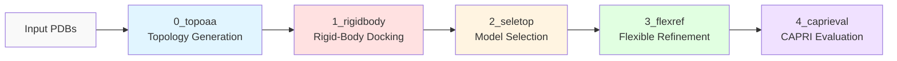
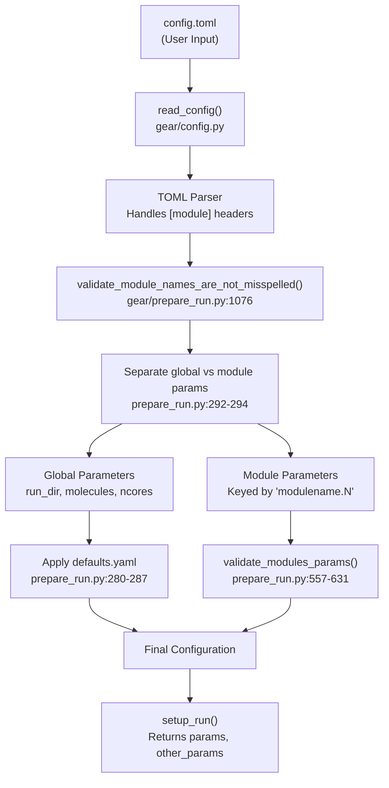
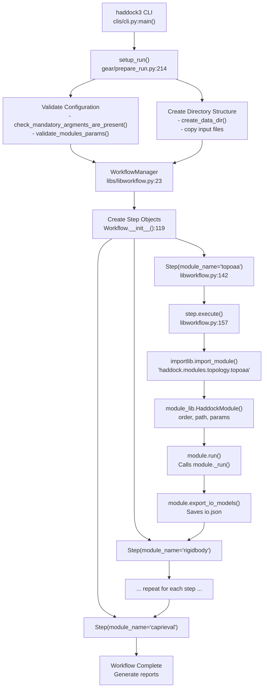
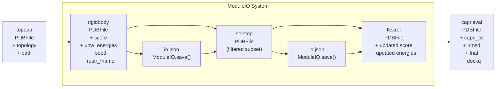
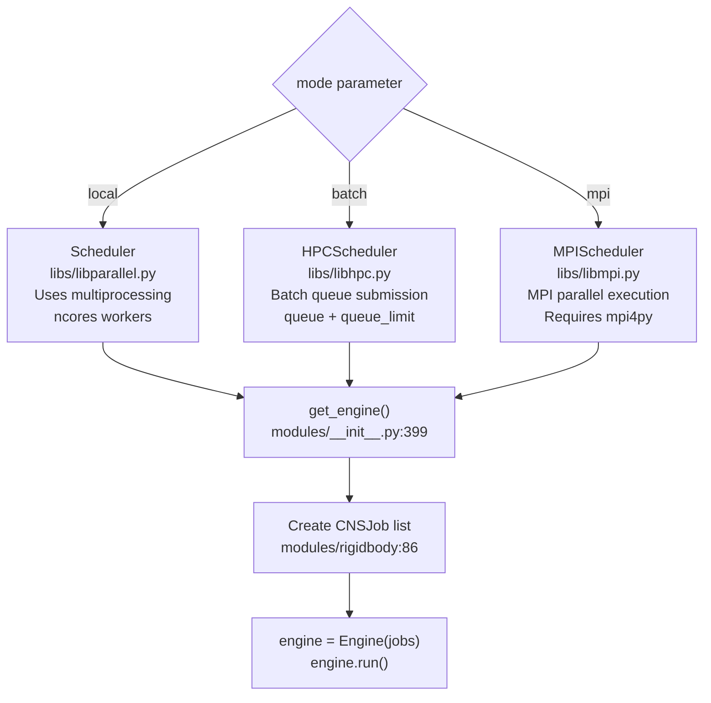

# Quick Start Tutorial

<details>
<summary>Relevant source files</summary>

The following files were used as context for generating this wiki page:

- [CHANGELOG.md](CHANGELOG.md)
- [notebooks/HADDOCK3-antibody-antigen.ipynb](notebooks/HADDOCK3-antibody-antigen.ipynb)
- [notebooks/README.md](notebooks/README.md)
- [pyproject.toml](pyproject.toml)
- [src/haddock/__init__.py](src/haddock/__init__.py)
- [src/haddock/clis/cli.py](src/haddock/clis/cli.py)
- [src/haddock/clis/wrapper_haddock_restraints.py](src/haddock/clis/wrapper_haddock_restraints.py)
- [src/haddock/core/defaults.py](src/haddock/core/defaults.py)
- [src/haddock/gear/config.py](src/haddock/gear/config.py)
- [src/haddock/gear/prepare_run.py](src/haddock/gear/prepare_run.py)
- [src/haddock/gear/zerofill.py](src/haddock/gear/zerofill.py)
- [src/haddock/libs/libnotebooks.py](src/haddock/libs/libnotebooks.py)
- [src/haddock/libs/libutil.py](src/haddock/libs/libutil.py)
- [src/haddock/libs/libworkflow.py](src/haddock/libs/libworkflow.py)
- [src/haddock/modules/__init__.py](src/haddock/modules/__init__.py)
- [src/haddock/modules/analysis/clustfcc/__init__.py](src/haddock/modules/analysis/clustfcc/__init__.py)
- [src/haddock/modules/analysis/seletop/__init__.py](src/haddock/modules/analysis/seletop/__init__.py)
- [src/haddock/modules/analysis/seletopclusts/__init__.py](src/haddock/modules/analysis/seletopclusts/__init__.py)
- [src/haddock/modules/refinement/emref/__init__.py](src/haddock/modules/refinement/emref/__init__.py)
- [src/haddock/modules/refinement/flexref/__init__.py](src/haddock/modules/refinement/flexref/__init__.py)
- [src/haddock/modules/refinement/mdref/__init__.py](src/haddock/modules/refinement/mdref/__init__.py)
- [src/haddock/modules/sampling/gdock/__init__.py](src/haddock/modules/sampling/gdock/__init__.py)
- [src/haddock/modules/sampling/lightdock/__init__.py](src/haddock/modules/sampling/lightdock/__init__.py)
- [src/haddock/modules/sampling/rigidbody/__init__.py](src/haddock/modules/sampling/rigidbody/__init__.py)
- [src/haddock/modules/scoring/emscoring/__init__.py](src/haddock/modules/scoring/emscoring/__init__.py)
- [src/haddock/modules/scoring/mdscoring/__init__.py](src/haddock/modules/scoring/mdscoring/__init__.py)
- [src/haddock/modules/topology/topoaa/__init__.py](src/haddock/modules/topology/topoaa/__init__.py)
- [tests/test_gear_config.py](tests/test_gear_config.py)
- [tests/test_gear_prepare_run.py](tests/test_gear_prepare_run.py)
- [tests/test_gear_zerofill.py](tests/test_gear_zerofill.py)
- [tests/test_libutil.py](tests/test_libutil.py)

</details>


**Purpose**: This tutorial guides you through running your first complete HADDOCK3 docking workflow using a practical antibody-antigen example. You will learn how to create a configuration file, execute a workflow, and interpret basic results.

**Scope**: Covers the essential steps from configuration to execution for a standard protein-protein docking scenario. For installation instructions, see [Installation](#2.1). For detailed command-line options, see [Command Line Interface](#2.3). For in-depth module descriptions, see [Module Reference](#4).

---

## Prerequisites

Before starting this tutorial, ensure you have:
- HADDOCK3 installed (see [Installation](#2.1))
- Basic familiarity with the command line
- Input PDB files for your molecules

The tutorial uses an antibody-antigen complex as an example, demonstrating the standard HADDOCK3 workflow suitable for most protein-protein docking scenarios.

Sources: [notebooks/HADDOCK3-antibody-antigen.ipynb:1-147](), [notebooks/README.md:1-51]()

---

## Tutorial Workflow Overview

This tutorial implements a five-stage workflow that mirrors the traditional HADDOCK2.x protocol but with modular flexibility:



**Workflow Pipeline - Code Entity Mapping**

| Stage | Module Class | Primary Function | Output |
|-------|-------------|------------------|---------|
| 0 | `HaddockModule` in `topoaa` | `_run()` generates CNS topology | `.psf`, `.pdb` files |
| 1 | `HaddockModule` in `rigidbody` | `_run()` performs rigid-body docking | `rigidbody_N.pdb` models |
| 2 | `HaddockModule` in `seletop` | `_run()` selects top N models | Selected subset |
| 3 | `HaddockModule` in `flexref` | `_run()` semi-flexible refinement | `flexref_N.pdb` models |
| 4 | `HaddockModule` in `caprieval` | `_run()` calculates CAPRI metrics | `capri_ss.tsv`, `capri_clt.tsv` |

Sources: [src/haddock/modules/topology/topoaa/__init__.py:102-357](), [src/haddock/modules/sampling/rigidbody/__init__.py:50-272](), [src/haddock/modules/analysis/seletop/__init__.py:22-66](), [src/haddock/modules/refinement/flexref/__init__.py:40-160]()

---

## Configuration File Structure

HADDOCK3 workflows are defined in TOML-like configuration files. The configuration consists of two parts: **global parameters** and **module definitions**.

### Basic Configuration Template

```toml
# Global parameters (apply to all modules unless overridden)
run_dir = "run1-antibody-antigen"
molecules = ["antibody.pdb", "antigen.pdb"]
mode = "local"
ncores = 8

# Module definitions (executed sequentially)
[topoaa]
# Topology generation parameters

[rigidbody]
sampling = 1000
ambig_fname = "ambig.tbl"

[seletop]
select = 200

[flexref]
# Flexible refinement parameters

[caprieval]
reference_fname = "reference.pdb"
```

**Configuration Processing Flow**



Sources: [src/haddock/gear/config.py:1-55](), [src/haddock/gear/prepare_run.py:214-430]()

---

## Step-by-Step Execution

### Step 1: Prepare Input Files

Organize your working directory with the following structure:

```
tutorial/
├── config.toml           # Workflow configuration
├── antibody.pdb          # Input structure 1
├── antigen.pdb           # Input structure 2
└── ambig.tbl            # Restraints file (optional)
```

**Required File Formats**:
- **PDB files**: Standard PDB format with chain identifiers
- **Restraints files** (`.tbl`): CNS-format distance restraints (see [Restraints](#5.3))

Sources: [src/haddock/gear/prepare_run.py:948-1002](), [notebooks/HADDOCK3-antibody-antigen.ipynb:155-180]()

### Step 2: Create Configuration File

Create `config.toml` with the following content:

```toml
# ==================================================================
# HADDOCK3 configuration for antibody-antigen docking
# ==================================================================

# Global execution parameters
run_dir = "run1-antibody-antigen"
molecules = ["antibody.pdb", "antigen.pdb"]
mode = "local"
ncores = 8

# Stage 0: Generate all-atom topologies
[topoaa]

# Stage 1: Rigid-body docking (it0)
[rigidbody]
sampling = 1000                    # Number of models to generate
ambig_fname = "ambig.tbl"         # Ambiguous restraints file
# For ab-initio mode without restraints, use:
# cmrest = true                   # Center-of-mass restraints

# Stage 2: Select top models for refinement
[seletop]
select = 200                       # Keep top 200 models
sortby = "score"                   # Sort by HADDOCK score

# Stage 3: Semi-flexible refinement (it1)
[flexref]
tolerance = 5                      # Allow 5% failures

# Stage 4: Evaluate against reference (optional)
[caprieval]
reference_fname = "reference.pdb"  # Known structure for comparison
```

**Key Configuration Parameters**:

| Parameter | Type | Location | Purpose |
|-----------|------|----------|---------|
| `run_dir` | string | global | Output directory name |
| `molecules` | list | global | Input PDB file paths |
| `mode` | string | global | Execution mode (`local`, `batch`, `mpi`) |
| `ncores` | integer | global | Number of CPU cores |
| `sampling` | integer | module | Number of models per combination |
| `ambig_fname` | path | module | Path to AIR restraints file |
| `select` | integer | module | Number of models to pass forward |

Sources: [src/haddock/gear/parameters.py:56-59]() (referenced in prepare_run.py), [src/haddock/modules/__init__.py:62-71]()

### Step 3: Execute the Workflow

Run HADDOCK3 using the `haddock3` command-line tool:

```bash
haddock3 config.toml
```

**Execution Flow - Code Components**



Sources: [src/haddock/clis/cli.py:76-214](), [src/haddock/libs/libworkflow.py:23-191]()

### Step 4: Monitor Execution

During execution, HADDOCK3 creates a run directory with numbered step folders:

```
run1-antibody-antigen/
├── 0_topoaa/
│   ├── antibody_1_haddock.pdb
│   ├── antibody_1_haddock.psf
│   ├── antigen_1_haddock.pdb
│   ├── antigen_1_haddock.psf
│   ├── io.json
│   └── params.cfg
├── 1_rigidbody/
│   ├── rigidbody_1.pdb
│   ├── rigidbody_2.pdb
│   ├── ... (1000 models)
│   ├── io.json
│   └── params.cfg
├── 2_seletop/
│   ├── seletop.txt
│   ├── io.json
│   └── params.cfg
├── 3_flexref/
│   ├── flexref_1.pdb
│   ├── ... (200 models)
│   ├── io.json
│   └── params.cfg
├── 4_caprieval/
│   ├── capri_ss.tsv
│   ├── capri_clt.tsv
│   └── io.json
├── data/
│   └── configurations/
└── haddock3.log
```

**Key Output Files**:
- `io.json`: Inter-module communication file (see `MODULE_IO_FILE` constant)
- `params.cfg`: Module-specific parameters used during execution
- `haddock3.log`: Complete execution log with timestamps

Sources: [src/haddock/modules/__init__.py:22-23](), [src/haddock/core/defaults.py:22-23](), [src/haddock/gear/zerofill.py:1-103]()

---

## Understanding Output and Results

### Module Output Structure

Each module produces models enriched with metadata. The `PDBFile` class progressively accumulates information:



**Data Flow via ModuleIO**

The `ModuleIO` class manages inter-module communication through serialization:

| Method | File | Purpose |
|--------|------|---------|
| `ModuleIO.add()` | [libs/libontology.py]() | Adds models to input/output |
| `ModuleIO.save()` | [libs/libontology.py]() | Serializes to `io.json` |
| `ModuleIO.load()` | [libs/libontology.py]() | Deserializes from `io.json` |
| `retrieve_models()` | [libs/libontology.py]() | Returns models for next step |

Sources: [src/haddock/modules/__init__.py:270-310](), [src/haddock/modules/sampling/rigidbody/__init__.py:262-271]()

### Key Result Files

**1. CAPRI Evaluation Output** (`4_caprieval/capri_ss.tsv`):

Contains per-structure quality metrics:

| Column | Description | Code Reference |
|--------|-------------|----------------|
| `model` | Structure filename | - |
| `score` | HADDOCK score | `HaddockModel.calc_haddock_score()` |
| `irmsd` | Interface RMSD | `caprieval` module |
| `fnat` | Fraction native contacts | `caprieval` module |
| `lrmsd` | Ligand RMSD | `caprieval` module |
| `dockq` | DockQ score | `caprieval` module |
| `capri_rank` | Quality classification | Single/Medium/High/Acceptable |

**2. Model Scoring** (`3_flexref/flexref_N.pdb`):

Each PDB file header contains energy terms extracted by `HaddockModel`:

```python
# Energy terms stored in PDBFile.unw_energies (dict)
# Calculated by gear/haddockmodel.py:HaddockModel.energies
```

Sources: [src/haddock/modules/refinement/flexref/__init__.py:150-156](), [src/haddock/modules/sampling/rigidbody/__init__.py:262-270]()

---

## Common Configuration Patterns

### Pattern 1: Ab-initio Docking (No Restraints)

```toml
[rigidbody]
sampling = 2000
cmrest = true              # Center-of-mass restraints
# Do NOT specify ambig_fname
```

**Validation Logic**: The `rigidbody` module enforces restraint requirements via `restraints_guardrail()`:

Sources: [src/haddock/modules/sampling/rigidbody/__init__.py:172-194]()

### Pattern 2: Information-Driven Docking

```toml
[rigidbody]
sampling = 1000
ambig_fname = "ambig.tbl"          # Active/passive residues
unambig_fname = "unambig.tbl"      # Known interactions
hbond_fname = "hbond.tbl"          # Hydrogen bond restraints
```

### Pattern 3: Multiple Refinement Rounds

```toml
[seletop]
select = 400

# First refinement
[flexref]
tolerance = 5

[seletop.1]
select = 200

# Second refinement
[flexref.1]
tolerance = 5
```

**Module Indexing**: The configuration system automatically assigns unique identifiers (`modulename.N`) to repeated modules using the logic in `identify_modules()`.

Sources: [src/haddock/gear/prepare_run.py:1060-1063](), [src/haddock/gear/config.py:73-95]()

---

## Workflow Execution Modes

HADDOCK3 supports three execution modes controlled by the `mode` parameter:



**Mode Selection Guidelines**:

| Mode | Use Case | Parameters | Command |
|------|----------|------------|---------|
| `local` | Desktop/laptop | `ncores`, `max_cpus` | `haddock3 config.toml` |
| `batch` | HPC cluster | `queue`, `queue_limit`, `concat` | `haddock3 config.toml` |
| `mpi` | MPI environment | `ncores` | `mpirun -n N haddock3-mpitask config.toml` |

Sources: [src/haddock/modules/__init__.py:396-443](), [pyproject.toml:83-97]()

---

## Troubleshooting Common Issues

### Issue 1: Module Name Misspelled

**Error**: `Module r1g1dbod1 not found in HADDOCK3 library`

**Cause**: The configuration contains an invalid module name detected by `validate_module_names_are_not_misspelled()`.

**Solution**: Check available module names:
```bash
haddock3-cfg -h
```

Sources: [src/haddock/gear/prepare_run.py:1076-1100]()

### Issue 2: Parameter Type Mismatch

**Error**: `Wrong provided type "str" with value "text". It should be of type "integer"`

**Cause**: Parameter validation via `validate_param_type()` found incorrect data type.

**Solution**: Check the parameter type in module documentation or `defaults.yaml`.

Sources: [src/haddock/gear/prepare_run.py:689-717](), [tests/test_gear_prepare_run.py:268-303]()

### Issue 3: Missing Input Files

**Error**: `File not found: 'path/to/file'`

**Cause**: The `check_if_path_exists()` function cannot locate specified files.

**Solution**: Verify file paths are relative to config file location or use absolute paths.

Sources: [src/haddock/gear/prepare_run.py:1046-1058]()

### Issue 4: Too Many Models

**Error**: `Too many models (2000) to refine, max_nmodels = 1000`

**Cause**: Safety limit in refinement modules (`max_nmodels` parameter).

**Solution**: Reduce models using `seletop` before refinement or increase `max_nmodels`:

```toml
[flexref]
max_nmodels = 2000
```

Sources: [src/haddock/modules/refinement/flexref/__init__.py:78-85](), [src/haddock/modules/refinement/emref/__init__.py:64-71]()

---

## Next Steps

After completing this tutorial, you can:

1. **Customize workflows**: Add clustering (`clustfcc`), additional scoring (`emscoring`), or analysis modules (`contactmap`)
2. **Explore advanced features**: Multi-stage refinement, ensemble docking, or custom restraints
3. **Understand module details**: See [Module Reference](#4) for comprehensive module documentation
4. **Learn advanced configuration**: See [Configuration Files](#5.1) and [Parameter System](#5.2)
5. **Optimize performance**: See [Execution Modes](#6) for parallel execution strategies

**Additional Resources**:
- Online tutorial: https://www.bonvinlab.org/education/HADDOCK3/HADDOCK3-antibody-antigen/
- Interactive notebooks: [notebooks/README.md]()
- Module catalog: [Module Catalog](#9.1)
- Troubleshooting guide: [Troubleshooting](#9.3)

Sources: [notebooks/HADDOCK3-antibody-antigen.ipynb:1-64](), [notebooks/README.md:11-16](), [CHANGELOG.md:1-23]()

---