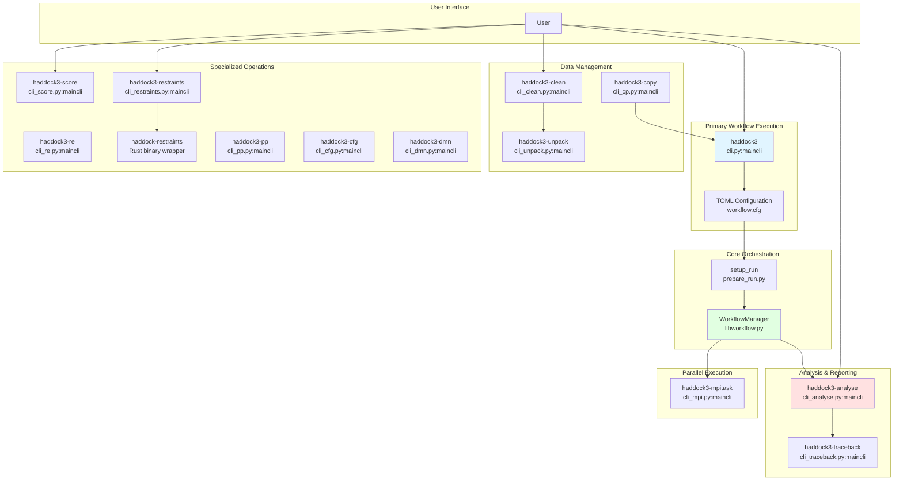
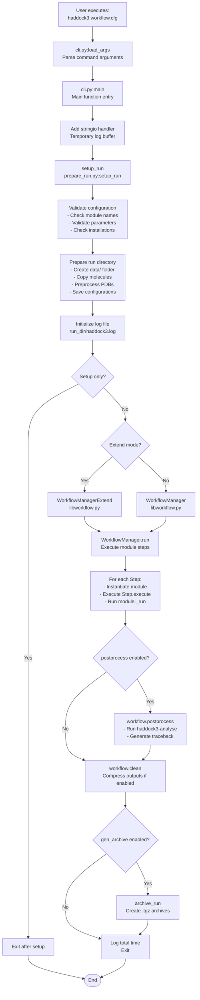
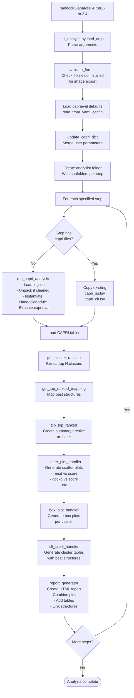
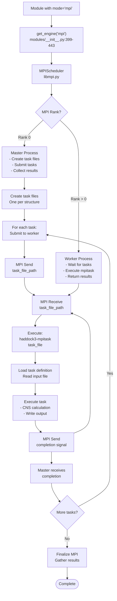

# Command Line Interface

<details>
<summary>Relevant source files</summary>

The following files were used as context for generating this wiki page:

- [CHANGELOG.md](CHANGELOG.md)
- [notebooks/HADDOCK3-antibody-antigen.ipynb](notebooks/HADDOCK3-antibody-antigen.ipynb)
- [notebooks/README.md](notebooks/README.md)
- [pyproject.toml](pyproject.toml)
- [src/haddock/__init__.py](src/haddock/__init__.py)
- [src/haddock/clis/cli.py](src/haddock/clis/cli.py)
- [src/haddock/clis/cli_analyse.py](src/haddock/clis/cli_analyse.py)
- [src/haddock/clis/wrapper_haddock_restraints.py](src/haddock/clis/wrapper_haddock_restraints.py)
- [src/haddock/core/defaults.py](src/haddock/core/defaults.py)
- [src/haddock/gear/config.py](src/haddock/gear/config.py)
- [src/haddock/gear/prepare_run.py](src/haddock/gear/prepare_run.py)
- [src/haddock/gear/zerofill.py](src/haddock/gear/zerofill.py)
- [src/haddock/libs/libnotebooks.py](src/haddock/libs/libnotebooks.py)
- [src/haddock/libs/libplots.py](src/haddock/libs/libplots.py)
- [src/haddock/libs/libutil.py](src/haddock/libs/libutil.py)
- [src/haddock/libs/libworkflow.py](src/haddock/libs/libworkflow.py)
- [src/haddock/modules/__init__.py](src/haddock/modules/__init__.py)
- [tests/data/capri_ss_-cluster.tsv](tests/data/capri_ss_-cluster.tsv)
- [tests/golden_data/capri_clt_example.tsv](tests/golden_data/capri_clt_example.tsv)
- [tests/golden_data/capri_ss_example.tsv](tests/golden_data/capri_ss_example.tsv)
- [tests/test_cli_analyse.py](tests/test_cli_analyse.py)
- [tests/test_gear_config.py](tests/test_gear_config.py)
- [tests/test_gear_prepare_run.py](tests/test_gear_prepare_run.py)
- [tests/test_gear_zerofill.py](tests/test_gear_zerofill.py)
- [tests/test_libplots.py](tests/test_libplots.py)
- [tests/test_libutil.py](tests/test_libutil.py)

</details>


## Purpose and Scope

This document describes the command-line interface (CLI) tools provided by HADDOCK3. These tools enable users to execute workflows, analyze results, manage data, and perform various operations on HADDOCK3 runs. For information about configuring workflows through configuration files, see [Configuration Files](#5.1). For details on module parameters, see [Parameter System](#5.2).

The HADDOCK3 CLI ecosystem comprises 15 distinct command-line tools, each designed for specific tasks in the docking workflow pipeline. This document details the purpose, arguments, and usage patterns of each tool.

---

## CLI Tools Overview

HADDOCK3 provides multiple command-line tools, all registered as console scripts in the package installation. The following table lists all available tools and their primary purposes:

| CLI Tool | Entry Point | Primary Purpose |
|----------|-------------|-----------------|
| `haddock3` | `haddock.clis.cli:maincli` | Execute HADDOCK3 workflows |
| `haddock3-mpitask` | `haddock.clis.cli_mpi:maincli` | MPI-based parallel task execution |
| `haddock3-analyse` | `haddock.clis.cli_analyse:maincli` | Generate analysis reports with interactive plots |
| `haddock3-cfg` | `haddock.clis.cli_cfg:maincli` | Configuration file utilities |
| `haddock3-clean` | `haddock.clis.cli_clean:maincli` | Clean/compress run outputs |
| `haddock3-copy` | `haddock.clis.cli_cp:maincli` | Copy runs for extension |
| `haddock3-dmn` | `haddock.clis.cli_dmn:maincli` | Domain manipulation utilities |
| `haddock3-pp` | `haddock.clis.cli_pp:maincli` | PDB preprocessing |
| `haddock3-score` | `haddock.clis.cli_score:maincli` | Score existing structures |
| `haddock3-unpack` | `haddock.clis.cli_unpack:maincli` | Uncompress archived outputs |
| `haddock3-traceback` | `haddock.clis.cli_traceback:maincli` | Generate workflow traceback visualizations |
| `haddock3-re` | `haddock.clis.cli_re:maincli` | Refine existing structures |
| `haddock3-restraints` | `haddock.clis.cli_restraints:maincli` | Restraint file manipulation (Python) |
| `haddock-restraints` | `haddock.clis.wrapper_haddock_restraints:main` | Restraint generation (Rust binary wrapper) |

**Sources:** [pyproject.toml:83-97]()

---

## CLI Architecture Diagram



**Sources:** [pyproject.toml:83-97](), [src/haddock/clis/cli.py:1-218](), [src/haddock/libs/libworkflow.py:1-191]()

---

## Main Workflow Execution: `haddock3`

### Command Signature

```bash
haddock3 <workflow_config> [--restart N] [--extend-run PATH] [--setup] [--log-level LEVEL] [--version]
```

The `haddock3` command is the primary entry point for executing HADDOCK3 workflows. It reads a configuration file defining the workflow pipeline and orchestrates the execution of all modules.

### Command Line Arguments

| Argument | Type | Required | Description |
|----------|------|----------|-------------|
| `workflow` | path | Yes | Path to TOML configuration file describing the workflow |
| `--restart` | int | No | Step number to restart from (inclusive). Module folders after this step are removed |
| `--extend-run` | path | No | Path to a run copied with `haddock3-copy` to extend with additional modules |
| `--setup` | flag | No | Only setup the run directory without executing modules |
| `--log-level` | str | No | Logging verbosity: INFO, DEBUG, ERROR, WARNING, CRITICAL (default: INFO) |
| `--version` | flag | No | Display HADDOCK3 version and exit |

**Sources:** [src/haddock/clis/cli.py:35-59]()

### Workflow Execution Flow

The following diagram shows how the `haddock3` command processes the configuration and executes the workflow:



**Sources:** [src/haddock/clis/cli.py:81-214](), [src/haddock/libs/libworkflow.py:23-96](), [src/haddock/gear/prepare_run.py:214-430]()

### Configuration File Requirements

The workflow configuration file must be in TOML format and define:

1. **Global parameters** - `run_dir`, `molecules`, `mode`, `ncores`, etc.
2. **Module definitions** - Each module as a `[module_name]` section with its parameters

Example minimal configuration:

```toml
run_dir = "run1-docking"
molecules = ["protein1.pdb", "protein2.pdb"]
mode = "local"
ncores = 8

[topoaa]
autohis = true

[rigidbody]
sampling = 1000

[caprieval]
reference_fname = "reference.pdb"
```

**Sources:** [src/haddock/gear/config.py:1-284](), [src/haddock/gear/prepare_run.py:276-288]()

### Restart and Extend Modes

#### Restart Mode (`--restart N`)

When `--restart` is specified:
1. Folders after step N are removed from the run directory
2. Data files after step N in `data/` are removed
3. Step folders are renumbered to accommodate new modules
4. Compressed files are automatically unpacked
5. Execution resumes from step N

**Sources:** [src/haddock/gear/prepare_run.py:332-336](), [src/haddock/gear/restart_run.py]()

#### Extend Mode (`--extend-run PATH`)

When `--extend-run` is specified:
1. The run directory is taken from the PATH argument (created by `haddock3-copy`)
2. Existing step folders are renumbered to accommodate new modules
3. The number of molecules is read from the existing run
4. Execution starts after the last existing step

**Sources:** [src/haddock/gear/prepare_run.py:309-391](), [src/haddock/gear/extend_run.py]()

---

## Analysis and Reporting: `haddock3-analyse`

### Command Signature

```bash
haddock3-analyse -r <run_dir> -m <module_numbers> [options]
```

The `haddock3-analyse` tool generates comprehensive analysis reports for specified workflow steps, including interactive plots, structure tables, and CAPRI evaluations.

### Command Line Arguments

| Argument | Type | Required | Description |
|----------|------|----------|-------------|
| `-r`, `--run-dir` | path | Yes | Path to the HADDOCK3 run directory |
| `-m`, `--modules` | int+ | Yes | Space-separated list of module step numbers to analyze |
| `-t`, `--top_clusters` | int | No | Number of top clusters to include in analysis (default: 10) |
| `--format` | str | No | Export plots as images: png, jpeg, webp, svg, pdf, eps |
| `--scale` | float | No | Scale factor for exported images (default: 1.0) |
| `--inter` | bool | No | Analyze only interactive-labeled steps (default: False) |
| `--is_cleaned` | bool | No | Whether the directory will be cleaned (affects file paths) |
| `--offline` | bool | No | Generate self-contained plots without CDN dependencies |
| `--mode` | str | No | Execution mode for caprieval: local, batch, mpi (default: local) |
| `--ncores` | int | No | Number of cores for parallel execution (default: 1) |
| `--self-contained` | bool | No | Copy models locally in analysis directory (default: False) |
| `-p`, `--other-params` | key=value | No | Additional caprieval module parameters |

**Sources:** [src/haddock/clis/cli_analyse.py:71-177]()

### Analysis Workflow

The `haddock3-analyse` command performs the following operations:



**Sources:** [src/haddock/clis/cli_analyse.py:253-302](), [src/haddock/clis/cli_analyse.py:510-641](), [src/haddock/clis/cli_analyse.py:690-757]()

### Generated Outputs

For each analyzed step, `haddock3-analyse` creates:

1. **HTML plots** - Interactive scatter and box plots for metrics (irmsd, dockq, fnat, etc.)
2. **Summary archive/folder** - Top-ranked structures per cluster
3. **Analysis report** - Comprehensive HTML report combining all visualizations
4. **TSV tables** - Cluster statistics and structure rankings

If `--format` is specified, static images are also exported in the requested format.

**Sources:** [src/haddock/libs/libplots.py:244-323](), [src/haddock/libs/libplots.py:401-646](), [src/haddock/libs/libplots.py:878-977]()

---

## Data Management Tools

### `haddock3-clean`: Compress Run Outputs

Compresses PDB files and other outputs to reduce disk usage.

```bash
haddock3-clean <run_dir> [--ncores N]
```

This tool recursively compresses `.pdb` files to `.pdb.gz` using gzip compression. It operates in parallel when multiple cores are specified.

**Sources:** [pyproject.toml:87]()

### `haddock3-unpack`: Decompress Archived Files

Reverses the compression performed by `haddock3-clean`.

```bash
haddock3-unpack <path> [--ncores N]
```

Decompresses `.gz` files and extracts `.tgz` archives in the specified directory. Used automatically during `--restart` and `--extend-run` operations.

**Sources:** [pyproject.toml:92](), [src/haddock/gear/prepare_run.py:343-351]()

### `haddock3-copy`: Prepare Run for Extension

Creates a copy of a run directory suitable for extension with `--extend-run`.

```bash
haddock3-copy <source_run> <destination>
```

This command:
1. Copies the run directory structure
2. Preserves module outputs and `io.json` files
3. Allows adding new modules to an existing workflow

**Sources:** [pyproject.toml:88](), [src/haddock/gear/extend_run.py]()

---

## Restraints Generation

### `haddock3-restraints`: Python-based Restraints Tool

Provides Python-based utilities for manipulating restraint files.

```bash
haddock3-restraints <subcommand> [options]
```

Available subcommands include restraint file validation, conversion, and filtering operations.

**Sources:** [pyproject.toml:96]()

### `haddock-restraints`: Rust Binary Wrapper

Wrapper for the compiled Rust binary that generates restraints with high performance.

```bash
haddock-restraints <subcommand> [options]
```

This command locates the pre-compiled `haddock-restraints` binary from the installation package and executes it with the provided arguments. The binary is downloaded during installation based on the platform architecture.

**Implementation:**

```python
# Locates binary: src/haddock/bin/haddock-restraints
binary = Path(files("haddock").joinpath("bin/haddock-restraints"))
sys.exit(subprocess.run([str(binary)] + sys.argv[1:]).returncode)
```

**Sources:** [pyproject.toml:97](), [src/haddock/clis/wrapper_haddock_restraints.py:1-21]()

---

## Specialized Tools

### `haddock3-score`: Score Existing Structures

Re-scores existing PDB models without performing docking.

```bash
haddock3-score <structures> [--config CONFIG]
```

This tool loads structures and evaluates them using HADDOCK scoring functions without running molecular dynamics or docking protocols.

**Sources:** [pyproject.toml:91]()

### `haddock3-re`: Interactive Refinement

Enables interactive refinement of selected structures from a previous run.

```bash
haddock3-re <run_dir> [options]
```

Creates an interactive refinement session where users can select specific structures for additional processing without re-running the entire workflow.

**Sources:** [pyproject.toml:95](), [src/haddock/core/defaults.py:33-34]()

### `haddock3-traceback`: Workflow Visualization

Generates visual traceback diagrams showing the flow of structures through the workflow.

```bash
haddock3-traceback <run_dir> [--offline]
```

Creates interactive diagrams that trace which input structures produced which output structures at each workflow step. This is automatically called during postprocessing.

**Sources:** [pyproject.toml:94](), [src/haddock/libs/libworkflow.py:92-95]()

### `haddock3-pp`: PDB Preprocessing

Preprocesses PDB files before docking to ensure compatibility with HADDOCK3.

```bash
haddock3-pp <pdb_file> [options]
```

Applies the three-stage preprocessing pipeline: line-by-line corrections, whole-PDB validations, and combined-PDB corrections. For details on the preprocessing stages, see [PDB Preprocessing](#7.1).

**Sources:** [pyproject.toml:90](), [src/haddock/gear/preprocessing.py]()

### `haddock3-cfg`: Configuration Utilities

Provides utilities for working with configuration files.

```bash
haddock3-cfg <operation> [options]
```

Operations include configuration file validation, conversion between formats, and parameter inspection.

**Sources:** [pyproject.toml:86]()

### `haddock3-dmn`: Domain Manipulation

Tools for manipulating protein domains in structures.

```bash
haddock3-dmn <operation> <structure> [options]
```

Enables domain-level operations such as extraction, rotation, and manipulation for multi-domain docking scenarios.

**Sources:** [pyproject.toml:89]()

---

## MPI Execution: `haddock3-mpitask`

### Command Signature

```bash
haddock3-mpitask <task_file>
```

The `haddock3-mpitask` command is used internally by the MPI execution engine to run individual tasks in parallel across MPI ranks. This command is not typically invoked directly by users but is called by the `MPIScheduler` when `mode = "mpi"` is set in the configuration.

### MPI Execution Flow

When a module is executed in MPI mode, the following process occurs:



**Sources:** [pyproject.toml:85](), [src/haddock/modules/__init__.py:432-433](), [src/haddock/libs/libmpi.py]()

### Task File Format

Each MPI task is defined by a task file containing:
- Input PDB file path
- CNS input script
- Output file path
- Execution parameters

The task file is pickled and transmitted between MPI ranks for execution.

**Sources:** [src/haddock/libs/libmpi.py]()

---

## Common CLI Patterns

### Help and Version Information

All CLI tools support `--help` and `--version` flags:

```bash
haddock3 --help
haddock3 --version
haddock3-analyse --help
```

**Sources:** [src/haddock/libs/libcli.py]()

### Log Level Control

Most tools accept `--log-level` to control output verbosity:

```bash
haddock3 workflow.cfg --log-level DEBUG
haddock3-analyse -r run1 -m 2 --log-level WARNING
```

Valid levels: DEBUG, INFO, WARNING, ERROR, CRITICAL

**Sources:** [src/haddock/clis/cli.py:57](), [src/haddock/libs/liblog.py]()

### Parallel Execution

Tools supporting parallelization accept `--ncores`:

```bash
haddock3-clean run1 --ncores 8
haddock3-unpack run1/2_caprieval --ncores 4
```

The number of cores is parsed and validated by `parse_ncores()` which ensures it doesn't exceed available system resources.

**Sources:** [src/haddock/libs/libutil.py:178-241]()

---

## CLI Integration with Core Systems

The CLI tools serve as entry points to the core HADDOCK3 systems:

| CLI Tool | Core System | Connection Point |
|----------|-------------|------------------|
| `haddock3` | Workflow Orchestration | `setup_run()` → `WorkflowManager` |
| `haddock3-mpitask` | Parallel Execution | `MPIScheduler` → task execution |
| `haddock3-analyse` | Analysis & Visualization | `scatter_plot_handler()`, `box_plot_handler()`, `report_generator()` |
| `haddock3-clean` | Data Management | `clean_output()` |
| `haddock3-unpack` | Data Management | `unpack_compressed_and_archived_files()` |
| `haddock3-restraints` | Restraints System | Direct restraint manipulation |
| `haddock-restraints` | Restraints System | Rust binary for restraint generation |

For more details on these core systems, see [Workflow System](#3.1), [Data Flow and ModuleIO](#3.3), and [Restraints](#5.3).

**Sources:** [src/haddock/clis/cli.py:111-214](), [src/haddock/clis/cli_analyse.py:253-641](), [src/haddock/gear/clean_steps.py]()

---