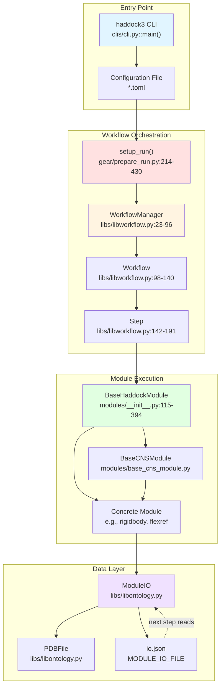
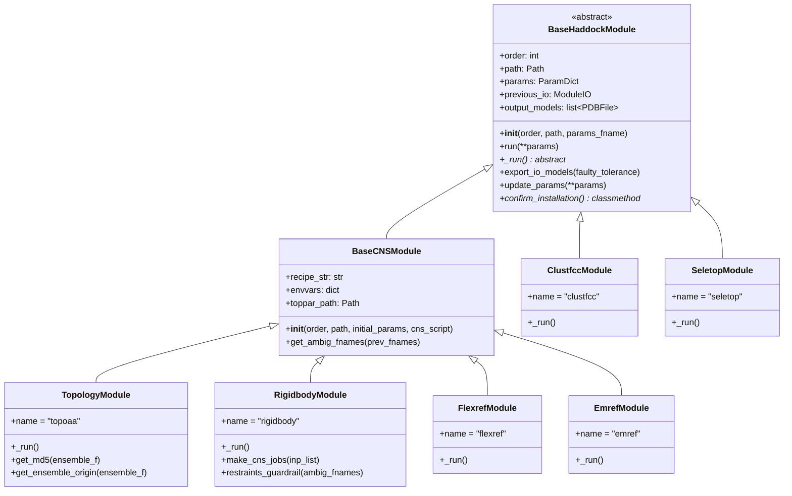
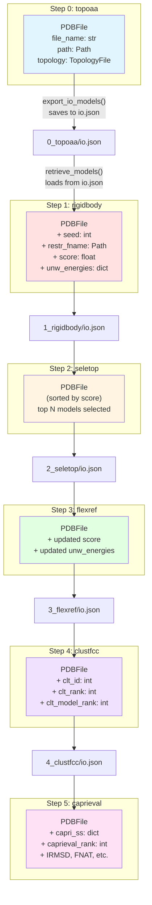
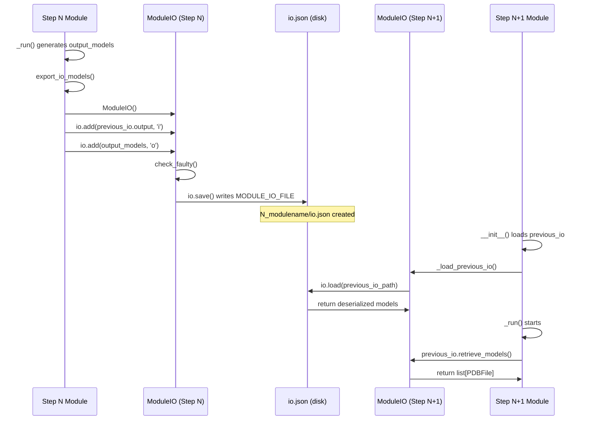
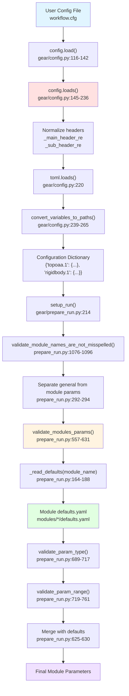
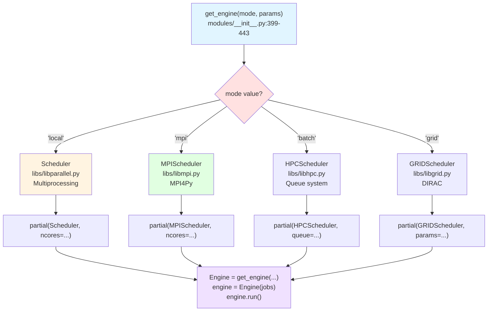

# Core Concepts

<details>
<summary>Relevant source files</summary>

The following files were used as context for generating this wiki page:

- [src/haddock/__init__.py](src/haddock/__init__.py)
- [src/haddock/clis/cli.py](src/haddock/clis/cli.py)
- [src/haddock/core/defaults.py](src/haddock/core/defaults.py)
- [src/haddock/gear/config.py](src/haddock/gear/config.py)
- [src/haddock/gear/prepare_run.py](src/haddock/gear/prepare_run.py)
- [src/haddock/gear/zerofill.py](src/haddock/gear/zerofill.py)
- [src/haddock/libs/libutil.py](src/haddock/libs/libutil.py)
- [src/haddock/libs/libworkflow.py](src/haddock/libs/libworkflow.py)
- [src/haddock/modules/__init__.py](src/haddock/modules/__init__.py)
- [src/haddock/modules/analysis/clustfcc/__init__.py](src/haddock/modules/analysis/clustfcc/__init__.py)
- [src/haddock/modules/analysis/seletop/__init__.py](src/haddock/modules/analysis/seletop/__init__.py)
- [src/haddock/modules/analysis/seletopclusts/__init__.py](src/haddock/modules/analysis/seletopclusts/__init__.py)
- [src/haddock/modules/refinement/emref/__init__.py](src/haddock/modules/refinement/emref/__init__.py)
- [src/haddock/modules/refinement/flexref/__init__.py](src/haddock/modules/refinement/flexref/__init__.py)
- [src/haddock/modules/refinement/mdref/__init__.py](src/haddock/modules/refinement/mdref/__init__.py)
- [src/haddock/modules/sampling/gdock/__init__.py](src/haddock/modules/sampling/gdock/__init__.py)
- [src/haddock/modules/sampling/lightdock/__init__.py](src/haddock/modules/sampling/lightdock/__init__.py)
- [src/haddock/modules/sampling/rigidbody/__init__.py](src/haddock/modules/sampling/rigidbody/__init__.py)
- [src/haddock/modules/scoring/emscoring/__init__.py](src/haddock/modules/scoring/emscoring/__init__.py)
- [src/haddock/modules/scoring/mdscoring/__init__.py](src/haddock/modules/scoring/mdscoring/__init__.py)
- [src/haddock/modules/topology/topoaa/__init__.py](src/haddock/modules/topology/topoaa/__init__.py)
- [tests/test_gear_config.py](tests/test_gear_config.py)
- [tests/test_gear_prepare_run.py](tests/test_gear_prepare_run.py)
- [tests/test_gear_zerofill.py](tests/test_gear_zerofill.py)
- [tests/test_libutil.py](tests/test_libutil.py)

</details>


This page explains the fundamental architecture and design patterns that underpin HADDOCK3. It provides a conceptual overview of how workflows are structured, how modules interact, and how data flows through the system.

For detailed information about specific aspects:
- Workflow execution details: see [Workflow System](#3.1)
- Module implementation: see [Module Architecture](#3.2)
- Data structures and model enrichment: see [Data Flow and ModuleIO](#3.3)

---

## Architectural Overview

HADDOCK3 implements a **workflow-based plugin architecture** where docking workflows are composed of sequential modules that progressively transform and analyze molecular structures. The system is organized into three core layers:

| Layer | Key Components | Responsibility |
|-------|---------------|----------------|
| **Workflow Orchestration** | `WorkflowManager`, `Workflow`, `Step` | Manages execution sequence and module lifecycle |
| **Module Ecosystem** | `BaseHaddockModule`, category-specific modules | Implements computational tasks (sampling, refinement, analysis) |
| **Data Exchange** | `ModuleIO`, `PDBFile` | Passes structural data and metadata between modules |

### Workflow-Module-Data Flow



**Sources:** [src/haddock/clis/cli.py:81-214](), [src/haddock/gear/prepare_run.py:214-430](), [src/haddock/libs/libworkflow.py:23-191](), [src/haddock/modules/__init__.py:115-394]()

---

## Workflow Lifecycle

The workflow execution follows a strict lifecycle from configuration parsing through module execution to final cleanup.

### Execution Pipeline with Code Entities

```mermaid
flowchart TD
    Start([User executes haddock3]) --> ParseConfig["config.loads()<br/>gear/config.py:145-236"]
    
    ParseConfig --> Validate["setup_run()<br/>gear/prepare_run.py:214"]
    
    Validate --> ValidateSteps["validate_modules_params()<br/>prepare_run.py:557-631"]
    
    ValidateSteps --> CreateDirs["Create run directory<br/>zero_fill.fill()"]
    
    CreateDirs --> InitWorkflow["WorkflowManager.__init__()<br/>libworkflow.py:26-37"]
    
    InitWorkflow --> LoopSteps{For each Step}
    
    LoopSteps --> CreateStep["Step.__init__()<br/>libworkflow.py:145-155"]
    
    CreateStep --> ExecuteStep["Step.execute()<br/>libworkflow.py:157-182"]
    
    ExecuteStep --> ImportModule["importlib.import_module()<br/>libworkflow.py:165"]
    
    ImportModule --> InstantiateModule["HaddockModule.__init__()<br/>modules/*/init.py"]
    
    InstantiateModule --> UpdateParams["module.update_params()<br/>modules/__init__.py:154-207"]
    
    UpdateParams --> RunModule["module.run()<br/>modules/__init__.py:238-248"]
    
    RunModule --> ModuleRun["module._run()<br/>Implemented by each module"]
    
    ModuleRun --> RetrieveModels["previous_io.retrieve_models()<br/>libontology.py"]
    
    RetrieveModels --> ProcessData["Process structures<br/>Module-specific logic"]
    
    ProcessData --> ExportIO["module.export_io_models()<br/>modules/__init__.py:271-310"]
    
    ExportIO --> SaveIO["io.save()<br/>libontology.py"]
    
    SaveIO --> CheckMore{More steps?}
    
    CheckMore -->|Yes| LoopSteps
    CheckMore -->|No| Postprocess["workflow.postprocess()<br/>libworkflow.py:62-96"]
    
    Postprocess --> Clean["workflow.clean()<br/>libworkflow.py:48-61"]
    
    Clean --> End([Workflow Complete])
    
    style ParseConfig fill:#e1f5ff
    style Validate fill:#ffe1e1
    style InstantiateModule fill:#fff4e1
    style RetrieveModels fill:#e1ffe1
    style ExportIO fill:#f0e1ff
```



**Sources:** [src/haddock/clis/cli.py:81-214](), [src/haddock/gear/prepare_run.py:214-430](), [src/haddock/libs/libworkflow.py:23-191](), [src/haddock/modules/__init__.py:115-394]()

### Key Lifecycle Methods

| Phase | Method | Location | Purpose |
|-------|--------|----------|---------|
| **Setup** | `setup_run()` | [gear/prepare_run.py:214-430]() | Validates config, creates directories, prepares input files |
| **Workflow Init** | `WorkflowManager.__init__()` | [libs/libworkflow.py:26-37]() | Creates `Workflow` and `Step` objects |
| **Step Execution** | `Step.execute()` | [libs/libworkflow.py:157-182]() | Imports module, instantiates, runs |
| **Module Run** | `BaseHaddockModule.run()` | [modules/__init__.py:238-248]() | Calls `_run()` within working directory |
| **Data Export** | `export_io_models()` | [modules/__init__.py:271-310]() | Saves outputs to `io.json` |

---

## Module System

HADDOCK3 implements a **plugin-based module system** where all computational tasks inherit from `BaseHaddockModule`. Modules are organized into categories that correspond to docking workflow stages.

### Module Class Hierarchy



**Sources:** [src/haddock/modules/__init__.py:115-394](), [src/haddock/modules/topology/topoaa/__init__.py:102-357](), [src/haddock/modules/sampling/rigidbody/__init__.py:50-272](), [src/haddock/modules/refinement/flexref/__init__.py:40-160]()

### Module Categories

Modules are organized by the `modules_category` dictionary defined in [modules/__init__.py:43-47]():

| Category | Purpose | Example Modules |
|----------|---------|-----------------|
| **topology** | Generate CNS topologies | `topoaa` |
| **sampling** | Generate initial docking poses | `rigidbody`, `lightdock`, `gdock` |
| **refinement** | Improve structure quality | `flexref`, `emref`, `mdref` |
| **scoring** | Evaluate models | `emscoring`, `mdscoring` |
| **analysis** | Analyze and cluster results | `caprieval`, `clustfcc`, `alascan` |

The category determines the module's import path: `haddock.modules.{category}.{module_name}` [libs/libworkflow.py:162-165]().

### Module Discovery and Loading

```mermaid
graph LR
    ConfigFile["Config File<br/>[topoaa]<br/>[rigidbody]"] --> GetModuleName["get_module_name()<br/>gear/config.py:295-306"]
    
    GetModuleName --> LookupCategory["modules_category<br/>modules/__init__.py:43-47"]
    
    LookupCategory --> BuildPath["Build import path<br/>'haddock.modules.{category}.{name}'"]
    
    BuildPath --> ImportModule["importlib.import_module()<br/>libworkflow.py:165"]
    
    ImportModule --> InstantiateClass["HaddockModule(order, path)<br/>Each module's __init__.py"]
    
    InstantiateClass --> ConfirmInstall["HaddockModule.confirm_installation()<br/>Check dependencies"]
    
    ConfirmInstall --> Ready["Module Ready"]
    
    style ConfigFile fill:#e1f5ff
    style LookupCategory fill:#ffe1e1
    style ImportModule fill:#fff4e1
    style ConfirmInstall fill:#e1ffe1
```



**Sources:** [src/haddock/gear/config.py:295-306](), [src/haddock/modules/__init__.py:43-47](), [src/haddock/libs/libworkflow.py:162-166]()

---

## Data Flow Between Modules

Data flows between modules through the `ModuleIO` interface, which serializes and deserializes `PDBFile` objects to `io.json` files in each module's directory.

### PDBFile Enrichment Pipeline



**Sources:** [src/haddock/modules/__init__.py:271-310](), [src/haddock/modules/__init__.py:320-336]()

### ModuleIO Interface

The `ModuleIO` class manages inter-module communication through file-based serialization:

| Method | Purpose | Location |
|--------|---------|----------|
| `retrieve_models()` | Load models from previous step's `io.json` | Referenced in module `_run()` methods |
| `export_io_models()` | Save current models to `io.json` | [modules/__init__.py:271-310]() |
| `add()` | Add models to input/output tracking | Used within `export_io_models()` |
| `save()` | Write `io.json` to disk | Called by `export_io_models()` |
| `load()` | Read `io.json` from previous step | [modules/__init__.py:332]() |
| `check_faulty()` | Detect missing output files | [modules/__init__.py:295]() |

The `MODULE_IO_FILE` constant (`"io.json"`) defines the filename used for data exchange [core/defaults.py:22-23]().

### Data Exchange Pattern



**Sources:** [src/haddock/modules/__init__.py:271-310](), [src/haddock/modules/__init__.py:320-336]()

---

## Configuration System

HADDOCK3 uses TOML-like configuration files with extensions to support repeated module definitions. The configuration system validates parameters against `defaults.yaml` files in each module directory.

### Configuration Processing Flow



**Sources:** [src/haddock/gear/config.py:116-265](), [src/haddock/gear/prepare_run.py:214-631]()

### Parameter Validation

Each module defines its parameters in `defaults.yaml` with type, range, and documentation:

```yaml
# Example from defaults.yaml
sampling:
  type: integer
  default: 1000
  min: 1
  max: 100000
  explevel: easy
  
ambig_fname:
  type: file
  default: null
  explevel: easy
```

The validation process in [prepare_run.py:633-686]():

1. **Type validation** - `validate_param_type()` checks against `TYPES_MAPPER` [prepare_run.py:101-140]()
2. **Range validation** - `validate_param_range()` checks min/max/choices [prepare_run.py:719-761]()
3. **Fuzzy matching** - `fuzzy_match()` suggests corrections for typos [prepare_run.py:1149-1181]()
4. **NCS validation** - `validate_ncs_params()` validates non-crystallographic symmetry [prepare_run.py:764-867]()

---

## Execution Modes

HADDOCK3 supports three execution modes for computational tasks, selected via the `mode` parameter.

### Engine Selection Pattern



**Sources:** [src/haddock/modules/__init__.py:399-443](), [src/haddock/modules/sampling/rigidbody/__init__.py:253-256]()

### Execution Mode Comparison

| Mode | Scheduler Class | Use Case | Job Distribution |
|------|----------------|----------|------------------|
| **local** | `Scheduler` | Single machine, multiprocessing | Python `multiprocessing` pool |
| **mpi** | `MPIScheduler` | HPC cluster with MPI | `mpi4py` task distribution |
| **batch** | `HPCScheduler` | HPC queue systems | Submit to queue (e.g., SLURM) |
| **grid** | `GRIDScheduler` | DIRAC grid computing | Grid job submission |

All scheduler classes implement a common interface:
- Constructor accepts job parameters and lists
- `run()` method executes all jobs
- `results` attribute contains outputs (for `local` mode)

Example usage in modules [sampling/rigidbody/__init__.py:253-256]():
```python
Engine = get_engine(self.params["mode"], self.params)
engine = Engine(jobs)
engine.run()
```

---

## Directory Structure and Zero-Fill Convention

HADDOCK3 creates a structured run directory with zero-filled numeric prefixes for module folders.

### Zero-Fill System

The `zero_fill` singleton manages folder naming [gear/zerofill.py:102]():

```python
# Example usage
zero_fill.read(modules_params)  # Determines required digits
zero_fill.zfnum  # Returns number of digits needed
zero_fill.fill("topoaa", 0)  # Returns "00_topoaa" (if zfnum=2)
```

The zero-fill number is calculated from the total number of modules [gear/zerofill.py:116-130]():
- 1-10 modules → 1 digit (`0_topoaa`, `1_rigidbody`, ..., `9_module`)
- 11-100 modules → 2 digits (`00_topoaa`, `01_rigidbody`, ..., `99_module`)
- 101-1000 modules → 3 digits

This ensures proper alphabetical sorting of module directories.

### Run Directory Structure

```
run_dir/
├── data/
│   ├── configurations/
│   │   ├── raw_input.toml
│   │   ├── cleaned_input.toml
│   │   └── enhanced_haddock_params.json
│   ├── 00_topoaa/
│   │   └── (copied input molecules)
│   └── 01_rigidbody/
│       └── (restraint files, etc.)
├── 00_topoaa/
│   ├── params.cfg
│   ├── io.json
│   ├── *.pdb (output structures)
│   └── *.psf (topology files)
├── 01_rigidbody/
│   ├── params.cfg
│   ├── io.json
│   ├── rigidbody_1.pdb
│   ├── rigidbody_1.out (CNS log)
│   └── ...
└── haddock3.log
```

**Sources:** [src/haddock/gear/zerofill.py:28-136](), [src/haddock/gear/prepare_run.py:926-937]()

---

## Summary

HADDOCK3's core architecture consists of:

1. **Workflow Orchestration**: `WorkflowManager` → `Workflow` → `Step` sequence controls execution [libs/libworkflow.py:23-191]()

2. **Module Plugin System**: All modules inherit from `BaseHaddockModule`, organized by category [modules/__init__.py:115-394]()

3. **Data Exchange**: `ModuleIO` serializes `PDBFile` objects to `io.json` between steps, progressively enriching metadata [modules/__init__.py:271-336]()

4. **Configuration**: TOML-like files validated against `defaults.yaml`, with type and range checking [gear/config.py:116-265](), [gear/prepare_run.py:557-761]()

5. **Flexible Execution**: Pluggable scheduler system supports local, MPI, batch, and grid modes [modules/__init__.py:399-443]()

This architecture provides extensibility (new modules easily added), maintainability (clear interfaces), and flexibility (multiple execution environments) for complex biomolecular docking workflows.

---