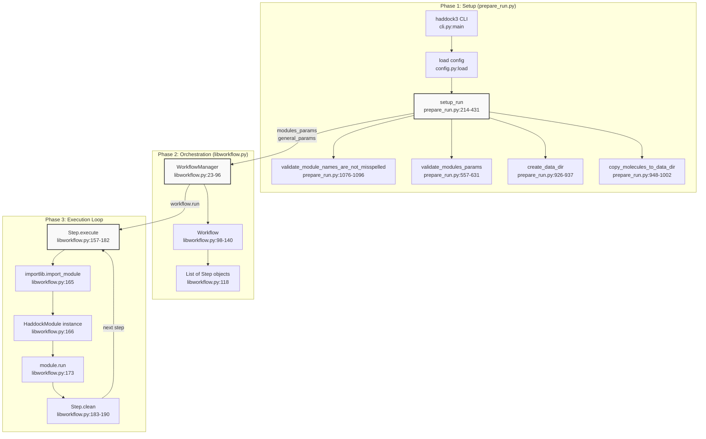
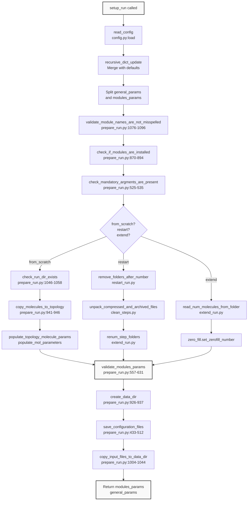
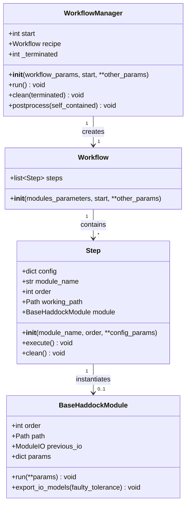
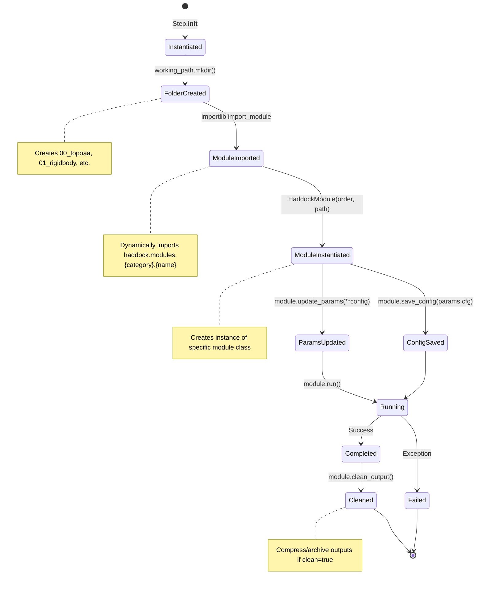
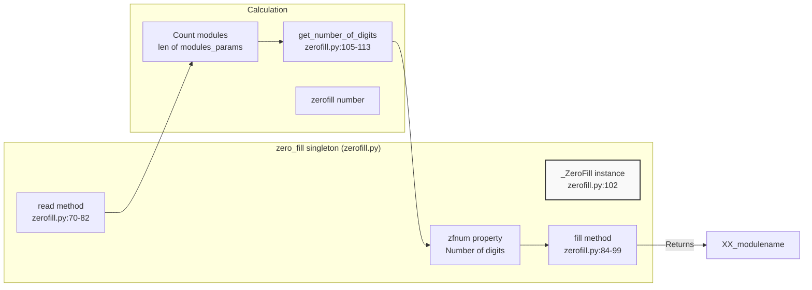
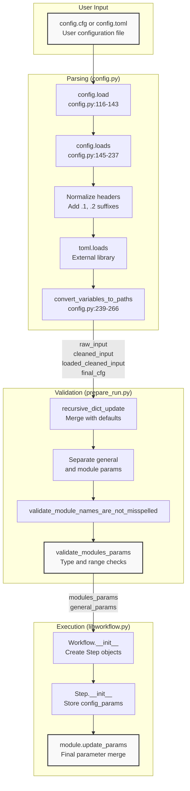
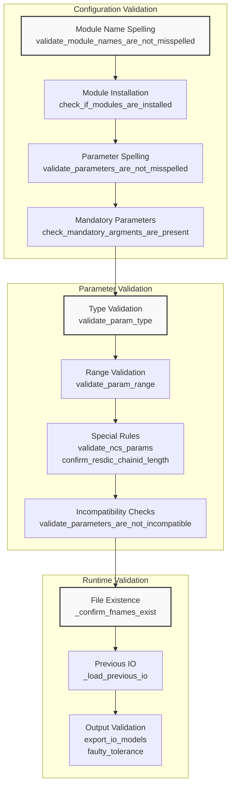
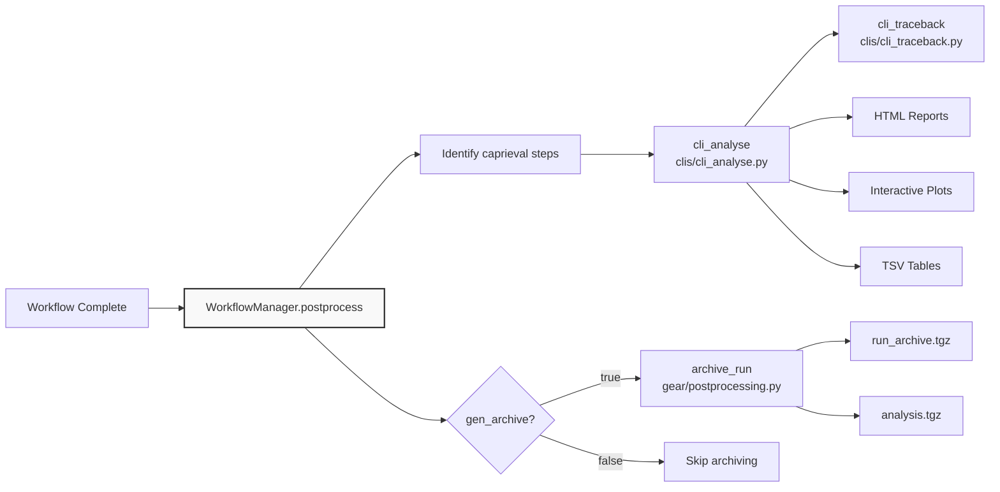

# Workflow System

<details>
<summary>Relevant source files</summary>

The following files were used as context for generating this wiki page:

- [src/haddock/__init__.py](src/haddock/__init__.py)
- [src/haddock/clis/cli.py](src/haddock/clis/cli.py)
- [src/haddock/core/defaults.py](src/haddock/core/defaults.py)
- [src/haddock/gear/config.py](src/haddock/gear/config.py)
- [src/haddock/gear/prepare_run.py](src/haddock/gear/prepare_run.py)
- [src/haddock/gear/zerofill.py](src/haddock/gear/zerofill.py)
- [src/haddock/libs/libutil.py](src/haddock/libs/libutil.py)
- [src/haddock/libs/libworkflow.py](src/haddock/libs/libworkflow.py)
- [src/haddock/modules/__init__.py](src/haddock/modules/__init__.py)
- [tests/test_examples_general.py](tests/test_examples_general.py)
- [tests/test_gear_config.py](tests/test_gear_config.py)
- [tests/test_gear_prepare_run.py](tests/test_gear_prepare_run.py)
- [tests/test_gear_zerofill.py](tests/test_gear_zerofill.py)
- [tests/test_libutil.py](tests/test_libutil.py)
- [tests/test_modules_general.py](tests/test_modules_general.py)
- [tests/test_validations.py](tests/test_validations.py)

</details>


## Purpose and Scope

This page documents the **Workflow System** in HADDOCK3, which is responsible for defining, validating, and executing docking workflows. The workflow system orchestrates the sequential execution of multiple modules, manages data flow between steps, and handles the complete lifecycle from configuration parsing to final execution.

For information about individual module implementations, see [Module Architecture](#3.2). For data exchange between modules, see [Data Flow and ModuleIO](#3.3). For configuration file syntax and parameter definitions, see [Configuration Files](#5.1).

## System Overview

The workflow system is built around three core phases:

1. **Setup Phase**: Configuration parsing, validation, and preparation via `setup_run()`
2. **Orchestration Phase**: Workflow decomposition into steps via `WorkflowManager` and `Workflow`
3. **Execution Phase**: Sequential step execution via `Step` objects that instantiate and run modules

**Key Design Principles**:
- **Linear Execution**: Steps execute sequentially in the order defined in the configuration file
- **Zero-Based Indexing**: Step folders are numbered starting from 0 (e.g., `0_topoaa`, `1_rigidbody`)
- **Stateless Steps**: Each step is independent; data flows through `ModuleIO` serialization
- **Validation-First**: All parameters are validated before any execution begins

Sources: [src/haddock/libs/libworkflow.py:1-191](), [src/haddock/gear/prepare_run.py:214-431]()

## Workflow Phases and Key Components



**Workflow Phases and Code Mapping**

| Phase | Primary Class/Function | File Location | Responsibility |
|-------|------------------------|---------------|----------------|
| Setup | `setup_run()` | prepare_run.py:214-431 | Parse, validate, prepare run directory |
| Orchestration | `WorkflowManager` | libworkflow.py:23-96 | Coordinate workflow execution |
| Orchestration | `Workflow` | libworkflow.py:98-140 | Decompose config into Step objects |
| Execution | `Step` | libworkflow.py:142-191 | Execute individual module |
| Module | `BaseHaddockModule` | modules/__init__.py:115-394 | Base class for all modules |

Sources: [src/haddock/libs/libworkflow.py:23-191](), [src/haddock/gear/prepare_run.py:214-431](), [src/haddock/clis/cli.py:81-214]()

## Setup Phase: setup_run()

The `setup_run()` function is the entry point for workflow preparation. It performs comprehensive validation and file preparation before execution begins.

### Setup Workflow



### Key Functions in Setup Phase

| Function | Location | Purpose |
|----------|----------|---------|
| `setup_run()` | prepare_run.py:214-431 | Main orchestrator for workflow setup |
| `validate_modules_params()` | prepare_run.py:557-631 | Validate each module's parameters against defaults.yaml |
| `validate_param_type()` | prepare_run.py:689-717 | Check parameter type matches expected type |
| `validate_param_range()` | prepare_run.py:719-762 | Check parameter value is in allowed range/choices |
| `validate_ncs_params()` | prepare_run.py:764-868 | Special validation for NCS restraints |
| `copy_molecules_to_data_dir()` | prepare_run.py:948-1002 | Copy and preprocess input PDB files |
| `populate_mol_parameters()` | prepare_run.py:1306-1337 | Expand mol1, mol2, etc. parameters |

**Validation Levels**: The setup phase performs five levels of validation:

1. **Spelling**: Module names match known modules ([prepare_run.py:1076-1096]())
2. **Installation**: Third-party dependencies are available ([prepare_run.py:870-894]())
3. **Type**: Parameter types match YAML definitions ([prepare_run.py:689-717]())
4. **Range**: Parameter values are in allowed ranges ([prepare_run.py:719-762]())
5. **Logic**: Special rules like NCS parameter consistency ([prepare_run.py:764-868]())

Sources: [src/haddock/gear/prepare_run.py:214-431](), [src/haddock/gear/prepare_run.py:557-868](), [src/haddock/gear/prepare_run.py:1076-1096]()

## Orchestration Phase: WorkflowManager and Workflow

After `setup_run()` completes, the `WorkflowManager` is instantiated to coordinate execution.

### WorkflowManager Class



**WorkflowManager Responsibilities**:
- **Execution Loop**: Iterates through steps sequentially ([libworkflow.py:39-46]())
- **Error Handling**: Catches `HaddockTermination` exceptions ([libworkflow.py:44-46]())
- **Cleanup**: Calls `clean()` on completed steps ([libworkflow.py:48-60]())
- **Post-processing**: Generates analysis reports via `cli_analyse` ([libworkflow.py:62-96]())

**Workflow Responsibilities**:
- **Step Creation**: Builds `Step` objects from `modules_parameters` dict ([libworkflow.py:118-135]())
- **Parameter Merging**: Combines global and module-specific parameters ([libworkflow.py:127]())
- **Zero-fill Management**: Determines folder naming prefix ([libworkflow.py:373]() in prepare_run)

Sources: [src/haddock/libs/libworkflow.py:23-140]()

## Execution Phase: Step Lifecycle

Each `Step` object represents one module in the workflow. The execution lifecycle follows a strict sequence.

### Step Execution Sequence



### Step.execute() Method Flow

The `Step.execute()` method ([libworkflow.py:157-182]()) performs these operations:

1. **Create Working Directory**: `self.working_path.resolve().mkdir()` ([libworkflow.py:159]())
   - Path format: `{zerofill}_{module_name}` (e.g., `01_rigidbody`)
   - `zerofill` determined by `zero_fill.fill()` ([zerofill.py:84-99]())

2. **Import Module**: `importlib.import_module(module_name)` ([libworkflow.py:165]())
   - Module path: `haddock.modules.{category}.{module_name}`
   - Category from `modules_category` dict ([modules/__init__.py:43-49]())

3. **Instantiate Module**: `module_lib.HaddockModule(order, path)` ([libworkflow.py:166]())
   - Calls `BaseHaddockModule.__init__()` ([modules/__init__.py:120-143]())
   - Loads previous step's `io.json` via `_load_previous_io()` ([modules/__init__.py:320-336]())

4. **Update Parameters**: `module.update_params(**self.config)` ([libworkflow.py:171]())
   - Merges defaults with user parameters ([modules/__init__.py:154-207]())

5. **Save Configuration**: `module.save_config(params.cfg)` ([libworkflow.py:172]())
   - Writes module config to `{step_folder}/params.cfg`

6. **Execute Module**: `module.run()` ([libworkflow.py:173]())
   - Calls module's `_run()` implementation ([modules/__init__.py:236-249]())

7. **Log Time**: Records execution duration ([libworkflow.py:169-181]())

Sources: [src/haddock/libs/libworkflow.py:142-191](), [src/haddock/modules/__init__.py:115-269]()

## Module Directory Structure and Zero-Fill

HADDOCK3 uses zero-filled numeric prefixes to ensure folders sort correctly regardless of the number of steps.

### Zero-Fill Logic



**Zero-Fill Examples**:

| Number of Modules | Zero-Fill Digits | Folder Names |
|-------------------|------------------|--------------|
| 1-10 | 1 | `0_topoaa`, `1_rigidbody`, ..., `9_caprieval` |
| 11-100 | 2 | `00_topoaa`, `01_rigidbody`, ..., `99_analysis` |
| 101-1000 | 3 | `000_topoaa`, `001_rigidbody`, ..., `999_end` |

**Key Functions**:
- `get_number_of_digits(num)`: Returns digit count ([zerofill.py:105-113]())
- `get_zerofill_for_modules(modules)`: Calculates zero-fill for module list ([zerofill.py:116-130]())
- `zero_fill.fill(name, num)`: Creates formatted folder name ([zerofill.py:84-99]())

Sources: [src/haddock/gear/zerofill.py:1-136](), [src/haddock/libs/libworkflow.py:154]()

## Configuration Flow: TOML to Execution

The configuration undergoes multiple transformations before execution:



**Configuration Dictionary Structure**:

The `config.loads()` function returns a dictionary with four keys:

```
{
    'raw_input': <original config string>,
    'cleaned_input': <normalized TOML string>,
    'loaded_cleaned_input': <parsed dict before path conversion>,
    'final_cfg': <dict with Path objects>
}
```

**Module Header Normalization**:

Input headers are normalized to the format `'modulename.N'`:

- `[topoaa]` → `['topoaa.1']`
- `[rigidbody]` → `['rigidbody.1']`
- `[rigidbody]` (second occurrence) → `['rigidbody.2']`
- `['flexref.3']` → `['flexref.1']` (renumbered sequentially)

This normalization happens via regex matching ([config.py:176-214]()).

Sources: [src/haddock/gear/config.py:116-237](), [src/haddock/gear/prepare_run.py:276-431]()

## Restart and Extend-Run Modes

HADDOCK3 supports three execution modes:

### Execution Mode Comparison

| Mode | CLI Flag | Starting Condition | Behavior |
|------|----------|-------------------|----------|
| **From Scratch** | None | Empty or non-existent run_dir | Full setup and execution |
| **Restart** | `--restart N` | Existing run_dir | Remove folders after step N, re-execute from N |
| **Extend** | `--extend-run PATH` | Copy of previous run | Continue from last step, add new steps |

### Restart Mode Flow

When `--restart N` is provided:

1. **Remove Folders**: `remove_folders_after_number(run_dir, N)` ([restart_run.py]())
   - Deletes step folders > N
   - Deletes data folders > N

2. **Unpack Archives**: `unpack_compressed_and_archived_files()` ([clean_steps.py]())
   - Decompresses `.tgz` files from previous steps

3. **Renumber Steps**: `renum_step_folders()` ([extend_run.py]())
   - Adjusts folder prefixes to match new workflow

4. **Partial File Copy**: `copy_input_files_to_data_dir(start=restart_from)` ([prepare_run.py:1004-1044]())
   - Only copies input files for steps >= N

### Extend-Run Mode Flow

When `--extend-run PATH` is provided:

1. **Read Existing Steps**: `get_module_steps_folders(extend_run)` ([modules/__init__.py:446-494]())
   - Scans existing run directory

2. **Calculate Start Point**: `restart_step = max([int(fold.split('_')[0]) for fold in steps]) + 1`
   - Starts after last existing step

3. **Adjust Zero-Fill**: `zero_fill.set_zerofill_number(num_steps + _num_modules)` ([prepare_run.py:358]())
   - Accounts for existing + new steps

4. **Use Extended Manager**: `WorkflowManagerExtend` instead of `WorkflowManager` ([cli.py:179]())

Sources: [src/haddock/gear/prepare_run.py:319-425](), [src/haddock/clis/cli.py:175-183]()

## Error Handling and Validation

The workflow system implements defensive validation at multiple levels:

### Validation Hierarchy



**Type Validation** ([prepare_run.py:689-717]()):
- Uses `TYPES_MAPPER` dict to map YAML types to Python types
- Example: `"integer"` maps to `(int, float)`

**Range Validation** ([prepare_run.py:719-762]()):
- Checks `choices` for enumerated options
- Checks `min`/`max` for numeric ranges
- Checks `minitems`/`maxitems` for lists
- Checks `minchars`/`maxchars` for strings

**Fuzzy Matching** ([prepare_run.py:1118-1142]()):
- When parameter misspelled, suggests closest match using `difflib.get_close_matches()`
- Example: `"loong-format"` suggests `"long-format"`

**Exception Types**:
- `ConfigurationError`: Raised for configuration issues ([core/exceptions.py]())
- `ModuleError`: Raised for module-specific problems ([core/exceptions.py]())
- `HaddockTermination`: Clean workflow exit signal ([core/exceptions.py]())
- `StepError`: Raised during step execution failures ([core/exceptions.py]())

Sources: [src/haddock/gear/prepare_run.py:557-868](), [src/haddock/gear/prepare_run.py:1118-1142](), [src/haddock/modules/__init__.py:383-394]()

## Post-Processing and Analysis

After workflow execution completes, the `WorkflowManager.postprocess()` method generates analysis outputs:

### Post-Processing Flow



**Post-Processing Configuration**:

The `postprocess()` method reads configuration from the first step:
- `clean`: Whether to compress intermediate files
- `offline`: Whether to skip external resources
- `mode`: Execution mode (local/mpi/grid)
- `ncores`: Number of cores for parallel analysis

**Archive Creation**:

If `gen_archive=true`, creates two archives:
1. **run_archive.tgz**: Complete run directory with all outputs
2. **analysis.tgz**: Analysis-only results (plots, tables, HTML)

Sources: [src/haddock/libs/libworkflow.py:62-96]()

---