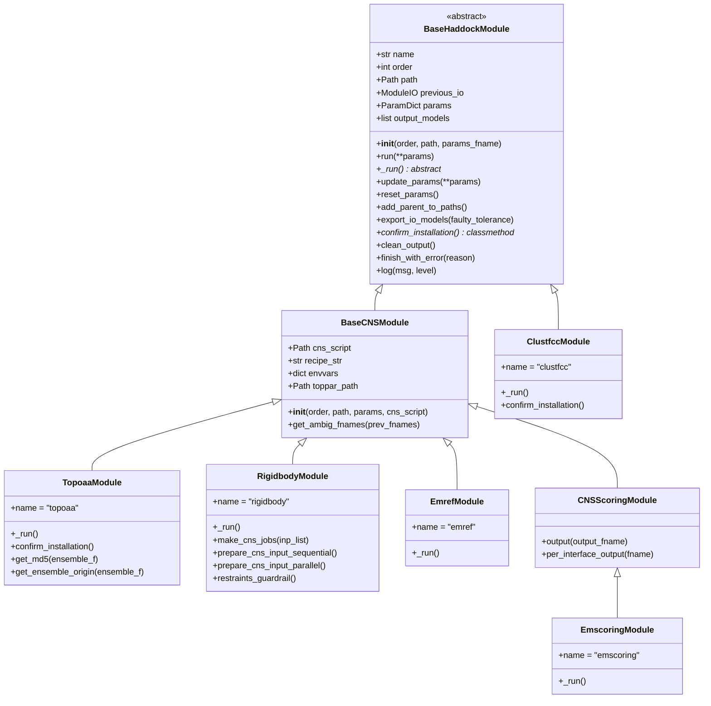
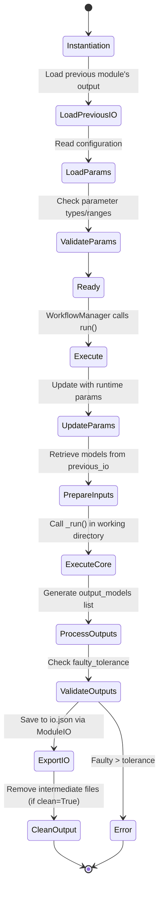

# Module Architecture

<details>
<summary>Relevant source files</summary>

The following files were used as context for generating this wiki page:

- [devtools/build_defaults_rst.py](devtools/build_defaults_rst.py)
- [docs/modules/index.rst](docs/modules/index.rst)
- [setup.py](setup.py)
- [src/haddock/__init__.py](src/haddock/__init__.py)
- [src/haddock/clis/cli.py](src/haddock/clis/cli.py)
- [src/haddock/core/defaults.py](src/haddock/core/defaults.py)
- [src/haddock/gear/config.py](src/haddock/gear/config.py)
- [src/haddock/gear/prepare_run.py](src/haddock/gear/prepare_run.py)
- [src/haddock/gear/zerofill.py](src/haddock/gear/zerofill.py)
- [src/haddock/libs/libutil.py](src/haddock/libs/libutil.py)
- [src/haddock/libs/libworkflow.py](src/haddock/libs/libworkflow.py)
- [src/haddock/modules/__init__.py](src/haddock/modules/__init__.py)
- [src/haddock/modules/_template_cat/README.md](src/haddock/modules/_template_cat/README.md)
- [src/haddock/modules/_template_cat/_template_mod/defaults.yaml](src/haddock/modules/_template_cat/_template_mod/defaults.yaml)
- [src/haddock/modules/analysis/clustfcc/__init__.py](src/haddock/modules/analysis/clustfcc/__init__.py)
- [src/haddock/modules/analysis/seletop/__init__.py](src/haddock/modules/analysis/seletop/__init__.py)
- [src/haddock/modules/analysis/seletopclusts/__init__.py](src/haddock/modules/analysis/seletopclusts/__init__.py)
- [src/haddock/modules/refinement/emref/__init__.py](src/haddock/modules/refinement/emref/__init__.py)
- [src/haddock/modules/refinement/flexref/__init__.py](src/haddock/modules/refinement/flexref/__init__.py)
- [src/haddock/modules/refinement/mdref/__init__.py](src/haddock/modules/refinement/mdref/__init__.py)
- [src/haddock/modules/sampling/gdock/__init__.py](src/haddock/modules/sampling/gdock/__init__.py)
- [src/haddock/modules/sampling/lightdock/__init__.py](src/haddock/modules/sampling/lightdock/__init__.py)
- [src/haddock/modules/sampling/rigidbody/__init__.py](src/haddock/modules/sampling/rigidbody/__init__.py)
- [src/haddock/modules/scoring/emscoring/__init__.py](src/haddock/modules/scoring/emscoring/__init__.py)
- [src/haddock/modules/scoring/mdscoring/__init__.py](src/haddock/modules/scoring/mdscoring/__init__.py)
- [src/haddock/modules/topology/topoaa/__init__.py](src/haddock/modules/topology/topoaa/__init__.py)
- [tests/test_gear_config.py](tests/test_gear_config.py)
- [tests/test_gear_prepare_run.py](tests/test_gear_prepare_run.py)
- [tests/test_gear_zerofill.py](tests/test_gear_zerofill.py)
- [tests/test_libutil.py](tests/test_libutil.py)

</details>


This page documents the architecture of HADDOCK3 modules, including the base classes, module categories, lifecycle, and structural patterns. For information about how modules are composed into workflows and executed, see [Workflow System](#3.1). For information about data exchange between modules, see [Data Flow and ModuleIO](#3.3).

## Overview

HADDOCK3 implements a plugin-based module architecture where each computational step (topology generation, sampling, refinement, scoring, analysis) is encapsulated as a module. All modules inherit from a common base class and follow standardized patterns for parameter handling, execution, and data exchange.

## Module Categories

Modules are organized into six functional categories, each representing a different stage or type of operation in the docking workflow:

| Category | Purpose | Example Modules |
|----------|---------|----------------|
| `topology` | Generate CNS-compatible topologies | `topoaa` |
| `sampling` | Explore conformational space | `rigidbody`, `lightdock`, `gdock` |
| `refinement` | Improve model quality | `flexref`, `emref`, `mdref` |
| `scoring` | Evaluate structures | `emscoring`, `mdscoring` |
| `analysis` | Analyze and cluster results | `caprieval`, `clustfcc`, `clustrmsd`, `alascan` |
| `extras` | Utility operations | `exit`, `filter`, `seletop`, `seletopclusts` |

The category hierarchy is defined in [src/haddock/modules/__init__.py:53-60]():

```python
category_hierarchy = [
    "topology",
    "sampling",
    "refinement",
    "scoring",
    "analysis",
    "extras",
]
```

**Sources:** [src/haddock/modules/__init__.py:40-59]()

## Module Class Hierarchy



**Sources:** [src/haddock/modules/__init__.py:115-394](), [src/haddock/modules/topology/topoaa/__init__.py:102-116](), [src/haddock/modules/sampling/rigidbody/__init__.py:50-64](), [src/haddock/modules/analysis/clustfcc/__init__.py:49-61](), [src/haddock/modules/refinement/emref/__init__.py:26-42]()

## Module Directory Structure

Each module follows a standardized directory structure within its category folder:

```
src/haddock/modules/
├── topology/
│   └── topoaa/
│       ├── __init__.py          # HaddockModule class
│       ├── defaults.yaml        # Parameter definitions
│       └── cns/                 # CNS scripts (if CNS-based)
│           └── generate-topology.cns
├── sampling/
│   ├── rigidbody/
│   │   ├── __init__.py
│   │   ├── defaults.yaml
│   │   └── cns/
│   │       └── rigidbody.cns
│   └── lightdock/
│       ├── __init__.py
│       └── defaults.yaml
├── analysis/
│   └── clustfcc/
│       ├── __init__.py
│       ├── defaults.yaml
│       └── clustfcc.py          # Helper functions
└── ...
```

The `modules_category` dictionary maps each module to its category by scanning the directory structure [src/haddock/modules/__init__.py:42-49]():

```python
modules_category = {
    module.name: category.name
    for category in modules_folder.glob(_folder_match_regex)
    for module in category.glob(_folder_match_regex)
}
```

**Sources:** [src/haddock/modules/__init__.py:40-51](), [src/haddock/modules/_template_cat/README.md:1-30]()

## BaseHaddockModule Class

The `BaseHaddockModule` abstract base class defines the interface all modules must implement.

### Core Attributes

| Attribute | Type | Description |
|-----------|------|-------------|
| `name` | `str` | Module identifier (e.g., "topoaa", "rigidbody") |
| `order` | `int` | Module position in workflow (0-indexed) |
| `path` | `Path` | Working directory for this module instance |
| `previous_io` | `ModuleIO` | Input models from previous module |
| `params` | `ParamDict` | Module configuration parameters |
| `output_models` | `list[PDBFile]` | Models produced by this module |

### Key Methods

**Initialization** [src/haddock/modules/__init__.py:120-143]():
```python
def __init__(self, order: int, path: Path, params_fname: FilePath) -> None:
    self.order = order
    self.path = path
    self.previous_io = self._load_previous_io()
    # Load parameters from config file
    extension = Path(params_fname).suffix
    self._original_params = config_readers[extension](params_fname)
    self._params: ParamDict = {}
    self.update_params(update_from_cfg_file=params_fname)
```

**Abstract Methods:**
- `_run()` - Core execution logic (must be implemented by subclasses)
- `confirm_installation()` - Verify required dependencies are available

**Parameter Management** [src/haddock/modules/__init__.py:154-207]():
- `update_params(**params)` - Update module parameters recursively
- `reset_params()` - Restore original parameters
- `save_config(path)` - Save current parameters to file

**Execution** [src/haddock/modules/__init__.py:238-248]():
```python
def run(self, **params: Any) -> None:
    log.info(f"Running [{self.name}] module")
    self.update_params(**params)
    self.add_parent_to_paths()
    with working_directory(self.path):
        self._run()
    log.info(f"Module [{self.name}] finished.")
```

**I/O Management** [src/haddock/modules/__init__.py:271-310]():
- `export_io_models(faulty_tolerance)` - Export output models to ModuleIO interface
- `_load_previous_io(filename)` - Load input models from previous module
- `previous_path()` - Get path to previous module's directory

**Sources:** [src/haddock/modules/__init__.py:115-394]()

## Module Lifecycle



### Detailed Lifecycle Steps

**1. Instantiation** [src/haddock/modules/__init__.py:120-143]()

The module is instantiated by the `WorkflowManager` with:
- `order`: Position in workflow (e.g., 0 for first module)
- `path`: Working directory (e.g., `00_topoaa/`)
- `params_fname`: Path to module's configuration section

**2. Previous I/O Loading** [src/haddock/modules/__init__.py:320-336]()

The module loads output from the previous module via `ModuleIO`:
```python
def _load_previous_io(self, filename: FilePath = MODULE_IO_FILE) -> ModuleIO:
    if self.order == 0:
        self._num_of_input_molecules = 0
        return ModuleIO()
    io = ModuleIO()
    previous_io = Path(self.previous_path(), filename)
    if previous_io.is_file():
        io.load(previous_io)
    self._num_of_input_molecules = len(io.output)
    return io
```

**3. Parameter Loading** [src/haddock/modules/__init__.py:136-143]()

Parameters are loaded from the configuration file and merged with defaults:
- Read from YAML or CFG file
- Merge with `non_mandatory_general_parameters_defaults`
- Convert path parameters to `Path` objects
- Validate file existence for `*_fname` parameters

**4. Execution** [src/haddock/libs/libworkflow.py:157-182]()

The `Step.execute()` method orchestrates module execution:
```python
def execute(self) -> None:
    self.working_path.resolve().mkdir(parents=False, exist_ok=False)
    module_name = ".".join(["haddock", "modules", 
                           modules_category[self.module_name], 
                           self.module_name])
    module_lib = importlib.import_module(module_name)
    self.module = module_lib.HaddockModule(order=self.order, 
                                           path=self.working_path)
    start = time()
    self.module.update_params(**self.config)
    self.module.save_config(Path(self.working_path, "params.cfg"))
    self.module.run()
    end = time()
```

**5. Output Export** [src/haddock/modules/__init__.py:271-310]()

After execution, outputs are validated and exported:
```python
def export_io_models(self, faulty_tolerance: float = 0.0) -> None:
    assert self.output_models, "`self.output_models` cannot be empty."
    io = ModuleIO()
    io.add(self.previous_io.output, "i")  # Add inputs
    io.add(self.output_models, "o")        # Add outputs
    faulty = io.check_faulty()            # Check missing outputs
    io.save()                              # Save to io.json
    if faulty > faulty_tolerance:
        # Check for CNS errors
        if detected_errors := find_all_cns_errors(self.path):
            # Report errors
        self.finish_with_error(msg)
```

**Sources:** [src/haddock/modules/__init__.py:115-394](), [src/haddock/libs/libworkflow.py:142-191]()

## CNS Module Specialization

Modules that use CNS for molecular dynamics inherit from `BaseCNSModule`, which provides:

### Additional Attributes

- `cns_script`: Path to the CNS protocol script
- `recipe_str`: CNS script content as string
- `envvars`: Environment variables for CNS execution
- `toppar_path`: Path to CNS topology/parameter files

### CNS Job Preparation Pattern

CNS-based modules follow this pattern [src/haddock/modules/sampling/rigidbody/__init__.py:90-123]():

1. **Prepare CNS input files** using `prepare_cns_input()`:
   - Combines parameter headers
   - Adds topology/coordinate information
   - Includes restraints
   - Generates random seed

2. **Create job objects**:
```python
job = CNSJob(
    cns_input,      # Input file or string
    output_file,    # .out file
    error_file,     # .cnserr file
    envvars=self.envvars
)
```

3. **Execute via engine**:
```python
Engine = get_engine(self.params["mode"], self.params)
engine = Engine(jobs)
engine.run()
```

4. **Process outputs**:
   - Extract energies from CNS output
   - Calculate HADDOCK score
   - Update PDBFile objects

**Sources:** [src/haddock/modules/sampling/rigidbody/__init__.py:90-271](), [src/haddock/modules/refinement/emref/__init__.py:43-142]()

## Module Registration and Discovery

### Runtime Module Discovery

At runtime, modules are discovered by scanning the filesystem [src/haddock/modules/__init__.py:40-51]():

```python
modules_folder = Path(__file__).resolve().parent
_folder_match_regex = "[a-zA-Z]*/"
modules_category = {
    module.name: category.name
    for category in modules_folder.glob(_folder_match_regex)
    for module in category.glob(_folder_match_regex)
}
modules_names = set(modules_category.keys())
```

### Step Folder Identification

Module execution folders are identified using regex [src/haddock/modules/__init__.py:79-100]():

```python
_step_folder_regex = tuple(
    r"[0-9]+_" + mod_name for mod_name in modules_category.keys()
)
step_folder_regex = "(" + "|".join(_step_folder_regex) + ")"
step_folder_regex_re = re.compile(step_folder_regex)
```

This matches folders like `00_topoaa`, `01_rigidbody`, `02_caprieval`.

### Module Import

Modules are imported dynamically during workflow execution [src/haddock/libs/libworkflow.py:162-166]():

```python
module_name = ".".join([
    "haddock", 
    "modules", 
    modules_category[self.module_name], 
    self.module_name
])
module_lib = importlib.import_module(module_name)
self.module = module_lib.HaddockModule(order=self.order, path=self.working_path)
```

**Sources:** [src/haddock/modules/__init__.py:40-100](), [src/haddock/libs/libworkflow.py:157-166]()

## Module Validation

### Installation Validation

Each module must implement `confirm_installation()` to verify dependencies [src/haddock/gear/prepare_run.py:870-893]():

```python
def check_if_modules_are_installed(params: ParamMap) -> None:
    for module_name in params.keys():
        module_import_name = ".".join([
            "haddock",
            "modules",
            modules_category[get_module_name(module_name)],
            get_module_name(module_name),
        ])
        module_lib = importlib.import_module(module_import_name)
        try:
            module_lib.HaddockModule.confirm_installation()
        except Exception as err:
            raise ModuleError(_msg) from err
```

### Parameter Validation

Module parameters are validated during setup [src/haddock/gear/prepare_run.py:557-630]():

1. **Parameter existence check**: Verify all user-provided parameters are defined in `defaults.yaml`
2. **Type validation**: Check parameter types match definitions [src/haddock/gear/prepare_run.py:689-716]()
3. **Range/choice validation**: Verify values within allowed bounds [src/haddock/gear/prepare_run.py:719-761]()
4. **Incompatibility check**: Ensure conflicting parameters aren't used together
5. **NCS parameter validation**: Special validation for non-crystallographic symmetry restraints [src/haddock/gear/prepare_run.py:764-867]()

**Sources:** [src/haddock/gear/prepare_run.py:557-893]()

## Execution Engine Selection

Modules can execute jobs using different computational backends [src/haddock/modules/__init__.py:399-443]():

```python
def get_engine(mode: str, params: dict) -> partial:
    if mode == "batch":
        return partial(HPCScheduler, 
                      target_queue=params["queue"],
                      queue_limit=params["queue_limit"],
                      concat=params["concat"])
    elif mode == "local":
        return partial(Scheduler,
                      ncores=params["ncores"],
                      max_cpus=params["max_cpus"])
    elif mode == "mpi":
        return partial(MPIScheduler, ncores=params["ncores"])
    elif mode == "grid":
        return partial(GRIDScheduler, params=params)
    else:
        raise ValueError(f"Scheduler `mode` {mode!r} not recognized.")
```

**Execution modes:**

| Mode | Engine | Use Case |
|------|--------|----------|
| `local` | `Scheduler` | Multiprocessing on single machine |
| `mpi` | `MPIScheduler` | Distributed execution via MPI |
| `batch` | `HPCScheduler` | HPC batch queue submission |
| `grid` | `GRIDScheduler` | DIRAC grid computing |

For analysis modules, a special execution mode mapper is used that constrains non-local modes to prevent resource conflicts [src/haddock/modules/analysis/clustfcc/__init__.py:90]().

**Sources:** [src/haddock/modules/__init__.py:396-443](), [src/haddock/modules/analysis/clustfcc/__init__.py:71-94]()

## Module Template

HADDOCK3 provides a template for creating new modules [src/haddock/modules/_template_cat/README.md:1-30]():

### Required Components

1. **Module folder** under appropriate category
2. **`__init__.py`** with `HaddockModule` class implementing:
   - `name` class attribute
   - `__init__(order, path, initial_params)` constructor
   - `_run()` method with execution logic
   - `confirm_installation()` classmethod
3. **`defaults.yaml`** with parameter definitions
4. **Tests** in `tests/` folder
5. **Example workflow** in `examples/` folder

### Parameter Definition Template

[src/haddock/modules/_template_cat/_template_mod/defaults.yaml:1-107]() shows the structure for defining parameters:

```yaml
# INTEGER parameter
random_seed:
  default: 42
  type: integer
  min: 0
  max: 999
  title: "Random seed title"
  short: "Short description"
  long: "Long description"
  group: "parameter_group"
  explevel: easy  # easy, expert, guru, or hidden

# FLOAT parameter with precision
indpb:
  default: 0.2
  type: float
  min: 0
  max: 1
  precision: 2
  explevel: expert

# STRING with choices
initial_mutation:
  default: keep
  type: string
  choices: [alanine, random, keep]
  explevel: guru
```

**Sources:** [src/haddock/modules/_template_cat/README.md:1-30](), [src/haddock/modules/_template_cat/_template_mod/defaults.yaml:1-107]()

## Module Folder Naming Convention

Module execution folders use zero-filled numeric prefixes [src/haddock/gear/zerofill.py:1-119]():

```python
class _ZeroFill:
    def fill(self, name: str, num: int) -> str:
        return make_zero_fill(num, self.zfnum) + "_" + name
```

**Examples:**
- With 10 modules: `0_topoaa`, `1_rigidbody`, `9_caprieval`
- With 100 modules: `00_topoaa`, `01_rigidbody`, `99_caprieval`

The zero-fill number is calculated from the total number of workflow modules [src/haddock/gear/zerofill.py:105-119]():

```python
def get_zerofill_for_modules(modules: Sized) -> int:
    num_modules = len(modules)
    if num_modules <= 0:
        return 1
    last_module_index = num_modules - 1
    return get_number_of_digits(last_module_index)
```

**Sources:** [src/haddock/gear/zerofill.py:1-119]()

---