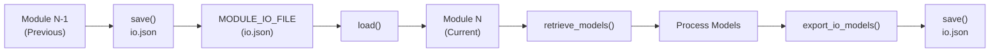
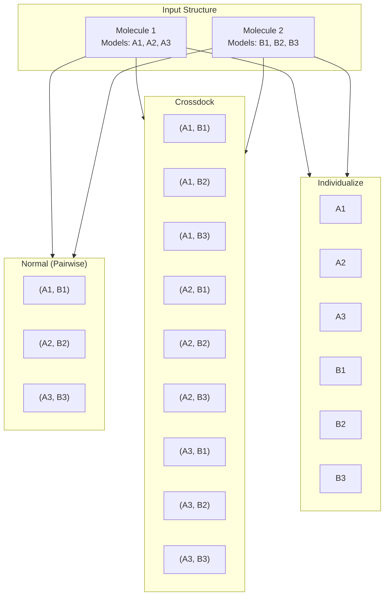
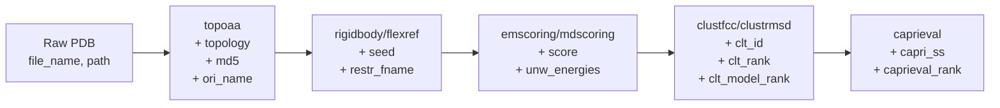
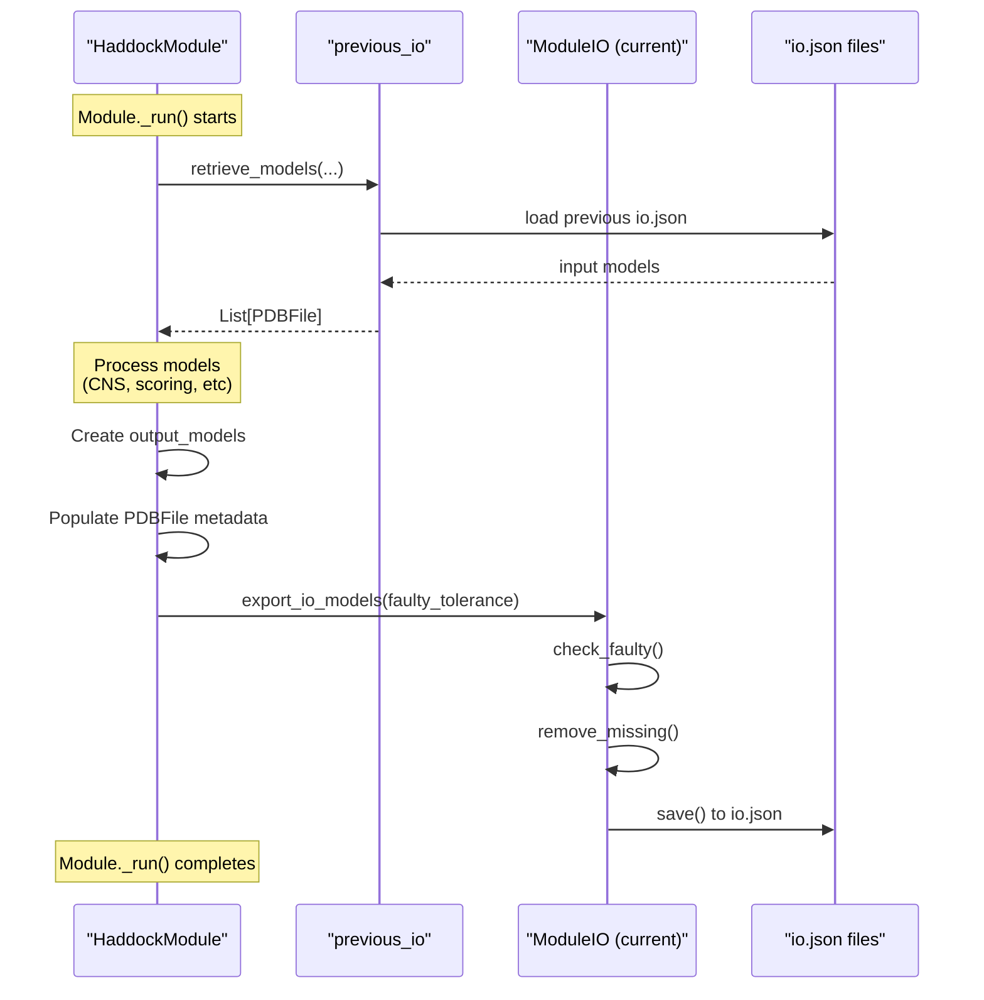
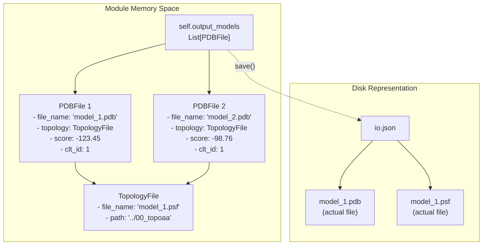

# Data Flow and ModuleIO

<details>
<summary>Relevant source files</summary>

The following files were used as context for generating this wiki page:

- [src/haddock/core/cns_paths.py](src/haddock/core/cns_paths.py)
- [src/haddock/core/supported_molecules.py](src/haddock/core/supported_molecules.py)
- [src/haddock/gear/preprocessing.py](src/haddock/gear/preprocessing.py)
- [src/haddock/libs/libcns.py](src/haddock/libs/libcns.py)
- [src/haddock/libs/libfunc.py](src/haddock/libs/libfunc.py)
- [src/haddock/libs/libontology.py](src/haddock/libs/libontology.py)
- [src/haddock/libs/libpdb.py](src/haddock/libs/libpdb.py)
- [src/haddock/modules/analysis/clustfcc/__init__.py](src/haddock/modules/analysis/clustfcc/__init__.py)
- [src/haddock/modules/analysis/seletop/__init__.py](src/haddock/modules/analysis/seletop/__init__.py)
- [src/haddock/modules/analysis/seletopclusts/__init__.py](src/haddock/modules/analysis/seletopclusts/__init__.py)
- [src/haddock/modules/base_cns_module.py](src/haddock/modules/base_cns_module.py)
- [src/haddock/modules/refinement/emref/__init__.py](src/haddock/modules/refinement/emref/__init__.py)
- [src/haddock/modules/refinement/flexref/__init__.py](src/haddock/modules/refinement/flexref/__init__.py)
- [src/haddock/modules/refinement/mdref/__init__.py](src/haddock/modules/refinement/mdref/__init__.py)
- [src/haddock/modules/sampling/gdock/__init__.py](src/haddock/modules/sampling/gdock/__init__.py)
- [src/haddock/modules/sampling/lightdock/__init__.py](src/haddock/modules/sampling/lightdock/__init__.py)
- [src/haddock/modules/sampling/rigidbody/__init__.py](src/haddock/modules/sampling/rigidbody/__init__.py)
- [src/haddock/modules/scoring/emscoring/__init__.py](src/haddock/modules/scoring/emscoring/__init__.py)
- [src/haddock/modules/scoring/mdscoring/__init__.py](src/haddock/modules/scoring/mdscoring/__init__.py)
- [src/haddock/modules/topology/topoaa/__init__.py](src/haddock/modules/topology/topoaa/__init__.py)
- [tests/data/broken.pdb](tests/data/broken.pdb)
- [tests/data/corrected.pdb](tests/data/corrected.pdb)
- [tests/data/residues.top](tests/data/residues.top)
- [tests/test_cns_paths.py](tests/test_cns_paths.py)
- [tests/test_core_supported_molecules.py](tests/test_core_supported_molecules.py)
- [tests/test_gear_preprocessing.py](tests/test_gear_preprocessing.py)

</details>


## Purpose and Scope

This document explains how data flows between HADDOCK3 modules and how the `ModuleIO` system manages inter-module communication. It covers the core data structures (`PDBFile`, `TopologyFile`), the serialization mechanism, and the progressive enrichment of model metadata as structures move through the workflow pipeline.

For information about the module execution lifecycle, see [Module Architecture](#3.2). For details on the workflow system that orchestrates modules, see [Workflow System](#3.1). For specific file formats and preprocessing steps, see [PDB Preprocessing](#7.1).

---

## Core Data Structures

HADDOCK3 uses an ontology of persistent file objects to represent molecular structures and their associated metadata throughout the workflow.

### PDBFile Class

The `PDBFile` class represents a molecular structure and accumulates metadata as it passes through the pipeline:

```python
class PDBFile(Persistent):
    def __init__(self, file_name, topology=None, path=".", score=NaN, 
                 md5=None, restr_fname=None, unw_energies=None)
```

**Core Attributes:**
| Attribute | Type | Added By | Purpose |
|-----------|------|----------|---------|
| `file_name` | str | All modules | Base filename |
| `path` | str | All modules | Directory location |
| `rel_path` | Path | All modules | Relative path for reference |
| `topology` | TopologyFile/list | topoaa | CNS topology reference |
| `seed` | int | Sampling modules | Random seed for reproducibility |
| `restr_fname` | str | Sampling/refinement | Restraint file used |
| `score` | float | Scoring modules | HADDOCK score |
| `unw_energies` | dict | Scoring modules | Individual energy terms |
| `md5` | str | topoaa | Hash for provenance |
| `ori_name` | str | Refinement modules | Original model name |
| `clt_id` | int/str | Clustering modules | Cluster identifier |
| `clt_rank` | int | Clustering modules | Cluster ranking |
| `clt_model_rank` | int | Clustering modules | Model rank within cluster |

[src/haddock/libs/libontology.py:65-101]()

### TopologyFile Class

Represents CNS-generated PSF topology files required for molecular dynamics:

```python
class TopologyFile(Persistent):
    def __init__(self, file_name, path=".")
```

[src/haddock/libs/libontology.py:114-118]()

### Other Persistent Types

- **`RMSDFile`**: Stores RMSD matrix data with pair count
- **`Format` enum**: Defines file types (PDB, PSF, CNS_INPUT, CNS_OUTPUT, MATRIX)

**Sources:** [src/haddock/libs/libontology.py:1-251]()

---

## The ModuleIO System

### Overview

`ModuleIO` manages the transfer of data between workflow modules through serialization to `io.json` files:



**ModuleIO Data Flow Diagram**

### Class Structure

```python
class ModuleIO:
    def __init__(self):
        self.input: List[Any] = []
        self.output: List[Any] = []
```

The class maintains two lists:
- **`input`**: Models/files received from previous module
- **`output`**: Models/files produced by current module

[src/haddock/libs/libontology.py:121-127]()

### Serialization Format

The `save()` method writes to `io.json` using `jsonpickle`:

```json
{
    "input": [PDBFile objects],
    "output": [PDBFile objects or dict structures]
}
```

**Key characteristics:**
- JSON format with Python object serialization
- Preserves full object state including metadata
- Default filename: `MODULE_IO_FILE` (constant: `"io.json"`)
- Sorted keys and indented for readability

[src/haddock/libs/libontology.py:141-148]()

### Core Methods

| Method | Purpose | Usage Pattern |
|--------|---------|---------------|
| `add(persistent, mode="i")` | Add input/output objects | Called by modules to register models |
| `save(path=".", filename=MODULE_IO_FILE)` | Serialize to disk | Automatic at module completion |
| `load(filename)` | Deserialize from disk | Automatic at module startup |
| `retrieve_models(crossdock, individualize)` | Extract models for processing | Called in module `_run()` |
| `check_faulty()` | Verify output existence | Validates completed jobs |
| `remove_missing()` | Clean non-existent files | Filters failed structures |

**Sources:** [src/haddock/libs/libontology.py:128-237]()

---

## Model Retrieval Patterns

The `retrieve_models()` method supports three distinct retrieval patterns based on how input molecules should be combined.

### Pattern Comparison Diagram



**Model Retrieval Pattern Comparison**

### Normal Retrieval (Pairwise)

**Use case:** Standard docking of corresponding models

```python
models_to_dock = self.previous_io.retrieve_models()
# Returns: [(A1, B1), (A2, B2), (A3, B3)]
```

**Behavior:**
- Pairs models from each molecule in order
- Requires equal number of models per molecule
- Raises exception if counts differ
- Default mode (`crossdock=False`, `individualize=False`)

[src/haddock/libs/libontology.py:174-186]()

**Example usage:**
[src/haddock/modules/refinement/flexref/__init__.py:63]()

### Crossdock Retrieval

**Use case:** All-vs-all docking for exhaustive sampling

```python
models_to_dock = self.previous_io.retrieve_models(crossdock=True)
# Returns: [(A1, B1), (A1, B2), (A1, B3), (A2, B1), ...]
```

**Behavior:**
- Creates Cartesian product of all molecule combinations
- For N molecules with M1, M2, ..., MN models: produces M1 × M2 × ... × MN complexes
- Used in rigidbody module with `crossdock=true` parameter

[src/haddock/libs/libontology.py:187-188]()

**Example usage:**
[src/haddock/modules/sampling/rigidbody/__init__.py:203-208]()

### Individualized Retrieval

**Use case:** Process each structure independently (scoring, clustering)

```python
models_to_score = self.previous_io.retrieve_models(individualize=True)
# Returns: [A1, A2, A3, B1, B2, B3]
```

**Behavior:**
- Flattens all molecule ensembles into single list
- Loses pairing information
- Used by scoring and clustering modules that evaluate individual structures

[src/haddock/libs/libontology.py:189-191]()

**Example usage:**
[src/haddock/modules/analysis/clustfcc/__init__.py:74]()
[src/haddock/modules/scoring/emscoring/__init__.py:45]()

**Sources:** [src/haddock/libs/libontology.py:157-192]()

---

## Model Enrichment Through the Pipeline

As models progress through the workflow, the `PDBFile` objects accumulate additional metadata. This section traces the enrichment process stage by stage.

### Enrichment Timeline Diagram



**Progressive Model Enrichment**

### Stage 1: Topology Generation

**Module:** `topoaa`

**Additions:**
- `topology`: Link to generated PSF file(s)
- `md5`: MD5 hash from input ensemble
- `ori_name`: Original model stem name

```python
pdb = PDBFile(
    file_name=processed_pdb,
    topology=topology,
    path=".",
    md5=md5_hash,
)
pdb.ori_name = model.stem
```

[src/haddock/modules/topology/topoaa/__init__.py:344-351]()

**Processing:**
1. Split multi-model ensembles
2. Sanitize PDB format
3. Generate CNS topology (PSF)
4. Rebuild missing atoms
5. Extract MD5 from REMARK lines
6. Rename files with provenance prefix

**Sources:** [src/haddock/modules/topology/topoaa/__init__.py:174-356]()

### Stage 2: Sampling/Refinement

**Modules:** `rigidbody`, `flexref`, `emref`, `mdref`

**Additions:**
- `seed`: Random seed used for reproducibility
- `restr_fname`: Ambiguous restraint file applied
- `score`: Initial HADDOCK score (if scoring performed)
- `unw_energies`: Unweighted energy components

```python
model = PDBFile(output_pdb_fname, path=".", restr_fname=ambig_fname)
model.topology = [e.topology for e in combination]
model.seed = seed
```

[src/haddock/modules/sampling/rigidbody/__init__.py:81-84]()

```python
haddock_model = HaddockModel(model.file_name)
model.unw_energies = haddock_model.energies
model.score = haddock_model.calc_haddock_score(**weights)
```

[src/haddock/modules/refinement/flexref/__init__.py:152-156]()

**Processing:**
- CNS input generation with restraints
- Job execution (rigid-body or flexible refinement)
- Energy extraction from CNS output
- Score calculation with weight parameters

**Sources:** [src/haddock/modules/sampling/rigidbody/__init__.py:66-271](), [src/haddock/modules/refinement/flexref/__init__.py:56-159]()

### Stage 3: Scoring

**Modules:** `emscoring`, `mdscoring`

**Refinement:**
- Recalculate `score` with current weights
- Update `unw_energies` dictionary
- Preserve `ori_name`, `md5`, `restr_fname`

```python
expected_pdb.ori_name = model.file_name
expected_pdb.md5 = model.md5
expected_pdb.restr_fname = model.restr_fname
```

[src/haddock/modules/scoring/emscoring/__init__.py:66-71]()

**Energy components in `unw_energies`:**
- Van der Waals (`vdw`)
- Electrostatics (`elec`)
- Desolvation (`desolv`)
- AIR restraints (`air`)
- Buried surface area (`bsa`)

**Sources:** [src/haddock/modules/scoring/emscoring/__init__.py:39-106]()

### Stage 4: Clustering

**Modules:** `clustfcc`, `clustrmsd`

**Additions:**
- `clt_id`: Cluster identifier (integer or "unclustered")
- `clt_rank`: Rank of cluster (by average score)
- `clt_model_rank`: Rank of model within its cluster

```python
# Applied by add_cluster_info()
for model in cluster.members:
    model.clt_id = cluster.id
    model.clt_rank = cluster.rank
    model.clt_model_rank = model.rank_in_cluster
```

[src/haddock/modules/analysis/clustfcc/__init__.py:172]()

**Processing:**
1. Calculate pairwise FCC/RMSD matrix
2. Perform hierarchical clustering
3. Rank clusters by average score
4. Assign cluster membership to models

**Sources:** [src/haddock/modules/analysis/clustfcc/__init__.py:71-220]()

### Stage 5: Evaluation

**Modules:** `caprieval`

**Additions:**
- `capri_ss`: CAPRI single-structure quality (high/medium/acceptable/unacceptable)
- `caprieval_rank`: Ranking based on DockQ score
- Additional CAPRI metrics (FNAT, i-RMSD, l-RMSD, DockQ)

**Processing:**
- Align model to reference structure
- Calculate interface metrics
- Classify quality category
- Generate per-structure and per-cluster statistics

**Sources:** Referenced in high-level diagrams

---

## Module Integration Points

Modules interact with `ModuleIO` at specific points in their execution lifecycle.

### Integration Flow



**Module-ModuleIO Interaction Sequence**

### Retrieving Models

**Access pattern:**
```python
def _run(self):
    models = self.previous_io.retrieve_models(
        crossdock=self.params.get("crossdock", False),
    )
```

**Common locations:**
- Sampling modules: [src/haddock/modules/sampling/rigidbody/__init__.py:202-209]()
- Refinement modules: [src/haddock/modules/refinement/flexref/__init__.py:63]()
- Scoring modules: [src/haddock/modules/scoring/emscoring/__init__.py:45]()
- Analysis modules: [src/haddock/modules/analysis/clustfcc/__init__.py:74]()
- Selection modules: [src/haddock/modules/analysis/seletop/__init__.py:47-51]()

### Exporting Models

**Standard pattern:**
```python
self.output_models = created_or_modified_models
self.export_io_models(faulty_tolerance=self.params["tolerance"])
```

**The `export_io_models()` method (inherited from `BaseHaddockModule`):**
1. Creates new `ModuleIO` instance
2. Populates `output` list with `self.output_models`
3. Calls `check_faulty()` to verify file existence
4. Removes missing files with `remove_missing()`
5. Validates fault percentage against tolerance
6. Saves to `io.json` in module directory

**Common locations:**
- Topology: [src/haddock/modules/topology/topoaa/__init__.py:356]()
- Sampling: [src/haddock/modules/sampling/rigidbody/__init__.py:271]()
- Refinement: [src/haddock/modules/refinement/flexref/__init__.py:159]()
- Scoring: [src/haddock/modules/scoring/emscoring/__init__.py:102]()
- Clustering: [src/haddock/modules/analysis/clustfcc/__init__.py:220]()

### Faulty Tolerance Mechanism

**Purpose:** Handle partial job failures gracefully

```python
def check_faulty(self) -> float:
    total = sum_of_expected_outputs
    present = sum_of_existing_files
    faulty_per = (1 - (present / total)) * 100
    self.remove_missing()  # Clean up
    return faulty_per
```

[src/haddock/libs/libontology.py:194-218]()

**Behavior:**
- Calculates percentage of missing output files
- Automatically removes missing files from output list
- Module validates against `tolerance` parameter
- Workflow terminates if fault percentage exceeds tolerance

**Example validation:**
```python
self.export_io_models(faulty_tolerance=self.params["tolerance"])
# If faulty% > tolerance: raises exception
```

**Sources:** [src/haddock/libs/libontology.py:194-237]()

---

## Data Structures in Memory vs Disk

### Memory Representation



**Memory vs Disk Data Structures**

### File System Layout

```
run_directory/
├── 00_topoaa/
│   ├── io.json                 # Output: topology info
│   ├── model_1_haddock.pdb
│   ├── model_1_haddock.psf
│   └── ...
├── 01_rigidbody/
│   ├── io.json                 # Output: docked models
│   ├── rigidbody_1.pdb         # score, seed populated
│   ├── rigidbody_2.pdb
│   └── ...
├── 02_clustfcc/
│   ├── io.json                 # Output: clustered models
│   ├── clustfcc.tsv            # Human-readable list
│   └── fcc.matrix              # Similarity matrix
└── ...
```

**Key observations:**
- Each module directory contains one `io.json`
- `io.json` stores serialized Python objects, not file contents
- Actual PDB/PSF files referenced by relative paths
- `rel_path` attribute enables cross-module file access

**Sources:** [src/haddock/libs/libontology.py:48-52](), [src/haddock/core/defaults.py]() (MODULE_IO_FILE constant)

---

## Special Cases and Edge Conditions

### Handling Ensembles vs Single Structures

**Dictionary-based output structure:**

When `topoaa` is the first module and processes multiple input molecules with multiple models each, the output structure uses nested dictionaries:

```python
# output format: dict[int, dict[int, PDBFile]]
expected[molecule_idx][model_idx] = pdb_file
```

[src/haddock/modules/topology/topoaa/__init__.py:306-352]()

**Retrieval handling:**
```python
for i, element in enumerate(self.output):
    if isinstance(element, dict):
        # Extract from nested dict
        for key in element:
            position_list.append(element[key])
    elif element.file_type == Format.PDB:
        model_list.append(element)
```

[src/haddock/libs/libontology.py:165-172]()

### Topology Handling

**Single topology:**
```python
pdb.topology = single_topology_file
```

**Multiple topologies (multi-molecule complex):**
```python
pdb.topology = [topology_1, topology_2, ...]
```

[src/haddock/modules/sampling/rigidbody/__init__.py:82]()

**Validation in CNS input preparation:**
```python
if isinstance(input_element.topology, (list, tuple)):
    for psf in input_element.topology:
        psf_list.append(psf.rel_path)
else:
    psf_list.append(input_element.topology.rel_path)
```

[src/haddock/libs/libcns.py:366-372]()

### Missing Model Cleanup

The `remove_missing()` method handles cases where expected outputs don't exist:

```python
def remove_missing(self) -> None:
    idxs: list[int] = []
    for idx, element in enumerate(self.output):
        if isinstance(element, dict):
            to_pop = [k for k, v in element.items() if not v.is_present()]
            for pop_me in to_pop:
                element.pop(pop_me)
        else:
            if not element.is_present():
                idxs.append(idx)
    
    self.output = [v for i, v in enumerate(self.output) if i not in idxs]
```

[src/haddock/libs/libontology.py:220-236]()

**Sources:** [src/haddock/libs/libontology.py:165-237](), [src/haddock/modules/topology/topoaa/__init__.py:306-356]()

---

## Summary Table: Data Flow Characteristics

| Aspect | Implementation | Key Files |
|--------|---------------|-----------|
| **Data carrier** | `PDBFile` objects with metadata | libontology.py:65-101 |
| **Serialization** | JSON via `jsonpickle` | libontology.py:141-148 |
| **File location** | `io.json` in each module dir | MODULE_IO_FILE constant |
| **Retrieval modes** | Normal, crossdock, individualize | libontology.py:157-192 |
| **Enrichment** | Progressive metadata addition | All module `__init__.py` files |
| **Validation** | `check_faulty()` + tolerance | libontology.py:194-218 |
| **Cleanup** | `remove_missing()` auto-removal | libontology.py:220-236 |
| **Topology** | Single or list of PSF references | libontology.py:70, rigidbody:82 |

**Sources:** [src/haddock/libs/libontology.py:1-251](), all module implementation files

---