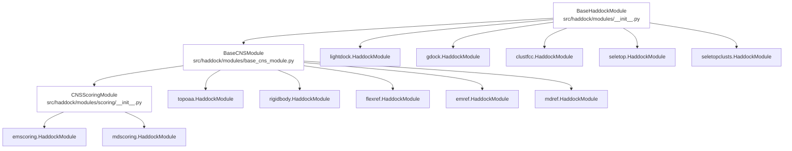
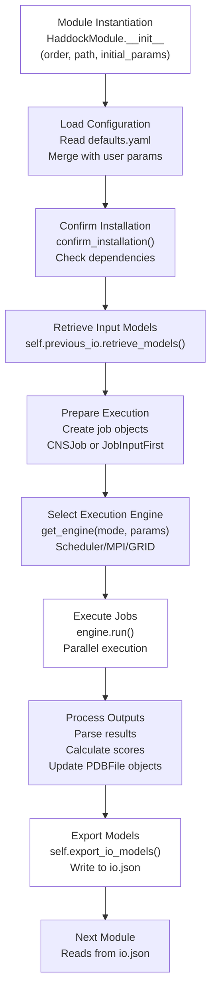
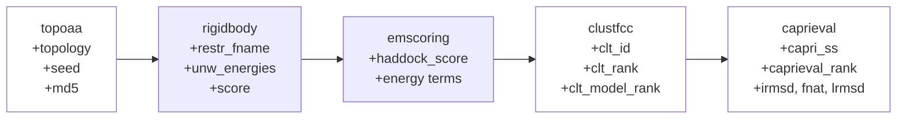
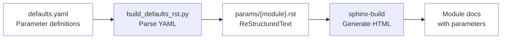

# Module Reference

<details>
<summary>Relevant source files</summary>

The following files were used as context for generating this wiki page:

- [devtools/build_defaults_rst.py](devtools/build_defaults_rst.py)
- [docs/modules/index.rst](docs/modules/index.rst)
- [setup.py](setup.py)
- [src/haddock/modules/_template_cat/README.md](src/haddock/modules/_template_cat/README.md)
- [src/haddock/modules/_template_cat/_template_mod/defaults.yaml](src/haddock/modules/_template_cat/_template_mod/defaults.yaml)
- [src/haddock/modules/analysis/clustfcc/__init__.py](src/haddock/modules/analysis/clustfcc/__init__.py)
- [src/haddock/modules/analysis/seletop/__init__.py](src/haddock/modules/analysis/seletop/__init__.py)
- [src/haddock/modules/analysis/seletopclusts/__init__.py](src/haddock/modules/analysis/seletopclusts/__init__.py)
- [src/haddock/modules/refinement/emref/__init__.py](src/haddock/modules/refinement/emref/__init__.py)
- [src/haddock/modules/refinement/flexref/__init__.py](src/haddock/modules/refinement/flexref/__init__.py)
- [src/haddock/modules/refinement/mdref/__init__.py](src/haddock/modules/refinement/mdref/__init__.py)
- [src/haddock/modules/sampling/gdock/__init__.py](src/haddock/modules/sampling/gdock/__init__.py)
- [src/haddock/modules/sampling/lightdock/__init__.py](src/haddock/modules/sampling/lightdock/__init__.py)
- [src/haddock/modules/sampling/rigidbody/__init__.py](src/haddock/modules/sampling/rigidbody/__init__.py)
- [src/haddock/modules/scoring/emscoring/__init__.py](src/haddock/modules/scoring/emscoring/__init__.py)
- [src/haddock/modules/scoring/mdscoring/__init__.py](src/haddock/modules/scoring/mdscoring/__init__.py)
- [src/haddock/modules/topology/topoaa/__init__.py](src/haddock/modules/topology/topoaa/__init__.py)

</details>


This page provides a comprehensive catalog of all HADDOCK3 modules organized by category. Each module implements a specific computational task in the docking workflow, from initial structure preparation through final analysis. For detailed configuration of workflows, see [Configuration](#5). For understanding data flow between modules, see [Data Flow and ModuleIO](#3.3). For creating custom modules, see [Creating New Modules](#8.3).

## Module Categories

HADDOCK3 modules are organized into six functional categories, each representing a distinct phase in the biomolecular docking workflow:

| Category | Purpose | Module Count | Key Modules |
|----------|---------|--------------|-------------|
| **Topology** | Generate CNS-compatible topologies and coordinates | 1 | topoaa |
| **Sampling** | Explore conformational space through docking | 3 | rigidbody, lightdock, gdock |
| **Refinement** | Improve model quality through simulations | 3 | flexref, emref, mdref |
| **Scoring** | Evaluate models without restraints | 2 | emscoring, mdscoring |
| **Analysis** | Cluster, evaluate, and visualize results | 7+ | caprieval, clustfcc, seletop, alascan |
| **Extras** | Specialized utilities and extensions | Variable | filter, exit, openmm |

Sources: [docs/modules/index.rst:1-17](), [devtools/build_defaults_rst.py:22-56]()

## Module Architecture

HADDOCK3 modules follow a class-based architecture with a clear inheritance hierarchy:



**Inheritance Structure:**
- `BaseHaddockModule`: Foundation for all modules, provides I/O, logging, and execution framework
- `BaseCNSModule`: Extends `BaseHaddockModule` for modules that execute CNS (Crystallography & NMR System)
- `CNSScoringModule`: Extends `BaseCNSModule` specifically for scoring operations without restraints
- Third-party integration modules (lightdock, gdock) directly inherit from `BaseHaddockModule`

Sources: [src/haddock/modules/topology/topoaa/__init__.py:102-111](), [src/haddock/modules/sampling/rigidbody/__init__.py:50-59](), [src/haddock/modules/refinement/flexref/__init__.py:40-49](), [src/haddock/modules/scoring/emscoring/__init__.py:23-32](), [src/haddock/modules/sampling/lightdock/__init__.py:20-33]()

## Module Catalog

### Topology Modules

| Module | Class | CNS-based | Purpose |
|--------|-------|-----------|---------|
| **topoaa** | `HaddockModule(BaseCNSModule)` | Yes | Generate all-atom topology (PSF) and rebuild missing atoms including hydrogens |

The `topoaa` module is typically the first module in a workflow, creating CNS-compatible parameter and topology files required by downstream CNS-based modules.

Sources: [src/haddock/modules/topology/topoaa/__init__.py:1-24](), [src/haddock/modules/topology/topoaa/__init__.py:102-111]()

### Sampling Modules

| Module | Class | Engine | Purpose |
|--------|-------|--------|---------|
| **rigidbody** | `HaddockModule(BaseCNSModule)` | CNS | Rigid-body docking with randomization and energy minimization (equivalent to HADDOCK2.x it0) |
| **lightdock** | `HaddockModule(BaseHaddockModule)` | LightDock | Glow-worm swarm optimization sampling via external LightDock integration |
| **gdock** | `HaddockModule(BaseHaddockModule)` | gdock | Genetic algorithm-based docking via external gdock integration |

**Sampling Characteristics:**
- Generate initial model ensemble (typically 100-1000 structures)
- Apply distance restraints (AIRs, unambiguous, hydrogen bonds)
- Support both targeted (with restraints) and ab-initio docking (CM restraints, random AIRs)
- CNS-based sampling uses rigid-body energy minimization
- Third-party tools use their native algorithms

Sources: [src/haddock/modules/sampling/rigidbody/__init__.py:1-30](), [src/haddock/modules/sampling/lightdock/__init__.py:1-2](), [src/haddock/modules/sampling/gdock/__init__.py:1-2]()

### Refinement Modules

| Module | Class | Protocol | Solvent |
|--------|-------|----------|---------|
| **flexref** | `HaddockModule(BaseCNSModule)` | Semi-flexible simulated annealing in torsion angle space (HADDOCK2.x it1) | Implicit |
| **emref** | `HaddockModule(BaseCNSModule)` | Conjugate gradient energy minimization | Implicit |
| **mdref** | `HaddockModule(BaseCNSModule)` | Molecular dynamics with heating/cooling cycles (HADDOCK2.x itw) | Explicit (8Å water or 12.5Å DMSO) |

**Refinement Stages:**
- `flexref`: High-temp rigid-body MD → rigid-body SA → semi-flexible SA (side-chains) → fully flexible SA (backbone + side-chains)
- `emref`: Fast conjugate gradient minimization for quick scoring/refinement
- `mdref`: Short MD simulation with 4 sequential steps: EM → heat to 300K → MD at 300K → cool to 100K

All refinement modules support `sampling_factor` parameter to generate multiple refined models per input structure.

Sources: [src/haddock/modules/refinement/flexref/__init__.py:1-22](), [src/haddock/modules/refinement/emref/__init__.py:1-8](), [src/haddock/modules/refinement/mdref/__init__.py:1-21]()

### Scoring Modules

| Module | Class | Method | Purpose |
|--------|-------|--------|---------|
| **emscoring** | `HaddockModule(CNSScoringModule)` | Energy minimization | Evaluate models via EM, no restraints applied |
| **mdscoring** | `HaddockModule(CNSScoringModule)` | Short MD simulation | Evaluate models via brief MD, no restraints applied |

Both scoring modules:
- Calculate HADDOCK score from weighted energy terms (vdW, electrostatics, desolvation, AIR, BSA)
- Produce TSV output files with per-structure scores
- Support `per_interface_scoring` for detailed interface energy breakdowns
- Do not apply distance restraints (unlike refinement modules)

Sources: [src/haddock/modules/scoring/emscoring/__init__.py:1-8](), [src/haddock/modules/scoring/mdscoring/__init__.py:1-5]()

### Analysis Modules

| Module | Class | Primary Function |
|--------|-------|------------------|
| **caprieval** | `HaddockModule(BaseHaddockModule)` | Calculate CAPRI metrics (IRMSD, FNAT, LRMSD, DockQ) against reference structure |
| **clustfcc** | `HaddockModule(BaseHaddockModule)` | Fraction of Common Contacts clustering using contact_fcc binary |
| **clustrmsd** | `HaddockModule(BaseHaddockModule)` | RMSD-based hierarchical clustering using fast-rmsdmatrix binary |
| **seletop** | `HaddockModule(BaseHaddockModule)` | Select top N models by score |
| **seletopclusts** | `HaddockModule(BaseHaddockModule)` | Select top N models from top M clusters |
| **alascan** | `HaddockModule(BaseHaddockModule)` | Computational alanine scanning for interface residue analysis |
| **contactmap** | `HaddockModule(BaseHaddockModule)` | Generate contact matrices and chordcharts |
| **rmsdmatrix** | `HaddockModule(BaseHaddockModule)` | Calculate full RMSD matrix between all models |

**Analysis Workflow Pattern:**
1. **Clustering** (clustfcc/clustrmsd) groups similar structures
2. **Selection** (seletopclusts) filters to top clusters/models
3. **Evaluation** (caprieval) computes quality metrics if reference available
4. **Interface Analysis** (alascan, contactmap) provides detailed binding site characterization

Sources: [src/haddock/modules/analysis/clustfcc/__init__.py:1-11](), [src/haddock/modules/analysis/seletop/__init__.py:1-9](), [src/haddock/modules/analysis/seletopclusts/__init__.py:1-10]()

## Module Lifecycle



**Module Execution Steps:**

1. **Instantiation**: `WorkflowManager` creates module instance with order number, working directory path, and configuration file
2. **Configuration Loading**: Module reads `defaults.yaml` and merges with user-provided parameters
3. **Installation Check**: `confirm_installation()` verifies required binaries/dependencies exist
4. **Input Retrieval**: Module retrieves models from previous step via `ModuleIO.retrieve_models()`
5. **Job Preparation**: Module creates job objects (`CNSJob` for CNS modules, `JobInputFirst` for binary execution)
6. **Engine Selection**: Module selects execution engine based on `mode` parameter (local/mpi/batch)
7. **Execution**: Engine runs jobs in parallel according to `ncores` parameter
8. **Output Processing**: Module parses outputs, extracts scores/energies, updates `PDBFile` objects
9. **Model Export**: Module writes enriched models to `io.json` via `export_io_models()`
10. **Handoff**: Next module reads from `io.json` to continue workflow

Sources: [src/haddock/modules/topology/topoaa/__init__.py:174-357](), [src/haddock/modules/sampling/rigidbody/__init__.py:196-272](), [src/haddock/modules/analysis/clustfcc/__init__.py:71-221]()

## Module File Structure

Each module follows a standardized directory structure within the codebase:

```
src/haddock/modules/
├── {category}/              # topology, sampling, refinement, scoring, analysis
│   └── {module_name}/       # e.g., rigidbody, clustfcc
│       ├── __init__.py      # Module implementation (HaddockModule class)
│       ├── defaults.yaml    # Parameter definitions with explevel hierarchy
│       ├── cns/             # CNS scripts (for CNS-based modules only)
│       │   └── *.cns
│       └── *.py             # Additional helper functions
```

**Key Files:**

- `__init__.py`: Contains `HaddockModule` class with `_run()` method implementing module logic
- `defaults.yaml`: Defines all module parameters with metadata (type, default, explevel, validation rules)
- `cns/*.cns`: CNS recipe scripts for modules using CNS engine

Sources: [src/haddock/modules/topology/topoaa/__init__.py:50-51](), [src/haddock/modules/sampling/rigidbody/__init__.py:46-47]()

## Module Configuration System

### Parameter Definition in defaults.yaml

Each module defines parameters in `defaults.yaml` with rich metadata:

```yaml
parameter_name:
  default: <value>              # Default value
  type: integer|float|string|list|dict|boolean
  explevel: easy|expert|guru|hidden
  title: "Parameter title"
  short: "Brief description"
  long: "Detailed description"
  group: "Logical grouping"
  # Type-specific constraints
  min: <number>                 # For integer/float
  max: <number>
  choices: [opt1, opt2]         # For string
  minitems: <number>            # For list
  maxitems: <number>
```

**Expertise Levels:**
- `easy`: Basic parameters users typically configure
- `expert`: Advanced tuning for experienced users
- `guru`: Low-level parameters for expert customization
- `hidden`: Internal parameters not exposed to users

Sources: [src/haddock/modules/_template_cat/_template_mod/defaults.yaml:1-107](), [devtools/build_defaults_rst.py:391-523]()

### Common Module Parameters

All modules inherit common parameters from `defaults.yaml`:

| Parameter | Type | Default | Purpose |
|-----------|------|---------|---------|
| `mode` | string | "local" | Execution mode: local, batch, mpi |
| `ncores` | integer | null | Number of CPU cores to use |
| `tolerance` | integer | 0 | Number of failed models tolerated before stopping |
| `debug` | boolean | false | Write CNS input files to disk for debugging |

CNS-based modules additionally inherit:
- Energy term weights: `w_vdw`, `w_elec`, `w_desolv`, `w_air`, `w_bsa`
- Restraint file paths: `ambig_fname`, `unambig_fname`, `hbond_fname`
- Sampling parameters: `sampling_factor`, `max_nmodels`

Sources: [src/haddock/modules/refinement/flexref/__init__.py:146-159](), [src/haddock/modules/scoring/emscoring/__init__.py:86-106]()

## Module Communication via PDBFile Objects

Modules communicate through enriched `PDBFile` objects that accumulate metadata through the workflow:



**Progressive Enrichment:**
1. `topoaa`: Adds `topology` (PSF file), `seed` (random seed), `md5` (hash)
2. Sampling modules: Add `restr_fname` (restraints used), `seed`, initial `score`
3. Refinement modules: Update `score`, add `unw_energies` (unweighted energy terms)
4. Scoring modules: Update `score` and `unw_energies` without restraints
5. Clustering modules: Add `clt_id`, `clt_rank`, `clt_model_rank`
6. Evaluation modules: Add `capri_ss` (CAPRI classification), quality metrics

Sources: [src/haddock/modules/topology/topoaa/__init__.py:344-352](), [src/haddock/modules/sampling/rigidbody/__init__.py:81-84](), [src/haddock/modules/analysis/clustfcc/__init__.py:156-173]()

## Module Implementation Pattern

All modules follow this implementation pattern:

```python
# Standard imports
from pathlib import Path
from haddock.core.defaults import MODULE_DEFAULT_YAML
from haddock.modules import BaseHaddockModule  # or BaseCNSModule

RECIPE_PATH = Path(__file__).resolve().parent
DEFAULT_CONFIG = Path(RECIPE_PATH, MODULE_DEFAULT_YAML)

class HaddockModule(BaseHaddockModule):  # or BaseCNSModule
    """Module documentation."""
    
    name = RECIPE_PATH.name  # Auto-set from directory name
    
    def __init__(self, order: int, path: Path, 
                 initial_params: FilePath = DEFAULT_CONFIG) -> None:
        # For CNS modules, specify cns_script
        super().__init__(order, path, initial_params)
    
    @classmethod
    def confirm_installation(cls) -> None:
        """Check dependencies/binaries exist."""
        # Validate external tools, binaries, libraries
        return
    
    def _run(self) -> None:
        """Execute module logic."""
        # 1. Retrieve input models
        models = self.previous_io.retrieve_models()
        
        # 2. Prepare jobs
        jobs = []  # Create job objects
        
        # 3. Execute via engine
        Engine = get_engine(self.params["mode"], self.params)
        engine = Engine(jobs)
        engine.run()
        
        # 4. Process outputs and update PDBFile objects
        self.output_models = [...]  # Updated PDBFile objects
        
        # 5. Export for next module
        self.export_io_models()
```

**Required Methods:**
- `__init__`: Initialize module with order, path, and configuration
- `confirm_installation()`: Class method verifying dependencies
- `_run()`: Main execution logic

**Required Attributes:**
- `name`: Module identifier (auto-set from directory name)
- `output_models`: List of `PDBFile` objects for next module

Sources: [src/haddock/modules/topology/topoaa/__init__.py:102-357](), [src/haddock/modules/sampling/rigidbody/__init__.py:50-272](), [src/haddock/modules/analysis/seletop/__init__.py:22-66]()

## Module Documentation Generation

Module documentation is automatically generated from `defaults.yaml` files:



The build process:
1. `build_defaults_rst.py` scans all `modules/**/defaults.yaml` files
2. Parses parameter metadata and organizes by explevel
3. Generates RST files in `docs/modules/{category}/params/`
4. Sphinx includes these via `.. include::` directives
5. HTML documentation displays parameters organized by Easy/Expert/Guru sections

Sources: [devtools/build_defaults_rst.py:266-330](), [devtools/build_defaults_rst.py:391-523]()

## Creating Custom Modules

To develop a custom HADDOCK3 module:

1. **Choose Category**: Create folder under appropriate category (or create new category)
2. **Copy Template**: Use `_template_mod` as starting point
3. **Implement Class**: Define `HaddockModule` with required methods
4. **Define Parameters**: Create `defaults.yaml` with parameter definitions
5. **Add CNS Scripts**: If CNS-based, add recipe scripts to `cns/` subdirectory
6. **Test Module**: Write unit/integration tests
7. **Document Usage**: Add example workflow to `examples/` directory

For detailed instructions, see [Creating New Modules](#8.3).

Sources: [src/haddock/modules/_template_cat/README.md:1-31](), [src/haddock/modules/_template_cat/_template_mod/defaults.yaml:1-107]()

---