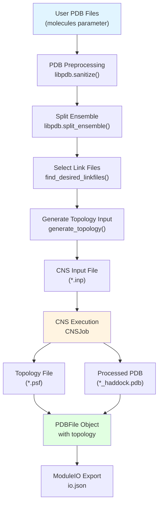
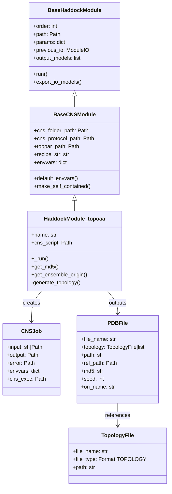
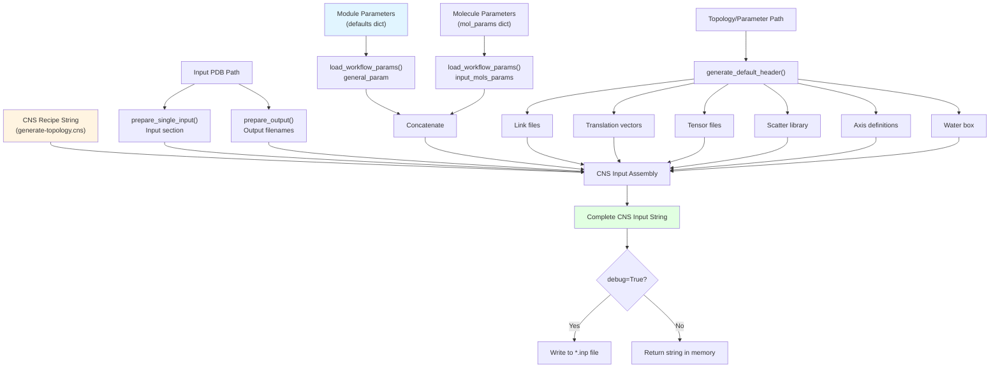
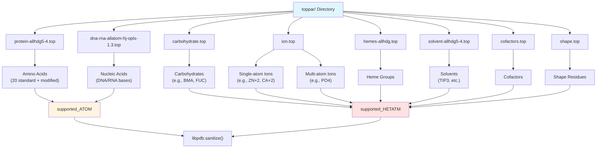
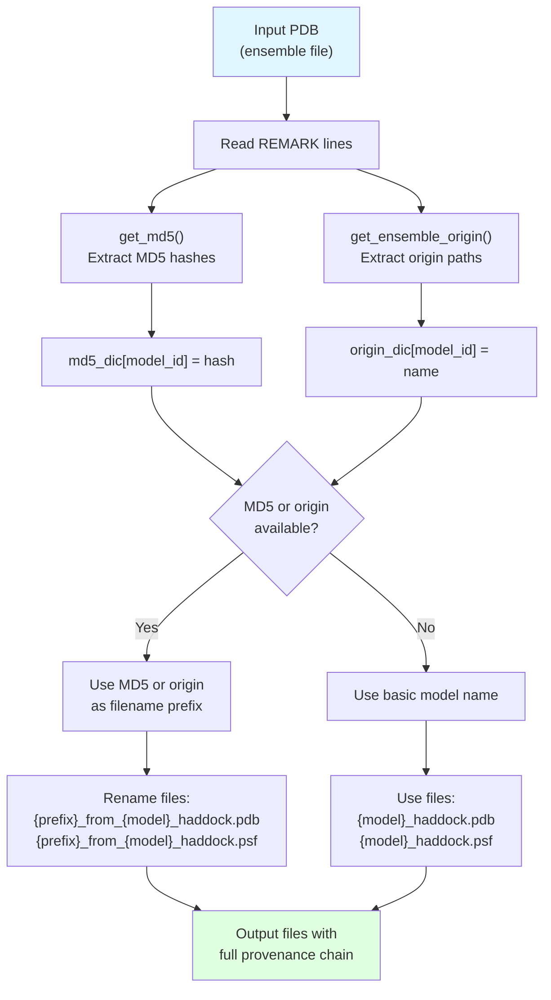

# Topology Modules

<details>
<summary>Relevant source files</summary>

The following files were used as context for generating this wiki page:

- [src/haddock/core/cns_paths.py](src/haddock/core/cns_paths.py)
- [src/haddock/core/supported_molecules.py](src/haddock/core/supported_molecules.py)
- [src/haddock/gear/preprocessing.py](src/haddock/gear/preprocessing.py)
- [src/haddock/libs/libcns.py](src/haddock/libs/libcns.py)
- [src/haddock/libs/libfunc.py](src/haddock/libs/libfunc.py)
- [src/haddock/libs/libontology.py](src/haddock/libs/libontology.py)
- [src/haddock/libs/libpdb.py](src/haddock/libs/libpdb.py)
- [src/haddock/modules/analysis/clustfcc/__init__.py](src/haddock/modules/analysis/clustfcc/__init__.py)
- [src/haddock/modules/analysis/seletop/__init__.py](src/haddock/modules/analysis/seletop/__init__.py)
- [src/haddock/modules/analysis/seletopclusts/__init__.py](src/haddock/modules/analysis/seletopclusts/__init__.py)
- [src/haddock/modules/base_cns_module.py](src/haddock/modules/base_cns_module.py)
- [src/haddock/modules/refinement/emref/__init__.py](src/haddock/modules/refinement/emref/__init__.py)
- [src/haddock/modules/refinement/flexref/__init__.py](src/haddock/modules/refinement/flexref/__init__.py)
- [src/haddock/modules/refinement/mdref/__init__.py](src/haddock/modules/refinement/mdref/__init__.py)
- [src/haddock/modules/sampling/gdock/__init__.py](src/haddock/modules/sampling/gdock/__init__.py)
- [src/haddock/modules/sampling/lightdock/__init__.py](src/haddock/modules/sampling/lightdock/__init__.py)
- [src/haddock/modules/sampling/rigidbody/__init__.py](src/haddock/modules/sampling/rigidbody/__init__.py)
- [src/haddock/modules/scoring/emscoring/__init__.py](src/haddock/modules/scoring/emscoring/__init__.py)
- [src/haddock/modules/scoring/mdscoring/__init__.py](src/haddock/modules/scoring/mdscoring/__init__.py)
- [src/haddock/modules/topology/topoaa/__init__.py](src/haddock/modules/topology/topoaa/__init__.py)
- [tests/data/broken.pdb](tests/data/broken.pdb)
- [tests/data/corrected.pdb](tests/data/corrected.pdb)
- [tests/data/residues.top](tests/data/residues.top)
- [tests/test_cns_paths.py](tests/test_cns_paths.py)
- [tests/test_core_supported_molecules.py](tests/test_core_supported_molecules.py)
- [tests/test_gear_preprocessing.py](tests/test_gear_preprocessing.py)

</details>


Topology modules prepare molecular structures for use in CNS-based computational modules by generating topology files (PSF format) and ensuring atomic completeness. The `topoaa` module is typically the first module in a HADDOCK3 workflow, as topology information is mandatory for all downstream energy minimization, molecular dynamics, and docking operations.

For information about how topology modules fit into the overall workflow execution, see [Workflow System](#3.1). For details on CNS script generation and execution, see [CNS Integration](#7.2). For information on supported molecular types and residue definitions, see [Supported Molecules](#7.3).

## Overview

The topology generation process transforms user-provided PDB files into CNS-compatible structures with complete atomic representations and associated topology files. This involves:

1. **Structure Sanitization**: PDB files are preprocessed to ensure HADDOCK3 compatibility
2. **Missing Atom Detection**: The module identifies incomplete residues
3. **Atom Reconstruction**: Missing atoms (including hydrogens) are rebuilt using CNS topology definitions
4. **Topology File Generation**: PSF files containing bonding information are created
5. **Coordinate Output**: Corrected PDB files with rebuilt atoms are written

**Mermaid Diagram: Topology Generation Process Flow**



Sources: [src/haddock/modules/topology/topoaa/__init__.py:1-357]()

## Module Architecture

The `topoaa` module is implemented as `HaddockModule` class inheriting from `BaseCNSModule`, providing the infrastructure for CNS-based topology generation.

**Mermaid Diagram: Topology Module Class Structure**



Sources: [src/haddock/modules/topology/topoaa/__init__.py:102-157](), [src/haddock/modules/base_cns_module.py:16-115](), [src/haddock/libs/libontology.py:65-120]()

### Key Components

| Component | Location | Purpose |
|-----------|----------|---------|
| `HaddockModule` | [src/haddock/modules/topology/topoaa/__init__.py:102-357]() | Main module class implementing `_run()` execution logic |
| `generate_topology()` | [src/haddock/modules/topology/topoaa/__init__.py:54-99]() | Generates CNS input string from PDB and parameters |
| `find_desired_linkfiles()` | [src/haddock/libs/libcns.py:56-103]() | Selects appropriate link files based on termini states |
| `libpdb.sanitize()` | [src/haddock/libs/libpdb.py:166-206]() | Preprocesses PDB files for CNS compatibility |
| `libpdb.split_ensemble()` | [src/haddock/libs/libpdb.py:117-133]() | Splits multi-model PDB files into individual structures |

Sources: [src/haddock/modules/topology/topoaa/__init__.py:54-357](), [src/haddock/libs/libcns.py:56-103](), [src/haddock/libs/libpdb.py:117-206]()

## Workflow Execution

The `_run()` method orchestrates the complete topology generation workflow. The execution differs based on whether `topoaa` is the first module (order == 0) or is used to rebuild topologies for models from a previous step.

**Mermaid Diagram: topoaa Execution Workflow**

```mermaid
flowchart TB
    Start([Module _run called])
    
    Start --> CheckOrder{order == 0?}
    
    CheckOrder -->|Yes| MakeMol["make_molecules()<br/>from params['molecules']"]
    CheckOrder -->|No| RetrieveMol["previous_io.retrieve_models()<br/>Get existing models"]
    
    MakeMol --> ExtractParams["Extract mol_params<br/>(mol1, mol2, etc.)"]
    RetrieveMol --> ExtractParams
    
    ExtractParams --> LoopMol["For each molecule"]
    
    LoopMol --> SplitEns["libpdb.split_ensemble()<br/>Split multi-model PDBs"]
    
    SplitEns --> GetMD5["get_md5()<br/>Extract MD5 hashes"]
    
    GetMD5 --> GetOrigin["get_ensemble_origin()<br/>Extract origin info"]
    
    GetOrigin --> ExtractTermini["Extract termini params<br/>(charged_nter, charged_cter, 5_phosphate)"]
    
    ExtractTermini --> FindLinks["find_desired_linkfiles()<br/>Select appropriate link files"]
    
    FindLinks --> LoopModels["For each model in ensemble"]
    
    LoopModels --> Sanitize["libpdb.sanitize()<br/>Clean PDB file"]
    
    Sanitize --> GenTopo["generate_topology()<br/>Create CNS input"]
    
    GenTopo --> CreateJob["Create CNSJob object<br/>(input, output, error)"]
    
    CreateJob --> AddJob["Add job to jobs list"]
    
    AddJob --> MoreModels{More models?}
    MoreModels -->|Yes| LoopModels
    MoreModels -->|No| MoreMol{More molecules?}
    
    MoreMol -->|Yes| LoopMol
    MoreMol -->|No| GetEngine["get_engine()<br/>params['mode']"]
    
    GetEngine --> RunJobs["Engine.run()<br/>Execute CNS jobs"]
    
    RunJobs --> CheckOutput["Check expected outputs<br/>(PSF and PDB files)"]
    
    CheckOutput --> Rename["Rename files with<br/>MD5/origin prefix"]
    
    Rename --> CreatePDB["Create PDBFile objects<br/>with TopologyFile"]
    
    CreatePDB --> Export["export_io_models()<br/>Save to io.json"]
    
    Export --> End([Module complete])
    
    style Start fill:#e1f5ff
    style RunJobs fill:#fff4e1
    style Export fill:#e1ffe1
```



Sources: [src/haddock/modules/topology/topoaa/__init__.py:174-357]()

### Molecule Parameters

The module handles per-molecule parameters (`mol1`, `mol2`, etc.) that specify termini properties:

| Parameter | Type | Description |
|-----------|------|-------------|
| `charged_nter` | bool | Whether N-terminus should be charged (NH3+) |
| `charged_cter` | bool | Whether C-terminus should be charged (COO-) |
| `5_phosphate` | bool | Whether nucleic acid has 5' phosphate group |

These parameters determine which link files are used during topology generation. The logic in `find_desired_linkfiles()` selects from:

**Protein Link Files:**
- `protein-allhdg5-4.link` (NH3+, COO-)
- `protein-allhdg5-4-noNter.link` (NH, COO-)
- `protein-allhdg5-4-noCter.link` (NH3+, CO)
- `protein-allhdg5-4-noter.link` (NH, CO)

**Nucleic Acid Link Files:**
- `dna-rna-pho-1.3.link` (5' phosphate)
- `dna-rna-1.3.link` (5' OH)

Sources: [src/haddock/modules/topology/topoaa/__init__.py:236-253](), [src/haddock/libs/libcns.py:56-103](), [src/haddock/core/cns_paths.py:29-38]()

## CNS Input Generation

The `generate_topology()` function constructs CNS input strings by combining multiple components in a specific order.

**Mermaid Diagram: CNS Input Assembly**



Sources: [src/haddock/modules/topology/topoaa/__init__.py:54-99](), [src/haddock/libs/libcns.py:23-53](), [src/haddock/libs/libcns.py:151-211]()

### CNS Input Structure

The CNS input is organized into sequential sections (see [src/haddock/modules/topology/topoaa/__init__.py:79-92]()):

```
1. general_param        - Module parameters converted to CNS eval statements
2. input_mols_params    - Molecule-specific parameters (termini, link files)
3. input_str            - Input PDB file path and metadata
4. output               - Output PDB and PSF filenames
5. trans_vec            - Translation vector definitions
6. tensor               - Tensor file references
7. scatter              - Scatter library path
8. axis                 - Axis definition files
9. water_box            - Water box template
10. recipe_str          - CNS protocol script (generate-topology.cns)
```

Each section is generated by specialized functions in `libcns` that format parameters according to CNS syntax requirements.

Sources: [src/haddock/modules/topology/topoaa/__init__.py:54-99](), [src/haddock/libs/libcns.py:151-253]()

## PDB Preprocessing and Sanitization

Before topology generation, input PDB files undergo extensive preprocessing to ensure CNS compatibility. This is handled by the `libpdb.sanitize()` function.

**Preprocessing Operations:**

| Step | Function | Purpose |
|------|----------|---------|
| 1. Format cleaning | `pdb_keepcoord` | Remove ANISOU records, keep only ATOM/HETATM |
| 2. Structure validation | `pdb_tidy` | Standardize PDB formatting |
| 3. Element assignment | `pdb_element` | Add/correct element symbols |
| 4. Alternate location | `pdb_selaltloc` | Select primary alternate locations |
| 5. Occupancy normalization | `pdb_occ` | Set occupancy to 1.00 |
| 6. Residue renaming | Replace MSE→MET, HSD/HSE/HID/HIE→HIS | Standardize residue names |
| 7. Ion charge formatting | `add_charges_to_ions` | Add charge information to ions |
| 8. Record type correction | `convert_ATOM_to_HETATM` | Fix ATOM/HETATM assignments |
| 9. Unsupported removal | Filter against `supported_residues` | Remove unknown residues |

For details on the complete preprocessing pipeline, see [PDB Preprocessing](#7.1).

Sources: [src/haddock/gear/preprocessing.py:326-437](), [src/haddock/libs/libpdb.py:166-206]()

## Supported Molecules and Topology Files

HADDOCK3 supports molecules defined in CNS topology files located in the `toppar` directory. The module automatically reads supported residues from these files.

**Mermaid Diagram: Supported Molecule Categories**



Sources: [src/haddock/core/supported_molecules.py:270-390](), [src/haddock/libs/libpdb.py:91-99]()

### Custom Topology Files

For non-standard molecules (e.g., small ligands, modified residues not in standard topology files), users can provide custom topology files via the `ligand_top_fname` parameter. The sanitization process will then accept residues defined in the custom topology file.

```python
# From src/haddock/modules/topology/topoaa/__init__.py:260-270
if self.params["ligand_top_fname"]:
    custom_top = self.params["ligand_top_fname"]
    self.log(f"Using custom topology {custom_top}")
    libpdb.sanitize(
        model,
        overwrite=True,
        custom_topology=custom_top,
    )
```

The custom topology file must follow CNS topology format with residue definitions starting with `RESIdue` or `RESI` keywords.

Sources: [src/haddock/modules/topology/topoaa/__init__.py:260-270](), [src/haddock/gear/preprocessing.py:273-323]()

## Output Files and Data Objects

The topology module produces several output files and data structures that are passed to subsequent modules.

**Output File Types:**

| File Pattern | Type | Description |
|--------------|------|-------------|
| `*_haddock.pdb` | PDB | Processed PDB file with rebuilt atoms |
| `*_haddock.psf` | PSF | CNS topology file with bonding information |
| `*.inp` | INP | CNS input file (only if `debug=True`) |
| `*.out` | OUT | CNS output log |
| `*.cnserr` | ERR | CNS error log |

**Output Data Structure:**

The module creates `PDBFile` objects that encapsulate both structure and topology information:

```python
# From src/haddock/modules/topology/topoaa/__init__.py:344-352
topology = TopologyFile(processed_topology, path=".")
pdb = PDBFile(
    file_name=processed_pdb,
    topology=topology,
    path=".",
    md5=md5_hash,
)
pdb.ori_name = model.stem
```

These objects are stored in the module's `output_models` list and exported via `ModuleIO` to `io.json` for retrieval by subsequent modules.

Sources: [src/haddock/modules/topology/topoaa/__init__.py:322-356](), [src/haddock/libs/libontology.py:65-101](), [src/haddock/libs/libontology.py:114-119]()

## File Naming and Provenance Tracking

The module implements a provenance tracking system using MD5 hashes and origin information embedded in PDB REMARK records.

**Mermaid Diagram: File Naming and Provenance**



The MD5 extraction uses regex pattern `^[a-f0-9]{32}$` to identify 32-character hexadecimal strings in REMARK lines with "MODEL" keyword. The origin extraction looks for patterns like `REMARK MODEL N FROM path/to/file`.

Sources: [src/haddock/modules/topology/topoaa/__init__.py:119-172](), [src/haddock/modules/topology/topoaa/__init__.py:309-342]()

## Parallel Execution

The module supports multiple execution modes through the engine system, with all CNS jobs prepared before execution:

| Mode | Engine Class | Parallelization Strategy |
|------|--------------|--------------------------|
| `local` | `Scheduler` | Multiprocessing on local machine |
| `mpi` | `MPIScheduler` | MPI-based distributed execution |
| `batch` | `GRIDScheduler` | Grid/cluster submission |

The number of parallel jobs depends on the number of molecules and models per molecule. Each model from each molecule gets its own CNSJob.

```python
# From src/haddock/modules/topology/topoaa/__init__.py:298-302
self.log(f"Running CNS Jobs n={len(jobs)}")
Engine = get_engine(self.params["mode"], self.params)
engine = Engine(jobs)
engine.run()
```

For details on execution engines, see [Execution Modes](#6).

Sources: [src/haddock/modules/topology/topoaa/__init__.py:297-302](), [src/haddock/modules/base_cns_module.py:40-63]()

## Configuration Parameters

The `topoaa` module accepts the following key parameters (defined in `defaults.yaml`):

| Parameter | Type | Default | Description |
|-----------|------|---------|-------------|
| `molecules` | list[Path] | Required | List of input PDB files |
| `ligand_top_fname` | Path\|None | None | Custom topology file for non-standard residues |
| `limit` | bool | True | Whether to limit molecule count (when order==0) |
| `tolerance` | int | 0 | Percentage of failed models to tolerate |
| `debug` | bool | False | Write CNS input files to disk |
| `mode` | str | "local" | Execution mode (local/mpi/batch) |
| `self_contained` | bool | False | Copy all dependencies to run directory |

**Per-molecule parameters** (mol1, mol2, ...):

| Parameter | Type | Default | Description |
|-----------|------|---------|-------------|
| `charged_nter` | bool | True | Charged N-terminus (NH3+) |
| `charged_cter` | bool | True | Charged C-terminus (COO-) |
| `5_phosphate` | bool | False | 5' phosphate on nucleic acids |

Sources: [src/haddock/modules/topology/topoaa/__init__.py:174-205](), [src/haddock/modules/topology/topoaa/__init__.py:236-253]()

## Error Handling and Tolerance

The module implements a fault-tolerant system through the `export_io_models()` method with configurable tolerance:

```python
# From src/haddock/modules/topology/topoaa/__init__.py:355-356
self.output_models = list(expected.values())
self.export_io_models(faulty_tolerance=self.params["tolerance"])
```

The tolerance parameter specifies the maximum percentage of failed models that is acceptable. If more models fail than the tolerance allows, the module terminates with an error. The `ModuleIO.check_faulty()` method calculates the failure percentage by checking which expected output files actually exist on disk.

Sources: [src/haddock/modules/topology/topoaa/__init__.py:354-356](), [src/haddock/libs/libontology.py:194-218]()

---