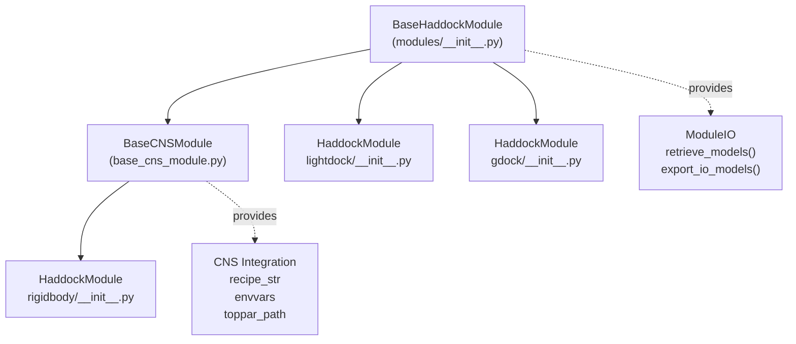
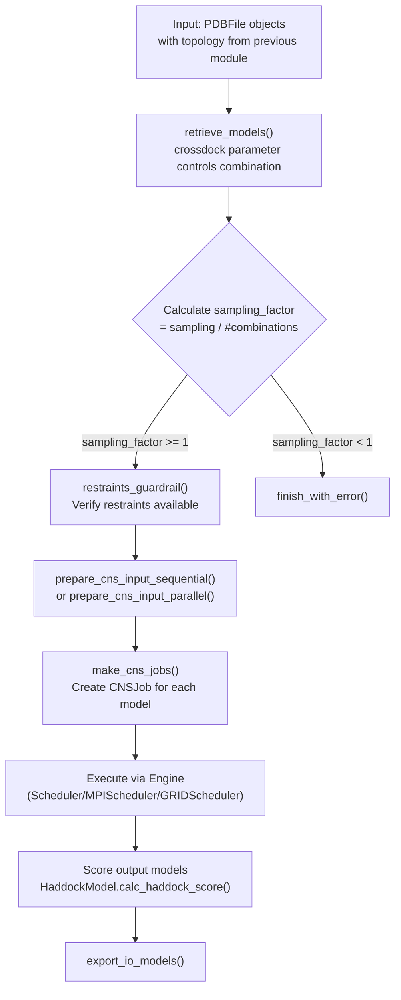
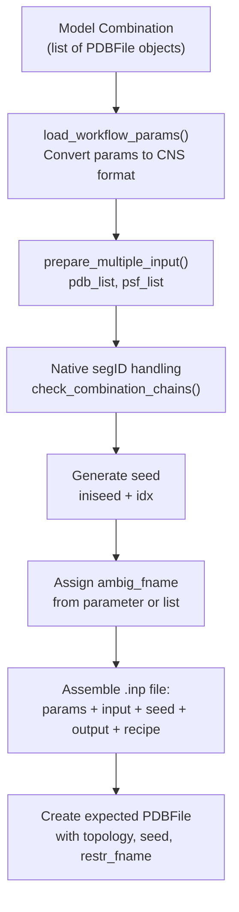
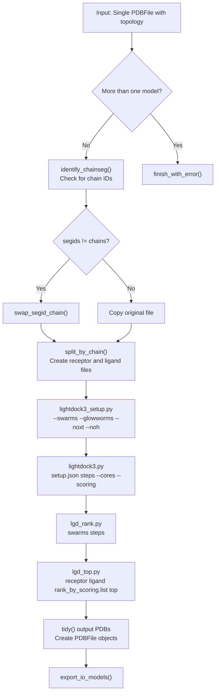
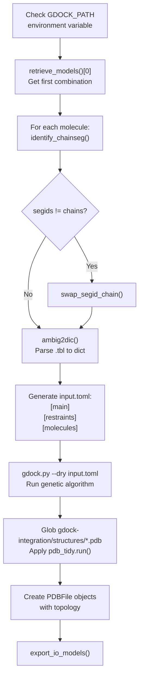

# Sampling Modules

<details>
<summary>Relevant source files</summary>

The following files were used as context for generating this wiki page:

- [src/haddock/core/cns_paths.py](src/haddock/core/cns_paths.py)
- [src/haddock/core/supported_molecules.py](src/haddock/core/supported_molecules.py)
- [src/haddock/gear/preprocessing.py](src/haddock/gear/preprocessing.py)
- [src/haddock/libs/libcns.py](src/haddock/libs/libcns.py)
- [src/haddock/libs/libfunc.py](src/haddock/libs/libfunc.py)
- [src/haddock/libs/libontology.py](src/haddock/libs/libontology.py)
- [src/haddock/libs/libpdb.py](src/haddock/libs/libpdb.py)
- [src/haddock/modules/analysis/clustfcc/__init__.py](src/haddock/modules/analysis/clustfcc/__init__.py)
- [src/haddock/modules/analysis/seletop/__init__.py](src/haddock/modules/analysis/seletop/__init__.py)
- [src/haddock/modules/analysis/seletopclusts/__init__.py](src/haddock/modules/analysis/seletopclusts/__init__.py)
- [src/haddock/modules/base_cns_module.py](src/haddock/modules/base_cns_module.py)
- [src/haddock/modules/refinement/emref/__init__.py](src/haddock/modules/refinement/emref/__init__.py)
- [src/haddock/modules/refinement/flexref/__init__.py](src/haddock/modules/refinement/flexref/__init__.py)
- [src/haddock/modules/refinement/mdref/__init__.py](src/haddock/modules/refinement/mdref/__init__.py)
- [src/haddock/modules/sampling/gdock/__init__.py](src/haddock/modules/sampling/gdock/__init__.py)
- [src/haddock/modules/sampling/lightdock/__init__.py](src/haddock/modules/sampling/lightdock/__init__.py)
- [src/haddock/modules/sampling/rigidbody/__init__.py](src/haddock/modules/sampling/rigidbody/__init__.py)
- [src/haddock/modules/scoring/emscoring/__init__.py](src/haddock/modules/scoring/emscoring/__init__.py)
- [src/haddock/modules/scoring/mdscoring/__init__.py](src/haddock/modules/scoring/mdscoring/__init__.py)
- [src/haddock/modules/topology/topoaa/__init__.py](src/haddock/modules/topology/topoaa/__init__.py)
- [tests/data/broken.pdb](tests/data/broken.pdb)
- [tests/data/corrected.pdb](tests/data/corrected.pdb)
- [tests/data/residues.top](tests/data/residues.top)
- [tests/test_cns_paths.py](tests/test_cns_paths.py)
- [tests/test_core_supported_molecules.py](tests/test_core_supported_molecules.py)
- [tests/test_gear_preprocessing.py](tests/test_gear_preprocessing.py)

</details>


## Purpose and Scope

Sampling modules generate initial docked complexes by exploring the conformational space of interacting molecules. This page documents the three sampling modules available in HADDOCK3: `rigidbody` (the classical HADDOCK rigid-body docking protocol), `lightdock` (glowworm swarm optimization integration), and `gdock` (genetic algorithm integration). These modules typically follow topology generation and precede refinement stages in a HADDOCK3 workflow.

For information about topology preparation that precedes sampling, see [Topology Modules](#4.1). For refinement modules that follow sampling, see [Refinement Modules](#4.3). For configuration of restraints used during sampling, see [Restraints](#5.3).

---

## Module Categories and Architecture

### Sampling Module Classification

HADDOCK3 provides three sampling approaches with different computational strategies:

| Module | Type | Algorithm | External Dependency |
|--------|------|-----------|---------------------|
| `rigidbody` | CNS-based | Rigid-body energy minimization | CNS executable |
| `lightdock` | Third-party | Glowworm swarm optimization | LightDock Python package |
| `gdock` | Third-party | Genetic algorithm | GDOCK package |

**Class Hierarchy Diagram**



Sources: [src/haddock/modules/sampling/rigidbody/__init__.py:50-60](), [src/haddock/modules/sampling/lightdock/__init__.py:20-33](), [src/haddock/modules/sampling/gdock/__init__.py:40-49](), [src/haddock/modules/base_cns_module.py:16-33]()

---

## Rigid-Body Docking Module

The `rigidbody` module implements the classical HADDOCK rigid-body docking protocol, corresponding to the `it0` stage in HADDOCK2.x. It treats interacting partners as rigid bodies with frozen internal geometries, performing randomization and energy minimization guided by restraints.

### Protocol Overview

The rigid-body protocol consists of:
1. Random separation and rotation of molecules around their centers of mass
2. Rigid-body energy minimization using rotations and translations as degrees of freedom
3. Energy evaluation using van der Waals, electrostatics, and restraint terms

**Rigid-Body Workflow Diagram**



Sources: [src/haddock/modules/sampling/rigidbody/__init__.py:196-272]()

### Restraint Types and Ab-Initio Mode

The module supports multiple restraint types to guide the docking:

| Restraint Type | Parameter | Description |
|----------------|-----------|-------------|
| Ambiguous | `ambig_fname` | AIRs (Ambiguous Interaction Restraints) |
| Unambiguous | `unambig_fname` | Distance restraints between specific atoms |
| Hydrogen bonds | `hbond_fname` | Explicit hydrogen bond restraints |
| Center of mass | `cmrest` | Distance restraints between centers of mass |
| Random AIRs | `ranair` | Randomly generated surface patches |
| Surface restraints | `surfrest` | Surface-based restraints |

The `restraints_guardrail()` method ensures at least one type of restraint is provided. If no restraints are available, the module terminates with an error.

Sources: [src/haddock/modules/sampling/rigidbody/__init__.py:172-194]()

### CNS Input Preparation

**CNS Input Generation Flow**



Sources: [src/haddock/libs/libcns.py:321-424](), [src/haddock/modules/sampling/rigidbody/__init__.py:90-123]()

### Crossdocking and Sampling Factor

The module supports two docking modes:

- **Pairwise mode** (`crossdock=false`): Pairs models from each input ensemble in order (model 1 of A with model 1 of B, etc.)
- **Crossdock mode** (`crossdock=true`): Creates all possible combinations (Cartesian product) of models from input ensembles

The `sampling_factor` parameter determines how many times each combination is sampled with different random seeds. The total number of output models is:

```
total_models = number_of_combinations * sampling_factor
```

Sources: [src/haddock/modules/sampling/rigidbody/__init__.py:202-220]()

### Scoring and Output

After CNS execution, each model is scored using the HADDOCK score function:

```python
# Weight keys extracted from parameters
_weight_keys = ("w_vdw", "w_elec", "w_desolv", "w_air", "w_bsa")
weights = {e: self.params[e] for e in _weight_keys}

# Score calculation
haddock_model = HaddockModel(model.file_name)
model.unw_energies = haddock_model.energies
haddock_score = haddock_model.calc_haddock_score(**weights)
model.score = haddock_score
```

The output `PDBFile` objects contain:
- `score`: Weighted HADDOCK score
- `unw_energies`: Dictionary of individual energy terms
- `topology`: List of topology files
- `seed`: Random seed used for generation
- `restr_fname`: Restraint file used

Sources: [src/haddock/modules/sampling/rigidbody/__init__.py:258-271]()

---

## LightDock Integration

The `lightdock` module integrates the LightDock docking software, which uses glowworm swarm optimization (GSO) to explore the conformational space. This is a multi-objective optimization algorithm inspired by the behavior of glowworms.

### LightDock Execution Pipeline

**LightDock Module Flow**



Sources: [src/haddock/modules/sampling/lightdock/__init__.py:40-161]()

### Configuration Parameters

Key parameters for LightDock integration:

| Parameter | Description | Default |
|-----------|-------------|---------|
| `receptor_chains` | List of receptor chain IDs | Required |
| `ligand_chains` | List of ligand chain IDs | Required |
| `swarms` | Number of swarms (binding site regions) | Module default |
| `glowworms` | Number of glowworms per swarm | Module default |
| `steps` | Number of optimization steps | Module default |
| `scoring` | Scoring function to use | Module default |
| `noxt` | Do not include OXT atoms | false |
| `noh` | Do not include hydrogen atoms | false |
| `top` | Number of top structures to generate | Module default |

### Chain ID Requirements

LightDock requires chain IDs to distinguish receptor from ligand. The module automatically handles cases where only segIDs are present by copying segIDs to the chain ID column using `swap_segid_chain()`.

Sources: [src/haddock/modules/sampling/lightdock/__init__.py:56-99](), [src/haddock/libs/libpdb.py:156-163]()

---

## GDOCK Integration

The `gdock` module integrates the GDOCK genetic algorithm-based docking software. GDOCK uses evolutionary computation to optimize the docking pose.

### GDOCK Setup and Execution

**GDOCK Integration Architecture**



Sources: [src/haddock/modules/sampling/gdock/__init__.py:66-152]()

### Restraint Conversion

GDOCK uses a simplified restraint format. The `ambig2dic()` function converts HADDOCK's `.tbl` restraint files to a dictionary mapping chain IDs to residue lists:

```python
def ambig2dic(ambig_f: FilePath) -> dict[str, list[int]]:
    """Read an ambig.tbl file and convert it to a dictionary."""
    ambig_regex = r"resid\s*(\d*)\s*and\s*segid\s*(\w)"
    ambig_dic: dict[str, list[int]] = {}
    # Parse CNS restraint format
    # Extract residue IDs and chain/segid
    # Return as {chain: [resid1, resid2, ...]}
```

This dictionary is then written to the TOML configuration file in the `[restraints]` section.

Sources: [src/haddock/modules/sampling/gdock/__init__.py:23-37](), [src/haddock/modules/sampling/gdock/__init__.py:96-112]()

### TOML Configuration Generation

The module dynamically generates a TOML input file for GDOCK:

```toml
[main]
identifier = "gdock-integration"
number_of_processors = <ncores>

[restraints]
A = [list of residue IDs for chain A]
B = [list of residue IDs for chain B]

[molecules]
A = "path/to/receptor.pdb"
B = "path/to/ligand.pdb"
```

Sources: [src/haddock/modules/sampling/gdock/__init__.py:99-128]()

---

## Common Patterns and Data Flow

### Input/Output Contract

All sampling modules follow a consistent input/output pattern:

**Sampling Module I/O Pattern**

```mermaid
graph LR
    subgraph Input
        PrevIO["previous_io.output<br/>(ModuleIO)"]
        PDBInput["List of PDBFile objects<br/>or tuples of PDBFiles"]
        TopoInfo["topology: TopologyFile(s)<br/>from topoaa module"]
    end
    
    subgraph Processing
        Sampling["Sampling Algorithm<br/>(rigidbody/lightdock/gdock)"]
        Combinations["Model Combinations<br/>(pairwise or crossdock)"]
    end
    
    subgraph Output
        PDBOutput["List of PDBFile objects"]
        Scores["score: float<br/>(HADDOCK score or 0.0)"]
        TopoOut["topology: TopologyFile(s)<br/>(inherited from input)"]
        Metadata["Optional: seed, restr_fname,<br/>unw_energies"]
    end
    
    PrevIO --> PDBInput
    PDBInput --> TopoInfo
    TopoInfo --> Combinations
    Combinations --> Sampling
    Sampling --> PDBOutput
    PDBOutput --> Scores
    Scores --> TopoOut
    TopoOut --> Metadata
```



Sources: [src/haddock/libs/libontology.py:157-192](), [src/haddock/modules/sampling/rigidbody/__init__.py:196-210]()

### Model Retrieval Methods

The `ModuleIO.retrieve_models()` method provides different combination strategies:

| Mode | `crossdock` | `individualize` | Behavior |
|------|-------------|-----------------|----------|
| Pairwise | `False` | `False` | Zip ensembles element-wise: `[(A1,B1), (A2,B2), ...]` |
| Crossdock | `True` | `False` | Cartesian product: `[(A1,B1), (A1,B2), (A2,B1), (A2,B2), ...]` |
| Individualize | - | `True` | Flatten all models: `[A1, A2, B1, B2, ...]` |

Sources: [src/haddock/libs/libontology.py:157-192]()

### CNS Module Pattern (rigidbody)

CNS-based sampling modules follow a specific execution pattern provided by `BaseCNSModule`:

1. **Environment Setup**: `default_envvars()` sets `MODULE`, `MODDIR`, `TOPPAR`
2. **Recipe Loading**: CNS script loaded into `recipe_str` from `cns/` subdirectory
3. **Self-Contained Mode**: Optional copying of CNS scripts and topology files into module directory
4. **Input Generation**: `prepare_cns_input()` assembles parameters, structures, and recipe into `.inp` files
5. **Execution**: Jobs dispatched to `Engine` (local/MPI/grid)
6. **Scoring**: Output parsed by `HaddockModel` and scored

Sources: [src/haddock/modules/base_cns_module.py:40-114](), [src/haddock/libs/libcns.py:321-424]()

### Third-Party Module Pattern (lightdock, gdock)

Third-party integration modules follow a different pattern:

1. **Installation Check**: `confirm_installation()` verifies external tool availability
2. **Input Preparation**: Convert HADDOCK formats to tool-specific formats
3. **Chain ID Handling**: Ensure chain IDs present (required by most external tools)
4. **Subprocess Execution**: Call external executables via `subprocess.call()`
5. **Output Collection**: Glob and parse tool-specific output files
6. **PDB Tidying**: Apply `pdb_tidy.run()` to ensure HADDOCK-compatible format
7. **Metadata Transfer**: Preserve topology information from input

Sources: [src/haddock/modules/sampling/lightdock/__init__.py:35-161](), [src/haddock/modules/sampling/gdock/__init__.py:52-152]()

---

## Configuration and Restraints

### Parameter Inheritance

Sampling modules inherit parameters from their base classes:

- **From BaseHaddockModule**: `mode` (execution mode), `ncores`, `tolerance`, `debug`
- **From BaseCNSModule** (rigidbody only): `cns_exec`, `self_contained`, toppar paths

Module-specific parameters are defined in `defaults.yaml` files within each module directory.

Sources: [src/haddock/modules/base_cns_module.py:23-74]()

### Ambiguous Restraint Handling

The `get_ambig_fnames()` method in `BaseCNSModule` provides flexible restraint file handling:

1. **Single file**: Use `ambig_fname` parameter for all models
2. **Compressed archive**: Extract `.tgz` to find numbered `.tbl` files
3. **Previous restraints**: Use `previous_ambig=true` to inherit from previous module
4. **Per-model restraints**: Match different restraint files to different models

This allows workflows where restraints vary across models (e.g., ensemble docking with model-specific restraints).

Sources: [src/haddock/modules/base_cns_module.py:116-154]()

### Typical Sampling Module Usage

A typical HADDOCK3 configuration using sampling modules:

```toml
# Workflow configuration
[topoaa]
autohis = true

[rigidbody]
sampling = 1000
ambig_fname = "ambig.tbl"
w_vdw = 0.01
w_elec = 1.0
w_air = 0.01
# For ab-initio mode without restraints:
# cmrest = true

[seletop]
select = 200

[flexref]
# ... refinement parameters
```

The sampling module typically produces 100-1000+ initial docked models, which are then filtered by selection modules (`seletop`) before refinement.

Sources: [src/haddock/modules/sampling/rigidbody/__init__.py:1-30](), [src/haddock/modules/analysis/seletop/__init__.py:1-9]()

---