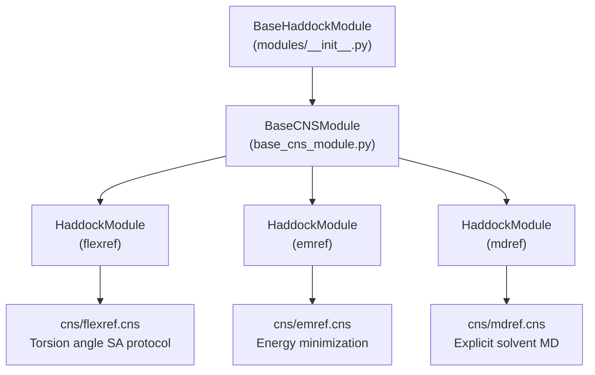
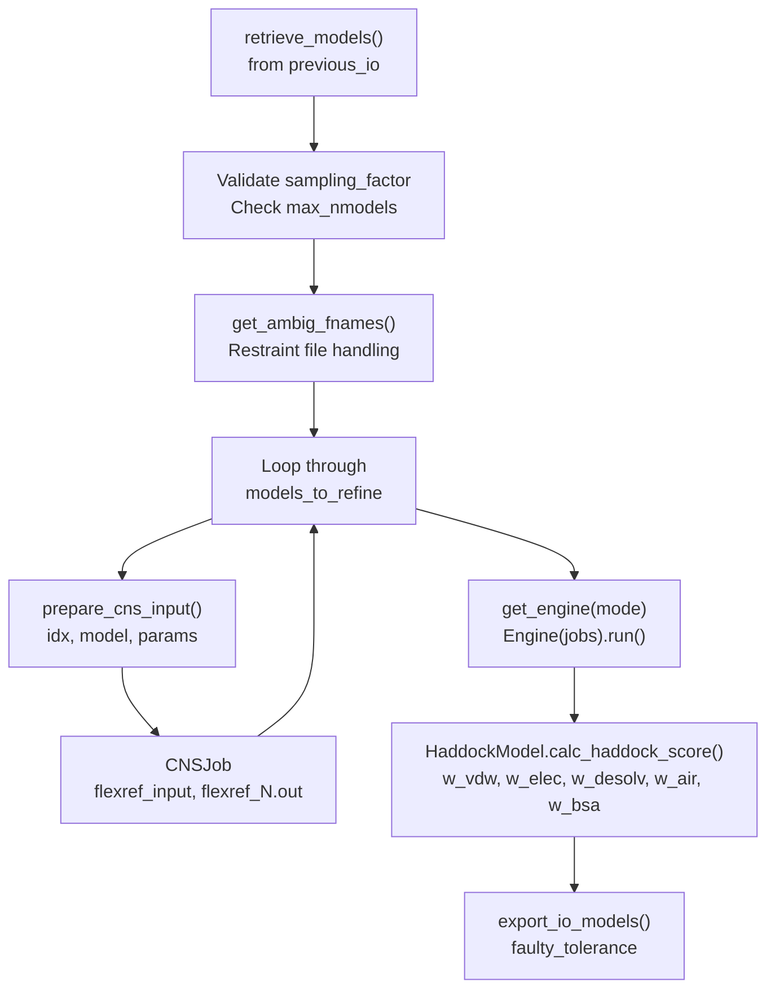
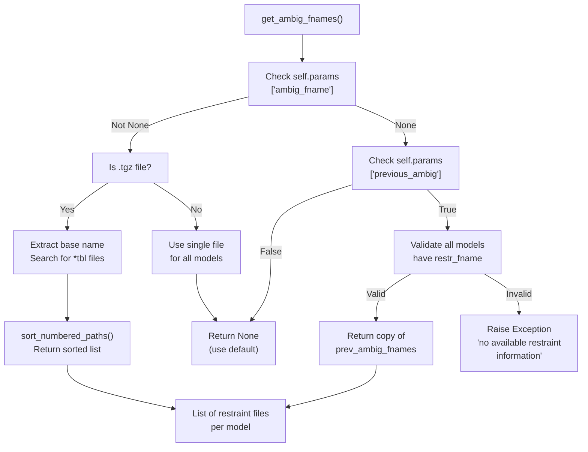
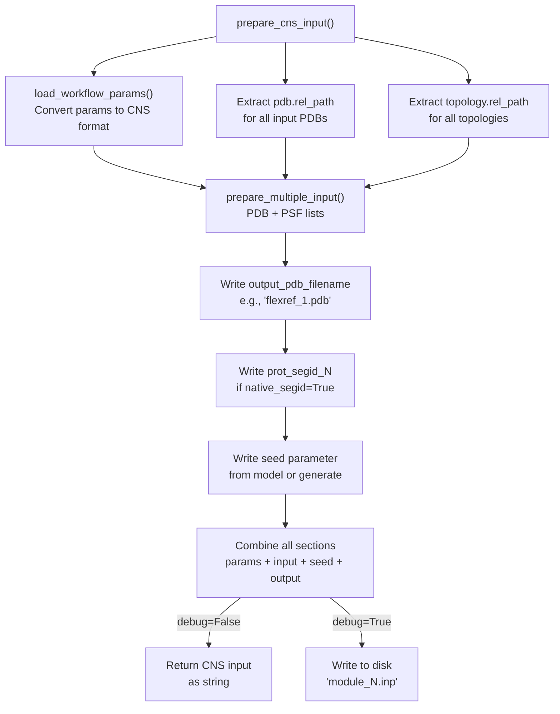

# Refinement Modules

<details>
<summary>Relevant source files</summary>

The following files were used as context for generating this wiki page:

- [src/haddock/core/cns_paths.py](src/haddock/core/cns_paths.py)
- [src/haddock/core/supported_molecules.py](src/haddock/core/supported_molecules.py)
- [src/haddock/gear/preprocessing.py](src/haddock/gear/preprocessing.py)
- [src/haddock/libs/libcns.py](src/haddock/libs/libcns.py)
- [src/haddock/libs/libfunc.py](src/haddock/libs/libfunc.py)
- [src/haddock/libs/libontology.py](src/haddock/libs/libontology.py)
- [src/haddock/libs/libpdb.py](src/haddock/libs/libpdb.py)
- [src/haddock/modules/analysis/clustfcc/__init__.py](src/haddock/modules/analysis/clustfcc/__init__.py)
- [src/haddock/modules/analysis/seletop/__init__.py](src/haddock/modules/analysis/seletop/__init__.py)
- [src/haddock/modules/analysis/seletopclusts/__init__.py](src/haddock/modules/analysis/seletopclusts/__init__.py)
- [src/haddock/modules/base_cns_module.py](src/haddock/modules/base_cns_module.py)
- [src/haddock/modules/refinement/emref/__init__.py](src/haddock/modules/refinement/emref/__init__.py)
- [src/haddock/modules/refinement/flexref/__init__.py](src/haddock/modules/refinement/flexref/__init__.py)
- [src/haddock/modules/refinement/mdref/__init__.py](src/haddock/modules/refinement/mdref/__init__.py)
- [src/haddock/modules/sampling/gdock/__init__.py](src/haddock/modules/sampling/gdock/__init__.py)
- [src/haddock/modules/sampling/lightdock/__init__.py](src/haddock/modules/sampling/lightdock/__init__.py)
- [src/haddock/modules/sampling/rigidbody/__init__.py](src/haddock/modules/sampling/rigidbody/__init__.py)
- [src/haddock/modules/scoring/emscoring/__init__.py](src/haddock/modules/scoring/emscoring/__init__.py)
- [src/haddock/modules/scoring/mdscoring/__init__.py](src/haddock/modules/scoring/mdscoring/__init__.py)
- [src/haddock/modules/topology/topoaa/__init__.py](src/haddock/modules/topology/topoaa/__init__.py)
- [tests/data/broken.pdb](tests/data/broken.pdb)
- [tests/data/corrected.pdb](tests/data/corrected.pdb)
- [tests/data/residues.top](tests/data/residues.top)
- [tests/test_cns_paths.py](tests/test_cns_paths.py)
- [tests/test_core_supported_molecules.py](tests/test_core_supported_molecules.py)
- [tests/test_gear_preprocessing.py](tests/test_gear_preprocessing.py)

</details>


## Purpose and Scope

This document describes the three refinement modules in HADDOCK3: **flexref** (flexible refinement), **emref** (energy minimization refinement), and **mdref** (molecular dynamics refinement in explicit solvent). These modules improve the quality of docked models generated by sampling modules through various computational refinement protocols executed by CNS. All refinement modules inherit from `BaseCNSModule` and follow similar architectural patterns.

For information about sampling modules that generate initial models, see [Sampling Modules](#4.2). For information about scoring modules that evaluate refined structures, see [Scoring Modules](#4.4).

---

## Module Overview

HADDOCK3 provides three refinement strategies, each serving different purposes in the docking workflow:

| Module | HADDOCK2.X Equivalent | Primary Method | Key Characteristics |
|--------|----------------------|----------------|---------------------|
| **flexref** | it1 | Semi-flexible simulated annealing in torsion angle space | Multi-stage protocol with progressive flexibility; interface-focused |
| **emref** | - | Conjugate gradient energy minimization | Fast refinement; no dynamics; maintains input geometry |
| **mdref** | itw | Molecular dynamics in explicit solvent | Computationally expensive; realistic solvation; temperature control |

**Sources:** [src/haddock/modules/refinement/flexref/__init__.py:1-22](), [src/haddock/modules/refinement/emref/__init__.py:1-8](), [src/haddock/modules/refinement/mdref/__init__.py:1-21]()

---

## Refinement Module Architecture

### Class Hierarchy



All three refinement modules are implemented as `HaddockModule` classes within their respective packages, inheriting shared functionality from `BaseCNSModule`. This base class provides CNS integration capabilities including script management, topology/parameter file handling, and environment variable configuration.

**Sources:** [src/haddock/modules/refinement/flexref/__init__.py:40-49](), [src/haddock/modules/refinement/emref/__init__.py:26-36](), [src/haddock/modules/refinement/mdref/__init__.py:39-48](), [src/haddock/modules/base_cns_module.py:16-39]()

---

## Flexible Refinement (flexref)

### Protocol Description

The `flexref` module implements a semi-flexible simulated annealing protocol in torsion angle space, corresponding to the `it1` stage in HADDOCK2.X. The protocol consists of four sequential stages:

1. **High-temperature rigid body molecular dynamics** - Initial exploration maintaining rigid molecules
2. **Rigid body simulated annealing** - Gradual cooling with rotation/translation degrees of freedom
3. **Semi-flexible SA with flexible side-chains** - Interface side-chains become flexible
4. **Semi-flexible SA with fully flexible interface** - Both backbone and side-chains at interface become flexible

By default, flexibility is automatically defined based on intermolecular contacts at the interface. Users can also manually define semi-flexible and fully flexible regions.

**Sources:** [src/haddock/modules/refinement/flexref/__init__.py:1-22]()

### Implementation Details



The module initializes with a CNS script path and executes the `_run()` method following this workflow:

1. **Model Retrieval** - Calls `self.previous_io.retrieve_models()` to get structures from the previous module
2. **Sampling Factor Validation** - Ensures `sampling_factor` is between 1-100 and validates `max_nmodels` constraint
3. **Restraint Handling** - Extracts `prev_ambig_fnames` from input models; calls `get_ambig_fnames()` to determine restraint files
4. **Job Preparation** - For each model × sampling_factor iterations:
   - Calls `prepare_cns_input()` with model, parameters, and restraints
   - Creates `PDBFile` object with `prepare_expected_pdb()`
   - Instantiates `CNSJob` with input/output paths
5. **Execution** - Submits all jobs to execution engine (local/MPI/grid)
6. **Scoring** - Calculates HADDOCK score using energy terms and weights
7. **Export** - Writes `io.json` with structure metadata and scores

**Sources:** [src/haddock/modules/refinement/flexref/__init__.py:56-159](), [src/haddock/libs/libcns.py:321-424]()

---

## Energy Minimization Refinement (emref)

### Protocol Description

The `emref` module performs energy minimization refinement using the conjugate gradient method implemented in CNS. This is a fast refinement strategy that optimizes molecular geometry without performing molecular dynamics. The method refines structures by minimizing the potential energy, primarily correcting unfavorable contacts and geometries.

Coordinates of energy-minimized structures are saved, and each complex is evaluated using the HADDOCK scoring function. No restraints are applied during the minimization step itself, though restraint information is preserved for downstream modules.

**Sources:** [src/haddock/modules/refinement/emref/__init__.py:1-8]()

### Implementation Details

The `emref` module follows an identical execution pattern to `flexref`, with key differences:

- **CNS Script**: Uses `cns/emref.cns` which implements energy minimization instead of simulated annealing
- **No Temperature Control**: Does not have temperature-related parameters
- **Fast Execution**: Typically completes faster than dynamics-based methods
- **Geometry-Focused**: Primarily corrects local geometry rather than exploring conformational space

The module supports `sampling_factor` to generate multiple minimized variants per input structure, though this is less common than in dynamics-based methods since energy minimization is deterministic.

**Sources:** [src/haddock/modules/refinement/emref/__init__.py:39-142]()

---

## Molecular Dynamics Refinement (mdref)

### Protocol Description

The `mdref` module (corresponding to `itw` in HADDOCK2.X) performs a short molecular dynamics simulation in Cartesian space using explicit solvent. A layer of solvent molecules is generated around surface residues:
- **8 Å** for water solvent
- **12.5 Å** for DMSO solvent

The refinement protocol consists of four sequential stages:


Using default parameters, no spectacular conformational changes are expected. However, the scoring of structures is typically improved by the explicit solvation and realistic dynamics. The number of MD steps can be modified using the `waterheatsteps`, `watersteps`, and `watercoolsteps` parameters.

**Sources:** [src/haddock/modules/refinement/mdref/__init__.py:1-21]()

### Implementation Details

The `mdref` module implementation mirrors `flexref` and `emref` architectures:

```python
# Key differences in mdref
cns_script = Path(RECIPE_PATH, "cns", "mdref.cns")
# Temperature control parameters available
# Solvent layer parameters available
# Longer execution time than emref/flexref
```

The module is computationally more expensive than `flexref` or `emref` due to:
- Explicit solvent molecule generation and management
- Longer simulation times with multiple heating/cooling cycles
- Cartesian space dynamics (more degrees of freedom than torsion angle space)

**Sources:** [src/haddock/modules/refinement/mdref/__init__.py:39-156]()

---

## Common Refinement Workflow

### Data Flow Through Refinement Modules

```mermaid
graph TB
    subgraph "Input Stage"
        PrevModule["Previous Module<br/>(sampling or selection)"]
        RetrieveModels["previous_io.retrieve_models()<br/>Returns list[PDBFile]"]
        PrevModule --> RetrieveModels
    end
    
    subgraph "Preparation Stage"
        ValidateParams["Validate Parameters<br/>sampling_factor: 1-100<br/>max_nmodels check"]
        ExtractRestraints["Extract prev_ambig_fnames<br/>from model.restr_fname"]
        GetAmbigFnames["get_ambig_fnames()<br/>Determine restraint files"]
        
        RetrieveModels --> ValidateParams
        ValidateParams --> ExtractRestraints
        ExtractRestraints --> GetAmbigFnames
    end
    
    subgraph "Job Creation Loop"
        LoopModels["For each model in<br/>models_to_refine"]
        LoopSampling["For _ in range<br/>(sampling_factor)"]
        PrepareCNSInput["prepare_cns_input()<br/>Generate CNS .inp"]
        PrepareExpectedPDB["prepare_expected_pdb()<br/>Create output PDBFile object"]
        CreateCNSJob["CNSJob()<br/>inp, out, err files"]
        
        GetAmbigFnames --> LoopModels
        LoopModels --> LoopSampling
        LoopSampling --> PrepareCNSInput
        PrepareCNSInput --> PrepareExpectedPDB
        PrepareExpectedPDB --> CreateCNSJob
        CreateCNSJob --> LoopSampling
    end
    
    subgraph "Execution Stage"
        GetEngine["get_engine(mode, params)<br/>Local/MPI/Grid"]
        InstantiateEngine["Engine(jobs)"]
        RunJobs["engine.run()<br/>Execute all CNS jobs"]
        
        CreateCNSJob --> GetEngine
        GetEngine --> InstantiateEngine
        InstantiateEngine --> RunJobs
    end
    
    subgraph "Scoring Stage"
        CheckPresence["For pdb in output_models<br/>if pdb.is_present()"]
        LoadEnergies["HaddockModel(pdb.file_name)<br/>Extract energies"]
        CalcScore["calc_haddock_score()<br/>Apply weights"]
        AssignScore["pdb.score = haddock_score<br/>pdb.unw_energies = energies"]
        
        RunJobs --> CheckPresence
        CheckPresence --> LoadEnergies
        LoadEnergies --> CalcScore
        CalcScore --> AssignScore
    end
    
    subgraph "Export Stage"
        ExportIO["export_io_models()<br/>faulty_tolerance"]
        WriteJSON["ModuleIO.save()<br/>io.json"]
        
        AssignScore --> ExportIO
        ExportIO --> WriteJSON
    end
```



**Sources:** [src/haddock/modules/refinement/flexref/__init__.py:56-159](), [src/haddock/modules/refinement/emref/__init__.py:43-142](), [src/haddock/modules/refinement/mdref/__init__.py:55-156]()

---

## Parameter Processing

### Common Parameters

All three refinement modules share these key parameters:

| Parameter | Type | Description | Default/Constraints |
|-----------|------|-------------|---------------------|
| `sampling_factor` | int | Number of refined structures per input model | 1-100; warns if 0 or >100 |
| `max_nmodels` | int | Maximum total number of models allowed | Enforced: `len(models) * sampling_factor ≤ max_nmodels` |
| `ambig_fname` | Path | Path to ambiguous restraints file (.tbl) | Can be .tgz archive or single file |
| `previous_ambig` | bool | Use restraints from previous module | Requires `restr_fname` in input models |
| `tolerance` | float | Tolerance for faulty models (percentage) | Passed to `export_io_models()` |
| `mode` | str | Execution mode | "local", "mpi", or "batch" |
| `debug` | bool | Write CNS input files to disk | Default: False |

**Sources:** [src/haddock/modules/refinement/flexref/__init__.py:68-84](), [src/haddock/modules/refinement/emref/__init__.py:54-70](), [src/haddock/modules/refinement/mdref/__init__.py:68-84]()

### Weight Parameters for HADDOCK Score

All refinement modules calculate HADDOCK scores using these energy term weights:

```python
_weight_keys = ("w_vdw", "w_elec", "w_desolv", "w_air", "w_bsa")
weights = {e: self.params[e] for e in _weight_keys}
haddock_score = haddock_model.calc_haddock_score(**weights)
```

These weights control the relative contributions of:
- `w_vdw` - Van der Waals energy
- `w_elec` - Electrostatic energy
- `w_desolv` - Desolvation energy
- `w_air` - Ambiguous interaction restraints
- `w_bsa` - Buried surface area

**Sources:** [src/haddock/modules/refinement/flexref/__init__.py:146-156](), [src/haddock/modules/refinement/emref/__init__.py:131-140](), [src/haddock/modules/refinement/mdref/__init__.py:143-153]()

---

## Restraint Handling

### Restraint File Resolution



The `get_ambig_fnames()` method (inherited from `BaseCNSModule`) implements sophisticated restraint file handling:

1. **Explicit File Provided**: If `ambig_fname` is set:
   - If filename ends with `.tgz`: Extract base name, search for matching `.tbl` files in directory, sort numerically
   - If regular `.tbl` file: Return None (use single file for all models)

2. **Previous Restraints**: If `previous_ambig=True`:
   - Extract `restr_fname` from each input `PDBFile` object
   - Validate that all models have restraint information
   - Return copied list of previous restraints

3. **No Restraints**: Return None (modules will use default or skip restraints)

This allows flexible workflows where different models can have different restraints, particularly useful after sampling modules that assigned model-specific restraints.

**Sources:** [src/haddock/modules/base_cns_module.py:116-154](), [src/haddock/modules/refinement/flexref/__init__.py:87-94](), [src/haddock/modules/refinement/emref/__init__.py:73-80](), [src/haddock/modules/refinement/mdref/__init__.py:86-93]()

---

## CNS Integration

### CNS Input Generation

All refinement modules use `prepare_cns_input()` to generate CNS input scripts:



The function assembles a complete CNS input script containing:
- **Parameter Section**: All module parameters in CNS `eval ($var=value)` format
- **Input Section**: PDB and PSF file paths, component counts, segment IDs
- **Seed Section**: Random seed for reproducibility (from model or generated)
- **Output Section**: Expected output filename
- **Recipe**: The CNS protocol script (loaded from `.cns` file)

**Sources:** [src/haddock/libs/libcns.py:321-424](), [src/haddock/libs/libcns.py:256-278](), [src/haddock/libs/libcns.py:151-182]()

### CNS Job Execution

```python
# Job creation pattern (identical across modules)
job = CNSJob(
    refinement_input,      # CNS input string or file path
    f"{module}_{idx}.out", # Output log file
    f"{module}_{idx}.cnserr",  # Error file
    envvars=self.envvars   # Environment variables (MODULE, TOPPAR, etc.)
)
jobs.append(job)

# Execution
Engine = get_engine(self.params["mode"], self.params)
engine = Engine(jobs)
engine.run()
```

The `CNSJob` class encapsulates all information needed to execute a single CNS calculation. The execution engine (local/MPI/grid) handles job distribution and execution based on the `mode` parameter.

**Sources:** [src/haddock/modules/refinement/flexref/__init__.py:133-143](), [src/haddock/modules/base_cns_module.py:65-73]()

---

## Output Processing and Scoring

### Model Scoring Workflow

After CNS execution completes, refinement modules calculate HADDOCK scores for all output structures:

```python
# Weight extraction (standardized across modules)
_weight_keys = ("w_vdw", "w_elec", "w_desolv", "w_air", "w_bsa")
weights = {e: self.params[e] for e in _weight_keys}

# Per-model scoring
for pdb in self.output_models:
    if pdb.is_present():
        haddock_model = HaddockModel(pdb.file_name)
        pdb.unw_energies = haddock_model.energies
        haddock_score = haddock_model.calc_haddock_score(**weights)
        pdb.score = haddock_score
```

The `HaddockModel` class parses CNS output files to extract energy terms, which are stored in both weighted (via `score`) and unweighted (via `unw_energies`) forms. This allows downstream modules to re-score with different weights if needed.

**Sources:** [src/haddock/modules/refinement/flexref/__init__.py:146-156](), [src/haddock/modules/refinement/emref/__init__.py:131-140](), [src/haddock/modules/refinement/mdref/__init__.py:143-153]()

### Faulty Model Tolerance

```python
self.export_io_models(faulty_tolerance=self.params["tolerance"])
```

The `export_io_models()` method (inherited from `BaseHaddockModule`) implements fault tolerance:

1. Checks which expected output files are actually present on disk
2. Calculates the percentage of missing/faulty models
3. If faulty percentage ≤ `tolerance`: Logs warning and continues
4. If faulty percentage > `tolerance`: Raises error and terminates workflow

This allows workflows to continue even if some refinement calculations fail, which is important for high-throughput docking where individual structure failures should not halt the entire pipeline.

**Sources:** [src/haddock/modules/refinement/flexref/__init__.py:159](), [src/haddock/modules/refinement/emref/__init__.py:142](), [src/haddock/modules/refinement/mdref/__init__.py:156]()

---

## Module Comparison Summary

### Computational Characteristics

| Aspect | flexref | emref | mdref |
|--------|---------|-------|-------|
| **Coordinate Space** | Torsion angles | Cartesian | Cartesian |
| **Primary Method** | Simulated annealing | Conjugate gradient | Molecular dynamics |
| **Solvent Model** | Implicit | Implicit | Explicit |
| **Temperature Control** | Multi-stage cooling | None | Heating + cooling cycles |
| **Relative Speed** | Medium | Fast | Slow |
| **Conformational Sampling** | Moderate | Minimal | High |
| **Interface Flexibility** | Progressive | Fixed | Full |
| **Typical Use Case** | Standard refinement after sampling | Quick geometry optimization | Final high-quality refinement |

### Typical Workflow Positioning


Common workflow patterns:
- **Standard**: sampling → flexref → scoring → clustering
- **Fast**: sampling → emref → scoring → clustering
- **High-Quality**: sampling → flexref → mdref → scoring → clustering
- **Multi-Stage**: sampling → seletop → flexref → seletop → mdref → scoring

**Sources:** Based on module documentation and typical HADDOCK3 workflows described in [src/haddock/modules/refinement/flexref/__init__.py:1-22](), [src/haddock/modules/refinement/emref/__init__.py:1-8](), [src/haddock/modules/refinement/mdref/__init__.py:1-21]()

---