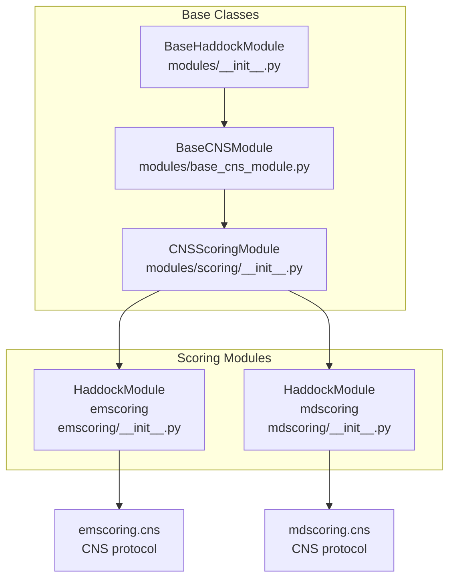
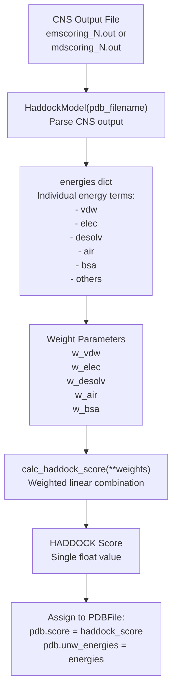
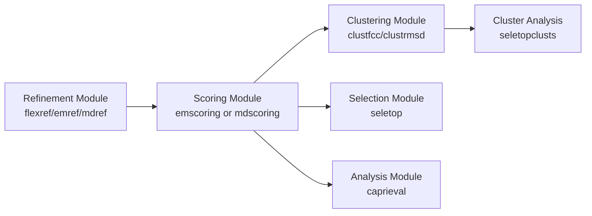

# Scoring Modules

<details>
<summary>Relevant source files</summary>

The following files were used as context for generating this wiki page:

- [src/haddock/core/cns_paths.py](src/haddock/core/cns_paths.py)
- [src/haddock/core/supported_molecules.py](src/haddock/core/supported_molecules.py)
- [src/haddock/gear/preprocessing.py](src/haddock/gear/preprocessing.py)
- [src/haddock/libs/libcns.py](src/haddock/libs/libcns.py)
- [src/haddock/libs/libfunc.py](src/haddock/libs/libfunc.py)
- [src/haddock/libs/libontology.py](src/haddock/libs/libontology.py)
- [src/haddock/libs/libpdb.py](src/haddock/libs/libpdb.py)
- [src/haddock/modules/analysis/clustfcc/__init__.py](src/haddock/modules/analysis/clustfcc/__init__.py)
- [src/haddock/modules/analysis/seletop/__init__.py](src/haddock/modules/analysis/seletop/__init__.py)
- [src/haddock/modules/analysis/seletopclusts/__init__.py](src/haddock/modules/analysis/seletopclusts/__init__.py)
- [src/haddock/modules/base_cns_module.py](src/haddock/modules/base_cns_module.py)
- [src/haddock/modules/refinement/emref/__init__.py](src/haddock/modules/refinement/emref/__init__.py)
- [src/haddock/modules/refinement/flexref/__init__.py](src/haddock/modules/refinement/flexref/__init__.py)
- [src/haddock/modules/refinement/mdref/__init__.py](src/haddock/modules/refinement/mdref/__init__.py)
- [src/haddock/modules/sampling/gdock/__init__.py](src/haddock/modules/sampling/gdock/__init__.py)
- [src/haddock/modules/sampling/lightdock/__init__.py](src/haddock/modules/sampling/lightdock/__init__.py)
- [src/haddock/modules/sampling/rigidbody/__init__.py](src/haddock/modules/sampling/rigidbody/__init__.py)
- [src/haddock/modules/scoring/emscoring/__init__.py](src/haddock/modules/scoring/emscoring/__init__.py)
- [src/haddock/modules/scoring/mdscoring/__init__.py](src/haddock/modules/scoring/mdscoring/__init__.py)
- [src/haddock/modules/topology/topoaa/__init__.py](src/haddock/modules/topology/topoaa/__init__.py)
- [tests/data/broken.pdb](tests/data/broken.pdb)
- [tests/data/corrected.pdb](tests/data/corrected.pdb)
- [tests/data/residues.top](tests/data/residues.top)
- [tests/test_cns_paths.py](tests/test_cns_paths.py)
- [tests/test_core_supported_molecules.py](tests/test_core_supported_molecules.py)
- [tests/test_gear_preprocessing.py](tests/test_gear_preprocessing.py)

</details>


## Purpose and Scope

This document describes the scoring modules in HADDOCK3, specifically `emscoring` and `mdscoring`. These modules evaluate molecular models by calculating energy-based scores through CNS simulations without applying restraints. For information about topology generation, see [Topology Modules](#4.1). For analysis and evaluation of scored models, see [Analysis Modules](#4.5).

## Overview

HADDOCK3 provides two scoring modules that evaluate models generated by upstream modules (sampling or refinement). Both modules use CNS to compute energy terms and combine them into a composite HADDOCK score. The key distinction is the computational approach:

| Module | Method | Purpose |
|--------|--------|---------|
| `emscoring` | Energy minimization via conjugate gradient | Fast scoring through local optimization |
| `mdscoring` | Short molecular dynamics simulation | Scoring with conformational sampling |

Both modules operate without restraints, providing unbiased energy evaluations of the input structures.

**Sources:** [src/haddock/modules/scoring/emscoring/__init__.py:1-8](), [src/haddock/modules/scoring/mdscoring/__init__.py:1-5]()

## Module Architecture



**Inheritance Hierarchy**

The scoring modules inherit common functionality through a three-tier class hierarchy:

1. **BaseHaddockModule**: Provides module lifecycle management, I/O operations, parameter handling
2. **BaseCNSModule**: Adds CNS-specific functionality including script management, topology handling, environment variables
3. **CNSScoringModule**: Implements scoring-specific output methods including TSV generation and per-interface scoring

Both `emscoring` and `mdscoring` instantiate `HaddockModule` classes that inherit from `CNSScoringModule`.

**Sources:** [src/haddock/modules/scoring/emscoring/__init__.py:23-32](), [src/haddock/modules/scoring/mdscoring/__init__.py:23-32](), [src/haddock/modules/base_cns_module.py:16-25]()

## Execution Workflow

```mermaid
flowchart TB
    Start([Previous Module Output]) --> Retrieve["retrieve_models(individualize=True)<br/>Get individual PDBFile objects"]
    
    Retrieve --> PrepLoop["For each model:<br/>Prepare CNS input"]
    
    PrepLoop --> PrepInput["prepare_cns_input()<br/>- Model number<br/>- PDB topology<br/>- CNS script<br/>- Parameters<br/>- Seed"]
    
    PrepInput --> CreatePDB["prepare_expected_pdb()<br/>Create output PDBFile object<br/>Preserve metadata:<br/>- ori_name<br/>- md5<br/>- restr_fname"]
    
    CreatePDB --> CreateJob["CNSJob<br/>- Input script<br/>- Output file<br/>- Error file"]
    
    CreateJob --> CheckMore{More models?}
    CheckMore -->|Yes| PrepLoop
    CheckMore -->|No| Execute
    
    Execute["Execute CNS Jobs<br/>get_engine(mode, params)<br/>engine.run()"]
    
    Execute --> Score["For each output model:<br/>Calculate HADDOCK score"]
    
    Score --> ParseEnergies["HaddockModel.energies<br/>Parse energy terms from CNS output"]
    
    ParseEnergies --> CalcScore["calc_haddock_score()<br/>Apply weights:<br/>w_vdw, w_elec, w_desolv<br/>w_air, w_bsa"]
    
    CalcScore --> UpdatePDB["Update PDBFile:<br/>- score<br/>- unw_energies"]
    
    UpdatePDB --> WriteTSV["Write TSV output<br/>module.output(filename)"]
    
    WriteTSV --> PerInterface{per_interface_scoring?}
    PerInterface -->|Yes| WritePerInterface["per_interface_output()<br/>Score by interface"]
    PerInterface -->|No| Export
    WritePerInterface --> Export
    
    Export["export_io_models()<br/>Save to MODULE_IO_FILE"]
    
    Export --> End([Models available for<br/>next module])
```



**Key Steps**

1. **Model Retrieval**: Uses `individualize=True` to flatten any grouped models from previous steps into individual `PDBFile` objects
2. **CNS Input Preparation**: Calls `prepare_cns_input()` from `libcns` to generate CNS input scripts with topology information and parameters
3. **Expected Output Setup**: Creates `PDBFile` objects representing expected outputs before execution
4. **Job Execution**: Submits CNS jobs to the appropriate execution engine (local, MPI, or grid)
5. **Score Calculation**: Parses CNS output files using `HaddockModel` class to extract energy terms, then calculates weighted HADDOCK score
6. **Output Generation**: Writes TSV files and optionally per-interface scores

**Sources:** [src/haddock/modules/scoring/emscoring/__init__.py:39-106](), [src/haddock/modules/scoring/mdscoring/__init__.py:39-106]()

## Energy Minimization Scoring (emscoring)

### Purpose

The `emscoring` module refines input complexes through energy minimization using the conjugate gradient method implemented in CNS, then evaluates them using the HADDOCK scoring function. No restraints are applied during minimization, allowing unbiased energy evaluation.

**Sources:** [src/haddock/modules/scoring/emscoring/__init__.py:1-8]()

### Implementation Details



```mermaid
flowchart LR
    Input["Input Models<br/>PDBFile objects"] --> IndivModels["Individualize Models<br/>individualize=True"]
    
    IndivModels --> PrepCNS["prepare_cns_input()<br/>Model index, PDB, topology<br/>emscoring.cns script"]
    
    PrepCNS --> CNSInput["CNS Input File<br/>emscoring_N.inp"]
    
    CNSInput --> CNSExec["CNS Execution<br/>Energy minimization<br/>Conjugate gradient"]
    
    CNSExec --> Output["Output Files<br/>emscoring_N.pdb<br/>emscoring_N.out"]
    
    Output --> Parse["HaddockModel<br/>Parse energies dict"]
    
    Parse --> Score["calc_haddock_score()<br/>Weighted combination"]
    
    Score --> Update["Update PDBFile<br/>score, unw_energies"]
    
    Update --> TSV["emscoring.tsv<br/>Tabular output"]
```

**Class Definition**

The module defines a `HaddockModule` class that inherits from `CNSScoringModule`:

- **Name**: `"emscoring"` (derived from directory name)
- **CNS Script**: `cns/emscoring.cns`
- **Initialization**: Sets up CNS script path and calls parent constructor

**Sources:** [src/haddock/modules/scoring/emscoring/__init__.py:23-37]()

### Key Methods

**`_run()` Method**

The main execution method [src/haddock/modules/scoring/emscoring/__init__.py:39-108]():

1. Retrieves models with `previous_io.retrieve_models(individualize=True)`
2. Prepares CNS input for each model using `prepare_cns_input()` with identifier `"emscoring"`
3. Creates expected output `PDBFile` objects with `prepare_expected_pdb()`
4. Preserves metadata: `ori_name`, `md5`, `restr_fname`
5. Executes CNS jobs via the configured execution engine
6. Parses output using `HaddockModel` class to extract `energies` dictionary
7. Calculates HADDOCK score using weighted energy terms
8. Writes output to `emscoring.tsv`
9. Optionally generates per-interface scores

**Sources:** [src/haddock/modules/scoring/emscoring/__init__.py:39-108]()

## Molecular Dynamics Scoring (mdscoring)

### Purpose

The `mdscoring` module performs a short molecular dynamics simulation in CNS to score input models. The MD simulation allows conformational sampling during scoring, providing a more dynamic evaluation than pure energy minimization. No restraints are applied.

**Sources:** [src/haddock/modules/scoring/mdscoring/__init__.py:1-5]()

### Implementation Details

The implementation mirrors `emscoring` with these differences:

- **CNS Script**: `cns/mdscoring.cns` (MD protocol instead of minimization)
- **Output Files**: `mdscoring_N.pdb`, `mdscoring_N.out`
- **TSV Output**: `mdscoring.tsv`

All other workflow steps (model retrieval, job preparation, score calculation, output generation) are identical to `emscoring`.

**Sources:** [src/haddock/modules/scoring/mdscoring/__init__.py:23-106]()

## HADDOCK Score Calculation



### Energy Terms

The HADDOCK score is computed from five weighted energy terms extracted from CNS output:

| Term | Weight Parameter | Description |
|------|------------------|-------------|
| Van der Waals | `w_vdw` | Non-bonded steric interactions |
| Electrostatics | `w_elec` | Coulombic interactions |
| Desolvation | `w_desolv` | Solvation free energy |
| AIR | `w_air` | Ambiguous interaction restraints (residual penalty) |
| BSA | `w_bsa` | Buried surface area term |

### Score Calculation

The weighted score is calculated by `HaddockModel.calc_haddock_score()`:

```
HADDOCK_score = w_vdw * E_vdw + w_elec * E_elec + w_desolv * E_desolv + w_air * E_air + w_bsa * E_bsa
```

The `unw_energies` dictionary containing all individual energy terms is preserved in the `PDBFile` object for downstream analysis.

**Sources:** [src/haddock/modules/scoring/emscoring/__init__.py:86-97](), [src/haddock/modules/scoring/mdscoring/__init__.py:86-97]()

## Output Files

### TSV Output

Both modules generate a primary TSV file (`emscoring.tsv` or `mdscoring.tsv`) containing:

- Structure identifiers
- HADDOCK score
- Individual energy components
- Metadata (original filename, MD5 hash if available)

The output is generated by calling `self.output(output_fname)`, which is inherited from `CNSScoringModule`.

**Sources:** [src/haddock/modules/scoring/emscoring/__init__.py:99-102](), [src/haddock/modules/scoring/mdscoring/__init__.py:99-102]()

### Per-Interface Scoring

When `per_interface_scoring` parameter is enabled, additional TSV files are generated with scores calculated separately for each molecular interface. This is useful for analyzing multi-body complexes.

The per-interface output is generated by `self.per_interface_output(output_fname)`.

**Sources:** [src/haddock/modules/scoring/emscoring/__init__.py:104-106](), [src/haddock/modules/scoring/mdscoring/__init__.py:104-106]()

### PDB Output Files

Scored structures are written as PDB files with naming pattern:
- `emscoring_N.pdb` (for emscoring)
- `mdscoring_N.pdb` (for mdscoring)

Where `N` is the model number starting from 1.

### Module I/O File

All output models are serialized to `io.json` via `export_io_models()`, making them available to subsequent modules. The tolerance for faulty models is controlled by the `tolerance` parameter.

**Sources:** [src/haddock/modules/scoring/emscoring/__init__.py:102](), [src/haddock/modules/scoring/mdscoring/__init__.py:102]()

## Configuration Parameters

### Common Parameters

Both scoring modules share these parameters inherited from `BaseCNSModule` and `BaseHaddockModule`:

| Parameter | Type | Description |
|-----------|------|-------------|
| `mode` | str | Execution mode: `"local"`, `"mpi"`, or `"batch"` |
| `ncores` | int | Number of CPU cores for parallel execution |
| `debug` | bool | Write CNS input files to disk for debugging |
| `tolerance` | int | Maximum percentage of faulty models allowed |
| `w_vdw` | float | Weight for van der Waals energy term |
| `w_elec` | float | Weight for electrostatics energy term |
| `w_desolv` | float | Weight for desolvation energy term |
| `w_air` | float | Weight for AIR energy term |
| `w_bsa` | float | Weight for buried surface area term |
| `per_interface_scoring` | bool | Enable per-interface score calculation |

### Weight Extraction

The weight parameters are extracted from the module's parameter dictionary using a fixed tuple of keys:

```python
_weight_keys = ("w_vdw", "w_elec", "w_desolv", "w_air", "w_bsa")
weights = {e: self.params[e] for e in _weight_keys}
```

These weights are passed directly to `HaddockModel.calc_haddock_score()` as keyword arguments.

**Sources:** [src/haddock/modules/scoring/emscoring/__init__.py:86-88](), [src/haddock/modules/scoring/mdscoring/__init__.py:86-88]()

## Integration with Workflow



**Typical Workflow Position**

Scoring modules typically appear after refinement modules and before clustering or selection modules. Common patterns:

1. **After Refinement**: Score refined structures before clustering
   - `flexref` → `emscoring` → `clustfcc`
   
2. **Before Analysis**: Score before CAPRI evaluation
   - `rigidbody` → `seletop` → `emscoring` → `caprieval`

3. **Multiple Scoring**: Use both methods for comparison
   - `flexref` → `emscoring` → `mdscoring` → `clustfcc`

The scored models carry their `score` and `unw_energies` attributes forward through the pipeline, enabling downstream modules to use these values for ranking, clustering, and analysis.

**Sources:** Referenced from high-level system architecture diagrams provided

---