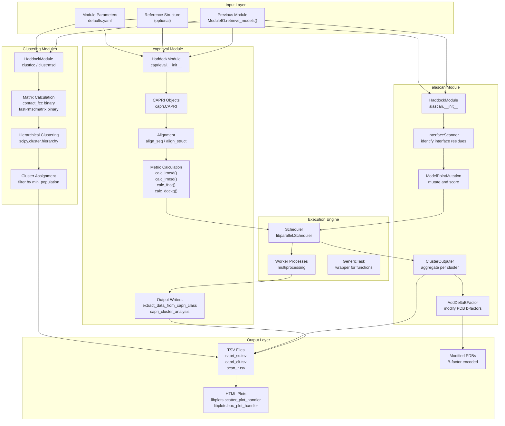
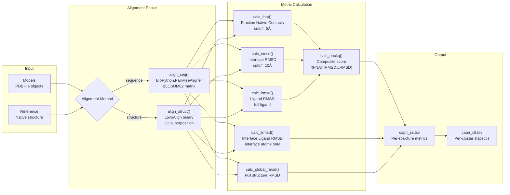
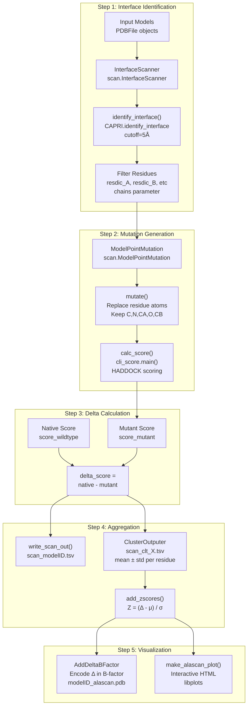
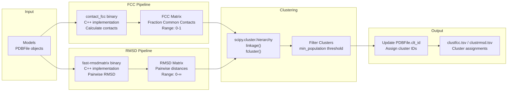
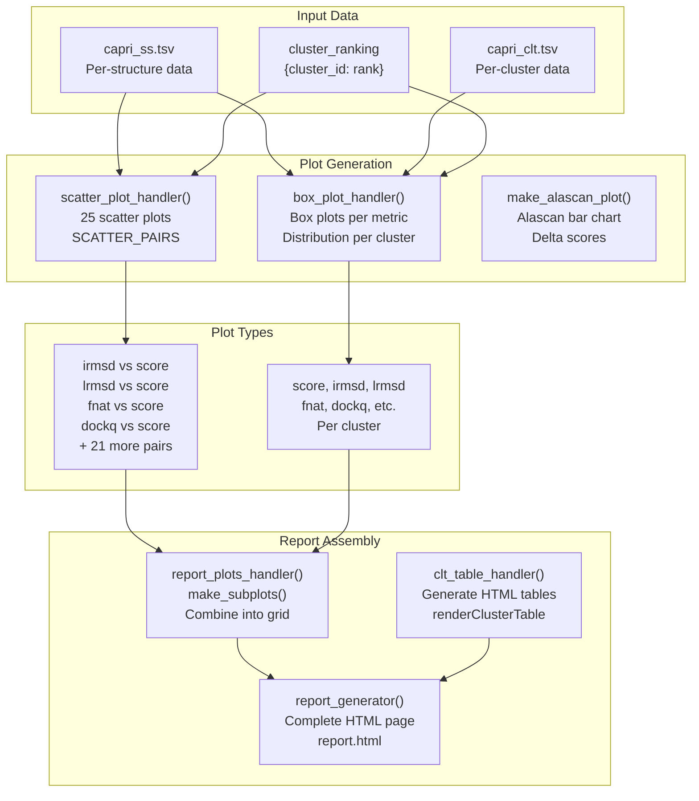
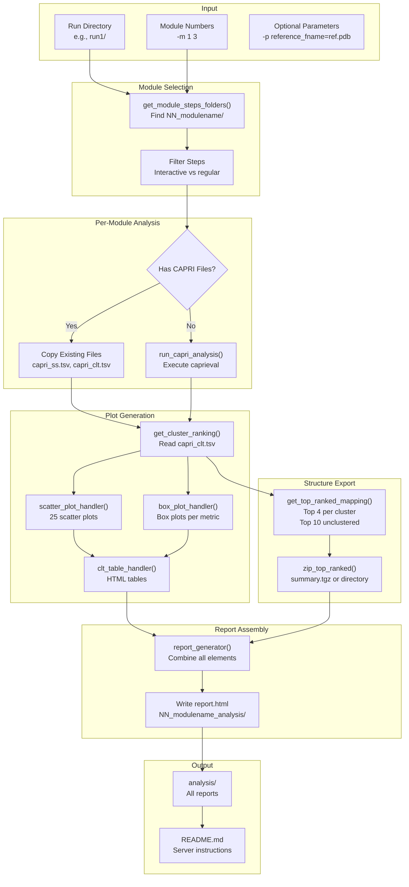
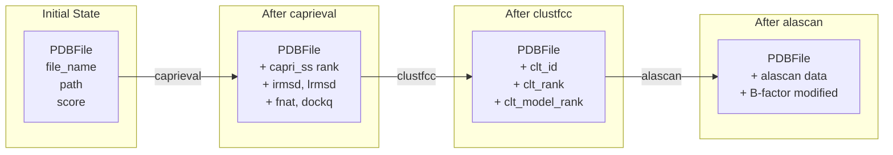

# Analysis Modules

<details>
<summary>Relevant source files</summary>

The following files were used as context for generating this wiki page:

- [integration_tests/test_caprieval.py](integration_tests/test_caprieval.py)
- [src/haddock/clis/cli_analyse.py](src/haddock/clis/cli_analyse.py)
- [src/haddock/core/typing.py](src/haddock/core/typing.py)
- [src/haddock/libs/libalign.py](src/haddock/libs/libalign.py)
- [src/haddock/libs/libparallel.py](src/haddock/libs/libparallel.py)
- [src/haddock/libs/libplots.py](src/haddock/libs/libplots.py)
- [src/haddock/libs/libsubprocess.py](src/haddock/libs/libsubprocess.py)
- [src/haddock/modules/analysis/alascan/__init__.py](src/haddock/modules/analysis/alascan/__init__.py)
- [src/haddock/modules/analysis/alascan/defaults.yaml](src/haddock/modules/analysis/alascan/defaults.yaml)
- [src/haddock/modules/analysis/alascan/scan.py](src/haddock/modules/analysis/alascan/scan.py)
- [src/haddock/modules/analysis/caprieval/__init__.py](src/haddock/modules/analysis/caprieval/__init__.py)
- [src/haddock/modules/analysis/caprieval/capri.py](src/haddock/modules/analysis/caprieval/capri.py)
- [src/haddock/modules/analysis/caprieval/defaults.yaml](src/haddock/modules/analysis/caprieval/defaults.yaml)
- [tests/data/capri_ss_-cluster.tsv](tests/data/capri_ss_-cluster.tsv)
- [tests/golden_data/capri_clt_example.tsv](tests/golden_data/capri_clt_example.tsv)
- [tests/golden_data/capri_ss_example.tsv](tests/golden_data/capri_ss_example.tsv)
- [tests/test_cli_analyse.py](tests/test_cli_analyse.py)
- [tests/test_libalign.py](tests/test_libalign.py)
- [tests/test_libparallel.py](tests/test_libparallel.py)
- [tests/test_libplots.py](tests/test_libplots.py)
- [tests/test_libsubprocess.py](tests/test_libsubprocess.py)
- [tests/test_module_alascan.py](tests/test_module_alascan.py)
- [tests/test_module_caprieval.py](tests/test_module_caprieval.py)

</details>


Analysis modules process docked models to evaluate their quality, cluster similar structures, identify important interface residues, and generate interactive visualizations. These modules typically execute after scoring and do not modify the input models, but instead produce tabular data (TSV files), interactive plots (HTML), and summary reports.

For detailed information about specific analysis modules, see:
- CAPRI Evaluation: [4.5.1](#4.5.1)
- Clustering: [4.5.2](#4.5.2)
- Alanine Scanning: [4.5.3](#4.5.3)
- Analysis Tools and Visualization: [4.5.4](#4.5.4)

For information on configuring module parameters, see [5.2](#5.2). For execution modes used by analysis modules, see [6](#6).

## Module Categories

HADDOCK3 provides analysis modules organized into four functional categories:

| Category | Modules | Purpose |
|----------|---------|---------|
| **Evaluation** | `caprieval` | Calculate CAPRI metrics comparing models to reference structures |
| **Clustering** | `clustfcc`, `clustrmsd` | Group similar structures using FCC or RMSD similarity |
| **Interface Analysis** | `alascan`, `contactmap`, `rmsdmatrix` | Analyze interface residues and contacts |
| **Selection** | `seletop`, `seletopclusts` | Filter top-ranked models or clusters |

Sources: [src/haddock/modules/analysis/caprieval/__init__.py:1-26](), [src/haddock/modules/analysis/alascan/__init__.py:1-43]()

## Analysis Module Architecture



**Diagram: Analysis Module Architecture and Data Flow**

This diagram shows how analysis modules inherit from `BaseHaddockModule`, retrieve models via `ModuleIO`, create job objects that execute through the `Scheduler`, and produce TSV/HTML/PDB outputs. All analysis modules follow this pattern but implement different job types and output formats.

Sources: [src/haddock/modules/analysis/caprieval/__init__.py:51-262](), [src/haddock/modules/analysis/alascan/__init__.py:65-201](), [src/haddock/libs/libparallel.py:105-205]()

## Common Module Features

### Module Lifecycle

All analysis modules inherit from `BaseHaddockModule` and follow a standardized execution pattern:

1. **Initialization**: Load parameters from `defaults.yaml`
2. **Model Retrieval**: Call `self.previous_io.retrieve_models(individualize=True)` to get input models
3. **Job Creation**: Generate task objects (e.g., `CAPRI`, `InterfaceScanner`, `ModelPointMutation`)
4. **Parallel Execution**: Submit jobs to `Scheduler` or execution engine
5. **Result Processing**: Aggregate results and write output files
6. **Model Export**: Pass models to next module via `self.export_io_models()`

Sources: [src/haddock/modules/analysis/caprieval/__init__.py:167-262](), [src/haddock/modules/analysis/alascan/__init__.py:100-201]()

### Execution Modes

Analysis modules support three execution modes configured via the `mode` parameter:

| Mode | Engine | Description |
|------|--------|-------------|
| `local` | `Scheduler` | Multiprocessing on local machine using `ncores` parameter |
| `batch` | `Scheduler` | Same as local (batch systems handled at workflow level) |
| `mpi` | `MPIScheduler` | Distributed execution via MPI4Py (not all modules support) |

The execution mode is determined by `get_analysis_exec_mode()` which typically defaults to `local` for most analysis modules.

Sources: [src/haddock/modules/analysis/alascan/__init__.py:127-130](), [src/haddock/libs/libparallel.py:105-205]()

### Parameter System

Analysis modules define parameters in `defaults.yaml` files with the following structure:

```yaml
parameter_name:
  default: value
  type: boolean|float|int|string|list|file
  title: Short description
  short: Brief explanation
  long: Detailed explanation
  group: analysis
  explevel: easy|expert|guru
```

Common analysis parameters include:
- **mode**: Execution mode (`local`, `batch`, `mpi`)
- **ncores**: Number of CPU cores for parallel execution
- **receptor_chain**: Chain ID for receptor molecule
- **ligand_chains**: List of chain IDs for ligand molecules

Sources: [src/haddock/modules/analysis/caprieval/defaults.yaml:1-160](), [src/haddock/modules/analysis/alascan/defaults.yaml:1-72]()

## CAPRI Evaluation Module



**Diagram: CAPRI Evaluation Workflow**

The `caprieval` module implements the CAPRI (Critical Assessment of PRedicted Interactions) evaluation protocol. It aligns each model to a reference structure and calculates six metrics to assess docking quality.

### Key Classes and Functions

- **CAPRI**: Main evaluation class [src/haddock/modules/analysis/caprieval/capri.py:175-765]()
  - `__init__()`: Initialize with model, reference, and parameters
  - `run()`: Execute alignment and metric calculations
  - `calc_irmsd()`: Interface RMSD calculation [234-297]()
  - `calc_lrmsd()`: Ligand RMSD calculation [299-400]()
  - `calc_ilrmsd()`: Interface-ligand RMSD calculation [402-510]()
  - `calc_fnat()`: Fraction of native contacts [512-540]()
  - `calc_dockq()`: DockQ composite score [583-593]()
  - `calc_global_rmsd()`: Full structure RMSD [542-581]()

- **Alignment Functions**: [src/haddock/libs/libalign.py:1-800]()
  - `align_seq()`: Sequence-based alignment using BioPython
  - `align_struct()`: Structure-based alignment using LovoAlign
  - `get_align()`: Returns appropriate alignment function

- **Output Functions**: [src/haddock/modules/analysis/caprieval/capri.py:867-1011]()
  - `extract_data_from_capri_class()`: Generate per-structure TSV file
  - `capri_cluster_analysis()`: Generate per-cluster statistics TSV file

### CAPRI Metrics

| Metric | Description | Range | Interpretation |
|--------|-------------|-------|----------------|
| **FNAT** | Fraction of Native Contacts | 0.0-1.0 | Higher is better. 1.0 = all native contacts preserved |
| **i-RMSD** | Interface RMSD (Å) | 0.0-∞ | Lower is better. < 1Å = high quality |
| **l-RMSD** | Ligand RMSD (Å) | 0.0-∞ | Lower is better. < 1Å = high quality |
| **il-RMSD** | Interface-Ligand RMSD (Å) | 0.0-∞ | Lower is better. Stricter than l-RMSD |
| **DockQ** | Composite Quality Score | 0.0-1.0 | > 0.8 = high, > 0.49 = medium, > 0.23 = acceptable |
| **Global RMSD** | Full Structure RMSD (Å) | 0.0-∞ | Lower is better. Includes all atoms |

Sources: [src/haddock/modules/analysis/caprieval/__init__.py:1-26](), [src/haddock/modules/analysis/caprieval/capri.py:175-691]()

## Alanine Scanning Module



**Diagram: Alanine Scanning Workflow**

The `alascan` module performs computational alanine scanning to identify interface residues critical for binding. Each interface residue is mutated to alanine (or another specified residue), rescored, and the change in HADDOCK score indicates residue importance.

### Key Classes

- **InterfaceScanner**: [src/haddock/modules/analysis/alascan/scan.py:490-627]()
  - Identifies interface residues using `CAPRI.identify_interface()`
  - Filters residues based on `resdic_*` and `chains` parameters
  - Returns list of `ModelPointMutation` jobs

- **ModelPointMutation**: Job object for single point mutation
  - `model_path`: Path to PDB structure
  - `chain`, `resid`, `ori_resname`: Residue to mutate
  - `target_resname`: Mutation target (default "ALA")
  - `native_scores`: Tuple of (score, vdw, elec, desolv, bsa) for wild-type
  - `run()`: Execute mutation and scoring, return `MutationResult`

- **MutationResult**: [src/haddock/modules/analysis/alascan/scan.py:72-84]()
  - Dataclass containing mutation data
  - `mutant_scores`: Energy terms for mutant
  - `delta_scores`: Native - mutant differences
  - `success`: Boolean indicating if mutation succeeded

- **ClusterOutputer**: [src/haddock/modules/analysis/alascan/scan.py:234-367]()
  - Aggregates mutation data per cluster
  - Calculates mean and standard deviation
  - Generates `scan_clt_X.tsv` files and optional plots

- **AddDeltaBFactor**: [src/haddock/modules/analysis/alascan/scan.py:370-487]()
  - Modifies PDB B-factor column with normalized delta scores
  - Allows visualization of residue importance in molecular viewers

### Output Files

| File | Description | Columns |
|------|-------------|---------|
| `scan_modelID.tsv` | Per-model mutation results | chain, resid, ori_resname, mutant scores, delta scores, z_score |
| `scan_clt_X.tsv` | Per-cluster aggregated results | chain, resid, resname, mean±std for all energy terms, frac_pres |
| `modelID_alascan.pdb` | B-factor encoded PDB | Standard PDB with B-factor column = normalized delta_score |
| `alascan_clt_X.html` | Interactive plot | Plotly visualization of delta scores per residue |

### Delta Score Interpretation

```
delta_score = score_wildtype - score_mutant
```

- **Positive delta_score**: Mutation is **destabilizing** (residue important for binding)
- **Negative delta_score**: Mutation is **stabilizing** (residue unfavorable for binding)
- **Z-score > 2**: Statistically significant destabilizing mutation
- **Z-score < -2**: Statistically significant stabilizing mutation

Sources: [src/haddock/modules/analysis/alascan/__init__.py:1-201](), [src/haddock/modules/analysis/alascan/scan.py:72-627]()

## Clustering Modules

The `clustfcc` and `clustrmsd` modules group similar structures using hierarchical clustering based on Fraction of Common Contacts (FCC) or RMSD similarity matrices.

### Similarity Matrix Calculation



**Diagram: Clustering Module Data Flow**

### FCC vs RMSD Clustering

| Aspect | clustfcc | clustrmsd |
|--------|----------|-----------|
| **Similarity Metric** | Fraction of Common Contacts | Root Mean Square Deviation |
| **Calculation** | `contact_fcc` binary | `fast-rmsdmatrix` binary |
| **Range** | 0.0 (no common contacts) to 1.0 (identical contacts) | 0.0 (identical) to ∞ (very different) |
| **Distance Interpretation** | Distance = 1 - FCC | Distance = RMSD (Å) |
| **Speed** | Faster (contact-based) | Slower (coordinate-based) |
| **Sensitivity** | Less sensitive to small conformational changes | More sensitive to coordinate shifts |
| **Recommended For** | Large datasets, flexible complexes | Rigid complexes, structural similarity |

### Clustering Parameters

Key parameters control the clustering behavior:

- **linkage**: Linkage criterion for hierarchical clustering
  - `average`: Average distance between all pairs (default)
  - `single`: Minimum distance between pairs
  - `complete`: Maximum distance between pairs
  
- **criterion**: Cluster formation criterion
  - `maxclust`: Form at most N clusters
  - `distance`: Use distance threshold
  
- **n_clusters**: Number of clusters to form (when `criterion=maxclust`)

- **clust_cutoff**: Distance cutoff (when `criterion=distance`)

- **min_population**: Minimum number of models per cluster (filter small clusters)

### Cluster Assignment

After clustering, each model's `PDBFile` object is enriched with cluster information:

```python
model.clt_id = cluster_id          # Integer cluster identifier
model.clt_rank = cluster_rank      # Rank of this cluster
model.clt_model_rank = rank        # Rank within cluster
```

Unclustered models (clusters below `min_population` threshold) receive `clt_id = None` or `"-"` depending on context.

Sources: [src/haddock/modules/analysis/caprieval/capri.py:1-50](), [src/haddock/libs/libplots.py:326-398]()

## Visualization and Reporting

### libplots Library

The `libplots` module provides plotting functions used by analysis modules and the `haddock3-analyse` CLI:



**Diagram: Visualization Pipeline**

### Key Plotting Functions

- **scatter_plot_handler()**: [src/haddock/libs/libplots.py:594-646]()
  - Generates scatter plots for 25 metric pairs defined in `SCATTER_PAIRS` [31-57]()
  - Colors points by cluster ID
  - Adds cluster mean ± std as square markers with error bars
  - Returns list of `plotly.graph_objects.Figure` objects

- **box_plot_handler()**: [src/haddock/libs/libplots.py:362-398]()
  - Creates box plots showing distribution of metrics per cluster
  - Uses `px.box()` with overlay mode
  - Displays outliers as individual points

- **clt_table_handler()**: [src/haddock/libs/libplots.py:878-976]()
  - Generates HTML tables with cluster statistics
  - Merges `capri_clt.tsv` and `capri_ss.tsv` data
  - Creates "Other" pseudo-cluster for low-ranking clusters
  - Adds top 4 structures per cluster as clickable links

- **report_generator()**: [src/haddock/libs/libplots.py:1217-1318]()
  - Assembles complete HTML report
  - Embeds Plotly.js for interactivity
  - Includes CSS for table styling
  - Generates structure visualization links

### Interactive Features

Generated HTML reports include:

1. **Interactive scatter plots**:
   - Hover to see model path, score, rank
   - Zoom and pan with Plotly controls
   - Toggle clusters on/off in legend

2. **Interactive tables**:
   - Sort by any column
   - Click structure names to view in 3D (requires local server)
   - Expand/collapse cluster rows

3. **Structure visualization**:
   - Links to `py3Dmol` viewer
   - Requires running local HTTP server: `python -m http.server 8000`

Sources: [src/haddock/libs/libplots.py:1-1318](), [src/haddock/clis/cli_analyse.py:1-843]()

## haddock3-analyse CLI

The `haddock3-analyse` command provides a convenient interface to generate analysis reports for existing workflow runs:

```bash
haddock3-analyse -r <run_dir> -m <module_numbers>
```

### Workflow



**Diagram: haddock3-analyse Execution Flow**

### Key Functions

- **main()**: [src/haddock/clis/cli_analyse.py:690-843]()
  - Orchestrates analysis workflow
  - Validates output format (requires `kaleido` for PNG/PDF export)
  - Creates `analysis/` directory

- **analyse_step()**: [src/haddock/clis/cli_analyse.py:510-641]()
  - Processes single module
  - Checks for existing CAPRI files or runs `caprieval`
  - Generates all plots and tables
  - Creates analysis subdirectory

- **run_capri_analysis()**: [src/haddock/clis/cli_analyse.py:254-301]()
  - Instantiates `caprieval` HaddockModule
  - Retrieves models from module's `io.json`
  - Executes CAPRI evaluation
  - Optionally unpacks/repacks gzipped files

- **get_top_ranked_mapping()**: [src/haddock/clis/cli_analyse.py:368-439]()
  - Identifies top-ranked structures per cluster
  - Returns mapping: `{original_path: new_name}`
  - Handles both clustered and unclustered structures

- **zip_top_ranked()**: [src/haddock/clis/cli_analyse.py:441-507]()
  - Creates archive or directory with top structures
  - Renames files: `cluster_X_model_Y.pdb`
  - Supports `--self-contained` for portable archives

### Command-Line Options

| Option | Type | Description |
|--------|------|-------------|
| `-r`, `--run-dir` | str | Path to HADDOCK3 run directory (required) |
| `-m`, `--modules` | int+ | Module numbers to analyze (required) |
| `-t`, `--top_clusters` | int | Number of clusters to display (default: 10) |
| `--format` | str | Export format: png, jpeg, svg, pdf, eps (requires `kaleido`) |
| `--scale` | float | Image scale factor (default: 1.0) |
| `--inter` | bool | Analyze only interactive steps |
| `--is_cleaned` | bool | Unpack gzipped files before analysis |
| `--offline` | bool | Embed Plotly.js in HTML files |
| `--mode` | str | Execution mode: local, batch, mpi (default: local) |
| `--ncores` | int | Number of CPU cores (default: 1) |
| `--self-contained` | bool | Copy structures to analysis directory |
| `-p`, `--other-params` | key=value | Override caprieval parameters |

### Output Structure

```
run1/
├── 01_rigidbody/
├── 02_caprieval/
├── 03_clustfcc/
└── analysis/
    ├── 01_rigidbody_analysis/
    │   ├── capri_ss.tsv
    │   ├── capri_clt.tsv
    │   ├── irmsd_score.html
    │   ├── lrmsd_score.html
    │   ├── ... (25 scatter plots)
    │   ├── score_clt.html
    │   ├── irmsd_clt.html
    │   ├── ... (box plots)
    │   ├── report.html
    │   └── summary.tgz
    ├── 03_clustfcc_analysis/
    │   └── ... (same structure)
    └── README.md
```

Sources: [src/haddock/clis/cli_analyse.py:1-843](), [src/haddock/libs/libplots.py:1217-1318]()

## Module Integration Patterns

### Data Enrichment Through Pipeline

Analysis modules progressively enrich `PDBFile` objects with metadata as models flow through the workflow:



**Diagram: Progressive Model Enrichment**

### ModuleIO Persistence

All metadata is persisted through `ModuleIO` serialization:

```python
# Export at end of module
self.output_models = models
self.export_io_models()  # Writes to io.json

# Retrieve in next module
models = self.previous_io.retrieve_models(individualize=True)
# Models now have all metadata from previous modules
```

The `io.json` file stores complete `PDBFile` state including all analysis results, allowing downstream modules and post-processing tools to access all accumulated data.

Sources: [src/haddock/modules/analysis/caprieval/__init__.py:259-262](), [src/haddock/modules/analysis/alascan/__init__.py:164-182]()

### Error Handling

Analysis modules implement graceful error handling to prevent workflow failure:

```python
# Try-except around individual jobs
for task in tasks:
    try:
        result = task.run()
    except Exception as e:
        log.warning(f"Task failed: {e}")
        result = None
    results.append(result)

# Filter failed results
successful_results = [r for r in results if r and r.success]
```

Failed jobs are logged but do not terminate the workflow. This allows partial results to be generated even when some models cannot be processed.

Common failure scenarios:
- **Alignment failure**: Model and reference have incompatible sequences/structures
- **Insufficient interface**: No residues within cutoff distance
- **Missing atoms**: Required atoms not present in PDB
- **Scoring failure**: Energy calculation error in alascan

Sources: [src/haddock/libs/libparallel.py:84-97](), [src/haddock/modules/analysis/caprieval/capri.py:609-649]()

## Performance Considerations

### Parallelization Strategy

Analysis modules achieve parallelization by creating independent job objects for each model or model pair:

```python
# Create jobs (lightweight objects)
jobs = [AnalysisTask(model, params) for model in models]

# Execute in parallel
engine = Scheduler(tasks=jobs, ncores=ncores)
engine.run()
results = engine.results
```

This pattern enables:
- **Load balancing**: `Scheduler` distributes jobs across workers
- **Fault tolerance**: Individual job failures don't crash workflow
- **Memory efficiency**: Only active jobs consume memory

### Computational Complexity

| Module | Complexity | Bottleneck | Parallelizable |
|--------|------------|------------|----------------|
| `caprieval` | O(n) | Alignment per model | Yes, per model |
| `clustfcc` | O(n²) | Matrix calculation | Partially (matrix construction) |
| `clustrmsd` | O(n²) | RMSD calculations | Partially (matrix construction) |
| `alascan` | O(n × r) | Scoring each mutant | Yes, per mutation |

Where:
- n = number of models
- r = number of interface residues

### Optimization Tips

1. **Use appropriate clustering method**:
   - `clustfcc` for large datasets (> 1000 models)
   - `clustrmsd` for small datasets or when structural precision matters

2. **Limit alascan residues**:
   - Use `resdic_*` parameters to specify critical residues
   - Use `chains` parameter to analyze specific chains
   - Set `int_cutoff` appropriately to reduce interface size

3. **Adjust ncores**:
   - Set `ncores` to number of available CPU cores
   - For caprieval: ncores = min(num_models, available_cores)
   - For alascan: ncores = min(num_mutations, available_cores)

4. **Use structure-based alignment**:
   - Set `alignment_method: structure` if LovoAlign available
   - Faster than sequence alignment for similar structures

Sources: [src/haddock/libs/libparallel.py:105-205](), [src/haddock/modules/analysis/alascan/__init__.py:100-145]()

---