# CAPRI Evaluation

<details>
<summary>Relevant source files</summary>

The following files were used as context for generating this wiki page:

- [integration_tests/test_caprieval.py](integration_tests/test_caprieval.py)
- [src/haddock/clis/cli_analyse.py](src/haddock/clis/cli_analyse.py)
- [src/haddock/core/typing.py](src/haddock/core/typing.py)
- [src/haddock/libs/libalign.py](src/haddock/libs/libalign.py)
- [src/haddock/libs/libplots.py](src/haddock/libs/libplots.py)
- [src/haddock/libs/libsubprocess.py](src/haddock/libs/libsubprocess.py)
- [src/haddock/modules/analysis/caprieval/__init__.py](src/haddock/modules/analysis/caprieval/__init__.py)
- [src/haddock/modules/analysis/caprieval/capri.py](src/haddock/modules/analysis/caprieval/capri.py)
- [src/haddock/modules/analysis/caprieval/defaults.yaml](src/haddock/modules/analysis/caprieval/defaults.yaml)
- [tests/data/capri_ss_-cluster.tsv](tests/data/capri_ss_-cluster.tsv)
- [tests/golden_data/capri_clt_example.tsv](tests/golden_data/capri_clt_example.tsv)
- [tests/golden_data/capri_ss_example.tsv](tests/golden_data/capri_ss_example.tsv)
- [tests/test_cli_analyse.py](tests/test_cli_analyse.py)
- [tests/test_libalign.py](tests/test_libalign.py)
- [tests/test_libplots.py](tests/test_libplots.py)
- [tests/test_module_caprieval.py](tests/test_module_caprieval.py)

</details>


The CAPRI evaluation module (`caprieval`) calculates quality metrics for docked models by comparing them against reference structures. It implements metrics defined by the Critical Assessment of PRedicted Interactions (CAPRI) competition to quantify the accuracy of protein-protein docking predictions.

**Scope**: This page covers the calculation of CAPRI metrics (FNAT, IRMSD, LRMSD, ILRMSD, DockQ, Global RMSD), alignment strategies, and output file formats. For visualization and interactive analysis of CAPRI results, see [4.5.4](#4.5.4). For clustering that groups models before CAPRI evaluation, see [4.5.2](#4.5.2).

## Overview

The `caprieval` module accepts models from previous workflow steps and compares them against one or more reference structures to assess docking quality. The module supports both sequence-based and structure-based alignment methods to handle cases where model and reference have different numbering or chain identifiers.

**Key Features**:
- Calculates six CAPRI metrics for quality assessment
- Supports multiple reference structures (ensemble evaluation)
- Two alignment methods: sequence-based (BioPython) and structure-based (LovoAlign)
- Generates both single-structure and cluster-averaged statistics
- Handles protein-protein, protein-DNA, and protein-ligand complexes

Sources: [src/haddock/modules/analysis/caprieval/__init__.py:1-26](), [src/haddock/modules/analysis/caprieval/capri.py:175-233]()

## Alignment Methods

Before calculating CAPRI metrics, the module must align the model to the reference structure to establish residue correspondence. This is critical because models and references may have different chain IDs, residue numbering, or even different sequences (mutations, truncations).

### Alignment Method Selection

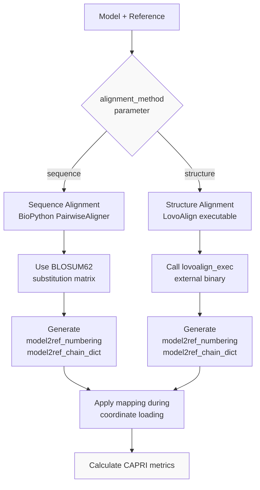

**Sequence Alignment** (`alignment_method: sequence`):
- Uses BioPython's `PairwiseAligner` with BLOSUM62 matrix
- Implemented in `align_seq()` function
- Creates chain-to-chain mappings and residue renumbering dictionaries
- Default method, requires no external dependencies
- Best for structures with similar sequences

**Structure Alignment** (`alignment_method: structure`):
- Uses LovoAlign external executable
- Specified via `lovoalign_exec` parameter
- Performs 3D structural superposition
- Better for structures with low sequence identity or significant conformational changes

Sources: [src/haddock/modules/analysis/caprieval/capri.py:609-624](), [src/haddock/libs/libalign.py:686-837](), [src/haddock/modules/analysis/caprieval/defaults.yaml:154-178]()

### Numbering and Chain Mapping

The alignment produces two critical data structures:

| Data Structure | Type | Purpose |
|----------------|------|---------|
| `model2ref_numbering` | `dict[str, dict[int, int]]` | Maps model residue numbers to reference residue numbers for each chain |
| `model2ref_chain_dict` | `dict[str, str]` | Maps model chain IDs to reference chain IDs |

These mappings are applied when loading coordinates via `load_coords()`:

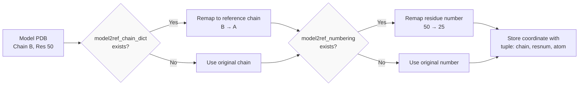

Sources: [src/haddock/libs/libalign.py:441-581](), [src/haddock/modules/analysis/caprieval/capri.py:256-270]()

## CAPRI Metrics

The module calculates six metrics that quantify different aspects of docking quality. Each metric focuses on a specific structural property.

### Metric Definitions

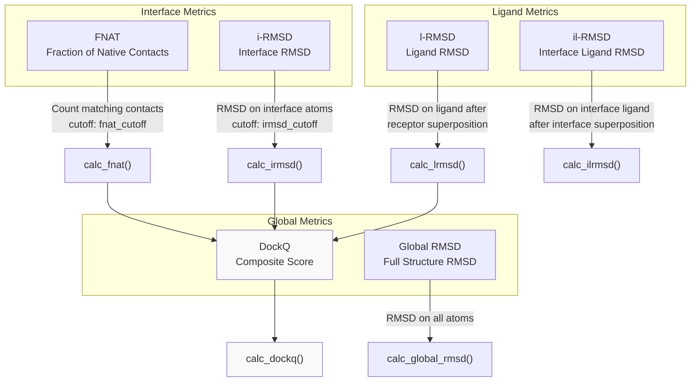

#### FNAT (Fraction of Native Contacts)

**Purpose**: Measures what fraction of intermolecular contacts in the reference structure are reproduced in the model.

**Calculation**:
1. Identify all intermolecular contacts in reference (atoms < `fnat_cutoff` apart, default 5.0 Å)
2. Identify all intermolecular contacts in model (using same cutoff)
3. Compute: `FNAT = |contacts_model ∩ contacts_ref| / |contacts_ref|`

**Range**: 0.0 (no native contacts) to 1.0 (all native contacts present)

**Implementation**: [src/haddock/modules/analysis/caprieval/capri.py:512-541]()

#### i-RMSD (Interface RMSD)

**Purpose**: Measures the positional accuracy of interface residues.

**Calculation**:
1. Identify interface residues in reference (atoms within `irmsd_cutoff`, default 10.0 Å, of other chains)
2. Extract interface backbone atoms from both structures
3. Superimpose structures on interface atoms
4. Calculate RMSD on superimposed interface atoms

**Units**: Ångströms (Å)

**Implementation**: [src/haddock/modules/analysis/caprieval/capri.py:234-298]()

#### l-RMSD (Ligand RMSD)

**Purpose**: Measures how well the ligand is positioned relative to the receptor.

**Calculation**:
1. Separate receptor (defined by `receptor_chain`) and ligand (defined by `ligand_chains`)
2. Superimpose model and reference on receptor backbone atoms
3. Calculate RMSD on ligand backbone atoms without further superposition

**Units**: Ångströms (Å)

**Chain specification**: Requires `receptor_chain` (single chain) and `ligand_chains` (list) parameters

**Implementation**: [src/haddock/modules/analysis/caprieval/capri.py:299-401]()

#### il-RMSD (Interface Ligand RMSD)

**Purpose**: Combines interface and ligand concepts—measures ligand positioning after aligning on the interface.

**Calculation**:
1. Identify interface residues (cutoff 10.0 Å)
2. Superimpose on receptor interface backbone atoms
3. Calculate RMSD on ligand interface backbone atoms

**Units**: Ångströms (Å)

**Implementation**: [src/haddock/modules/analysis/caprieval/capri.py:402-511]()

#### Global RMSD

**Purpose**: Measures overall structural similarity of the entire complex.

**Calculation**:
1. Load all backbone atoms from both structures
2. Superimpose on all atoms
3. Calculate RMSD on all atoms

**Units**: Ångströms (Å)

**Note**: With `allatoms: false` (default), only backbone atoms used; with `allatoms: true`, all heavy atoms used.

**Implementation**: [src/haddock/modules/analysis/caprieval/capri.py:542-582]()

#### DockQ

**Purpose**: Composite quality score combining FNAT, i-RMSD, and l-RMSD into single value.

**Calculation**:
```
DockQ = (FNAT + 1/(1 + (i-RMSD/1.5)²) + 1/(1 + (l-RMSD/8.5)²)) / 3
```

**Range**: 0.0 (poor) to 1.0 (native-like)

**Classification**:
- DockQ ≥ 0.80: High quality
- 0.49 ≤ DockQ < 0.80: Medium quality
- 0.23 ≤ DockQ < 0.49: Acceptable quality
- DockQ < 0.23: Incorrect

**Reference**: Basu and Wallner, PLoS ONE 11(8): e0161879 (2016)

**Implementation**: [src/haddock/modules/analysis/caprieval/capri.py:583-594]()

Sources: [src/haddock/modules/analysis/caprieval/capri.py:234-594](), [src/haddock/modules/analysis/caprieval/defaults.yaml:11-78]()

## Module Architecture

### Class Structure

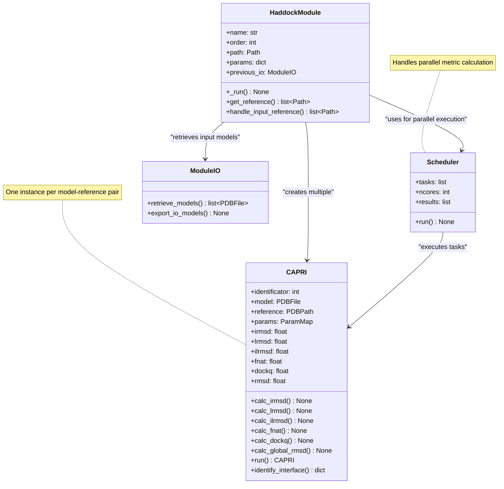

### Execution Flow

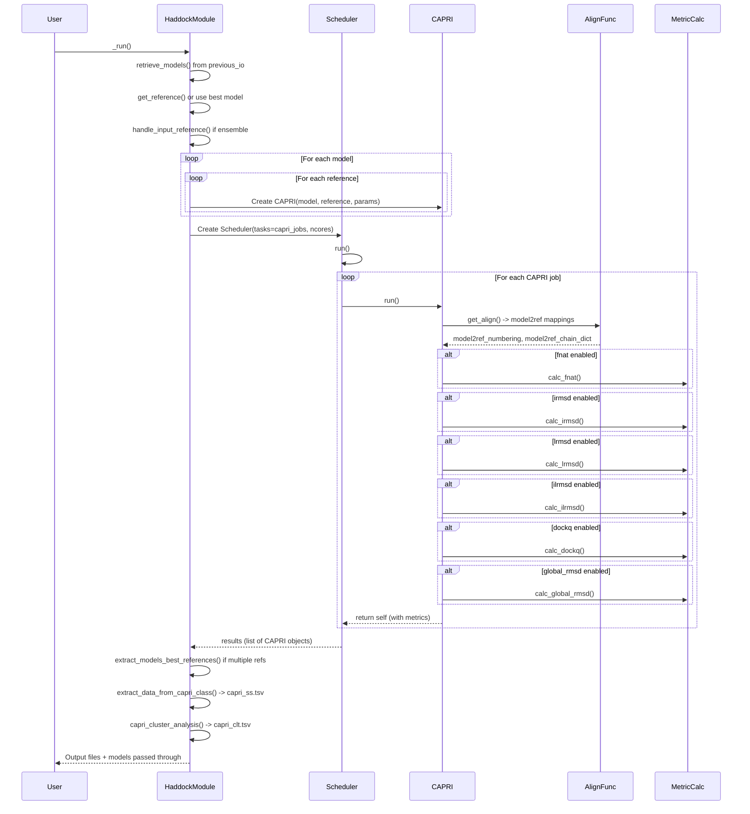

Sources: [src/haddock/modules/analysis/caprieval/__init__.py:167-262](), [src/haddock/modules/analysis/caprieval/capri.py:175-233](), [src/haddock/modules/analysis/caprieval/capri.py:609-650]()

## Multi-Reference Evaluation

When multiple reference structures are provided (e.g., an NMR ensemble or crystal structures in different conformations), the module evaluates each model against all references and selects the best-performing comparison.

### Multi-Reference Workflow

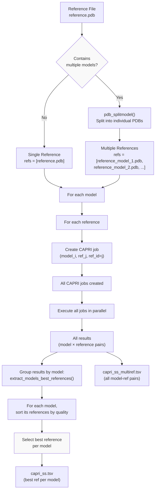

**Key Functions**:
- `handle_input_reference()`: Detects and splits multi-model reference files using `pdb_splitmodel()`
- `extract_models_best_references()`: Groups CAPRI results by model and selects best-scoring reference for each
- Sorting uses built-in `__lt__` and `__eq__` methods in CAPRI class, which prioritize metrics based on parameters

**Output**:
- `capri_ss.tsv`: Best reference for each model (standard output)
- `capri_ss_multiref.tsv`: All model-reference combinations (generated only when multiple references provided)

Sources: [src/haddock/modules/analysis/caprieval/__init__.py:76-165](), [src/haddock/modules/analysis/caprieval/capri.py:831-864](), [src/haddock/modules/analysis/caprieval/__init__.py:236-258]()

## Output Files

### capri_ss.tsv (Single Structure)

Tab-separated file containing CAPRI metrics for each individual model. One row per model, sorted by `sortby` parameter (default: `score`).

**Column Structure**:

| Column | Type | Description |
|--------|------|-------------|
| `model` | string | Path to PDB file |
| `md5` | string | MD5 hash of structure (if available) |
| `caprieval_rank` | int | Rank based on HADDOCK score |
| `score` | float | HADDOCK score from previous module |
| `irmsd` | float | Interface RMSD (Å) |
| `fnat` | float | Fraction of native contacts (0-1) |
| `lrmsd` | float | Ligand RMSD (Å) |
| `ilrmsd` | float | Interface-ligand RMSD (Å) |
| `dockq` | float | DockQ composite score (0-1) |
| `rmsd` | float | Global RMSD (Å) |
| `cluster_id` | string/int | Cluster identifier (if clustering performed before) |
| `cluster_ranking` | string/int | Rank of cluster |
| `model-cluster_ranking` | string/int | Rank of model within its cluster |
| Additional columns | float | Energy terms from previous modules (e.g., `air`, `vdw`, `elec`, `desolv`) |

**Sorting**: Controlled by `sortby` and `sort_ascending` parameters. Default sorts by `score` ascending.

**Generation**: Created by `extract_data_from_capri_class()` function.

Sources: [src/haddock/modules/analysis/caprieval/capri.py:867-960](), [src/haddock/modules/analysis/caprieval/__init__.py:228-234]()

### capri_clt.tsv (Cluster Analysis)

Tab-separated file containing cluster-averaged CAPRI metrics. Generated if models contain clustering information from previous clustering modules.

**Column Structure**:

| Column | Type | Description |
|--------|------|-------------|
| `cluster_rank` | int/string | Rank of cluster ("-" if unclustered) |
| `cluster_id` | int/string | Cluster identifier |
| `n` | int | Number of structures in cluster |
| `under_eval` | string | "yes" if fewer than `clt_threshold` models, "no" otherwise |
| `score` | float | Mean HADDOCK score |
| `score_std` | float | Standard deviation of HADDOCK score |
| `irmsd` | float | Mean i-RMSD |
| `irmsd_std` | float | Standard deviation of i-RMSD |
| `fnat` | float | Mean FNAT |
| `fnat_std` | float | Standard deviation of FNAT |
| ... | ... | Mean and std for all metrics |

**Statistics Calculation**:
- **Mean**: Average of top `clt_threshold` models (default: 4) in cluster
- **Standard Deviation**: Calculated on same top `clt_threshold` models
- **Unclustered Models**: Single cluster with `cluster_id = "-"`, statistics over top 4 models overall

**Generation**: Created by `capri_cluster_analysis()` function which:
1. Groups models by `cluster_id`
2. Sorts models within each cluster by score
3. Calculates statistics using `calc_stats()` on top N models
4. Outputs cluster-level summary

Sources: [src/haddock/modules/analysis/caprieval/capri.py:962-1124](), [src/haddock/modules/analysis/caprieval/__init__.py:237-246]()

### File Location

Both files are generated in the module's execution directory (e.g., `03_caprieval/`):
```
03_caprieval/
├── capri_ss.tsv
├── capri_clt.tsv
├── capri_ss_multiref.tsv  (if multiple references)
├── io.json
└── weights_params.json
```

## Configuration Parameters

### Essential Parameters

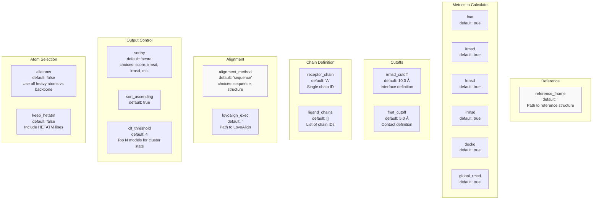

### Parameter Details

**Reference Structure** (`reference_fname`):
- If not specified, uses lowest-scoring model from previous step as reference
- Can be single structure or multi-model ensemble
- File type: PDB format

**Cutoff Parameters**:
- `irmsd_cutoff`: Distance threshold for interface residue identification (used in i-RMSD and il-RMSD)
- `fnat_cutoff`: Distance threshold for contact identification (used in FNAT)
- Both default to standard CAPRI values (10.0 Å and 5.0 Å respectively)

**Chain Specification**:
- `receptor_chain`: Must be single character (chain ID)
- `ligand_chains`: List of chain IDs (can be empty, auto-detected)
- Critical for l-RMSD and il-RMSD calculations

**Alignment Method**:
- `sequence`: Uses BioPython PairwiseAligner (no external dependencies)
- `structure`: Uses LovoAlign (requires `lovoalign_exec` parameter)

**Atom Selection**:
- `allatoms: false`: Backbone atoms only (C, N, CA, O for proteins)
- `allatoms: true`: All heavy atoms including sidechains
- `keep_hetatm: true`: Include HETATM records (important for ligands)

Sources: [src/haddock/modules/analysis/caprieval/defaults.yaml:1-209]()

## Interface Identification

Before calculating interface-based metrics (i-RMSD, il-RMSD), the module identifies which residues constitute the interface.

### Interface Detection Algorithm

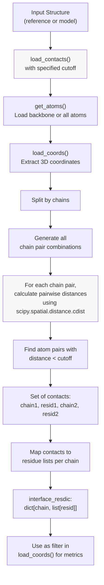

**Key Details**:
- **Contact Definition**: Two atoms in contact if distance < cutoff
- **Default Cutoffs**: 
  - FNAT: 5.0 Å
  - i-RMSD: 10.0 Å (interface is larger for i-RMSD)
  - il-RMSD: 10.0 Å
- **Chain Combinations**: Uses `itertools.combinations()` to avoid duplicate chain pairs
- **Performance**: Uses NumPy's vectorized operations via `cdist()` for speed

**Function Chain**:
1. `identify_interface()` → calls `load_contacts()`
2. `load_contacts()` → calculates pairwise distances for all chain pairs
3. Returns `interface_resdic` dict mapping chains to interface residue numbers
4. This dictionary is passed to `load_coords()` as `filter_resdic` parameter

Sources: [src/haddock/modules/analysis/caprieval/capri.py:723-765](), [src/haddock/modules/analysis/caprieval/capri.py:110-173]()

## Integration with Workflow

### Position in Workflow

The `caprieval` module is typically placed after scoring or clustering modules:

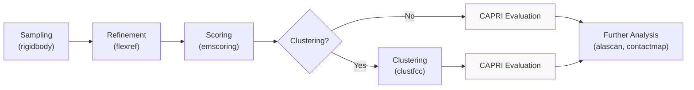

### Data Flow Through ModuleIO

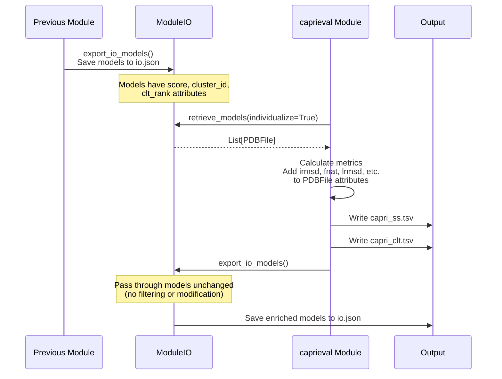

**Important**: The `caprieval` module does not filter or modify models—it adds metrics as metadata and passes all models to the next step. This allows downstream modules to use CAPRI metrics for selection or analysis.

Sources: [src/haddock/modules/analysis/caprieval/__init__.py:167-262](), [src/haddock/libs/libontology.py]() (PDBFile class)

## Command-Line Analysis

The `haddock3-analyse` CLI provides interactive analysis and visualization of CAPRI results.

### CLI Workflow

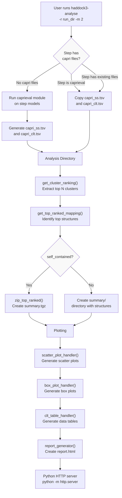

### Key Functions

**Analysis Execution**:
- `analyse_step()`: Main function coordinating analysis for one step
- `run_capri_analysis()`: Executes caprieval module if needed
- Creates timestamped analysis subdirectories

**Top Structure Selection**:
- `get_top_ranked_mapping()`: Extracts top N structures per cluster (default: top 4)
- `zip_top_ranked()`: Creates portable archive or directory of best models
- Naming convention: `cluster_{rank}_model_{rank}.pdb` or `model_{rank}.pdb` for unclustered

**Visualization**:
- `scatter_plot_handler()`: Creates scatter plots for metric pairs (defined in `SCATTER_PAIRS`)
- `box_plot_handler()`: Creates box plots showing metric distributions per cluster
- `clt_table_handler()`: Generates interactive HTML tables with structure links
- All plots use Plotly for interactivity

**Report Generation**:
- `report_generator()`: Assembles all plots and tables into single HTML file
- Supports offline mode (embeds all JavaScript)
- Includes README with instructions for local HTTP server

Sources: [src/haddock/clis/cli_analyse.py:510-641](), [src/haddock/clis/cli_analyse.py:254-302](), [src/haddock/libs/libplots.py:594-646]()

## Error Handling

### Common Issues and Resolution

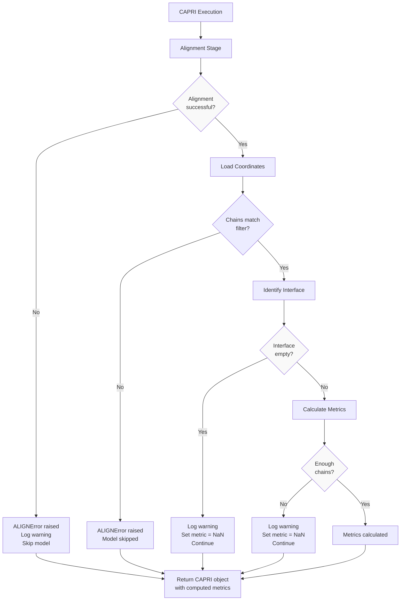

**Error Types**:

1. **ALIGNError**: Raised when alignment fails or chain matching fails
   - Caught in `calc_irmsd()`, `calc_lrmsd()`, etc.
   - Logs warning and returns early, leaving metric as NaN
   - Source: [src/haddock/modules/analysis/caprieval/capri.py:268-270]()

2. **Empty Interface**: When no contacts found in reference
   - Logs warning "No reference interface found" or "No reference contacts found"
   - Metric remains NaN
   - Source: [src/haddock/modules/analysis/caprieval/capri.py:249-251]()

3. **Insufficient Chains**: When calculating l-RMSD or il-RMSD with < 2 chains
   - Logs warning "Not enough chains for calculating lrmsd/ilrmsd"
   - Metric remains NaN
   - Source: [src/haddock/modules/analysis/caprieval/capri.py:333-335]()

**Robustness**:
- Module continues execution even if individual metrics fail
- Returns CAPRI object with partial results (some metrics NaN)
- Allows workflow to continue even with problematic models

Sources: [src/haddock/modules/analysis/caprieval/capri.py:234-650](), [src/haddock/libs/libalign.py:369-375]()

## Performance Considerations

### Parallelization Strategy

The module parallelizes at the model level using the `Scheduler` class:

```python
jobs: list[CAPRI] = []
for i, model in enumerate(models, start=1):
    for ref_id, reference in enumerate(references, start=1):
        jobs.append(CAPRI(
            identificator=i,
            model=model,
            reference=reference,
            params=self.params,
            ref_id=ref_id,
        ))

engine = Scheduler(
    tasks=jobs,
    ncores=self.params["ncores"],
    max_cpus=self.params["max_cpus"],
)
engine.run()
```

**Scaling**:
- Each CAPRI object is an independent task
- With N models and M references: N × M tasks
- Parallelism controlled by `ncores` parameter
- No inter-task communication (embarrassingly parallel)

**Memory Optimization**:
- Coordinates loaded on-demand within each task
- Only interface regions loaded for i-RMSD and il-RMSD calculations
- Temporary alignment files cleaned up after use

Sources: [src/haddock/modules/analysis/caprieval/__init__.py:191-219](), [src/haddock/libs/libparallel.py]() (Scheduler implementation)

### Computational Cost

**Relative Cost by Metric** (approximate):

| Metric | Cost | Main Operations |
|--------|------|----------------|
| FNAT | Medium | Distance matrix calculation, set operations |
| i-RMSD | Low-Medium | Interface identification, RMSD on subset |
| l-RMSD | Low | RMSD on backbone atoms |
| il-RMSD | Medium | Interface identification, RMSD on subset |
| Global RMSD | Low | RMSD on backbone atoms |
| DockQ | Negligible | Simple arithmetic on other metrics |

**Bottlenecks**:
1. **Alignment**: Sequence alignment is fast; structure alignment (LovoAlign) can be slow for large systems
2. **Contact Calculation**: Scales as O(N×M) for N and M atoms in different chains
3. **Interface Identification**: Repeated for each metric calculation (cached within single CAPRI job)

Sources: [src/haddock/modules/analysis/caprieval/capri.py:110-173](), [src/haddock/libs/libalign.py:686-837]()

---