# Clustering

<details>
<summary>Relevant source files</summary>

The following files were used as context for generating this wiki page:

- [src/haddock/clis/cli_analyse.py](src/haddock/clis/cli_analyse.py)
- [src/haddock/libs/libclust.py](src/haddock/libs/libclust.py)
- [src/haddock/libs/libplots.py](src/haddock/libs/libplots.py)
- [src/haddock/modules/analysis/clustfcc/__init__.py](src/haddock/modules/analysis/clustfcc/__init__.py)
- [src/haddock/modules/analysis/clustfcc/defaults.yaml](src/haddock/modules/analysis/clustfcc/defaults.yaml)
- [src/haddock/modules/analysis/clustrmsd/__init__.py](src/haddock/modules/analysis/clustrmsd/__init__.py)
- [src/haddock/modules/analysis/clustrmsd/clustrmsd.py](src/haddock/modules/analysis/clustrmsd/clustrmsd.py)
- [src/haddock/modules/analysis/clustrmsd/defaults.yaml](src/haddock/modules/analysis/clustrmsd/defaults.yaml)
- [src/haddock/modules/analysis/seletop/__init__.py](src/haddock/modules/analysis/seletop/__init__.py)
- [src/haddock/modules/analysis/seletop/defaults.yaml](src/haddock/modules/analysis/seletop/defaults.yaml)
- [src/haddock/modules/analysis/seletopclusts/__init__.py](src/haddock/modules/analysis/seletopclusts/__init__.py)
- [src/haddock/modules/analysis/seletopclusts/defaults.yaml](src/haddock/modules/analysis/seletopclusts/defaults.yaml)
- [src/haddock/modules/analysis/seletopclusts/seletopclusts.py](src/haddock/modules/analysis/seletopclusts/seletopclusts.py)
- [src/haddock/modules/defaults.yaml](src/haddock/modules/defaults.yaml)
- [src/haddock/modules/refinement/emref/__init__.py](src/haddock/modules/refinement/emref/__init__.py)
- [src/haddock/modules/refinement/flexref/__init__.py](src/haddock/modules/refinement/flexref/__init__.py)
- [src/haddock/modules/refinement/mdref/__init__.py](src/haddock/modules/refinement/mdref/__init__.py)
- [src/haddock/modules/sampling/gdock/__init__.py](src/haddock/modules/sampling/gdock/__init__.py)
- [src/haddock/modules/sampling/gdock/defaults.yaml](src/haddock/modules/sampling/gdock/defaults.yaml)
- [src/haddock/modules/sampling/lightdock/__init__.py](src/haddock/modules/sampling/lightdock/__init__.py)
- [src/haddock/modules/sampling/lightdock/defaults.yaml](src/haddock/modules/sampling/lightdock/defaults.yaml)
- [src/haddock/modules/sampling/rigidbody/__init__.py](src/haddock/modules/sampling/rigidbody/__init__.py)
- [src/haddock/modules/scoring/emscoring/__init__.py](src/haddock/modules/scoring/emscoring/__init__.py)
- [src/haddock/modules/scoring/mdscoring/__init__.py](src/haddock/modules/scoring/mdscoring/__init__.py)
- [src/haddock/modules/topology/topoaa/__init__.py](src/haddock/modules/topology/topoaa/__init__.py)
- [tests/data/capri_ss_-cluster.tsv](tests/data/capri_ss_-cluster.tsv)
- [tests/golden_data/capri_clt_example.tsv](tests/golden_data/capri_clt_example.tsv)
- [tests/golden_data/capri_ss_example.tsv](tests/golden_data/capri_ss_example.tsv)
- [tests/test_cli_analyse.py](tests/test_cli_analyse.py)
- [tests/test_libclust.py](tests/test_libclust.py)
- [tests/test_libplots.py](tests/test_libplots.py)
- [tests/test_module_clustrmsd.py](tests/test_module_clustrmsd.py)

</details>


This page documents the clustering analysis modules in HADDOCK3, which group similar structural models based on either contact similarity (FCC) or structural similarity (RMSD). Clustering is a critical analysis step that identifies representative conformational families from docking or refinement results.

For information about selecting structures from clusters, see [Selection Tools](#4.5.4). For evaluating cluster quality with CAPRI metrics, see [CAPRI Evaluation](#4.5.1).

## Purpose and Overview

HADDOCK3 provides two complementary clustering approaches that operate on different similarity metrics:

| Module | Metric | Input Required | Best For |
|--------|--------|----------------|----------|
| `clustfcc` | Fraction of Common Contacts | Models only | Interface-focused clustering, fast computation |
| `clustrmsd` | Root Mean Square Deviation | Pre-computed RMSD matrix | Full structure comparison, flexible criteria |

Both modules produce ranked clusters where models within each cluster share structural or contact similarity above configurable thresholds. The clustering results enrich `PDBFile` objects with cluster metadata that downstream modules can utilize.

Sources: [src/haddock/modules/analysis/clustfcc/__init__.py:1-221](), [src/haddock/modules/analysis/clustrmsd/__init__.py:1-192]()

## Clustering Workflow Architecture

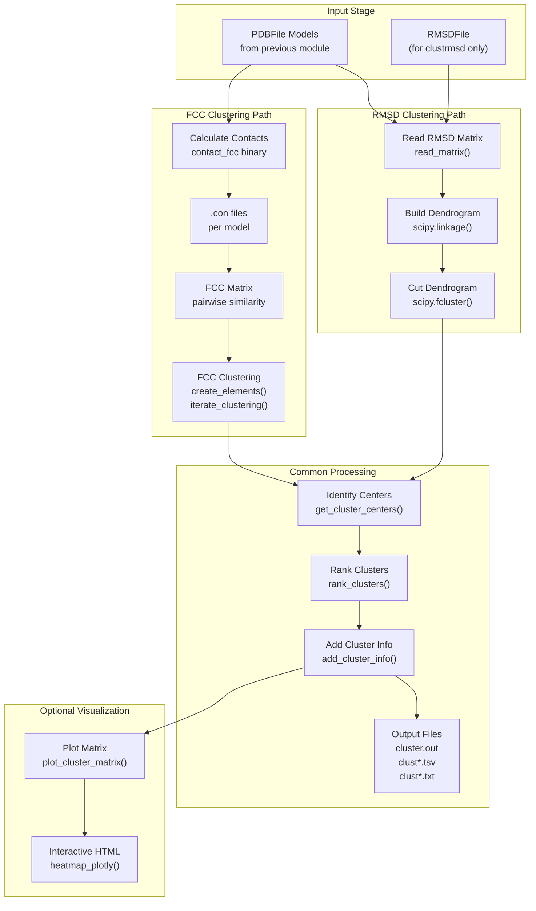

**Workflow Execution Pattern**: Both clustering modules follow a similar execution pattern: (1) compute or load similarity data, (2) apply clustering algorithm, (3) filter by population threshold, (4) identify cluster representatives, (5) rank clusters by score, (6) enrich model metadata, and (7) export results.

Sources: [src/haddock/modules/analysis/clustfcc/__init__.py:71-221](), [src/haddock/modules/analysis/clustrmsd/__init__.py:81-192](), [src/haddock/libs/libclust.py:227-288]()

## FCC Clustering Module (`clustfcc`)

### Contact Calculation

The `clustfcc` module begins by calculating intermolecular contacts for each input model using the compiled `contact_fcc` binary:

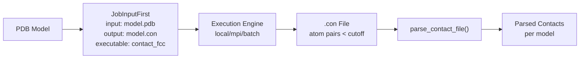

**Contact Detection**: The `contact_distance_cutoff` parameter (default: 5.0 Å) determines which atom pairs constitute a contact. Each job executes the binary with syntax: `contact_fcc <pdb_file> <output_file> <cutoff>`.

Sources: [src/haddock/modules/analysis/clustfcc/__init__.py:76-94](), [src/haddock/core/defaults.py:17]()

### FCC Matrix Generation

After contact calculation, the module computes pairwise Fraction of Common Contacts (FCC) between all model pairs:

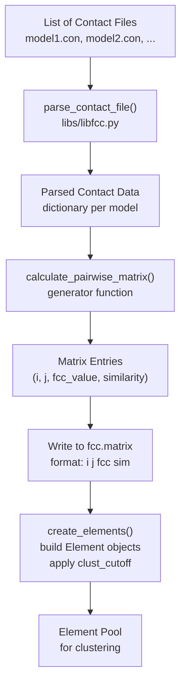

**FCC Calculation**: For each model pair, FCC is computed as the number of common contacts divided by the smaller contact set size. The `clust_cutoff` parameter (default: 0.60) and `strictness` parameter (default: 0.75) control clustering stringency.

Sources: [src/haddock/modules/analysis/clustfcc/__init__.py:115-154](), [src/haddock/libs/libfcc.py]()

### Clustering Algorithm Parameters

| Parameter | Default | Range | Purpose |
|-----------|---------|-------|---------|
| `contact_distance_cutoff` | 5.0 | 2.0-999.99 | Atom distance threshold (Å) for contact detection |
| `clust_cutoff` | 0.60 | 0.0-1.0 | Minimum FCC to group models in same cluster |
| `strictness` | 0.75 | 0.0-1.0 | Multiplier for cutoff in second matrix half |
| `min_population` | 4 | 1-9999 | Minimum cluster size to retain |
| `plot_matrix` | false | boolean | Generate interactive FCC matrix visualization |

**Population Threshold**: The module iteratively reduces `min_population` if no valid clusters are found, down to a minimum of 1, ensuring at least one cluster is always produced.

Sources: [src/haddock/modules/analysis/clustfcc/defaults.yaml:1-59](), [src/haddock/modules/analysis/clustfcc/__init__.py:145-153]()

### FCC Output Files

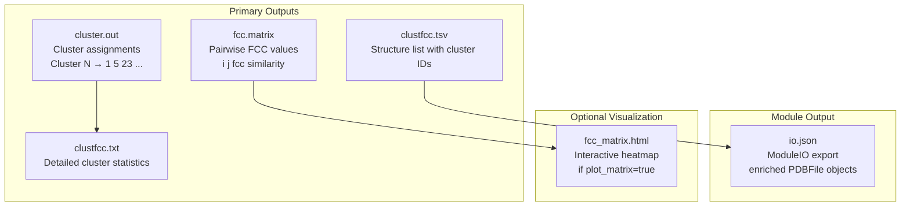

**Cluster File Format**: The `clustfcc.txt` file contains comprehensive statistics including cluster rank, population, average score of top-N models, cluster center, and per-model rankings within each cluster.

Sources: [src/haddock/modules/analysis/clustfcc/__init__.py:155-221](), [src/haddock/modules/analysis/clustfcc/clustfcc.py]()

## RMSD Clustering Module (`clustrmsd`)

### RMSD Matrix Input

Unlike `clustfcc`, the `clustrmsd` module requires a pre-computed RMSD matrix, typically generated by the `rmsdmatrix` module:

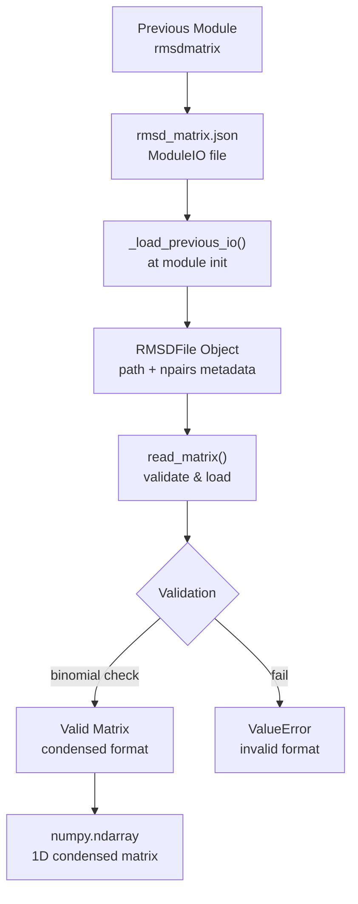

**Matrix Format**: The RMSD matrix must be a condensed (1D) distance matrix with N*(N-1)/2 entries for N models, stored as triplets: `model_i model_j rmsd_value`.

Sources: [src/haddock/modules/analysis/clustrmsd/__init__.py:74-87](), [src/haddock/modules/analysis/clustrmsd/clustrmsd.py:91-128]()

### Hierarchical Clustering Process

The `clustrmsd` module uses scipy's hierarchical clustering with configurable linkage methods:

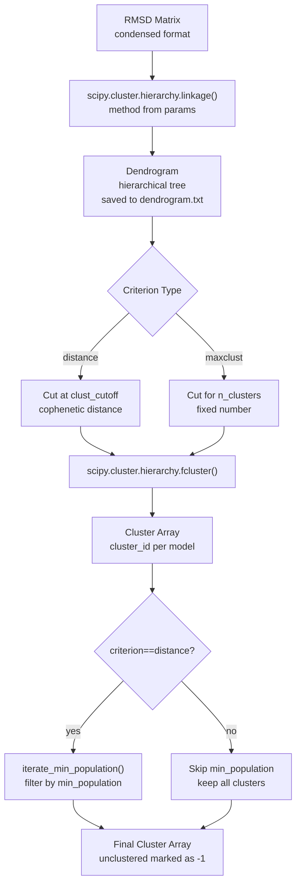

**Linkage Methods**: Available linkage types are: `average`, `centroid`, `complete`, `median`, `single`, `ward`, and `weighted`. Each defines how distances between clusters are computed during agglomeration.

Sources: [src/haddock/modules/analysis/clustrmsd/__init__.py:92-119](), [src/haddock/modules/analysis/clustrmsd/clustrmsd.py:131-228]()

### Clustering Criterion Parameters

| Parameter | Default | Applies When | Purpose |
|-----------|---------|--------------|---------|
| `criterion` | "distance" | always | Cut method: "distance" or "maxclust" |
| `linkage` | "average" | always | Hierarchical linkage method |
| `clust_cutoff` | 7.5 | criterion="distance" | RMSD cutoff value (Å) |
| `n_clusters` | 4 | criterion="maxclust" | Target number of clusters |
| `min_population` | 4 | criterion="distance" | Minimum cluster size |
| `plot_matrix` | false | always | Generate RMSD matrix visualization |

**Criterion Selection**: When `criterion="distance"`, models are grouped if their cophenetic distance is below `clust_cutoff`. When `criterion="maxclust"`, the dendrogram is cut to produce exactly `n_clusters` clusters, ignoring `min_population`.

Sources: [src/haddock/modules/analysis/clustrmsd/defaults.yaml:1-70](), [src/haddock/libs/libclust.py:289-322]()

### Cluster Center Identification

For RMSD clustering, cluster centers are computed by finding the model with minimum average distance to all other cluster members:

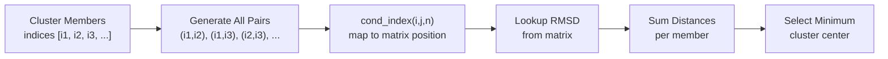

**Center Formula**: The condensed index calculation is `n*(n-1)/2 - (n-i)*(n-i-1)/2 + j - i - 1`, mapping 2D coordinates to the 1D condensed matrix position.

Sources: [src/haddock/modules/analysis/clustrmsd/clustrmsd.py:231-280](), [src/haddock/modules/analysis/clustrmsd/__init__.py:121-130]()

### RMSD Output Files

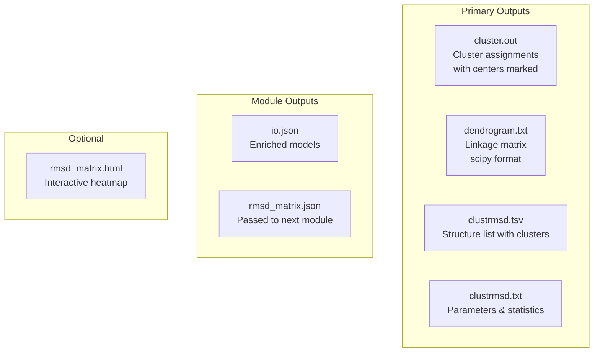

**Matrix Propagation**: The `rmsd_matrix.json` file is passed forward, allowing multiple `clustrmsd` modules with different parameters to operate on the same RMSD data without recalculation.

Sources: [src/haddock/modules/analysis/clustrmsd/__init__.py:122-192](), [src/haddock/modules/analysis/clustrmsd/clustrmsd.py:282-386]()

## Cluster Ranking and Scoring

Both clustering modules apply identical ranking logic to order clusters by quality:

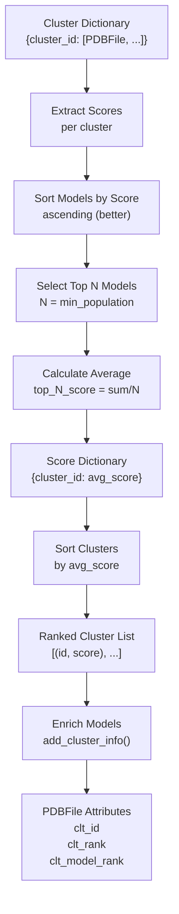

**Ranking Function**: The `rank_clusters()` function in `libclust` computes the average score of the top `min_population` models (or all models if fewer exist) for each cluster, then sorts clusters by this average.

Sources: [src/haddock/libs/libclust.py:227-258](), [src/haddock/modules/analysis/clustfcc/__init__.py:166-172](), [src/haddock/modules/analysis/clustrmsd/__init__.py:132-138]()

## Model Metadata Enrichment

After clustering, three key attributes are added to each `PDBFile` object:

| Attribute | Type | Description | Assignment |
|-----------|------|-------------|------------|
| `clt_id` | int or "-" | Cluster identifier | Numeric ID or "-" for unclustered |
| `clt_rank` | int | Cluster rank | 1-based ranking by average score |
| `clt_model_rank` | int | Model rank in cluster | 1-based ranking by score within cluster |

**Unclustered Models**: Models that fail to meet clustering thresholds receive `clt_id="-"` and are listed separately in output files but still exported for downstream processing.

Sources: [src/haddock/libs/libclust.py:260-288](), [src/haddock/modules/analysis/clustfcc/__init__.py:172-179]()

## Interactive Matrix Visualization

When `plot_matrix=true`, both modules generate interactive HTML heatmaps using Plotly:

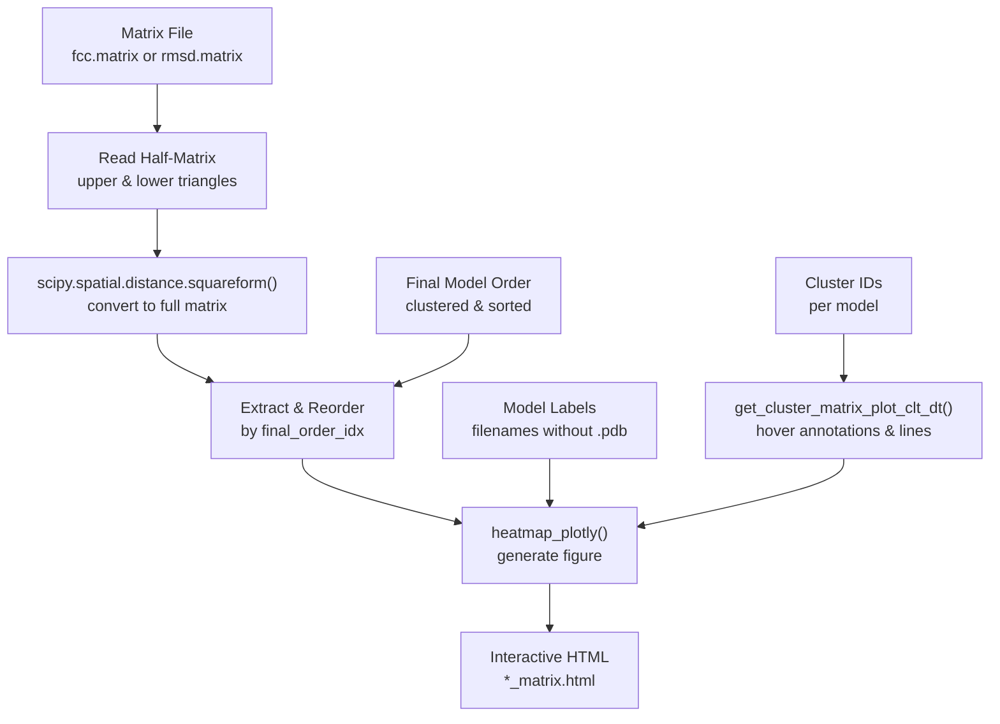

**Size Limitation**: Matrix visualization is skipped if the number of models exceeds `MAX_NB_ENTRY_HTML_MATRIX` (3100) to prevent browser memory issues.

Sources: [src/haddock/libs/libclust.py:62-173](), [src/haddock/libs/libplots.py:heatmap_plotly](), [src/haddock/modules/analysis/clustfcc/__init__.py:189-217]()

## Integration with Analysis Workflow

Clustering modules fit into the standard HADDOCK3 analysis pipeline:

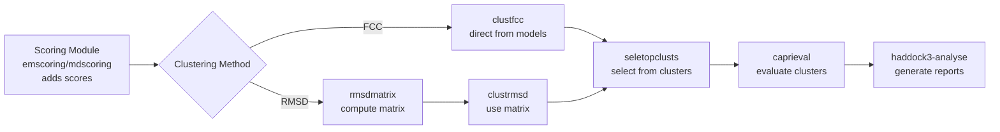

**Typical Workflow**: After scoring, run either `clustfcc` (faster, interface-focused) or `rmsdmatrix`→`clustrmsd` (full structure, flexible). Follow with `seletopclusts` to select representatives from top clusters, then `caprieval` for quality metrics. The `haddock3-analyse` CLI orchestrates final visualization.

Sources: [src/haddock/clis/cli_analyse.py:1-865](), [src/haddock/modules/analysis/seletopclusts/__init__.py:1-90]()

## Common Output Format

Both clustering modules produce structurally similar output files:

### Structure List Format (`clust*.tsv`)

```
rank    model_name              score   cluster_id
1       model_42.pdb            -35.12  1
2       model_17.pdb            -34.89  1
3       model_93.pdb            -33.45  2
...
50      model_8.pdb             -12.34  -
```

**File Purpose**: This TSV file lists all structures with their overall rank, score, and cluster assignment. Unclustered structures have `cluster_id="-"` and appear after clustered structures when sorted by score.

Sources: [src/haddock/libs/libclust.py:26-60](), [src/haddock/modules/analysis/clustfcc/__init__.py:175-179]()

### Detailed Statistics Format (`clust*.txt`)

The detailed text file includes:
- Clustering parameters used (linkage, cutoff, population)
- Total number of clusters found
- Per-cluster sections with:
  - Cluster rank and ID
  - Population size
  - Average score of top-N models
  - Cluster center (if computed)
  - All members with individual ranks and scores

Sources: [src/haddock/modules/analysis/clustfcc/clustfcc.py:write_clustfcc_file](), [src/haddock/modules/analysis/clustrmsd/clustrmsd.py:282-386]()

## Performance Considerations

| Aspect | FCC Clustering | RMSD Clustering |
|--------|----------------|-----------------|
| **Computation** | O(N²) contact comparisons | Requires pre-computed matrix |
| **Memory** | Light (contact lists) | Matrix storage: N*(N-1)/2 floats |
| **Speed** | Fast for <1000 models | Depends on linkage method |
| **Parallelization** | Contact jobs parallelized | Matrix generation parallelized |
| **Sensitivity** | Interface-focused | Whole structure |

**Recommendation**: Use `clustfcc` for large sampling runs (>500 models) where interface similarity is sufficient. Use `clustrmsd` when full structural similarity is required or when comparing against reference structures.

Sources: [src/haddock/modules/analysis/clustfcc/__init__.py:76-94](), [src/haddock/modules/analysis/clustrmsd/__init__.py:87-119]()

---