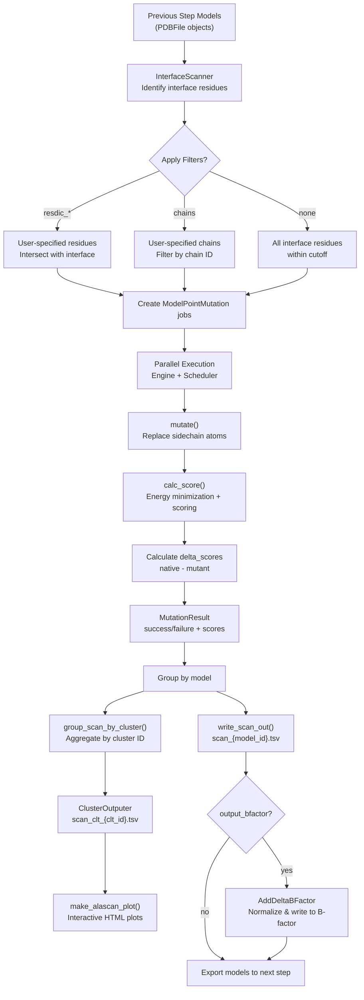
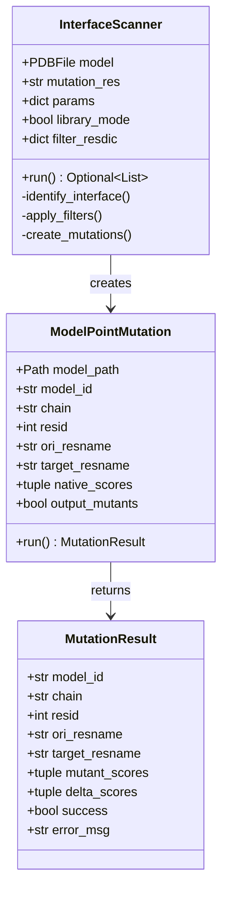
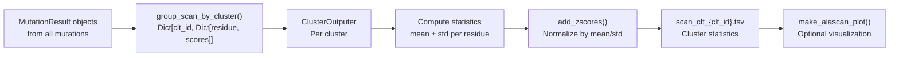
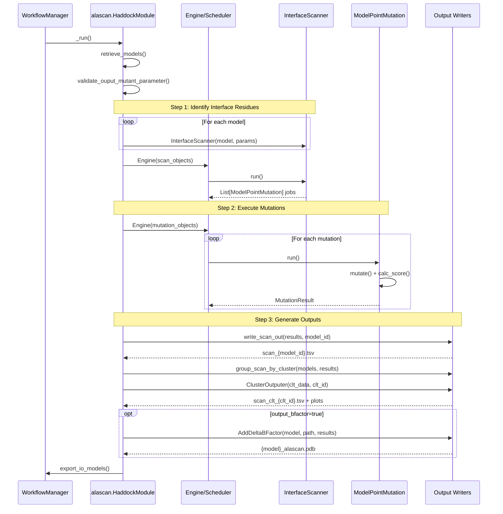
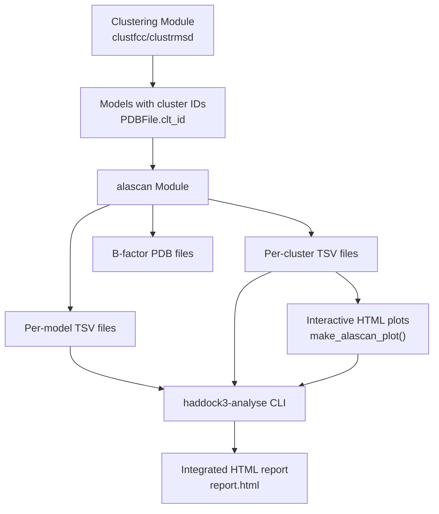

# Alanine Scanning

Relevant source files

The following files were used as context for generating this wiki page:

- [src/haddock/clis/cli_analyse.py](src/haddock/clis/cli_analyse.py)
- [src/haddock/libs/libparallel.py](src/haddock/libs/libparallel.py)
- [src/haddock/libs/libplots.py](src/haddock/libs/libplots.py)
- [src/haddock/modules/analysis/alascan/__init__.py](src/haddock/modules/analysis/alascan/__init__.py)
- [src/haddock/modules/analysis/alascan/defaults.yaml](src/haddock/modules/analysis/alascan/defaults.yaml)
- [src/haddock/modules/analysis/alascan/scan.py](src/haddock/modules/analysis/alascan/scan.py)
- [tests/data/capri_ss_-cluster.tsv](tests/data/capri_ss_-cluster.tsv)
- [tests/golden_data/capri_clt_example.tsv](tests/golden_data/capri_clt_example.tsv)
- [tests/golden_data/capri_ss_example.tsv](tests/golden_data/capri_ss_example.tsv)
- [tests/test_cli_analyse.py](tests/test_cli_analyse.py)
- [tests/test_libparallel.py](tests/test_libparallel.py)
- [tests/test_libplots.py](tests/test_libplots.py)
- [tests/test_libsubprocess.py](tests/test_libsubprocess.py)
- [tests/test_module_alascan.py](tests/test_module_alascan.py)

The `alascan` module performs computational alanine scanning (or scanning with any other residue) to quantify the energetic contribution of individual interface residues to complex stability. For each interface residue, the module generates a mutant structure, calculates its HADDOCK score, and computes the delta score (native - mutant) to determine whether the mutation is stabilizing (negative delta) or destabilizing (positive delta). The module supports cluster-based analysis, parallel execution, and visualization of results.

For general analysis workflow information, see [Analysis Tools and Visualization](#4.5.4). For CAPRI evaluation metrics used in conjunction with scanning, see [CAPRI Evaluation](#4.5.1).

---

## Overview

The alanine scanning module operates on models from the previous workflow step (typically after clustering) and systematically mutates interface residues to assess their importance. The module identifies interface residues within a distance cutoff, generates point mutations, scores each mutant via energy minimization, and aggregates results both per-model and per-cluster.

**Key characteristics:**
- **Delta score calculation**: `delta_score = score_native - score_mutant`
  - Positive values indicate destabilizing mutations
  - Negative values indicate stabilizing mutations
- **Statistical normalization**: Z-scores computed relative to all residues in the analysis
- **Cluster aggregation**: When cluster information is available, statistics are computed for each cluster (mean ± std)
- **Parallel execution**: Mutations are distributed across available cores for efficiency

Sources: [src/haddock/modules/analysis/alascan/__init__.py:1-43](), [src/haddock/modules/analysis/alascan/scan.py:1-23]()

---

## Workflow Architecture

**Diagram: Alanine Scanning Workflow**

The workflow begins with interface identification, applies optional user filters, generates and executes mutations in parallel, computes delta scores, and produces both per-model and per-cluster outputs. When `output_bfactor=true`, the module generates modified PDB files with normalized delta scores in the B-factor column for visualization.

Sources: [src/haddock/modules/analysis/alascan/__init__.py:100-204](), [src/haddock/modules/analysis/alascan/scan.py:637-796]()

---

## Core Components

### InterfaceScanner

The `InterfaceScanner` class identifies interface residues and prepares mutation jobs. It supports two execution modes:

- **Library mode** (`library_mode=True`): Executes mutations sequentially, used for standalone execution
- **HADDOCK mode** (`library_mode=False`): Returns mutation jobs for parallel execution via Engine

**Diagram: Scanner and Mutation Classes**

The `InterfaceScanner` creates `ModelPointMutation` jobs for each interface residue. Each mutation job executes independently and returns a `MutationResult` containing success status and score components.

**Interface identification**: Uses `CAPRI.identify_interface(model_path, cutoff)` to find residues within the distance cutoff. The default cutoff is 5.0 Å.

**Filtering logic**:
1. If `resdic_*` parameters are provided, use only specified residues that are in the interface
2. If `chains` parameter is provided (and no `resdic_*`), use only specified chains
3. Otherwise, use all interface residues

Sources: [src/haddock/modules/analysis/alascan/scan.py:637-796](), [src/haddock/modules/analysis/alascan/scan.py:72-85]()

### ModelPointMutation

The `ModelPointMutation` class performs individual mutation operations:

**Execution steps**:
1. Load the native structure
2. Call `mutate(pdb_f, chain, resid, target_resname)` to generate mutant PDB
3. Calculate mutant score using `calc_score(mutant_pdb, run_dir)`
4. Compute delta scores: `(score_native - score_mutant, vdw_delta, elec_delta, desolv_delta, bsa_delta)`
5. Return `MutationResult` with success status

The `mutate()` function replaces only backbone-adjacent atoms (`C`, `N`, `CA`, `O`, `CB`) with the target residue while preserving the rest of the structure.

Sources: [src/haddock/modules/analysis/alascan/scan.py:797-897](), [src/haddock/modules/analysis/alascan/scan.py:87-136]()

### Cluster Analysis Components

**Diagram: Cluster Analysis Pipeline**

The `group_scan_by_cluster()` function organizes mutation results by cluster ID, then `ClusterOutputer` computes aggregate statistics for each cluster. For each residue, it calculates mean and standard deviation across all models in the cluster, plus a Z-score normalized to the cluster's distribution.

**Z-score calculation**: `z_score = (delta_score - mean_cluster) / std_cluster`

This identifies residues that have unusually large or small delta scores relative to other residues in the same cluster.

Sources: [src/haddock/modules/analysis/alascan/scan.py:564-634](), [src/haddock/modules/analysis/alascan/scan.py:234-368]()

### B-Factor Output

The `AddDeltaBFactor` class generates modified PDB files with normalized delta scores in the B-factor column:

**Normalization**: `bfactor = 100 * (delta_score - min_score) / (max_score - min_score)`

This produces values between 0 and 100, where higher values indicate more favorable (or less unfavorable) mutations. The output PDB files can be visualized in molecular viewers like PyMOL using `spectrum b` to color by B-factor.

Sources: [src/haddock/modules/analysis/alascan/scan.py:370-488]()

---

## Module Execution Flow

The `HaddockModule` class in `__init__.py` orchestrates the entire scanning workflow:

**Diagram: Module Execution Sequence**

The module follows a three-step process: (1) identify interface residues for all models, (2) execute all mutations in parallel, and (3) aggregate and output results. The `Engine` handles parallel distribution based on the `mode` parameter (`local`, `mpi`, or `batch`).

Sources: [src/haddock/modules/analysis/alascan/__init__.py:100-204]()

---

## Configuration Parameters

The module is configured via `defaults.yaml` and user-provided parameters in the workflow configuration:

| Parameter | Type | Default | Description |
|-----------|------|---------|-------------|
| `scan_residue` | string | `"ALA"` | Target residue for mutations. Must be 3-letter code. |
| `int_cutoff` | float | `5.0` | Distance cutoff (Å) for interface residue identification. |
| `chains` | list | `[]` | Specific chain IDs to scan. Empty = all chains. |
| `resdic_*` | list | `[]` | Chain-specific residue lists (e.g., `resdic_A = [19, 20]`). |
| `output_bfactor` | boolean | `false` | Generate PDB files with delta scores in B-factor column. |
| `output_mutants` | boolean | `false` | Save mutant PDB files. Only allowed for single-model input. |
| `plot` | boolean | `false` | Generate interactive HTML plots of scan data. |
| `offline` | boolean | `false` | Make plots self-contained (embed JavaScript). |

**Expandable parameters**: The `resdic_*` parameter uses an expandable pattern where `*` is replaced with chain ID (e.g., `resdic_A`, `resdic_B`). This allows specifying different residue lists for each chain.

**Parameter validation**: The module validates `output_mutants` at runtime - if more than one model is provided, this parameter is automatically set to `false` to prevent excessive file generation.

Sources: [src/haddock/modules/analysis/alascan/defaults.yaml:1-70](), [src/haddock/modules/analysis/alascan/__init__.py:79-98]()

---

## Output Files

### Per-Model Output: scan_{model_id}.tsv

Tab-separated file containing mutation results for individual models:

| Column | Description |
|--------|-------------|
| `chain` | Chain identifier |
| `res` | Residue number |
| `ori_resname` | Original residue name (3-letter code) |
| `end_resname` | Target residue name |
| `score` | Mutant HADDOCK score |
| `vdw`, `elec`, `desolv`, `bsa` | Mutant energy components |
| `delta_score` | Score difference (native - mutant) |
| `delta_vdw`, `delta_elec`, `delta_desolv`, `delta_bsa` | Component differences |
| `z_score` | Normalized score relative to other residues in model |

**File header**: Includes comments with native score and Z-score calculation description.

Sources: [src/haddock/modules/analysis/alascan/scan.py:490-562]()

### Per-Cluster Output: scan_clt_{cluster_id}.tsv

Aggregate statistics for each cluster:

| Column | Description |
|--------|-------------|
| `chain` | Chain identifier |
| `resid` | Residue number |
| `resname` | Residue name |
| `full_resname` | Full identifier (chain-resid-resname) |
| `delta_score` | Mean delta score across cluster |
| `delta_score_std` | Standard deviation |
| `delta_vdw`, `delta_vdw_std` | VDW component statistics |
| `delta_elec`, `delta_elec_std` | Electrostatic component statistics |
| `delta_desolv`, `delta_desolv_std` | Desolvation component statistics |
| `delta_bsa`, `delta_bsa_std` | BSA component statistics |
| `frac_pres` | Fraction of cluster models containing this residue |
| `z_score` | Normalized score relative to cluster distribution |

Sources: [src/haddock/modules/analysis/alascan/scan.py:269-341]()

### B-Factor Modified PDBs: {model}_alascan.pdb

When `output_bfactor=true`, the module generates PDB files with normalized delta scores in the B-factor column:

- Delta scores are normalized to [0, 100] range within each model
- Higher values indicate more favorable mutations
- Can be visualized in PyMOL: `spectrum b`

The B-factor value is calculated as: `100 * (delta - min) / (max - min)` where min and max are the minimum and maximum delta scores observed in that model.

Sources: [src/haddock/modules/analysis/alascan/scan.py:391-488]()

---

## Integration with Analysis Pipeline

The alascan module integrates with the broader HADDOCK3 analysis ecosystem:

**Diagram: Analysis Pipeline Integration**

The alascan module receives models with cluster assignments from clustering modules. Results are both standalone (individual TSV files) and integrated into the comprehensive analysis report generated by `haddock3-analyse`.

**Cluster-aware analysis**: When models have `clt_id` attributes (assigned by clustering modules), the alascan module automatically groups results by cluster and computes cluster-level statistics. Models without cluster IDs are grouped into an "unclustered" category.

Sources: [src/haddock/modules/analysis/alascan/scan.py:564-634](), [src/haddock/clis/cli_analyse.py:1-23]()

---

## Parallel Execution

The module leverages HADDOCK3's parallel execution infrastructure:

**Execution modes** (via `mode` parameter):
- `local`: Multiprocessing via `Scheduler` class
- `mpi`: MPI-based parallelization via `MPIScheduler`
- `batch`: Batch job submission (typically for HPC)

**Parallelization strategy**:
1. **Interface scanning**: Parallelized across input models
2. **Mutation execution**: Parallelized across all mutation jobs
3. **Output generation**: Parallelized using `GenericTask` wrappers

The `Engine` class abstracts the execution mode and distributes jobs based on available resources (`ncores` parameter).

Sources: [src/haddock/modules/analysis/alascan/__init__.py:127-161](), [src/haddock/libs/libparallel.py:105-209]()

---

## Scoring Methodology

Each mutation is evaluated using the HADDOCK scoring function via `cli_score.main()`:

**Score components**:
1. **Van der Waals** (`vdw`): Lennard-Jones interactions
2. **Electrostatic** (`elec`): Coulomb interactions
3. **Desolvation** (`desolv`): Implicit solvation energy
4. **Buried Surface Area** (`bsa`): Interface surface area

**HADDOCK score formula**: Weighted combination of energy terms (weights defined in CNS parameters)

The `calc_score()` function performs energy minimization on the mutant structure before scoring to ensure fair comparison with the native (also energy-minimized) structure.

Sources: [src/haddock/modules/analysis/alascan/scan.py:165-207](), [src/haddock/clis/cli_score.py]()

---

## Implementation Notes

### Residue Mutation Logic

The `mutate()` function implements conservative sidechain replacement:

**Atoms mutated**: `C`, `N`, `CA`, `O`, `CB` (backbone-adjacent atoms)

**Atoms preserved**: All other atoms remain unchanged

This approach maintains backbone geometry while replacing the sidechain. The mutation is conservative to minimize structural perturbation.

**Residue code mapping**: The `RES_CODES` dictionary maps 3-letter codes to 1-letter codes for file naming (e.g., `THR` → `T`, `ALA` → `A`). Includes modified residues like `MSE` (selenomethionine), `ALY` (N-acetyl-lysine), etc.

Sources: [src/haddock/modules/analysis/alascan/scan.py:87-136](), [src/haddock/modules/analysis/alascan/scan.py:22-69]()

### Error Handling

The `MutationResult` dataclass supports success/failure tracking:

- `success=True`: Mutation and scoring completed successfully
- `success=False`: Mutation failed (with `error_msg` describing the error)

Failed mutations are included in the output but marked as failures. The module continues processing even if individual mutations fail.

Sources: [src/haddock/modules/analysis/alascan/scan.py:72-85]()

### Temporary Directory Management

Each scoring operation creates a temporary directory (`haddock3-score-{model_id}-{pid}`) to isolate CNS execution. The directory is cleaned up after scoring completes, even if an error occurs.

Sources: [src/haddock/modules/analysis/alascan/scan.py:697-702]()

---

## Visualization

When `plot=true`, the module generates interactive HTML plots using Plotly:

**Plot features**:
- Delta score distribution per residue
- Error bars showing standard deviation (for cluster plots)
- Interactive tooltips with residue information
- Offline mode support (embed Plotly JavaScript)

The plotting is handled by `make_alascan_plot()` in `libplots.py`, which creates bar charts with residues on the x-axis and delta scores on the y-axis.

Sources: [src/haddock/modules/analysis/alascan/scan.py:343-368](), [src/haddock/libs/libplots.py:2583-2698]()

---