# Analysis Tools and Visualization

<details>
<summary>Relevant source files</summary>

The following files were used as context for generating this wiki page:

- [src/haddock/clis/cli_analyse.py](src/haddock/clis/cli_analyse.py)
- [src/haddock/libs/libplots.py](src/haddock/libs/libplots.py)
- [src/haddock/modules/analysis/clustfcc/__init__.py](src/haddock/modules/analysis/clustfcc/__init__.py)
- [src/haddock/modules/analysis/seletop/__init__.py](src/haddock/modules/analysis/seletop/__init__.py)
- [src/haddock/modules/analysis/seletopclusts/__init__.py](src/haddock/modules/analysis/seletopclusts/__init__.py)
- [src/haddock/modules/refinement/emref/__init__.py](src/haddock/modules/refinement/emref/__init__.py)
- [src/haddock/modules/refinement/flexref/__init__.py](src/haddock/modules/refinement/flexref/__init__.py)
- [src/haddock/modules/refinement/mdref/__init__.py](src/haddock/modules/refinement/mdref/__init__.py)
- [src/haddock/modules/sampling/gdock/__init__.py](src/haddock/modules/sampling/gdock/__init__.py)
- [src/haddock/modules/sampling/lightdock/__init__.py](src/haddock/modules/sampling/lightdock/__init__.py)
- [src/haddock/modules/sampling/rigidbody/__init__.py](src/haddock/modules/sampling/rigidbody/__init__.py)
- [src/haddock/modules/scoring/emscoring/__init__.py](src/haddock/modules/scoring/emscoring/__init__.py)
- [src/haddock/modules/scoring/mdscoring/__init__.py](src/haddock/modules/scoring/mdscoring/__init__.py)
- [src/haddock/modules/topology/topoaa/__init__.py](src/haddock/modules/topology/topoaa/__init__.py)
- [tests/data/capri_ss_-cluster.tsv](tests/data/capri_ss_-cluster.tsv)
- [tests/golden_data/capri_clt_example.tsv](tests/golden_data/capri_clt_example.tsv)
- [tests/golden_data/capri_ss_example.tsv](tests/golden_data/capri_ss_example.tsv)
- [tests/test_cli_analyse.py](tests/test_cli_analyse.py)
- [tests/test_libplots.py](tests/test_libplots.py)

</details>


This page documents the analysis and visualization tools available in HADDOCK3, including model selection modules (`seletop`, `seletopclusts`) and the comprehensive analysis framework provided by `haddock3-analyse`. These tools generate interactive HTML reports with scatter plots, box plots, and sortable tables to evaluate docking results.

For detailed information about CAPRI metric calculations, see [CAPRI Evaluation](#4.5.1). For clustering algorithms, see [Clustering](#4.5.2). For interface residue analysis, see [Alanine Scanning](#4.5.3).

---

## Selection Modules

HADDOCK3 provides two modules for selecting subsets of models to pass to subsequent workflow steps.

### seletop Module

The `seletop` module performs simple selection of the top N models based on score. It retrieves models from the previous step, sorts them by their `score` attribute, and selects the specified number.

**Module**: [src/haddock/modules/analysis/seletop/__init__.py:1-66]()

**Key Parameters**:
- `select`: Number of models to select (default: 200)

**Implementation Details**:

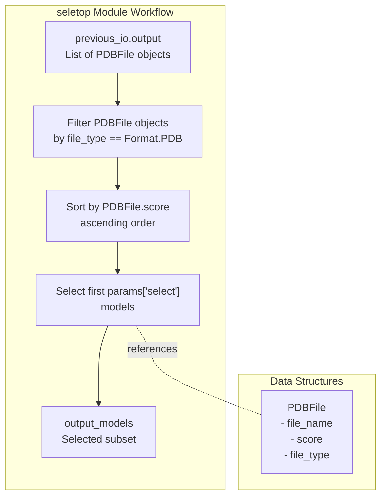

**Sources**: [src/haddock/modules/analysis/seletop/__init__.py:40-65]()

---

### seletopclusts Module

The `seletopclusts` module provides more sophisticated selection by choosing the top N models from the top M clusters. This maintains diversity by ensuring representation from multiple clusters rather than taking all models from the best cluster.

**Module**: [src/haddock/modules/analysis/seletopclusts/__init__.py:1-90]()

**Key Parameters**:
- `top_clusters`: Number of clusters to consider
- `top_models`: Number of models to select per cluster
- `sortby`: Metric to use for ranking (default: "score")

**Selection Algorithm**:

```mermaid
graph TB
    subgraph "seletopclusts Workflow"
        Input["previous_io.retrieve_models()"]
        ValidateCluster["Check for cluster info<br/>PDBFile.clt_rank must exist"]
        SelectFunc["select_top_clusts_models()"]
        GroupClusters["Group models by cluster_id"]
        RankClusters["Sort clusters by mean score"]
        SelectTopClust["Select top_clusters clusters"]
        SelectModels["From each cluster select<br/>top_models models by sortby"]
        Write["write_selected_models()<br/>Rename and copy to current dir"]
        Output["output_models"]
        
        Input --> ValidateCluster
        ValidateCluster --> SelectFunc
        SelectFunc --> GroupClusters
        GroupClusters --> RankClusters
        RankClusters --> SelectTopClust
        SelectTopClust --> SelectModels
        SelectModels --> Write
        Write --> Output
    end
```

**Sources**: [src/haddock/modules/analysis/seletopclusts/__init__.py:46-89](), [src/haddock/modules/analysis/seletopclusts/seletopclusts.py]()

---

## Visualization Library Architecture

The visualization system is implemented in `libplots.py` and provides interactive plotting capabilities using Plotly. All plots are generated as HTML files with embedded JavaScript for interactivity.

### Core Plotting Functions

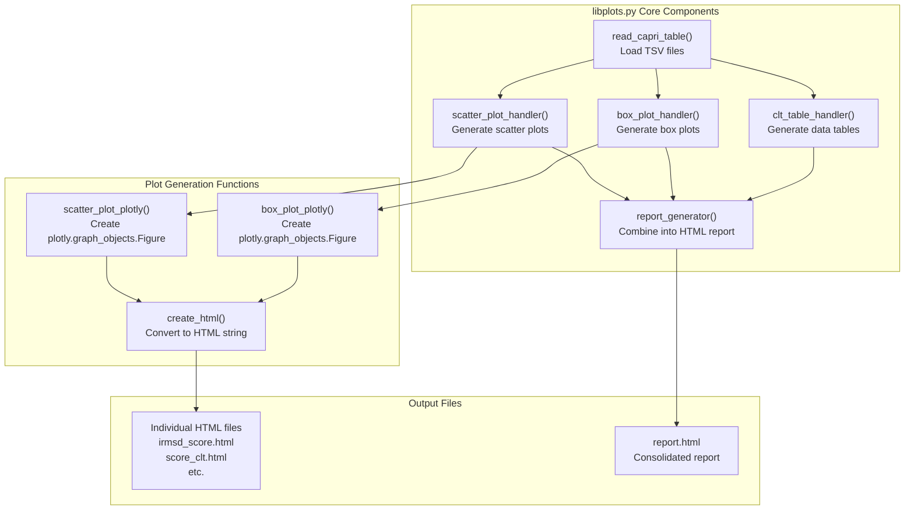

**Sources**: [src/haddock/libs/libplots.py:1-160](), [src/haddock/libs/libplots.py:400-647]()

---

### Scatter Plot Generation

Scatter plots visualize relationships between CAPRI metrics (i-RMSD, l-RMSD, FNAT, DockQ) and energy terms (score, VdW, elec, desolv, AIR).

**Key Variables and Functions**:

| Component | Location | Description |
|-----------|----------|-------------|
| `SCATTER_PAIRS` | [src/haddock/libs/libplots.py:31-57]() | List of 25 metric pairs to plot |
| `AXIS_NAMES` | [src/haddock/libs/libplots.py:77-89]() | Human-readable axis labels |
| `scatter_plot_handler()` | [src/haddock/libs/libplots.py:594-646]() | Orchestrates scatter plot generation |
| `scatter_plot_plotly()` | [src/haddock/libs/libplots.py:401-563]() | Creates individual scatter plot Figure |
| `scatter_plot_data()` | [src/haddock/libs/libplots.py:566-591]() | Prepares data by grouping clusters |

**Scatter Plot Features**:

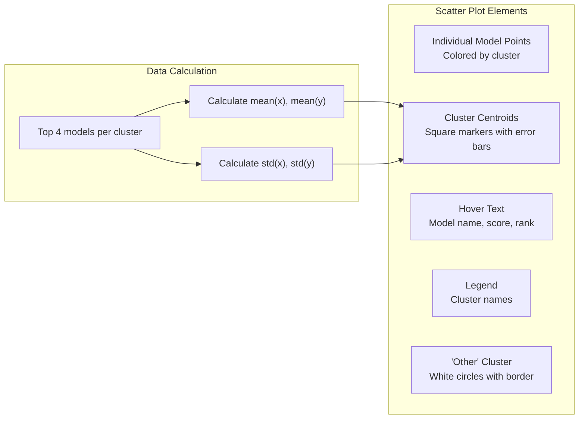

Each scatter plot includes:
- Individual model points colored by cluster membership
- Cluster centroids as larger square markers with error bars (mean ± std of top 4 models)
- Interactive hover text showing model path, score, and CAPRI rank
- Models not in top clusters grouped into "Other" category

**Sources**: [src/haddock/libs/libplots.py:401-563]()

---

### Box Plot Generation

Box plots show the distribution of metrics within each cluster, allowing visual comparison of cluster quality.

**Key Functions**:

| Function | Location | Description |
|----------|----------|-------------|
| `box_plot_handler()` | [src/haddock/libs/libplots.py:362-398]() | Orchestrates box plot generation |
| `box_plot_plotly()` | [src/haddock/libs/libplots.py:244-323]() | Creates individual box plot Figure |
| `box_plot_data()` | [src/haddock/libs/libplots.py:326-359]() | Groups and filters data for plotting |

**Box Plot Generation Pipeline**:

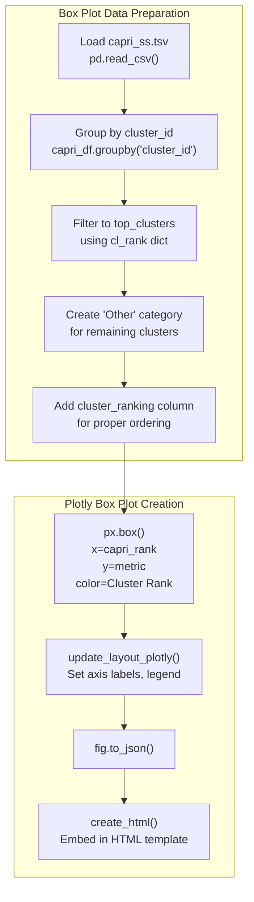

**Sources**: [src/haddock/libs/libplots.py:244-398]()

---

### Table Generation

Interactive tables display cluster statistics and top-ranked structures. Tables support sorting, filtering, and structure visualization when served via HTTP.

**Table Types**:

1. **Clustered Results Table**: Shows cluster-level statistics with best structures per cluster
2. **Unclustered Results Table**: Shows individual structure rankings when no clustering performed

**Key Functions**:

| Function | Location | Description |
|----------|----------|-------------|
| `clt_table_handler()` | [src/haddock/libs/libplots.py:878-976]() | Orchestrates table creation |
| `find_best_struct()` | [src/haddock/libs/libplots.py:752-788]() | Finds top N structures per cluster |
| `create_other_cluster()` | [src/haddock/libs/libplots.py:825-875]() | Combines clusters beyond threshold |
| `clean_capri_table()` | [src/haddock/libs/libplots.py:791-822]() | Formats mean ± std columns |

**Table Generation Flow**:

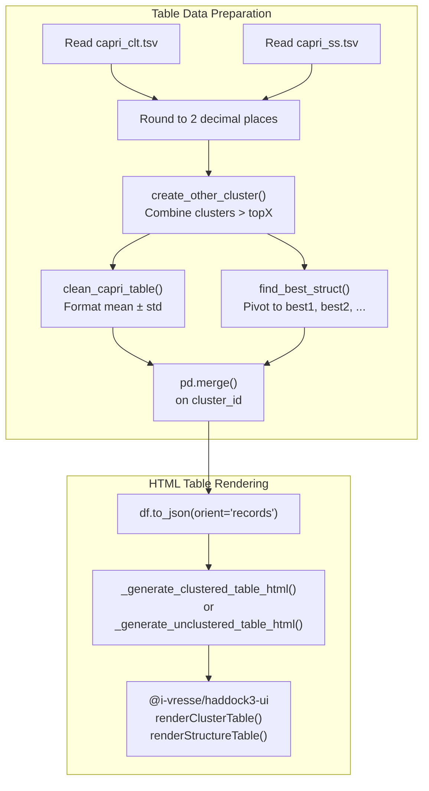

**Table Features**:
- Sortable columns by clicking headers
- Structure columns with download/visualization links (requires HTTP server)
- Mean ± standard deviation displayed as `{mean: X, std: Y}` objects
- Responsive design for wide tables (horizontal scrolling)

**Sources**: [src/haddock/libs/libplots.py:752-976](), [src/haddock/libs/libplots.py:1094-1172]()

---

## haddock3-analyse CLI

The `haddock3-analyse` command provides a comprehensive analysis workflow that can be run after a HADDOCK3 docking run completes. It generates interactive HTML reports for one or more workflow steps.

### Command-Line Interface

**Usage**:
```bash
haddock3-analyse -r <run_dir> -m <module_numbers> [options]
```

**Key Arguments**:

| Argument | Type | Description |
|----------|------|-------------|
| `-r`, `--run-dir` | str | Path to HADDOCK3 run directory |
| `-m`, `--modules` | int+ | Module numbers to analyze (e.g., `1 3 5`) |
| `-t`, `--top_clusters` | int | Number of clusters to display (default: 10) |
| `--format` | str | Export plots as png/jpeg/svg/pdf/eps (requires kaleido) |
| `--scale` | float | Scale factor for exported images (default: 1.0) |
| `--offline` | bool | Generate self-contained HTML (default: False) |
| `--self-contained` | bool | Copy structures locally (default: False) |
| `-p`, `--other-params` | dict | Additional caprieval parameters |

**Sources**: [src/haddock/clis/cli_analyse.py:71-178]()

---

### Analysis Workflow

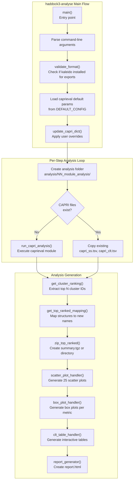

**Sources**: [src/haddock/clis/cli_analyse.py:690-860]()

---

### CAPRI File Handling

The CLI intelligently handles CAPRI evaluation files:

**Decision Logic**:

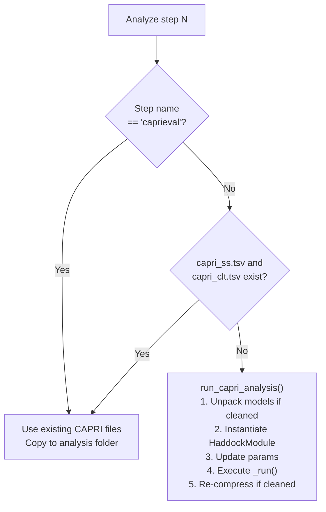

**`run_capri_analysis()` Implementation**:
- Loads `io.json` from the target step via `ModuleIO`
- Optionally unpacks gzipped structures using `haddock3_unpack()`
- Creates a `HaddockModule` instance from caprieval with `order = step_number + 1`
- Executes the caprieval `_run()` method to generate CAPRI files
- Optionally re-compresses structures using `haddock3_clean()`

**Sources**: [src/haddock/clis/cli_analyse.py:254-302](), [src/haddock/clis/cli_analyse.py:510-641]()

---

### Structure Archive Creation

The `zip_top_ranked()` function creates portable archives of top-ranked structures, making it easy to share or visualize key results.

**Archive Types**:

| Mode | Parameter | Output | Description |
|------|-----------|--------|-------------|
| Archive | `gen_archive=True` | `summary.tgz` | Compressed archive with renamed structures |
| Directory | `gen_archive=False` | `summary/` | Directory with renamed structures |

**Structure Selection**:
- **Clustered**: Top 4 models from top N clusters (default N=10)
- **Unclustered**: Top 10 models overall

**Renaming Convention**:
- Clustered: `cluster_{rank}_model_{intra_rank}.pdb`
- Unclustered: `model_{rank}.pdb`

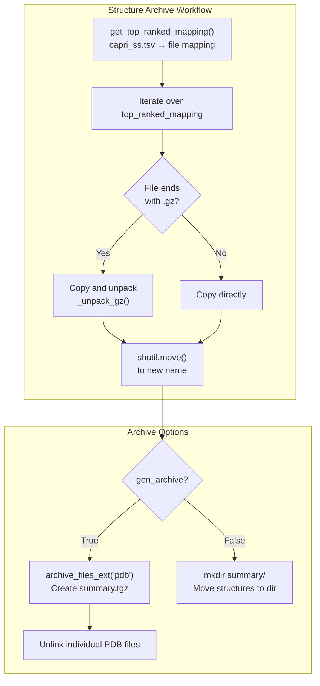

**Sources**: [src/haddock/clis/cli_analyse.py:368-508]()

---

## Interactive Report Generation

The final output of `haddock3-analyse` is an interactive HTML report (`report.html`) that consolidates all visualizations and tables.

### Report Structure

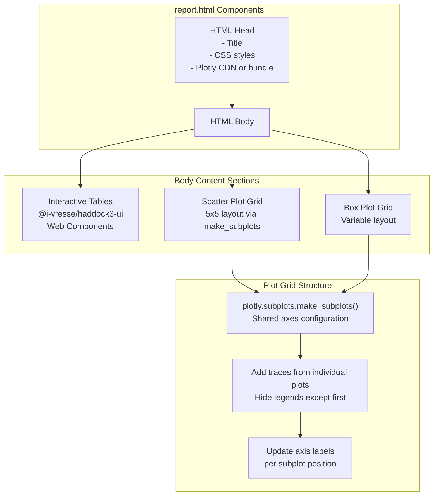

**Sources**: [src/haddock/libs/libplots.py:1038-1196]()

---

### Report Generation Pipeline

The `report_generator()` function orchestrates the complete report assembly:

**Function Signature**:
```python
def report_generator(
    boxes: list[Figure],
    scatters: list[Figure],
    tables: pd.DataFrame,
    step: str,
    report_path: FilePath,
    offline: bool = False,
) -> None
```

**Assembly Process**:

| Step | Function | Output |
|------|----------|--------|
| 1. Generate scatter subplot | `report_plots_handler(scatters, shared_xaxes='all')` | Combined scatter Figure |
| 2. Generate box subplot | `report_plots_handler(boxes, shared_xaxes=False)` | Combined box Figure |
| 3. Prepare figures list | Combine tables, scatters, boxes | List of elements |
| 4. Generate HTML | `_generate_html_report(step, figures, report_path, offline)` | `report.html` |

**Grid Layout Calculation**:

The `_report_grid_size()` function determines optimal layout:
- **Columns**: Fixed at `SCATTER_MATRIX_SIZE[1]` (5 columns)
- **Rows**: `ceil(number_of_plots / 5)`
- **Width/Height per plot**: 
  - 600px if more than 5 clusters (enables horizontal scroll)
  - 350px otherwise

**Sources**: [src/haddock/libs/libplots.py:1207-1267](), [src/haddock/libs/libplots.py:688-749]()

---

### CSS and JavaScript Injection

The report includes custom styling and JavaScript for interactivity:

**CSS Components**:

| CSS Rule | Purpose |
|----------|---------|
| `.title` | Report title styling |
| `table` | Collapsible borders, even-row striping |
| `th[scope="row"]` | Sticky first column (position: sticky) |
| `.js-plotly-plot .plotly .modebar svg` | Enable Plotly modebar icons |

**JavaScript Sources**:

| Mode | Source | Location |
|------|--------|----------|
| Online | CDN | `plotly_cdn_url()` from plotly.io._utils |
| Offline | Bundle | `get_plotlyjs()` copied to `plotly_bundle.js` |

**Table Web Components**: Uses `@i-vresse/haddock3-ui` package for sortable, filterable tables with structure visualization capabilities.

**Sources**: [src/haddock/libs/libplots.py:979-1036](), [src/haddock/libs/libplots.py:1094-1172]()

---

### Offline Mode

When `--offline` flag is used, the report becomes completely self-contained with no external dependencies.

**Offline Asset Management**:

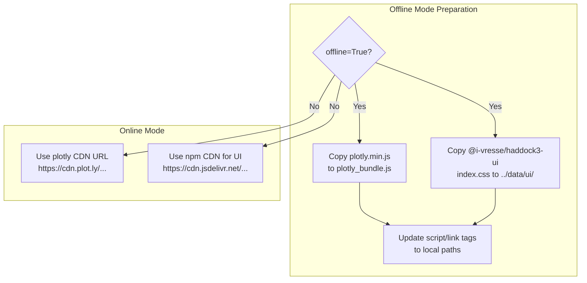

**`offline_js_manager()` Implementation**:
- **Online**: Returns CDN URL string for `<script src="...">` tag
- **Offline**: 
  1. Calls `get_plotlyjs()` to get bundled JavaScript
  2. Writes to `plotly_bundle.js` in figure directory
  3. Returns relative path for `<script src="./plotly_bundle.js">`

**Sources**: [src/haddock/libs/libplots.py:1273-1291](), [tests/test_libplots.py:290-303]()

---

## Output Directory Structure

After running `haddock3-analyse`, the following structure is created:

```
run_dir/
├── 00_topoaa/
├── 01_rigidbody/
├── 02_caprieval/
│   ├── capri_ss.tsv
│   └── capri_clt.tsv
├── analysis/
│   ├── README.md                    # Instructions for HTTP server
│   ├── 02_caprieval_analysis/
│   │   ├── capri_ss.tsv            # Copied CAPRI files
│   │   ├── capri_clt.tsv
│   │   ├── report.html             # Main interactive report
│   │   ├── plotly_bundle.js        # (if offline mode)
│   │   ├── irmsd_score.html        # Individual scatter plots
│   │   ├── dockq_score.html
│   │   ├── ... (23 more scatter plots)
│   │   ├── score_clt.html          # Individual box plots
│   │   ├── irmsd_clt.html
│   │   ├── ... (8 more box plots)
│   │   ├── summary.tgz             # Top-ranked structures archive
│   │   └── (or summary/ directory)
│   └── 03_flexref_analysis/
│       └── ...
└── data/
    └── ui/
        ├── index.css               # (if offline mode)
        └── report.bundle.js        # (if offline mode)
```

**README.md Content**:
The generated README provides usage instructions:
```markdown
# Usage

To view structures or download the structure files, in a terminal run the command:
```bash
python -m http.server --directory .
```

And open the following links in a web browser:
- [analysis/02_caprieval_analysis/report.html](http://0.0.0.0:8000/analysis/02_caprieval_analysis/report.html)
```

**Sources**: [src/haddock/clis/cli_analyse.py:814-858]()

---

## Usage Examples

### Example 1: Basic Analysis

Analyze caprieval and flexref steps from a completed run:

```bash
haddock3-analyse -r run1 -m 2 4
```

This generates:
- `run1/analysis/02_caprieval_analysis/report.html`
- `run1/analysis/04_flexref_analysis/report.html`

**Sources**: [src/haddock/clis/cli_analyse.py:1-22]()

---

### Example 2: Offline Report with Custom Parameters

Generate self-contained reports with custom CAPRI reference:

```bash
haddock3-analyse -r run1 -m 2 \
  --offline \
  --top_clusters 5 \
  -p reference_fname native.pdb
```

**Sources**: [src/haddock/clis/cli_analyse.py:130-177]()

---

### Example 3: Export High-Resolution Images

Generate reports with PNG exports for publication:

```bash
haddock3-analyse -r run1 -m 2 \
  --format png \
  --scale 2.0
```

**Requires**: `kaleido` package (`pip install kaleido==0.2.*`)

This creates both HTML files and PNG images for each plot.

**Sources**: [src/haddock/clis/cli_analyse.py:643-687](), [src/haddock/libs/libplots.py:321-322](), [src/haddock/libs/libplots.py:561-562]()

---

## Plot Customization

### Modifying Plot Pairs

To add or remove scatter plot pairs, edit `SCATTER_PAIRS` in libplots.py:

```python
SCATTER_PAIRS = [
    ("irmsd", "score"),
    ("irmsd", "desolv"),
    # Add custom pairs:
    ("fnat", "bsa"),
    ("lrmsd", "total"),
]
```

**Note**: Also update `SCATTER_MATRIX_SIZE` to match the grid dimensions.

**Sources**: [src/haddock/libs/libplots.py:31-61]()

---

### Color Schemes

Cluster colors are defined using Plotly's qualitative color palettes:

```python
colors = px_colors.qualitative.Dark24  # 24 distinct colors
color_idx = (cluster_rank - 1) % len(colors)
```

The "Other" cluster always uses `#DDDBDA` (light gray).

**Sources**: [src/haddock/libs/libplots.py:273-285](), [src/haddock/libs/libplots.py:532-535]()

---

## Testing

The visualization system includes comprehensive tests:

| Test File | Coverage |
|-----------|----------|
| [tests/test_libplots.py]() | Plot generation, table formatting, offline mode |
| [tests/test_cli_analyse.py]() | CLI workflow, CAPRI handling, archive creation |

**Key Test Cases**:
- `test_find_best_struct_best1`: Validates top structure selection
- `test_create_other_cluster_maxover`: Tests cluster aggregation logic
- `test_offline_js_manager`: Verifies offline bundle creation
- `test_box_plot_handler_format`: Tests image export with kaleido
- `test_zip_top_ranked`: Validates structure archive generation

**Sources**: [tests/test_libplots.py:1-360](), [tests/test_cli_analyse.py:1-163]()

---