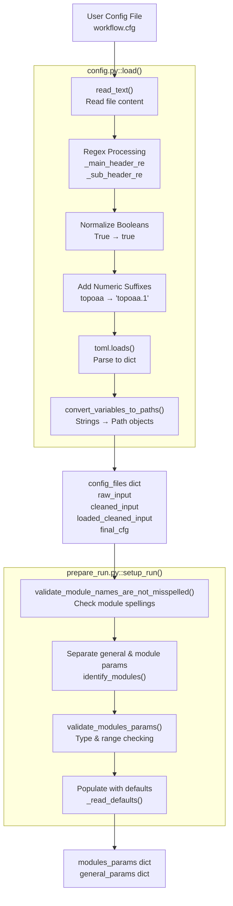
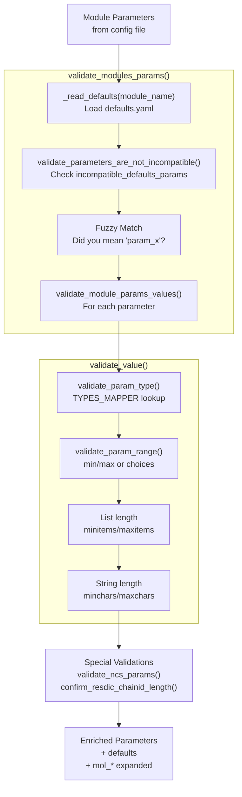
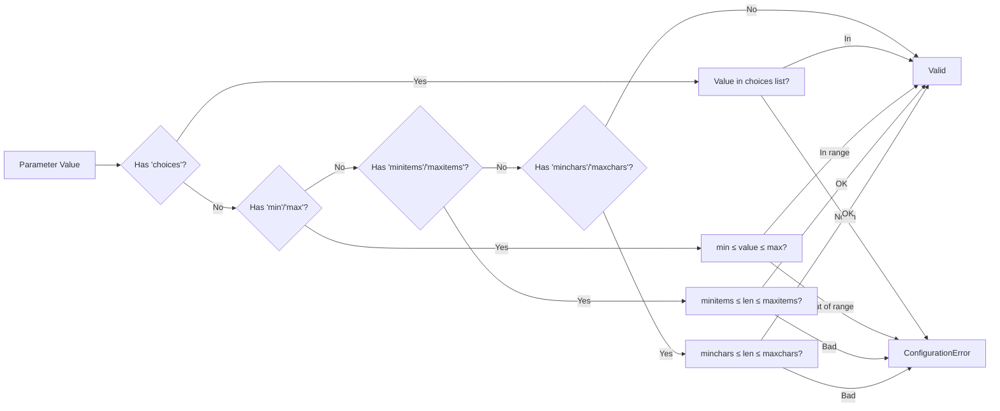
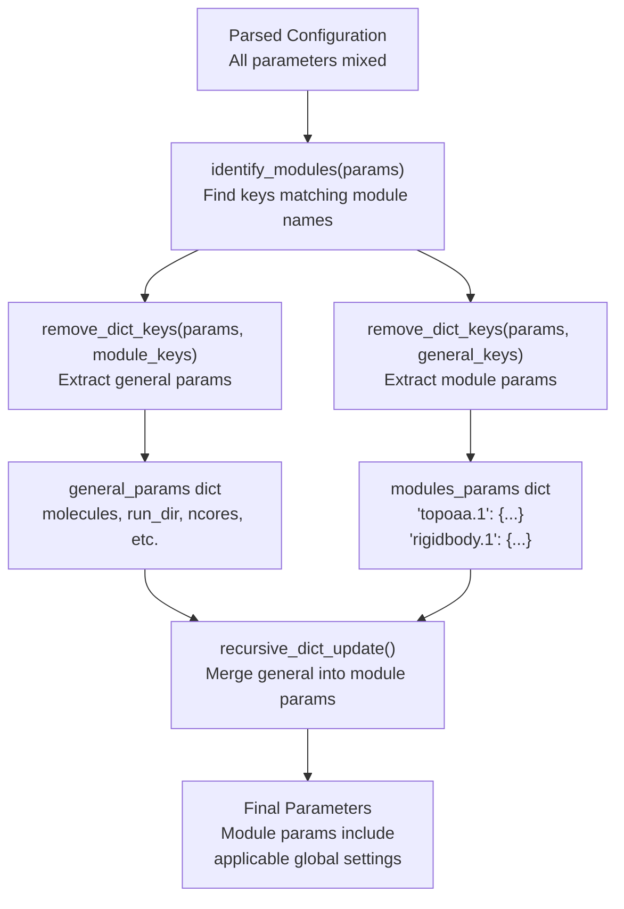
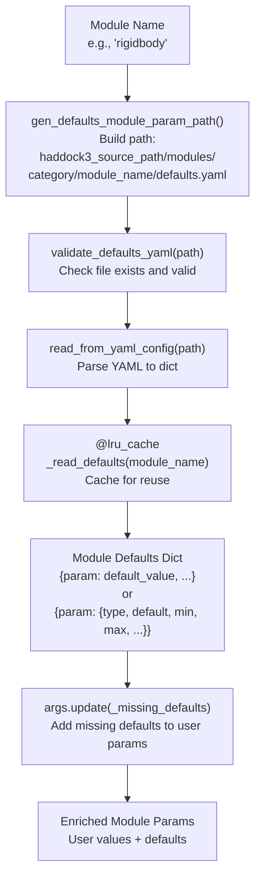
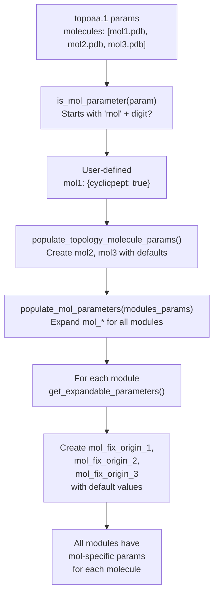
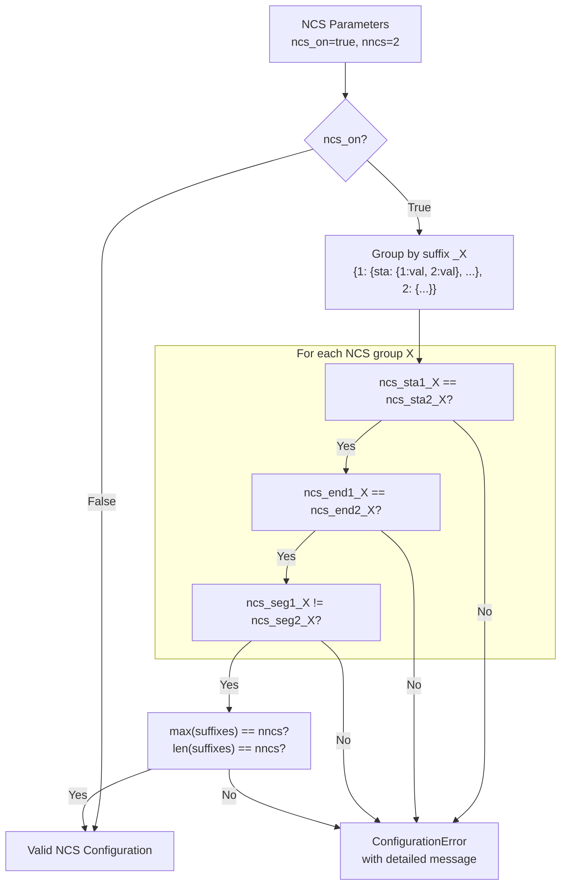
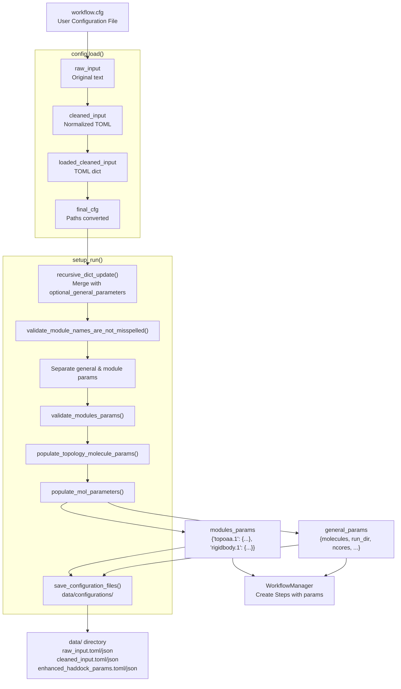

# Configuration

<details>
<summary>Relevant source files</summary>

The following files were used as context for generating this wiki page:

- [src/haddock/__init__.py](src/haddock/__init__.py)
- [src/haddock/clis/cli.py](src/haddock/clis/cli.py)
- [src/haddock/core/defaults.py](src/haddock/core/defaults.py)
- [src/haddock/gear/config.py](src/haddock/gear/config.py)
- [src/haddock/gear/prepare_run.py](src/haddock/gear/prepare_run.py)
- [src/haddock/gear/zerofill.py](src/haddock/gear/zerofill.py)
- [src/haddock/libs/libutil.py](src/haddock/libs/libutil.py)
- [src/haddock/libs/libworkflow.py](src/haddock/libs/libworkflow.py)
- [src/haddock/modules/__init__.py](src/haddock/modules/__init__.py)
- [tests/test_examples_general.py](tests/test_examples_general.py)
- [tests/test_gear_config.py](tests/test_gear_config.py)
- [tests/test_gear_prepare_run.py](tests/test_gear_prepare_run.py)
- [tests/test_gear_zerofill.py](tests/test_gear_zerofill.py)
- [tests/test_libutil.py](tests/test_libutil.py)
- [tests/test_modules_general.py](tests/test_modules_general.py)
- [tests/test_validations.py](tests/test_validations.py)

</details>


This page explains how HADDOCK3 workflows are configured through configuration files and parameters. It covers the configuration file format, parameter validation system, and how configuration data flows from user input through to module execution.

For details about specific configuration file syntax and structure, see [Configuration Files](#5.1). For information about the parameter definition system and defaults.yaml files, see [Parameter System](#5.2). For restraint-specific configuration, see [Restraints](#5.3).

## Overview

HADDOCK3 uses a TOML-based configuration format that defines a workflow as a sequence of modules with their parameters. The configuration system performs comprehensive validation, type checking, and parameter enrichment before workflow execution begins.

The configuration system has three main responsibilities:

1. **Parse** user configuration files (TOML format with HADDOCK3 extensions)
2. **Validate** module names, parameter names, types, ranges, and compatibility
3. **Enrich** parameters with defaults and expand molecule-specific parameters

## Configuration File Format

HADDOCK3 configuration files use TOML syntax with extensions to support repeated module names. The format allows users to define modules multiple times in the same configuration file.

### Module Declaration Syntax

```toml
# Basic module declaration
[topoaa]
molecules = ["protein.pdb", "ligand.pdb"]

# Modules can be repeated
[rigidbody]
sampling = 1000

[caprieval]
reference_fname = "reference.pdb"

# Second caprieval instance
[caprieval]
reference_fname = "reference2.pdb"
```

The parser in `config.py` automatically normalizes module names with numeric suffixes (e.g., `topoaa.1`, `rigidbody.1`, `caprieval.1`, `caprieval.2`).

### Configuration Processing Diagram



**Sources:** [src/haddock/gear/config.py:116-236](), [src/haddock/gear/prepare_run.py:214-430]()

## Parameter Types and Validation

HADDOCK3 implements a comprehensive type system for parameter validation defined in `TYPES_MAPPER`:

| YAML Type | Python Types | Validation |
|-----------|--------------|------------|
| `integer`, `int` | `int`, `float` | min/max range |
| `float`, `double`, `long` | `float`, `int` | min/max range, precision |
| `boolean`, `bool` | `bool` | true/false |
| `string`, `str` | `str` | minchars/maxchars, choices |
| `list`, `array` | `list` | minitems/maxitems |
| `path`, `file` | `str`, `Path`, `EmptyPath` | file existence |
| `dict` | `dict` | nested validation |

### Validation Pipeline



**Sources:** [src/haddock/gear/prepare_run.py:557-631](), [src/haddock/gear/prepare_run.py:656-687](), [src/haddock/gear/prepare_run.py:689-761]()

### Type Validation Example

The `validate_param_type()` function checks if provided values match expected types:

```python
# From TYPES_MAPPER at prepare_run.py:101-140
TYPES_MAPPER = {
    "boolean": (bool,),
    "integer": (int, float,),  # float allowed for int
    "float": (float, int,),
    "string": (str,),
    "list": (list,),
    "path": (str, Path, PosixPath, EmptyPath,),
}
```

If a user provides `sampling = "1000"` (string) for an integer parameter, the validation raises a `ConfigurationError` with a helpful message indicating the expected type.

**Sources:** [src/haddock/gear/prepare_run.py:101-140](), [src/haddock/gear/prepare_run.py:689-717]()

### Range Validation

The `validate_param_range()` function enforces parameter constraints:



**Sources:** [src/haddock/gear/prepare_run.py:719-761]()

## Parameter Incompatibilities

HADDOCK3 supports defining parameter incompatibilities where certain parameter values prevent other parameters from taking specific values. This is defined in `defaults.yaml` files using the `incompatibilities` key.

The validation function `validate_parameters_are_not_incompatible()` checks these constraints:

```python
# Example incompatibility structure
incompatible_params = {
    "limiting_parameter": {
        True: {  # When limiting_parameter is True
            "incompatible_parameter": "forbidden_value"  # This value is forbidden
        }
    }
}
```

**Sources:** [src/haddock/gear/prepare_run.py:1099-1158](), [src/haddock/gear/yaml2cfg.py:87-116]()

## General vs Module Parameters

HADDOCK3 distinguishes between general parameters (affecting all modules) and module-specific parameters:

### General Parameters

Defined in three categories:

1. **Mandatory general parameters** (`config_mandatory_general_parameters`):
   - `molecules` - Input PDB files
   - `run_dir` - Output directory

2. **Non-mandatory general parameters** (`non_mandatory_general_parameters_defaults`):
   - Loaded from [src/haddock/modules/defaults.yaml]()
   - Include `ncores`, `mode`, `clean`, `offline`, etc.

3. **Optional general parameters** (`config_optional_general_parameters`):
   - Parameters that can be defined globally or per-module
   - Module-level definitions override global definitions

### Parameter Separation Flow



**Sources:** [src/haddock/gear/prepare_run.py:292-294](), [src/haddock/gear/prepare_run.py:1060-1063](), [src/haddock/libs/libworkflow.py:111-127]()

## Defaults and Parameter Inheritance

Each module has a `defaults.yaml` file defining default parameter values and metadata. The system loads these defaults and merges them with user-provided parameters.

### Defaults Loading Process



The `_read_defaults()` function at [src/haddock/gear/prepare_run.py:164-188]() uses `@lru_cache` to avoid repeatedly reading the same defaults file.

**Sources:** [src/haddock/gear/prepare_run.py:164-211](), [src/haddock/gear/prepare_run.py:624-630]()

## Expandable Parameters

Some parameters are molecule-specific and need to be expanded based on the number of molecules. These parameters follow naming patterns like `mol_*`, `hisd_*`, `hise_*`.

### Molecule Parameter Expansion



The system identifies expandable parameters using patterns and expands them across all molecules:

- `mol_*` parameters (e.g., `mol_fix_origin`, `mol_shape`)
- Histidine parameters (`hisd_*`, `hise_*`, `nhisd`, `nhise`)
- NCS parameters (`ncs_sta1_*`, `ncs_end1_*`, `ncs_seg1_*`)

**Sources:** [src/haddock/gear/prepare_run.py:1173-1227](), [src/haddock/gear/prepare_run.py:1229-1273](), [src/haddock/gear/prepare_run.py:375-376]()

## Special Validations

### NCS (Non-Crystallographic Symmetry) Parameters

NCS parameters have complex interdependencies validated by `validate_ncs_params()`:

**Rules:**
1. `ncs_sta1_X` must equal `ncs_sta2_X` (same start residue)
2. `ncs_end1_X` must equal `ncs_end2_X` (same end residue)
3. `ncs_seg1_X` must differ from `ncs_seg2_X` (different chains)
4. `nncs` must match the number of NCS restraint definitions



**Sources:** [src/haddock/gear/prepare_run.py:764-867]()

### Resdic Chain ID Validation

For analysis modules using `resdic` (residue dictionaries), the system validates that chain IDs have appropriate lengths using `confirm_resdic_chainid_length()`.

**Sources:** [src/haddock/modules/analysis/__init__.py](), [src/haddock/gear/prepare_run.py:587-588]()

## Configuration Data Structures

### Complete Configuration Flow



**Sources:** [src/haddock/gear/prepare_run.py:214-430](), [src/haddock/gear/prepare_run.py:433-511]()

## Configuration File Locations

During a HADDOCK3 run, configuration information is stored in multiple locations:

| Location | Purpose | Format |
|----------|---------|--------|
| `data/configurations/raw_input.toml` | Original user config | TOML |
| `data/configurations/cleaned_input.toml` | Normalized config | TOML |
| `data/configurations/enhanced_haddock_params.toml` | Full config with defaults | TOML |
| `data/configurations/*.json` | Same as above | JSON |
| `<step_folder>/params.cfg` | Module-specific params | TOML |

The `save_configuration_files()` function creates these files with a README explaining each version.

**Sources:** [src/haddock/gear/prepare_run.py:433-511]()

## Error Handling and User Feedback

The configuration system provides detailed error messages with suggestions:

### Fuzzy Matching

When a parameter name is misspelled, `fuzzy_match()` uses `difflib.get_close_matches()` to suggest corrections:

```python
# Example error output
ConfigurationError: The following parameters do not match any expected 
parameters for module 'rigidbody':
 * 'samplng' did you mean 'sampling'?
 * 'airbearing' did you mean 'air_bearing'?
```

**Sources:** [src/haddock/gear/prepare_run.py:1344-1358](), [src/haddock/gear/prepare_run.py:606-616]()

### Validation Error Context

The `@with_config_error` decorator wraps validation functions to provide consistent error context:

```python
@with_config_error
def validate_modules_params(modules_params, max_mols):
    # Validation logic
    # KeyError automatically becomes ConfigurationError
```

**Sources:** [src/haddock/gear/prepare_run.py:143-161](), [src/haddock/gear/prepare_run.py:556-631]()

## Configuration in Module Lifecycle

When modules are instantiated, they receive configuration through the `BaseHaddockModule` initialization:

```mermaid
graph LR
    ParamsCfg["params.cfg<br/>in step folder"]
    
    ModuleInit["BaseHaddockModule.__init__()<br/>(order, path, params_fname)"]
    
    ReadParams["config_readers[extension](params_fname)<br/>Load params"]
    
    UpdateParams["update_params()<br/>Merge with non_mandatory_general_parameters"]
    
    FillEmpty["_fill_emptypaths()<br/>Convert empty strings to EmptyPath"]
    
    ConfirmFiles["_confirm_fnames_exist()<br/>Check *_fname files exist"]
    
    ModuleParams["self._params<br/>Final module parameters"]
    
    ModuleRun["module.run()<br/>Execute with params"]
    
    ParamsCfg --> ModuleInit
    ModuleInit --> ReadParams
    ReadParams --> UpdateParams
    UpdateParams --> FillEmpty
    FillEmpty --> ConfirmFiles
    ConfirmFiles --> ModuleParams
    ModuleParams --> ModuleRun
```



**Sources:** [src/haddock/modules/__init__.py:120-206]()

## Summary

The HADDOCK3 configuration system:

1. **Parses** TOML files with repeated module names using regex normalization
2. **Validates** parameter names, types, ranges, and incompatibilities
3. **Enriches** parameters with defaults and expands molecule-specific parameters
4. **Saves** configuration snapshots for reproducibility
5. **Provides** helpful error messages with fuzzy matching suggestions

This multi-stage validation ensures that errors are caught early, before expensive computations begin, and that all modules receive properly formatted and validated parameters.

**Sources:** [src/haddock/gear/config.py](), [src/haddock/gear/prepare_run.py](), [src/haddock/modules/__init__.py]()

---