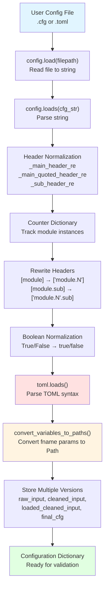
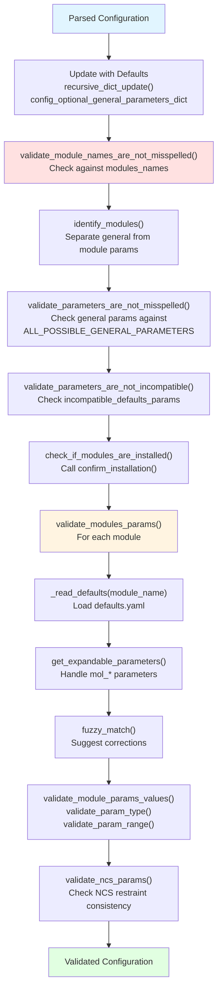
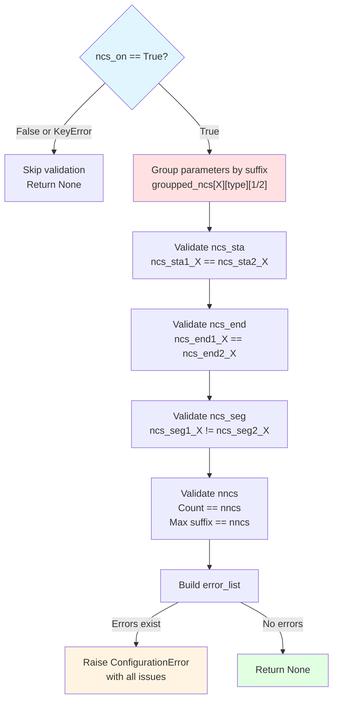
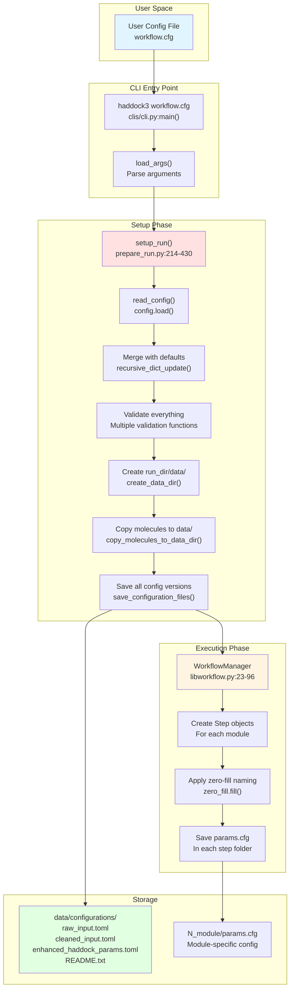
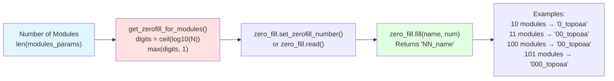

# Configuration Files

<details>
<summary>Relevant source files</summary>

The following files were used as context for generating this wiki page:

- [src/haddock/__init__.py](src/haddock/__init__.py)
- [src/haddock/clis/cli.py](src/haddock/clis/cli.py)
- [src/haddock/core/defaults.py](src/haddock/core/defaults.py)
- [src/haddock/gear/config.py](src/haddock/gear/config.py)
- [src/haddock/gear/prepare_run.py](src/haddock/gear/prepare_run.py)
- [src/haddock/gear/zerofill.py](src/haddock/gear/zerofill.py)
- [src/haddock/libs/libutil.py](src/haddock/libs/libutil.py)
- [src/haddock/libs/libworkflow.py](src/haddock/libs/libworkflow.py)
- [src/haddock/modules/__init__.py](src/haddock/modules/__init__.py)
- [tests/test_examples_general.py](tests/test_examples_general.py)
- [tests/test_gear_config.py](tests/test_gear_config.py)
- [tests/test_gear_prepare_run.py](tests/test_gear_prepare_run.py)
- [tests/test_gear_zerofill.py](tests/test_gear_zerofill.py)
- [tests/test_libutil.py](tests/test_libutil.py)
- [tests/test_modules_general.py](tests/test_modules_general.py)
- [tests/test_validations.py](tests/test_validations.py)

</details>


Configuration files define HADDOCK3 workflows by specifying the sequence of modules to execute and their parameters. This page documents the TOML-based configuration format, the parsing pipeline that processes configuration files, and the validation system that ensures correctness.

For information about parameter definitions and the `defaults.yaml` system, see [Parameter System](#5.2). For information about restraint file formats, see [Restraints](#5.3).

---

## File Format

HADDOCK3 configuration files use TOML syntax with custom extensions to support workflow definitions. The system accepts both pure TOML files and HADDOCK3-extended configuration files with repeated module headers.

### TOML Syntax with Extensions

Standard TOML syntax defines parameters as `key = value` pairs within sections denoted by `[headers]`. HADDOCK3 extends this by allowing repeated headers to define multiple instances of the same module:

```toml
# General parameters
molecules = ["protein.pdb", "ligand.pdb"]
run_dir = "run1"

# First module instance
[topoaa]
autohis = true

# Sampling module
[rigidbody]
sampling = 1000

# First analysis module instance
[caprieval]
reference_fname = "reference.pdb"

# Refinement module
[flexref]
tolerance = 5

# Second analysis module instance (repeated header)
[caprieval]
reference_fname = "reference.pdb"
```

The parser automatically indexes repeated modules as `caprieval.1` and `caprieval.2` internally, but users can write the simpler repeated header syntax.

### Module Naming Conventions

Modules can be specified in three ways:

| Format | Example | Use Case |
|--------|---------|----------|
| Simple header | `[rigidbody]` | User-friendly format with automatic indexing |
| Indexed header | `[rigidbody.1]` | Pure TOML compatibility |
| Quoted indexed | `['rigidbody.1']` | Internal representation after parsing |

Sources: [src/haddock/gear/config.py:75-92]()

### Path Parameters

Parameters ending with `_fname` or listed in `_keys_that_accept_files` are automatically converted to `pathlib.Path` objects during parsing. Empty path values are converted to `EmptyPath()` objects that evaluate to `False` in boolean contexts:

```toml
[module]
restraints_fname = "data/restraints.tbl"  # Converted to Path
optional_file = ""  # Converted to EmptyPath
```

Sources: [src/haddock/gear/config.py:97-106](), [src/haddock/gear/config.py:239-265]()

---

## Configuration Parsing Pipeline

The configuration parsing system transforms user-written configuration files through multiple stages to produce validated, executable module definitions.

### Parsing Flow Diagram



Sources: [src/haddock/gear/config.py:145-236]()

### Header Normalization

The parser uses four regular expressions to normalize headers regardless of input format:

| Regex | Matches | Transforms To |
|-------|---------|---------------|
| `_main_header_re` | `[module]` | `['module.N']` |
| `_main_quoted_header_re` | `['module.3']` | `['module.N']` (renumbered) |
| `_sub_header_re` | `[module.subkey]` | `['module.N'.subkey]` |
| `_sub_quoted_header_re` | `['module.3'.subkey]` | `['module.N'.subkey]` (renumbered) |

The counter dictionary tracks how many times each module name appears and assigns sequential indices starting from 1. This normalization ensures consistent internal representation regardless of input format.

Sources: [src/haddock/gear/config.py:73-92](), [src/haddock/gear/config.py:180-214]()

### Path Conversion

After TOML parsing, the `convert_variables_to_paths()` function recursively traverses the configuration dictionary and converts appropriate parameters to Path objects:

```python
# Pseudo-code representation
def convert_variables_to_paths(cfg):
    for param, value in cfg.items():
        if param == "molecules":
            cfg[param] = [Path(v) for v in to_list(value)]
        elif match_path_criteria(param):
            cfg[param] = convert_to_path(value)
        elif isinstance(value, dict):
            cfg[param] = convert_variables_to_paths(value)
```

The `match_path_criteria()` function returns `True` if the parameter name ends with `_fname` or is in the list `['cns_exec', 'executable', 'run_dir']`.

Sources: [src/haddock/gear/config.py:239-283]()

### Configuration Storage

The parsing pipeline produces a dictionary with four keys preserving the configuration at different stages:

| Key | Content | Purpose |
|-----|---------|---------|
| `raw_input` | Original file content | Debugging and audit trail |
| `cleaned_input` | Normalized TOML text | Shows header transformations |
| `loaded_cleaned_input` | Parsed dictionary | Intermediate representation |
| `final_cfg` | Paths converted | Final executable configuration |

These versions are saved to `data/configurations/` during workflow setup for reproducibility.

Sources: [src/haddock/gear/config.py:228-236](), [src/haddock/gear/prepare_run.py:433-511]()

---

## Configuration Validation

After parsing, the `setup_run()` function validates the configuration through multiple stages to catch errors before execution begins.

### Validation Pipeline Diagram



Sources: [src/haddock/gear/prepare_run.py:214-430]()

### Module Name Validation

The system validates that module names are spelled correctly and installed:

**Step 1: Spelling Check**
- Extract module names using `get_module_name()` to remove `.N` suffixes
- Compare against `modules_names` set from available modules
- Use `validate_module_names_are_not_misspelled()` for general parameters
- Call `validate_parameters_are_not_misspelled()` with fuzzy matching

**Step 2: Installation Check**
- Import each module using `importlib.import_module()`
- Call `HaddockModule.confirm_installation()` to verify dependencies
- Raise `ModuleError` if third-party requirements are missing

Sources: [src/haddock/gear/prepare_run.py:1076-1097](), [src/haddock/gear/prepare_run.py:870-893]()

### Parameter Type and Value Validation

For each module parameter, the system validates both type and value constraints defined in `defaults.yaml`:

#### Type Validation Mapping

| YAML Type | Python Types | Validation Function |
|-----------|-------------|---------------------|
| `integer` | `int, float` | `validate_param_type()` |
| `float` | `float, int` | `validate_param_type()` |
| `boolean` | `bool` | `validate_param_type()` |
| `string` | `str` | `validate_param_type()` |
| `list` | `list` | `validate_param_type()` |
| `file` | `str, Path` | `validate_param_type()` |

#### Value Range Validation

The `validate_param_range()` function checks values against constraints:

| Constraint Type | YAML Keys | Validation |
|----------------|-----------|------------|
| Numeric range | `min`, `max` | `min <= value <= max` |
| Choices | `choices` | `value in choices` |
| List length | `minitems`, `maxitems` | Length bounds |
| String length | `minchars`, `maxchars` | Character bounds |

Sources: [src/haddock/gear/prepare_run.py:633-687](), [src/haddock/gear/prepare_run.py:689-762]()

### NCS Parameter Validation

Non-Crystallographic Symmetry (NCS) parameters require special validation to ensure consistency:



The validation enforces three rules:
1. Start residues must match: `ncs_sta1_X == ncs_sta2_X`
2. End residues must match: `ncs_end1_X == ncs_end2_X`
3. Chain/segment IDs must differ: `ncs_seg1_X != ncs_seg2_X`

Sources: [src/haddock/gear/prepare_run.py:764-867]()

### Incompatible Parameter Detection

The system checks for parameter combinations that are logically incompatible using the `validate_parameters_are_not_incompatible()` function:

```python
# Example incompatibility structure
incompatible_params = {
    "limiting_parameter": {
        True: {
            "incompatible_parameter": "incompatible_value"
        }
    }
}
```

When `limiting_parameter` has value `True`, `incompatible_parameter` cannot have value `"incompatible_value"`. The system raises a `ValueError` describing the conflict if incompatible parameters are detected.

Sources: [src/haddock/gear/prepare_run.py:1099-1150](), [src/haddock/gear/yaml2cfg.py:68-69]()

### Fuzzy Parameter Matching

When unknown parameters are detected, the `fuzzy_match()` function uses `difflib.get_close_matches()` to suggest corrections:

```python
# Example error message
"The following parameters do not match any expected parameters for module 'rigidbody':
 * 'smapling' did you mean 'sampling'?
 * 'tolerence' did you mean 'tolerance'?"
```

This helps users quickly identify and fix typos in configuration files.

Sources: [src/haddock/gear/prepare_run.py:1151-1200]()

---

## Configuration Life Cycle

The following diagram shows how configuration flows from user file through the HADDOCK3 system:



Sources: [src/haddock/clis/cli.py:81-213](), [src/haddock/gear/prepare_run.py:214-430](), [src/haddock/libs/libworkflow.py:23-191]()

### Configuration Preservation

Three versions of the configuration are saved to `data/configurations/` for reproducibility and debugging:

| File | Content | Description |
|------|---------|-------------|
| `raw_input.toml` | Original user input | Untouched copy as provided by user |
| `cleaned_input.toml` | Normalized headers | Pre-parsed with header indexing applied |
| `enhanced_haddock_params.toml` | Complete parameters | Final configuration with all defaults filled in |
| `README.txt` | Documentation | Explains each configuration file |

Additionally, each module step folder (e.g., `00_topoaa/`, `01_rigidbody/`) contains a `params.cfg` file with the module-specific configuration saved via `BaseHaddockModule.save_config()`.

Sources: [src/haddock/gear/prepare_run.py:433-511](), [src/haddock/modules/__init__.py:208-224]()

---

## Module Indexing and Zero-Fill

Module folder names use zero-filled numeric prefixes to maintain sort order. The `zero_fill` singleton manages this naming scheme.

### Zero-Fill Calculation



The zero-fill system ensures folders sort correctly in file browsers:
- 1-10 modules: single digit (`0_topoaa`, `1_rigidbody`, ..., `9_module`)
- 11-100 modules: two digits (`00_topoaa`, `01_rigidbody`, ..., `99_module`)
- 101-1000 modules: three digits (`000_topoaa`, `001_rigidbody`, ..., `999_module`)

The calculation uses `max(ceil(log10(len(modules))), 1)` to determine the number of digits needed.

Sources: [src/haddock/gear/zerofill.py:24-136](), [src/haddock/gear/prepare_run.py:358-375]()

### Module Name Extraction

The `get_module_name()` function extracts the base module name from indexed names:

| Input | Output |
|-------|--------|
| `"topoaa"` | `"topoaa"` |
| `"rigidbody.1"` | `"rigidbody"` |
| `"caprieval.2"` | `"caprieval"` |
| `"flexref.10"` | `"flexref"` |

This function is used throughout validation and execution to map indexed module instances back to their module definitions.

Sources: [src/haddock/gear/config.py:286-292]()

---

## Key Code Entities Reference

| Entity | Location | Purpose |
|--------|----------|---------|
| `config.load()` | [src/haddock/gear/config.py:116-142]() | Main entry point for reading config files |
| `config.loads()` | [src/haddock/gear/config.py:145-236]() | Parse config string to dictionary |
| `config.save()` | [src/haddock/gear/config.py:295-339]() | Write config dictionary to file |
| `setup_run()` | [src/haddock/gear/prepare_run.py:214-430]() | Validate and prepare workflow execution |
| `validate_modules_params()` | [src/haddock/gear/prepare_run.py:557-631]() | Validate all module parameters |
| `validate_module_params_values()` | [src/haddock/gear/prepare_run.py:633-653]() | Validate individual parameter values |
| `validate_param_type()` | [src/haddock/gear/prepare_run.py:689-716]() | Check parameter type correctness |
| `validate_param_range()` | [src/haddock/gear/prepare_run.py:719-761]() | Check parameter value ranges |
| `validate_ncs_params()` | [src/haddock/gear/prepare_run.py:764-867]() | Validate NCS restraint consistency |
| `fuzzy_match()` | [src/haddock/gear/prepare_run.py:1151-1200]() | Suggest corrections for typos |
| `zero_fill` | [src/haddock/gear/zerofill.py:102]() | Singleton for folder name zero-filling |
| `get_module_name()` | [src/haddock/gear/config.py:286-292]() | Extract base module name from indexed name |
| `save_configuration_files()` | [src/haddock/gear/prepare_run.py:433-511]() | Save config versions to data/ directory |

Sources: [src/haddock/gear/config.py](), [src/haddock/gear/prepare_run.py](), [src/haddock/gear/zerofill.py]()

---