# Parameter System

<details>
<summary>Relevant source files</summary>

The following files were used as context for generating this wiki page:

- [devtools/build_defaults_rst.py](devtools/build_defaults_rst.py)
- [docs/modules/index.rst](docs/modules/index.rst)
- [setup.py](setup.py)
- [src/haddock/__init__.py](src/haddock/__init__.py)
- [src/haddock/clis/cli.py](src/haddock/clis/cli.py)
- [src/haddock/core/defaults.py](src/haddock/core/defaults.py)
- [src/haddock/gear/config.py](src/haddock/gear/config.py)
- [src/haddock/gear/prepare_run.py](src/haddock/gear/prepare_run.py)
- [src/haddock/gear/zerofill.py](src/haddock/gear/zerofill.py)
- [src/haddock/libs/libutil.py](src/haddock/libs/libutil.py)
- [src/haddock/libs/libworkflow.py](src/haddock/libs/libworkflow.py)
- [src/haddock/modules/__init__.py](src/haddock/modules/__init__.py)
- [src/haddock/modules/_template_cat/README.md](src/haddock/modules/_template_cat/README.md)
- [src/haddock/modules/_template_cat/_template_mod/defaults.yaml](src/haddock/modules/_template_cat/_template_mod/defaults.yaml)
- [tests/test_examples_general.py](tests/test_examples_general.py)
- [tests/test_gear_config.py](tests/test_gear_config.py)
- [tests/test_gear_prepare_run.py](tests/test_gear_prepare_run.py)
- [tests/test_gear_zerofill.py](tests/test_gear_zerofill.py)
- [tests/test_libutil.py](tests/test_libutil.py)
- [tests/test_modules_general.py](tests/test_modules_general.py)
- [tests/test_validations.py](tests/test_validations.py)

</details>


## Purpose and Scope

The Parameter System in HADDOCK3 manages the configuration, validation, and distribution of parameters across all modules in a workflow. It provides a structured schema-based approach where each module defines its parameters in a `defaults.yaml` file with full type specifications, constraints, and documentation. The system handles parameter inheritance from global to module-specific levels, validates user inputs against schemas, and organizes parameters by expertise level to accommodate users with different experience levels.

For information about configuration file formats and parsing, see [Configuration Files](#5.1). For details on restraint-specific parameters, see [Restraints](#5.3).

---

## Parameter Definition Structure

Each HADDOCK3 module defines its parameters in a `defaults.yaml` file located in the module's directory. The structure follows a strict schema that enables automatic validation, documentation generation, and user interface construction.

### defaults.yaml Schema

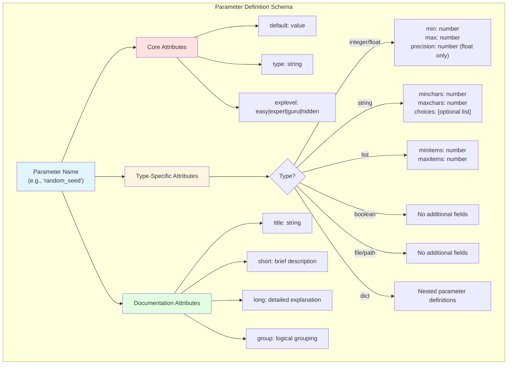

**Sources:** [src/haddock/modules/_template_cat/_template_mod/defaults.yaml:1-107](), [devtools/build_defaults_rst.py:51-120]()

### Example Parameter Definitions

The template module demonstrates all parameter types:

| Parameter Type | Example | Required Fields | Optional Fields |
|----------------|---------|-----------------|-----------------|
| Integer | `random_seed: 42` | `default`, `type`, `min`, `max`, `title`, `short`, `long`, `group`, `explevel` | - |
| Float | `indpb: 0.2` | Same as integer + `precision` | - |
| Boolean | `autohis: true` | `default`, `type`, `title`, `short`, `long`, `group`, `explevel` | - |
| String (with choices) | `initial_mutation: keep` | Same as boolean + `minchars`, `maxchars`, `choices` | `choices` can be omitted |
| String (free form) | `target_chain: "A"` | Same + `minchars`, `maxchars` | - |
| List | `region: []` | Same as boolean + `minitems`, `maxitems` | - |
| File/Path | `some_path_fname: "./path"` | `default`, `type`, `title`, `short`, `long`, `group`, `explevel` | - |
| Dict | `dict_like_par: {nested params}` | Same as boolean + nested parameter definitions | - |

**Sources:** [src/haddock/modules/_template_cat/_template_mod/defaults.yaml:10-107]()

---

## Parameter Type System

The parameter system maps YAML type declarations to Python types and enforces validation rules specific to each type.

### Type Mapping

The `TYPES_MAPPER` dictionary defines how string type declarations in `defaults.yaml` files map to Python types:

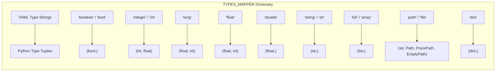

**Sources:** [src/haddock/gear/prepare_run.py:101-140]()

### Type-Specific Validation Rules

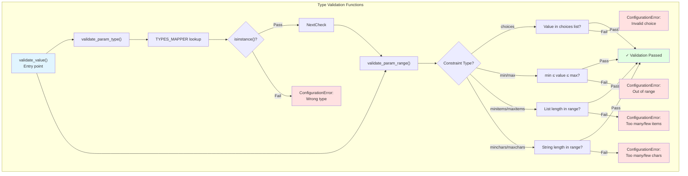

**Sources:** [src/haddock/gear/prepare_run.py:656-761]()

### Validation Implementation

The validation logic is implemented in three key functions:

**`validate_param_type(param: dict, val: Any) -> Optional[str]`** [src/haddock/gear/prepare_run.py:689-717]()
- Checks if the provided value matches the expected Python type
- Uses `TYPES_MAPPER` to convert string type to Python type tuple
- Returns `None` on success, error string on failure

**`validate_param_range(param: dict, val: Any) -> Optional[str]`** [src/haddock/gear/prepare_run.py:719-761]()
- Validates value is within allowed constraints:
  - `choices`: value must be in list
  - `min`/`max`: numeric value must be in range
  - `minitems`/`maxitems`: list length must be in range
  - `minchars`/`maxchars`: string length must be in range
- Returns `None` on success, error string on failure

**`validate_value(default_yaml: dict, key: str, value: Any) -> None`** [src/haddock/gear/prepare_run.py:656-687]()
- Orchestrates validation by calling type and range checks
- Special handling for `molecules` group parameters
- Raises `ConfigurationError` if validation fails

**Sources:** [src/haddock/gear/prepare_run.py:656-761]()

---

## Expertise Levels (explevel)

Parameters are organized into expertise levels to guide users of different experience levels. This hierarchy determines which parameters appear in different documentation views and user interfaces.

### Hierarchy Definition

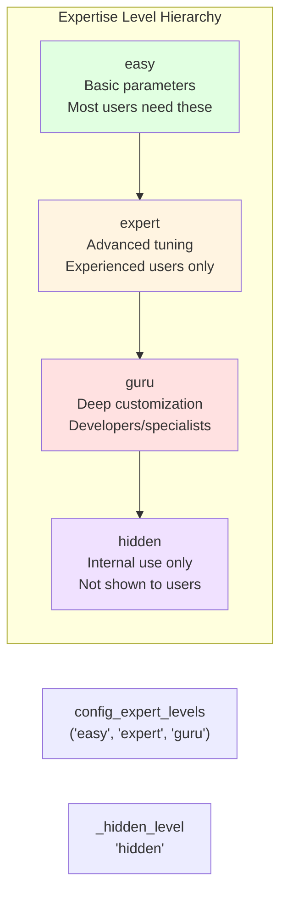

The `explevel` field is mandatory for all parameters and must be one of: `"easy"`, `"expert"`, `"guru"`, or `"hidden"`.

**Sources:** [src/haddock/__init__.py:24-26](), [devtools/build_defaults_rst.py:448-453]()

### Level Usage in Documentation

The documentation build system (`build_defaults_rst.py`) separates parameters by expertise level when generating RST files:

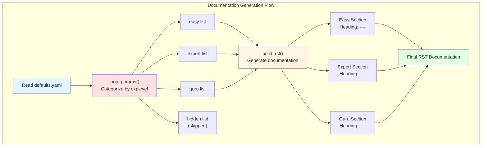

**Sources:** [devtools/build_defaults_rst.py:416-523]()

---

## Parameter Validation Flow

The parameter validation occurs during the `setup_run()` phase before any modules execute. This ensures all errors are caught early.

### Validation Pipeline

```mermaid
graph TB
    subgraph "setup_run() Validation Pipeline"
        Start["User Config File<br/>(TOML)"] --> ParseConfig["Read & Parse Config<br/>gear/config.load()"]
        
        ParseConfig --> SplitParams["Separate General<br/>from Module Parameters"]
        
        SplitParams --> ValidateGeneral["Validate General Parameters<br/>validate_parameters_are_not_misspelled()"]
        SplitParams --> ValidateModuleNames["Validate Module Names<br/>validate_module_names_are_not_misspelled()"]
        
        ValidateModuleNames --> CheckInstalled["Check Modules Installed<br/>check_if_modules_are_installed()"]
        
        CheckInstalled --> ValidateModules["For each module:<br/>validate_modules_params()"]
        
        ValidateModules --> LoadDefaults["Load defaults.yaml<br/>_read_defaults()"]
        LoadDefaults --> CheckIncompat["Check Parameter Incompatibilities<br/>find_incompatible_parameters()"]
        
        CheckIncompat --> FuzzyMatch["Check for Misspellings<br/>fuzzy_match()"]
        
        FuzzyMatch --> ValidateEach["For each parameter:<br/>validate_module_params_values()"]
        
        ValidateEach --> ValidateValue["validate_value()<br/>Type & Range checks"]
        
        ValidateValue --> ValidateNCS["validate_ncs_params()<br/>NCS-specific validation"]
        
        ValidateNCS --> MergeDefaults["Merge with Defaults<br/>Add missing parameters"]
        
        MergeDefaults --> Success["✓ Validation Complete<br/>Ready to Execute"]
        
        ValidateGeneral -.->|Error| Fail["ConfigurationError"]
        ValidateModuleNames -.->|Error| Fail
        CheckInstalled -.->|Error| Fail
        CheckIncompat -.->|Error| Fail
        FuzzyMatch -.->|Error| Fail
        ValidateValue -.->|Error| Fail
        ValidateNCS -.->|Error| Fail
    end
    
    style Start fill:#e1f5ff
    style ValidateValue fill:#ffe1e1
    style Success fill:#e1ffe1
    style Fail fill:#ffe1e1
```

**Sources:** [src/haddock/gear/prepare_run.py:214-430](), [src/haddock/gear/prepare_run.py:557-631]()

### Key Validation Functions

| Function | Location | Purpose |
|----------|----------|---------|
| `validate_params()` | [src/haddock/gear/prepare_run.py:514-523]() | Entry point for validation |
| `validate_module_names_are_not_misspelled()` | [src/haddock/gear/prepare_run.py:1076-1096]() | Checks module names against known modules |
| `validate_parameters_are_not_misspelled()` | [src/haddock/gear/prepare_run.py:1131-1155]() | Uses fuzzy matching to detect typos |
| `validate_modules_params()` | [src/haddock/gear/prepare_run.py:557-631]() | Validates all parameters for all modules |
| `validate_module_params_values()` | [src/haddock/gear/prepare_run.py:633-654]() | Validates each parameter value |
| `validate_ncs_params()` | [src/haddock/gear/prepare_run.py:764-867]() | Special validation for NCS restraints |
| `validate_parameters_are_not_incompatible()` | [src/haddock/gear/prepare_run.py:1099-1128]() | Checks parameter incompatibility rules |

**Sources:** [src/haddock/gear/prepare_run.py:514-867](), [src/haddock/gear/prepare_run.py:1076-1155]()

### Fuzzy Matching for Error Messages

When a parameter name doesn't match any known parameter, the system uses fuzzy matching to suggest corrections:

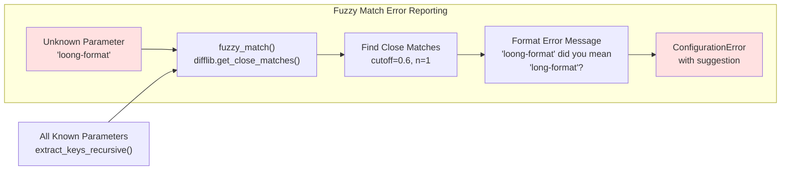

**Sources:** [src/haddock/gear/prepare_run.py:1157-1174](), [tests/test_gear_prepare_run.py:177-192]()

---

## Parameter Inheritance and Hierarchy

HADDOCK3 supports two levels of parameter definition: global (general) parameters and module-specific parameters. Module-specific parameters override global parameters.

### Parameter Sources

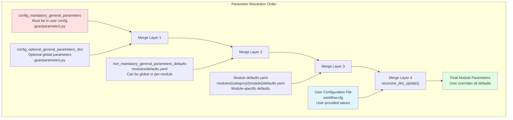

**Sources:** [src/haddock/gear/prepare_run.py:278-287](), [src/haddock/modules/__init__.py:62-70](), [src/haddock/libs/libutil.py:280-305]()

### Mandatory vs. Optional Parameters

**Mandatory General Parameters** [src/haddock/gear/parameters.py]() (referenced by `config_mandatory_general_parameters`):
- `molecules`: List of input PDB files
- `run_dir`: Output directory path

These must be present in the user configuration file and have no defaults.

**Optional General Parameters** [src/haddock/gear/parameters.py]() (defined in `config_optional_general_parameters_dict`):
- Execution settings: `mode`, `ncores`, `max_cpus`
- Workflow options: `clean`, `offline`, `postprocess`
- Debug options: `debug`, `log_level`

**Non-Mandatory General Parameters** [src/haddock/modules/defaults.yaml]():
- Can be defined globally or per-module
- Module-level definitions override global definitions
- Examples: `ambig_fname`, `unambig_fname`, `tolerance`, `randremoval`

**Sources:** [src/haddock/gear/parameters.py:1-85](), [src/haddock/gear/prepare_run.py:94-98]()

### Merge Process with recursive_dict_update()

The `recursive_dict_update()` function performs deep merging of nested dictionaries:

```python
# Simplified example from libutil.py
def recursive_dict_update(d: dict, u: dict) -> dict:
    """
    Update dictionary d with u recursively.
    Returns a new dict; originals are not modified.
    """
    new = deepcopy(d)
    for k, v in u.items():
        if isinstance(v, Mapping):
            new[k] = recursive_dict_update(new.get(k, {}), v)
        else:
            new[k] = deepcopy(v)
    return new
```

This ensures that nested parameter groups (like `mol1`, `weights`, etc.) are properly merged without overwriting entire sections.

**Sources:** [src/haddock/libs/libutil.py:280-305]()

---

## Expandable Parameters

Expandable parameters allow dynamic parameter generation based on the number of molecules in the system. This is essential for parameters that apply differently to each molecule.

### Expandable Parameter Types

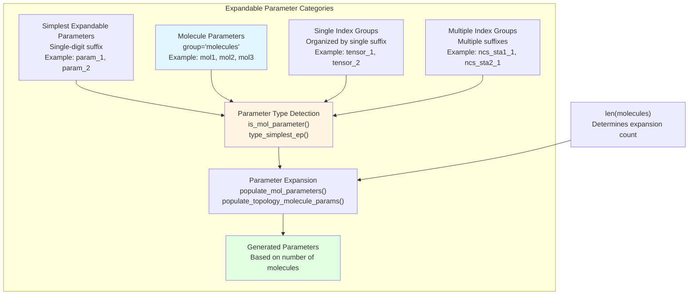

**Sources:** [src/haddock/gear/expandable_parameters.py:1-73](), [src/haddock/gear/prepare_run.py:1193-1262]()

### Molecule-Specific Parameters

In the `topoaa` module, molecule-specific parameters are defined as a dictionary parameter with `group: "molecules"`:

```yaml
# From topoaa/defaults.yaml
mol1:
  explevel: easy
  group: molecules
  title: Molecule 1 parameters
  short: Parameters specific to first molecule
  long: ...
  
  # Sub-parameters for molecule 1
  cyclicpept:
    default: false
    type: boolean
    ...
  
  hisd_1:
    default: .nan
    type: integer
    ...
```

When a workflow has 3 molecules, the system automatically generates `mol1`, `mol2`, and `mol3` parameter groups, each with the same sub-parameters.

**Sources:** [src/haddock/modules/topology/topoaa/defaults.yaml](), [src/haddock/gear/prepare_run.py:1264-1327]()

### Expansion Functions

| Function | Purpose |
|----------|---------|
| `get_expandable_parameters()` | [src/haddock/gear/prepare_run.py:1176-1232]() | Identifies all expandable parameters in a module |
| `populate_topology_molecule_params()` | [src/haddock/gear/prepare_run.py:1264-1327]() | Generates `molX` parameters for topoaa module |
| `populate_mol_parameters()` | [src/haddock/gear/prepare_run.py:1329-1393]() | Generates molecule-specific parameters for other modules |
| `is_mol_parameter()` | [src/haddock/gear/expandable_parameters.py]() | Checks if parameter name is molecule-related |
| `get_mol_parameters()` | [src/haddock/gear/expandable_parameters.py]() | Extracts molecule parameter names |

**Sources:** [src/haddock/gear/prepare_run.py:1176-1393](), [src/haddock/gear/expandable_parameters.py:1-73]()

---

## Parameter Reading and Loading

The system provides functions to read parameter definitions from `defaults.yaml` files at both runtime and documentation build time.

### Loading Pipeline

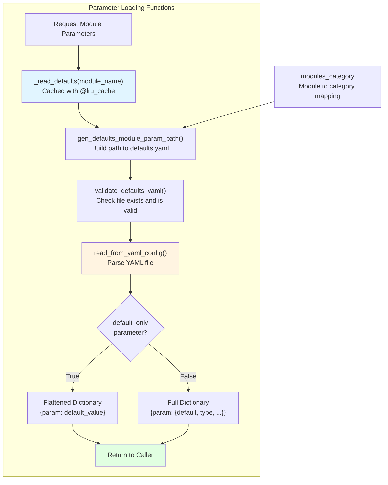

**Sources:** [src/haddock/gear/prepare_run.py:164-211](), [src/haddock/gear/yaml2cfg.py:1-47]()

### Key Reading Functions

**`_read_defaults(module_name: str, default_only: bool = True) -> dict`** [src/haddock/gear/prepare_run.py:164-188]()
- Reads the `defaults.yaml` for a given module
- Cached with `@lru_cache` for performance
- Returns either flat dict (default values only) or full dict (all metadata)

**`gen_defaults_module_param_path(module_name_: str) -> Path`** [src/haddock/gear/prepare_run.py:191-211]()
- Constructs path to module's `defaults.yaml`: `src/haddock/modules/{category}/{module}/defaults.yaml`
- Uses `modules_category` dict to map module names to categories

**`read_from_yaml_config(path: Path, default_only: bool = True) -> dict`** [src/haddock/gear/yaml2cfg.py]()
- Low-level YAML parsing function
- Can return either defaults-only or full parameter specifications

**Sources:** [src/haddock/gear/prepare_run.py:164-211](), [src/haddock/gear/yaml2cfg.py:1-47]()

---

## Parameter Incompatibilities

Some parameters cannot be used together due to logical conflicts. The system defines and validates these incompatibilities.

### Incompatibility Definition

Incompatibilities are defined in `defaults.yaml` files using a special `incompatible_params` section:

```yaml
# Example structure (not from actual code)
incompatible_params:
  limiting_parameter:
    value_that_causes_conflict:
      incompatible_parameter: forbidden_value
```

For example, if `some_parameter: true`, then `other_parameter` cannot have the value `"incompatible_value"`.

**Sources:** [src/haddock/gear/yaml2cfg.py:49-84](), [src/haddock/modules/__init__.py:72]()

### Incompatibility Validation Flow

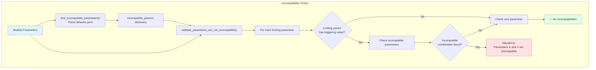

**Sources:** [src/haddock/gear/prepare_run.py:1099-1128](), [src/haddock/gear/yaml2cfg.py:49-84]()

### Implementation

**`find_incompatible_parameters(yaml_path: Path) -> dict`** [src/haddock/gear/yaml2cfg.py:49-84]()
- Parses the `incompatible_params` section from `defaults.yaml`
- Returns a nested dictionary structure defining incompatibilities

**`validate_parameters_are_not_incompatible(params: dict, incompatible_params: dict) -> None`** [src/haddock/gear/prepare_run.py:1099-1128]()
- Checks user parameters against incompatibility rules
- Raises `ValueError` if conflicting parameters are found

**Sources:** [src/haddock/gear/prepare_run.py:1099-1128](), [src/haddock/gear/yaml2cfg.py:49-84](), [tests/test_gear_prepare_run.py:414-449]()

---

## Special Validation Cases

### NCS (Non-Crystallographic Symmetry) Parameters

NCS parameters have complex validation rules that ensure consistency:

- `ncs_sta1_X` must equal `ncs_sta2_X` (same start residue)
- `ncs_end1_X` must equal `ncs_end2_X` (same end residue)
- `ncs_seg1_X` must differ from `ncs_seg2_X` (different chains)
- `nncs` must equal the number of NCS restraint definitions

The `validate_ncs_params()` function enforces these rules.

**Sources:** [src/haddock/gear/prepare_run.py:764-867](), [tests/test_gear_prepare_run.py:451-506]()

### Residue Dictionary (resdic) Parameters

Some analysis modules (`caprieval`, `contactmap`, `alascan`) use `resdic` parameters that map chain IDs to residue lists. These have special validation to ensure chain IDs and residue ranges are valid.

**Sources:** [src/haddock/modules/analysis/__init__.py](), [src/haddock/gear/prepare_run.py:587-588]()

---

## Complete Parameter Flow

```mermaid
graph TB
    subgraph "End-to-End Parameter Flow"
        DevDefaults["Developer:<br/>Write defaults.yaml<br/>for module"] --> Validate1["validate_defaults_yaml()<br/>Schema check"]
        
        Validate1 --> GenDocs["Documentation Build:<br/>build_defaults_rst.py<br/>Generate RST docs"]
        
        GenDocs --> PublicDocs["Published Documentation<br/>By expertise level"]
        
        PublicDocs --> UserConfig["User:<br/>Write workflow.cfg<br/>Override parameters"]
        
        UserConfig --> SetupRun["setup_run()<br/>Main entry point"]
        
        SetupRun --> ParseConfig["Parse TOML Config<br/>gear/config.load()"]
        
        ParseConfig --> LoadDefaults["Load Module Defaults<br/>_read_defaults()"]
        
        LoadDefaults --> MergeParams["Merge Parameters<br/>recursive_dict_update()"]
        
        MergeParams --> ValidateAll["Validate All Parameters<br/>validate_modules_params()"]
        
        ValidateAll --> TypeCheck["Type Validation<br/>validate_param_type()"]
        ValidateAll --> RangeCheck["Range Validation<br/>validate_param_range()"]
        ValidateAll --> IncompatCheck["Incompatibility Check<br/>validate_parameters_are_not_incompatible()"]
        
        TypeCheck --> AllValid{"All Valid?"}
        RangeCheck --> AllValid
        IncompatCheck --> AllValid
        
        AllValid -->|No| ErrorReport["ConfigurationError<br/>with helpful message"]
        AllValid -->|Yes| SaveConfig["Save Enhanced Config<br/>data/configurations/"]
        
        SaveConfig --> CreateModules["Instantiate Modules<br/>BaseHaddockModule.__init__()"]
        
        CreateModules --> UpdateParams["module.update_params()<br/>Apply final parameters"]
        
        UpdateParams --> Execute["Module Execution<br/>module._run()"]
    end
    
    style DevDefaults fill:#e1f5ff
    style UserConfig fill:#fff4e1
    style ValidateAll fill:#ffe1e1
    style Execute fill:#e1ffe1
    style ErrorReport fill:#ffe1e1
```

**Sources:** [src/haddock/gear/prepare_run.py:214-430](), [src/haddock/modules/__init__.py:120-206](), [src/haddock/clis/cli.py:81-214]()

---

## Summary

The HADDOCK3 Parameter System provides:

1. **Schema-based definitions** in `defaults.yaml` files with full type, constraint, and documentation metadata
2. **Hierarchical organization** by expertise level (easy/expert/guru/hidden)
3. **Comprehensive validation** of types, ranges, choices, and logical incompatibilities
4. **Parameter inheritance** from global defaults to module-specific overrides
5. **Expandable parameters** for dynamic generation based on number of molecules
6. **Automatic documentation** generation from parameter schemas
7. **Fuzzy matching** for helpful error messages on typos
8. **Early validation** in `setup_run()` to catch errors before execution

This system ensures that workflows are correctly configured, well-documented, and fail fast with clear error messages when problems occur.

---