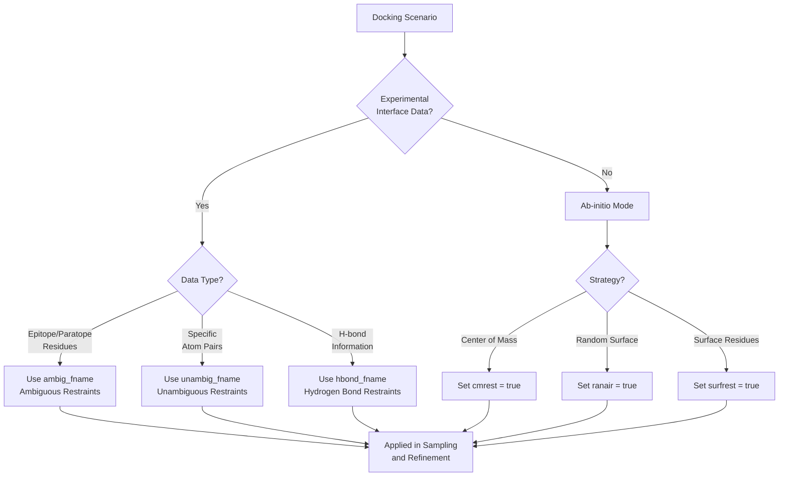
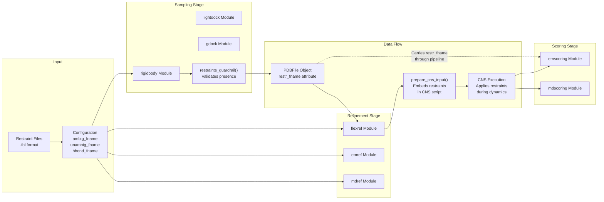
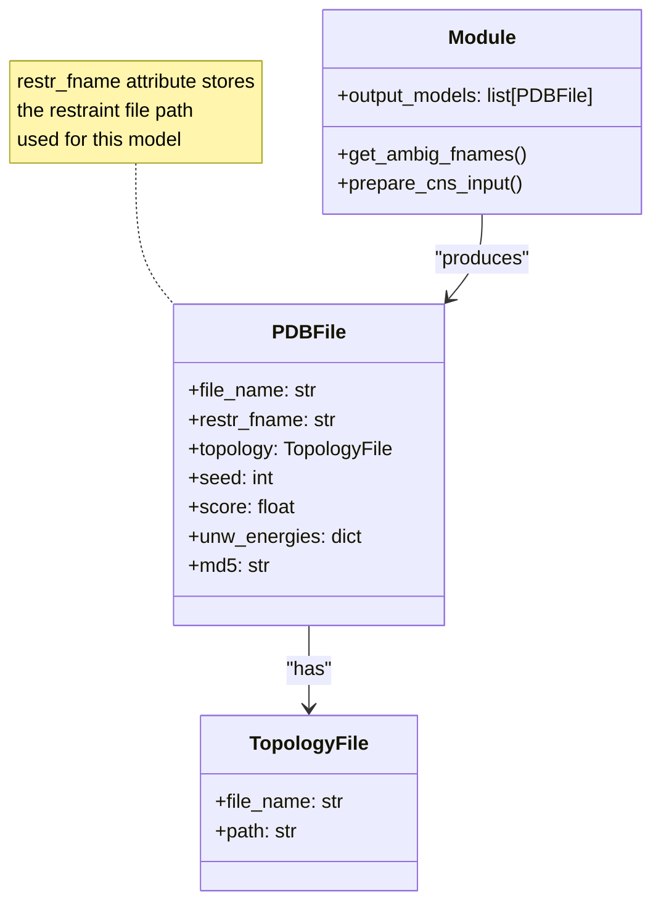
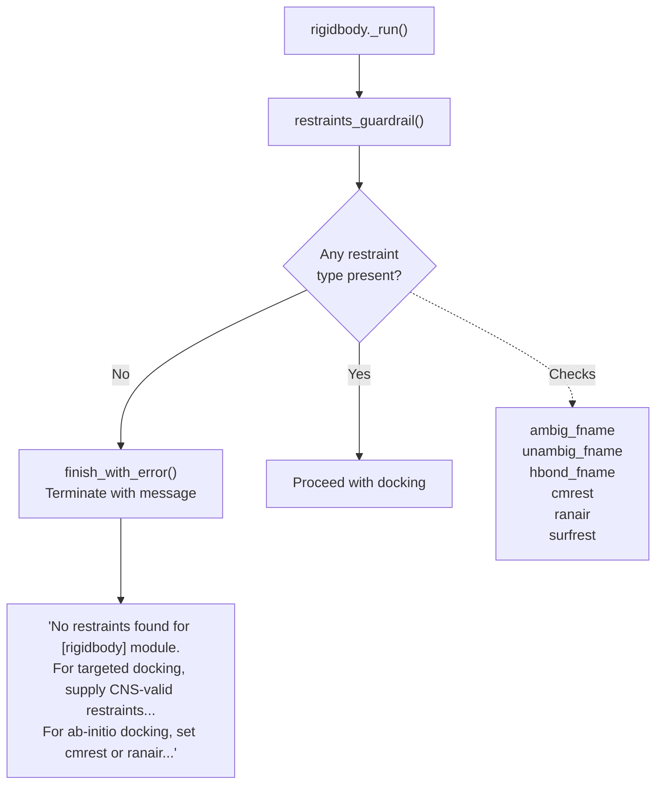
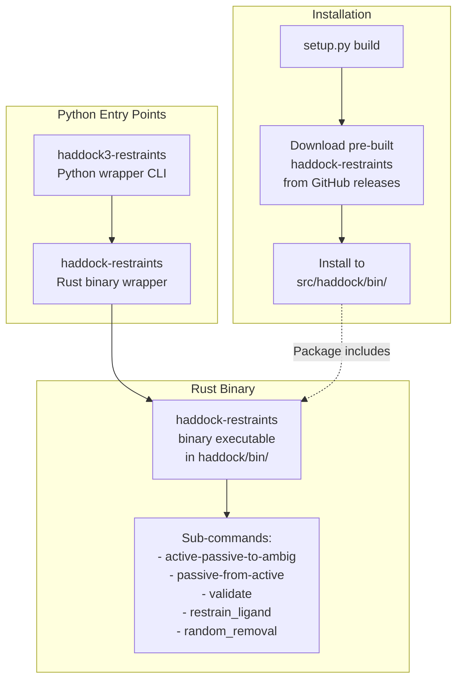
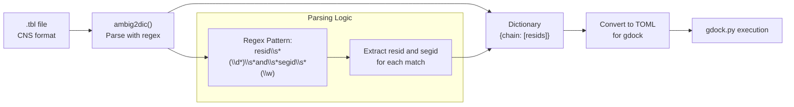
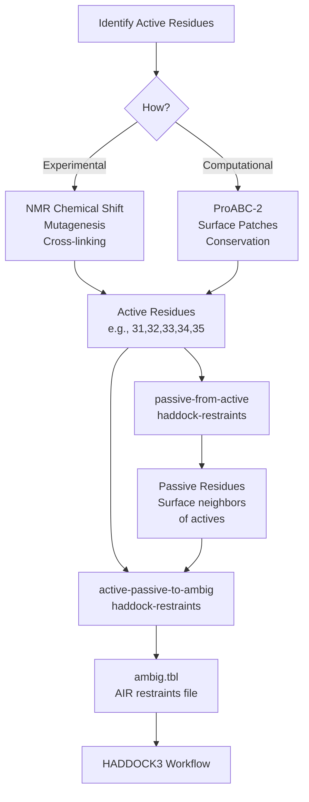
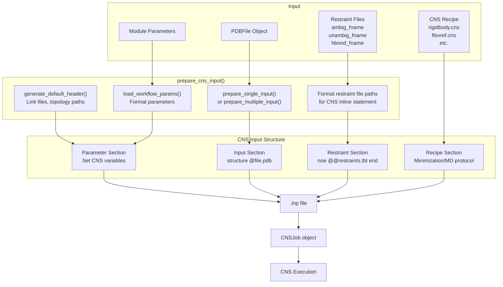

# Restraints

<details>
<summary>Relevant source files</summary>

The following files were used as context for generating this wiki page:

- [CHANGELOG.md](CHANGELOG.md)
- [notebooks/HADDOCK3-antibody-antigen.ipynb](notebooks/HADDOCK3-antibody-antigen.ipynb)
- [notebooks/README.md](notebooks/README.md)
- [pyproject.toml](pyproject.toml)
- [src/haddock/clis/wrapper_haddock_restraints.py](src/haddock/clis/wrapper_haddock_restraints.py)
- [src/haddock/libs/libnotebooks.py](src/haddock/libs/libnotebooks.py)
- [src/haddock/modules/analysis/clustfcc/__init__.py](src/haddock/modules/analysis/clustfcc/__init__.py)
- [src/haddock/modules/analysis/seletop/__init__.py](src/haddock/modules/analysis/seletop/__init__.py)
- [src/haddock/modules/analysis/seletopclusts/__init__.py](src/haddock/modules/analysis/seletopclusts/__init__.py)
- [src/haddock/modules/refinement/emref/__init__.py](src/haddock/modules/refinement/emref/__init__.py)
- [src/haddock/modules/refinement/flexref/__init__.py](src/haddock/modules/refinement/flexref/__init__.py)
- [src/haddock/modules/refinement/mdref/__init__.py](src/haddock/modules/refinement/mdref/__init__.py)
- [src/haddock/modules/sampling/gdock/__init__.py](src/haddock/modules/sampling/gdock/__init__.py)
- [src/haddock/modules/sampling/lightdock/__init__.py](src/haddock/modules/sampling/lightdock/__init__.py)
- [src/haddock/modules/sampling/rigidbody/__init__.py](src/haddock/modules/sampling/rigidbody/__init__.py)
- [src/haddock/modules/scoring/emscoring/__init__.py](src/haddock/modules/scoring/emscoring/__init__.py)
- [src/haddock/modules/scoring/mdscoring/__init__.py](src/haddock/modules/scoring/mdscoring/__init__.py)
- [src/haddock/modules/topology/topoaa/__init__.py](src/haddock/modules/topology/topoaa/__init__.py)

</details>


## Purpose and Scope

This page documents the restraint system in HADDOCK3, including restraint types, file formats, and how restraints are used throughout the docking workflow. Restraints guide the docking process by encoding experimental or predicted interface information as distance constraints applied during sampling and refinement.

For information about configuring restraint parameters in workflows, see [Parameter System](#5.2). For details on how restraints are used in specific modules, see [Sampling Modules](#4.2) and [Refinement Modules](#4.3).

---

## Restraint Types

HADDOCK3 supports multiple types of restraints that encode different kinds of interface information:

| Restraint Type | Parameter Name | Description | Typical Use Case |
|----------------|----------------|-------------|------------------|
| **Ambiguous Interaction Restraints (AIRs)** | `ambig_fname` | Distance restraints between sets of interface residues with OR logic | Experimental epitope/paratope data, predictions |
| **Unambiguous Restraints** | `unambig_fname` | Explicit distance restraints between specific atom pairs | Cross-linking data, specific contacts |
| **Hydrogen Bond Restraints** | `hbond_fname` | Distance and angle restraints enforcing H-bonds | NMR NOE data, predicted H-bonds |
| **Center of Mass Restraints** | `cmrest` (boolean) | Restraints between molecular centers of mass | Ab-initio docking |
| **Random AIRs** | `ranair` (boolean) | Randomly selected surface patches as AIRs | Ab-initio docking |
| **Surface Restraints** | `surfrest` (boolean) | Restraints to solvent-accessible surface residues | Ab-initio docking |

Sources: [src/haddock/modules/sampling/rigidbody/__init__.py:174-194]()

### Restraint Type Decision Flow



Sources: [src/haddock/modules/sampling/rigidbody/__init__.py:172-194]()

---

## CNS Restraint File Format

HADDOCK3 uses the CNS restraint format (`.tbl` files). Distance restraints follow this syntax:

```
assign (selection1) (selection2) distance, lower-bound correction, upper-bound correction
```

Where:
- **selection1/selection2**: CNS atom selection statements
- **distance**: Target distance in Angstroms
- **lower-bound correction**: Subtracted from distance to get lower limit
- **upper-bound correction**: Added to distance to get upper limit

### Selection Syntax

CNS selections combine multiple keywords:

| Keyword | Description | Example |
|---------|-------------|---------|
| `segid` | Chain/segment identifier | `segid A` |
| `resid` | Residue number | `resid 42` |
| `name` | Atom name | `name CA` |
| `resname` | Residue type | `resname ALA` |

Selections can use boolean operators: `and`, `or`, `not`

### Example: Unambiguous Restraint

```
assign (segid A and resid 10 and name CB) 
       (segid B and resid 200 and name CB) 
       20.0 10.0 0.0
```

This restraint:
- Targets CB atoms of residues A:10 and B:200
- Allowed distance range: 10.0Å to 20.0Å (20.0 - 10.0 to 20.0 + 0.0)

### Example: Ambiguous Restraint (AIR)

```
assign (
    (segid A and resid 10) or
    (segid A and resid 11) or
    (segid A and resid 12)
) (
    (segid B and resid 200) or
    (segid B and resid 201)
) 2.0 2.0 0.0
```

This AIR:
- Defines OR logic between multiple residues on each side
- Satisfied if ANY residue pair comes within range
- Distance range: 0.0Å to 4.0Å

Sources: [notebooks/HADDOCK3-antibody-antigen.ipynb:366-390]()

---

## Restraints in the Module Workflow



Sources: [src/haddock/modules/sampling/rigidbody/__init__.py:172-194](), [src/haddock/modules/refinement/flexref/__init__.py:87-104](), [src/haddock/modules/refinement/emref/__init__.py:74-90](), [src/haddock/modules/refinement/mdref/__init__.py:86-103]()

### Parameter Propagation

Restraints are specified at the module level in the configuration file:

```toml
[rigidbody]
ambig_fname = "restraints/ambig.tbl"
unambig_fname = "restraints/unambig.tbl"

[flexref]
ambig_fname = "restraints/ambig.tbl"
```

The `BaseCNSModule` class provides the `get_ambig_fnames()` method to retrieve restraint files from previous modules:

[src/haddock/modules/sampling/rigidbody/__init__.py:222-233]()

This allows restraints to be:
1. Specified explicitly via parameters
2. Inherited from previous module output
3. Mixed (different restraints per model when using multiple files)

Sources: [src/haddock/modules/sampling/rigidbody/__init__.py:222-233](), [src/haddock/modules/refinement/flexref/__init__.py:87-94]()

### PDBFile Restraint Tracking

The `PDBFile` class carries restraint information through the workflow:



When creating expected output models, modules set the `restr_fname` attribute:

[src/haddock/modules/sampling/rigidbody/__init__.py:81]()
[src/haddock/modules/refinement/flexref/__init__.py:126]()

Sources: [src/haddock/modules/sampling/rigidbody/__init__.py:76-87](), [src/haddock/modules/refinement/flexref/__init__.py:124-127]()

---

## Restraint Validation

The `rigidbody` module includes a guardrail to ensure at least one restraint type is specified:



Implementation:

[src/haddock/modules/sampling/rigidbody/__init__.py:172-194]()

This validation prevents users from accidentally running docking without any guidance, which would produce meaningless results.

Sources: [src/haddock/modules/sampling/rigidbody/__init__.py:172-194]()

---

## The haddock3-restraints CLI

HADDOCK3 provides command-line tools for generating and manipulating restraints.

### CLI Structure



The `haddock3-restraints` entry point is defined in:

[pyproject.toml:96]()

The wrapper implementation:

[src/haddock/clis/wrapper_haddock_restraints.py:1-21]()

This wrapper locates the binary in the package and executes it with the provided arguments.

Sources: [pyproject.toml:96-97](), [src/haddock/clis/wrapper_haddock_restraints.py:1-21](), [CHANGELOG.md:9](), [CHANGELOG.md:19]()

### Common Use Cases

The `haddock-restraints` binary provides utilities for restraint generation:

| Sub-command | Purpose | Input | Output |
|-------------|---------|-------|--------|
| `active-passive-to-ambig` | Generate AIR file from active/passive residues | Residue lists, PDB files | `ambig.tbl` |
| `passive-from-active` | Calculate passive residues from actives | Active residues, PDB file | Passive residue list |
| `validate` | Check restraint file syntax | `.tbl` file | Validation report |
| `restrain_ligand` | Generate ligand restraints | Ligand PDB, receptor PDB | `ambig.tbl` |
| `random_removal` | Randomly remove restraints for testing | `.tbl` file, percentage | Modified `.tbl` |

Sources: [CHANGELOG.md:19](), [CHANGELOG.md:22]()

---

## Restraints in Third-Party Modules

### gdock Module

The `gdock` module parses `.tbl` files to extract restraint information:



Implementation:

[src/haddock/modules/sampling/gdock/__init__.py:23-37]()

The parsed restraints are then converted to the format expected by the `gdock` executable:

[src/haddock/modules/sampling/gdock/__init__.py:99-117]()

Sources: [src/haddock/modules/sampling/gdock/__init__.py:23-37](), [src/haddock/modules/sampling/gdock/__init__.py:99-117]()

---

## Active and Passive Residues

AIRs are typically defined using the active-passive paradigm:

- **Active residues**: Directly involved in binding (experimentally determined or predicted)
- **Passive residues**: Surface-exposed neighbors of active residues (automatically calculated)

The restraint generation workflow:



The calculation of passive residues typically uses:
- Distance cutoff (e.g., 6.5Å from active residues)
- Solvent accessibility criteria
- Surface exposure thresholds

Sources: [notebooks/HADDOCK3-antibody-antigen.ipynb:400-420]()

---

## Integration with CNS

When modules execute CNS jobs, restraints are embedded in the CNS input script via `libcns.prepare_cns_input()`:



The restraint file paths are passed to CNS using inline file inclusion:

```
noe
  @@ambig.tbl
end
```

CNS then parses the `.tbl` file during execution and applies the distance restraints to the energy function.

Sources: [src/haddock/modules/sampling/rigidbody/__init__.py:106-120](), [src/haddock/modules/refinement/flexref/__init__.py:108-119]()

---

## Best Practices

### Restraint File Organization

Recommended directory structure:

```
run_directory/
├── pdbs/
│   ├── molecule_A.pdb
│   └── molecule_B.pdb
├── restraints/
│   ├── ambig.tbl
│   ├── unambig.tbl
│   └── hbond.tbl
└── workflow.cfg
```

### Parameter Configuration

For targeted docking with experimental data:

```toml
[rigidbody]
ambig_fname = "restraints/ambig.tbl"
unambig_fname = "restraints/unambig.tbl"
sampling = 1000

[flexref]
ambig_fname = "restraints/ambig.tbl"
```

For ab-initio docking:

```toml
[rigidbody]
cmrest = true
sampling = 10000

[flexref]
ambig_fname = false  # No restraints in refinement
```

### Restraint Validation

Always validate restraint files before running workflows:

```bash
haddock-restraints validate restraints/ambig.tbl
```

Sources: [notebooks/HADDOCK3-antibody-antigen.ipynb:360-394]()

---

## Troubleshooting

### Common Errors

| Error | Cause | Solution |
|-------|-------|----------|
| "No restraints found for [rigidbody] module" | No restraint parameters specified | Set `ambig_fname` or enable `cmrest`/`ranair` |
| CNS parsing error in `.tbl` file | Invalid selection syntax | Check CNS selection keywords and boolean operators |
| "restr_fname not found" | Missing restraint file | Verify file path in configuration |
| Restraint not applied | Atom selection doesn't match structure | Check segid/chain IDs and residue numbering |

### Debugging Restraint Application

To verify restraints are being used:

1. Enable debug mode: `debug = true` in module configuration
2. Check generated `.inp` files for restraint sections
3. Examine CNS output (`.out` files) for "NOE restraints" section
4. Verify violation statistics in output

Sources: [src/haddock/modules/sampling/rigidbody/__init__.py:172-194]()

---