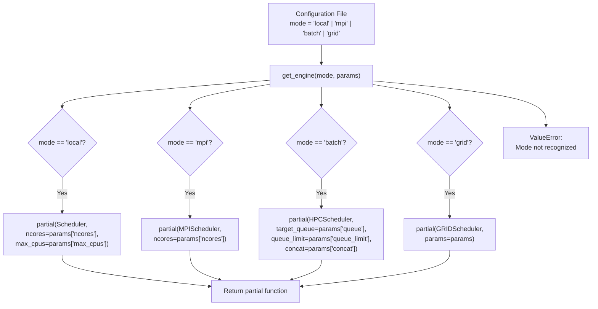
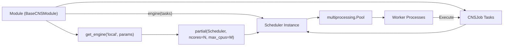
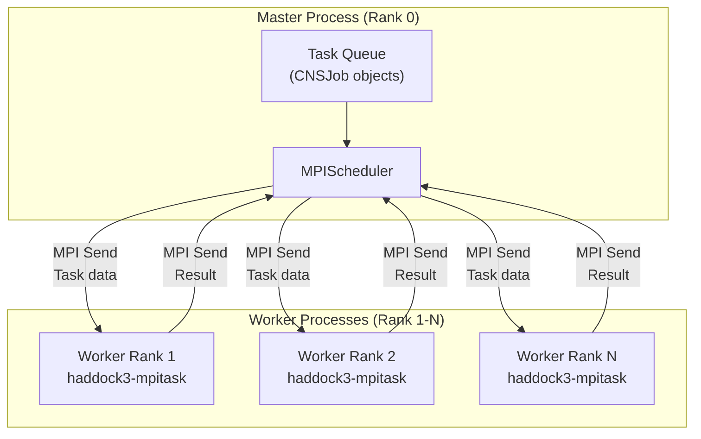
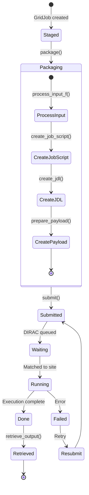
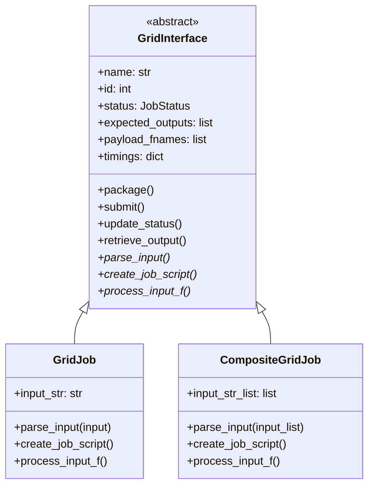
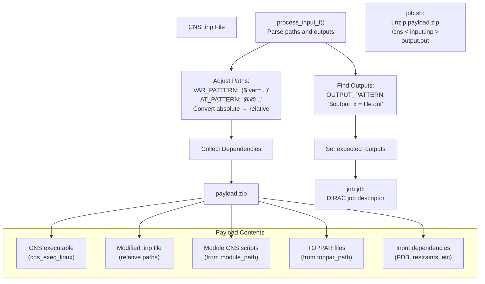
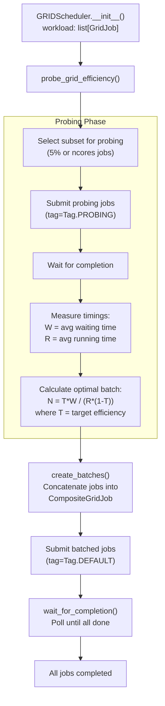
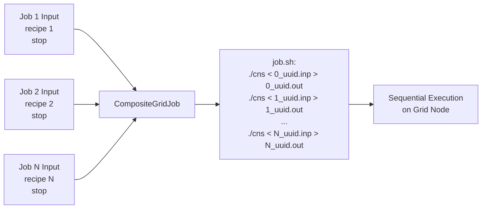
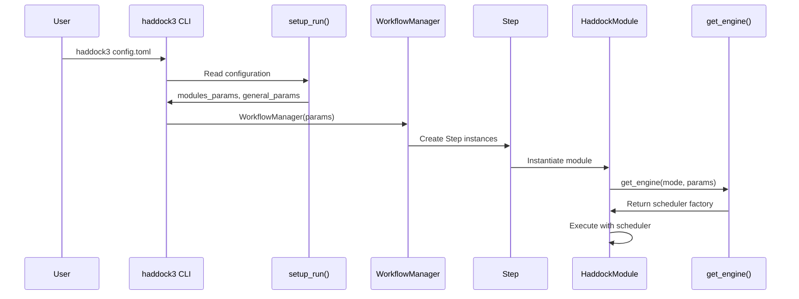

# Execution Modes

<details>
<summary>Relevant source files</summary>

The following files were used as context for generating this wiki page:

- [src/haddock/__init__.py](src/haddock/__init__.py)
- [src/haddock/clis/cli.py](src/haddock/clis/cli.py)
- [src/haddock/core/defaults.py](src/haddock/core/defaults.py)
- [src/haddock/gear/config.py](src/haddock/gear/config.py)
- [src/haddock/gear/prepare_run.py](src/haddock/gear/prepare_run.py)
- [src/haddock/gear/zerofill.py](src/haddock/gear/zerofill.py)
- [src/haddock/libs/libgrid.py](src/haddock/libs/libgrid.py)
- [src/haddock/libs/libutil.py](src/haddock/libs/libutil.py)
- [src/haddock/libs/libworkflow.py](src/haddock/libs/libworkflow.py)
- [src/haddock/modules/__init__.py](src/haddock/modules/__init__.py)
- [src/haddock/modules/analysis/__init__.py](src/haddock/modules/analysis/__init__.py)
- [tests/__init__.py](tests/__init__.py)
- [tests/test_gear_config.py](tests/test_gear_config.py)
- [tests/test_gear_prepare_run.py](tests/test_gear_prepare_run.py)
- [tests/test_gear_zerofill.py](tests/test_gear_zerofill.py)
- [tests/test_libgrid.py](tests/test_libgrid.py)
- [tests/test_libnotebooks.py](tests/test_libnotebooks.py)
- [tests/test_libutil.py](tests/test_libutil.py)

</details>


## Purpose and Scope

This page documents the computational execution strategies available in HADDOCK3 for running docking workflows. HADDOCK3 supports four execution modes that allow adaptation to different computational environments, from laptops to supercomputers to grid infrastructure. This page covers mode selection, configuration, and the internal architecture of each execution engine.

For information about the workflow system that orchestrates module execution, see [Workflow System](#3.1). For details on individual module implementations, see [Module Reference](#4).

---

## Execution Mode Overview

HADDOCK3 provides four execution modes to accommodate different computational resources and scaling requirements:

| Mode | Scheduler Class | Use Case | Parallelism Strategy |
|------|----------------|----------|---------------------|
| `local` | `Scheduler` | Single machine, moderate jobs | Python multiprocessing |
| `mpi` | `MPIScheduler` | HPC clusters, large jobs | MPI with rank distribution |
| `batch` | `HPCScheduler` | HPC queue systems | Job submission to scheduler |
| `grid` | `GRIDScheduler` | Distributed grid computing | DIRAC middleware |

The execution mode is specified in the configuration file as a global parameter that affects all modules. Individual modules retrieve their execution engine through a factory pattern implemented in the `get_engine()` function.

**Sources:** [src/haddock/modules/__init__.py:396-443]()

---

## Mode Selection Architecture

### The get_engine Factory Function

The `get_engine()` function serves as a factory that instantiates the appropriate scheduler based on the `mode` parameter:



The function returns a `functools.partial` object pre-configured with the necessary parameters. Modules call this partial function with their task list to execute jobs.

**Sources:** [src/haddock/modules/__init__.py:399-443]()

---

## Local Execution Mode

### Overview

Local mode (`mode="local"`) uses Python's `multiprocessing` module to execute tasks in parallel on a single machine. This is the default execution mode and requires no additional infrastructure beyond a Python environment.

### Core Components



### Parameter Resolution

The `parse_ncores()` function determines the actual number of cores to use based on three parameters:

1. **`ncores`**: User-requested cores (from configuration)
2. **`max_cpus`**: Maximum cores allowed (can be `True`, `False`, `None`, or an integer)
3. **`njobs`**: Number of jobs to execute (optional constraint)

The function implements the following logic:
- If `max_cpus` is `None` or `False`: defaults to `cpu_count() - 1`
- If `max_cpus` is `True`: uses all available cores (`cpu_count()`)
- Returns `min(ncores, njobs, max_cpus)` to avoid over-allocation

**Sources:** [src/haddock/libs/libutil.py:178-241](), [src/haddock/modules/__init__.py:427-431]()

### CPU Detection

The `cpu_count()` function detects available cores by attempting to use `os.process_cpu_count()` (Python 3.13+) or falling back to `os.sched_getaffinity(0)` to respect CPU affinity masks set by schedulers:

**Sources:** [src/haddock/libs/libutil.py:134-175]()

---

## MPI Execution Mode

### Overview

MPI mode (`mode="mpi"`) distributes tasks across multiple processes using the Message Passing Interface (MPI) protocol via the `mpi4py` library. This mode is designed for HPC clusters where MPI is the standard parallelization method.

### Architecture



### Execution Flow

1. The main HADDOCK3 process runs on MPI rank 0
2. Worker processes (`haddock3-mpitask`) run on ranks 1 through N
3. Master distributes tasks via `MPI.COMM_WORLD.send()`
4. Workers execute tasks and return results via `MPI.COMM_WORLD.send()`
5. Master collects results and proceeds when all tasks complete

### Configuration Requirements

MPI mode requires:
- Installation of the optional `[mpi]` dependency group: `pip install haddock3[mpi]`
- Launching with `mpirun` or `mpiexec`: `mpirun -n 8 haddock3 config.toml`
- Setting `mode = "mpi"` in the configuration file

**Sources:** [src/haddock/modules/__init__.py:432-433]()

---

## Grid Execution Mode

### Overview

Grid mode (`mode="grid"`) enables execution on distributed computing infrastructure through the DIRAC middleware system. This mode packages jobs with all dependencies, submits them to the grid, monitors their status, and retrieves outputs.

### Grid Job Lifecycle



### Grid Job Components

#### GridJob and CompositeGridJob Classes



**Sources:** [src/haddock/libs/libgrid.py:103-556]()

### Job Packaging Process

The packaging process prepares a self-contained job that can execute on any grid node:



The path adjustment uses three regex patterns to identify files referenced in CNS input scripts:
- `VAR_PATTERN`: Matches CNS variable assignments like `( $var = "file.pdb" )`
- `AT_PATTERN`: Matches CNS include directives like `@@file.cns`
- `OUTPUT_PATTERN`: Matches output file declarations like `$output_file = "result.pdb"`

**Sources:** [src/haddock/libs/libgrid.py:40-43](), [src/haddock/libs/libgrid.py:244-269](), [src/haddock/libs/libgrid.py:447-471]()

### DIRAC Integration

#### Job Submission

The `submit()` method executes the DIRAC command:
```
dirac-wms-job-submit <job.jdl>
```

This returns a job ID which is stored in the `GridJob.id` attribute. The JDL (Job Description Language) file specifies:
- `JobName`: UUID for the job
- `Executable`: `job.sh`
- `JobType`: Environment variable `HADDOCK3_GRID_JOB_TYPE` (default: "WeNMR-DEV")
- `InputSandbox`: Files to upload (`job.sh`, `payload.zip`)
- `OutputSandbox`: Files to download (specified in `expected_outputs`)

**Sources:** [src/haddock/libs/libgrid.py:192-212](), [src/haddock/libs/libgrid.py:271-304]()

#### Status Monitoring

The `update_status()` method queries job status via:
```
dirac-wms-job-status <job_id>
```

The output is parsed to extract job state, which is mapped to the `JobStatus` enum:
- `STAGED`: Job created but not submitted
- `WAITING`: Submitted to DIRAC queue
- `MATCHED`: Assigned to a computing element
- `RUNNING`: Currently executing
- `COMPLETING`: Finishing execution
- `DONE`: Successfully completed
- `FAILED`: Execution failed

**Sources:** [src/haddock/libs/libgrid.py:78-96](), [src/haddock/libs/libgrid.py:214-242]()

#### Output Retrieval

The `retrieve_output()` method fetches results via:
```
dirac-wms-job-get-output <job_id>
```

This downloads the output sandbox to `<temp_dir>/<job_id>/`, from which files are copied to the working directory.

**Sources:** [src/haddock/libs/libgrid.py:306-345]()

### GRIDScheduler Optimization

The `GRIDScheduler` class manages multiple grid jobs with intelligent batching to minimize overhead:



#### Batch Size Optimization

The optimal batch size is calculated using the efficiency formula:

**E = (N × R) / (W + N × R)**

Where:
- **E**: Efficiency (proportion of time spent computing vs. waiting)
- **N**: Number of jobs per batch
- **W**: Average waiting time (queue + scheduling)
- **R**: Average running time per job

Solving for **N** to achieve target efficiency **T** (default 90%):

**N = (T × W) / (R × (1 - T))**

This ensures that grid overhead (waiting) does not dominate execution time.

**Sources:** [src/haddock/libs/libgrid.py:558-767]()

### CompositeGridJob Structure

`CompositeGridJob` concatenates multiple CNS input files into a single job to reduce submission overhead:



Each recipe is written to a separate `.inp` file (`0_uuid.inp`, `1_uuid.inp`, etc.), and the job script executes them sequentially. This amortizes submission and queuing overhead across multiple jobs.

**Sources:** [src/haddock/libs/libgrid.py:474-556]()

### DIRAC Validation

The `validate_dirac()` function checks for required DIRAC commands:
- `dirac-proxy-info`
- `dirac-wms-job-submit`
- `dirac-wms-job-status`
- `dirac-wms-job-get-output`

The `ping_dirac()` function verifies DIRAC proxy credentials are valid.

**Sources:** [src/haddock/libs/libgrid.py:46-75]()

---

## Batch/HPC Execution Mode

### Overview

Batch mode (`mode="batch"`) submits jobs to an HPC queue system (e.g., SLURM, PBS, SGE) using the `HPCScheduler` class. This mode is appropriate for clusters that use batch scheduling rather than direct MPI execution.

### Configuration Parameters

| Parameter | Type | Description |
|-----------|------|-------------|
| `queue` | string | Target queue/partition name |
| `queue_limit` | integer | Maximum jobs in queue simultaneously |
| `concat` | integer | Number of tasks to concatenate per job |

The `concat` parameter allows multiple CNS tasks to be bundled into a single queue submission, reducing scheduler load.

**Sources:** [src/haddock/modules/__init__.py:419-424]()

---

## Analysis Module Execution Override

Analysis modules (e.g., `caprieval`, `clustfcc`, `alascan`) override the global execution mode to force local execution regardless of user configuration. This is necessary because:

1. Analysis modules often use external binaries not available on grid/HPC nodes
2. Analysis tasks are typically fast and don't benefit from distributed execution
3. Some analysis modules use shared resources (e.g., distance matrices) that complicate distribution

The `get_analysis_exec_mode()` function implements this logic:

```python
def get_analysis_exec_mode(mode: str) -> str:
    return "local" if mode in ("batch", "grid") else mode
```

Modules that perform analysis call this function before retrieving their execution engine.

**Sources:** [src/haddock/modules/analysis/__init__.py:35-61]()

---

## Configuration Example

Example configuration file showing execution mode parameters:

```toml
# Global execution settings
mode = "local"  # or "mpi", "batch", "grid"
ncores = 8
max_cpus = false  # Use all-but-one cores

# Batch mode specific (only used if mode="batch")
queue = "normal"
queue_limit = 100
concat = 5

# Module definitions
[topoaa]
# topology parameters...

[rigidbody]
# sampling parameters...
# This module will use the execution mode specified above
```

**Sources:** [src/haddock/gear/prepare_run.py:214-430]()

---

## Execution Mode Selection in Workflow

The `WorkflowManager` passes execution parameters to each module during instantiation:



**Sources:** [src/haddock/libs/libworkflow.py:23-191](), [src/haddock/clis/cli.py:81-214]()

---

## Summary of Execution Modes

| Aspect | Local | MPI | Batch | Grid |
|--------|-------|-----|-------|------|
| **Infrastructure** | Single machine | MPI cluster | HPC queue | Distributed grid |
| **Setup Complexity** | Minimal | Medium | Medium | High |
| **Job Overhead** | Low | Low | Medium | High |
| **Scalability** | Limited by cores | High | High | Very high |
| **Fault Tolerance** | None | None | Queue-dependent | Built-in retries |
| **Best For** | Small/medium jobs | Large MPI-enabled clusters | HPC with queues | Distributed resources |

The choice of execution mode should be based on available infrastructure and job requirements. Local mode is suitable for most use cases, while MPI and batch modes are appropriate for HPC environments. Grid mode is specialized for distributed computing infrastructure with DIRAC middleware.

**Sources:** [src/haddock/modules/__init__.py:396-443]()

---