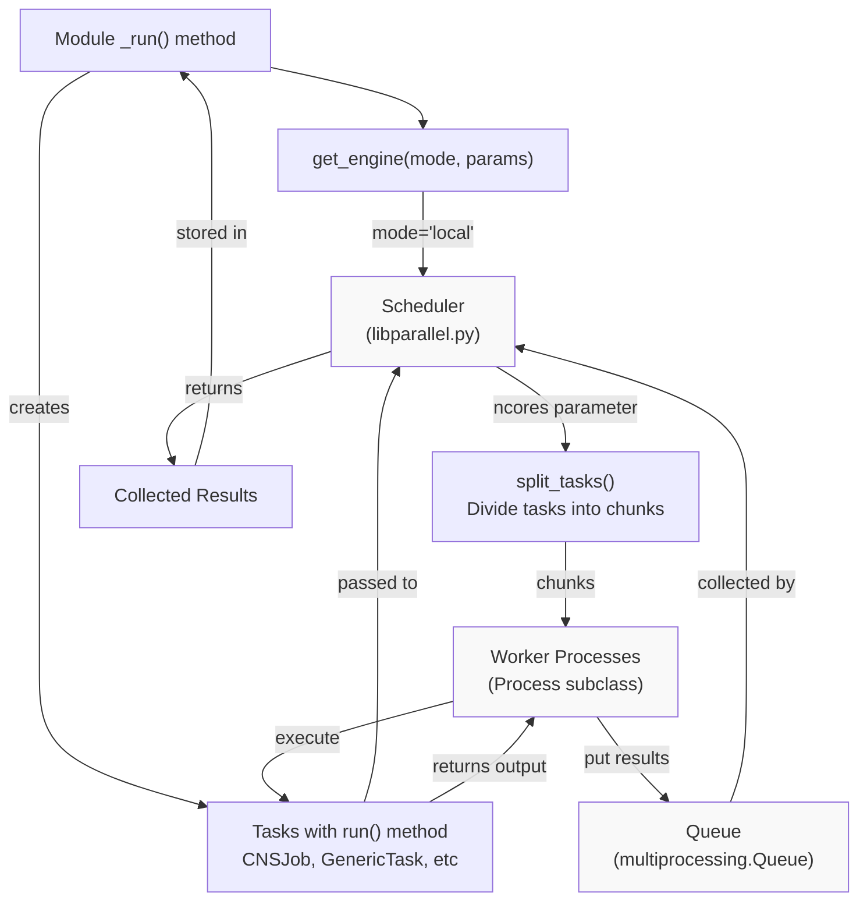
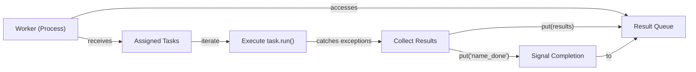
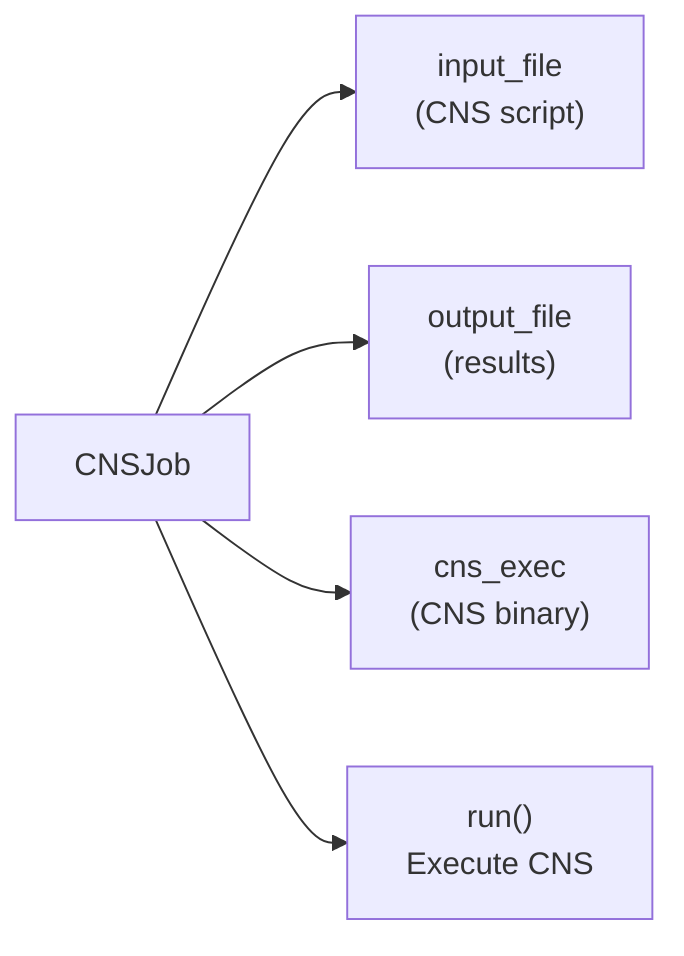
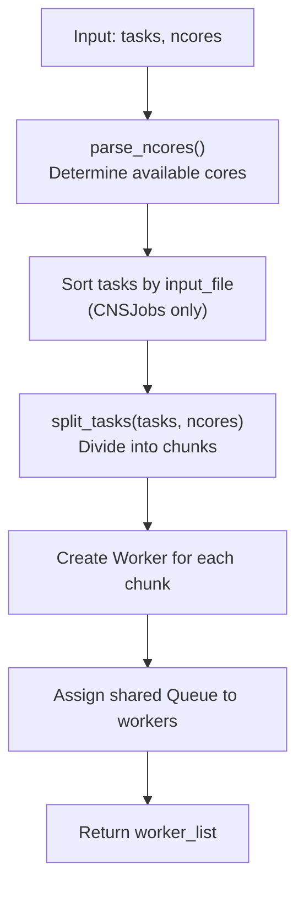
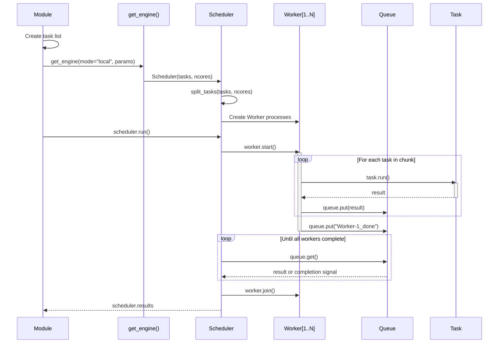
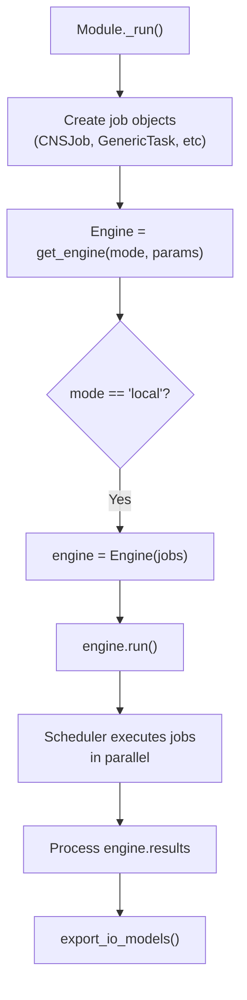
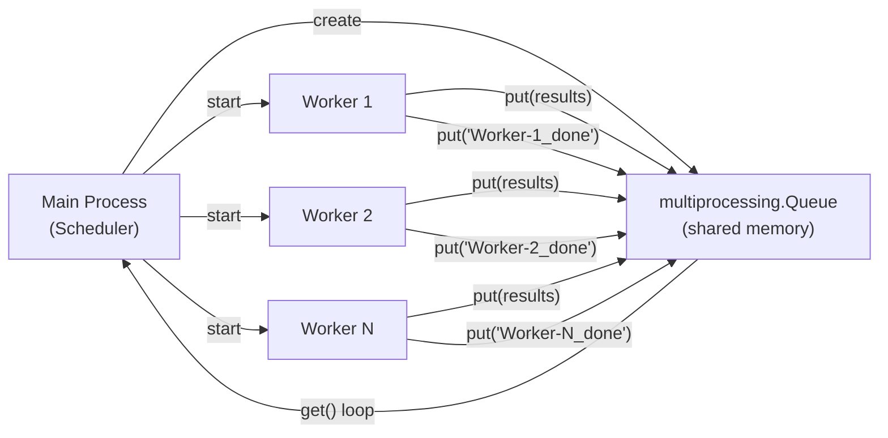
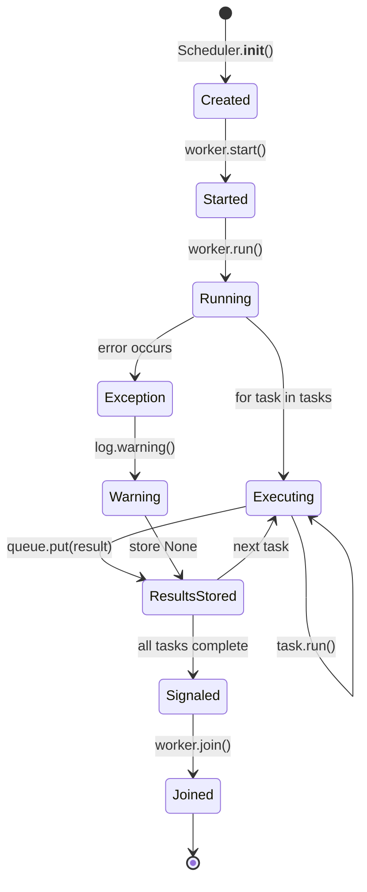

# Local Execution

<details>
<summary>Relevant source files</summary>

The following files were used as context for generating this wiki page:

- [src/haddock/libs/libparallel.py](src/haddock/libs/libparallel.py)
- [src/haddock/modules/analysis/alascan/__init__.py](src/haddock/modules/analysis/alascan/__init__.py)
- [src/haddock/modules/analysis/alascan/defaults.yaml](src/haddock/modules/analysis/alascan/defaults.yaml)
- [src/haddock/modules/analysis/alascan/scan.py](src/haddock/modules/analysis/alascan/scan.py)
- [src/haddock/modules/analysis/clustfcc/__init__.py](src/haddock/modules/analysis/clustfcc/__init__.py)
- [src/haddock/modules/analysis/seletop/__init__.py](src/haddock/modules/analysis/seletop/__init__.py)
- [src/haddock/modules/analysis/seletopclusts/__init__.py](src/haddock/modules/analysis/seletopclusts/__init__.py)
- [src/haddock/modules/refinement/emref/__init__.py](src/haddock/modules/refinement/emref/__init__.py)
- [src/haddock/modules/refinement/flexref/__init__.py](src/haddock/modules/refinement/flexref/__init__.py)
- [src/haddock/modules/refinement/mdref/__init__.py](src/haddock/modules/refinement/mdref/__init__.py)
- [src/haddock/modules/sampling/gdock/__init__.py](src/haddock/modules/sampling/gdock/__init__.py)
- [src/haddock/modules/sampling/lightdock/__init__.py](src/haddock/modules/sampling/lightdock/__init__.py)
- [src/haddock/modules/sampling/rigidbody/__init__.py](src/haddock/modules/sampling/rigidbody/__init__.py)
- [src/haddock/modules/scoring/emscoring/__init__.py](src/haddock/modules/scoring/emscoring/__init__.py)
- [src/haddock/modules/scoring/mdscoring/__init__.py](src/haddock/modules/scoring/mdscoring/__init__.py)
- [src/haddock/modules/topology/topoaa/__init__.py](src/haddock/modules/topology/topoaa/__init__.py)
- [tests/test_libparallel.py](tests/test_libparallel.py)
- [tests/test_libsubprocess.py](tests/test_libsubprocess.py)
- [tests/test_module_alascan.py](tests/test_module_alascan.py)

</details>


Local execution mode enables HADDOCK3 modules to run computationally intensive tasks in parallel using multiprocessing on a single machine. This mode leverages Python's `multiprocessing` library to distribute jobs across multiple CPU cores, providing efficient parallelization without requiring external infrastructure like MPI or grid computing systems.

For distributed execution across multiple machines, see [MPI Execution](#6.2). For grid-based execution using DIRAC, see [Grid Execution](#6.3).

---

## Overview

Local execution mode is the default execution strategy in HADDOCK3. When a module specifies `mode = "local"` in its configuration, the `Scheduler` class from [src/haddock/libs/libparallel.py:105-209]() orchestrates parallel task execution using worker processes. This mode is appropriate for workstations, compute nodes, or any environment where multiple CPU cores are available on a single system.

The local execution system supports any task that implements a `run()` method, making it flexible enough to handle diverse workloads including CNS jobs, generic Python functions, and module-specific operations.

**Sources:** [src/haddock/libs/libparallel.py:1-209](), [src/haddock/modules/topology/topoaa/__init__.py:297-302](), [src/haddock/modules/sampling/rigidbody/__init__.py:252-256]()

---

## Architecture



**Sources:** [src/haddock/libs/libparallel.py:105-209](), [src/haddock/modules/__init__.py]()

---

## Core Components

### Scheduler Class

The `Scheduler` class is the central orchestrator for local parallel execution. It manages task distribution, worker process lifecycle, and result collection.

| Component | Type | Description |
|-----------|------|-------------|
| **tasks** | `list[SupportsRunT]` | List of task objects to execute |
| **ncores** | `Optional[int]` | Number of CPU cores to use (auto-detected if None) |
| **max_cpus** | `bool` | Whether to use all available CPUs |
| **queue** | `Queue` | Inter-process communication queue for results |
| **worker_list** | `list[Worker]` | List of worker processes |
| **results** | `list` | Collected results from all tasks |

**Key Methods:**

- `__init__(tasks, ncores, max_cpus)` - Initializes scheduler with task splitting [src/haddock/libs/libparallel.py:108-152]()
- `run()` - Starts workers, collects results, handles completion [src/haddock/libs/libparallel.py:168-202]()
- `terminate()` - Controlled shutdown of worker processes [src/haddock/libs/libparallel.py:203-208]()

**Sources:** [src/haddock/libs/libparallel.py:105-209]()

---

### Worker Class

The `Worker` class extends `multiprocessing.Process` and executes a subset of tasks assigned by the scheduler.



**Execution Flow:**
1. Worker receives task list in constructor [src/haddock/libs/libparallel.py:78-82]()
2. `run()` method iterates through tasks [src/haddock/libs/libparallel.py:84-103]()
3. Each task's `run()` method is called with exception handling
4. Results are collected and placed in queue
5. Completion signal sent to parent process

**Sources:** [src/haddock/libs/libparallel.py:75-103]()

---

### Task Types

The local execution system supports multiple task types, all implementing a `run()` method:

#### CNSJob

Executes CNS (Crystallography & NMR System) calculations. Used extensively in topology, sampling, refinement, and scoring modules.



**Sources:** [src/haddock/libs/libsubprocess.py](), [src/haddock/modules/topology/topoaa/__init__.py:287-295](), [src/haddock/modules/sampling/rigidbody/__init__.py:86-88]()

#### GenericTask

Wraps any Python callable (function, method, lambda) for execution in the parallel framework.

```python
# Structure from libparallel.py:61-73
class GenericTask:
    def __init__(self, function, *args, **kwargs):
        self.function = function
        self.args = args
        self.kwargs = kwargs
    
    def run(self):
        return self.function(*self.args, **self.kwargs)
```

**Usage Examples:**
- Preparing CNS input files in parallel [src/haddock/modules/sampling/rigidbody/__init__.py:143-156]()
- Writing scan results [src/haddock/modules/analysis/alascan/__init__.py:156-161]()
- Updating models with B-factors [src/haddock/modules/analysis/alascan/__init__.py:173-178]()

**Sources:** [src/haddock/libs/libparallel.py:61-73](), [tests/test_libparallel.py:171-221]()

#### Module-Specific Tasks

Some modules define custom task objects with `run()` methods:

- `InterfaceScanner` - Identifies interface residues and creates mutation jobs [src/haddock/modules/analysis/alascan/scan.py:637-793]()
- `ModelPointMutation` - Performs single point mutations [src/haddock/modules/analysis/alascan/scan.py:796-889]()
- `AddDeltaBFactor` - Adds delta scores to PDB B-factors [src/haddock/modules/analysis/alascan/scan.py:370-487]()
- `ClusterOutputer` - Generates cluster-based analysis outputs [src/haddock/modules/analysis/alascan/scan.py:234-368]()

**Sources:** [src/haddock/modules/analysis/alascan/scan.py:637-889](), [src/haddock/modules/analysis/alascan/__init__.py:116-130]()

---

## Task Distribution Algorithm

The scheduler implements an intelligent task distribution algorithm to balance workload across CPU cores:



### Task Splitting Logic

The `split_tasks()` function divides tasks into roughly equal chunks:

| Total Tasks | NCores | Chunk Sizes | Distribution |
|-------------|--------|-------------|--------------|
| 10 | 3 | [4, 4, 2] | Balanced |
| 10 | 4 | [3, 3, 3, 1] | Nearly balanced |
| 100 | 8 | [13, 13, 12, 12, 12, 12, 12, 12] | Optimal |

**Algorithm:**
```
chunk_size = ceil(num_tasks / ncores)
for j in range(0, num_tasks, chunk_size):
    yield tasks[j : j + chunk_size]
```

**Sources:** [src/haddock/libs/libparallel.py:19-24](), [tests/test_libparallel.py:109-120]()

### CPU Core Detection

The scheduler automatically determines the number of cores to use via `parse_ncores()`:

1. If `ncores` is specified, use that value (with validation)
2. If `ncores` is `None`:
   - If `max_cpus=True`, use all available cores
   - Otherwise, use `min(njobs, available_cores)`
3. Ensure ncores doesn't exceed available system cores
4. Ensure ncores doesn't exceed number of jobs

**Sources:** [src/haddock/libs/libutil.py](), [src/haddock/libs/libparallel.py:154-166]()

---

## Execution Flow

### Detailed Execution Sequence



### Exception Handling

Workers implement robust exception handling to prevent single task failures from breaking the entire workflow:

```python
# Pattern from libparallel.py:84-94
for task in self.tasks:
    r = None
    try:
        r = task.run()
    except Exception as e:
        log.warning(f"Exception in task execution: {e}")
    
    results.append(r)  # None if exception occurred
```

Failed tasks return `None` in the results list, allowing the workflow to continue. Modules check for missing outputs using methods like `is_present()` on PDBFile objects.

**Sources:** [src/haddock/libs/libparallel.py:84-94](), [tests/test_libparallel.py:162-169]()

---

## Integration with HADDOCK3 Modules

### Module Execution Pattern

All HADDOCK3 modules follow a consistent pattern for local execution:



**Sources:** [src/haddock/modules/topology/topoaa/__init__.py:174-356](), [src/haddock/modules/sampling/rigidbody/__init__.py:196-271](), [src/haddock/modules/refinement/emref/__init__.py:43-142]()

---

### Example: Topology Module (topoaa)

The topoaa module demonstrates typical local execution usage:

1. **Job Creation** - Create CNSJob objects for topology generation [src/haddock/modules/topology/topoaa/__init__.py:206-295]()

```
jobs: list[CNSJob] = []
for model in splited_models:
    topoaa_input = generate_topology(...)
    job = CNSJob(topoaa_input, output_filename, err_fname, ...)
    jobs.append(job)
```

2. **Engine Selection** - Get local execution engine [src/haddock/modules/topology/topoaa/__init__.py:299]()

```
Engine = get_engine(self.params["mode"], self.params)
```

3. **Execution** - Run jobs in parallel [src/haddock/modules/topology/topoaa/__init__.py:300-302]()

```
engine = Engine(jobs)
engine.run()
```

4. **Result Processing** - Check generated files and update models [src/haddock/modules/topology/topoaa/__init__.py:306-356]()

**Sources:** [src/haddock/modules/topology/topoaa/__init__.py:174-356]()

---

### Example: Rigidbody Sampling Module

The rigidbody module shows parallel input preparation followed by CNS execution:

**Parallel Input Preparation (local mode only):**

```python
# From rigidbody/__init__.py:125-163
prepare_tasks = []
for combination in models_to_dock:
    for _ in range(sampling_factor):
        task = GenericTask(
            function=prepare_cns_input,
            model_number=idx,
            input_element=combination,
            step_path=self.path,
            recipe_str=self.recipe_str,
            defaults=self.params,
            identifier="rigidbody",
            ambig_fname=ambig_fname,
            ...
        )
        prepare_tasks.append(task)

Engine = get_engine(self.params["mode"], self.params)
prepare_engine = Engine(prepare_tasks)
prepare_engine.run()
```

**CNS Execution:**

After input preparation, CNSJob objects are created and executed in parallel [src/haddock/modules/sampling/rigidbody/__init__.py:249-256]().

**Sources:** [src/haddock/modules/sampling/rigidbody/__init__.py:125-271]()

---

### Example: Alanine Scanning Module

The alascan module demonstrates multi-stage parallel execution:

**Stage 1: Interface Scanning**

```python
# From alascan/__init__.py:116-130
scan_objects = [
    InterfaceScanner(
        mutation_res=self.params["scan_residue"],
        model=model,
        params=self.params,
        library_mode=False
    )
    for model in models
]

Engine = get_engine(exec_mode, self.params)
engine = Engine(scan_objects)
engine.run()
```

**Stage 2: Mutation Execution**

```python
# From alascan/__init__.py:134-145
mutation_objects = []
for mutations_to_perform in engine.results:
    if mutations_to_perform:
        mutation_objects.extend(mutations_to_perform)

engine = Engine(mutation_objects)
engine.run()
```

**Stage 3: Result Writing**

```python
# From alascan/__init__.py:156-161
scan_writer_jobs = [
    GenericTask(write_scan_out, results, model_id)
    for model_id, results in results_by_model.items()
]
engine = Engine(scan_writer_jobs)
engine.run()
```

**Sources:** [src/haddock/modules/analysis/alascan/__init__.py:100-204]()

---

## Configuration and Parameters

### Module Configuration

Modules specify execution mode via the `mode` parameter in their configuration:

| Parameter | Type | Default | Description |
|-----------|------|---------|-------------|
| `mode` | `str` | `"local"` | Execution mode: `"local"`, `"mpi"`, `"batch"` |
| `ncores` | `int` or `None` | `None` | Number of CPU cores (auto-detect if None) |
| `max_cpus` | `bool` | `False` | Use all available CPUs |

**Configuration Example:**

```toml
[rigidbody]
mode = "local"
ncores = 8
sampling = 1000
```

**Sources:** [src/haddock/modules/topology/topoaa/__init__.py:299](), [src/haddock/modules/sampling/rigidbody/__init__.py:253]()

---

### Runtime Behavior

**Automatic Core Detection:**

When `ncores` is not specified:
- Scheduler queries available system cores
- Balances between job count and available resources
- Logs selected core count: `"Using {num_processes} cores"`

**Task Sorting:**

For CNSJob tasks, the scheduler sorts by input filename to ensure deterministic execution order [src/haddock/libs/libparallel.py:133-146]():

```python
if all(hasattr(t, "input_file") for t in tasks):
    task_name_dic = {i: (t.input_file, len(str(t.input_file))) 
                     for i, t in enumerate(tasks)}
    sorted_task_list = [tasks[e[0]] 
                       for e in sorted(task_name_dic.items(), 
                                     key=lambda x: (x[0], x[1]))]
```

**Sources:** [src/haddock/libs/libparallel.py:105-209]()

---

## Performance Considerations

### Advantages of Local Execution

| Aspect | Benefit |
|--------|---------|
| **Overhead** | Minimal - no network communication or job submission delays |
| **Setup** | Zero configuration - works out of the box |
| **Debugging** | Simple - all processes on same machine with shared filesystem |
| **Resource Efficiency** | Automatic load balancing across cores |

### Limitations

| Constraint | Impact |
|------------|--------|
| **Single Machine** | Cannot scale beyond one node's CPU cores |
| **Memory** | All processes share same physical memory |
| **I/O Contention** | Heavy disk I/O can bottleneck on shared filesystem |
| **Fault Tolerance** | No automatic job restart on failure |

### Optimal Use Cases

Local execution is ideal for:
- Development and testing workflows
- Workstation-based production runs (8-64 cores)
- Modules with moderate computational requirements (emref, emscoring)
- Workflows processing tens to hundreds of models

For large-scale production (>1000 models, >100 cores), consider [MPI Execution](#6.2) or [Grid Execution](#6.3).

**Sources:** [src/haddock/libs/libparallel.py:1-209]()

---

## Task Lifecycle and Communication

### Inter-Process Communication



**Communication Protocol:**

1. Scheduler creates shared `multiprocessing.Queue` [src/haddock/libs/libparallel.py:130]()
2. Workers receive queue reference in constructor [src/haddock/libs/libparallel.py:78-82]()
3. Workers put results into queue after each task [src/haddock/libs/libparallel.py:97]()
4. Workers signal completion with `"{name}_done"` message [src/haddock/libs/libparallel.py:100]()
5. Scheduler collects results until all completion signals received [src/haddock/libs/libparallel.py:175-190]()

**Sources:** [src/haddock/libs/libparallel.py:75-209]()

---

### Process Lifecycle



**Graceful Shutdown:**

The scheduler implements controlled termination on keyboard interrupt [src/haddock/libs/libparallel.py:194-201]():

```python
try:
    # ... worker execution ...
except KeyboardInterrupt as err:
    self.terminate()
    raise err

def terminate(self):
    for worker in self.worker_list:
        worker.terminate()
    log.info("The workers terminated in a controlled way")
```

**Sources:** [src/haddock/libs/libparallel.py:168-208](), [tests/test_libparallel.py:56-107]()

---

## Comparison with Other Execution Modes

| Feature | Local | MPI ([#6.2](#6.2)) | Grid ([#6.3](#6.3)) |
|---------|-------|-----|------|
| **Infrastructure** | Single machine | Multiple nodes | Grid middleware |
| **Communication** | multiprocessing.Queue | MPI4Py | File-based |
| **Scalability** | Single node cores | Hundreds of cores | Thousands of cores |
| **Setup Complexity** | None | MPI installation | DIRAC configuration |
| **Fault Tolerance** | Manual retry | Checkpoint/restart | Automatic job retry |
| **Job Overhead** | Microseconds | Milliseconds | Seconds to minutes |
| **Best For** | Development, small runs | Medium production | Large production |

**Sources:** [src/haddock/libs/libparallel.py:1-209]()

---

## Testing and Validation

The local execution system includes comprehensive unit tests:

### Test Coverage

| Test Category | Test Cases | File |
|--------------|------------|------|
| **Task Splitting** | `test_split_tasks()` | [tests/test_libparallel.py:109-120]() |
| **Index Distribution** | `test_get_index_list()` | [tests/test_libparallel.py:122-133]() |
| **Worker Execution** | `test_worker_run()` | [tests/test_libparallel.py:135-142]() |
| **Scheduler Basic** | `test_scheduler()` | [tests/test_libparallel.py:153-160]() |
| **File Creation** | `test_scheduler_files()` | [tests/test_libparallel.py:144-151]() |
| **Exception Handling** | `test_scheduler_with_exception()` | [tests/test_libparallel.py:162-169]() |
| **GenericTask Creation** | `test_generic_task_init()` | [tests/test_libparallel.py:171-205]() |
| **GenericTask Execution** | `test_generic_task_run()` | [tests/test_libparallel.py:226-264]() |
| **Error Propagation** | `test_generic_task_run_exceptions()` | [tests/test_libparallel.py:266-287]() |

**Sources:** [tests/test_libparallel.py:1-312]()

---

## Summary

Local execution mode provides efficient multiprocessing for HADDOCK3 workflows through the `Scheduler` class. Key characteristics:

- **Zero-configuration parallelism** using Python's multiprocessing
- **Flexible task support** via `run()` method protocol
- **Intelligent load balancing** across CPU cores
- **Robust error handling** preventing cascade failures
- **Seamless module integration** through `get_engine()` interface

The system automatically detects available resources, distributes tasks optimally, and collects results efficiently, making it the preferred choice for development, testing, and small-to-medium production workflows.

**Sources:** [src/haddock/libs/libparallel.py:1-209](), [src/haddock/modules/topology/topoaa/__init__.py:174-356](), [src/haddock/modules/sampling/rigidbody/__init__.py:196-271](), [src/haddock/modules/analysis/alascan/__init__.py:100-204]()

---