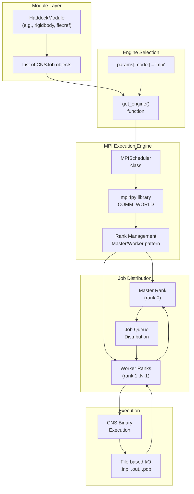
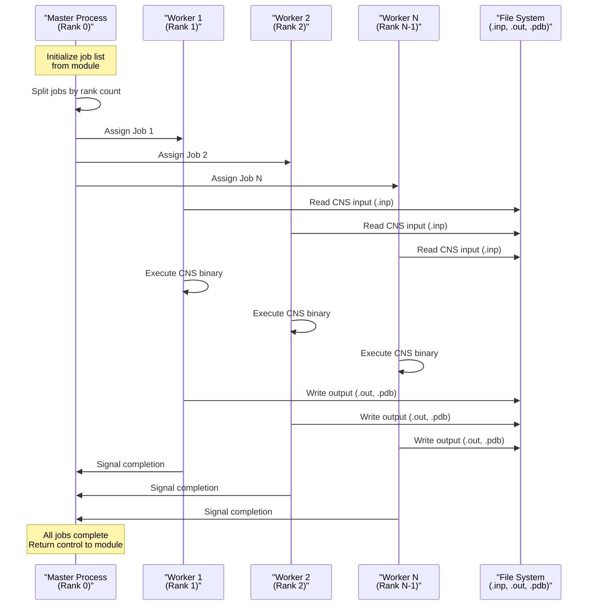
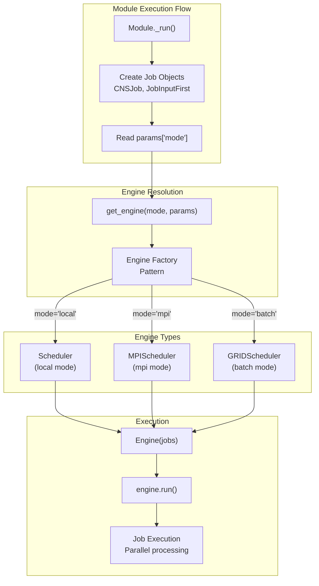
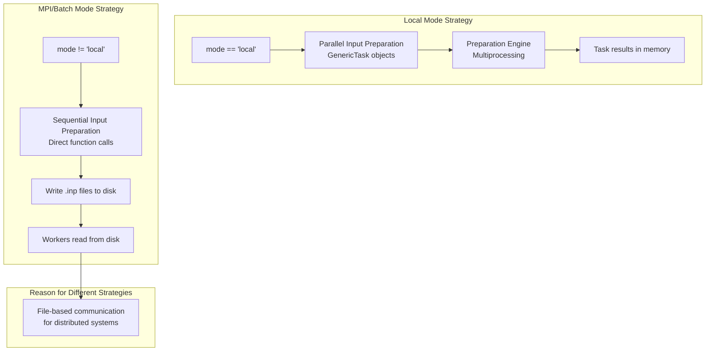

# MPI Execution

<details>
<summary>Relevant source files</summary>

The following files were used as context for generating this wiki page:

- [DEVELOPMENT.md](DEVELOPMENT.md)
- [README.md](README.md)
- [docs/INSTALL.md](docs/INSTALL.md)
- [src/haddock/modules/analysis/clustfcc/__init__.py](src/haddock/modules/analysis/clustfcc/__init__.py)
- [src/haddock/modules/analysis/seletop/__init__.py](src/haddock/modules/analysis/seletop/__init__.py)
- [src/haddock/modules/analysis/seletopclusts/__init__.py](src/haddock/modules/analysis/seletopclusts/__init__.py)
- [src/haddock/modules/refinement/emref/__init__.py](src/haddock/modules/refinement/emref/__init__.py)
- [src/haddock/modules/refinement/flexref/__init__.py](src/haddock/modules/refinement/flexref/__init__.py)
- [src/haddock/modules/refinement/mdref/__init__.py](src/haddock/modules/refinement/mdref/__init__.py)
- [src/haddock/modules/sampling/gdock/__init__.py](src/haddock/modules/sampling/gdock/__init__.py)
- [src/haddock/modules/sampling/lightdock/__init__.py](src/haddock/modules/sampling/lightdock/__init__.py)
- [src/haddock/modules/sampling/rigidbody/__init__.py](src/haddock/modules/sampling/rigidbody/__init__.py)
- [src/haddock/modules/scoring/emscoring/__init__.py](src/haddock/modules/scoring/emscoring/__init__.py)
- [src/haddock/modules/scoring/mdscoring/__init__.py](src/haddock/modules/scoring/mdscoring/__init__.py)
- [src/haddock/modules/topology/topoaa/__init__.py](src/haddock/modules/topology/topoaa/__init__.py)

</details>


This page documents the MPI (Message Passing Interface) execution mode in HADDOCK3, which enables parallel execution of computational jobs across multiple processes and potentially multiple compute nodes. MPI mode is particularly useful for HPC cluster environments where distributed computing resources are available.

For information about single-node multiprocessing, see [Local Execution](#6.1). For distributed computing using job schedulers, see [Grid Execution](#6.3).

## Purpose and Scope

The MPI execution mode leverages the MPI4Py library to distribute computational jobs across multiple MPI ranks (processes), enabling HADDOCK3 to efficiently utilize distributed computing resources on HPC clusters. This mode is designed for scenarios where:

- Large numbers of CNS jobs need to be executed in parallel
- Multiple compute nodes are available
- Job execution time is the bottleneck in the workflow
- Access to an HPC cluster with MPI support is available

## Architecture Overview



**MPI Execution Architecture**: The module creates a list of jobs, selects the MPI engine via `get_engine()`, and the MPIScheduler distributes jobs across MPI ranks using a master-worker pattern.

Sources: [src/haddock/modules/sampling/rigidbody/__init__.py:252-256](), [src/haddock/modules/topology/topoaa/__init__.py:298-302](), [src/haddock/modules/refinement/flexref/__init__.py:140-144]()

## Installation Requirements

### System Dependencies

MPI execution requires OpenMPI or another MPI implementation to be installed on your system before installing HADDOCK3.

**Ubuntu/Debian**:
```bash
sudo apt-get install openmpi-bin libopenmpi3 libopenmpi-dev
```

**macOS** (using Homebrew):
```bash
brew install open-mpi
```

Sources: [DEVELOPMENT.md:32]()

### Python Package Installation

After installing OpenMPI, install HADDOCK3 with MPI support:

```bash
pip install 'haddock3[mpi]'
```

This installs the `mpi4py` Python package along with HADDOCK3. The `mpi4py` library provides Python bindings to MPI, enabling inter-process communication.

For development installations:

```bash
pip install -e '.[dev,docs,mpi]'
```

Sources: [README.md:32-37](), [docs/INSTALL.md:26-32](), [DEVELOPMENT.md:83-87]()

### Verification

After installation, verify that MPI is properly configured by checking that `mpirun` or `mpiexec` is available:

```bash
which mpirun
mpirun --version
```

## Configuration

### Setting MPI Mode

To use MPI execution, configure the `mode` parameter in your workflow configuration file (TOML) for each module that should use MPI:

```toml
[topoaa]
mode = "mpi"

[rigidbody]
mode = "mpi"
sampling = 1000

[flexref]
mode = "mpi"
```

The `mode` parameter accepts the following values:
- `"local"` - multiprocessing on a single node (default)
- `"mpi"` - MPI-based distributed execution
- `"batch"` - batch job submission mode
- Additional modes depending on installed engines

Sources: [src/haddock/modules/sampling/rigidbody/__init__.py:252-256](), [src/haddock/modules/refinement/flexref/__init__.py:140-144]()

### Core Count Consideration

Unlike local mode where the `ncores` parameter controls the number of processes, MPI mode uses all available MPI ranks. The number of processes is determined by the MPI launcher command (see Usage section).

The `ncores` parameter in module configuration is typically ignored in MPI mode, as process count is controlled by the MPI runtime environment.

## Usage

### Running with MPI

To execute a HADDOCK3 workflow using MPI, use the `mpirun` or `mpiexec` launcher:

```bash
mpirun -np 16 haddock3 config.toml
```

This command launches HADDOCK3 with 16 MPI processes (1 master + 15 workers).

**Parameters**:
- `-np N` or `-n N`: Number of MPI processes to launch
- `--hostfile <file>`: Specify compute nodes to use
- `--map-by node`: Distribute processes across nodes

Example with hostfile for multi-node execution:

```bash
mpirun -np 64 --hostfile hosts.txt haddock3 config.toml
```

Sources: [README.md:56-82](), [docs/INSTALL.md:32]()

### MPI Task Command

The `haddock3-mpitask` command-line tool is provided for MPI-specific operations. This utility is automatically available when HADDOCK3 is installed with MPI support.

```bash
haddock3-mpitask [options]
```

This command is typically invoked internally by the MPI execution engine and is not meant for direct user interaction in most cases.

## Job Distribution Pattern



**MPI Job Distribution Sequence**: The master process (rank 0) distributes jobs to worker processes, which independently execute CNS and write results to the file system. File-based I/O is used for CNS input/output.

Sources: [src/haddock/modules/sampling/rigidbody/__init__.py:252-256](), [src/haddock/modules/topology/topoaa/__init__.py:298-302]()

## Engine Selection Mechanism



**Engine Selection Flow**: Each module calls `get_engine()` with the configured mode parameter, which returns the appropriate scheduler class. The engine is instantiated with the job list and executed.

Sources: [src/haddock/modules/sampling/rigidbody/__init__.py:252-256](), [src/haddock/modules/refinement/emref/__init__.py:124-128](), [src/haddock/modules/analysis/clustfcc/__init__.py:90-94]()

## Module Compatibility

Most HADDOCK3 modules support MPI execution mode. The following module categories can leverage MPI:

| Module Category | Examples | MPI Support |
|----------------|----------|-------------|
| **Topology** | `topoaa` | ✓ Yes |
| **Sampling** | `rigidbody`, `lightdock`, `gdock` | ✓ Yes |
| **Refinement** | `flexref`, `emref`, `mdref` | ✓ Yes |
| **Scoring** | `emscoring`, `mdscoring` | ✓ Yes |
| **Clustering** | `clustfcc`, `clustrmsd` | ✓ Yes (contact calculation) |
| **Analysis** | `caprieval`, `seletop`, `seletopclusts` | ✓ Yes |

Each module independently specifies its execution mode via the `mode` parameter. You can mix execution modes within a single workflow:

```toml
[topoaa]
mode = "local"  # Fast, no need for MPI

[rigidbody]
mode = "mpi"    # Many jobs, use MPI
sampling = 1000

[seletop]
select = 200

[flexref]
mode = "mpi"    # Many jobs, use MPI
```

Sources: [src/haddock/modules/topology/topoaa/__init__.py:298-302](), [src/haddock/modules/sampling/rigidbody/__init__.py:252-256](), [src/haddock/modules/refinement/flexref/__init__.py:140-144](), [src/haddock/modules/scoring/emscoring/__init__.py:80-84](), [src/haddock/modules/analysis/clustfcc/__init__.py:90-94]()

## Input Preparation Strategies

Different input preparation strategies are used depending on the execution mode:



**Input Preparation Strategies**: Local mode can prepare CNS inputs in parallel and pass them in memory, while MPI/batch modes use sequential preparation with file-based communication for distributed execution.

Sources: [src/haddock/modules/sampling/rigidbody/__init__.py:238-247]()

### Sequential vs Parallel Preparation

The `rigidbody` module demonstrates this pattern clearly:

**For local mode** ([src/haddock/modules/sampling/rigidbody/__init__.py:244-247]()):
```python
if self.params["mode"] == "local":
    cns_input = self.prepare_cns_input_parallel(
        models_to_dock, sampling_factor, ambig_fnames
    )
```

**For MPI/batch mode** ([src/haddock/modules/sampling/rigidbody/__init__.py:238-242]()):
```python
if self.params["mode"] != "local":
    cns_input = self.prepare_cns_input_sequential(
        models_to_dock, sampling_factor, ambig_fnames
    )
```

The sequential preparation writes CNS input files to disk with the `debug` parameter, while parallel preparation can optionally keep input strings in memory for faster local execution.

Sources: [src/haddock/modules/sampling/rigidbody/__init__.py:90-170]()

## File System Requirements

MPI execution relies heavily on a shared file system accessible to all MPI processes. All compute nodes must have access to:

- **Input files**: PDB structures, topology files, parameter files
- **CNS input files**: Generated `.inp` files for each job
- **Output files**: Generated `.pdb`, `.out`, and other result files
- **Working directory**: The module's execution directory

### File System Considerations

| Aspect | Requirement |
|--------|-------------|
| **File System Type** | Shared/distributed (NFS, Lustre, GPFS) |
| **Latency** | Low latency preferred for I/O intensive operations |
| **Concurrency** | Must support many processes writing simultaneously |
| **Consistency** | Strong consistency required |
| **Path Access** | Identical paths across all nodes |

**Performance Note**: On some HPC systems, excessive concurrent file I/O can create bottlenecks. The number of parallel jobs should be tuned based on file system performance characteristics.

## HPC Environment Considerations

### SLURM Integration

On clusters using SLURM, launch MPI jobs within a SLURM allocation:

```bash
#!/bin/bash
#SBATCH --job-name=haddock3_mpi
#SBATCH --nodes=4
#SBATCH --ntasks-per-node=16
#SBATCH --time=24:00:00

mpirun haddock3 config.toml
```

SLURM automatically configures MPI to use the allocated resources.

### OpenMPI vs System MPI

When building HADDOCK3 on HPC systems, use the system's MPI installation rather than installing a separate OpenMPI:

```bash
# Load system MPI module
module load openmpi/4.1.2

# Install HADDOCK3 with MPI support
pip install 'haddock3[mpi]'
```

This ensures `mpi4py` is compiled against the same MPI implementation used by the MPI launcher, preventing library conflicts.

Sources: [DEVELOPMENT.md:129-136]()

## Performance Characteristics

### Scaling Efficiency

MPI execution provides near-linear scaling for embarrassingly parallel workloads like CNS job execution:

| Configuration | Expected Speedup |
|--------------|------------------|
| 1000 jobs, 16 processes | ~16x vs sequential |
| 1000 jobs, 64 processes | ~64x vs sequential |
| 1000 jobs, 128 processes | ~120x vs sequential (slight overhead) |

**Overhead sources**:
- MPI communication latency
- File system I/O contention
- Master process coordination
- Job distribution imbalance

### When to Use MPI vs Local

| Scenario | Recommended Mode | Reason |
|----------|-----------------|--------|
| Single workstation | `local` | Lower overhead, simpler setup |
| Small job count (< 100) | `local` | MPI overhead not justified |
| Large job count (> 500) | `mpi` | Better scalability across nodes |
| Multi-node HPC cluster | `mpi` | Only way to use multiple nodes |
| Short job duration (< 1s) | `local` | MPI overhead dominates |
| Long job duration (> 10s) | Either | Choose based on available resources |

Sources: [src/haddock/modules/sampling/rigidbody/__init__.py:252-256](), [src/haddock/modules/refinement/flexref/__init__.py:140-144]()

## Troubleshooting

### Common Issues

**Issue**: `ImportError: No module named 'mpi4py'`
- **Solution**: Install MPI support: `pip install 'haddock3[mpi]'`

**Issue**: MPI processes hang or timeout
- **Solution**: Check that all nodes can access the shared file system. Verify network connectivity between nodes.

**Issue**: `mpirun` command not found
- **Solution**: Install OpenMPI or load the MPI module on your HPC system.

**Issue**: Inconsistent results between runs
- **Solution**: Ensure file system consistency. Some distributed file systems may have caching that causes stale reads.

**Issue**: Poor scaling beyond certain process count
- **Solution**: File system I/O is likely the bottleneck. Reduce concurrent process count or optimize file system configuration.

### Debugging MPI Execution

To debug MPI execution, reduce the number of processes and enable verbose logging:

```bash
mpirun -np 4 haddock3 --log-level DEBUG config.toml
```

Check that CNS jobs are being distributed by examining the output files:

```bash
# Check which jobs completed
ls -l rigidbody_*.pdb

# Check for errors
grep -i error rigidbody_*.cnserr
```

## Comparison with Other Execution Modes

| Feature | Local | MPI | Grid/Batch |
|---------|-------|-----|------------|
| **Process Communication** | Shared memory | MPI messages | File system |
| **Node Scaling** | Single node only | Multiple nodes | Multiple nodes |
| **Setup Complexity** | Simple | Moderate | Complex |
| **File System Load** | Low | High | Very high |
| **Job Distribution** | Dynamic (multiprocessing) | Static (at start) | External scheduler |
| **Overhead** | Minimal | Low-moderate | High |
| **Fault Tolerance** | Limited | Limited | High (job retry) |
| **Best For** | Workstation | HPC cluster | HPC cluster with job scheduler |

For local execution details, see [Local Execution](#6.1). For grid execution details, see [Grid Execution](#6.3).

Sources: [src/haddock/modules/sampling/rigidbody/__init__.py:238-256](), [src/haddock/modules/analysis/clustfcc/__init__.py:90-94]()

---