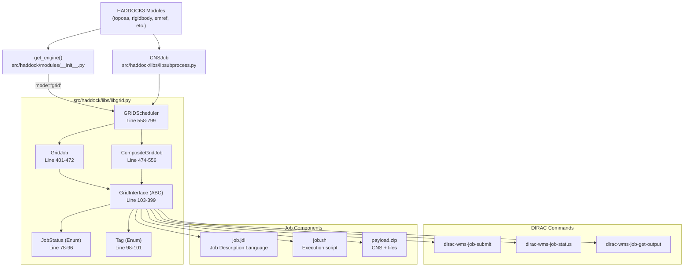
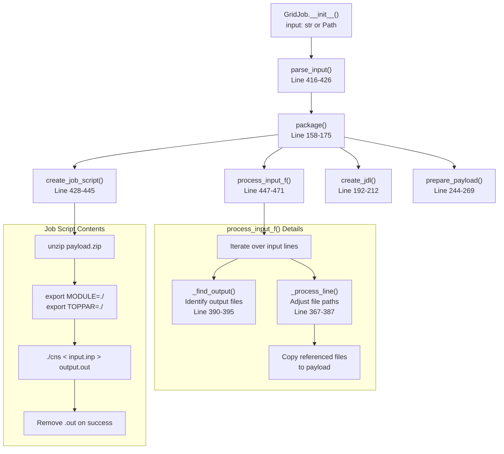
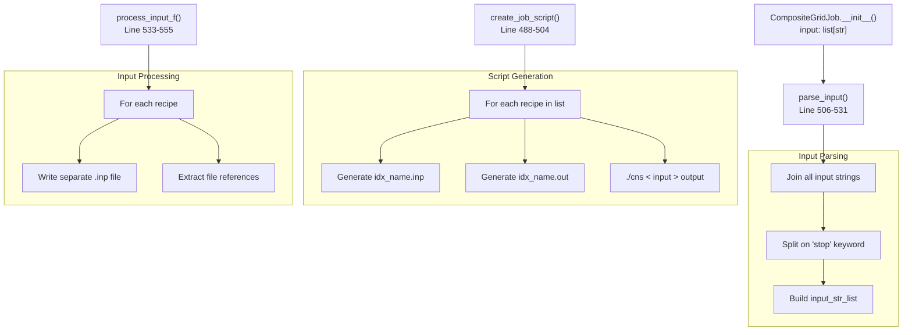
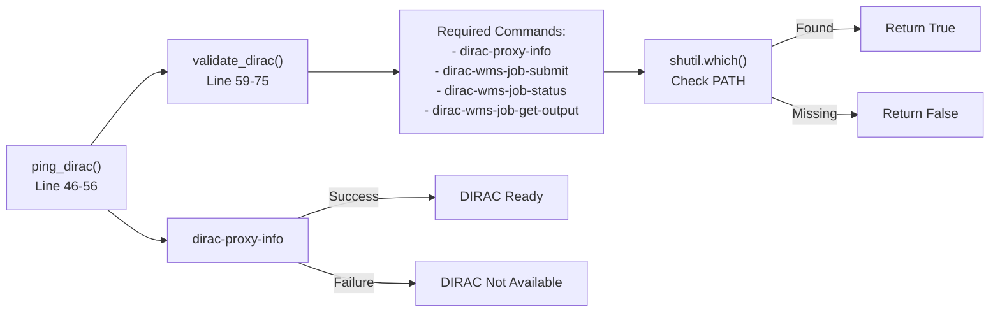
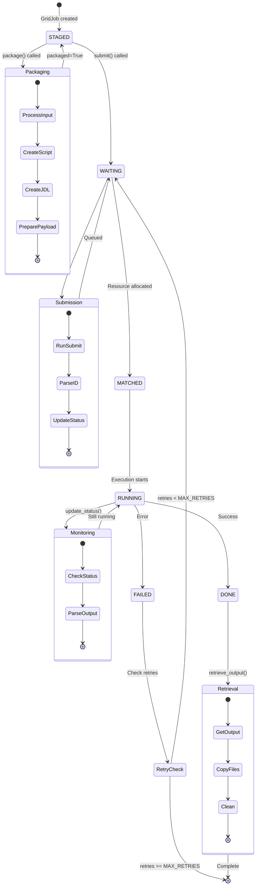

# Grid Execution

<details>
<summary>Relevant source files</summary>

The following files were used as context for generating this wiki page:

- [src/haddock/libs/libgrid.py](src/haddock/libs/libgrid.py)
- [src/haddock/modules/analysis/__init__.py](src/haddock/modules/analysis/__init__.py)
- [src/haddock/modules/analysis/clustfcc/__init__.py](src/haddock/modules/analysis/clustfcc/__init__.py)
- [src/haddock/modules/analysis/seletop/__init__.py](src/haddock/modules/analysis/seletop/__init__.py)
- [src/haddock/modules/analysis/seletopclusts/__init__.py](src/haddock/modules/analysis/seletopclusts/__init__.py)
- [src/haddock/modules/refinement/emref/__init__.py](src/haddock/modules/refinement/emref/__init__.py)
- [src/haddock/modules/refinement/flexref/__init__.py](src/haddock/modules/refinement/flexref/__init__.py)
- [src/haddock/modules/refinement/mdref/__init__.py](src/haddock/modules/refinement/mdref/__init__.py)
- [src/haddock/modules/sampling/gdock/__init__.py](src/haddock/modules/sampling/gdock/__init__.py)
- [src/haddock/modules/sampling/lightdock/__init__.py](src/haddock/modules/sampling/lightdock/__init__.py)
- [src/haddock/modules/sampling/rigidbody/__init__.py](src/haddock/modules/sampling/rigidbody/__init__.py)
- [src/haddock/modules/scoring/emscoring/__init__.py](src/haddock/modules/scoring/emscoring/__init__.py)
- [src/haddock/modules/scoring/mdscoring/__init__.py](src/haddock/modules/scoring/mdscoring/__init__.py)
- [src/haddock/modules/topology/topoaa/__init__.py](src/haddock/modules/topology/topoaa/__init__.py)
- [tests/__init__.py](tests/__init__.py)
- [tests/test_libgrid.py](tests/test_libgrid.py)
- [tests/test_libnotebooks.py](tests/test_libnotebooks.py)

</details>


This document describes the grid execution system in HADDOCK3, which enables running computational jobs on distributed computing infrastructure via DIRAC (Distributed Infrastructure with Remote Agent Control). This execution mode is one of three available modes alongside local and MPI execution. For general information about execution modes, see [Execution Modes](#6). For local execution specifics, see [Local Execution](#6.1). For MPI execution, see [MPI Execution](#6.2).

The grid execution system automatically packages jobs, submits them to the DIRAC grid, monitors their status, retrieves outputs, and optimizes batch sizes based on measured grid efficiency.

---

## System Architecture

The grid execution system consists of four main components: the `GridInterface` abstract base class, two concrete implementations (`GridJob` and `CompositeGridJob`), and the `GRIDScheduler` that orchestrates the entire workflow.

**Grid Execution Component Architecture**



Sources: [src/haddock/libs/libgrid.py:1-799](), [src/haddock/modules/__init__.py]()

---

## Core Components

### GridInterface Abstract Base Class

`GridInterface` defines the common interface and shared functionality for all grid jobs. Each instance represents a single unit of work to be executed on the grid.

| Attribute | Type | Purpose |
|-----------|------|---------|
| `name` | str | UUID-based unique job identifier |
| `loc` | Path | Temporary directory for job files |
| `wd` | Path | Working directory where outputs are returned |
| `id` | int | DIRAC-assigned job ID |
| `site` | str | Grid site where job executes |
| `status` | JobStatus | Current job state |
| `expected_outputs` | list[str] | Files to retrieve after completion |
| `payload_fnames` | list[Path] | Files to include in payload.zip |
| `retries` | int | Number of retry attempts |
| `timings` | dict | Timestamp tracking for metrics |
| `tag` | Tag | PROBING or DEFAULT |

Sources: [src/haddock/libs/libgrid.py:103-156]()

The class defines three abstract methods that concrete implementations must provide:

- `parse_input()`: Handles polymorphic input (string, Path, or list)
- `create_job_script()`: Generates the bash script executed on the grid
- `process_input_f()`: Adjusts paths in CNS input files for grid environment

Sources: [src/haddock/libs/libgrid.py:177-190]()

### GridJob Implementation

`GridJob` represents a single CNS job to be executed on the grid. It accepts either a CNS input string or a Path to a CNS input file.

**GridJob Packaging Process**



Sources: [src/haddock/libs/libgrid.py:401-472]()

The `create_job_script()` method generates a bash script that:
1. Sets environment variables `MODULE` and `TOPPAR` to current directory
2. Extracts payload.zip
3. Executes CNS with the input file
4. Removes the CNS log file if execution succeeds

Sources: [src/haddock/libs/libgrid.py:428-445]()

### CompositeGridJob Implementation

`CompositeGridJob` packages multiple CNS jobs into a single grid submission to amortize submission overhead. This is critical for efficiency when grid waiting times are significant.



Sources: [src/haddock/libs/libgrid.py:474-556]()

The key difference from `GridJob` is that `CompositeGridJob.create_job_script()` generates multiple CNS execution commands, one for each input recipe, all within a single bash script.

Sources: [src/haddock/libs/libgrid.py:488-504]()

---

## DIRAC Integration

HADDOCK3 interfaces with DIRAC via command-line tools. The system validates DIRAC availability before attempting any grid operations.

### DIRAC Validation



Sources: [src/haddock/libs/libgrid.py:46-76]()

### Job Description Language (JDL)

Each grid job requires a JDL file that describes the job to DIRAC. The `create_jdl()` method generates this file with the following structure:

| Field | Value | Description |
|-------|-------|-------------|
| JobName | UUID | Unique job identifier |
| Executable | "job.sh" | Bash script to execute |
| StdOutput | "job.out" | Standard output file |
| StdError | "job.err" | Standard error file |
| JobType | `$HADDOCK3_GRID_JOB_TYPE` | Accounting category (default: "WeNMR-DEV") |
| InputSandbox | ["job.sh", "payload.zip"] | Files uploaded to grid |
| OutputSandbox | ["job.out", "job.err", ...] | Files retrieved from grid |

The `OutputSandbox` includes `job.out`, `job.err`, and all files identified as outputs in the CNS input file.

Sources: [src/haddock/libs/libgrid.py:192-212](), [src/haddock/libs/libgrid.py:37]()

### Job Status Tracking

The `JobStatus` enum defines all possible job states recognized by DIRAC:

```python
class JobStatus(Enum):
    WAITING = "Waiting"      # Queued, not yet running
    RUNNING = "Running"      # Currently executing
    UNKNOWN = "Unknown"      # Status could not be determined
    DONE = "Done"           # Completed successfully
    MATCHED = "Matched"      # Matched to a resource
    COMPLETING = "Completing"  # Finishing up
    FAILED = "Failed"       # Execution failed
    STAGED = "Staged"       # Locally prepared, not yet submitted
```

Sources: [src/haddock/libs/libgrid.py:78-96]()

---

## Job Lifecycle

**Complete Job Execution Flow**



Sources: [src/haddock/libs/libgrid.py:214-353](), [src/haddock/libs/libgrid.py:769-798]()

### Submission Process

The `submit()` method performs the following steps:

1. Clean any previous timing data with `clean_timings()`
2. Call `package()` if not already packaged
3. Record submission timestamp
4. Execute `dirac-wms-job-submit` with the JDL file
5. Parse the DIRAC-assigned job ID from stdout
6. Call `update_status()` to get initial status

Sources: [src/haddock/libs/libgrid.py:271-304]()

### Status Monitoring

The `update_status()` method queries DIRAC for the current job state:

```python
result = subprocess.run(
    ["dirac-wms-job-status", str(self.id)],
    capture_output=True,
    text=True,
)
output_dict = self.parse_output(result.stdout)
self.status = JobStatus.from_string(output_dict["Status"])
self.site = output_dict.get("Site", "Unknown")
```

The method also maintains timing information, recording timestamps when jobs transition to `RUNNING` and `DONE` states for efficiency metrics.

Sources: [src/haddock/libs/libgrid.py:214-242]()

### Output Retrieval

When a job reaches `DONE` status, `retrieve_output()` is called:

1. Execute `dirac-wms-job-get-output` to download the output sandbox
2. Files are placed in `{loc}/{id}/` directory
3. Copy `job.out` and `job.err` to the original working directory
4. Copy all expected output files to the working directory
5. If stderr exists, save it as `{id}_dirac.err` for debugging

Sources: [src/haddock/libs/libgrid.py:306-345]()

### Retry Mechanism

Failed jobs are automatically retried up to `MAX_RETRIES` times (default: 10). The `process_job()` static method implements this logic:

```python
if job.status == JobStatus.FAILED:
    if job.retries < MAX_RETRIES:
        job.retries += 1
        log.warning(
            f"> Job {job.name} failed on {job.site}, "
            f"re-submitting - {job.retries}/{MAX_RETRIES} <"
        )
        job.submit()
```

Sources: [src/haddock/libs/libgrid.py:769-791](), [src/haddock/libs/libgrid.py:38]()

---

## Payload Preparation

The payload is a ZIP archive containing all files necessary to execute the CNS job on a remote grid node. The `prepare_payload()` method collects these files:

**Payload Contents**

| Component | Source | Purpose |
|-----------|--------|---------|
| `cns` executable | `haddock.core.defaults.cns_exec_linux` | CNS binary for Linux x86_64 |
| CNS module scripts | `module_path` (e.g., `rigidbody/cns/`) | Protocol-specific CNS scripts |
| TOPPAR files | `toppar_path` | Parameter and topology files |
| Input files | Referenced in CNS input | PDB structures, restraint files, etc. |
| CNS input file(s) | Generated by `process_input_f()` | Recipe(s) to execute |

The method preserves the directory structure of TOPPAR files because CNS scripts contain hardcoded relative paths:

```python
for f in toppar_path.rglob("*"):
    if f.is_file():
        if f.is_relative_to(toppar_path):
            relative_path = f.relative_to(toppar_path)
            z.write(f, arcname=str(relative_path))
```

Sources: [src/haddock/libs/libgrid.py:244-269]()

### Path Adjustment in CNS Input Files

CNS input files typically contain absolute paths that won't exist on grid nodes. The `_process_line()` method identifies and adjusts these paths:

1. Match against `VAR_PATTERN`: `r"\(\$\s*[^=]*=(?!.?\$)(.*)\)"`
2. Match against `AT_PATTERN`: `r"@@(?!\$)(.*)"`
3. If matched item is an existing file path, replace with just the filename
4. Copy the file to the payload location

Sources: [src/haddock/libs/libgrid.py:367-387](), [src/haddock/libs/libgrid.py:40-43]()

Output file declarations are also identified using `OUTPUT_PATTERN` to populate the `expected_outputs` list:

```python
OUTPUT_PATTERN = r'\$output_\w+\s*=\s*"([^"]+)"|\$output_\w+\s*=\s*([^\s;]+)'
```

Sources: [src/haddock/libs/libgrid.py:41](), [src/haddock/libs/libgrid.py:390-395]()

---

## GRIDScheduler Orchestration

The `GRIDScheduler` class manages the complete grid execution workflow, including efficiency probing, batch optimization, parallel submission, and completion monitoring.

### Initialization and Probing Strategy

The scheduler initializes with a list of `CNSJob` objects and converts them to `GridJob` instances:

```python
self.workload: list[GridJob] = [
    GridJob(
        input=t.input_file,
        toppar_path=t.envvars["TOPPAR"],
        module_path=t.envvars["MODULE"],
    )
    for t in tasks
]
```

A subset of jobs is randomly tagged for probing to measure grid performance:

```python
subset_size = min(self.ncores, max(1, math.ceil(len(self.workload) * probing)))

if len(self.workload) >= subset_size:
    for i in random.sample(range(len(self.workload)), subset_size):
        self.workload[i].tag = Tag.PROBING
```

The subset size is bounded by `ncores` and defaults to 5% of total jobs, ensuring at least one probing job.

Sources: [src/haddock/libs/libgrid.py:558-604]()

### Execution Workflow

**GRIDScheduler.run() Complete Flow**

```mermaid
flowchart TD
    Start["GRIDScheduler.run()<br/>Line 605-618"]
    Probe["probe_grid_efficiency()<br/>Line 678-739"]
    CreateBatch["create_batches()<br/>Line 620-643"]
    SubmitJobs["submit_jobs()<br/>Line 663-676"]
    WaitComplete["wait_for_completion()<br/>Line 645-661"]
    Done["Execution Complete"]
    
    Start --> Probe
    
    subgraph "Probing Phase"
        ProbeCheck{probing enabled?}
        SubmitProbe["Submit Tag.PROBING jobs<br/>submit_jobs(tag=PROBING)"]
        WaitProbe["Wait for probing jobs"]
        CalcMetrics["Calculate timing metrics:<br/>- avg_waiting<br/>- avg_running"]
        OptimizeBatch["calculate_optimal_batch_size()<br/>Line 741-767"]
    end
    
    Probe --> ProbeCheck
    ProbeCheck -->|Yes| SubmitProbe
    ProbeCheck -->|No| CreateBatch
    SubmitProbe --> WaitProbe
    WaitProbe --> CalcMetrics
    CalcMetrics --> OptimizeBatch
    OptimizeBatch --> CreateBatch
    
    subgraph "Batch Creation"
        GetDefaultJobs["Filter jobs with Tag.DEFAULT"]
        GroupJobs["Group jobs by batch_size"]
        CreateComposite["Create CompositeGridJob<br/>for each batch"]
    end
    
    CreateBatch --> GetDefaultJobs
    GetDefaultJobs --> GroupJobs
    GroupJobs --> CreateComposite
    CreateComposite --> SubmitJobs
    
    subgraph "Submission"
        ParallelPackage["ThreadPoolExecutor:<br/>package() all jobs"]
        ParallelSubmit["ThreadPoolExecutor:<br/>submit() all jobs"]
    end
    
    SubmitJobs --> ParallelPackage
    ParallelPackage --> ParallelSubmit
    ParallelSubmit --> WaitComplete
    
    subgraph "Monitoring Loop"
        CheckJobs["Filter non-complete jobs"]
        ParallelProcess["ThreadPoolExecutor:<br/>process_job() for each"]
        UpdateLoop{Any jobs pending?}
    end
    
    WaitComplete --> CheckJobs
    CheckJobs --> ParallelProcess
    ParallelProcess --> UpdateLoop
    UpdateLoop -->|Yes| CheckJobs
    UpdateLoop -->|No| Done
```



Sources: [src/haddock/libs/libgrid.py:605-618]()

### Efficiency Probing and Batch Optimization

The probing phase measures actual grid performance by submitting a small number of jobs and tracking their execution times. The scheduler calculates optimal batch size using the measured metrics:

**Efficiency Formula**

The efficiency `E` of submitting `N` jobs per batch is:

```
E = (N × R) / (W + N × R)
```

Where:
- `N` = number of jobs in batch
- `W` = average waiting time (WAITING → RUNNING)
- `R` = average running time (RUNNING → DONE)

To achieve target efficiency `T` (default 90%), solve for `N`:

```
N = (T × W) / (R × (1 - T))
```

The `calculate_optimal_batch_size()` method implements this calculation:

```python
def calculate_optimal_batch_size(N: int, W: float, R: float, T: float) -> int:
    E = (N * R) / (W + N * R)
    log.info(f"+ Current efficiency with {N} job(s) per payload: {E:.1%}")
    
    batch_size = (T * W) / (R * (1 - T))
    batch_size = max(1, round(batch_size))
    return batch_size
```

Sources: [src/haddock/libs/libgrid.py:741-767]()

The timing data is collected during the probing phase:

```python
waiting_duration = (run_start - wait_start).total_seconds()
running_duration = (done_time - run_start).total_seconds()
```

Sources: [src/haddock/libs/libgrid.py:678-724]()

### Batch Creation

Once the optimal batch size is determined, `create_batches()` groups jobs:

```python
jobs = [j for j in self.workload if j.tag == Tag.DEFAULT]

composite_jobs = []
for i, batch in enumerate(range(0, len(jobs), self.batch_size), start=1):
    input = [j.input_str for j in jobs[batch : batch + self.batch_size]]
    job = CompositeGridJob(
        input=input,
        toppar_path=toppar_path,
        module_path=module_path,
    )
    composite_jobs.append(job)

self.workload = composite_jobs
```

Sources: [src/haddock/libs/libgrid.py:620-643]()

### Parallel Job Processing

The scheduler uses `ThreadPoolExecutor` for parallelizing I/O-bound operations:

**Job Submission (parallel)**:
```python
with ThreadPoolExecutor(max_workers=self.ncores) as executor:
    executor.map(lambda job: job.package(), queue)

with ThreadPoolExecutor(max_workers=self.ncores) as executor:
    executor.map(lambda job: job.submit(), queue)
```

Sources: [src/haddock/libs/libgrid.py:672-676]()

**Status Monitoring (parallel)**:
```python
with ThreadPoolExecutor(max_workers=self.ncores) as executor:
    executor.map(self.process_job, jobs_to_check)
```

Sources: [src/haddock/libs/libgrid.py:658-659]()

The `wait_for_completion()` method continuously monitors jobs until all reach terminal states (`DONE`, `FAILED`, or `STAGED`):

```python
jobs_to_check = [
    job
    for job in self.workload
    if job.status not in {JobStatus.STAGED, JobStatus.DONE, JobStatus.FAILED}
]
```

Sources: [src/haddock/libs/libgrid.py:650-655]()

---

## Module Integration

HADDOCK3 modules use the grid execution system via the `get_engine()` function. Each CNS-based module follows this pattern:

**Module Usage Pattern**

```mermaid
flowchart LR
    Module["Module._run()"]
    PrepareJobs["Prepare CNS input<br/>prepare_cns_input()"]
    CreateJobs["Create CNSJob objects"]
    GetEngine["get_engine(mode, params)"]
    Instantiate["Engine = GRIDScheduler"]
    ExecuteRun["engine.run()"]
    ProcessOutput["Process outputs<br/>score models"]
    
    Module --> PrepareJobs
    PrepareJobs --> CreateJobs
    CreateJobs --> GetEngine
    GetEngine -->|"mode='grid'"| Instantiate
    Instantiate --> ExecuteRun
    ExecuteRun --> ProcessOutput
```



Sources: [src/haddock/modules/topology/topoaa/__init__.py:298-302](), [src/haddock/modules/sampling/rigidbody/__init__.py:252-256](), [src/haddock/modules/refinement/emref/__init__.py:124-128]()

### Example: Rigidbody Module

The `rigidbody` module demonstrates typical grid execution usage:

1. **Prepare CNS inputs**: Convert models and parameters to CNS input strings
   ```python
   rigidbody_input = prepare_cns_input(
       idx,
       combination,
       self.path,
       self.recipe_str,
       self.params,
       "rigidbody",
       ...
   )
   ```

2. **Create CNS jobs**: Package inputs into `CNSJob` objects
   ```python
   job = CNSJob(inp_input, log_fname, err_fname, envvars=self.envvars)
   jobs.append(job)
   ```

3. **Select execution engine**: Get appropriate engine based on mode parameter
   ```python
   Engine = get_engine(self.params["mode"], self.params)
   engine = Engine(jobs)
   ```

4. **Execute**: Run all jobs and wait for completion
   ```python
   engine.run()
   ```

Sources: [src/haddock/modules/sampling/rigidbody/__init__.py:107-119](), [src/haddock/modules/sampling/rigidbody/__init__.py:86-87](), [src/haddock/modules/sampling/rigidbody/__init__.py:253-255]()

### Analysis Module Restrictions

Analysis modules (e.g., `clustfcc`, `caprieval`) override grid mode to local execution:

```python
exec_mode = get_analysis_exec_mode(self.params["mode"])
```

The `get_analysis_exec_mode()` function converts `"grid"` and `"batch"` to `"local"` because analysis modules do not support distributed execution.

Sources: [src/haddock/modules/analysis/__init__.py:35-61](), [src/haddock/modules/analysis/clustfcc/__init__.py:90]()

---

## Configuration

Grid execution is controlled via module parameters:

| Parameter | Type | Default | Purpose |
|-----------|------|---------|---------|
| `mode` | str | "local" | Execution mode: "local", "mpi", or "grid" |
| `ncores` | int | 1 | Number of parallel workers for submission/monitoring |

The `HADDOCK3_GRID_JOB_TYPE` environment variable specifies the job type for DIRAC accounting (default: "WeNMR-DEV").

Sources: [src/haddock/libs/libgrid.py:37]()

### DIRAC Prerequisites

To use grid execution, the following must be available:

1. DIRAC client tools installed and in PATH
2. Valid DIRAC proxy certificate (check with `dirac-proxy-info`)
3. Network connectivity to DIRAC WMS (Workload Management System)

The system validates these requirements with `validate_dirac()` and `ping_dirac()`.

Sources: [src/haddock/libs/libgrid.py:46-76]()

---

## Testing

The grid execution system includes comprehensive unit tests:

**Test Coverage**

| Test | Purpose | Location |
|------|---------|----------|
| `test_gridjob_create_jdl_and_job_script` | Verify JDL and script generation | [tests/test_libgrid.py:22-35]() |
| `test_gridjob_process_input_f` | Validate input file processing | [tests/test_libgrid.py:38-48]() |
| `test_compositegridjob_parse_input_and_process` | Test multi-job parsing | [tests/test_libgrid.py:51-59]() |
| `test_jobstatus_from_string` | Verify status enum conversion | [tests/test_libgrid.py:69-71]() |
| `test_parse_output` | Validate DIRAC output parsing | [tests/test_libgrid.py:79-84]() |
| `test_process_line_and_find_output` | Test path adjustment logic | [tests/test_libgrid.py:87-92]() |

Integration tests require a functional DIRAC installation and are conditionally skipped:

```python
has_grid = pytest.mark.skipif(not ping_dirac(), reason="Dirac not reachable")
```

Sources: [tests/test_libgrid.py:1-159](), [tests/__init__.py:46]()

---

## Error Handling and Debugging

### Common Issues

**Problem**: Job submission fails with "Command not found"
- **Cause**: DIRAC client tools not in PATH
- **Solution**: Verify `validate_dirac()` returns `True`, install DIRAC client

**Problem**: Jobs remain in WAITING state indefinitely
- **Cause**: No available grid resources or invalid proxy
- **Solution**: Check proxy with `dirac-proxy-info`, verify VO membership

**Problem**: Jobs repeatedly fail and exhaust retries
- **Cause**: Payload missing files, CNS errors, or grid node issues
- **Solution**: Check `{job_id}_dirac.err` files in working directory

### Debug Output

When jobs fail, the system saves diagnostic information:

1. **DIRAC stderr**: Saved as `{job_id}_dirac.err` in working directory
2. **Job stdout**: Available in retrieved `job.out` file
3. **Job stderr**: Available in retrieved `job.err` file

The scheduler logs job status at debug level:

```python
log.debug(self)  # Prints job ID, name, outputs, status, site
```

Sources: [src/haddock/libs/libgrid.py:332-335](), [src/haddock/libs/libgrid.py:235]()

---

## Performance Considerations

### Efficiency vs. Throughput Trade-offs

The probing mechanism balances two competing concerns:

1. **Small batches**: Fast failure detection, better parallelism, but high submission overhead
2. **Large batches**: Amortized submission cost, but one failure affects many jobs

The default target efficiency of 90% represents a reasonable compromise. Lower targets (e.g., 80%) increase batch sizes but may waste more computation on failures.

### Optimal Scenarios for Grid Execution

Grid execution is most beneficial when:

- **Long-running jobs**: CNS execution time >> submission overhead
- **Many jobs**: Large-scale sampling (1000+ structures) benefits from distribution
- **Grid availability**: Low waiting times and high reliability

Grid execution may not be optimal when:

- **Short jobs**: Submission overhead dominates execution time
- **Few jobs**: Local execution with multiprocessing is simpler
- **Unreliable grid**: High failure rates increase retry overhead

Sources: [src/haddock/libs/libgrid.py:678-739]()

---