# Data Processing

Relevant source files

The following files were used as context for generating this wiki page:

- [src/haddock/core/cns_paths.py](src/haddock/core/cns_paths.py)
- [src/haddock/core/supported_molecules.py](src/haddock/core/supported_molecules.py)
- [src/haddock/gear/preprocessing.py](src/haddock/gear/preprocessing.py)
- [src/haddock/libs/libcns.py](src/haddock/libs/libcns.py)
- [src/haddock/libs/libfunc.py](src/haddock/libs/libfunc.py)
- [src/haddock/libs/libontology.py](src/haddock/libs/libontology.py)
- [src/haddock/libs/libpdb.py](src/haddock/libs/libpdb.py)
- [src/haddock/modules/analysis/clustfcc/__init__.py](src/haddock/modules/analysis/clustfcc/__init__.py)
- [src/haddock/modules/analysis/seletop/__init__.py](src/haddock/modules/analysis/seletop/__init__.py)
- [src/haddock/modules/analysis/seletopclusts/__init__.py](src/haddock/modules/analysis/seletopclusts/__init__.py)
- [src/haddock/modules/base_cns_module.py](src/haddock/modules/base_cns_module.py)
- [src/haddock/modules/refinement/emref/__init__.py](src/haddock/modules/refinement/emref/__init__.py)
- [src/haddock/modules/refinement/flexref/__init__.py](src/haddock/modules/refinement/flexref/__init__.py)
- [src/haddock/modules/refinement/mdref/__init__.py](src/haddock/modules/refinement/mdref/__init__.py)
- [src/haddock/modules/sampling/gdock/__init__.py](src/haddock/modules/sampling/gdock/__init__.py)
- [src/haddock/modules/sampling/lightdock/__init__.py](src/haddock/modules/sampling/lightdock/__init__.py)
- [src/haddock/modules/sampling/rigidbody/__init__.py](src/haddock/modules/sampling/rigidbody/__init__.py)
- [src/haddock/modules/scoring/emscoring/__init__.py](src/haddock/modules/scoring/emscoring/__init__.py)
- [src/haddock/modules/scoring/mdscoring/__init__.py](src/haddock/modules/scoring/mdscoring/__init__.py)
- [src/haddock/modules/topology/topoaa/__init__.py](src/haddock/modules/topology/topoaa/__init__.py)
- [tests/data/broken.pdb](tests/data/broken.pdb)
- [tests/data/corrected.pdb](tests/data/corrected.pdb)
- [tests/data/residues.top](tests/data/residues.top)
- [tests/test_cns_paths.py](tests/test_cns_paths.py)
- [tests/test_core_supported_molecules.py](tests/test_core_supported_molecules.py)
- [tests/test_gear_preprocessing.py](tests/test_gear_preprocessing.py)

This page explains how HADDOCK3 processes and prepares molecular structures for computation. Data processing in HADDOCK3 encompasses the transformation of raw PDB files into CNS-compatible structures, the generation of topology files, and the progressive enrichment of structural metadata as models flow through the workflow pipeline.

For detailed information about specific processing stages, see:
- PDB preprocessing operations: [PDB Preprocessing](#7.1)
- CNS script generation and execution: [CNS Integration](#7.2)
- Supported molecule definitions: [Supported Molecules](#7.3)

## Data Processing Architecture

The data processing system in HADDOCK3 operates at multiple stages of the workflow, transforming molecular structures from user inputs to fully annotated output models.

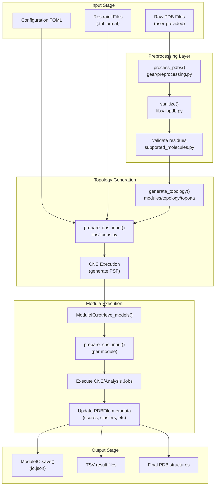

**Sources:** [src/haddock/gear/preprocessing.py:326-437](), [src/haddock/libs/libcns.py:321-424](), [src/haddock/libs/libontology.py:121-240](), [src/haddock/modules/topology/topoaa/__init__.py:54-100]()

## Three-Stage Preprocessing Pipeline

HADDOCK3 implements a three-stage preprocessing pipeline that ensures PDB file compatibility. This processing occurs automatically when reading input molecules unless `skip_preprocess = True` is set in the configuration.

### Processing Stages

| Stage | Function | Operations Performed |
|-------|----------|---------------------|
| **Line-by-Line** | 18 operations | `pdb_keepcoord`, `pdb_tidy`, `pdb_element`, `pdb_selaltloc`, `pdb_occ`, MSE→MET, HSD/HSE/HID/HIE→HIS, ion charge addition, ATOM↔HETATM conversion, `pdb_fixinsert`, unsupported molecule removal, `pdb_reatom` |
| **Whole-PDB** | 3 operations | `models_should_have_the_same_labels`, `solve_no_chainID_no_segID`, `homogenize_chains` |
| **Combined-PDB** | 1 operation | `correct_equal_chain_segids` |

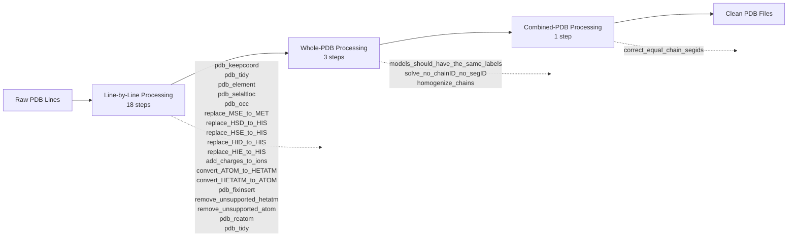

**Sources:** [src/haddock/gear/preprocessing.py:1-85](), [src/haddock/gear/preprocessing.py:371-437]()

### Key Preprocessing Functions

The `process_pdbs()` function orchestrates all preprocessing stages:

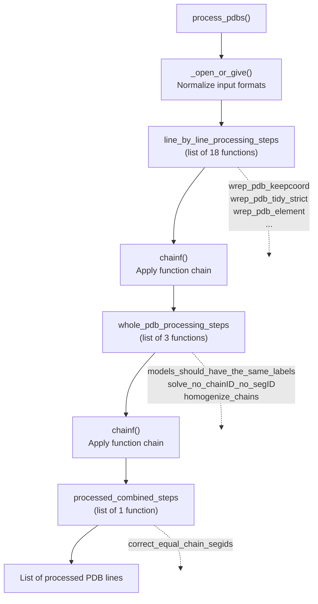

**Sources:** [src/haddock/gear/preprocessing.py:326-437](), [src/haddock/libs/libfunc.py:13-38]()

### Ion Charge Processing

HADDOCK3 automatically adds or corrects charges for ions using a three-case priority system:

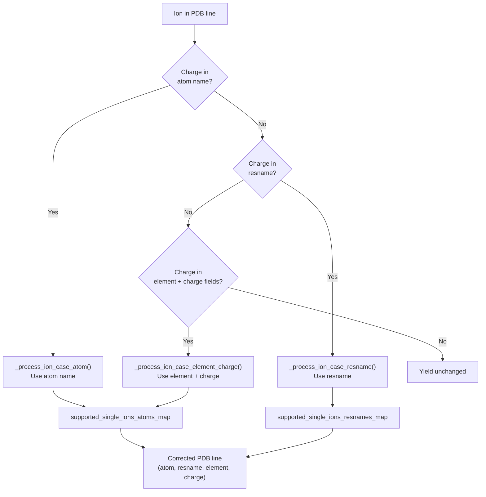

**Sources:** [src/haddock/gear/preprocessing.py:673-829](), [src/haddock/core/supported_molecules.py:420-427]()

## CNS Input Generation

HADDOCK3 generates CNS input files dynamically by assembling multiple components into a single `.inp` file.

### CNS Input Structure

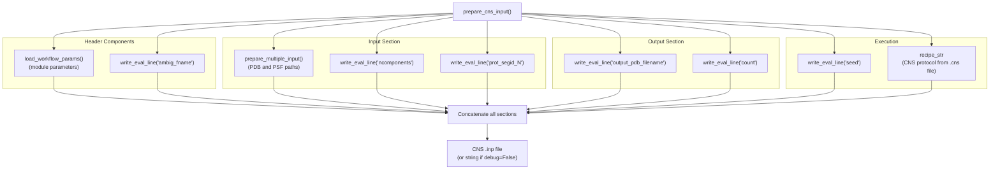

**Sources:** [src/haddock/libs/libcns.py:321-424](), [src/haddock/libs/libcns.py:151-210]()

### CNS Header Generation

The `generate_default_header()` function loads six types of support files required by CNS:

| File Type | Function | Purpose |
|-----------|----------|---------|
| **Link Files** | `load_link()` | Protein/nucleic acid linkage definitions |
| **Translation Vectors** | `load_trans_vectors()` | Initial position definitions (51 files) |
| **Tensors** | `load_tensor()` | Tensor parameter files (6 files) |
| **Scatter Library** | `load_scatter()` | Scattering data for SAXS/SANS |
| **Axis Definitions** | `load_axis()` | Axis parameter files (3 files) |
| **Water Box** | `load_boxtyp20()` | Water box topology |

**Sources:** [src/haddock/libs/libcns.py:23-53](), [src/haddock/core/cns_paths.py:45-99]()

### Parameter Filtering

The `load_workflow_params()` function filters parameters using `filter_empty_vars()` to exclude:
- NaN values
- Empty strings
- `None` values

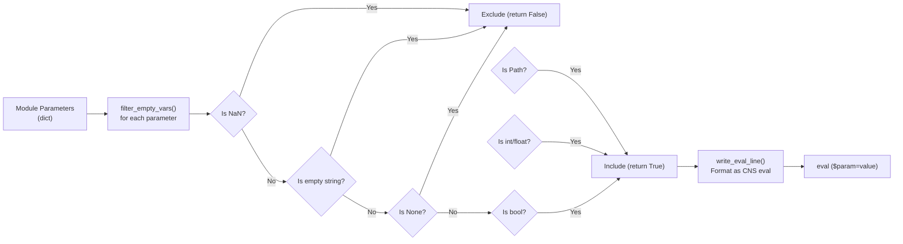

**Sources:** [src/haddock/libs/libcns.py:114-183](), [src/haddock/libs/libcns.py:185-210]()

## Topology Generation

The `topoaa` module generates CNS topology (`.psf`) and coordinate (`.pdb`) files with rebuilt missing atoms.

### Topology Generation Workflow

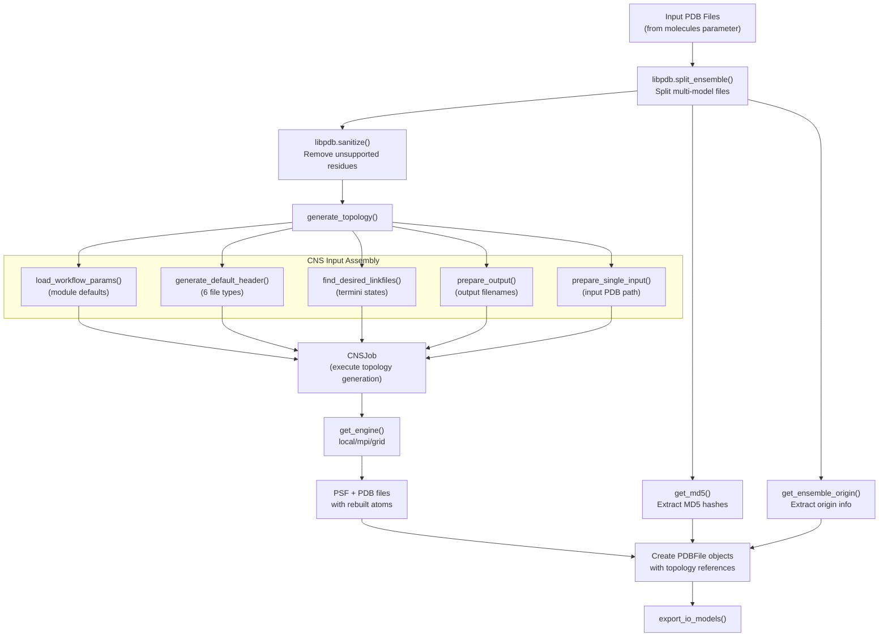

**Sources:** [src/haddock/modules/topology/topoaa/__init__.py:54-100](), [src/haddock/modules/topology/topoaa/__init__.py:174-357](), [src/haddock/libs/libpdb.py:117-206]()

### Link File Selection

The `find_desired_linkfiles()` function selects appropriate link files based on termini states:

| Termini State | Protein Link File | Nucleic Link File |
|---------------|------------------|-------------------|
| N-ter: charged, C-ter: charged | `protein-allhdg5-4.link` | `dna-rna-pho-1.3.link` (if 5' phosphate) |
| N-ter: uncharged, C-ter: charged | `protein-allhdg5-4-noNter.link` | `dna-rna-1.3.link` (if 5' OH) |
| N-ter: charged, C-ter: uncharged | `protein-allhdg5-4-noCter.link` | |
| N-ter: uncharged, C-ter: uncharged | `protein-allhdg5-4-noter.link` | |

**Sources:** [src/haddock/libs/libcns.py:56-103](), [src/haddock/core/cns_paths.py:29-38]()

## PDBFile Object and Data Flow

The `PDBFile` class is the core data structure that flows between modules, accumulating metadata throughout the workflow.

### PDBFile Class Structure

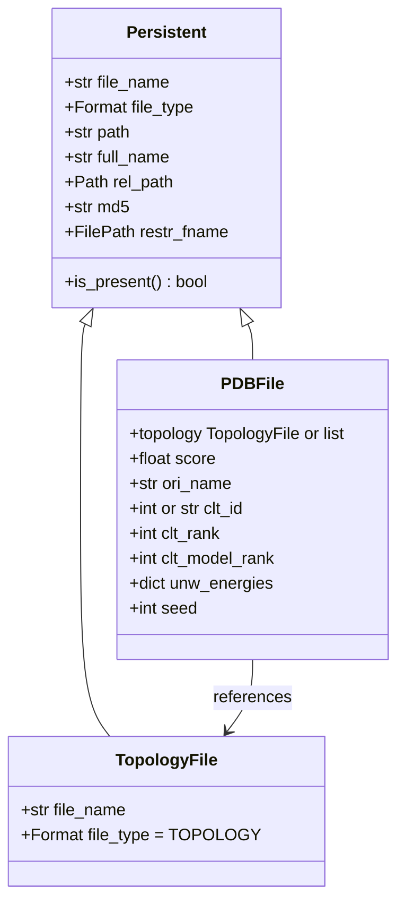

**Sources:** [src/haddock/libs/libontology.py:34-101](), [src/haddock/libs/libontology.py:114-119]()

### Progressive Enrichment Through Modules

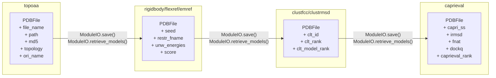

**Sources:** [src/haddock/libs/libontology.py:65-101](), [src/haddock/modules/topology/topoaa/__init__.py:344-356](), [src/haddock/modules/sampling/rigidbody/__init__.py:80-85](), [src/haddock/modules/analysis/clustfcc/__init__.py:161-172]()

## ModuleIO System

The `ModuleIO` class manages inter-module data exchange by serializing and deserializing `PDBFile` objects to JSON format.

### ModuleIO Operations

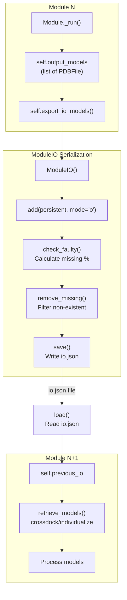

**Sources:** [src/haddock/libs/libontology.py:121-240](), [src/haddock/modules/base_cns_module.py:40-62]()

### Retrieve Models Options

The `retrieve_models()` method supports three retrieval modes:

| Parameter | Default | Behavior |
|-----------|---------|----------|
| `crossdock` | `False` | If `True`, generates all combinations using `itertools.product()` |
| `individualize` | `False` | If `True`, flattens nested structures using `itertools.chain()` |
| Default | - | Returns pairwise combinations using `zip()` |

**Sources:** [src/haddock/libs/libontology.py:157-192]()

## File Path Management

HADDOCK3 maintains both absolute and relative paths for portability:

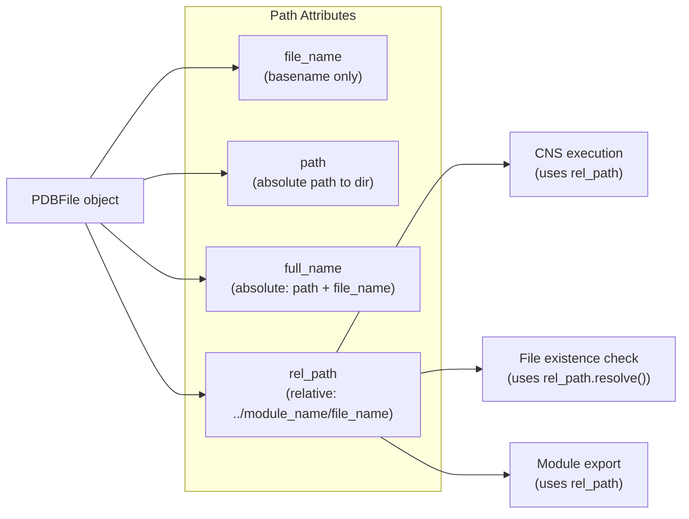

**Sources:** [src/haddock/libs/libontology.py:34-62]()

## Sanitization and Validation

### Sanitize Function

The `sanitize()` function removes unsupported residues and corrects naming:

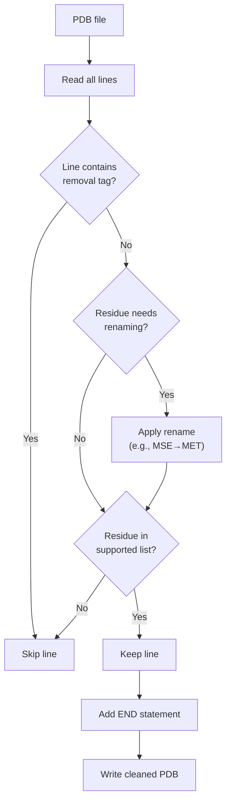

**Removal tags:** `REMAR`, `CTERB`, `CTERA`, `NTERA`, `NTERB`, `CONECT`

**Rename mappings:** `HSD`→`HIS`, `HSE`→`HIS`, `HID`→`HIS`, `HIE`→`HIS`, `WAT`→`TIP3`

**Sources:** [src/haddock/libs/libpdb.py:166-206](), [src/haddock/libs/libpdb.py:102-114]()

### Chain/Segment ID Resolution

The `solve_no_chainID_no_segID()` function ensures consistent identifiers:

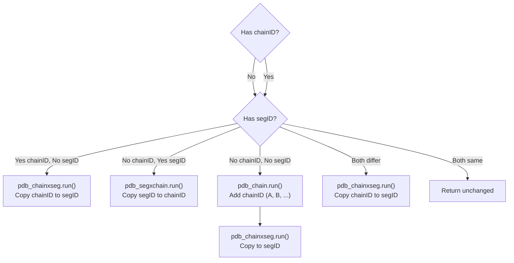

**Sources:** [src/haddock/gear/preprocessing.py:896-937]()

## Data Processing in Module Execution

Each CNS-based module follows a standard data processing pattern:

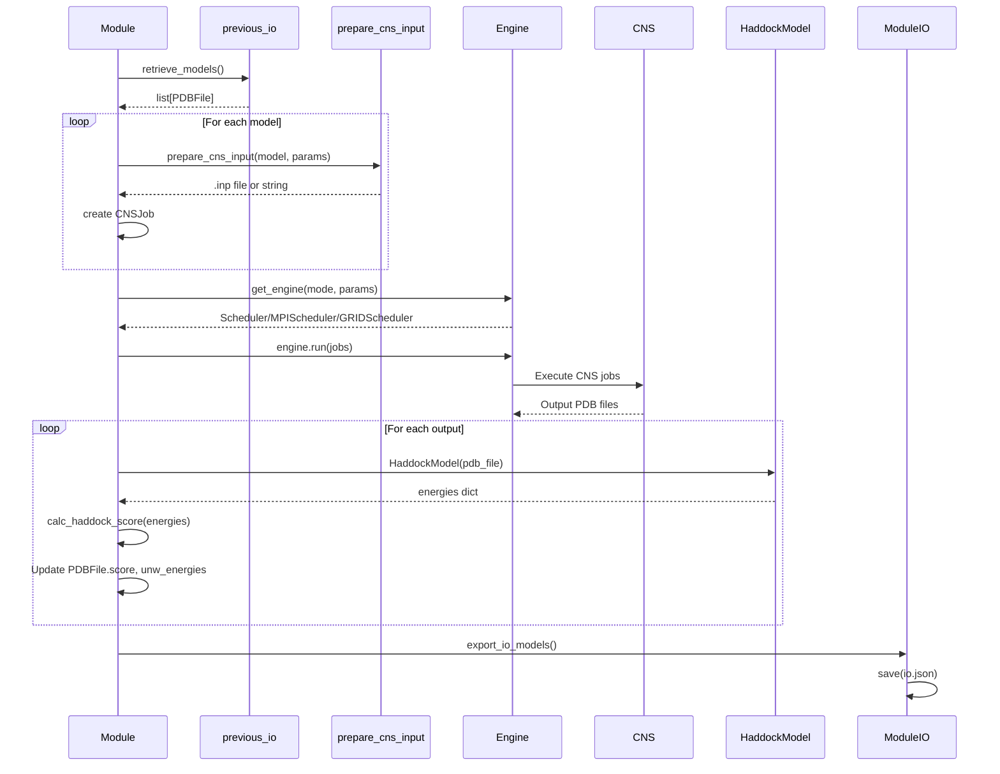

**Sources:** [src/haddock/modules/sampling/rigidbody/__init__.py:196-271](), [src/haddock/modules/refinement/flexref/__init__.py:56-159](), [src/haddock/modules/scoring/emscoring/__init__.py:39-102]()

## Error Handling and Tolerance

HADDOCK3 implements fault tolerance through the `faulty_tolerance` parameter:

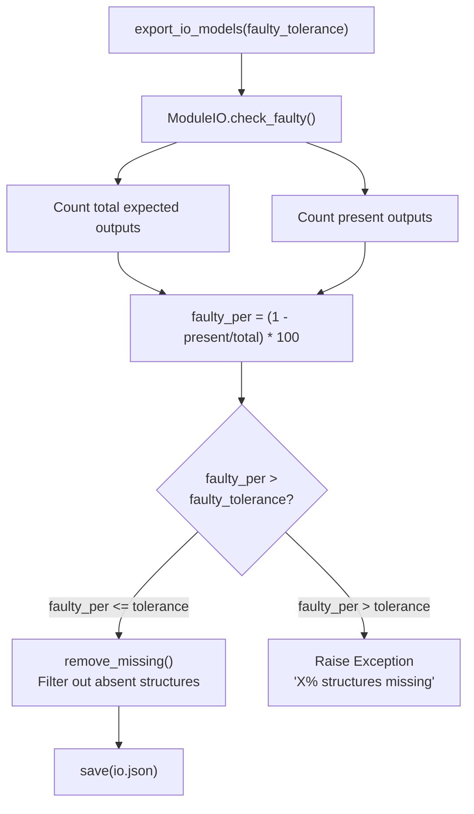

**Sources:** [src/haddock/libs/libontology.py:194-237](), [src/haddock/modules/base_cns_module.py:40-62]()

---