# PDB Preprocessing

<details>
<summary>Relevant source files</summary>

The following files were used as context for generating this wiki page:

- [src/haddock/core/cns_paths.py](src/haddock/core/cns_paths.py)
- [src/haddock/core/supported_molecules.py](src/haddock/core/supported_molecules.py)
- [src/haddock/gear/preprocessing.py](src/haddock/gear/preprocessing.py)
- [src/haddock/libs/libcns.py](src/haddock/libs/libcns.py)
- [src/haddock/libs/libfunc.py](src/haddock/libs/libfunc.py)
- [src/haddock/libs/libontology.py](src/haddock/libs/libontology.py)
- [src/haddock/libs/libpdb.py](src/haddock/libs/libpdb.py)
- [src/haddock/modules/analysis/clustfcc/__init__.py](src/haddock/modules/analysis/clustfcc/__init__.py)
- [src/haddock/modules/analysis/seletop/__init__.py](src/haddock/modules/analysis/seletop/__init__.py)
- [src/haddock/modules/analysis/seletopclusts/__init__.py](src/haddock/modules/analysis/seletopclusts/__init__.py)
- [src/haddock/modules/base_cns_module.py](src/haddock/modules/base_cns_module.py)
- [src/haddock/modules/refinement/emref/__init__.py](src/haddock/modules/refinement/emref/__init__.py)
- [src/haddock/modules/refinement/flexref/__init__.py](src/haddock/modules/refinement/flexref/__init__.py)
- [src/haddock/modules/refinement/mdref/__init__.py](src/haddock/modules/refinement/mdref/__init__.py)
- [src/haddock/modules/sampling/gdock/__init__.py](src/haddock/modules/sampling/gdock/__init__.py)
- [src/haddock/modules/sampling/lightdock/__init__.py](src/haddock/modules/sampling/lightdock/__init__.py)
- [src/haddock/modules/sampling/rigidbody/__init__.py](src/haddock/modules/sampling/rigidbody/__init__.py)
- [src/haddock/modules/scoring/emscoring/__init__.py](src/haddock/modules/scoring/emscoring/__init__.py)
- [src/haddock/modules/scoring/mdscoring/__init__.py](src/haddock/modules/scoring/mdscoring/__init__.py)
- [src/haddock/modules/topology/topoaa/__init__.py](src/haddock/modules/topology/topoaa/__init__.py)
- [tests/data/broken.pdb](tests/data/broken.pdb)
- [tests/data/corrected.pdb](tests/data/corrected.pdb)
- [tests/data/residues.top](tests/data/residues.top)
- [tests/test_cns_paths.py](tests/test_cns_paths.py)
- [tests/test_core_supported_molecules.py](tests/test_core_supported_molecules.py)
- [tests/test_gear_preprocessing.py](tests/test_gear_preprocessing.py)

</details>


## Purpose and Scope

The PDB preprocessing system ensures that input molecular structures are compatible with HADDOCK3 by automatically detecting and correcting common formatting issues in PDB files. This preprocessing step runs before topology generation and applies a series of standardization operations to produce clean, CNS-compatible PDB files.

For information about topology generation that occurs after preprocessing, see [Topology Modules](#4.1). For details on supported molecule types and residues, see [Supported Molecules](#7.3).

**Sources:** [src/haddock/gear/preprocessing.py:1-85]()

## When Preprocessing Occurs

PDB preprocessing executes automatically when input molecules are copied to the `data/` folder during workflow setup. The system creates backup copies of original input PDBs alongside the processed versions.

To disable automatic preprocessing, set `skip_preprocess = False` in the general configuration parameters. However, this is not recommended as unprocessed PDBs may cause failures in downstream CNS-based modules.

**Sources:** [src/haddock/gear/preprocessing.py:67-77](), [src/haddock/modules/topology/topoaa/__init__.py:257-270]()

## Three-Stage Processing Pipeline

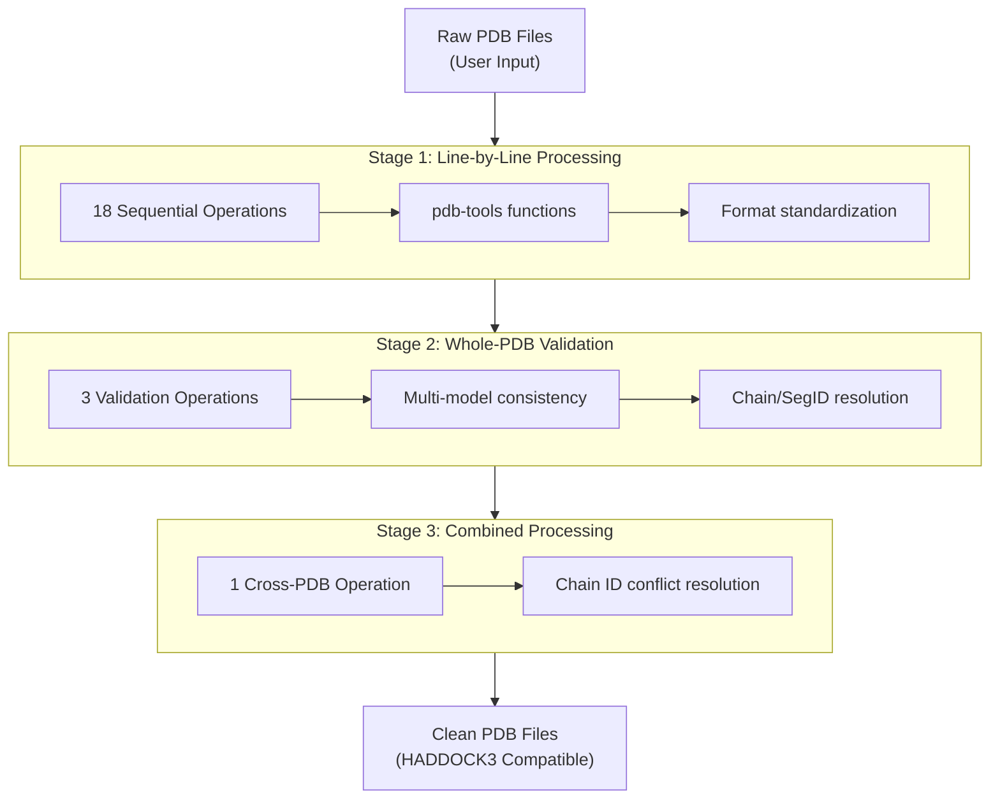

**Diagram: PDB Preprocessing Pipeline Architecture**

The preprocessing pipeline consists of three distinct stages that process PDB files sequentially. Each stage has specific responsibilities and operates on different scopes of the input data.

**Sources:** [src/haddock/gear/preprocessing.py:326-437]()

## Entry Point and Configuration

### Main Function: process_pdbs

The `process_pdbs` function orchestrates all preprocessing operations:

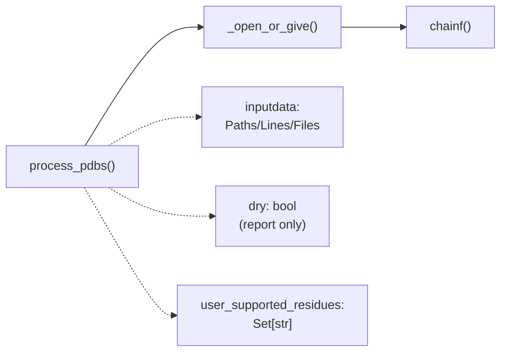

**Diagram: process_pdbs Function Signature**

**Sources:** [src/haddock/gear/preprocessing.py:326-364]()

### Input Handling

The `_open_or_give` function accepts multiple input types and normalizes them to a consistent format:

| Input Type | Example | Handling |
|------------|---------|----------|
| `Path` | `Path("molecule.pdb")` | Read file to lines |
| `str` | `"molecule.pdb"` | Convert to Path, read |
| `io.TextIOBase` | `open("molecule.pdb")` | Read lines directly |
| `list[str]` | `["ATOM...", "ATOM..."]` | Use as-is |
| `tuple[str]` | `("ATOM...", "ATOM...")` | Convert to list |

**Sources:** [src/haddock/gear/preprocessing.py:212-271]()

## Stage 1: Line-by-Line Corrections

This stage applies 18 sequential operations to each line of the PDB file, using the functional programming pattern implemented by `chainf`:

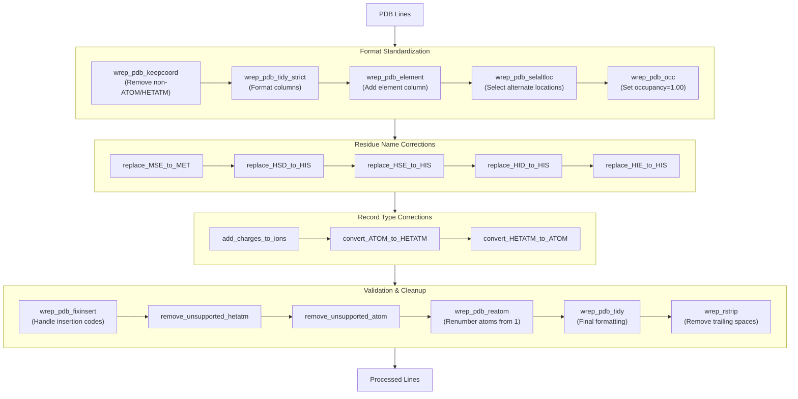

**Diagram: Line-by-Line Processing Steps**

**Sources:** [src/haddock/gear/preprocessing.py:371-404]()

### Format Standardization Operations

| Function | Purpose | Source |
|----------|---------|--------|
| `wrep_pdb_keepcoord` | Discard all records except ATOM/HETATM/ANISOU | pdb-tools |
| `wrep_pdb_tidy_strict` | Format columns according to PDB standard (strict mode) | pdb-tools |
| `wrep_pdb_element` | Generate and add element column if missing | pdb-tools |
| `wrep_pdb_selaltloc` | Select first alternate location when multiple exist | pdb-tools |
| `wrep_pdb_occ` | Set occupancy to 1.00 for all atoms | pdb-tools |

**Sources:** [src/haddock/gear/preprocessing.py:443-456]()

### Residue Renaming Operations

These operations convert non-standard residue names to their standard equivalents:

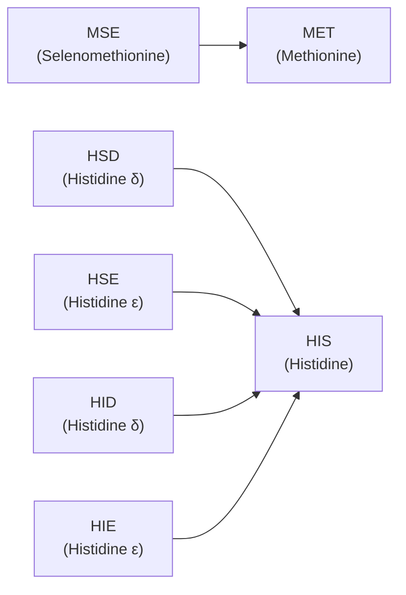

**Diagram: Residue Name Conversions**

The `replace_residue` function handles both the name change and conversion from HETATM to ATOM when necessary.

**Sources:** [src/haddock/gear/preprocessing.py:490-568]()

### Ion Charge Handling

The `add_charges_to_ions` function ensures ions have properly formatted charges by checking three locations in priority order:

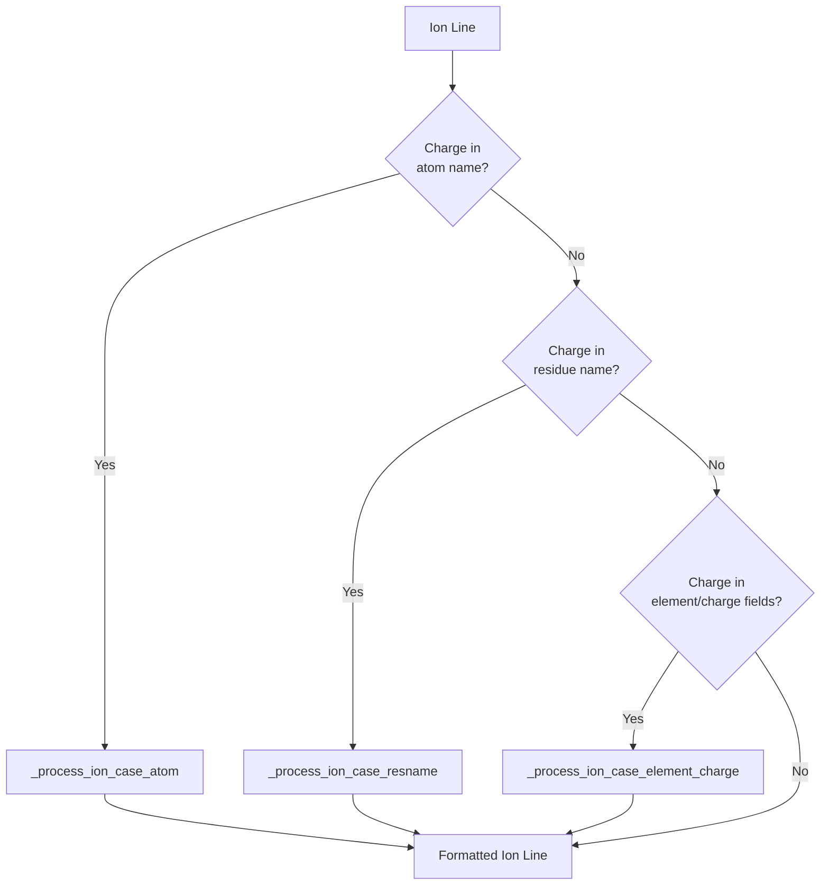

**Diagram: Ion Charge Processing Logic**

**Sources:** [src/haddock/gear/preprocessing.py:673-829]()

### ATOM/HETATM Record Conversion

The system automatically converts records based on residue type:

| Function | Operation | Criteria |
|----------|-----------|----------|
| `convert_ATOM_to_HETATM` | ATOM → HETATM | Residue in `supported_HETATM` set |
| `convert_HETATM_to_ATOM` | HETATM → ATOM | Residue in `supported_ATOM` set |

**Sources:** [src/haddock/gear/preprocessing.py:832-890](), [src/haddock/core/supported_molecules.py:47-50]()

### Unsupported Molecule Removal

The `remove_unsupported_molecules` function filters out residues not recognized by HADDOCK3:

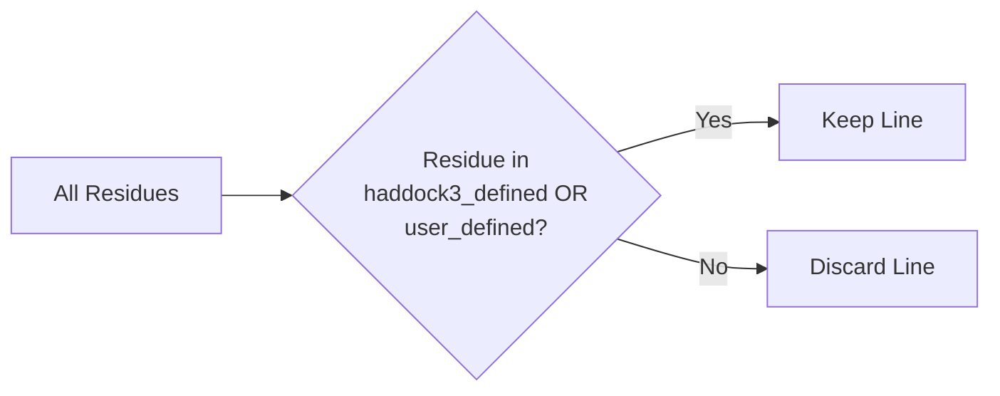

**Diagram: Unsupported Molecule Filtering**

Users can provide custom residue definitions via the `user_supported_residues` parameter, which are read from topology files using `read_additional_residues`.

**Sources:** [src/haddock/gear/preprocessing.py:571-670](), [src/haddock/gear/preprocessing.py:273-323]()

## Stage 2: Whole-PDB Validations

This stage performs three operations that examine the entire PDB structure:

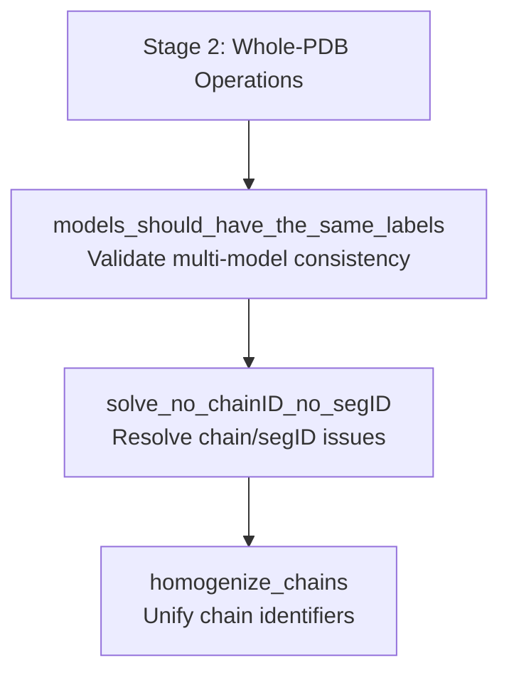

**Diagram: Whole-PDB Processing Sequence**

**Sources:** [src/haddock/gear/preprocessing.py:408-412]()

### Multi-Model Consistency Check

The `models_should_have_the_same_labels` function ensures all models in an ensemble have identical atom labels:

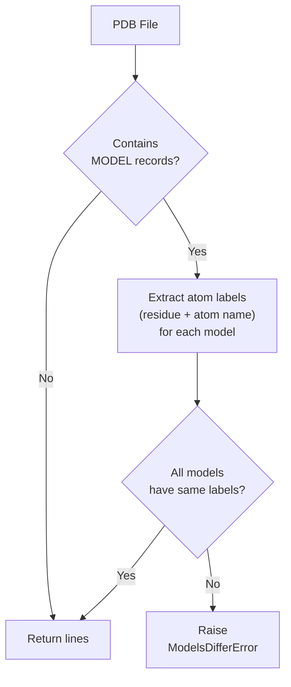

**Diagram: Multi-Model Validation Logic**

**Sources:** [src/haddock/gear/preprocessing.py:1031-1089]()

### Chain and SegID Resolution

The `solve_no_chainID_no_segID` function handles four cases:

| Case | Chain ID | Seg ID | Action | pdb-tools Function |
|------|----------|--------|--------|-------------------|
| 1 | Empty | Present | Copy segID → chainID | `pdb_segxchain` |
| 2 | Present | Empty | Copy chainID → segID | `pdb_chainxseg` |
| 3 | Empty | Empty | Assign 'A', copy to both | `pdb_chain` + `pdb_chainxseg` |
| 4 | Present | Different | Copy chainID → segID (priority) | `pdb_chainxseg` |

**Sources:** [src/haddock/gear/preprocessing.py:896-937]()

### Chain Homogenization

The `homogenize_chains` function ensures a single PDB file uses one consistent chain identifier:

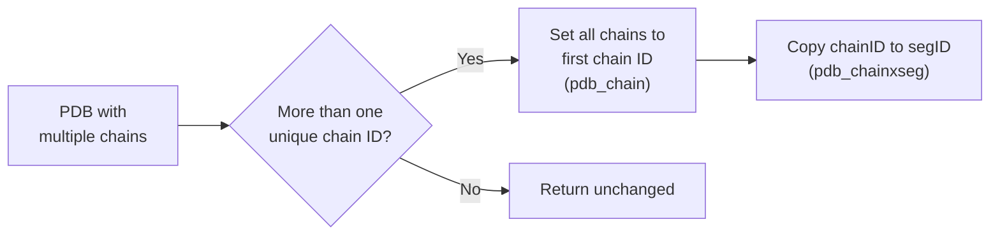

**Diagram: Chain Homogenization Process**

**Sources:** [src/haddock/gear/preprocessing.py:945-971]()

## Stage 3: Combined-PDB Corrections

This stage operates on all input PDB files simultaneously to resolve conflicts:

### Chain ID Conflict Resolution

The `correct_equal_chain_segids` function prevents chain ID collisions across multiple input molecules:

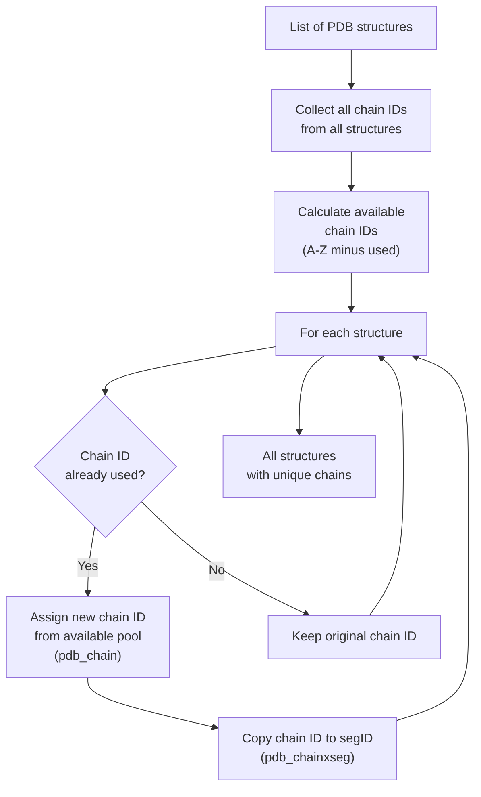

**Diagram: Cross-PDB Chain Conflict Resolution**

**Sources:** [src/haddock/gear/preprocessing.py:976-1028]()

## Reporting and Debugging

### Dry Run Mode

The preprocessing system supports a dry-run mode via the `report` parameter, enabled by the `_report` decorator:

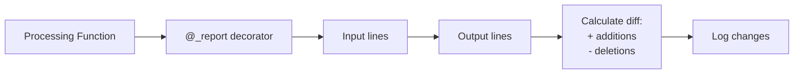

**Diagram: Report Decorator Mechanism**

When `report=True`, each processing function logs the differences between input and output, showing added lines (prefixed with `+`) and deleted lines (prefixed with `-`).

**Sources:** [src/haddock/gear/preprocessing.py:152-209]()

### Log Format

Each reported change includes:
- Function name and parameters
- Number of additions and deletions
- Full diff showing affected lines

Example log output format:
```
[pdb_tidy strict=True] + 5 - 3 lines
+ ATOM      1  N   ALA A   1   ...
+ ATOM      2  CA  ALA A   1   ...
- ATOM   1  N   ALA A   1   ...
- ATOM   2  CA  ALA A   1   ...
```

**Sources:** [src/haddock/gear/preprocessing.py:173-201]()

## Integration with Topology Generation

The `topoaa` module integrates preprocessing via `libpdb.sanitize`:

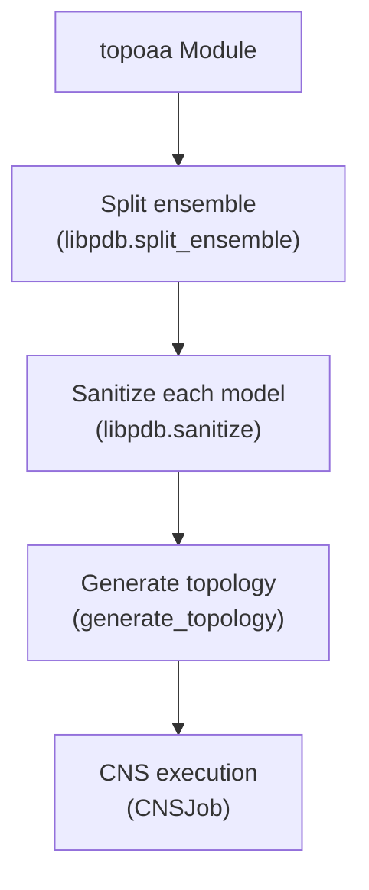

**Diagram: Preprocessing in Topology Workflow**

The `sanitize` function performs a simplified preprocessing focused on residue validation and basic formatting.

**Sources:** [src/haddock/modules/topology/topoaa/__init__.py:256-270](), [src/haddock/libs/libpdb.py:166-206]()

## Supported Molecule Types

Preprocessing recognizes molecules based on CNS topology files. The system categorizes residues into two groups:

### ATOM Record Types

Molecules that should appear as `ATOM` records:
- Standard amino acids (20 natural + modified)
- Nucleic acids (DNA/RNA variants)
- Coarse-grained protein/DNA beads (Martini)

### HETATM Record Types

Molecules that should appear as `HETATM` records:
- Carbohydrates
- Hemes and cofactors
- Single-atom ions (Na+, Cl-, Zn2+, etc.)
- Multi-atom ions (PO4, SO4, etc.)
- Solvent molecules
- Fragment probes
- Shape definitions

**Sources:** [src/haddock/core/supported_molecules.py:1-50](), [src/haddock/core/supported_molecules.py:393-453]()

### Custom Topology Support

Users can extend supported residues by providing custom topology files:

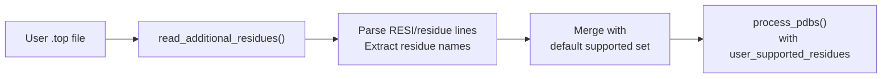

**Diagram: Custom Residue Support Flow**

The `read_additional_residues` function extracts residue names from topology files using the regex pattern: `^(RESIdue|residue|RESI) ([A-Z0-9]{1,3}).*$`

**Sources:** [src/haddock/gear/preprocessing.py:273-323](), [src/haddock/libs/libpdb.py:91-99]()

## Example: Complete Preprocessing

Consider this broken PDB input:

```
MSE residue with wrong record type
HETATM  1  SE  MSE A  23  ...
HSD residue needing conversion
ATOM   1  N   HSD A  24  ...
Missing element column
ATOM   2  CA  ALA A   1  ...                  
Ion with missing charge
ATOM   3  ZN  ZN  A  30  ...
```

After preprocessing:

```
ATOM   1  SD  MET A  23  ...  S 
ATOM   1  N   HIS A  24  ...  N 
ATOM   2  CA  ALA A   1  ...  C 
HETATM 3 ZN+2 ZN2 A  30  ... ZN2+
```

Changes applied:
1. MSE → MET (residue rename)
2. HETATM → ATOM (for MET)
3. HSD → HIS (residue rename)
4. Element column added (S, N, C)
5. ZN reformatted with proper charge (ZN+2)
6. ATOM → HETATM (for ion)
7. Residue name updated (ZN → ZN2)

**Sources:** [tests/data/broken.pdb:1-192](), [tests/data/corrected.pdb:1-192]()

## Configuration Parameters

While preprocessing happens automatically, it can be controlled via configuration:

| Parameter | Type | Default | Purpose |
|-----------|------|---------|---------|
| `skip_preprocess` | bool | False | Disable automatic preprocessing |
| `ligand_top_fname` | Path | None | Custom topology file path |

Custom topologies are passed to `process_pdbs` via the `user_supported_residues` parameter.

**Sources:** [src/haddock/gear/preprocessing.py:326-364](), [src/haddock/modules/topology/topoaa/__init__.py:260-270]()

## Technical Implementation Details

### Functional Programming Pattern

The preprocessing pipeline uses the `chainf` function to compose operations:

```python
result = chainf(
    structure,
    operation1,
    operation2,
    operation3,
    report=dry_run_mode
)
```

This pattern allows clean composition of line-by-line transformations where each function receives the output of the previous one.

**Sources:** [src/haddock/gear/preprocessing.py:420-426](), [src/haddock/libs/libfunc.py:13-38]()

### Generator-Based Processing

Most line-by-line operations are implemented as generators for memory efficiency:

```python
def some_operation(lines: Iterable[str]) -> Generator[str, None, None]:
    for line in lines:
        # process line
        yield modified_line
```

The `_report` decorator can convert generators to lists when reporting is enabled, but maintains generator behavior otherwise.

**Sources:** [src/haddock/gear/preprocessing.py:152-209]()

### PDB Line Slicing Constants

The system uses predefined slice objects for PDB field access:

| Slice Name | Columns | Field |
|------------|---------|-------|
| `slc_record` | 0-6 | Record type (ATOM/HETATM) |
| `slc_name` | 12-16 | Atom name |
| `slc_resname` | 17-20 | Residue name |
| `slc_chainid` | 21-22 | Chain ID |
| `slc_segid` | 72-76 | Segment ID |
| `slc_element` | 76-78 | Element symbol |
| `slc_charge` | 78-80 | Atomic charge |

**Sources:** [src/haddock/libs/libpdb.py:27-42]()

## Related Systems

- **Topology Generation**: See [Topology Modules](#4.1) for how preprocessed PDBs are used to generate CNS topology files
- **Supported Molecules**: See [Supported Molecules](#7.3) for detailed residue type definitions and CNS topology file parsing
- **CNS Integration**: See [CNS Integration](#7.2) for how cleaned PDBs are used in CNS calculations

**Sources:** [src/haddock/gear/preprocessing.py:1-85]()

---