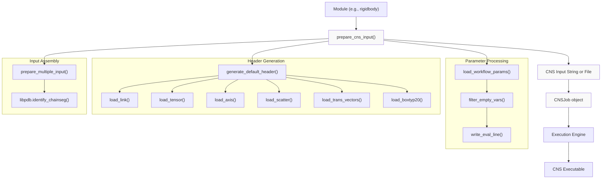
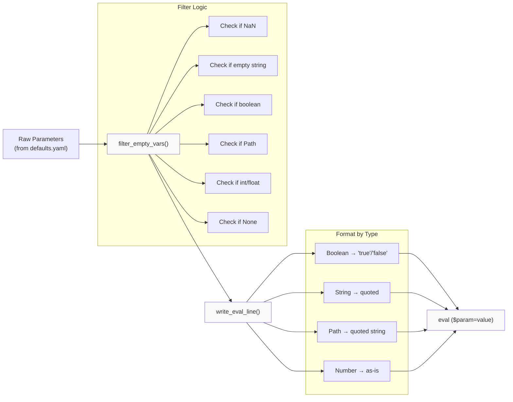
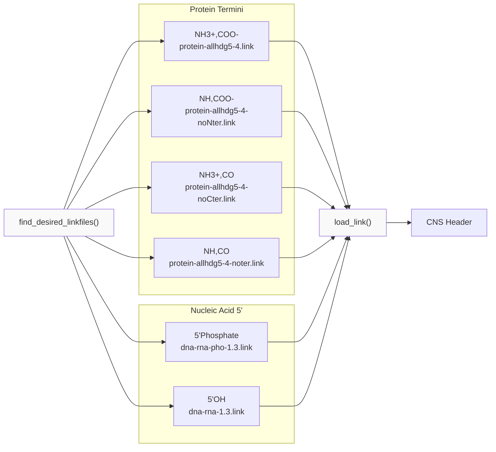
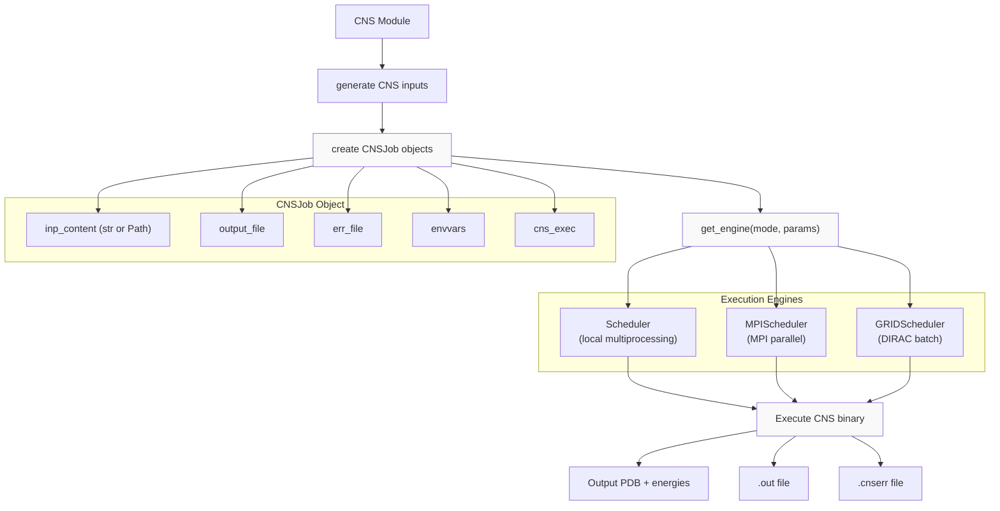
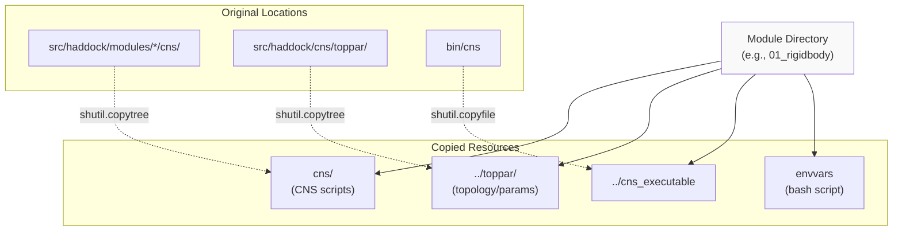
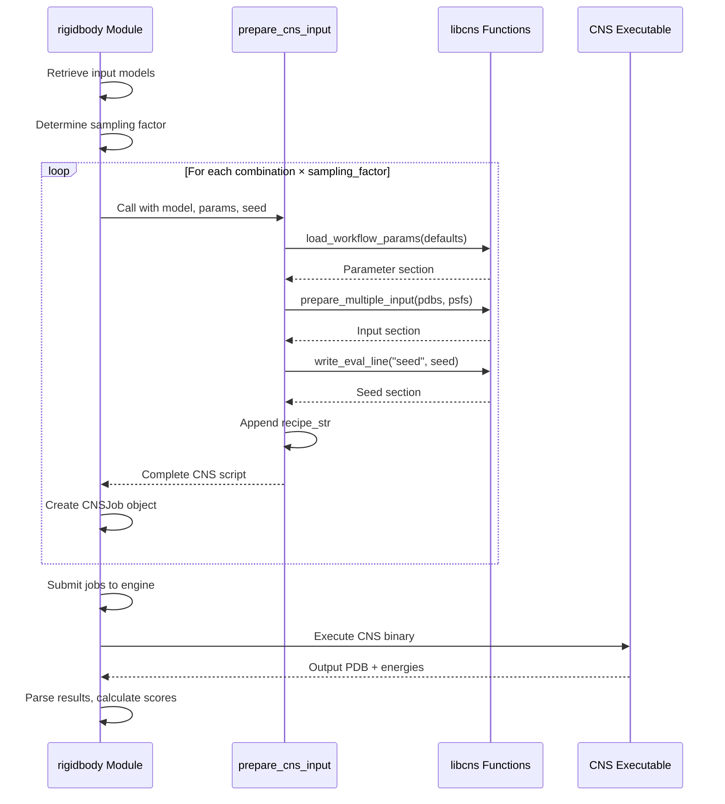

# CNS Integration

<details>
<summary>Relevant source files</summary>

The following files were used as context for generating this wiki page:

- [src/haddock/core/cns_paths.py](src/haddock/core/cns_paths.py)
- [src/haddock/core/supported_molecules.py](src/haddock/core/supported_molecules.py)
- [src/haddock/gear/preprocessing.py](src/haddock/gear/preprocessing.py)
- [src/haddock/libs/libcns.py](src/haddock/libs/libcns.py)
- [src/haddock/libs/libfunc.py](src/haddock/libs/libfunc.py)
- [src/haddock/libs/libontology.py](src/haddock/libs/libontology.py)
- [src/haddock/libs/libpdb.py](src/haddock/libs/libpdb.py)
- [src/haddock/modules/analysis/clustfcc/__init__.py](src/haddock/modules/analysis/clustfcc/__init__.py)
- [src/haddock/modules/analysis/seletop/__init__.py](src/haddock/modules/analysis/seletop/__init__.py)
- [src/haddock/modules/analysis/seletopclusts/__init__.py](src/haddock/modules/analysis/seletopclusts/__init__.py)
- [src/haddock/modules/base_cns_module.py](src/haddock/modules/base_cns_module.py)
- [src/haddock/modules/refinement/emref/__init__.py](src/haddock/modules/refinement/emref/__init__.py)
- [src/haddock/modules/refinement/flexref/__init__.py](src/haddock/modules/refinement/flexref/__init__.py)
- [src/haddock/modules/refinement/mdref/__init__.py](src/haddock/modules/refinement/mdref/__init__.py)
- [src/haddock/modules/sampling/gdock/__init__.py](src/haddock/modules/sampling/gdock/__init__.py)
- [src/haddock/modules/sampling/lightdock/__init__.py](src/haddock/modules/sampling/lightdock/__init__.py)
- [src/haddock/modules/sampling/rigidbody/__init__.py](src/haddock/modules/sampling/rigidbody/__init__.py)
- [src/haddock/modules/scoring/emscoring/__init__.py](src/haddock/modules/scoring/emscoring/__init__.py)
- [src/haddock/modules/scoring/mdscoring/__init__.py](src/haddock/modules/scoring/mdscoring/__init__.py)
- [src/haddock/modules/topology/topoaa/__init__.py](src/haddock/modules/topology/topoaa/__init__.py)
- [tests/data/broken.pdb](tests/data/broken.pdb)
- [tests/data/corrected.pdb](tests/data/corrected.pdb)
- [tests/data/residues.top](tests/data/residues.top)
- [tests/test_cns_paths.py](tests/test_cns_paths.py)
- [tests/test_core_supported_molecules.py](tests/test_core_supported_molecules.py)
- [tests/test_gear_preprocessing.py](tests/test_gear_preprocessing.py)

</details>


## Purpose and Scope

This page explains how HADDOCK3 interfaces with CNS (Crystallography & NMR System) for molecular dynamics simulations, energy minimization, and structure refinement. CNS is the computational engine that performs rigid-body docking, flexible refinement, and scoring calculations.

For information about the overall module architecture, see [Module Architecture](#3.2). For details on specific CNS-based modules like topology generation, sampling, and refinement, see [Module Reference](#4).

## CNS Input File Structure

HADDOCK3 generates CNS input files (`.inp`) that combine multiple components into a single executable script. Each input file follows a consistent structure:

```
┌─────────────────────────────┐
│ 1. Header Section           │  ← Link files, tensors, axis definitions
├─────────────────────────────┤
│ 2. Parameters Section       │  ← Module-specific parameters (eval statements)
├─────────────────────────────┤
│ 3. Input Section            │  ← PDB/PSF paths, ncomponents, segids
├─────────────────────────────┤
│ 4. Seed Section             │  ← Random seed for reproducibility
├─────────────────────────────┤
│ 5. Output Section           │  ← Output PDB filename, model count
├─────────────────────────────┤
│ 6. Recipe Section           │  ← CNS protocol script (e.g., rigidbody.cns)
└─────────────────────────────┘
```

Each section is assembled by specific functions in [src/haddock/libs/libcns.py]().

**Sources:** [src/haddock/libs/libcns.py:321-424]()

## Script Generation Pipeline

The following diagram shows how HADDOCK3 modules generate CNS input scripts:



**Sources:** [src/haddock/libs/libcns.py:321-424](), [src/haddock/libs/libcns.py:151-182](), [src/haddock/libs/libcns.py:23-53]()

### Core Function: prepare_cns_input

The `prepare_cns_input` function orchestrates the entire script generation process:

| Parameter | Type | Purpose |
|-----------|------|---------|
| `model_number` | `int` | Model identifier for file naming |
| `input_element` | `PDBFile` or `list[PDBFile]` | Input structures with topology |
| `step_path` | `FilePath` | Module working directory |
| `recipe_str` | `str` | CNS protocol script content |
| `defaults` | `dict` | Module parameters |
| `identifier` | `str` | Module name (e.g., "rigidbody") |
| `ambig_fname` | `FilePath` | Ambiguous restraints file |
| `native_segid` | `bool` | Preserve chain/seg IDs |
| `debug` | `bool` | Write `.inp` file to disk |
| `seed` | `int` | Random seed override |

The function returns either a string (when `debug=False`) or a `Path` to the written `.inp` file.

**Sources:** [src/haddock/libs/libcns.py:321-424]()

## Parameter Handling and Filtering

CNS requires specific parameter formatting. HADDOCK3 filters and formats parameters through a multi-step process:



### Filtering Rules

The `filter_empty_vars` function determines which parameters should be written to CNS:

| Condition | Action | Reason |
|-----------|--------|--------|
| `math.isnan(value)` | Skip | Invalid numeric value |
| Empty string `""` | Skip | No value provided |
| `None` | Skip | Parameter not set |
| Boolean | Include | Valid CNS parameter |
| Non-empty string | Include | Valid CNS parameter |
| `int` or `float` | Include | Valid CNS parameter |
| `Path` or `EmptyPath` | Include | File path parameter |

**Sources:** [src/haddock/libs/libcns.py:106-148](), [src/haddock/libs/libcns.py:185-210]()

## BaseCNSModule Architecture

All CNS-based modules inherit from `BaseCNSModule`, which provides CNS-specific functionality:

```mermaid
graph TB
    BaseHaddockModule["BaseHaddockModule"]
    BaseCNSModule["BaseCNSModule"]
    
    BaseHaddockModule --> BaseCNSModule
    
    subgraph "CNS Modules"
        TopoAA["topoaa.HaddockModule"]
        RigidBody["rigidbody.HaddockModule"]
        FlexRef["flexref.HaddockModule"]
        EMRef["emref.HaddockModule"]
        MDRef["mdref.HaddockModule"]
        EMScoring["emscoring.HaddockModule"]
        MDScoring["mdscoring.HaddockModule"]
    end
    
    BaseCNSModule --> TopoAA
    BaseCNSModule --> RigidBody
    BaseCNSModule --> FlexRef
    BaseCNSModule --> EMRef
    BaseCNSModule --> MDRef
    BaseCNSModule --> EMScoring
    BaseCNSModule --> MDScoring
    
    subgraph "BaseCNSModule Attributes"
        CNSFolder["cns_folder_path"]
        CNSProtocol["cns_protocol_path"]
        TopparPath["toppar_path"]
        RecipeStr["recipe_str"]
        Envvars["envvars"]
    end
    
    BaseCNSModule --> CNSFolder
    BaseCNSModule --> CNSProtocol
    BaseCNSModule --> TopparPath
    BaseCNSModule --> RecipeStr
    BaseCNSModule --> Envvars
    
    style BaseCNSModule fill:#f9f9f9
```



### Initialization

When a CNS module is instantiated, it loads the CNS protocol script:

```python
# Example from rigidbody module
cns_script = Path(RECIPE_PATH, "cns", "rigidbody.cns")
super().__init__(order, path, initial_params, cns_script=cns_script)
```

The `BaseCNSModule.__init__` method:
1. Calls `BaseHaddockModule.__init__`
2. Resolves the CNS script path
3. Sets `toppar_path` to the global topology/parameter directory
4. Reads the CNS protocol script into `recipe_str`

**Sources:** [src/haddock/modules/base_cns_module.py:23-39]()

### Environment Variables

CNS modules require three environment variables:

| Variable | Value | Purpose |
|----------|-------|---------|
| `MODULE` | `str(cns_folder_path)` | Path to CNS scripts directory |
| `MODDIR` | `"."` | Current module directory |
| `TOPPAR` | `str(toppar_path)` | Path to topology/parameter files |

These are set by `default_envvars()` and passed to `CNSJob` objects:

**Sources:** [src/haddock/modules/base_cns_module.py:65-73]()

## Header Component Details

The CNS input header consists of six major components, each loaded by dedicated functions:

### 1. Link Files

Link files define how residues connect (termini states, bonds between residues):



The selection is based on three boolean parameters:
- `charged_nter`: N-terminus protonated (NH3+)?
- `charged_cter`: C-terminus deprotonated (COO-)?
- `phosphate_5`: 5' end has phosphate group?

**Sources:** [src/haddock/libs/libcns.py:56-103](), [src/haddock/libs/libcns.py:213-218](), [src/haddock/core/cns_paths.py:29-38]()

### 2. Axis Definitions

Axis files define coordinate system orientations for RDC (Residual Dipolar Coupling) calculations:

| File | Purpose |
|------|---------|
| `top_axis.pro` | Standard axis topology |
| `par_axis.pro` | Parallel axis parameters |
| `top_axis_dani.pro` | DANI (Direct Assignment of NIH shifts) axis |

**Sources:** [src/haddock/core/cns_paths.py:78-85]()

### 3. Tensor Files

Tensor files define magnetic susceptibility anisotropy tensors for RDC/PCS calculations:

| File | Purpose |
|------|---------|
| `tensor.psf`, `tensor.pdb` | Standard tensor definition |
| `tensor_para.psf`, `tensor_para.pdb` | Paramagnetic tensor |
| `tensor_dani.psf`, `tensor_dani.pdb` | DANI tensor |

**Sources:** [src/haddock/core/cns_paths.py:66-75]()

### 4. Translation Vectors

Translation vectors define initial separation positions for rigid-body docking:

- 51 predefined vectors in `initial_positions/trans_vector_0` through `trans_vector_50`
- Used to separate molecules before docking minimization
- Ensures diverse starting configurations

**Sources:** [src/haddock/core/cns_paths.py:45-62]()

### 5. Scatter Library

The scatter library (`scatter.lib`) contains X-ray scattering factors for SAXS/WAXS restraints.

**Sources:** [src/haddock/libs/libcns.py:241-245]()

### 6. Water Box

The water box file (`boxtyp20.pdb`) provides a pre-equilibrated water box for explicit solvent refinement.

**Sources:** [src/haddock/libs/libcns.py:248-252]()

## Input Section Assembly

The input section specifies the molecular structures to process:

### Single Input (Topology and Scoring)

For modules like `topoaa` and `emscoring`, a single PDB is provided:

```
! Input structure
structure
  @@path/to/structure.psf
end
coor @@path/to/structure.pdb
eval ($file="path/to/structure.pdb")
eval ($ncomponents=2)
eval ($prot_segid_1="A")
eval ($prot_segid_2="B")
eval ($seed=12345)
```

Generated by `prepare_single_input()`.

**Sources:** [src/haddock/libs/libcns.py:282-318]()

### Multiple Input (Docking and Refinement)

For docking modules, multiple PDBs are combined:

```
! Input structure
structure
  @@path/to/mol1.psf
end
structure
  @@path/to/mol2.psf
end
coor @@path/to/mol1.pdb
eval ($input_pdb_filename_1="path/to/mol1.pdb")
coor @@path/to/mol2.pdb
eval ($input_pdb_filename_2="path/to/mol2.pdb")
eval ($ncomponents=2)
```

Generated by `prepare_multiple_input()`.

**Sources:** [src/haddock/libs/libcns.py:256-278]()

### Chain/Segment ID Detection

The number of components (`ncomponents`) is determined by identifying unique chain/segment IDs:

```python
segids, chains = libpdb.identify_chainseg(pdb_input)
chainsegs = sorted(list(set(segids) | set(chains)))
ncomponents = len(chainsegs)
```

**Sources:** [src/haddock/libs/libcns.py:306-310](), [src/haddock/libs/libpdb.py:209-243]()

## CNS Job Execution

After script generation, CNS jobs are executed through the scheduler system:



### CNSJob Class

The `CNSJob` class (defined in [src/haddock/libs/libsubprocess.py]()) encapsulates:

1. **Input**: CNS script content (string) or path to `.inp` file
2. **Output**: Path where CNS will write output (`.out` file)
3. **Errors**: Path for error messages (`.cnserr` file)
4. **Environment**: Environment variables (`MODULE`, `MODDIR`, `TOPPAR`)
5. **Executable**: Path to CNS binary

**Sources:** [src/haddock/modules/sampling/rigidbody/__init__.py:86-88](), [src/haddock/modules/refinement/flexref/__init__.py:133]()

### Typical Execution Pattern

```python
# 1. Generate CNS input
rigidbody_input = prepare_cns_input(
    idx,
    combination,
    self.path,
    self.recipe_str,
    self.params,
    "rigidbody",
    ambig_fname=ambig_fname,
    default_params_path=self.toppar_path,
    native_segid=True,
    debug=self.params["debug"],
    seed=seed,
)

# 2. Create CNSJob
job = CNSJob(
    rigidbody_input,
    log_fname,
    err_fname,
    envvars=self.envvars,
)

# 3. Submit to engine
Engine = get_engine(self.params["mode"], self.params)
engine = Engine(jobs)
engine.run()
```

**Sources:** [src/haddock/modules/sampling/rigidbody/__init__.py:107-119](), [src/haddock/modules/sampling/rigidbody/__init__.py:86-88](), [src/haddock/modules/sampling/rigidbody/__init__.py:252-256]()

## Self-Contained Mode

When `self_contained=true`, the module copies all CNS-related files into its directory, enabling the run to be moved independently:



The `make_self_contained()` method:

1. Copies the module's `cns/` scripts directory
2. Copies the shared `toppar/` directory (if not already copied)
3. Copies the CNS executable binary
4. Updates environment variables to use relative paths
5. Writes an `envvars` bash script for debugging

**Sources:** [src/haddock/modules/base_cns_module.py:91-114]()

### Environment Variables File

The generated `envvars` file allows manual CNS execution for debugging:

```bash
#!/bin/bash
# for debugging purposes source this file from within the 
# module folder for example, from within '00_topoaa'
export MODULE=cns
export MODDIR=.
export TOPPAR=../toppar
```

**Sources:** [src/haddock/modules/base_cns_module.py:75-89]()

## Restraint File Handling

CNS modules can use different restraint files for each model. The `get_ambig_fnames()` method handles three scenarios:

| Scenario | Configuration | Behavior |
|----------|---------------|----------|
| Single restraint file | `ambig_fname="restraints.tbl"` | All models use this file |
| Tarball of restraints | `ambig_fname="restraints.tbl.tgz"` | Extract and use per-model files |
| Previous restraints | `previous_ambig=true` | Use restraint files from input models |

### Tarball Expansion

When a `.tbl.tgz` file is provided:

1. Extract the tarball (done externally during setup)
2. Search for files matching the pattern `{basename}*tbl`
3. Sort files numerically
4. Assign restraints in order to models

```python
if ambig_fname.name.endswith("tgz"):
    exp_name = ambig_fname.name.split(".tbl.tgz")[0]
    exp_dir = ambig_fname.parent
    path = ambig_fname.parent
    ambig_fnames = list(path.glob(f"{exp_name}*tbl"))
    ambig_fnames = sort_numbered_paths(*ambig_fnames)
```

**Sources:** [src/haddock/modules/base_cns_module.py:116-154]()

## Integration with Module Workflow

The following table shows how different module types use CNS:

| Module Type | CNS Usage | Key Functions |
|-------------|-----------|---------------|
| **Topology** (`topoaa`) | Generate PSF topology files | `generate_topology()`, `prepare_single_input()` |
| **Sampling** (`rigidbody`) | Rigid-body energy minimization | `prepare_cns_input()`, random translation vectors |
| **Refinement** (`flexref`, `emref`, `mdref`) | Torsion angle dynamics, EM, explicit solvent MD | `prepare_cns_input()`, restraint handling |
| **Scoring** (`emscoring`, `mdscoring`) | Energy evaluation | `prepare_cns_input()`, no restraints |

**Sources:** [src/haddock/modules/topology/topoaa/__init__.py:54-100](), [src/haddock/modules/sampling/rigidbody/__init__.py:90-171](), [src/haddock/modules/refinement/flexref/__init__.py:108-119](), [src/haddock/modules/scoring/emscoring/__init__.py:51-77]()

## Example: Complete CNS Input Generation

Here's how a `rigidbody` module generates a CNS input:



The complete process:

1. Module retrieves input models from `previous_io`
2. Determines how many times to sample each combination
3. For each model:
   - Generate CNS input via `prepare_cns_input()`
   - Create `CNSJob` object
   - Add expected `PDBFile` object to `output_models`
4. Submit all jobs to execution engine
5. Engine runs CNS binary for each job
6. Module parses output files, extracts energies, calculates HADDOCK score

**Sources:** [src/haddock/modules/sampling/rigidbody/__init__.py:196-272]()

---