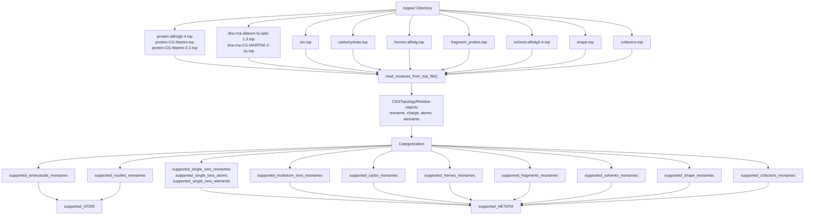
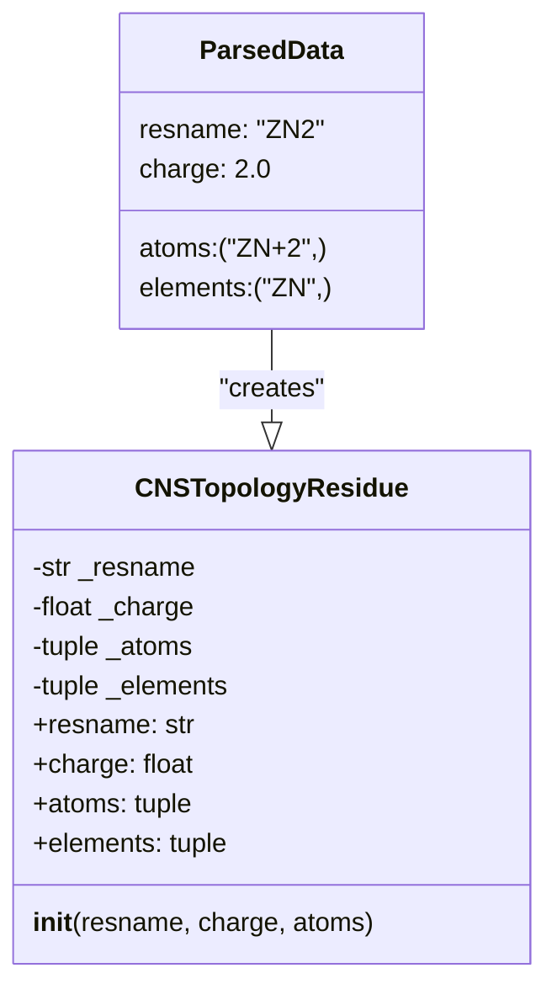
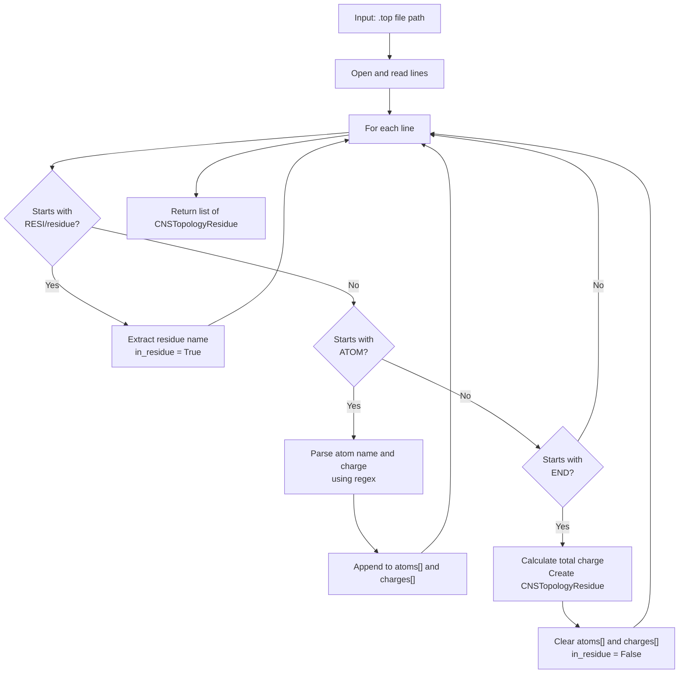
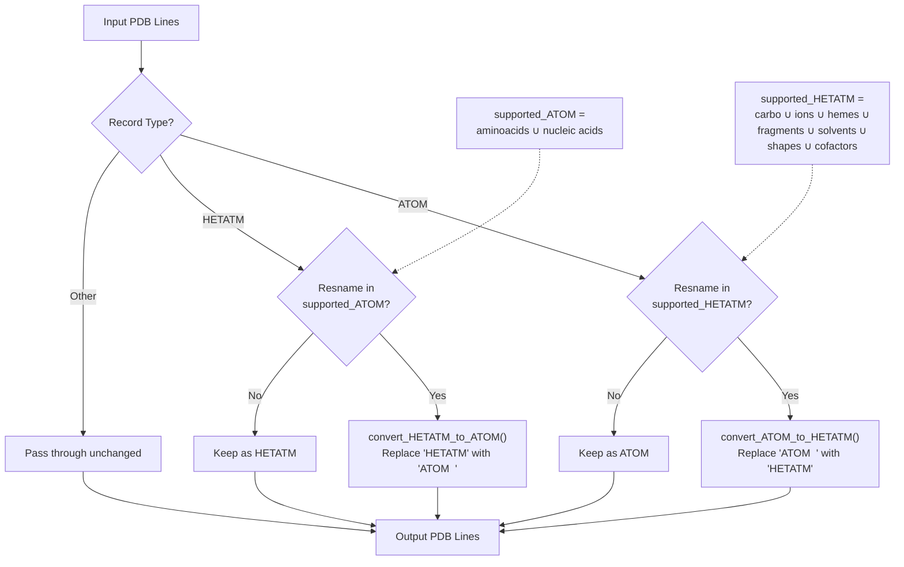
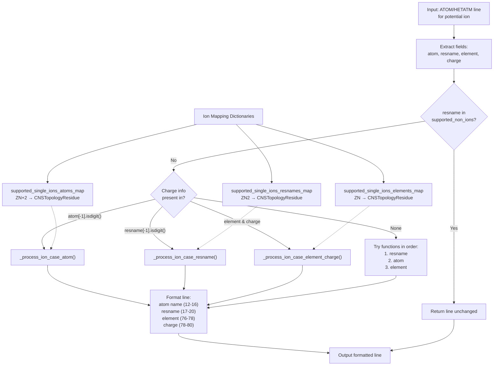
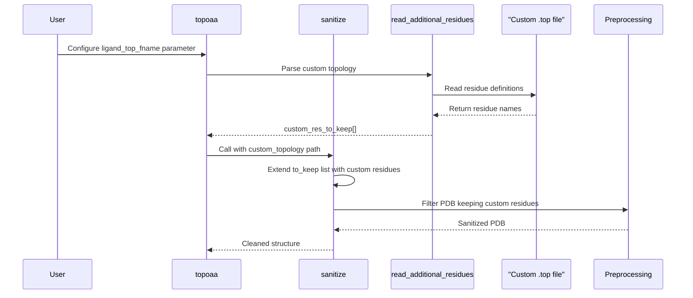

# Supported Molecules

<details>
<summary>Relevant source files</summary>

The following files were used as context for generating this wiki page:

- [src/haddock/core/cns_paths.py](src/haddock/core/cns_paths.py)
- [src/haddock/core/supported_molecules.py](src/haddock/core/supported_molecules.py)
- [src/haddock/gear/preprocessing.py](src/haddock/gear/preprocessing.py)
- [src/haddock/libs/libcns.py](src/haddock/libs/libcns.py)
- [src/haddock/libs/libfunc.py](src/haddock/libs/libfunc.py)
- [src/haddock/libs/libontology.py](src/haddock/libs/libontology.py)
- [src/haddock/libs/libpdb.py](src/haddock/libs/libpdb.py)
- [src/haddock/modules/analysis/clustfcc/__init__.py](src/haddock/modules/analysis/clustfcc/__init__.py)
- [src/haddock/modules/analysis/seletop/__init__.py](src/haddock/modules/analysis/seletop/__init__.py)
- [src/haddock/modules/analysis/seletopclusts/__init__.py](src/haddock/modules/analysis/seletopclusts/__init__.py)
- [src/haddock/modules/base_cns_module.py](src/haddock/modules/base_cns_module.py)
- [src/haddock/modules/refinement/emref/__init__.py](src/haddock/modules/refinement/emref/__init__.py)
- [src/haddock/modules/refinement/flexref/__init__.py](src/haddock/modules/refinement/flexref/__init__.py)
- [src/haddock/modules/refinement/mdref/__init__.py](src/haddock/modules/refinement/mdref/__init__.py)
- [src/haddock/modules/sampling/gdock/__init__.py](src/haddock/modules/sampling/gdock/__init__.py)
- [src/haddock/modules/sampling/lightdock/__init__.py](src/haddock/modules/sampling/lightdock/__init__.py)
- [src/haddock/modules/sampling/rigidbody/__init__.py](src/haddock/modules/sampling/rigidbody/__init__.py)
- [src/haddock/modules/scoring/emscoring/__init__.py](src/haddock/modules/scoring/emscoring/__init__.py)
- [src/haddock/modules/scoring/mdscoring/__init__.py](src/haddock/modules/scoring/mdscoring/__init__.py)
- [src/haddock/modules/topology/topoaa/__init__.py](src/haddock/modules/topology/topoaa/__init__.py)
- [tests/data/broken.pdb](tests/data/broken.pdb)
- [tests/data/corrected.pdb](tests/data/corrected.pdb)
- [tests/data/residues.top](tests/data/residues.top)
- [tests/test_cns_paths.py](tests/test_cns_paths.py)
- [tests/test_core_supported_molecules.py](tests/test_core_supported_molecules.py)
- [tests/test_gear_preprocessing.py](tests/test_gear_preprocessing.py)

</details>


This document describes HADDOCK3's system for validating and categorizing molecular residues during structure preparation. The supported molecules system defines which residue types can be processed by CNS-based modules and how they should be classified in PDB files.

For information about PDB preprocessing and validation, see [PDB Preprocessing](#7.1). For topology generation, see [Topology Modules](#4.1).

## Overview

HADDOCK3 determines which molecules are supported by parsing CNS topology files located in the `toppar/` directory. The system automatically reads residue definitions from `.top` files and categorizes them into groups (proteins, nucleic acids, ions, carbohydrates, etc.). This information is used throughout the workflow to validate input structures, correct PDB formatting, and ensure compatibility with CNS.

The supported molecules system serves three primary functions:
1. **Validation**: Removes unsupported residues during PDB preprocessing
2. **Classification**: Determines whether residues should be `ATOM` or `HETATM` records
3. **Formatting**: Ensures ion charges and atom names follow CNS conventions

**Sources:** [src/haddock/core/supported_molecules.py:1-59]()

## Topology File System



**Sources:** [src/haddock/core/supported_molecules.py:270-391](), [src/haddock/core/supported_molecules.py:159-243]()

## CNSTopologyResidue Class

The `CNSTopologyResidue` class represents a parsed residue definition from CNS topology files. It stores the minimal information needed for PDB validation and formatting.



| Property | Type | Description |
|----------|------|-------------|
| `resname` | `str` | Three-letter residue code (e.g., "ZN2", "ALA") |
| `charge` | `float` | Total residue charge, rounded to 2 decimal places |
| `atoms` | `tuple[str, ...]` | List of atom names in the residue |
| `elements` | `tuple[str, ...]` | Element symbols for each atom (ions only) |

**Sources:** [src/haddock/core/supported_molecules.py:61-139]()

## Molecule Categories

HADDOCK3 organizes supported residues into ten categories based on their chemical nature and source topology files:

| Category | Variable Name | Description | Record Type |
|----------|--------------|-------------|-------------|
| Amino Acids | `supported_aminoacids_resnames` | Natural and modified protein residues, including coarse-grained Martini beads | ATOM |
| Nucleic Acids | `supported_nucleic_resnames` | DNA/RNA residues (all-atom and CG-Martini) | ATOM |
| Carbohydrates | `supported_carbo_resnames` | Glycan residues (e.g., BMA, FUC, GAL) | HETATM |
| Hemes | `supported_hemes_resnames` | Heme cofactors and variants | HETATM |
| Single-Atom Ions | `supported_single_ions_resnames` | Monatomic ions (e.g., ZN2, CA2, MG2) | HETATM |
| Multi-Atom Ions | `supported_multiatom_ions_resnames` | Polyatomic ions (e.g., PO4, SO4) | HETATM |
| Fragments | `supported_fragments_resnames` | Small molecule probes | HETATM |
| Solvents | `supported_solvents_resnames` | Water models (TIP3, HOH) and DMSO | HETATM |
| Shapes | `supported_shape_resnames` | Geometric shapes for docking | HETATM |
| Cofactors | `supported_cofactors_resnames` | Non-heme cofactors (e.g., NAD, ATP) | HETATM |

The categories determine whether residues are written as `ATOM` or `HETATM` records during preprocessing. Only amino acids and nucleic acids use `ATOM`; all others use `HETATM`.

**Sources:** [src/haddock/core/supported_molecules.py:304-366](), [src/haddock/core/supported_molecules.py:408-452]()

## Topology File Parsing

The `read_residues_from_top_file()` function extracts residue definitions from CNS topology files:



The parser uses a regular expression to extract atom charges:
```
^ATOM +([A-Z0-9\'\+\-]{1,4}) +.* +(?:charge|CHARGE|CHARge) *= *([\-|+]?\d+.?\d*).*(?:END|end).*$
```

**Sources:** [src/haddock/core/supported_molecules.py:159-243]()

## ATOM vs HETATM Classification

During PDB preprocessing, residues are automatically converted between `ATOM` and `HETATM` records based on their classification:



| Preprocessing Function | Purpose | Applied When |
|----------------------|---------|--------------|
| `convert_ATOM_to_HETATM()` | Changes `ATOM` → `HETATM` | Residue is in `supported_HETATM` set |
| `convert_HETATM_to_ATOM()` | Changes `HETATM` → `ATOM` | Residue is in `supported_ATOM` set |
| `remove_unsupported_atom()` | Removes unsupported `ATOM` records | Residue not in `supported_ATOM` |
| `remove_unsupported_hetatm()` | Removes unsupported `HETATM` records | Residue not in `supported_HETATM` |

**Sources:** [src/haddock/gear/preprocessing.py:832-890](), [src/haddock/gear/preprocessing.py:571-670](), [src/haddock/core/supported_molecules.py:445-452]()

## Ion Processing

Single-atom ions require special handling to ensure correct formatting of charge information across residue name, atom name, element, and charge columns:



The ion processing system maintains three mapping dictionaries:

| Dictionary | Key | Value | Usage |
|-----------|-----|-------|-------|
| `supported_single_ions_resnames_map` | Resname (e.g., "ZN2") | `CNSTopologyResidue` | Look up by residue name |
| `supported_single_ions_atoms_map` | Atom name (e.g., "ZN+2") | `CNSTopologyResidue` | Look up by atom name |
| `supported_single_ions_elements_map` | Element (e.g., "ZN") | `CNSTopologyResidue` | Look up by element symbol |

**Sources:** [src/haddock/gear/preprocessing.py:673-829](), [src/haddock/core/supported_molecules.py:141-157](), [src/haddock/core/supported_molecules.py:420-436]()

## Custom Topology Support

Users can provide custom topology files for non-standard molecules through the `ligand_top_fname` parameter in the `topoaa` module:



The `read_additional_residues()` function extracts residue names from custom topology files using a regular expression:

```
^(RESIdue|residue|RESI) ([A-Z0-9]{1,3}).*$
```

This matches lines like:
- `RESIdue XXX`
- `RESI XXX`
- `residue XXX`

**Sources:** [src/haddock/gear/preprocessing.py:273-323](), [src/haddock/libs/libpdb.py:91-99](), [src/haddock/libs/libpdb.py:166-206](), [src/haddock/modules/topology/topoaa/__init__.py:260-270]()

## Usage in Workflow

The supported molecules system is integrated into multiple stages of the HADDOCK3 workflow:

| Stage | Module/Component | Function | Purpose |
|-------|-----------------|----------|---------|
| **Setup** | `process_pdbs()` | Input validation | Remove unsupported residues before workflow starts |
| **Preprocessing** | Line-by-line corrections | Format validation | Convert records, add ion charges, remove unsupported molecules |
| **Topology Generation** | `topoaa` module | Sanitization | Ensure CNS compatibility using `libpdb.sanitize()` |
| **Sampling/Refinement** | CNS modules | Structure processing | Rely on pre-validated structures with correct formatting |

The validation occurs in `gear/preprocessing.py` through these functions applied sequentially:

1. `convert_ATOM_to_HETATM()` - Lines 864-869
2. `convert_HETATM_to_ATOM()` - Lines 878-883
3. `remove_unsupported_hetatm()` - Lines 394-396
4. `remove_unsupported_atom()` - Line 397
5. `add_charges_to_ions()` - Line 383

**Sources:** [src/haddock/gear/preprocessing.py:326-404](), [src/haddock/modules/topology/topoaa/__init__.py:256-270]()

## Adding New Supported Molecules

To add support for new molecule types:

1. **Create a topology file**: Add a new `.top` file to the `toppar/` directory following CNS topology format
2. **Update `read_supported_residues()`**: Modify [src/haddock/core/supported_molecules.py:270-391]() to read the new file
3. **Assign category**: Add residues to appropriate category sets (lines 394-405)
4. **Define ATOM/HETATM classification**: Add to either `supported_ATOM` or `supported_HETATM` (lines 445-452)

For ions specifically, ensure the `elements` attribute is set using `get_ion_element_from_atoms()` (lines 369-370).

**Sources:** [src/haddock/core/supported_molecules.py:270-406]()

---