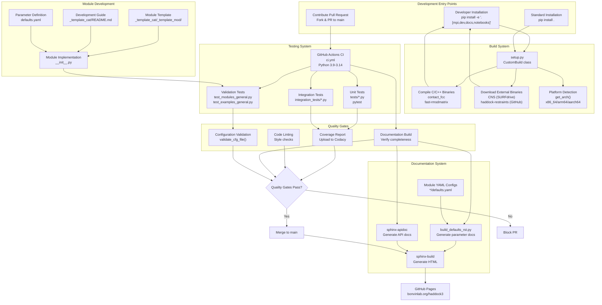
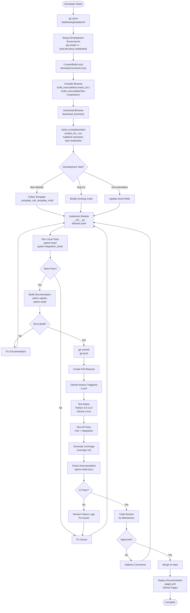
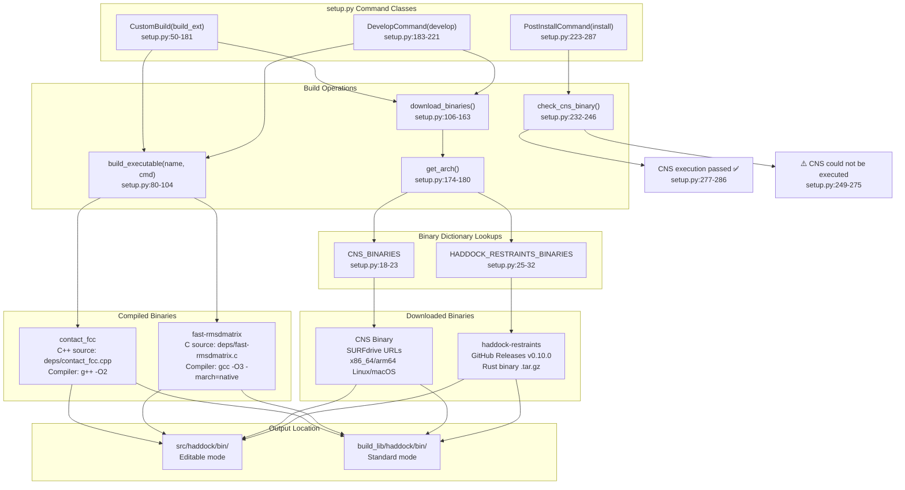
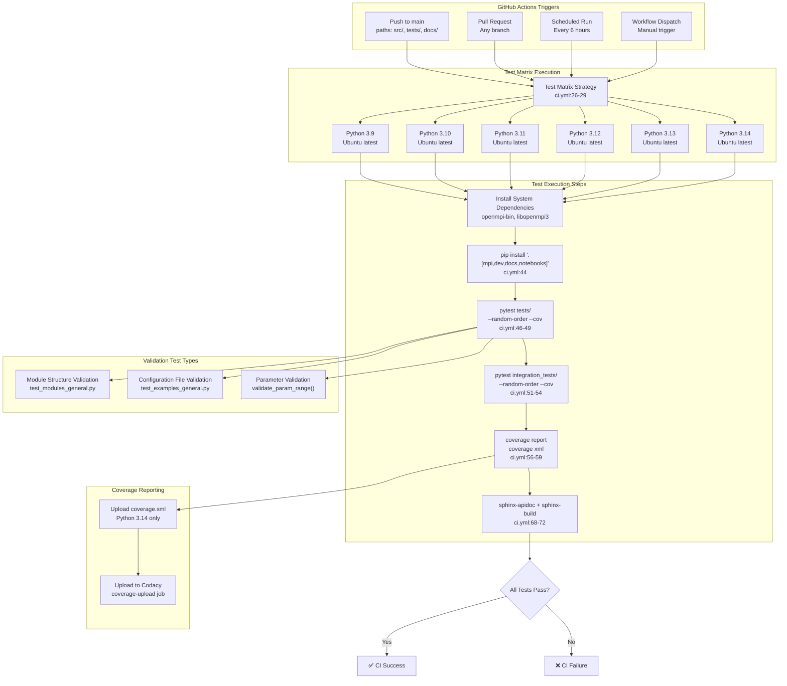
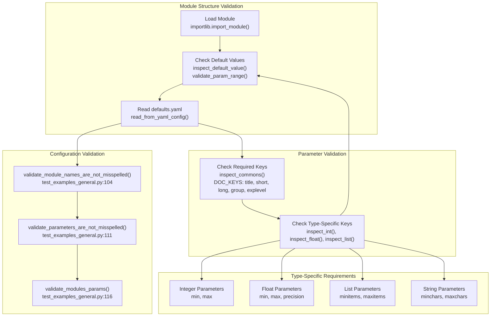
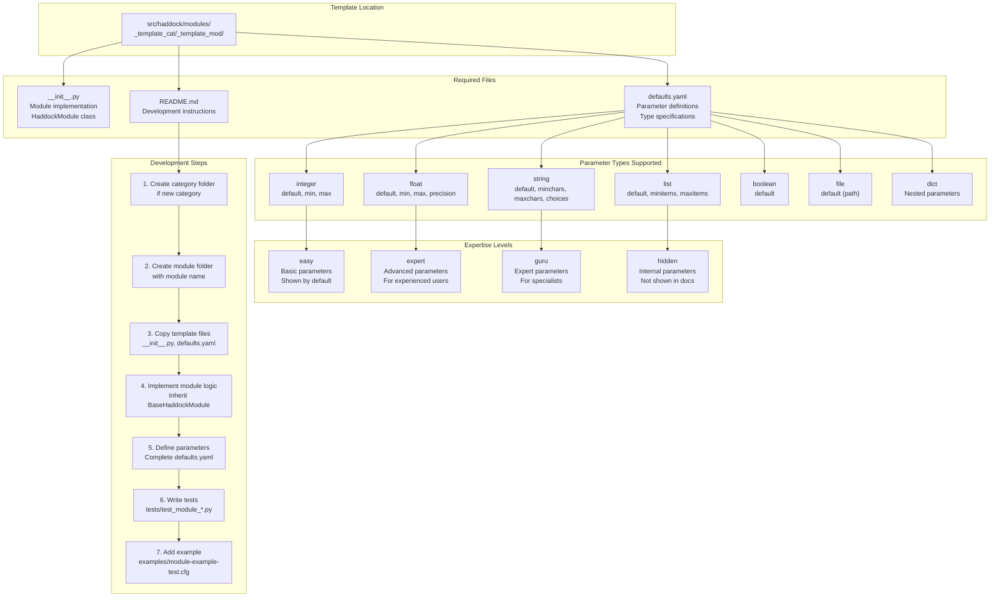
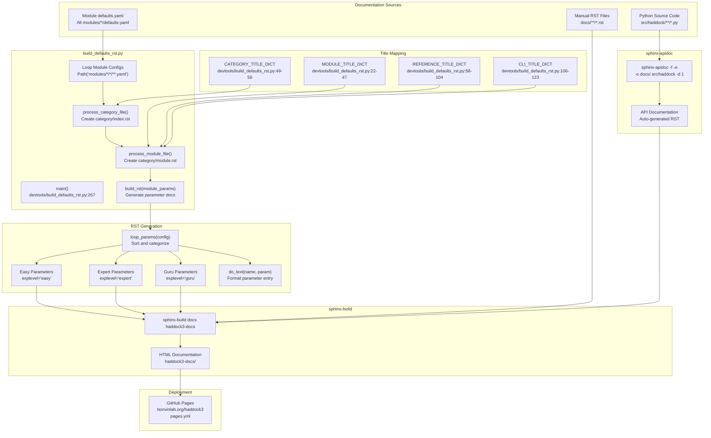
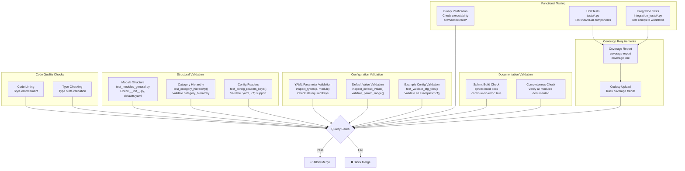

# Development

Relevant source files

The following files were used as context for generating this wiki page:

- [.github/workflows/ci.yml](.github/workflows/ci.yml)
- [.github/workflows/github-to-gitlab-push-sync.yml](.github/workflows/github-to-gitlab-push-sync.yml)
- [.github/workflows/pages.yml](.github/workflows/pages.yml)
- [.github/workflows/validate_citation.yml](.github/workflows/validate_citation.yml)
- [devtools/build_defaults_rst.py](devtools/build_defaults_rst.py)
- [docs/modules/index.rst](docs/modules/index.rst)
- [setup.py](setup.py)
- [src/haddock/modules/_template_cat/README.md](src/haddock/modules/_template_cat/README.md)
- [src/haddock/modules/_template_cat/_template_mod/defaults.yaml](src/haddock/modules/_template_cat/_template_mod/defaults.yaml)
- [tests/test_examples_general.py](tests/test_examples_general.py)
- [tests/test_modules_general.py](tests/test_modules_general.py)
- [tests/test_validations.py](tests/test_validations.py)

This section provides technical guidance for developers who want to contribute to or extend HADDOCK3. It covers the build system, testing infrastructure, module creation, and documentation generation. For information about using HADDOCK3 as an end-user, see [Getting Started](#2). For information about the module architecture from an execution perspective, see [Module Architecture](#3.2).

## Purpose and Scope

This page provides an architectural overview of HADDOCK3's development infrastructure, explaining how the various development components work together. Detailed information about specific subsystems is available in:

- **Build System** ([8.1](#8.1)): Compilation, binary downloads, and installation modes
- **Testing Infrastructure** ([8.2](#8.2)): Unit tests, integration tests, and CI/CD pipelines  
- **Creating New Modules** ([8.3](#8.3)): Step-by-step guide for implementing custom modules
- **Documentation System** ([8.4](#8.4)): Automated documentation generation from code and YAML

## Development Architecture Overview

HADDOCK3's development infrastructure is organized into four major subsystems that ensure code quality, enable extensibility, and maintain comprehensive documentation. The system supports three installation modes (`pip install`, `pip install -e`, `pip install '[mpi]'`) and validates all code changes through automated testing pipelines.

**Sources:** [setup.py:1-296](), [.github/workflows/ci.yml:1-120](), [devtools/build_defaults_rst.py:1-527](), [src/haddock/modules/_template_cat/README.md:1-31]()

## Development Workflow

The typical development workflow involves setting up a development environment, making changes, running tests locally, and submitting a pull request. The CI/CD pipeline automatically validates all changes before they can be merged.

**Sources:** [.github/workflows/ci.yml:19-120](), [setup.py:183-221](), [src/haddock/modules/_template_cat/README.md:1-31]()

## Build System Architecture

The build system handles compilation of performance-critical C/C++ binaries and downloading of platform-specific external binaries. It supports three installation modes through custom command classes.

### Installation Modes and Custom Commands

| Installation Mode | Command | Purpose | Build Location |
|------------------|---------|---------|----------------|
| Standard | `pip install .` | Production install | `build_lib/haddock/bin/` |
| Editable | `pip install -e .` | Development with live code changes | `src/haddock/bin/` |
| MPI-enabled | `pip install '.[mpi]'` | Parallel execution support | `build_lib/haddock/bin/` + mpi4py |

**Sources:** [setup.py:18-296](), [.github/workflows/ci.yml:38-44]()

### Platform Detection and Binary Downloads

The build system detects the platform architecture and downloads appropriate pre-compiled binaries. For non-x86_64 Linux systems, it also downloads the Linux binary for GRID execution compatibility.

| Platform | Architecture | CNS URL | Restraints URL |
|----------|--------------|---------|----------------|
| Linux x86_64 | `x86_64-linux` | SURFdrive/BWa5OimzbNliTi6 | GitHub/x86_64-unknown-linux-musl.tar.gz |
| macOS x86_64 | `x86_64-darwin` | SURFdrive/3Fzzte0Zx0L8GTY | GitHub/x86_64-apple-darwin.tar.gz |
| macOS ARM64 | `arm64-darwin` | SURFdrive/bYB3xPWf7iwo07X | GitHub/aarch64-apple-darwin.tar.gz |
| Linux ARM64 | `aarch64-linux` | SURFdrive/3rHpxcufHGrntHn | GitHub/aarch64-unknown-linux-musl.tar.gz |

**Sources:** [setup.py:18-32](), [setup.py:106-163](), [setup.py:174-180]()

## Testing Infrastructure

HADDOCK3 employs a comprehensive three-tier testing system: unit tests for individual components, integration tests for complete workflows, and validation tests for module structure compliance.

### CI/CD Pipeline Matrix

**Sources:** [.github/workflows/ci.yml:1-120](), [tests/test_modules_general.py:1-277](), [tests/test_examples_general.py:1-122]()

### Module Validation Tests

The test suite automatically validates that all modules conform to the required structure. This ensures consistency across the module ecosystem.

**Sources:** [tests/test_modules_general.py:32-205](), [tests/test_examples_general.py:69-122]()

## Module Development System

HADDOCK3 provides a template-based system for creating new modules. The module template includes all required files and extensive documentation.

### Module Template Structure

**Sources:** [src/haddock/modules/_template_cat/_template_mod/defaults.yaml:1-107](), [src/haddock/modules/_template_cat/README.md:1-31]()

### Parameter Definition Example

The template provides examples for all supported parameter types with required fields:

| Parameter Type | Required Fields | Optional Fields | Example Default |
|---------------|----------------|-----------------|-----------------|
| `integer` | `default`, `type`, `min`, `max` | `choices` | `42` |
| `float` | `default`, `type`, `min`, `max`, `precision` | - | `0.2` |
| `string` | `default`, `type`, `minchars`, `maxchars` | `choices` | `"keep"` |
| `list` | `default`, `type`, `minitems`, `maxitems` | - | `[]` |
| `boolean` | `default`, `type` | - | `true` |
| `file` | `default`, `type` | - | `"path/to/file"` |
| `dict` | `explevel`, `title`, `short`, `long`, `group` | - | `{}` |

All parameters require documentation fields: `title`, `short`, `long`, `group`, `explevel`.

**Sources:** [src/haddock/modules/_template_cat/_template_mod/defaults.yaml:10-107]()

## Documentation Generation System

HADDOCK3 automatically generates comprehensive documentation from YAML configuration files and Python docstrings. The system organizes documentation by module category and expertise level.

**Sources:** [devtools/build_defaults_rst.py:1-527](), [.github/workflows/pages.yml:33-37]()

### Documentation Organization

The documentation system organizes content hierarchically:

1. **Module Documentation** (organized by category):
   - `docs/modules/topology/` - Topology module docs
   - `docs/modules/sampling/` - Sampling module docs
   - `docs/modules/refinement/` - Refinement module docs
   - `docs/modules/scoring/` - Scoring module docs
   - `docs/modules/analysis/` - Analysis module docs
   - `docs/modules/extras/` - Extra module docs

2. **Parameter Documentation** (organized by expertise level):
   - Easy parameters appear first
   - Expert parameters in second section
   - Guru parameters in third section
   - Hidden parameters excluded from docs

3. **Reference Documentation**:
   - `docs/reference/core/` - Core system reference
   - `docs/reference/gear/` - Workflow orchestration reference
   - `docs/reference/libs/` - Library utilities reference

4. **Command-Line Documentation**:
   - `docs/clients/` - CLI tool documentation

**Sources:** [devtools/build_defaults_rst.py:188-388](), [docs/modules/index.rst:1-42]()

## Quality Assurance System

HADDOCK3 enforces quality through multiple automated validation layers that run on every commit and pull request.

### Validation Layers

**Sources:** [tests/test_modules_general.py:1-277](), [tests/test_examples_general.py:1-122](), [.github/workflows/ci.yml:46-72]()

## Continuous Integration Matrix

HADDOCK3 tests against six Python versions to ensure broad compatibility. Each version runs the complete test suite independently.

| Python Version | Test Status | Coverage | Notes |
|---------------|-------------|----------|-------|
| 3.9 | ✅ Required | Included | Minimum supported version |
| 3.10 | ✅ Required | Included | Documentation build version |
| 3.11 | ✅ Required | Included | Stable release |
| 3.12 | ✅ Required | Included | Recent stable |
| 3.13 | ✅ Required | Included | Latest stable |
| 3.14 | ✅ Required | **Uploaded to Codacy** | Latest Python version |

The CI pipeline runs:
- On every push to `main` branch
- On every pull request
- Every 6 hours (scheduled)
- On manual trigger (`workflow_dispatch`)

**Sources:** [.github/workflows/ci.yml:26-87]()

## Additional Infrastructure

### Repository Synchronization

HADDOCK3 maintains a mirror on GitLab for specific user communities:

- **Primary Repository**: `github.com/haddocking/haddock3`
- **Mirror Repository**: `codehub.hlrs.de/coes/bioexcel/haddock3.git`
- **Sync Trigger**: On tag creation
- **Implementation**: [.github/workflows/github-to-gitlab-push-sync.yml:1-26]()

### Citation Validation

The repository validates citation metadata on every change to `CITATION.cff`:

- **Validator**: `dieghernan/cff-validator@v3`
- **Trigger**: Pull requests modifying `CITATION.cff`
- **Implementation**: [.github/workflows/validate_citation.yml:1-18]()

**Sources:** [.github/workflows/github-to-gitlab-push-sync.yml:1-26](), [.github/workflows/validate_citation.yml:1-18]()

## Getting Started with Development

To begin developing HADDOCK3:

1. **Clone the repository**: `git clone https://github.com/haddocking/haddock3.git`
2. **Install development dependencies**: `pip install -e '.[mpi,dev,docs,notebooks]'`
3. **Verify installation**: Check that binaries exist in `src/haddock/bin/`
4. **Run tests**: `pytest tests/ integration_tests/`
5. **Build documentation**: `sphinx-apidoc -f -e -o docs/ src/haddock -d 1 && sphinx-build docs haddock3-docs`

For detailed information about specific development tasks:
- **Building and installing**: See [Build System](#8.1)
- **Writing and running tests**: See [Testing Infrastructure](#8.2)
- **Creating a new module**: See [Creating New Modules](#8.3)
- **Updating documentation**: See [Documentation System](#8.4)

**Sources:** [.github/workflows/ci.yml:38-72](), [setup.py:1-296](), [src/haddock/modules/_template_cat/README.md:1-31]()

---