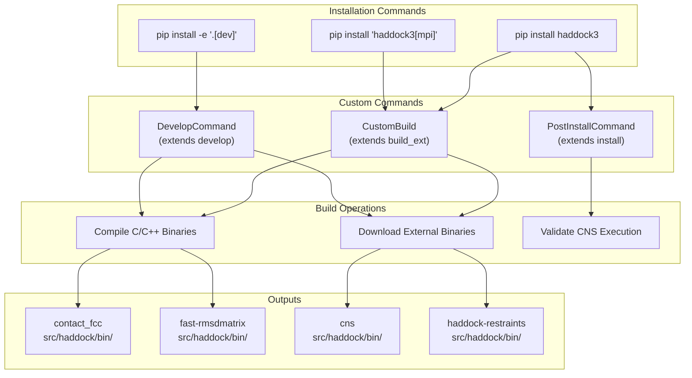
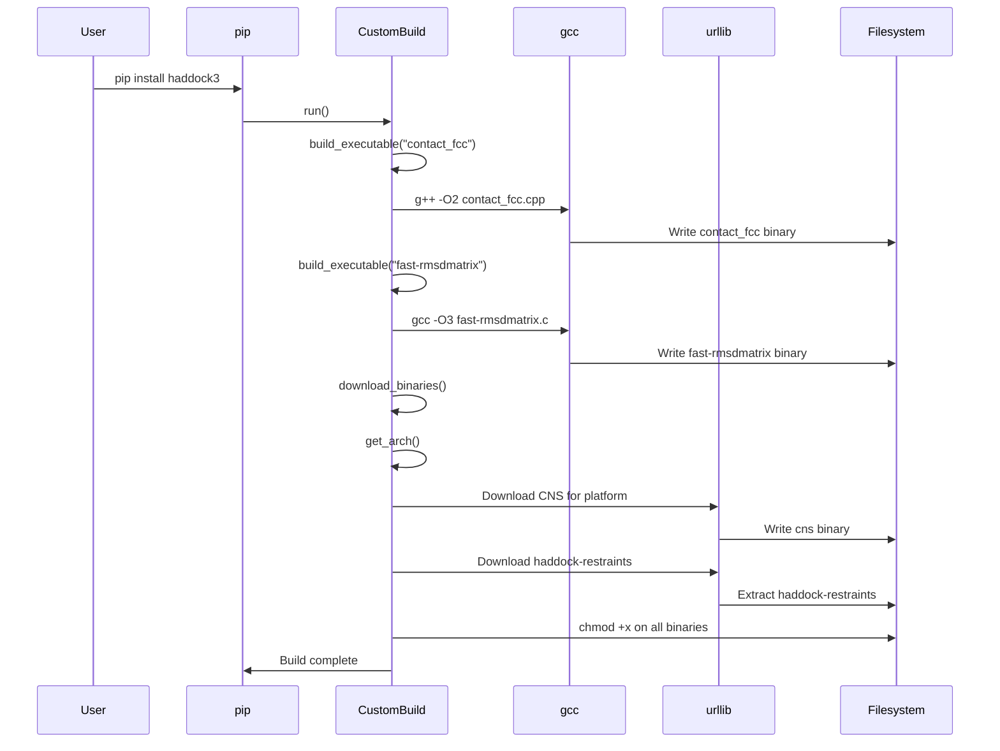
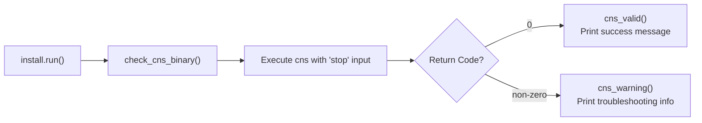
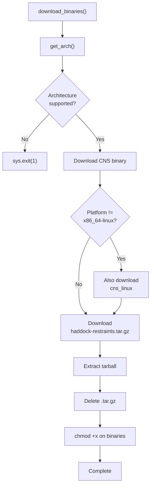
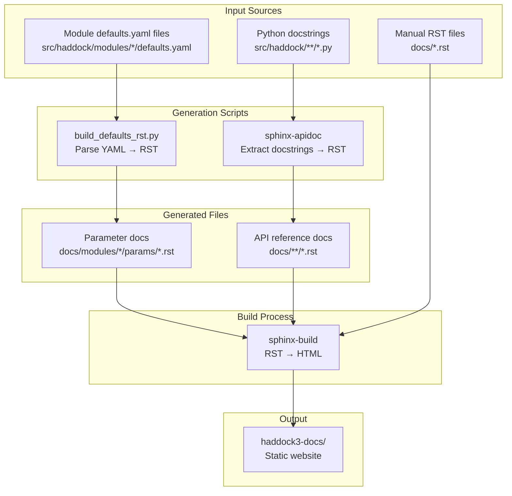
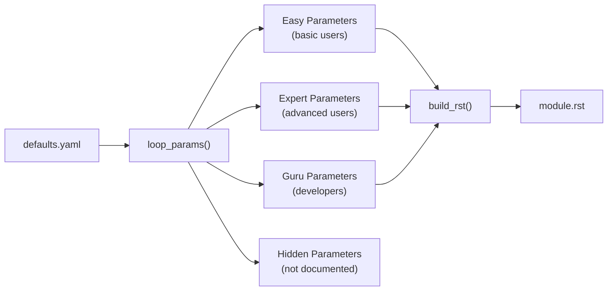

# Build System

<details>
<summary>Relevant source files</summary>

The following files were used as context for generating this wiki page:

- [DEVELOPMENT.md](DEVELOPMENT.md)
- [README.md](README.md)
- [devtools/build_defaults_rst.py](devtools/build_defaults_rst.py)
- [docs/INSTALL.md](docs/INSTALL.md)
- [docs/modules/index.rst](docs/modules/index.rst)
- [setup.py](setup.py)
- [src/haddock/modules/_template_cat/README.md](src/haddock/modules/_template_cat/README.md)
- [src/haddock/modules/_template_cat/_template_mod/defaults.yaml](src/haddock/modules/_template_cat/_template_mod/defaults.yaml)

</details>


## Purpose and Scope

This page documents the HADDOCK3 build system, which is responsible for compiling native C/C++ binaries, downloading platform-specific executables, and preparing the software for installation. The build system is implemented through custom setuptools commands in [setup.py]() and handles three main responsibilities:

1. **Compilation** of performance-critical C/C++ binaries (`contact_fcc`, `fast-rmsdmatrix`)
2. **Download** of external executables (CNS molecular dynamics engine, haddock-restraints utility)
3. **Platform detection** and architecture-specific binary selection

For information about the documentation generation system, see [Documentation System](#8.4). For testing infrastructure, see [Testing Infrastructure](#8.2).

---

## Build System Architecture

The build system uses setuptools' command extension mechanism to customize the installation process:



**Sources:** [setup.py:50-296](), [README.md:24-47](), [docs/INSTALL.md:1-67]()

---

## Custom Build Commands

The build system defines three custom setuptools commands registered in [setup.py:290-294]():

### CustomBuild Class

The `CustomBuild` class extends `build_ext` and executes during standard installations:

| Method | Purpose | Line Reference |
|--------|---------|----------------|
| `run()` | Main build orchestration | [setup.py:53-78]() |
| `build_executable()` | Compile individual C/C++ binaries | [setup.py:80-104]() |
| `download_binaries()` | Download external executables | [setup.py:106-163]() |
| `download_file()` | HTTP download utility | [setup.py:166-172]() |
| `get_arch()` | Platform detection | [setup.py:175-180]() |

The build process follows this sequence:



**Sources:** [setup.py:50-180]()

### DevelopCommand Class

The `DevelopCommand` class handles editable installations (`pip install -e`). It differs from `CustomBuild` by setting `build_cmd.inplace = True` to ensure binaries are written to the source directory rather than `build_lib`:

```python
# Key difference at setup.py:194-195
build_cmd.inplace = True
```

This allows developers to modify source code and immediately see changes without reinstalling.

**Sources:** [setup.py:183-220](), [DEVELOPMENT.md:76-87]()

### PostInstallCommand Class

The `PostInstallCommand` validates the CNS binary after installation:



The validation attempts to execute the CNS binary at `{install_lib}/haddock/bin/cns` with input `stop\n` and checks the return code.

**Sources:** [setup.py:223-286](), [docs/INSTALL.md:34-58]()

---

## C/C++ Binary Compilation

The build system compiles two performance-critical binaries from source:

### contact_fcc Binary

**Purpose:** Calculates Fraction of Common Contacts (FCC) matrices for clustering analysis.

**Compilation command:** [setup.py:57-58]()
```bash
g++ -O2 -o contact_fcc src/haddock/deps/contact_fcc.cpp
```

**Destination:** `src/haddock/bin/contact_fcc`

**Used by:** `clustfcc` module for FCC-based clustering (see [Clustering](#4.5.2))

### fast-rmsdmatrix Binary

**Purpose:** Computes pairwise RMSD matrices efficiently.

**Compilation command:** [setup.py:61-72]()
```bash
gcc -Wall -O3 -march=native -std=c99 -o fast-rmsdmatrix \
    src/haddock/deps/fast-rmsdmatrix.c -lm
```

**Compilation flags:**
- `-O3`: Maximum optimization
- `-march=native`: CPU-specific optimizations
- `-std=c99`: C99 standard compliance
- `-lm`: Link math library

**Destination:** `src/haddock/bin/fast-rmsdmatrix`

**Used by:** `clustrmsd` and `rmsdmatrix` modules for RMSD-based clustering

The compilation process creates the binary in the root directory, then moves it to `src/haddock/bin/`. For editable installations, it also copies the binary to `{build_lib}/haddock/bin/` if that directory exists.

**Sources:** [setup.py:35-47,56-73]()

---

## External Binary Downloads

The build system downloads two pre-compiled external executables:

### Platform Detection

The `get_arch()` method [setup.py:175-180]() determines the platform using Python's `platform` module:

```python
system = platform.system().lower()  # e.g., "linux", "darwin"
machine = platform.machine().lower()  # e.g., "x86_64", "arm64"
return f"{machine}-{system}"
```

Supported architectures:

| Architecture | Platform | Binary Sources |
|--------------|----------|----------------|
| `x86_64-linux` | 64-bit Intel/AMD Linux | SURFdrive, GitHub Releases |
| `x86_64-darwin` | 64-bit Intel macOS | SURFdrive, GitHub Releases |
| `arm64-darwin` | Apple Silicon macOS | SURFdrive, GitHub Releases |
| `aarch64-linux` | ARM64 Linux | SURFdrive, GitHub Releases |

### CNS Binary Downloads

CNS (Crystallography & NMR System) binary URLs are defined at [setup.py:18-23]():

```python
CNS_BINARIES = {
    "x86_64-linux": "https://surfdrive.surf.nl/files/index.php/s/BWa5OimzbNliTi6/download",
    "x86_64-darwin": "https://surfdrive.surf.nl/files/index.php/s/3Fzzte0Zx0L8GTY/download",
    "arm64-darwin": "https://surfdrive.surf.nl/files/index.php/s/bYB3xPWf7iwo07X/download",
    "aarch64-linux": "https://surfdrive.surf.nl/files/index.php/s/3rHpxcufHGrntHn/download",
}
```

**Special case for grid execution:** On non-x86_64-linux platforms, the build system downloads both the native CNS binary (saved as `cns`) and the x86_64-linux binary (saved as `cns_linux`) at [setup.py:134-142](). This enables grid execution on systems that submit jobs to Linux worker nodes.

**Destination:** `src/haddock/bin/cns` (and `cns_linux` if applicable)

**Used by:** All CNS-based modules (topology, sampling, refinement, scoring)

### haddock-restraints Binary Downloads

The haddock-restraints utility (written in Rust) is downloaded from GitHub releases. The version is configured at [setup.py:25]():

```python
HADDOCK_RESTRAINTS_VERSION = "0.10.0"
```

Binary URLs are constructed at [setup.py:26-32]():

```python
BASE_GITHUB_URL = f"https://github.com/haddocking/haddock-restraints/releases/download/v{HADDOCK_RESTRAINTS_VERSION}"
HADDOCK_RESTRAINTS_BINARIES = {
    "x86_64-linux": f"{BASE_GITHUB_URL}/haddock-restraints-v{HADDOCK_RESTRAINTS_VERSION}-x86_64-unknown-linux-musl.tar.gz",
    # ... other platforms
}
```

The binary is downloaded as a `.tar.gz` archive, extracted to `src/haddock/bin/`, and the archive is deleted [setup.py:144-156]().

**Destination:** `src/haddock/bin/haddock-restraints`

**Used by:** `haddock3-restraints` CLI for generating restraint files (see [Restraints](#5.3))

### Download Flow



**Sources:** [setup.py:106-180]()

---

## Installation Modes

The build system supports three installation modes, each triggering different build commands:

### Standard Installation

```bash
pip install haddock3
```

**Triggers:** `CustomBuild` → `PostInstallCommand`

**Binary destination:** `{site-packages}/haddock/bin/`

**Characteristics:**
- Binaries written to Python environment's site-packages directory
- CNS validation performed post-installation
- Immutable installation (requires reinstall for code changes)

### Editable Installation (Development Mode)

```bash
pip install -e '.[dev]'
```

**Triggers:** `DevelopCommand` (sets `inplace=True`)

**Binary destination:** `src/haddock/bin/`

**Characteristics:**
- Binaries written to source directory
- Code changes take effect immediately without reinstall
- Includes development dependencies (pytest, linters)
- Recommended for module development (see [Creating New Modules](#8.3))

### MPI-Enabled Installation

```bash
pip install 'haddock3[mpi]'
```

**Triggers:** `CustomBuild` → `PostInstallCommand` + installs `mpi4py`

**Requirements:**
- OpenMPI library must be installed on system
- Enables `MPIScheduler` for parallel execution (see [MPI Execution](#6.2))

**Installation instructions:** [docs/INSTALL.md:26-32]()

The extras are defined in `pyproject.toml`:
```python
[project.optional-dependencies]
mpi = ["mpi4py>=3.1.4"]
dev = ["pytest", "pytest-cov", "pytest-mock", ...]
docs = ["sphinx", "sphinx-rtd-theme", ...]
```

**Sources:** [README.md:24-37](), [docs/INSTALL.md:8-32](), [DEVELOPMENT.md:76-89]()

---

## Documentation Generation System

The documentation build system is separate from the main build system but runs during documentation generation:



### build_defaults_rst.py Script

The `build_defaults_rst.py` script [devtools/build_defaults_rst.py:1-527]() automates parameter documentation generation:

**Process:**
1. Scans `src/haddock/modules/*/*/defaults.yaml` files [devtools/build_defaults_rst.py:278-279]()
2. Parses YAML parameter definitions using `read_from_yaml()` [devtools/build_defaults_rst.py:288]()
3. Groups parameters by expertise level (`easy`, `expert`, `guru`) [devtools/build_defaults_rst.py:417-505]()
4. Generates RST files in `docs/modules/*/params/*.rst` [devtools/build_defaults_rst.py:310-311]()
5. Includes parameter RST in module documentation [devtools/build_defaults_rst.py:254-259]()

**Parameter documentation structure:**



**Parameter attributes documented:**
- `default`: Default value
- `type`: Data type (integer, float, string, list, dict)
- `title`: Human-readable title
- `short`: Short description
- `long`: Long description
- `group`: Parameter grouping
- `explevel`: Expertise level
- `min`/`max`: Numeric bounds (if applicable)
- `choices`: Valid options (if applicable)

**Sources:** [devtools/build_defaults_rst.py:1-527](), [README.md:120-125]()

### Sphinx Documentation Build

Build commands [README.md:122-124]():

```bash
# Generate API documentation from docstrings
sphinx-apidoc -f -e -o docs/ src/haddock -d 1

# Build HTML documentation
sphinx-build -b html docs haddock3-docs
```

The documentation is deployed to GitHub Pages at `bonvinlab.org/haddock3`.

**Sources:** [README.md:110-130](), [docs/modules/index.rst:1-42]()

---

## Platform-Specific Considerations

### Linux

**Requirements:**
- GCC and G++ compilers for C/C++ compilation
- glibc compatibility for CNS binary

**Installation:** [DEVELOPMENT.md:18-32]()

### macOS

**Intel Macs (`x86_64-darwin`):**
- Uses Apple's clang compiler (aliased as gcc/g++)
- CNS binary built for Intel architecture

**Apple Silicon Macs (`arm64-darwin`):**
- Native ARM64 CNS binary
- GCC available via Homebrew: `brew install gcc`
- May require Rosetta 2 for some dependencies

**Sources:** [DEVELOPMENT.md:49-55]()

### ARM64 Linux (`aarch64-linux`)

Native binaries provided for ARM64 Linux servers and HPC systems.

### Grid Execution Considerations

When using grid execution (see [Grid Execution](#6.3)), jobs are submitted to potentially heterogeneous worker nodes. The build system addresses this by:

1. Downloading the native platform's CNS binary as `cns` for local testing
2. Downloading the x86_64-linux CNS binary as `cns_linux` for grid payloads [setup.py:134-142]()

This ensures grid jobs can execute on standard Linux worker nodes regardless of the submission host's architecture.

**Sources:** [setup.py:134-142]()

---

## Binary Verification and Troubleshooting

### CNS Validation

The `PostInstallCommand.check_cns_binary()` method [setup.py:232-246]() validates CNS installation:

```python
cns_path = Path(f"{self.install_lib}/haddock/bin/cns")
proc = subprocess.run(
    [cns_path],
    input="stop\n",
    text=True,
    stdout=subprocess.DEVNULL,
    stderr=subprocess.DEVNULL,
)

if proc.returncode != 0:
    self.cns_warning()
if proc.returncode == 0:
    self.cns_valid()
```

If validation fails, users see a warning directing them to troubleshooting documentation: `docs/CNS.md` [setup.py:263-264]().

### Common Issues and Solutions

| Issue | Cause | Solution |
|-------|-------|----------|
| CNS binary fails to execute | Missing system libraries (e.g., libstdc++) | Recompile CNS from source (see `docs/CNS.md`) |
| C++ compilation fails | Missing GCC/G++ | Install build-essential (Linux) or Xcode tools (macOS) |
| Architecture not supported | Uncommon platform | Contact developers or compile binaries manually |
| Permission denied on binaries | Incorrect file permissions | Build system sets `chmod +x`, but may fail on network drives |

### Manual Binary Replacement

If the downloaded CNS binary doesn't work, users can manually replace it:

1. Locate installation directory:
   ```bash
   pip show haddock3  # Check "Location" field
   ```

2. Replace CNS binary:
   ```bash
   cp <custom-cns-binary> <location>/haddock/bin/cns
   chmod +x <location>/haddock/bin/cns
   ```

**Sources:** [docs/INSTALL.md:34-58](), [DEVELOPMENT.md:103-127]()

---

## Build System Extension Points

### Adding New Compiled Binaries

To add a new C/C++ binary to the build system:

1. **Add source file** to `src/haddock/deps/`
2. **Register Extension** in [setup.py:35-47]():
   ```python
   cpp_extensions = [
       Extension(
           "haddock.bin.new_binary",
           sources=["src/haddock/deps/new_binary.c"],
           extra_compile_args=["-O3"],
       ),
   ]
   ```
3. **Add build command** in `CustomBuild.run()` [setup.py:53-78]()
4. **Add to `DevelopCommand`** for editable installs [setup.py:197-220]()

### Adding New External Binary Downloads

To add a new external binary download:

1. **Define URL mapping** similar to [setup.py:18-32]()
2. **Add to download loop** in `download_binaries()` [setup.py:109-163]()
3. **Handle platform detection** if needed
4. **Set executable permissions** [setup.py:163]()

**Sources:** [setup.py:35-220]()

---

## Summary Table: Build Artifacts

| Artifact | Source | Compilation | Destination | Purpose |
|----------|--------|-------------|-------------|---------|
| `contact_fcc` | `src/haddock/deps/contact_fcc.cpp` | g++ -O2 | `src/haddock/bin/` | FCC matrix calculation |
| `fast-rmsdmatrix` | `src/haddock/deps/fast-rmsdmatrix.c` | gcc -O3 | `src/haddock/bin/` | RMSD matrix calculation |
| `cns` | SURFdrive (platform-specific) | Pre-compiled | `src/haddock/bin/` | CNS molecular dynamics |
| `cns_linux` | SURFdrive (x86_64-linux) | Pre-compiled | `src/haddock/bin/` | CNS for grid execution |
| `haddock-restraints` | GitHub Releases (Rust binary) | Pre-compiled | `src/haddock/bin/` | Restraint generation |

**Sources:** [setup.py:18-180]()

---