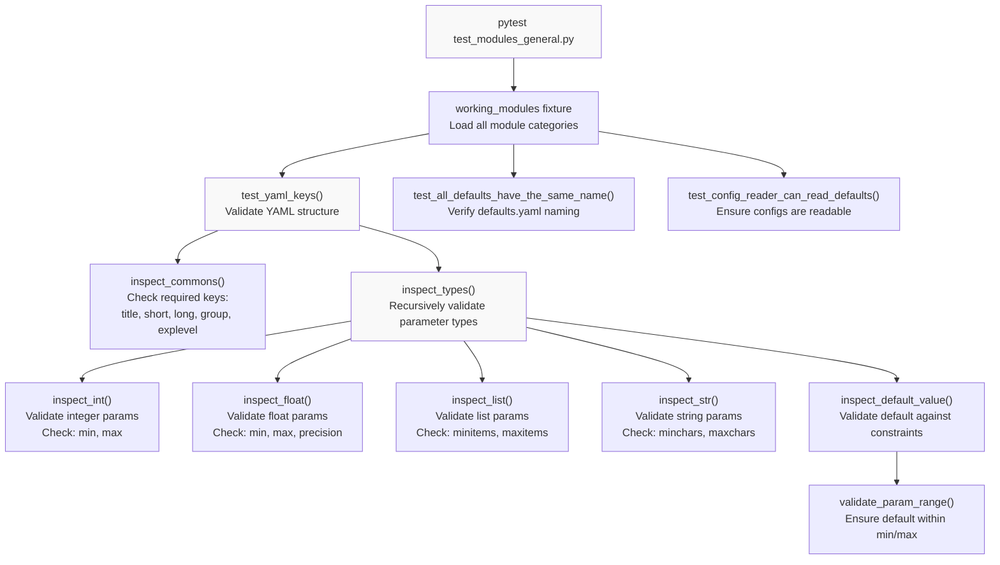
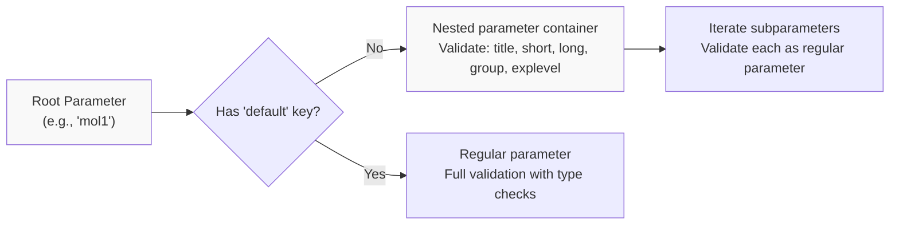
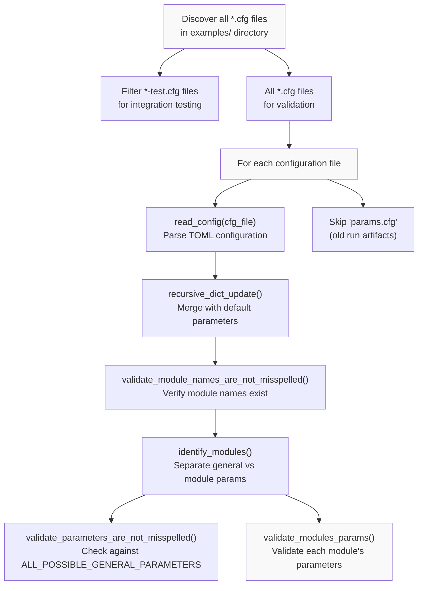
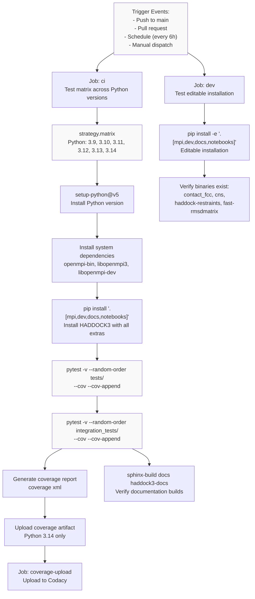
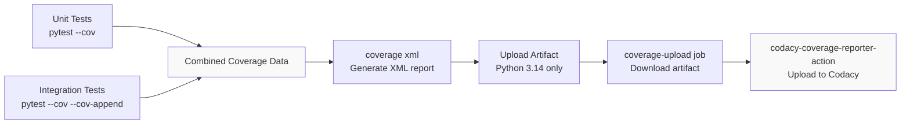
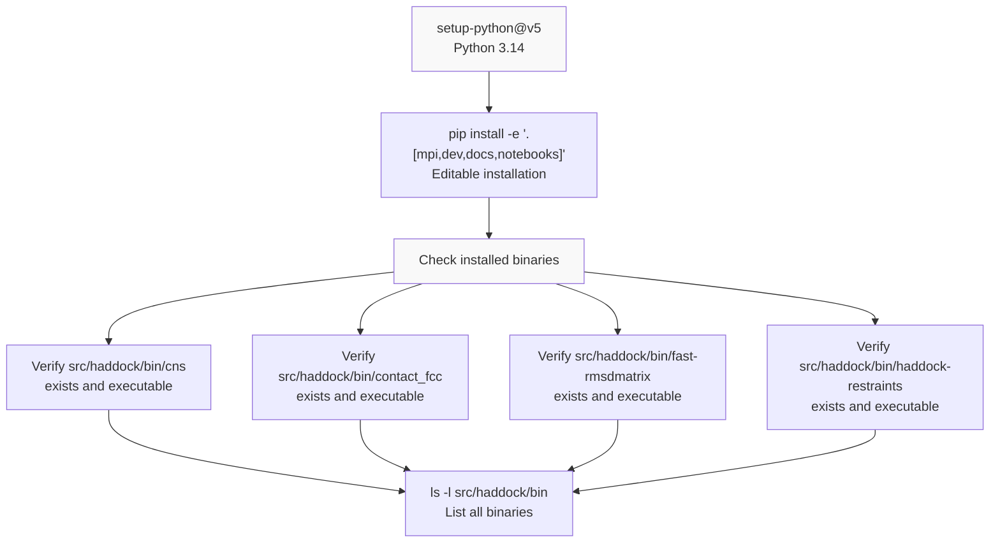

# Testing Infrastructure

<details>
<summary>Relevant source files</summary>

The following files were used as context for generating this wiki page:

- [.github/workflows/ci.yml](.github/workflows/ci.yml)
- [.github/workflows/github-to-gitlab-push-sync.yml](.github/workflows/github-to-gitlab-push-sync.yml)
- [.github/workflows/pages.yml](.github/workflows/pages.yml)
- [.github/workflows/validate_citation.yml](.github/workflows/validate_citation.yml)
- [devtools/build_defaults_rst.py](devtools/build_defaults_rst.py)
- [docs/modules/index.rst](docs/modules/index.rst)
- [setup.py](setup.py)
- [src/haddock/modules/_template_cat/README.md](src/haddock/modules/_template_cat/README.md)
- [src/haddock/modules/_template_cat/_template_mod/defaults.yaml](src/haddock/modules/_template_cat/_template_mod/defaults.yaml)
- [tests/test_examples_general.py](tests/test_examples_general.py)
- [tests/test_modules_general.py](tests/test_modules_general.py)
- [tests/test_validations.py](tests/test_validations.py)

</details>


## Purpose and Scope

This document describes HADDOCK3's comprehensive testing infrastructure, including unit tests, integration tests, module validation tests, and the CI/CD pipeline that ensures code quality across multiple Python versions. For information about the build system that compiles binaries and downloads dependencies, see [Build System](#8.1). For guidance on writing tests for new modules, see [Creating New Modules](#8.3).

## Test Organization

HADDOCK3 maintains two primary test suites located in separate directories with distinct purposes:

| Directory | Purpose | Scope | Typical Runtime |
|-----------|---------|-------|-----------------|
| `tests/` | Unit tests | Test individual functions, classes, and module validation | Fast (< 1 minute) |
| `integration_tests/` | Integration tests | Test complete workflows and module interactions | Slower (several minutes) |

Both test suites use pytest as the testing framework and share common configuration from `pyproject.toml`.

### Test Execution Order

Tests are executed with the `--random-order` flag [.github/workflows/ci.yml:48,53]() to detect test interdependencies and ensure isolation. Each test should be independent and not rely on execution order.

**Sources:** [.github/workflows/ci.yml:46-54]()

## Test Structure

### Unit Tests Directory

The `tests/` directory contains fast-running unit tests that validate individual components:

```
tests/
├── test_modules_general.py      # Module architecture validation
├── test_examples_general.py     # Example configuration validation
├── test_validations.py          # Validation function tests
├── __init__.py                  # Test fixtures and helpers
└── ... (other unit test files)
```

Each test file follows the naming convention `test_*.py` to be automatically discovered by pytest.

**Sources:** [tests/test_modules_general.py:1-5](), [tests/test_examples_general.py:1-5]()

### Integration Tests Directory

The `integration_tests/` directory contains slower end-to-end tests that execute complete workflows with real data.

**Sources:** [.github/workflows/ci.yml:51-54]()

## Module Validation Framework

HADDOCK3 implements comprehensive validation tests to ensure all modules follow the required architecture and conventions.

### Module Structure Validation

The test system validates every module's structure and parameter definitions:



**Diagram: Module Validation Test Flow**

The validation system ensures every parameter definition in `defaults.yaml` files contains required metadata:

| Parameter Type | Required Keys | Validation Function |
|----------------|---------------|---------------------|
| `integer` | `default`, `type`, `min`, `max`, `title`, `short`, `long`, `group`, `explevel` | `inspect_int()` |
| `float` | Same as integer + `precision` | `inspect_float()` |
| `string` | `default`, `type`, `minchars`, `maxchars`, + common keys | `inspect_str()` |
| `list` | `default`, `type`, `minitems`, `maxitems`, + common keys | `inspect_list()` |
| `boolean` | `default`, `type`, + common keys | No additional validation |
| `file` | `default`, `type`, + common keys | No additional validation |

**Sources:** [tests/test_modules_general.py:51-93](), [tests/test_modules_general.py:112-119]()

### Parameter Type Validation

Each parameter type maps to expected Python types and validation rules:

```python
# From test_modules_general.py:96-109
yaml_params_types = {
    "integer": (int, float),      # Accepts int or float
    "float": (float, int),        # Accepts float or int
    "boolean": (bool,),           # Accepts bool only
    "string": (str,),             # Accepts str only
    "list": (list,),              # Accepts list only
    "file": (str,),               # File paths as strings
}
```

The system verifies that the `default` value matches the declared `type` [tests/test_modules_general.py:184-189]() and falls within specified constraints using `validate_param_range()` [tests/test_modules_general.py:156-162]().

**Sources:** [tests/test_modules_general.py:96-119](), [tests/test_modules_general.py:156-162]()

### Nested Parameter Validation

HADDOCK3 supports nested parameters (e.g., `mol1.param` in topoaa module). The validation system handles one level of nesting:



**Diagram: Nested Parameter Validation Logic**

The `inspect_types()` function recursively processes parameters, detecting nesting by checking if a parameter dictionary lacks a `default` key [tests/test_modules_general.py:173-203]().

**Sources:** [tests/test_modules_general.py:173-203](), [tests/test_modules_general.py:435-478]()

## Configuration File Validation

### Example Configuration Testing

All example configuration files in the `examples/` directory are automatically validated:



**Diagram: Example Configuration Validation Pipeline**

The validation process uses `validate_cfg_file()` [tests/test_examples_general.py:75-121]() to ensure:

1. Configuration files are parseable
2. Module names are spelled correctly
3. Parameters are not misspelled
4. Parameter values are within valid ranges

**Sources:** [tests/test_examples_general.py:69-121]()

### Validation Function Tests

Specific validation functions are tested in `test_validations.py`:

```python
# Example: Run directory validation
@pytest.mark.parametrize(
    "rundir",
    [
        "some/folder",           # Valid: simple path
        "some_folder/other",     # Valid: underscores allowed
        Path('some', 'folder'),  # Valid: Path objects
    ]
)
def test_v_rundir_okay(rundir):
    v_rundir(rundir)  # Should not raise

@pytest.mark.parametrize(
    "rundir",
    [
        "some/folder with spaces",  # Invalid: spaces
        "some_folder/ðßæ",         # Invalid: special chars
    ]
)
def test_v_rundir_invalid(rundir):
    with pytest.raises(ConfigurationError):
        v_rundir(rundir)
```

**Sources:** [tests/test_validations.py:11-37]()

## Test Fixtures

HADDOCK3 uses pytest fixtures to provide reusable test components:

### Module Fixtures

The `working_modules` fixture provides access to all functional HADDOCK3 modules:

```python
@pytest.fixture(params=working_modules)
def modules(request):
    """Give imported HADDOCK3 modules."""
    module_name, category = request.param
    mod = ".".join(["haddock", "modules", category, module_name])
    module = importlib.import_module(mod)
    return module
```

This fixture is parameterized to run tests across all modules in all categories [tests/test_modules_general.py:122-128]().

### Configuration Fixtures

Configuration fixtures provide parsed YAML dictionaries:

| Fixture | Purpose | Returns |
|---------|---------|---------|
| `module_yaml_dict` | Flattened config dictionary | Processed config via `read_from_yaml_config()` |
| `module_yaml_pure` | Raw YAML structure | Pure dictionary from `read_from_yaml()` |
| `example_config` | Example config files | Path to each example `.cfg` file |

**Sources:** [tests/test_modules_general.py:131-143](), [tests/test_examples_general.py:44-47]()

## CI/CD Pipeline

### GitHub Actions Workflow

HADDOCK3 uses GitHub Actions for continuous integration with a comprehensive test matrix:



**Diagram: CI/CD Pipeline Architecture**

The pipeline configuration is defined in [.github/workflows/ci.yml:1-120]() with the following key features:

**Trigger Paths:** The CI runs on changes to:
- `src/*` - Source code changes
- `tests/*` - Test suite changes
- `integration_tests/*` - Integration test changes
- `docs/*` - Documentation changes
- `pyproject.toml`, `setup.py` - Configuration changes

**Sources:** [.github/workflows/ci.yml:1-120]()

### Test Matrix Strategy

The CI uses a matrix strategy with `fail-fast: false` [.github/workflows/ci.yml:29]() to test all Python versions even if one fails:

| Python Version | Purpose |
|----------------|---------|
| 3.9 | Minimum supported version |
| 3.10, 3.11, 3.12 | Stable versions |
| 3.13, 3.14 | Latest versions |

The matrix ensures HADDOCK3 remains compatible across a wide range of Python versions.

**Sources:** [.github/workflows/ci.yml:26-29]()

### Coverage Reporting

Coverage data is collected during test execution and uploaded to Codacy for analysis:



**Diagram: Coverage Collection and Reporting Flow**

The `--cov-append` flag [.github/workflows/ci.yml:49,54]() ensures coverage from both unit and integration tests is combined. Coverage reports are only uploaded from the Python 3.14 run to avoid duplicate reports [.github/workflows/ci.yml:63]().

**Sources:** [.github/workflows/ci.yml:46-87]()

### Editable Installation Testing

The `dev` job tests editable installation mode, which is critical for development workflows:



**Diagram: Editable Installation Verification**

This test ensures the custom build commands in `setup.py` work correctly for development installations [.github/workflows/ci.yml:108-119]().

**Sources:** [.github/workflows/ci.yml:89-120]()

## Documentation Build Validation

The CI pipeline includes a documentation build step to catch documentation errors early:

```bash
sphinx-apidoc -f -e -o docs/ src/haddock -d 1
sphinx-build docs haddock3-docs
```

This step:
1. Generates API documentation from Python docstrings using `sphinx-apidoc`
2. Builds the complete documentation using `sphinx-build`
3. Continues on error with `continue-on-error: true` [.github/workflows/ci.yml:69]() to not block PRs on documentation issues

The documentation build uses the automated parameter documentation generation from `build_defaults_rst.py` [devtools/build_defaults_rst.py:267-273](), which creates RST files from module YAML configurations.

**Sources:** [.github/workflows/ci.yml:68-72](), [devtools/build_defaults_rst.py:1-10]()

## Module Category Validation

The test system validates the module category hierarchy:

```python
def test_category_hierarchy():
    """Test all categories are listed in hierarchies."""
    categories_1 = set(category_hierarchy)
    assert len(categories_1) == len(category_hierarchy)  # No duplicates
    
    categories_2 = set(modules_category.values())
    assert categories_1 == categories_2  # Categories match
```

This ensures the `category_hierarchy` list contains all categories exactly once and matches the categories defined in `modules_category` [tests/test_modules_general.py:224-230]().

**Sources:** [tests/test_modules_general.py:224-230]()

## Step Folder Validation

Tests validate the step folder naming convention used in HADDOCK3 runs:

| Pattern | Valid | Explanation |
|---------|-------|-------------|
| `0_topoaa` | ✓ | Zero-prefixed number + module name |
| `1_clustfcc` | ✓ | Single digit + module name |
| `100_rigidbody` | ✓ | Multi-digit number + module name |
| `0_nothing` | ✗ | Module name doesn't exist |
| `topoaa` | ✗ | Missing number prefix |
| `1_topoaa_other` | ✗ | Extra suffix not allowed |

The `is_step_folder()` function validates folder names match the pattern `{number}_{module_name}` [tests/test_modules_general.py:251-276]().

**Sources:** [tests/test_modules_general.py:251-276]()

## Running Tests Locally

### Basic Test Execution

```bash
# Run all unit tests
pytest tests/

# Run all integration tests  
pytest integration_tests/

# Run with random order (as in CI)
pytest --random-order tests/

# Run with coverage
pytest --cov --cov-report=html tests/
```

### Running Specific Test Categories

```bash
# Run only module validation tests
pytest tests/test_modules_general.py

# Run only configuration validation tests
pytest tests/test_examples_general.py

# Run with verbose output
pytest -v tests/
```

### Coverage Analysis

```bash
# Generate combined coverage report
pytest --cov tests/ integration_tests/
coverage report  # Terminal output
coverage html    # HTML report in htmlcov/
```

**Sources:** [.github/workflows/ci.yml:46-59]()

## Test Template for New Modules

When creating a new module, developers should ensure it follows the template structure documented in [src/haddock/modules/_template_cat/_template_mod/defaults.yaml:1-107](), which includes:

- All required parameter types (integer, float, string, list, boolean, file)
- Proper documentation keys (title, short, long, group, explevel)
- Valid constraint specifications (min, max, precision, choices)
- Example nested parameters if needed

The existing test infrastructure will automatically validate new modules if they follow this template structure.

**Sources:** [src/haddock/modules/_template_cat/_template_mod/defaults.yaml:1-107](), [src/haddock/modules/_template_cat/README.md:1-30]()

## Additional CI Workflows

### GitHub Pages Deployment

A separate workflow [.github/workflows/pages.yml:1-46]() handles documentation deployment to GitHub Pages on pushes to the main branch.

### GitLab Synchronization

The [.github/workflows/github-to-gitlab-push-sync.yml:1-26]() workflow synchronizes tagged releases to a GitLab mirror at `codehub.hlrs.de`.

### Citation Validation

The [.github/workflows/validate_citation.yml:1-18]() workflow validates the `CITATION.cff` file format using `cff-validator`.

**Sources:** [.github/workflows/pages.yml:1-46](), [.github/workflows/github-to-gitlab-push-sync.yml:1-26](), [.github/workflows/validate_citation.yml:1-18]()

---