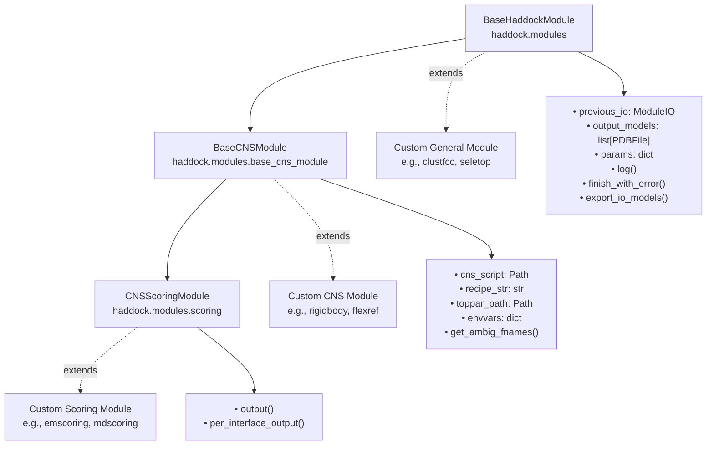
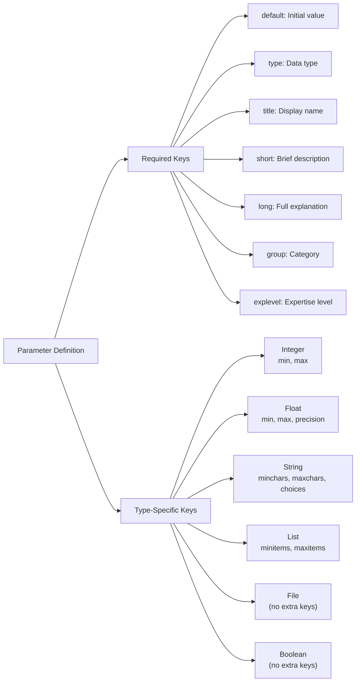
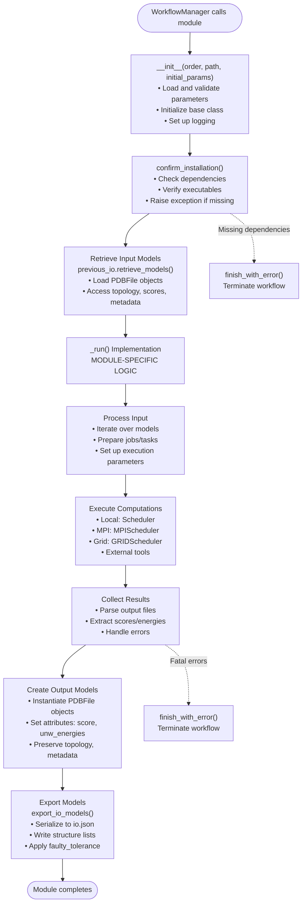
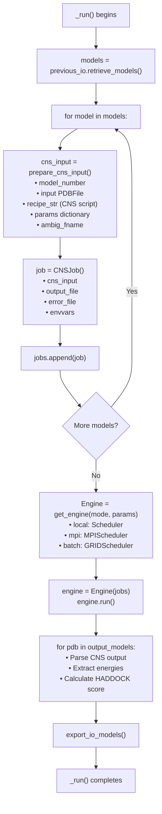
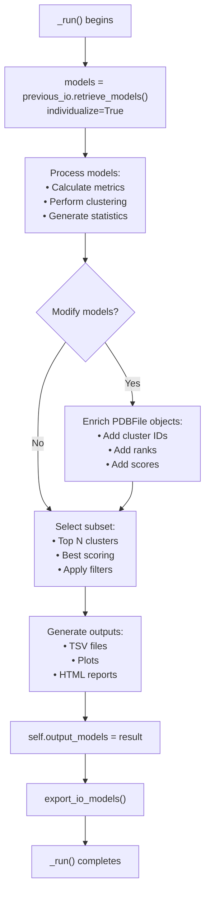
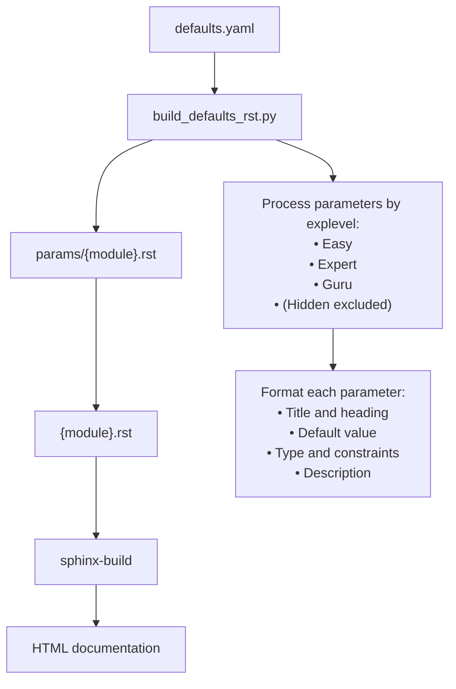

# Creating New Modules

<details>
<summary>Relevant source files</summary>

The following files were used as context for generating this wiki page:

- [devtools/build_defaults_rst.py](devtools/build_defaults_rst.py)
- [docs/modules/index.rst](docs/modules/index.rst)
- [setup.py](setup.py)
- [src/haddock/modules/_template_cat/README.md](src/haddock/modules/_template_cat/README.md)
- [src/haddock/modules/_template_cat/_template_mod/defaults.yaml](src/haddock/modules/_template_cat/_template_mod/defaults.yaml)
- [src/haddock/modules/analysis/clustfcc/__init__.py](src/haddock/modules/analysis/clustfcc/__init__.py)
- [src/haddock/modules/analysis/seletop/__init__.py](src/haddock/modules/analysis/seletop/__init__.py)
- [src/haddock/modules/analysis/seletopclusts/__init__.py](src/haddock/modules/analysis/seletopclusts/__init__.py)
- [src/haddock/modules/refinement/emref/__init__.py](src/haddock/modules/refinement/emref/__init__.py)
- [src/haddock/modules/refinement/flexref/__init__.py](src/haddock/modules/refinement/flexref/__init__.py)
- [src/haddock/modules/refinement/mdref/__init__.py](src/haddock/modules/refinement/mdref/__init__.py)
- [src/haddock/modules/sampling/gdock/__init__.py](src/haddock/modules/sampling/gdock/__init__.py)
- [src/haddock/modules/sampling/lightdock/__init__.py](src/haddock/modules/sampling/lightdock/__init__.py)
- [src/haddock/modules/sampling/rigidbody/__init__.py](src/haddock/modules/sampling/rigidbody/__init__.py)
- [src/haddock/modules/scoring/emscoring/__init__.py](src/haddock/modules/scoring/emscoring/__init__.py)
- [src/haddock/modules/scoring/mdscoring/__init__.py](src/haddock/modules/scoring/mdscoring/__init__.py)
- [src/haddock/modules/topology/topoaa/__init__.py](src/haddock/modules/topology/topoaa/__init__.py)
- [tests/test_examples_general.py](tests/test_examples_general.py)
- [tests/test_modules_general.py](tests/test_modules_general.py)
- [tests/test_validations.py](tests/test_validations.py)

</details>


This document provides a comprehensive guide for developers who want to create custom HADDOCK3 modules. It covers the module architecture, required components, parameter system, and development workflow. For information about the overall module architecture and how modules fit into workflows, see [Module Architecture](#3.2). For details about the build system and installation, see [Build System](#8.1).

## Purpose and Scope

Custom modules extend HADDOCK3's functionality by implementing new sampling algorithms, refinement protocols, scoring functions, or analysis methods. This guide explains:

- The required file structure and base classes
- How to define and validate module parameters
- The module execution lifecycle and data flow
- Integration with the workflow system and documentation

---

## Module File Structure

Every HADDOCK3 module follows a standardized directory structure within the `src/haddock/modules/` hierarchy.

### Directory Layout

```
src/haddock/modules/
└── {category}/              # topology, sampling, refinement, scoring, analysis, extras
    └── {module_name}/       # Module identifier (lowercase, no spaces)
        ├── __init__.py      # Required: Module class implementation
        ├── defaults.yaml    # Required: Parameter definitions
        └── cns/             # Optional: CNS scripts (for CNS-based modules)
            └── {script}.cns
```

### Category Organization

Modules are organized into six categories as defined in the `modules_category` and `category_hierarchy` dictionaries:

| Category | Purpose | Examples |
|----------|---------|----------|
| `topology` | Generate molecular topologies | `topoaa` |
| `sampling` | Conformational space exploration | `rigidbody`, `lightdock`, `gdock` |
| `refinement` | Structure optimization | `flexref`, `emref`, `mdref` |
| `scoring` | Energy evaluation | `emscoring`, `mdscoring` |
| `analysis` | Result analysis and clustering | `clustfcc`, `caprieval`, `alascan` |
| `extras` | Utility and filtering | `seletop`, `seletopclusts` |

Sources: [src/haddock/modules/_template_cat/README.md:5-7](), [tests/test_modules_general.py:223-230]()

---

## Base Classes Hierarchy

HADDOCK3 provides three base classes for module development, each adding specific functionality.



### BaseHaddockModule

The foundation for all modules, providing core workflow integration.

**Key attributes:**
- `name`: Module identifier (set to `RECIPE_PATH.name`)
- `order`: Module position in workflow (0-indexed)
- `path`: Working directory for this module step
- `params`: Validated parameter dictionary
- `previous_io`: `ModuleIO` object for retrieving input models
- `output_models`: List of `PDBFile` objects produced by module

**Key methods:**
- `_run()`: Abstract method - implements module's main logic
- `confirm_installation()`: Classmethod to verify dependencies
- `log(message, level)`: Write to module log file
- `export_io_models()`: Serialize output models to `io.json`
- `finish_with_error(message)`: Terminate with error message

Sources: [src/haddock/modules/analysis/clustfcc/__init__.py:49-70](), [src/haddock/modules/analysis/seletop/__init__.py:22-38]()

### BaseCNSModule

Extends `BaseHaddockModule` for modules that execute CNS (Crystallography & NMR System) scripts.

**Additional attributes:**
- `cns_script`: Path to the CNS script file
- `recipe_str`: CNS script content as string
- `toppar_path`: Path to CNS topology/parameter files
- `envvars`: Environment variables for CNS execution

**Additional methods:**
- `get_ambig_fnames()`: Retrieve ambiguous restraint files from previous modules

Sources: [src/haddock/modules/sampling/rigidbody/__init__.py:50-64](), [src/haddock/modules/refinement/flexref/__init__.py:40-54]()

### CNSScoringModule

Extends `BaseCNSModule` with scoring-specific output formatting.

**Additional methods:**
- `output(fname)`: Write scoring results to TSV file
- `per_interface_output(fname)`: Write per-interface scoring breakdown

Sources: [src/haddock/modules/scoring/emscoring/__init__.py:23-37](), [src/haddock/modules/scoring/mdscoring/__init__.py:23-37]()

---

## Required Module Components

### 1. Module Class in `__init__.py`

Every module must define a class named `HaddockModule` inheriting from one of the base classes.

**Minimal structure:**

```python
from pathlib import Path
from haddock.core.defaults import MODULE_DEFAULT_YAML
from haddock.core.typing import FilePath
from haddock.modules import BaseHaddockModule

RECIPE_PATH = Path(__file__).resolve().parent
DEFAULT_CONFIG = Path(RECIPE_PATH, MODULE_DEFAULT_YAML)

class HaddockModule(BaseHaddockModule):
    """Module description."""
    
    name = RECIPE_PATH.name
    
    def __init__(
        self, 
        order: int, 
        path: Path, 
        initial_params: FilePath = DEFAULT_CONFIG
    ) -> None:
        super().__init__(order, path, initial_params)
    
    @classmethod
    def confirm_installation(cls) -> None:
        """Verify module dependencies are installed."""
        # Check for required executables, libraries, etc.
        return
    
    def _run(self) -> None:
        """Execute module logic."""
        # Implement module functionality
        pass
```

**Key requirements:**

1. **Class name must be `HaddockModule`**: The workflow system imports this specific name
2. **Set `name` attribute**: Must equal `RECIPE_PATH.name` (the module folder name)
3. **Define `DEFAULT_CONFIG`**: Path to the module's `defaults.yaml`
4. **Implement `confirm_installation()`**: Verify dependencies at installation/runtime
5. **Implement `_run()`**: Contains the module's execution logic

Sources: [src/haddock/modules/analysis/clustfcc/__init__.py:49-70](), [src/haddock/modules/analysis/seletop/__init__.py:22-38]()

### 2. Parameter Definitions in `defaults.yaml`

The `defaults.yaml` file defines all configurable parameters using a structured format validated by the system.

**Parameter structure:**

```yaml
parameter_name:
  default: <value>              # Default value (required)
  type: <type>                  # integer, float, boolean, string, list, file (required)
  title: <string>               # Short title (required)
  short: <string>               # Brief description (required)
  long: <string>                # Detailed explanation (required)
  group: <string>               # Parameter grouping (required)
  explevel: <level>             # easy, expert, guru, hidden (required)
  
  # Type-specific fields:
  # For integer/float:
  min: <number>                 # Minimum value
  max: <number>                 # Maximum value
  precision: <int>              # Decimal places (float only)
  
  # For string:
  minchars: <int>               # Minimum length
  maxchars: <int>               # Maximum length
  choices: [...]                # Allowed values (optional)
  
  # For list:
  minitems: <int>               # Minimum number of items
  maxitems: <int>               # Maximum number of items
```

**Expertise levels:**

- `easy`: Basic parameters shown to all users
- `expert`: Advanced parameters for experienced users
- `guru`: Expert-level fine-tuning parameters
- `hidden`: Internal parameters not shown in documentation

Sources: [src/haddock/modules/_template_cat/_template_mod/defaults.yaml:1-107](), [tests/test_modules_general.py:51-57]()

### 3. Documentation Keys

The documentation generation system ([build_defaults_rst.py]()) requires these keys for every parameter:



Sources: [tests/test_modules_general.py:51-93](), [devtools/build_defaults_rst.py:391-413]()

---

## Module Execution Lifecycle

The workflow system orchestrates module execution through a well-defined lifecycle.



### Key Lifecycle Methods

**1. Initialization**
```python
def __init__(self, order: int, path: Path, initial_params: FilePath = DEFAULT_CONFIG):
    super().__init__(order, path, initial_params)
    # Custom initialization if needed
```

**2. Retrieve Input**
```python
def _run(self) -> None:
    # Get models from previous module
    models = self.previous_io.retrieve_models(
        individualize=True,  # Flatten model lists
        crossdock=False      # Enable all combinations
    )
```

**3. Execute and Collect**
```python
    # Create output models
    self.output_models = []
    
    for model in models:
        # Process each model
        result = process_model(model)
        
        # Create PDBFile for output
        output_pdb = PDBFile(result_path, path=".", topology=model.topology)
        output_pdb.score = calculated_score
        self.output_models.append(output_pdb)
```

**4. Export**
```python
    # Serialize for next module
    self.export_io_models(faulty_tolerance=self.params["tolerance"])
```

Sources: [src/haddock/modules/sampling/rigidbody/__init__.py:196-271](), [src/haddock/modules/analysis/clustfcc/__init__.py:71-220]()

---

## Parameter System Deep Dive

### Parameter Type Specifications

The validation system enforces type-specific constraints defined in `defaults.yaml`.

**Integer parameters:**
```yaml
sampling:
  default: 1000
  type: integer
  min: 1
  max: 10000
  title: Number of models to generate
  short: Controls the sampling size
  long: Total number of models produced during the sampling stage
  group: sampling
  explevel: easy
```

**Float parameters:**
```yaml
clust_cutoff:
  default: 0.60
  type: float
  min: 0.0
  max: 1.0
  precision: 2
  title: Clustering cutoff
  short: FCC similarity threshold
  long: Fraction of common contacts threshold for clustering
  group: clustering
  explevel: expert
```

**String with choices:**
```yaml
mode:
  default: local
  type: string
  minchars: 3
  maxchars: 10
  choices:
    - local
    - mpi
    - batch
  title: Execution mode
  short: How to run jobs
  long: Determines the execution engine for parallel processing
  group: execution
  explevel: expert
```

**List parameters:**
```yaml
receptor_chains:
  default: ["A"]
  type: list
  minitems: 1
  maxitems: 10
  title: Receptor chain IDs
  short: Chains to treat as receptor
  long: List of chain identifiers for the receptor molecule
  group: molecules
  explevel: easy
```

**File parameters:**
```yaml
ambig_fname:
  default: null
  type: file
  title: Ambiguous restraints file
  short: Path to AIR restraints
  long: CNS-format file with ambiguous interaction restraints
  group: restraints
  explevel: easy
```

Sources: [src/haddock/modules/_template_cat/_template_mod/defaults.yaml:10-73](), [tests/test_modules_general.py:96-119]()

### Nested Parameters

Some modules use dictionary-style nested parameters (e.g., per-molecule settings).

```yaml
mol1:
  explevel: easy
  title: Molecule 1 parameters
  short: Settings for first molecule
  long: Configuration specific to the first input structure
  group: molecules
  
  # Nested parameters
  charged_nter:
    default: true
    type: boolean
    title: Charged N-terminus
    short: N-terminal charge state
    long: Whether to protonate the N-terminus
    group: molecules
    explevel: expert
  
  charged_cter:
    default: true
    type: boolean
    title: Charged C-terminus
    short: C-terminal charge state
    long: Whether to deprotonate the C-terminus
    group: molecules
    explevel: expert
```

**Accessing nested parameters:**
```python
# In _run() method
mol_params = {}
for k in list(self.params.keys()):
    if k.startswith("mol") and k[3:].isdigit():
        mol_params[k] = self.params.pop(k)

# Access nested values
charged_nter = mol_params["mol1"]["charged_nter"]
```

Sources: [src/haddock/modules/topology/topoaa/__init__.py:189-254](), [devtools/build_defaults_rst.py:416-478]()

### Parameter Validation

The system validates parameters against their definitions at runtime.

**Validation checks performed:**

| Check | Applied To | Function |
|-------|-----------|----------|
| Type matching | All | `yaml_params_types` mapping |
| Range validation | integer, float | `validate_param_range()` |
| Length validation | string | `minchars`, `maxchars` |
| Choice validation | string | `choices` list |
| Item count | list | `minitems`, `maxitems` |
| File existence | file | Path validation |

Sources: [tests/test_modules_general.py:156-203](), [haddock/gear/prepare_run.py:validate_param_range]()

---

## Module Development Patterns

### Pattern 1: CNS-Based Modules

Modules that execute CNS scripts follow a standard pattern.



**Example: Rigid-body docking module**

Key steps from [src/haddock/modules/sampling/rigidbody/__init__.py:196-271]():

1. Retrieve models with optional crossdocking
2. Calculate sampling factor
3. Prepare CNS inputs (sequentially or in parallel)
4. Create CNSJob objects with input scripts
5. Execute via selected engine
6. Parse energies and calculate HADDOCK scores
7. Export models with fault tolerance

Sources: [src/haddock/modules/refinement/flexref/__init__.py:56-159](), [src/haddock/modules/refinement/emref/__init__.py:43-142]()

### Pattern 2: Analysis Modules

Analysis modules process existing models without external executables.



**Example: FCC clustering module**

Key steps from [src/haddock/modules/analysis/clustfcc/__init__.py:71-220]():

1. Calculate contacts for each model (binary executable)
2. Generate FCC matrix from contacts
3. Perform hierarchical clustering
4. Rank clusters by average score
5. Add cluster info to PDBFile objects
6. Write structure lists and cluster files
7. Generate matrix plots

Sources: [src/haddock/modules/analysis/seletopclusts/__init__.py:46-89](), [src/haddock/modules/analysis/seletop/__init__.py:40-65]()

### Pattern 3: Third-Party Tool Integration

Modules that wrap external tools require special handling.

```python
class HaddockModule(BaseHaddockModule):
    @classmethod
    def confirm_installation(cls) -> None:
        """Check if external tool is available."""
        check_subprocess('lightdock3.py -h')  # Verify executable
        # Or check environment variables
        if 'GDOCK_PATH' not in os.environ:
            raise ModuleError("GDOCK_PATH not defined")
    
    def _run(self) -> None:
        # Prepare input files in module's working directory
        with working_directory(self.path):
            # Run external tool via subprocess
            cmd = f"external_tool {args}"
            subprocess.call(cmd, shell=True)
        
        # Parse tool's output
        # Create PDBFile objects from results
        # Export via export_io_models()
```

Sources: [src/haddock/modules/sampling/lightdock/__init__.py:35-160](), [src/haddock/modules/sampling/gdock/__init__.py:51-152]()

---

## Error Handling and Logging

### Logging

Use the module's `log()` method for all output:

```python
self.log("Starting calculation", level="info")      # Default
self.log("Debug information", level="debug")        
self.log("Warning message", level="warning")
self.log(f"Processing model {i+1}/{total}")
```

Log files are written to `{order}_{module_name}/{module_name}.log`.

### Error Handling

**Terminate on fatal errors:**
```python
if critical_condition:
    self.finish_with_error("Descriptive error message explaining the problem")
```

**Handle recoverable errors:**
```python
try:
    result = risky_operation()
except Exception as e:
    self.log(f"Warning: {e}", level="warning")
    # Continue with fallback behavior
```

**Validate inputs:**
```python
if self.params["top_models"] <= 0:
    self.finish_with_error("top_models must be positive")

if len(models) > self.params["max_nmodels"]:
    self.finish_with_error(
        f"Too many models ({len(models)}), max is {self.params['max_nmodels']}"
    )
```

Sources: [src/haddock/modules/analysis/seletopclusts/__init__.py:48-66](), [src/haddock/modules/refinement/flexref/__init__.py:78-85]()

---

## Step-by-Step Development Workflow

### 1. Create Module Structure

```bash
# Choose or create category
cd src/haddock/modules/

# Create module folder (lowercase, no spaces)
mkdir -p analysis/mymodule
cd analysis/mymodule
```

### 2. Implement `__init__.py`

Start with the template pattern:

```python
from pathlib import Path
from haddock.core.defaults import MODULE_DEFAULT_YAML
from haddock.core.typing import FilePath
from haddock.modules import BaseHaddockModule

RECIPE_PATH = Path(__file__).resolve().parent
DEFAULT_CONFIG = Path(RECIPE_PATH, MODULE_DEFAULT_YAML)

class HaddockModule(BaseHaddockModule):
    """Brief description of what this module does."""
    
    name = RECIPE_PATH.name
    
    def __init__(
        self, 
        order: int, 
        path: Path, 
        initial_params: FilePath = DEFAULT_CONFIG
    ) -> None:
        super().__init__(order, path, initial_params)
    
    @classmethod
    def confirm_installation(cls) -> None:
        """Confirm module dependencies are available."""
        # Add dependency checks here
        return
    
    def _run(self) -> None:
        """Execute module logic."""
        # Step 1: Get input models
        models = self.previous_io.retrieve_models()
        
        # Step 2: Process models
        self.output_models = []
        for model in models:
            # Your processing logic
            processed = process_model(model)
            self.output_models.append(processed)
        
        # Step 3: Export results
        self.export_io_models()
```

### 3. Define Parameters in `defaults.yaml`

Create comprehensive parameter definitions:

```yaml
# Essential module parameters
param1:
  default: value
  type: integer
  min: 0
  max: 100
  title: Parameter 1
  short: Brief description
  long: Detailed explanation of what this parameter controls
  group: main
  explevel: easy

# Add all configurable options
# Follow existing modules for examples
```

### 4. Add Module Entry to Category

If creating a new category, update `category_hierarchy` in `src/haddock/modules/__init__.py`.

### 5. Create Tests

Add module-specific tests in `tests/`:

```python
# tests/test_module_mymodule.py
import pytest
from haddock.modules.analysis.mymodule import HaddockModule

def test_module_instantiation():
    """Test module can be instantiated."""
    module = HaddockModule(order=0, path=Path("."))
    assert module.name == "mymodule"

def test_confirm_installation():
    """Test installation verification."""
    HaddockModule.confirm_installation()  # Should not raise
```

### 6. Add Example Configuration

Create example in `examples/`:

```toml
# examples/mymodule-example/docking-mymodule-test.cfg
run_dir = "run-mymodule-test"

[molecules]
mol1 = "data/protein.pdb"
mol2 = "data/ligand.pdb"

[topoaa]
[rigidbody]
sampling = 10

[mymodule]
param1 = 50
```

### 7. Update Documentation

The documentation system automatically generates parameter documentation from `defaults.yaml`. Add a module title to [devtools/build_defaults_rst.py:22-47]():

```python
MODULE_TITLE_DICT = {
    # ... existing entries
    "mymodule": "My Module description",
}
```

Sources: [src/haddock/modules/_template_cat/README.md:1-31](), [tests/test_modules_general.py:122-144]()

---

## Testing and Validation

### Automatic Validation

The test suite automatically validates all modules for:

**1. Configuration file structure** ([tests/test_modules_general.py:164-204]()):
- All required keys present (`default`, `type`, `title`, `short`, `long`, `group`, `explevel`)
- Type-specific keys present (e.g., `min`/`max` for integers)
- Default values match declared type
- Default values within specified ranges

**2. Module structure** ([tests/test_modules_general.py:207-210]()):
- `defaults.yaml` file named correctly
- Module class follows conventions

**3. Import compatibility**:
- Module can be imported without errors
- Configuration can be parsed

### Manual Testing Checklist

Before submitting a new module:

- [ ] Module instantiates without errors
- [ ] `confirm_installation()` passes on target systems
- [ ] `_run()` executes successfully with test data
- [ ] Output models are correctly formatted
- [ ] `export_io_models()` creates valid `io.json`
- [ ] Module integrates into a complete workflow
- [ ] Example configuration runs without errors
- [ ] Log output is informative
- [ ] Errors produce helpful messages

Sources: [tests/test_modules_general.py:1-277](), [tests/test_examples_general.py:69-122]()

---

## Documentation Integration

### Automatic Documentation Generation

The [devtools/build_defaults_rst.py]() script automatically generates reStructuredText documentation from `defaults.yaml` files.

**Documentation structure:**



**Generated sections:**

For each expertise level with parameters:

```rst
Easy
----

parameter_name
``````````````

| *default*: value
| *type*: integer
| *min*: 0
| *max*: 100
| *title*: Parameter title
| *short description*: Brief description
| *long description*: Detailed explanation
| *group*: groupname
| *explevel*: easy
```

**Module documentation page:**

Each module's `.rst` file automatically includes the generated parameters:

```rst
Module Name
===========

Module description from docstring.

.. automodule:: haddock.modules.category.modulename
   :members:

Default Parameters
------------------
.. include:: params/modulename.rst
```

Sources: [devtools/build_defaults_rst.py:266-329](), [devtools/build_defaults_rst.py:391-523]()

---

## Best Practices

### 1. Follow Existing Patterns

Study similar modules before implementing:

- **For CNS modules**: See [rigidbody](), [flexref](), [emref]()
- **For analysis**: See [clustfcc](), [caprieval](), [seletop]()
- **For external tools**: See [lightdock](), [gdock]()

### 2. Preserve Model Metadata

Always preserve critical metadata when creating output models:

```python
output_pdb = PDBFile(output_path, path=".", topology=input_model.topology)
output_pdb.md5 = input_model.md5
output_pdb.ori_name = input_model.file_name
output_pdb.seed = input_model.seed
output_pdb.restr_fname = input_model.restr_fname
# Copy cluster info if present
if hasattr(input_model, 'clt_id'):
    output_pdb.clt_id = input_model.clt_id
```

### 3. Use Appropriate Execution Modes

Let users choose execution mode via the `mode` parameter:

```python
Engine = get_engine(self.params["mode"], self.params)
engine = Engine(jobs)
engine.run()
```

Supported modes: `local`, `mpi`, `batch`

### 4. Handle Fault Tolerance

Specify fault tolerance when exporting models:

```python
self.export_io_models(faulty_tolerance=self.params["tolerance"])
```

This allows the workflow to continue if some models fail.

### 5. Validate Inputs Early

Check preconditions at the start of `_run()`:

```python
def _run(self) -> None:
    # Validate model count
    if len(models) < self.params["min_required"]:
        self.finish_with_error(f"Need at least {self.params['min_required']} models")
    
    # Check for required metadata
    if any(m.clt_rank is None for m in models):
        self.finish_with_error("Cluster information required - run clustering first")
    
    # Verify file existence
    if self.params["config_file"] and not Path(self.params["config_file"]).exists():
        self.finish_with_error(f"Config file not found: {self.params['config_file']}")
```

### 6. Use Working Directory Context

For modules that execute external tools:

```python
from haddock.libs.libio import working_directory

with working_directory(self.path):
    # All file operations happen in module directory
    subprocess.call(cmd, shell=True)
```

### 7. Provide Informative Logging

Log key progress points and parameters:

```python
self.log(f"Processing {len(models)} models")
self.log(f"Using cutoff: {self.params['cutoff']}")
self.log(f"Calculated {n_clusters} clusters")
```

### 8. Document Parameter Interactions

In `defaults.yaml`, explain parameter dependencies in the `long` field:

```yaml
param_a:
  long: |
    Controls feature A. When set to X, param_b must be set to Y.
    Ignored if param_c is false.
```

Sources: [src/haddock/modules/sampling/rigidbody/__init__.py:172-195](), [src/haddock/modules/analysis/seletopclusts/__init__.py:48-66]()

---

## Summary

Creating a HADDOCK3 module requires:

1. **Module structure**: `__init__.py` with `HaddockModule` class and `defaults.yaml` with parameters
2. **Base class selection**: Choose `BaseHaddockModule`, `BaseCNSModule`, or `CNSScoringModule`
3. **Required methods**: `__init__`, `confirm_installation`, `_run`
4. **Parameter definitions**: Complete YAML with all required documentation keys
5. **Data flow integration**: Use `previous_io.retrieve_models()` and `export_io_models()`
6. **Testing**: Create module-specific tests and example configuration
7. **Documentation**: Add module title and verify generated docs

The module system provides a robust framework for extending HADDOCK3 with custom functionality while maintaining consistency and integration with the workflow system.

Sources: [src/haddock/modules/_template_cat/README.md:1-31](), [tests/test_modules_general.py:1-277]()

---