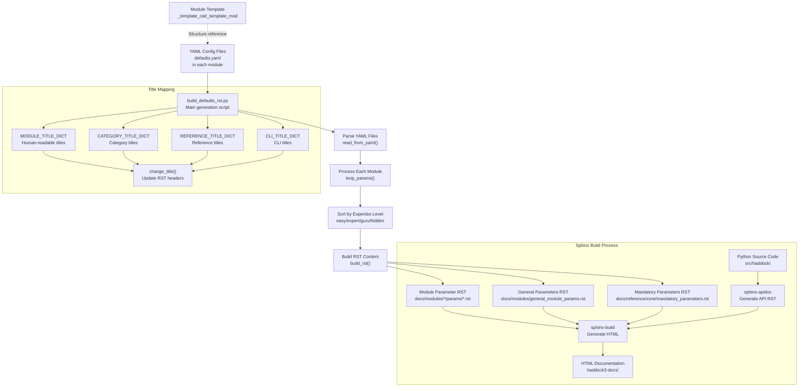
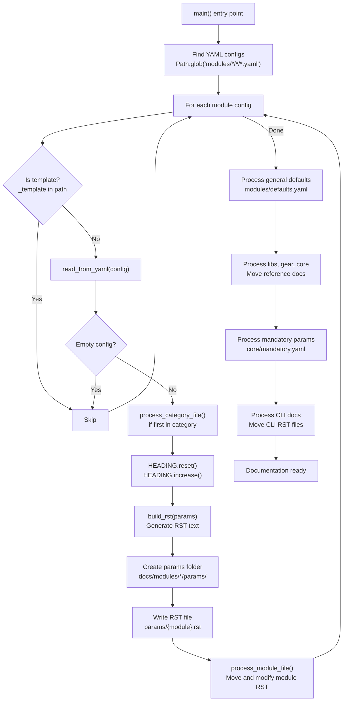
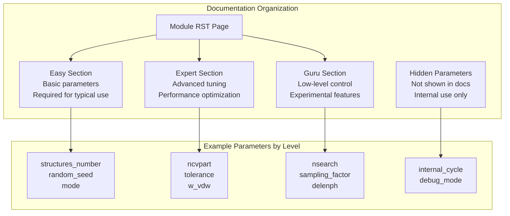
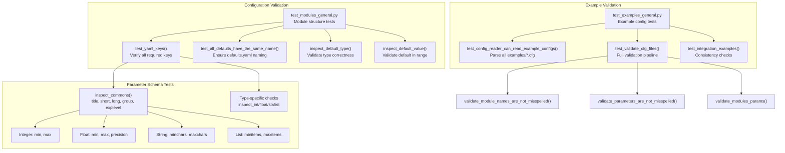

# Documentation System

<details>
<summary>Relevant source files</summary>

The following files were used as context for generating this wiki page:

- [devtools/build_defaults_rst.py](devtools/build_defaults_rst.py)
- [docs/modules/index.rst](docs/modules/index.rst)
- [setup.py](setup.py)
- [src/haddock/modules/_template_cat/README.md](src/haddock/modules/_template_cat/README.md)
- [src/haddock/modules/_template_cat/_template_mod/defaults.yaml](src/haddock/modules/_template_cat/_template_mod/defaults.yaml)
- [tests/test_examples_general.py](tests/test_examples_general.py)
- [tests/test_modules_general.py](tests/test_modules_general.py)
- [tests/test_validations.py](tests/test_validations.py)

</details>


## Purpose and Scope

This document describes the automated documentation generation system in HADDOCK3, which produces HTML documentation from YAML parameter configuration files and Python docstrings. The system ensures that module parameters are consistently documented and organized by expertise level.

For information about creating new modules and their configuration files, see [Creating New Modules](#8.3). For details about the parameter system itself, see [Parameter System](#5.2).

## Overview

The HADDOCK3 documentation system implements a two-tier approach:

1. **Automated Parameter Documentation**: The `build_defaults_rst.py` script parses YAML configuration files from all modules and generates reStructuredText (RST) files organized by expertise level (easy/expert/guru).

2. **API Documentation**: Sphinx's `sphinx-apidoc` tool generates API reference documentation from Python docstrings in the source code.

Both documentation types are compiled by Sphinx into a unified HTML documentation site. The parameter documentation is automatically regenerated during the documentation build process, ensuring it always reflects the current configuration structure.

## Documentation Generation Architecture



**Sources:** [devtools/build_defaults_rst.py:1-527](), [setup.py:1-296](), Diagram 5 from context

## YAML Configuration File Structure

Each HADDOCK3 module contains a `defaults.yaml` file that defines all configurable parameters. The file structure follows a strict schema validated by the testing infrastructure.

### Parameter Definition Schema

| Field | Type | Required | Description |
|-------|------|----------|-------------|
| `default` | any | Yes | Default value for the parameter |
| `type` | string | Yes | One of: integer, float, boolean, string, list, file, dict |
| `title` | string | Yes | Short title for the parameter |
| `short` | string | Yes | Brief description |
| `long` | string | Yes | Detailed description |
| `group` | string | Yes | Logical grouping identifier |
| `explevel` | string | Yes | Expertise level: easy, expert, guru, hidden |
| `min` | number | Type-specific | Minimum value (integer/float) |
| `max` | number | Type-specific | Maximum value (integer/float) |
| `precision` | integer | float only | Decimal precision |
| `choices` | list | Optional | Valid choices for string parameters |
| `minchars` | integer | string only | Minimum string length |
| `maxchars` | integer | string only | Maximum string length |
| `minitems` | integer | list only | Minimum list length |
| `maxitems` | integer | list only | Maximum list length |

### Example Parameter Definitions

```yaml
# Simple integer parameter
random_seed:
  default: 42
  type: integer
  min: 0
  max: 999
  title: Random seed for reproducibility
  short: Random number generator seed
  long: Sets the seed for all random number generation in the module
  group: sampling
  explevel: easy

# Float parameter with precision
temperature:
  default: 300.0
  type: float
  min: 0.0
  max: 1000.0
  precision: 1
  title: Temperature for MD simulation
  short: Simulation temperature in Kelvin
  long: Temperature used for molecular dynamics calculations
  group: simulation
  explevel: expert

# String parameter with choices
method:
  default: fcc
  type: string
  minchars: 3
  maxchars: 10
  choices:
    - fcc
    - rmsd
    - both
  title: Clustering method
  short: Algorithm for clustering structures
  long: Determines which similarity metric is used for clustering
  group: clustering
  explevel: easy
```

**Sources:** [src/haddock/modules/_template_cat/_template_mod/defaults.yaml:1-107](), [tests/test_modules_general.py:51-120]()

## Documentation Generation Process

The `build_defaults_rst.py` script orchestrates the entire documentation generation workflow.

### Main Processing Flow



### Key Functions and Their Roles

**HeadingController class** [devtools/build_defaults_rst.py:126-162]()
- Manages reStructuredText heading hierarchy
- Uses punctuation characters: `-`, `` ` ``, `~`, `*`
- Tracks current heading level and provides next/current/reset methods

**build_rst(module_params)** [devtools/build_defaults_rst.py:507-523]()
- Main function that generates RST text from parameter dictionary
- Creates three sections: Easy, Expert, Guru
- Calls `loop_params()` to process parameters recursively

**loop_params(config, easy, expert, guru)** [devtools/build_defaults_rst.py:416-504]()
- Recursively processes parameter dictionaries
- Handles nested parameters (e.g., `mol1.charge_iterations`)
- Sorts parameters by name within each expertise level
- Filters out `hidden` parameters

**do_text(name, param, level)** [devtools/build_defaults_rst.py:391-413]()
- Formats a single parameter as RST text
- Creates heading with appropriate punctuation
- Lists all parameter attributes (default, type, title, etc.)
- Conditionally includes min/max/choices when present

**process_module_file(category, module_name)** [devtools/build_defaults_rst.py:217-264]()
- Moves generated RST files to correct directory structure
- Appends parameter documentation include directive
- Updates module titles using `MODULE_TITLE_DICT`
- Handles submodule RST files when present

**change_title(rst_file, title)** [devtools/build_defaults_rst.py:166-185]()
- Updates the title line in existing RST files
- Used to apply human-readable titles from mapping dictionaries

**Sources:** [devtools/build_defaults_rst.py:126-523]()

## Expertise Level Organization

Parameters are organized into four expertise levels, each targeting different user skill levels:

### Expertise Levels



### Level Definitions

**easy** - Parameters that most users will need to configure:
- Core functionality controls
- Input/output specifications
- Basic algorithmic choices
- Typical values work for most cases

**expert** - Parameters for experienced users optimizing workflows:
- Performance tuning options
- Advanced algorithmic parameters
- Resource allocation settings
- Requires understanding of underlying methods

**guru** - Parameters for developers and power users:
- Low-level CNS parameters
- Experimental features
- Edge case handling
- Debugging and diagnostic options

**hidden** - Internal parameters not shown in documentation:
- Internal state variables
- Deprecated options maintained for compatibility
- Development/testing parameters

**Sources:** [devtools/build_defaults_rst.py:391-523](), [src/haddock/modules/_template_cat/_template_mod/defaults.yaml:5]()

## Module Documentation Structure

The documentation for each module is composed of multiple automatically generated files organized in a hierarchical directory structure.

### Directory Layout

```
docs/
├── modules/
│   ├── index.rst                          # Main modules page
│   ├── general_module_params.rst          # General parameters
│   ├── topology/
│   │   ├── index.rst                      # Category index
│   │   ├── haddock.modules.topology.topoaa.rst
│   │   └── params/
│   │       └── topoaa.rst                 # Generated parameters
│   ├── sampling/
│   │   ├── index.rst
│   │   ├── haddock.modules.sampling.rigidbody.rst
│   │   ├── haddock.modules.sampling.lightdock.rst
│   │   └── params/
│   │       ├── rigidbody.rst
│   │       └── lightdock.rst
│   ├── analysis/
│   │   ├── index.rst
│   │   ├── haddock.modules.analysis.caprieval.rst
│   │   └── params/
│   │       └── caprieval.rst
│   └── ...
├── reference/
│   ├── core/
│   │   ├── haddock.core.defaults.rst
│   │   ├── haddock.core.exceptions.rst
│   │   └── mandatory_parameters.rst       # Generated
│   ├── gear/
│   │   ├── haddock.gear.config.rst
│   │   └── ...
│   └── libs/
│       ├── haddock.libs.libio.rst
│       └── ...
└── clients/
    ├── haddock.clis.cli.rst
    └── ...
```

### Module RST File Components

Each module's main RST file contains:

1. **Title**: Human-readable module name from `MODULE_TITLE_DICT`
2. **Module Docstring**: Extracted by sphinx-apidoc from the module's Python docstring
3. **Class Documentation**: Auto-generated API documentation for the module class
4. **Parameter Documentation**: Include directive pointing to generated `params/*.rst` file

Example structure added by `process_module_file()`:

```rst
Default Parameters
---------------
.. include:: params/topoaa.rst
```

**Sources:** [devtools/build_defaults_rst.py:217-264](), [docs/modules/index.rst:1-42]()

## Title Mapping Dictionaries

The documentation system uses dictionaries to map internal identifiers to human-readable titles.

### MODULE_TITLE_DICT

Maps module names to descriptive titles [devtools/build_defaults_rst.py:22-47]():

```python
MODULE_TITLE_DICT = {
    "topoaa": "All-atom topology module",
    "rigidbody": "Rigid body docking sampling module",
    "caprieval": "CAPRI Evaluation module",
    "clustfcc": "FCC Clustering module",
    "alascan": "Alanine Scanning module",
    # ... 25 total mappings
}
```

### CATEGORY_TITLE_DICT

Maps category folders to section titles [devtools/build_defaults_rst.py:49-56]():

```python
CATEGORY_TITLE_DICT = {
    "analysis": "Analysis Modules",
    "refinement": "Model Refinement Modules",
    "sampling": "Sampling Modules",
    "scoring": "Scoring Modules",
    "topology": "Topology Modules",
    "extras": "Extra Modules",
}
```

### REFERENCE_TITLE_DICT

Maps reference documentation files to titles [devtools/build_defaults_rst.py:58-104]():

```python
REFERENCE_TITLE_DICT = {
    "libs.libio": "libio: I/O helping functions",
    "gear.config": "Configuration file I/O",
    "core.exceptions": "Exceptions",
    # ... 40+ total mappings
}
```

### CLI_TITLE_DICT

Maps command-line interface modules to titles [devtools/build_defaults_rst.py:106-123]():

```python
CLI_TITLE_DICT = {
    "clis.cli": "Run HADDOCK3",
    "clis.cli_analyse": "Analysis client",
    "clis.cli_restraints": "Generate restraints",
    # ... 15 total mappings
}
```

**Sources:** [devtools/build_defaults_rst.py:22-123]()

## Validation and Testing

The documentation system includes comprehensive validation to ensure consistency and correctness.

### Test Coverage



### Key Validation Functions

**inspect_types(d, module)** [tests/test_modules_general.py:173-204]()
- Recursively validates parameter structure
- Checks for required keys based on parameter type
- Validates default value types match declared type
- Ensures default values are within specified ranges

**inspect_commons(d, param, module)** [tests/test_modules_general.py:60-62]()
- Verifies presence of documentation keys
- Checks: `title`, `short`, `long`, `group`, `explevel`

**Type-specific validators** [tests/test_modules_general.py:65-92]()
- `inspect_int()`: Validates `min`, `max` keys
- `inspect_float()`: Validates `min`, `max`, `precision` keys
- `inspect_str()`: Validates `minchars`, `maxchars` keys
- `inspect_list()`: Validates `minitems`, `maxitems` keys

**validate_param_range(param, defaultval)** [tests/test_modules_general.py:156-162]()
- Ensures default value is within min/max bounds
- Checks default is in choices list if specified
- Returns error message if validation fails

### Test Execution

Tests run automatically in CI/CD across 6 Python versions [tests/test_modules_general.py:122-277]():

```python
@pytest.fixture(params=working_modules)
def modules(request):
    """Give imported HADDOCK3 modules."""
    module_name, category = request.param
    mod = ".".join(["haddock", "modules", category, module_name])
    module = importlib.import_module(mod)
    return module
```

This fixture dynamically imports all working modules and runs the validation suite against each one, ensuring consistent structure across the entire module ecosystem.

**Sources:** [tests/test_modules_general.py:1-277](), [tests/test_examples_general.py:1-122]()

## Sphinx Integration

The generated RST files are integrated into the Sphinx documentation build process.

### Build Process Flow

1. **Python builds invoke build_defaults_rst.py**: The script is executed as part of documentation preparation
2. **RST generation**: All module parameters are converted to RST format and written to `docs/`
3. **sphinx-apidoc**: Generates API documentation from Python docstrings
4. **sphinx-build**: Compiles all RST files to HTML
5. **Output**: Complete documentation site in `haddock3-docs/`

### Include Directives

Module documentation uses RST include directives to compose the final pages:

```rst
# In docs/modules/analysis/haddock.modules.analysis.caprieval.rst
Default Parameters
---------------
.. include:: params/caprieval.rst
```

This approach separates auto-generated content (parameters) from manually maintained content (module descriptions), allowing regeneration without overwriting manual documentation.

### General Parameters

The general default parameters that apply to all modules are documented separately:

```rst
# In docs/modules/index.rst
General Default parameters
--------------------------

General default parameters can be defined in the main section of the
configuration file, but can also be defined for each individual module (step).
In the later case, overriding the general definition.

.. include:: general_module_params.rst
```

This generated file comes from `src/haddock/modules/defaults.yaml` [devtools/build_defaults_rst.py:317-329]().

**Sources:** [devtools/build_defaults_rst.py:254-259](), [devtools/build_defaults_rst.py:317-329](), [docs/modules/index.rst:34-41]()

## Output Files and Artifacts

The documentation generation process produces several types of output files.

### Generated RST Files (Temporary)

These files are generated during the build process but not committed to version control:

| File Pattern | Purpose | Generated By |
|-------------|---------|--------------|
| `docs/modules/*/params/*.rst` | Module parameter documentation | `build_defaults_rst.py` |
| `docs/modules/general_module_params.rst` | General parameters | `build_defaults_rst.py` |
| `docs/reference/core/mandatory_parameters.rst` | Mandatory parameters | `build_defaults_rst.py` |
| `docs/haddock.*.rst` | API reference files | `sphinx-apidoc` |

### Final HTML Documentation

The Sphinx build process produces the final documentation site:

- **Location**: `haddock3-docs/` directory
- **Deployment**: Published to GitHub Pages at `bonvinlab.org/haddock3`
- **Structure**: Mirrors the RST directory organization
- **Features**: Interactive navigation, search functionality, syntax highlighting

### Directory Reorganization

The `build_defaults_rst.py` script reorganizes generated files [devtools/build_defaults_rst.py:188-264]():

1. **Category files**: Moved from `docs/haddock.modules.{category}.rst` to `docs/modules/{category}/index.rst`
2. **Module files**: Moved from `docs/haddock.modules.{category}.{module}.rst` to `docs/modules/{category}/haddock.modules.{category}.{module}.rst`
3. **Reference files**: Moved from `docs/haddock.{folder}*.rst` to `docs/reference/{folder}/`
4. **CLI files**: Moved from `docs/haddock.clis*.rst` to `docs/clients/`

This reorganization creates a clean, hierarchical documentation structure that matches the module organization.

**Sources:** [devtools/build_defaults_rst.py:188-389](), Diagram 5 from context

## Creating Module Documentation

When creating a new module, developers must create a properly structured `defaults.yaml` file to enable automatic documentation generation.

### Required Steps

1. **Create defaults.yaml**: Copy template from [src/haddock/modules/_template_cat/_template_mod/defaults.yaml:1-107]()
2. **Define parameters**: Add all configurable parameters with complete metadata
3. **Set expertise levels**: Assign appropriate `explevel` for each parameter
4. **Add to title mapping**: If desired, add entry to `MODULE_TITLE_DICT` [devtools/build_defaults_rst.py:22-47]()
5. **Run tests**: Ensure `test_modules_general.py` passes validation
6. **Build documentation**: Execute documentation build to verify output

### Parameter Documentation Best Practices

**title**: Concise parameter name (shown in UI)
- Good: "Number of structures to generate"
- Bad: "structures_number parameter"

**short**: One-sentence description
- Good: "Controls how many structural models are created during sampling"
- Bad: "The number" (too brief)

**long**: Detailed explanation including:
- What the parameter controls
- Impact on results/performance
- Typical values and use cases
- Interaction with other parameters
- References to relevant documentation

**group**: Logical grouping for related parameters
- Examples: "sampling", "scoring", "io", "clustering"
- Consistent across modules for similar parameter types

**explevel**: Choose appropriately
- Use "easy" for parameters users typically change
- Use "expert" for tuning and optimization
- Use "guru" for CNS parameters and edge cases
- Use "hidden" for internal parameters

**Sources:** [src/haddock/modules/_template_cat/_template_mod/defaults.yaml:1-107](), [src/haddock/modules/_template_cat/README.md:1-31]()

---