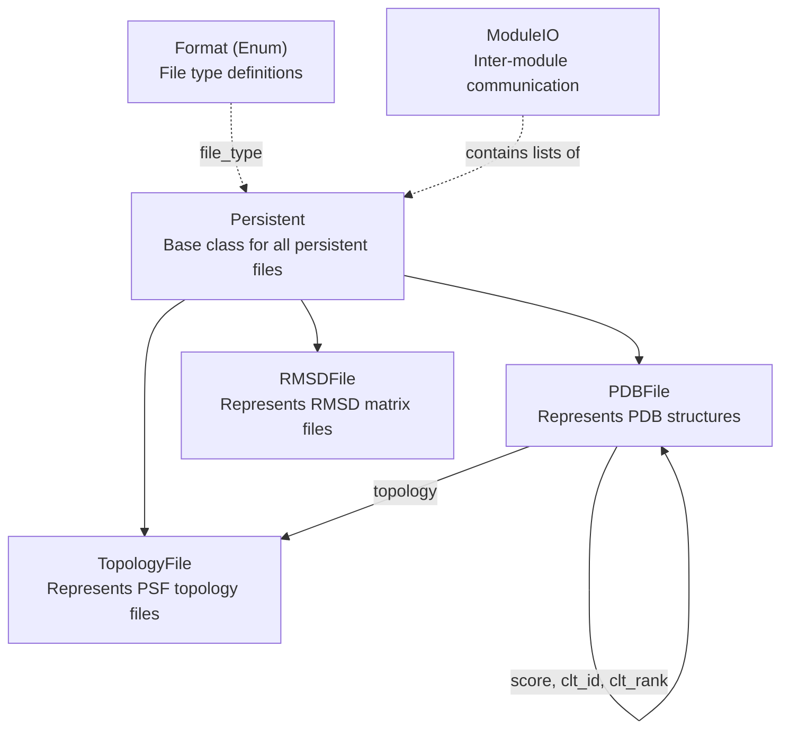
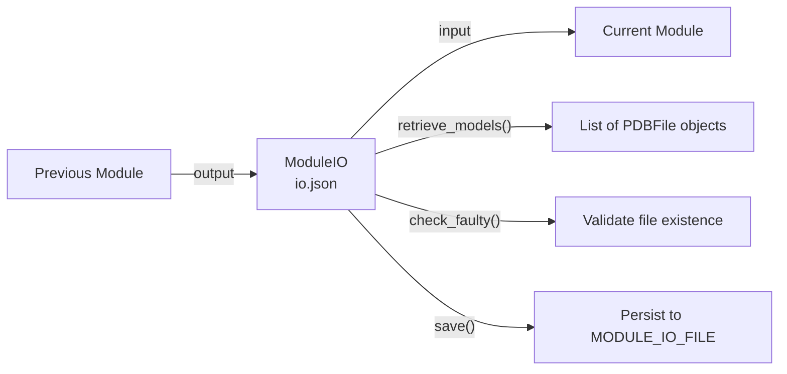
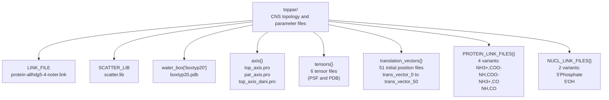
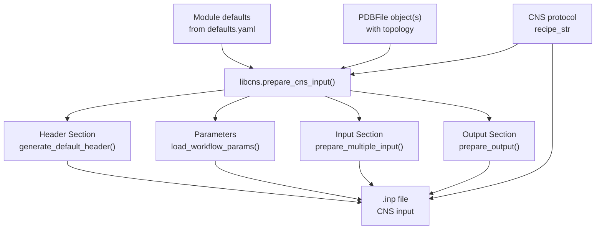
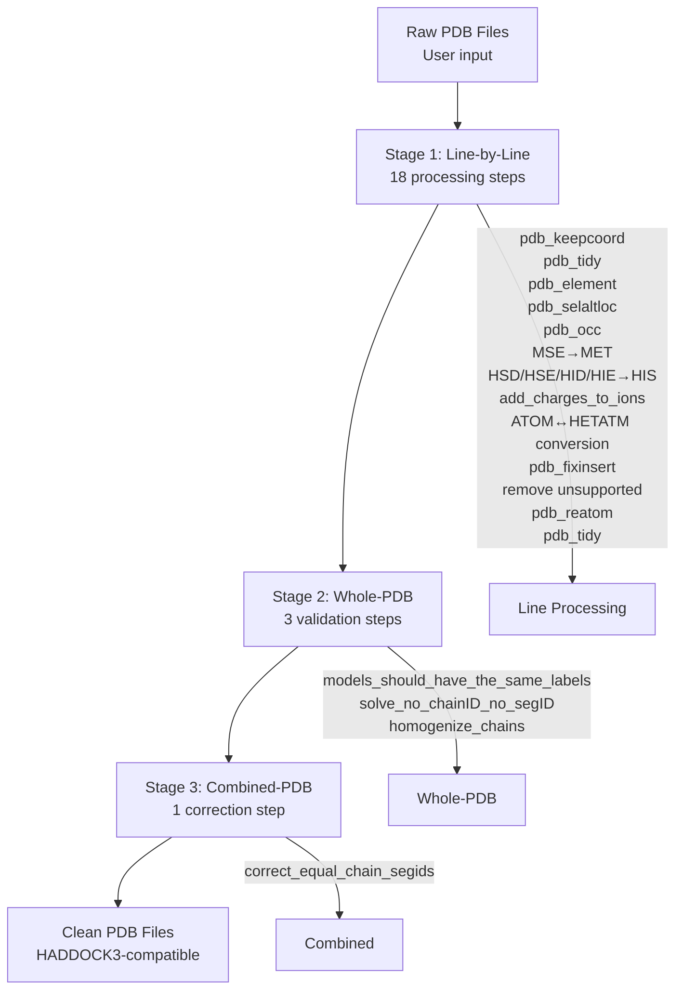
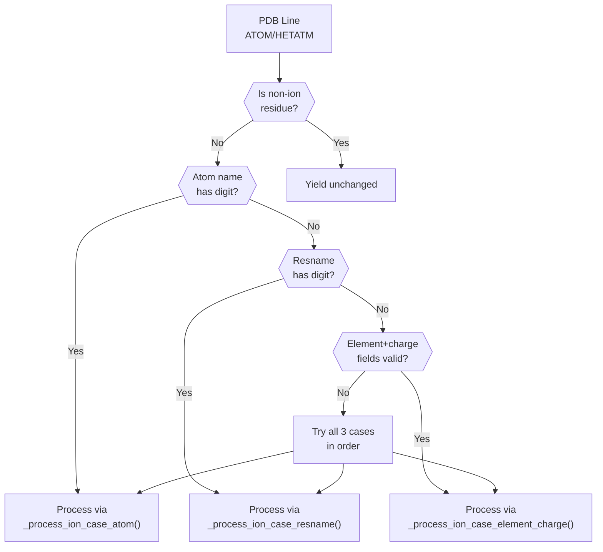

# Reference

<details>
<summary>Relevant source files</summary>

The following files were used as context for generating this wiki page:

- [CHANGELOG.md](CHANGELOG.md)
- [notebooks/HADDOCK3-antibody-antigen.ipynb](notebooks/HADDOCK3-antibody-antigen.ipynb)
- [notebooks/README.md](notebooks/README.md)
- [pyproject.toml](pyproject.toml)
- [src/haddock/clis/wrapper_haddock_restraints.py](src/haddock/clis/wrapper_haddock_restraints.py)
- [src/haddock/core/cns_paths.py](src/haddock/core/cns_paths.py)
- [src/haddock/core/supported_molecules.py](src/haddock/core/supported_molecules.py)
- [src/haddock/gear/preprocessing.py](src/haddock/gear/preprocessing.py)
- [src/haddock/libs/libcns.py](src/haddock/libs/libcns.py)
- [src/haddock/libs/libfunc.py](src/haddock/libs/libfunc.py)
- [src/haddock/libs/libnotebooks.py](src/haddock/libs/libnotebooks.py)
- [src/haddock/libs/libontology.py](src/haddock/libs/libontology.py)
- [src/haddock/libs/libpdb.py](src/haddock/libs/libpdb.py)
- [src/haddock/modules/base_cns_module.py](src/haddock/modules/base_cns_module.py)
- [tests/data/broken.pdb](tests/data/broken.pdb)
- [tests/data/corrected.pdb](tests/data/corrected.pdb)
- [tests/data/residues.top](tests/data/residues.top)
- [tests/test_cns_paths.py](tests/test_cns_paths.py)
- [tests/test_core_supported_molecules.py](tests/test_core_supported_molecules.py)
- [tests/test_gear_preprocessing.py](tests/test_gear_preprocessing.py)

</details>


This page provides comprehensive reference material for HADDOCK3 components, including core data structures, file formats, supported molecules, and configuration constants. For detailed module-specific information, see [Module Catalog](#9.1). For file format specifications, see [File Formats](#9.2). For common issues and solutions, see [Troubleshooting](#9.3).

---

## Core Data Structures

HADDOCK3 uses a well-defined ontology to represent persistent files and inter-module communication. These data structures are central to understanding how data flows through the workflow.

### Ontology Class Hierarchy



Sources: [src/haddock/libs/libontology.py:34-251]()

### Persistent Base Class

The `Persistent` class is the foundation for all file objects in HADDOCK3:

| Attribute | Type | Description |
|-----------|------|-------------|
| `file_name` | `str` | Base name of the file |
| `file_type` | `Format` | File type enumeration (PDB, PSF, MATRIX, etc.) |
| `path` | `str` | Absolute path to directory containing file |
| `full_name` | `str` | Complete path including filename |
| `rel_path` | `Path` | Relative path for inter-module reference |
| `md5` | `str` | MD5 hash for file integrity checking |
| `restr_fname` | `FilePath` | Associated restraint file path |
| `created` | `str` | ISO timestamp of creation |

Sources: [src/haddock/libs/libontology.py:34-63]()

### PDBFile Class

The `PDBFile` class extends `Persistent` to represent molecular structures with additional scoring and clustering metadata:

| Attribute | Type | Description |
|-----------|------|-------------|
| `topology` | `TopologyFile` or `list` | Associated PSF topology file(s) |
| `score` | `float` | HADDOCK score for the structure |
| `ori_name` | `str` | Original filename before processing |
| `clt_id` | `str` or `int` | Cluster identifier |
| `clt_rank` | `int` | Rank within cluster |
| `clt_model_rank` | `int` | Overall model rank in cluster |
| `unw_energies` | `dict[str, float]` | Dictionary of individual energy terms |
| `seed` | `int` | Random seed used for generation |

The `PDBFile` class implements comparison operators (`__lt__`, `__gt__`, `__eq__`) based on the `score` attribute, enabling direct sorting and comparison of structures.

Sources: [src/haddock/libs/libontology.py:65-101]()

### ModuleIO Class

The `ModuleIO` class manages data exchange between workflow modules:



Key methods:

| Method | Parameters | Returns | Purpose |
|--------|-----------|---------|---------|
| `add()` | `persistent`, `mode="i"` or `"o"` | `None` | Add file to input or output list |
| `save()` | `path`, `filename=MODULE_IO_FILE` | `Path` | Serialize to JSON using jsonpickle |
| `load()` | `filename` | `None` | Deserialize from JSON file |
| `retrieve_models()` | `crossdock=False`, `individualize=False` | `list` | Get models for next module |
| `check_faulty()` | None | `float` | Calculate percentage of missing files |
| `remove_missing()` | None | `None` | Remove non-existent files from output |

The `retrieve_models()` method supports three modes:
- **Pairwise mode** (default): Combines molecules from ensembles in order
- **Crossdock mode** (`crossdock=True`): Creates all combinations using `itertools.product()`
- **Individualize mode** (`individualize=True`): Flattens all molecules into single list

Sources: [src/haddock/libs/libontology.py:121-240]()

---

## Supported Molecules

HADDOCK3 supports a comprehensive set of molecule types defined by CNS topology files. The system automatically parses these definitions from `.top` files.

### Molecule Type Taxonomy

```mermaid
graph TB
    All["supported_residues<br/>All supported molecules"]
    
    ATOM["supported_ATOM<br/>Must use ATOM records"]
    HETATM["supported_HETATM<br/>Must use HETATM records"]
    
    AA["supported_aminoacids_resnames<br/>Protein residues"]
    NA["supported_nucleic_resnames<br/>DNA/RNA residues"]
    Shape["supported_shape_resnames<br/>Shape molecules"]
    
    Carbo["supported_carbo_resnames<br/>Carbohydrates"]
    Frag["supported_fragments_resnames<br/>Fragment probes"]
    Hemes["supported_hemes_resnames<br/>Heme groups"]
    SingleIon["supported_single_ions_resnames<br/>Single-atom ions"]
    MultiIon["supported_multiatom_ions_resnames<br/>Multi-atom ions"]
    Solvent["supported_solvents_resnames<br/>Solvent molecules"]
    Cofactor["supported_cofactors_resnames<br/>Cofactors"]
    
    All --> ATOM
    All --> HETATM
    
    ATOM --> AA
    ATOM --> NA
    ATOM --> Shape
    
    HETATM --> Carbo
    HETATM --> Frag
    HETATM --> Hemes
    HETATM --> SingleIon
    HETATM --> MultiIon
    HETATM --> Solvent
    HETATM --> Cofactor
```



Sources: [src/haddock/core/supported_molecules.py:1-498]()

### Topology File Parsing

The system reads residue definitions from CNS topology files using the `CNSTopologyResidue` class:

| Attribute | Type | Description |
|-----------|------|-------------|
| `resname` | `str` | Three-letter residue code |
| `charge` | `float` | Total residue charge (rounded to 2 decimals) |
| `atoms` | `tuple[str]` | Tuple of atom names in residue |
| `elements` | `tuple[str]` | Element symbols (for ions, derived from atom names) |

The `read_residues_from_top_file()` function parses CNS topology files using regex to extract:
- `RESI` or `RESIdue` lines for residue names
- `ATOM` lines with charge specifications
- Accumulates charges to compute total residue charge

Sources: [src/haddock/core/supported_molecules.py:61-243]()

### Topology File Sources

| Category | Source File | Variable Name |
|----------|-------------|---------------|
| Carbohydrates | `carbohydrate.top` | `supported_carbo_resnames` |
| DNA/RNA (all-atom) | `dna-rna-allatom-hj-opls-1.3.top` | `supported_nucleic_resnames` |
| DNA/RNA (MARTINI) | `dna-rna-CG-MARTINI-2-1p.top` | `supported_nucleic_resnames` |
| Fragment probes | `fragment_probes.top` | `supported_fragments_resnames` |
| Hemes | `hemes-allhdg.top` | `supported_hemes_resnames` |
| Ions | `ion.top` | `supported_single_ions_resnames`, `supported_multiatom_ions_resnames` |
| Protein (all-atom) | `protein-allhdg5-4.top` | `supported_aminoacids_resnames` |
| Protein (MARTINI) | `protein-CG-Martini-2-2.top`, `protein-CG-Martini.top` | `supported_aminoacids_resnames` |
| Solvents | `solvent-allhdg5-4.top` | `supported_solvents_resnames` |
| Shape | `shape.top` | `supported_shape_resnames` |
| Cofactors | `cofactors.top` | `supported_cofactors_resnames` |

Sources: [src/haddock/core/supported_molecules.py:270-405]()

### Ion Handling

Single-atom ions require special handling for charge information. The system provides three mapping dictionaries:

| Map | Key | Value | Purpose |
|-----|-----|-------|---------|
| `supported_single_ions_resnames_map` | Resname (e.g., "ZN2") | `CNSTopologyResidue` | Map residue name to topology |
| `supported_single_ions_elements_map` | Element (e.g., "ZN") | `CNSTopologyResidue` | Map element to topology |
| `supported_single_ions_atoms_map` | Atom name (e.g., "ZN+2") | `CNSTopologyResidue` | Map atom name to topology |

The `get_ion_element_from_atoms()` function strips trailing digits and charges (`+-`) from atom names to derive element symbols.

Sources: [src/haddock/core/supported_molecules.py:141-157](), [src/haddock/core/supported_molecules.py:420-436]()

---

## CNS Integration

HADDOCK3 uses CNS (Crystallography & NMR System) as its computational engine. The integration involves managing CNS paths, generating input files, and handling topology/parameter files.

### CNS File Path Structure



Sources: [src/haddock/core/cns_paths.py:1-100]()

### CNS Path Constants

| Constant | Type | Description |
|----------|------|-------------|
| `LINK_FILE` | `str` | Default link file: "protein-allhdg5-4-noter.link" |
| `SCATTER_LIB` | `str` | Scatter library: "scatter.lib" |
| `INITIAL_POSITIONS_DIR` | `str` | Directory for translation vectors |
| `PROTEIN_LINK_FILES` | `dict` | Maps terminus states to protein link files |
| `NUCL_LINK_FILES` | `dict` | Maps 5' states to nucleic acid link files |

The `find_desired_linkfiles()` function selects appropriate link files based on:
- `charged_nter`: Whether N-terminus is charged (NH3+ vs NH)
- `charged_cter`: Whether C-terminus is charged (COO- vs CO)
- `phosphate_5`: Whether 5' end has phosphate (vs OH)

Sources: [src/haddock/core/cns_paths.py:24-103]()

### CNS Path Generation Functions

| Function | Returns | Purpose |
|----------|---------|---------|
| `get_axis(path)` | `dict[str, Path]` | Generate 3 axis definition files |
| `get_tensors(path)` | `dict[str, Path]` | Generate 6 tensor files (PSF/PDB pairs) |
| `get_translation_vectors(path)` | `dict[str, Path]` | Generate 51 initial position files |
| `get_water_box(path)` | `dict[str, Path]` | Generate water box file path |

These functions create relative or absolute paths depending on the input `path` parameter. They are used during `self_contained` mode to copy CNS files into the run directory.

Sources: [src/haddock/core/cns_paths.py:45-99]()

### CNS Input File Generation



Sources: [src/haddock/libs/libcns.py:321-425]()

### CNS Header Components

The `generate_default_header()` function returns a tuple of 6 CNS header strings:

| Component | Function | Content |
|-----------|----------|---------|
| Link files | `load_link()` | Protein/nucleic acid linkage definitions |
| Translation vectors | `load_trans_vectors()` | 51 initial position files |
| Tensors | `load_tensor()` | Tensor PSF/PDB files |
| Scatter library | `load_scatter()` | X-ray scattering library |
| Axis definitions | `load_axis()` | RDC axis topology/parameters |
| Water box | `load_boxtyp20()` | Water box for explicit solvent |

Each component is formatted as CNS `eval` statements using `write_eval_line()`.

Sources: [src/haddock/libs/libcns.py:23-53]()

### Parameter Filtering

The `filter_empty_vars()` function determines which parameters to write to CNS:

| Type | Write to CNS? | Notes |
|------|---------------|-------|
| Non-empty string | ✓ | Wrapped in double quotes |
| Boolean | ✓ | Converted to lowercase ("true"/"false") |
| `int` or `float` | ✓ | Written as-is |
| `Path` or `EmptyPath` | ✓ | Converted to string |
| Empty string | ✗ | Filtered out |
| `None` | ✗ | Filtered out |
| `NaN` | ✗ | Filtered out |

Sources: [src/haddock/libs/libcns.py:114-149]()

---

## PDB Preprocessing Pipeline

HADDOCK3 performs extensive PDB preprocessing to ensure compatibility with CNS. The pipeline is implemented in three stages.

### Preprocessing Stage Overview



Sources: [src/haddock/gear/preprocessing.py:1-437]()

### Stage 1: Line-by-Line Processing (18 Steps)

The 18 line-by-line processing steps in order:

| Step | Function | Purpose |
|------|----------|---------|
| 1 | `wrep_pdb_keepcoord` | Keep only coordinate lines (ATOM/HETATM), discard ANISOU |
| 2 | `wrep_pdb_tidy_strict` | Tidy with strict=True (TER only between chains) |
| 3 | `wrep_pdb_element` | Add element symbols |
| 4 | `wrep_pdb_selaltloc` | Select first alternate location |
| 5 | `wrep_pdb_occ` | Set occupancy to 1.00 |
| 6 | `replace_MSE_to_MET` | Replace selenomethionine with methionine |
| 7 | `replace_HSD_to_HIS` | Replace histidine delta with standard |
| 8 | `replace_HSE_to_HIS` | Replace histidine epsilon with standard |
| 9 | `replace_HID_to_HIS` | Replace histidine delta with standard |
| 10 | `replace_HIE_to_HIS` | Replace histidine epsilon with standard |
| 11 | `add_charges_to_ions` | Add charge information to ion residues |
| 12 | `convert_ATOM_to_HETATM` | Convert ATOM records that should be HETATM |
| 13 | `convert_HETATM_to_ATOM` | Convert HETATM records that should be ATOM |
| 14 | `wrep_pdb_fixinsert` | Fix insertion codes (e.g., 82A→83 in antibodies) |
| 15 | `remove_unsupported_hetatm` | Remove unsupported HETATM residues |
| 16 | `remove_unsupported_atom` | Remove unsupported ATOM residues |
| 17 | `wrep_pdb_reatom` | Renumber atoms starting from 1 |
| 18 | `wrep_pdb_tidy` | Final tidy |

Sources: [src/haddock/gear/preprocessing.py:371-404]()

### Stage 2: Whole-PDB Processing (3 Steps)

| Step | Function | Purpose |
|------|----------|---------|
| 1 | `models_should_have_the_same_labels` | Verify all MODELs in ensemble have identical atom labels |
| 2 | `solve_no_chainID_no_segID` | Handle missing chain/seg IDs (copy one to other, or assign 'A') |
| 3 | `homogenize_chains` | Make all chain IDs in PDB the same (copy first to all) |

The `models_should_have_the_same_labels()` function raises `ModelsDifferError` if models differ, reporting which model numbers are inconsistent.

Sources: [src/haddock/gear/preprocessing.py:408-412](), [src/haddock/gear/preprocessing.py:896-971]()

### Stage 3: Combined Processing (1 Step)

The `correct_equal_chain_segids()` function operates on all input PDBs simultaneously:

1. Collects all chain IDs from all structures
2. Identifies available unused chain letters (A-Z, a-z)
3. For each structure with a duplicate chain ID:
   - Assigns next available unused letter
   - Applies using `pdb_chain.run()` and `pdb_chainxseg.run()`

Sources: [src/haddock/gear/preprocessing.py:416-418](), [src/haddock/gear/preprocessing.py:976-1028]()

### Ion Charge Processing

The `add_charges_to_ions()` function handles charge information in three priority levels:



Each processing case reconstructs the PDB line with corrected:
- Atom name (formatted via `format_atom_name()`)
- Residue name
- Element symbol
- Charge field

Sources: [src/haddock/gear/preprocessing.py:673-748](), [src/haddock/gear/preprocessing.py:750-829]()

---

## Command-Line Tools

HADDOCK3 provides a comprehensive suite of command-line tools for workflow management, analysis, and utility operations.

### CLI Tool Ecosystem

```mermaid
graph TB
    Main["haddock3<br/>Main workflow execution"]
    
    Workflow["Workflow Management"]
    Analysis["Analysis & Reporting"]
    Utilities["Utilities"]
    MPI["Parallel Execution"]
    
    Main --> Workflow
    Main --> Analysis
    Main --> Utilities
    Main --> MPI
    
    Workflow --> cfg["haddock3-cfg<br/>Generate config templates"]
    Workflow --> re["haddock3-re<br/>Restart from step"]
    Workflow --> clean["haddock3-clean<br/>Clean run directory"]
    
    Analysis --> analyse["haddock3-analyse<br/>Generate HTML reports"]
    Analysis --> score["haddock3-score<br/>Score structures"]
    Analysis --> dmn["haddock3-dmn<br/>Domain analysis"]
    
    Utilities --> copy["haddock3-copy<br/>Copy modules/params"]
    Utilities --> pp["haddock3-pp<br/>Preprocess PDB"]
    Utilities --> unpack["haddock3-unpack<br/>Extract archives"]
    Utilities --> traceback["haddock3-traceback<br/>Show error details"]
    Utilities --> restraints_py["haddock3-restraints<br/>Python wrapper"]
    Utilities --> restraints_bin["haddock-restraints<br/>Rust binary"]
    
    MPI --> mpitask["haddock3-mpitask<br/>MPI task execution"]
```



Sources: [pyproject.toml:83-98]()

### CLI Script Definitions

| Script Name | Entry Point | Purpose |
|-------------|-------------|---------|
| `haddock3` | `haddock.clis.cli:maincli` | Main workflow execution |
| `haddock3-mpitask` | `haddock.clis.cli_mpi:maincli` | Execute module with MPI |
| `haddock3-cfg` | `haddock.clis.cli_cfg:maincli` | Generate configuration templates |
| `haddock3-clean` | `haddock.clis.cli_clean:maincli` | Clean workflow directory |
| `haddock3-copy` | `haddock.clis.cli_cp:maincli` | Copy modules or parameters |
| `haddock3-dmn` | `haddock.clis.cli_dmn:maincli` | Domain manipulation |
| `haddock3-pp` | `haddock.clis.cli_pp:maincli` | PDB preprocessing |
| `haddock3-score` | `haddock.clis.cli_score:maincli` | Score existing structures |
| `haddock3-unpack` | `haddock.clis.cli_unpack:maincli` | Unpack archived runs |
| `haddock3-analyse` | `haddock.clis.cli_analyse:maincli` | Generate analysis reports |
| `haddock3-traceback` | `haddock.clis.cli_traceback:maincli` | Show detailed error information |
| `haddock3-re` | `haddock.clis.cli_re:maincli` | Restart workflow from step |
| `haddock3-restraints` | `haddock.clis.cli_restraints:maincli` | Python wrapper for restraints CLI |
| `haddock-restraints` | `haddock.clis.wrapper_haddock_restraints:main` | Rust binary wrapper |

Sources: [pyproject.toml:83-98]()

### haddock-restraints Wrapper

The `haddock-restraints` binary is a Rust-compiled external tool distributed with HADDOCK3. The Python wrapper locates and executes it:

```python
# From wrapper_haddock_restraints.py
binary = Path(files("haddock").joinpath("bin/haddock-restraints"))
subprocess.run([str(binary)] + sys.argv[1:])
```

The wrapper:
1. Locates binary in `haddock/bin/haddock-restraints` using `importlib.resources`
2. Replaces `sys.argv[0]` with actual binary path
3. Executes via `subprocess.run()` with all arguments
4. Returns the binary's exit code

Sources: [src/haddock/clis/wrapper_haddock_restraints.py:1-21]()

---

## Project Configuration

The project configuration defines dependencies, build system, and package metadata.

### Dependency Specification

```mermaid
graph TB
    Core["Core Dependencies<br/>Required for all installations"]
    Optional["Optional Dependencies<br/>Feature-specific"]
    
    Core --> pdbtools["pdb-tools>=2.5.0"]
    Core --> biopython["biopython==1.*"]
    Core --> jsonpickle["jsonpickle>=2.1.0"]
    Core --> numpy["numpy==2.*"]
    Core --> pyyaml["pyyaml>=6.0"]
    Core --> scipy["scipy>=1.10.0"]
    Core --> toml["toml>=0.10.2"]
    Core --> pandas["pandas==2.*"]
    Core --> prodigy_prot["prodigy-prot==2.3.0"]
    Core --> prodigy_lig["prodigy-lig==1.1.4"]
    Core --> plotly["plotly==6.3.0"]
    Core --> freesasa["freesasa>=2.2.1"]
    
    Optional --> dev["dev<br/>Testing & development"]
    Optional --> docs["docs<br/>Documentation generation"]
    Optional --> mpi_extra["mpi<br/>MPI execution"]
    Optional --> notebooks["notebooks<br/>Jupyter support"]
    
    dev --> pytest["pytest, coverage, hypothesis"]
    docs --> sphinx["sphinx, sphinx-argparse"]
    mpi_extra --> mpi4py["mpi4py>=4.0.2"]
    notebooks --> py3dmol["py3Dmol>=2.5.2"]
```



Sources: [pyproject.toml:38-75]()

### Core Dependencies

| Package | Version | Purpose |
|---------|---------|---------|
| `pdb-tools` | >=2.5.0 | PDB file manipulation utilities |
| `biopython` | 1.* | Biological computation (alignment, parsing) |
| `jsonpickle` | >=2.1.0 | Object serialization for ModuleIO |
| `numpy` | 2.* | Numerical arrays and operations |
| `pyyaml` | >=6.0 | YAML configuration parsing |
| `scipy` | >=1.10.0 | Scientific computing (clustering, statistics) |
| `toml` | >=0.10.2 | TOML configuration file parsing |
| `pandas` | 2.* | Data manipulation and TSV output |
| `prodigy-prot` | 2.3.0 | Protein-protein binding affinity prediction |
| `prodigy-lig` | 1.1.4 | Protein-ligand binding affinity prediction |
| `plotly` | 6.3.0 | Interactive plot generation |
| `freesasa` | >=2.2.1 | Solvent accessible surface area calculation |

Sources: [pyproject.toml:38-51]()

### Optional Dependencies

| Group | Packages | Purpose |
|-------|----------|---------|
| `dev` | coverage, pytest, pytest-cov, hypothesis, pytest-mock, fastapi, httpx, kaleido, pytest-random-order | Development and testing |
| `docs` | sphinx, sphinx-argparse, sphinx_rtd_theme, CommonMark, mock, myst-parser | Documentation generation |
| `mpi` | mpi4py>=4.0.2 | MPI-based parallel execution |
| `notebooks` | py3Dmol>=2.5.2 | Jupyter notebook visualization |

Install optional dependencies:
```bash
pip install haddock3[dev]        # Development tools
pip install haddock3[docs]       # Documentation
pip install haddock3[mpi]        # MPI support
pip install haddock3[notebooks]  # Notebook support
```

Sources: [pyproject.toml:53-75]()

### Build System

| Setting | Value | Description |
|---------|-------|-------------|
| `build-backend` | `setuptools.build_meta` | Uses setuptools for building |
| `requires` | `setuptools>=45`, `wheel` | Build dependencies |
| `packages` | `["haddock"]` | Single package to install |
| `package-dir` | `{"": "src"}` | Source location in `src/` directory |
| `include-package-data` | `true` | Include non-Python files |
| `package-data` | `haddock = ["bin/*"]` | Include all files in `haddock/bin/` |

The package data specification ensures compiled binaries in `src/haddock/bin/` are included in the distribution.

Sources: [pyproject.toml:1-113]()

### Python Version Support

HADDOCK3 supports Python 3.9 through 3.14 (excluding 3.15+):

```python
requires-python = ">=3.9, <3.15"
```

Classifier list confirms support for:
- Python 3.9
- Python 3.10
- Python 3.11
- Python 3.12
- Python 3.13
- Python 3.14

Sources: [pyproject.toml:23-29](), [pyproject.toml:37]()

---

## Constants and Defaults

### File Format Constants

The `MODULE_IO_FILE` constant defines the JSON serialization filename:

```python
MODULE_IO_FILE = "io.json"
```

This file is created in each module directory to store the `ModuleIO` object state using jsonpickle serialization.

Sources: [src/haddock/core/defaults.py:12]() (inferred from usage in [src/haddock/libs/libontology.py:141-148]())

### Format Enumeration

| Format | Value | Description |
|--------|-------|-------------|
| `Format.PDB` | "pdb" | PDB coordinate files |
| `Format.PDB_ENSEMBLE` | "pdb" | Multi-model PDB files |
| `Format.CNS_INPUT` | "inp" | CNS input scripts |
| `Format.CNS_OUTPUT` | "out" | CNS output logs |
| `Format.TOPOLOGY` | "psf" | PSF topology files |
| `Format.MATRIX` | "matrix" | Distance/similarity matrices |

Sources: [src/haddock/libs/libontology.py:20-32]()

### PDB Slice Constants

PDB line parsing uses fixed-width field slices defined in `libpdb.py`:

| Slice | Columns | Field |
|-------|---------|-------|
| `slc_record` | 0-6 | Record type (ATOM/HETATM) |
| `slc_serial` | 6-11 | Atom serial number |
| `slc_name` | 12-16 | Atom name |
| `slc_altloc` | 16-17 | Alternate location indicator |
| `slc_resname` | 17-20 | Residue name |
| `slc_chainid` | 21-22 | Chain identifier |
| `slc_resseq` | 22-26 | Residue sequence number |
| `slc_icode` | 26-27 | Insertion code |
| `slc_x` | 30-38 | X coordinate |
| `slc_y` | 38-46 | Y coordinate |
| `slc_z` | 46-54 | Z coordinate |
| `slc_occ` | 54-60 | Occupancy |
| `slc_temp` | 60-66 | Temperature factor |
| `slc_segid` | 72-76 | Segment identifier |
| `slc_element` | 76-78 | Element symbol |
| `slc_charge` | 78-80 | Charge |

Sources: [src/haddock/libs/libpdb.py:27-42]()

### Special Value Constants

| Constant | Value | Usage |
|----------|-------|-------|
| `NaN` | `float("nan")` | Missing/undefined numeric values in ontology |

Sources: [src/haddock/libs/libontology.py:17]()

---

## Utility Functions

### Functional Programming Utilities

The `libfunc` module provides functional programming patterns:

| Function | Parameters | Returns | Purpose |
|----------|-----------|---------|---------|
| `chainf()` | `init`, `*funcs`, `**common` | `Any` | Apply sequence of functions to initial value |
| `chainfs()` | `*funcs`, `**common` | `Callable` | Store functions for later execution |
| `give_same()` | `value` | `Any` | Identity function |
| `true()` | `*ignore`, `**everything` | `True` | Always returns True |
| `false()` | `*ignore`, `**everything` | `False` | Always returns False |
| `none()` | `*ignore`, `**everything` | `None` | Always returns None |
| `nan()` | `*ignore`, `**everything` | `float` | Always returns NaN |
| `not_none()` | `value` | `bool` | Test if value is not None |

Example usage:
```python
# Chain functions
result = chainf(2, str, int, float)  # Returns 2.0

# Store chain for reuse
converter = chainfs(str, int, float)
result = converter(2)  # Returns 2.0
```

Sources: [src/haddock/libs/libfunc.py:1-101]()

### PDB Utility Functions

| Function | Parameters | Returns | Purpose |
|----------|-----------|---------|---------|
| `format_atom_name()` | `atom`, `element` | `str` | Format atom name according to PDB standards |
| `get_supported_residues()` | `haddock_topology` | `list[str]` | Extract residue names from topology file |
| `split_ensemble()` | `pdb_file_path`, `dest` | `list[Path]` | Split multi-model PDB into separate files |
| `split_by_chain()` | `pdb_file_path` | `list[Path]` | Split PDB by chain into separate files |
| `tidy()` | `pdb_file_path`, `new_pdb_file_path` | `None` | Tidy PDB structure |
| `swap_segid_chain()` | `pdb_file_path`, `new_pdb_file_path` | `None` | Copy segment ID to chain ID |
| `sanitize()` | `pdb_file_path`, `overwrite`, `custom_topology` | `Path` | Remove unsupported residues |
| `identify_chainseg()` | `pdb_file_path`, `sort` | `tuple[list, list]` | Extract chain and segment IDs |
| `add_TER_on_chain_breaks()` | `input_pdb`, `output_pdb` | `None` | Detect and mark chain breaks with TER |
| `check_combination_chains()` | `combination` | `list[str]` | Verify unique chain IDs in combination |

Sources: [src/haddock/libs/libpdb.py:45-507]()

### Notebook Utilities

Functions for Jupyter notebook integration:

| Function | Parameters | Returns | Purpose |
|----------|-----------|---------|---------|
| `load_pdb_file()` | `file_path` | `str` | Load PDB file (supports .gz) |
| `pdb_string_to_structure()` | `pdb_string`, `structure_id` | `Structure` | Parse PDB string to BioPython Structure |
| `structure_to_pdb_string()` | `structure` | `str` | Convert Structure to PDB string |
| `align_full()` | `pdb_path1`, `pdb_path2`, `chains`, ... | `py3Dmol.view` | Align and visualize structures |

The `align_full()` function provides comprehensive alignment with:
- Per-chain RMSD calculation
- Customizable colors per chain
- Atom type selection (CA, P, C1, etc.)
- Interactive py3Dmol visualization

Sources: [src/haddock/libs/libnotebooks.py:1-294]()

---

## Version and Metadata

### Current Version

```python
version = "2025.9.0"
```

HADDOCK3 uses calendar versioning (CalVer) with format `YYYY.M.MICRO`.

Sources: [pyproject.toml:7]()

### Project Metadata

| Field | Value |
|-------|-------|
| Name | haddock3 |
| Description | HADDOCK3 |
| Authors | BonvinLab <bonvinlab.support@uu.nl> |
| License | Apache License 2.0 |
| Homepage | https://github.com/haddocking/haddock3 |
| Documentation | https://github.com/haddocking/haddock3#readme |
| Issue Tracker | https://github.com/haddocking/haddock3/issues |

Sources: [pyproject.toml:5-81]()

### Platform Support

HADDOCK3 supports:
- **Operating Systems**: POSIX, Linux, MacOS
- **Intended Audience**: Science/Research
- **Topics**: Bio-Informatics, Chemistry, Physics
- **Development Status**: Production/Stable

Sources: [pyproject.toml:12-29]()

### Recent Changes

Major changes from the CHANGELOG:

| Date | Change |
|------|--------|
| 2025-09-11 | Added `grid` execution mode |
| 2025-09-11 | Corrected antibody-antigen notebook (Issue #1383) |
| 2025-09-09 | Added Jupyter notebooks with tutorials (Issue #1367) |
| 2025-09-05 | Consistency in cluster naming in contactmap module (Issue #1359) |
| 2025-09-03 | Added support for THR-glycosylation (Issue #1371) |
| 2025-08-25 | Distribute the `haddock-restraints` binary |
| 2025-06-12 | Added `restrain_ligand` sub-command in haddock3-restraints (Issue #1299) |
| 2025-06-06 | Added selection of Nter, Cter and 5'end states at topology generation (Issue #1269) |
| 2025-06-05 | Added support for pyroglutamic acid (PCA) (Issue #1228) |

Sources: [CHANGELOG.md:1-23]()

---