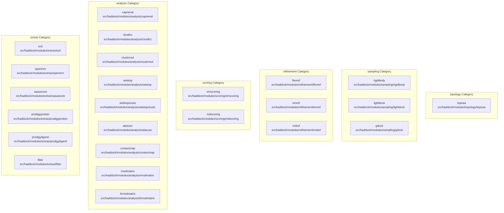
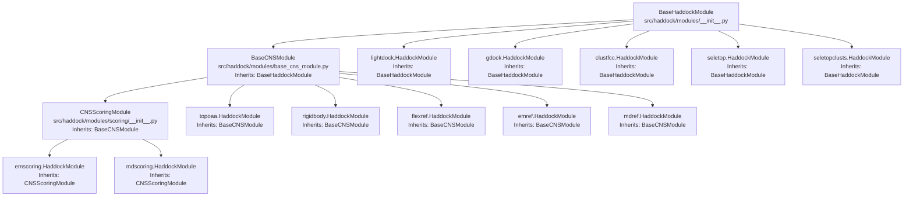
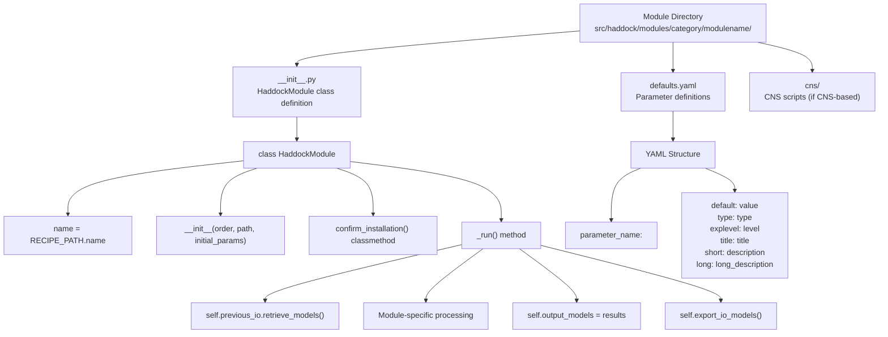

# Module Catalog

Relevant source files

The following files were used as context for generating this wiki page:

- [devtools/build_defaults_rst.py](devtools/build_defaults_rst.py)
- [docs/modules/index.rst](docs/modules/index.rst)
- [setup.py](setup.py)
- [src/haddock/modules/_template_cat/README.md](src/haddock/modules/_template_cat/README.md)
- [src/haddock/modules/_template_cat/_template_mod/defaults.yaml](src/haddock/modules/_template_cat/_template_mod/defaults.yaml)
- [src/haddock/modules/analysis/clustfcc/__init__.py](src/haddock/modules/analysis/clustfcc/__init__.py)
- [src/haddock/modules/analysis/seletop/__init__.py](src/haddock/modules/analysis/seletop/__init__.py)
- [src/haddock/modules/analysis/seletopclusts/__init__.py](src/haddock/modules/analysis/seletopclusts/__init__.py)
- [src/haddock/modules/refinement/emref/__init__.py](src/haddock/modules/refinement/emref/__init__.py)
- [src/haddock/modules/refinement/flexref/__init__.py](src/haddock/modules/refinement/flexref/__init__.py)
- [src/haddock/modules/refinement/mdref/__init__.py](src/haddock/modules/refinement/mdref/__init__.py)
- [src/haddock/modules/sampling/gdock/__init__.py](src/haddock/modules/sampling/gdock/__init__.py)
- [src/haddock/modules/sampling/lightdock/__init__.py](src/haddock/modules/sampling/lightdock/__init__.py)
- [src/haddock/modules/sampling/rigidbody/__init__.py](src/haddock/modules/sampling/rigidbody/__init__.py)
- [src/haddock/modules/scoring/emscoring/__init__.py](src/haddock/modules/scoring/emscoring/__init__.py)
- [src/haddock/modules/scoring/mdscoring/__init__.py](src/haddock/modules/scoring/mdscoring/__init__.py)
- [src/haddock/modules/topology/topoaa/__init__.py](src/haddock/modules/topology/topoaa/__init__.py)

This page provides a comprehensive reference listing of all HADDOCK3 modules organized by category. Each entry includes the module name as used in configuration files, a brief description of its functionality, the implementing class location, and key configurable parameters.

For detailed documentation on individual module categories, see:
- Topology modules: [4.1](#4.1)
- Sampling modules: [4.2](#4.2)
- Refinement modules: [4.3](#4.3)
- Scoring modules: [4.4](#4.4)
- Analysis modules: [4.5](#4.5)

For information on how to create custom modules, see [8.3](#8.3). For parameter definitions and validation, see [5.2](#5.2).

---

## Module Organization Structure

HADDOCK3 modules are organized into six major categories, each representing a distinct phase or function in the docking workflow. The following diagram maps module names (as used in configuration files) to their filesystem locations.

**Diagram: Module Namespace to Filesystem Mapping**

**Sources:** [devtools/build_defaults_rst.py:22-56]()

---

## Module Base Classes

All HADDOCK3 modules inherit from one of several base classes that define their core behavior. Understanding this hierarchy helps in determining module capabilities and requirements.

**Diagram: Module Class Inheritance**

**Sources:** [src/haddock/modules/topology/topoaa/__init__.py:102](), [src/haddock/modules/sampling/rigidbody/__init__.py:50](), [src/haddock/modules/refinement/flexref/__init__.py:40](), [src/haddock/modules/refinement/emref/__init__.py:26](), [src/haddock/modules/refinement/mdref/__init__.py:39](), [src/haddock/modules/scoring/emscoring/__init__.py:23](), [src/haddock/modules/scoring/mdscoring/__init__.py:23](), [src/haddock/modules/sampling/lightdock/__init__.py:20](), [src/haddock/modules/sampling/gdock/__init__.py:40](), [src/haddock/modules/analysis/clustfcc/__init__.py:49](), [src/haddock/modules/analysis/seletop/__init__.py:22](), [src/haddock/modules/analysis/seletopclusts/__init__.py:28]()

---

## Topology Modules

Topology modules generate CNS-compatible molecular topology files and prepare structures for computational operations.

### topoaa

**Full Name:** All-atom topology module  
**Class:** `HaddockModule` in [src/haddock/modules/topology/topoaa/__init__.py:102-357]()  
**Base Class:** `BaseCNSModule`  
**Default Config:** [src/haddock/modules/topology/topoaa/defaults.yaml]()

**Description:**  
Creates and manages CNS all-atom topology files (`.psf`) for input structures. Detects and rebuilds missing atoms including hydrogens, and generates parameter files (`.param`) required by CNS. This module is typically the first step in any HADDOCK3 workflow using CNS-based modules.

**Key Parameters:**

| Parameter | Type | Default | Description |
|-----------|------|---------|-------------|
| `molecules` | list | - | List of input PDB files |
| `ligand_top_fname` | string | null | Custom topology file for non-standard molecules |
| `charged_nter` | boolean | true | Use charged N-terminus |
| `charged_cter` | boolean | true | Use charged C-terminus |
| `5_phosphate` | boolean | false | Use 5' phosphate for nucleic acids |
| `limit` | boolean | false | Limit topologies to one per molecule |
| `tolerance` | integer | 0 | Number of failed models to tolerate |

**Outputs:**
- `*_haddock.pdb`: Processed PDB files with rebuilt atoms
- `*_haddock.psf`: CNS topology files
- `PDBFile` objects with `topology` attribute set

**Sources:** [src/haddock/modules/topology/topoaa/__init__.py:1-24](), [src/haddock/modules/topology/topoaa/__init__.py:174-357]()

---

## Sampling Modules

Sampling modules explore the conformational space of molecular complexes using different docking algorithms.

### rigidbody

**Full Name:** Rigid body docking sampling module  
**Class:** `HaddockModule` in [src/haddock/modules/sampling/rigidbody/__init__.py:50-272]()  
**Base Class:** `BaseCNSModule`  
**Default Config:** [src/haddock/modules/sampling/rigidbody/defaults.yaml]()

**Description:**  
Performs rigid-body docking with random orientation sampling and energy minimization. Corresponds to the classical `it0` step in HADDOCK2.x. Partners are treated as rigid bodies, randomly rotated and translated, then brought together through energy minimization guided by restraints.

**Key Parameters:**

| Parameter | Type | Default | Description |
|-----------|------|---------|-------------|
| `sampling` | integer | 1000 | Number of models to generate |
| `ambig_fname` | string | null | Ambiguous restraints file (.tbl) |
| `unambig_fname` | string | null | Unambiguous restraints file (.tbl) |
| `hbond_fname` | string | null | Hydrogen bond restraints file (.tbl) |
| `cmrest` | boolean | false | Use center-of-mass restraints |
| `ranair` | boolean | false | Use random AIRs for ab-initio docking |
| `surfrest` | boolean | false | Use surface restraints |
| `crossdock` | boolean | false | Enable cross-docking mode |
| `iniseed` | integer | 917 | Initial random seed |
| `w_vdw` | float | 0.01 | Van der Waals weight |
| `w_elec` | float | 1.0 | Electrostatics weight |
| `w_desolv` | float | 1.0 | Desolvation weight |
| `w_air` | float | 0.1 | AIR restraints weight |
| `w_bsa` | float | -0.01 | Buried surface area weight |

**Outputs:**
- `rigidbody_*.pdb`: Generated docking models
- `PDBFile` objects with `score` and `unw_energies` attributes

**Sources:** [src/haddock/modules/sampling/rigidbody/__init__.py:1-30](), [src/haddock/modules/sampling/rigidbody/__init__.py:196-272]()

### lightdock

**Full Name:** LightDock sampling module  
**Class:** `HaddockModule` in [src/haddock/modules/sampling/lightdock/__init__.py:20-161]()  
**Base Class:** `BaseHaddockModule`  
**Default Config:** [src/haddock/modules/sampling/lightdock/defaults.yaml]()

**Description:**  
Integrates the LightDock docking software using glowworm swarm optimization. LightDock is an external third-party tool that must be installed separately. Requires chain IDs to be present in input structures.

**Key Parameters:**

| Parameter | Type | Default | Description |
|-----------|------|---------|-------------|
| `receptor_chains` | list | ["A"] | Receptor chain identifiers |
| `ligand_chains` | list | ["B"] | Ligand chain identifiers |
| `swarms` | integer | 25 | Number of swarms |
| `glowworms` | integer | 200 | Number of glowworms per swarm |
| `steps` | integer | 100 | Number of optimization steps |
| `scoring` | string | "fastdfire" | Scoring function |
| `noxt` | boolean | false | Ignore OXT atoms |
| `noh` | boolean | false | Ignore hydrogen atoms |
| `top` | integer | 200 | Number of top models to generate |

**Installation Check:** Executes `lightdock3.py -h` via [src/haddock/modules/sampling/lightdock/__init__.py:38]()

**Sources:** [src/haddock/modules/sampling/lightdock/__init__.py:1](), [src/haddock/modules/sampling/lightdock/__init__.py:40-161]()

### gdock

**Full Name:** Gdock sampling module  
**Class:** `HaddockModule` in [src/haddock/modules/sampling/gdock/__init__.py:40-153]()  
**Base Class:** `BaseHaddockModule`  
**Default Config:** [src/haddock/modules/sampling/gdock/defaults.yaml]()

**Description:**  
Integrates the gdock genetic algorithm-based docking software. Requires the `GDOCK_PATH` environment variable to be set and converts HADDOCK restraints to gdock format.

**Key Parameters:**

| Parameter | Type | Default | Description |
|-----------|------|---------|-------------|
| `ambig_fname` | string | - | Ambiguous restraints file (required) |
| `ncores` | integer | 1 | Number of processor cores |

**Installation Check:** Verifies `gdock.py` exists in `$GDOCK_PATH` via [src/haddock/modules/sampling/gdock/__init__.py:52-64]()

**Sources:** [src/haddock/modules/sampling/gdock/__init__.py:1](), [src/haddock/modules/sampling/gdock/__init__.py:66-153]()

---

## Refinement Modules

Refinement modules improve the quality of docked models through energy minimization and molecular dynamics.

### flexref

**Full Name:** Flexible refinement module  
**Class:** `HaddockModule` in [src/haddock/modules/refinement/flexref/__init__.py:40-160]()  
**Base Class:** `BaseCNSModule`  
**Default Config:** [src/haddock/modules/refinement/flexref/defaults.yaml]()

**Description:**  
Semi-flexible simulated annealing protocol using molecular dynamics in torsion angle space. Corresponds to the `it1` stage in HADDOCK2.x. Consists of rigid body molecular dynamics, rigid body simulated annealing, semi-flexible annealing with flexible interface side-chains, and fully flexible interface annealing.

**Key Parameters:**

| Parameter | Type | Default | Description |
|-----------|------|---------|-------------|
| `sampling_factor` | integer | 1 | Number of refinement iterations per model |
| `max_nmodels` | integer | 10000 | Maximum number of models to refine |
| `ambig_fname` | string | null | Ambiguous restraints file |
| `w_vdw` | float | 1.0 | Van der Waals weight |
| `w_elec` | float | 1.0 | Electrostatics weight |
| `w_desolv` | float | 1.0 | Desolvation weight |
| `w_air` | float | 0.1 | AIR restraints weight |
| `w_bsa` | float | 0.0 | Buried surface area weight |

**Outputs:**
- `flexref_*.pdb`: Refined models
- `PDBFile` objects with updated `score` and `unw_energies`

**Sources:** [src/haddock/modules/refinement/flexref/__init__.py:1-22](), [src/haddock/modules/refinement/flexref/__init__.py:56-160]()

### emref

**Full Name:** Energy Minimization refinement module  
**Class:** `HaddockModule` in [src/haddock/modules/refinement/emref/__init__.py:26-143]()  
**Base Class:** `BaseCNSModule`  
**Default Config:** [src/haddock/modules/refinement/emref/defaults.yaml]()

**Description:**  
Refines complexes through energy minimization using the conjugate gradient method in CNS. Faster than molecular dynamics-based refinement but less thorough in exploring conformational space.

**Key Parameters:**

| Parameter | Type | Default | Description |
|-----------|------|---------|-------------|
| `sampling_factor` | integer | 1 | Number of minimization iterations per model |
| `max_nmodels` | integer | 10000 | Maximum number of models to refine |
| `ambig_fname` | string | null | Ambiguous restraints file |

**Sources:** [src/haddock/modules/refinement/emref/__init__.py:1-8](), [src/haddock/modules/refinement/emref/__init__.py:43-143]()

### mdref

**Full Name:** Water refinement module  
**Class:** `HaddockModule` in [src/haddock/modules/refinement/mdref/__init__.py:39-157]()  
**Base Class:** `BaseCNSModule`  
**Default Config:** [src/haddock/modules/refinement/mdref/defaults.yaml]()

**Description:**  
Explicit solvent molecular dynamics refinement in Cartesian space. Corresponds to the `itw` stage in HADDOCK2.x. Generates a solvent layer around surface residues (8Å for water, 12.5Å for DMSO) and performs MD heating to 300K, equilibration, and cooling to 100K.

**Key Parameters:**

| Parameter | Type | Default | Description |
|-----------|------|---------|-------------|
| `sampling_factor` | integer | 1 | Number of MD iterations per model |
| `max_nmodels` | integer | 10000 | Maximum number of models to refine |
| `waterheatsteps` | integer | 100 | MD steps during heating |
| `watersteps` | integer | 1250 | MD steps at 300K |
| `watercoolsteps` | integer | 500 | MD steps during cooling |

**Sources:** [src/haddock/modules/refinement/mdref/__init__.py:1-21](), [src/haddock/modules/refinement/mdref/__init__.py:55-157]()

---

## Scoring Modules

Scoring modules evaluate models using energy calculations without applying restraints.

### emscoring

**Full Name:** Energy Minimization scoring module  
**Class:** `HaddockModule` in [src/haddock/modules/scoring/emscoring/__init__.py:23-108]()  
**Base Class:** `CNSScoringModule`  
**Default Config:** [src/haddock/modules/scoring/emscoring/defaults.yaml]()

**Description:**  
Performs energy minimization and scoring without restraints. Evaluates models using the HADDOCK scoring function. Faster than MD-based scoring.

**Key Parameters:**

| Parameter | Type | Default | Description |
|-----------|------|---------|-------------|
| `w_vdw` | float | 1.0 | Van der Waals weight |
| `w_elec` | float | 0.2 | Electrostatics weight |
| `w_desolv` | float | 1.0 | Desolvation weight |
| `w_air` | float | 0.1 | AIR restraints weight |
| `w_bsa` | float | 0.0 | Buried surface area weight |
| `per_interface_scoring` | boolean | false | Calculate per-interface scores |

**Outputs:**
- `emscoring_*.pdb`: Scored models
- `emscoring.tsv`: Tabular results with energy terms

**Sources:** [src/haddock/modules/scoring/emscoring/__init__.py:1-5](), [src/haddock/modules/scoring/emscoring/__init__.py:39-108]()

### mdscoring

**Full Name:** Molecular Dynamics scoring module  
**Class:** `HaddockModule` in [src/haddock/modules/scoring/mdscoring/__init__.py:23-106]()  
**Base Class:** `CNSScoringModule`  
**Default Config:** [src/haddock/modules/scoring/mdscoring/defaults.yaml]()

**Description:**  
Performs a short MD simulation followed by scoring without restraints. More computationally intensive than `emscoring` but may provide better sampling of local conformational space.

**Key Parameters:**

| Parameter | Type | Default | Description |
|-----------|------|---------|-------------|
| `w_vdw` | float | 1.0 | Van der Waals weight |
| `w_elec` | float | 0.2 | Electrostatics weight |
| `w_desolv` | float | 1.0 | Desolvation weight |
| `w_air` | float | 0.1 | AIR restraints weight |
| `w_bsa` | float | 0.0 | Buried surface area weight |
| `per_interface_scoring` | boolean | false | Calculate per-interface scores |

**Outputs:**
- `mdscoring_*.pdb`: Scored models
- `mdscoring.tsv`: Tabular results with energy terms

**Sources:** [src/haddock/modules/scoring/mdscoring/__init__.py:1-5](), [src/haddock/modules/scoring/mdscoring/__init__.py:39-106]()

---

## Analysis Modules

Analysis modules evaluate, cluster, and select models based on various metrics.

### caprieval

**Full Name:** CAPRI Evaluation module  
**Class:** `HaddockModule` in analysis module  
**Base Class:** `BaseHaddockModule`  
**Default Config:** [src/haddock/modules/analysis/caprieval/defaults.yaml]()

**Description:**  
Calculates CAPRI (Critical Assessment of Predicted Interactions) metrics for docking quality assessment. Computes FNAT (fraction of native contacts), i-RMSD (interface RMSD), l-RMSD (ligand RMSD), and DockQ composite score. Requires a reference structure.

**Key Parameters:**

| Parameter | Type | Default | Description |
|-----------|------|---------|-------------|
| `reference_fname` | string | - | Reference structure file (required) |
| `irmsd_cutoff` | float | 10.0 | Interface RMSD cutoff (Å) |
| `fnat_cutoff` | float | 5.0 | Contact distance cutoff (Å) |
| `alignment_method` | string | "sequence" | Alignment method (sequence/structure) |

**Outputs:**
- `capri_ss.tsv`: Single-structure CAPRI metrics
- `capri_clt.tsv`: Cluster-averaged CAPRI metrics
- Interactive scatter plots

**Sources:** [devtools/build_defaults_rst.py:32]()

### clustfcc

**Full Name:** FCC Clustering module  
**Class:** `HaddockModule` in [src/haddock/modules/analysis/clustfcc/__init__.py:49-221]()  
**Base Class:** `BaseHaddockModule`  
**Default Config:** [src/haddock/modules/analysis/clustfcc/defaults.yaml]()

**Description:**  
Clusters models based on Fraction of Common Contacts (FCC). Uses the compiled `contact_fcc` binary to calculate intermolecular contacts, computes FCC similarity matrix, and performs hierarchical clustering.

**Key Parameters:**

| Parameter | Type | Default | Description |
|-----------|------|---------|-------------|
| `clust_cutoff` | float | 0.60 | FCC threshold for clustering |
| `min_population` | integer | 4 | Minimum cluster size |
| `strictness` | float | 0.75 | Clustering strictness |
| `contact_distance_cutoff` | float | 5.0 | Distance cutoff for contacts (Å) |
| `plot_matrix` | boolean | true | Generate interactive matrix plot |

**Outputs:**
- `clustfcc.tsv`: Structure list with cluster assignments
- `fcc.matrix`: FCC similarity matrix
- `fcc_matrix.html`: Interactive cluster matrix plot
- `PDBFile` objects with `clt_id`, `clt_rank`, `clt_model_rank` attributes

**Binary Dependency:** `CONTACT_FCC_EXEC` from [src/haddock/core/defaults.py]()

**Sources:** [src/haddock/modules/analysis/clustfcc/__init__.py:1-11](), [src/haddock/modules/analysis/clustfcc/__init__.py:71-221]()

### clustrmsd

**Full Name:** RMSD Clustering module  
**Base Class:** `BaseHaddockModule`  
**Default Config:** [src/haddock/modules/analysis/clustrmsd/defaults.yaml]()

**Description:**  
Clusters models based on pairwise RMSD calculations. Uses the compiled `fast-rmsdmatrix` binary for efficient RMSD computation. Alternative to FCC clustering when structural similarity is preferred over contact similarity.

**Key Parameters:**

| Parameter | Type | Default | Description |
|-----------|------|---------|-------------|
| `clust_cutoff` | float | 7.5 | RMSD threshold for clustering (Å) |
| `min_population` | integer | 4 | Minimum cluster size |
| `plot_matrix` | boolean | true | Generate interactive matrix plot |

**Sources:** [devtools/build_defaults_rst.py:35]()

### seletop

**Full Name:** Selection of top models module  
**Class:** `HaddockModule` in [src/haddock/modules/analysis/seletop/__init__.py:22-66]()  
**Base Class:** `BaseHaddockModule`  
**Default Config:** [src/haddock/modules/analysis/seletop/defaults.yaml]()

**Description:**  
Selects a specified number of top-scoring models from the previous step. Typically used to reduce the number of models before computationally expensive refinement stages.

**Key Parameters:**

| Parameter | Type | Default | Description |
|-----------|------|---------|-------------|
| `select` | integer | 200 | Number of models to select |
| `sortby` | string | "score" | Attribute to sort by |

**Outputs:**
- Selected subset of `PDBFile` objects

**Sources:** [src/haddock/modules/analysis/seletop/__init__.py:1-9](), [src/haddock/modules/analysis/seletop/__init__.py:40-66]()

### seletopclusts

**Full Name:** Selection of top clusters module  
**Class:** `HaddockModule` in [src/haddock/modules/analysis/seletopclusts/__init__.py:28-90]()  
**Base Class:** `BaseHaddockModule`  
**Default Config:** [src/haddock/modules/analysis/seletopclusts/defaults.yaml]()

**Description:**  
Selects models from the top-ranked clusters. Standard HADDOCK analysis typically shows the top 4 models from the top 10 clusters. Ensures diversity in final results.

**Key Parameters:**

| Parameter | Type | Default | Description |
|-----------|------|---------|-------------|
| `top_clusters` | integer | 10 | Number of clusters to select from |
| `top_models` | integer | 4 | Number of models per cluster |
| `sortby` | string | "score" | Attribute to sort by |

**Outputs:**
- `seletopclusts.txt`: Selected models list
- Renamed `PDBFile` objects

**Sources:** [src/haddock/modules/analysis/seletopclusts/__init__.py:1-10](), [src/haddock/modules/analysis/seletopclusts/__init__.py:46-90]()

### alascan

**Full Name:** Alanine Scanning module  
**Base Class:** `BaseHaddockModule`  
**Default Config:** [src/haddock/modules/analysis/alascan/defaults.yaml]()

**Description:**  
Performs computational alanine scanning to identify critical interface residues. Mutates interface residues to alanine, recalculates energies, and computes delta scores (native minus mutant). Generates per-model and per-cluster statistics.

**Key Parameters:**

| Parameter | Type | Default | Description |
|-----------|------|---------|-------------|
| `cutoff` | float | 5.0 | Distance cutoff for interface definition (Å) |
| `mode` | string | "local" | Execution mode |

**Outputs:**
- Per-model scan results (TSV)
- Per-cluster scan results (TSV)
- B-factor PDB files with normalized delta scores
- Interactive residue importance plots

**Sources:** [devtools/build_defaults_rst.py:39]()

### contactmap

**Full Name:** Contact Map module  
**Base Class:** `BaseHaddockModule`  
**Default Config:** [src/haddock/modules/analysis/contactmap/defaults.yaml]()

**Description:**  
Generates contact matrices and chord diagrams showing intermolecular contacts. Visualizes interaction patterns between chains in the complex.

**Key Parameters:**

| Parameter | Type | Default | Description |
|-----------|------|---------|-------------|
| `cutoff` | float | 5.0 | Contact distance cutoff (Å) |

**Outputs:**
- Contact matrices
- Chord diagrams (HTML)

**Sources:** [devtools/build_defaults_rst.py:34]()

### rmsdmatrix

**Full Name:** RMSD Matrix calculation module  
**Base Class:** `BaseHaddockModule`  
**Default Config:** [src/haddock/modules/analysis/rmsdmatrix/defaults.yaml]()

**Description:**  
Calculates and visualizes the pairwise RMSD matrix for all models. Useful for understanding structural diversity without clustering.

**Outputs:**
- RMSD matrix file
- Interactive matrix heatmap

**Sources:** [devtools/build_defaults_rst.py:36]()

### ilrmsdmatrix

**Full Name:** Interface Ligand RMSD Matrix calculation module  
**Base Class:** `BaseHaddockModule`  
**Default Config:** [src/haddock/modules/analysis/ilrmsdmatrix/defaults.yaml]()

**Description:**  
Calculates interface-ligand RMSD (il-RMSD) matrix, focusing on the ligand atoms in the interface region. More sensitive to binding mode differences than full-ligand RMSD.

**Sources:** [devtools/build_defaults_rst.py:40]()

---

## Extra Modules

Extra modules provide additional functionality beyond the core docking workflow.

### exit

**Full Name:** Exit module  
**Base Class:** `BaseHaddockModule`  
**Default Config:** [src/haddock/modules/extras/exit/defaults.yaml]()

**Description:**  
Special module that terminates the workflow. Can be used to halt execution at a specific point or to implement conditional workflow logic.

**Sources:** [devtools/build_defaults_rst.py:41]()

### openmm

**Full Name:** OpenMM Molecular Dynamics module  
**Base Class:** `BaseHaddockModule`  
**Default Config:** [src/haddock/modules/extras/openmm/defaults.yaml]()

**Description:**  
Performs molecular dynamics simulations using the OpenMM library. Provides GPU-accelerated MD as an alternative to CNS-based refinement.

**Key Parameters:**

| Parameter | Type | Default | Description |
|-----------|------|---------|-------------|
| `sampling_factor` | integer | 1 | Number of MD runs per model |
| `forcefield` | string | "amber14" | Force field selection |

**Installation:** Requires OpenMM library installation

**Sources:** [devtools/build_defaults_rst.py:42]()

### sasascore

**Full Name:** Surface Accessibility Scoring module  
**Base Class:** `BaseHaddockModule`  
**Default Config:** [src/haddock/modules/extras/sasascore/defaults.yaml]()

**Description:**  
Calculates solvent-accessible surface area (SASA) and uses it for scoring. Can be used to favor models with more buried surface area at the interface.

**Sources:** [devtools/build_defaults_rst.py:43]()

### prodigyprotein

**Full Name:** Binding affinity prediction with PRODIGY  
**Base Class:** `BaseHaddockModule`  
**Default Config:** [src/haddock/modules/extras/prodigyprotein/defaults.yaml]()

**Description:**  
Predicts protein-protein binding affinity using the PRODIGY method. Estimates dissociation constants (Kd) and binding free energies.

**Sources:** [devtools/build_defaults_rst.py:44]()

### prodigyligand

**Full Name:** Ligand binding affinity prediction with PRODIGY-lig  
**Base Class:** `BaseHaddockModule`  
**Default Config:** [src/haddock/modules/extras/prodigyligand/defaults.yaml]()

**Description:**  
Predicts protein-ligand binding affinity using the PRODIGY-lig extension. Specialized version for small molecule binding.

**Sources:** [devtools/build_defaults_rst.py:45]()

### filter

**Full Name:** Filtering of models based on their score  
**Base Class:** `BaseHaddockModule`  
**Default Config:** [src/haddock/modules/extras/filter/defaults.yaml]()

**Description:**  
Filters models based on score thresholds or other criteria. Can be used to remove poor-quality models before further processing.

**Key Parameters:**

| Parameter | Type | Default | Description |
|-----------|------|---------|-------------|
| `threshold` | float | - | Score threshold for filtering |
| `comparison` | string | "less" | Comparison operator (less/greater) |

**Sources:** [devtools/build_defaults_rst.py:46]()

---

## Module Configuration Structure

All HADDOCK3 modules follow a standard configuration structure defined in their `defaults.yaml` files. The configuration system supports parameter validation, expertise levels, and parameter inheritance.

**Diagram: Module Configuration Components**

```mermaid
graph TB
    DefaultsYAML["defaults.yaml<br/>Parameter definitions"]
    
    DefaultsYAML --> ParamDef["Parameter Definition"]
    
    ParamDef --> Required["Required Fields"]
    Required --> DefaultVal["default: value"]
    Required --> Type["type: integer|float|string|list|dict|boolean"]
    Required --> ExplLevel["explevel: easy|expert|guru|hidden"]
    Required --> Title["title: human-readable name"]
    Required --> Short["short: brief description"]
    Required --> Long["long: detailed description"]
    
    ParamDef --> Optional["Optional Fields"]
    Optional --> Min["min: minimum value"]
    Optional --> Max["max: maximum value"]
    Optional --> Choices["choices: [valid, options]"]
    Optional --> Group["group: parameter grouping"]
    Optional --> MinItems["minitems: list min length"]
    Optional --> MaxItems["maxitems: list max length"]
    
    DefaultsYAML --> Validation["Parameter Validation<br/>gear/validations.py"]
    
    Validation --> TypeCheck["Type Checking"]
    Validation --> RangeCheck["Range Validation"]
    Validation --> ChoiceCheck["Choice Validation"]
    
    DefaultsYAML --> Documentation["Auto-Documentation<br/>devtools/build_defaults_rst.py"]
    
    Documentation --> EasyParams["Easy Parameters<br/>For beginners"]
    Documentation --> ExpertParams["Expert Parameters<br/>For advanced users"]
    Documentation --> GuruParams["Guru Parameters<br/>For developers"]
```

**Sources:** [src/haddock/modules/_template_cat/_template_mod/defaults.yaml:1-107](), [devtools/build_defaults_rst.py:266-523]()

---

## Module Template Structure

New modules should follow the template structure to ensure consistency and proper integration with the HADDOCK3 framework.

**Diagram: Required Module Files and Structure**

**Template Files:**
- [src/haddock/modules/_template_cat/_template_mod/__init__.py]()
- [src/haddock/modules/_template_cat/_template_mod/defaults.yaml:1-107]()
- [src/haddock/modules/_template_cat/README.md:1-31]()

**Sources:** [src/haddock/modules/_template_cat/_template_mod/defaults.yaml:1-107](), [src/haddock/modules/_template_cat/README.md:1-31]()

---

## Common Module Parameters

Certain parameters are inherited by all modules from the base configuration. These can be overridden in individual module configurations.

| Parameter | Type | Default | Description |
|-----------|------|---------|-------------|
| `mode` | string | "local" | Execution mode (local/batch/mpi) |
| `ncores` | integer | null | Number of cores for parallel execution |
| `debug` | boolean | false | Enable debug output |
| `tolerance` | integer | 0 | Number of failed models to tolerate before aborting |

**General Defaults Location:** [src/haddock/modules/defaults.yaml]()

**Sources:** [docs/modules/index.rst:34-42]()

---