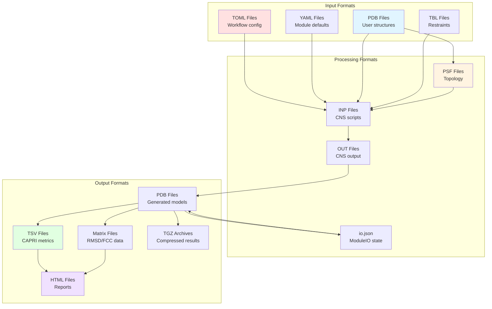
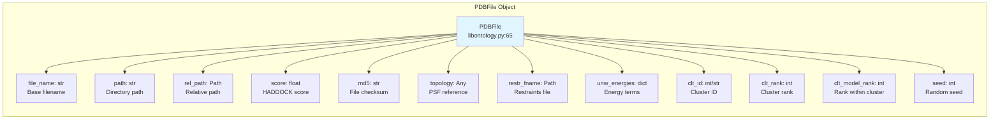
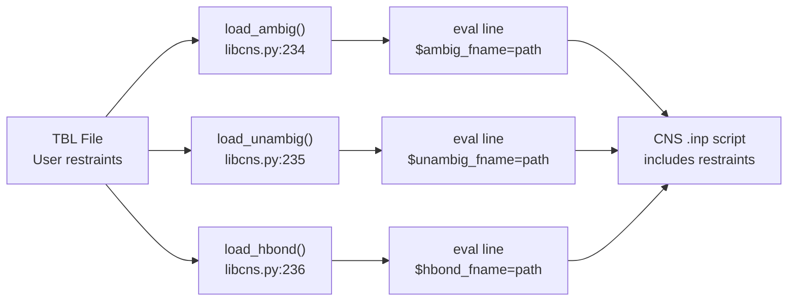
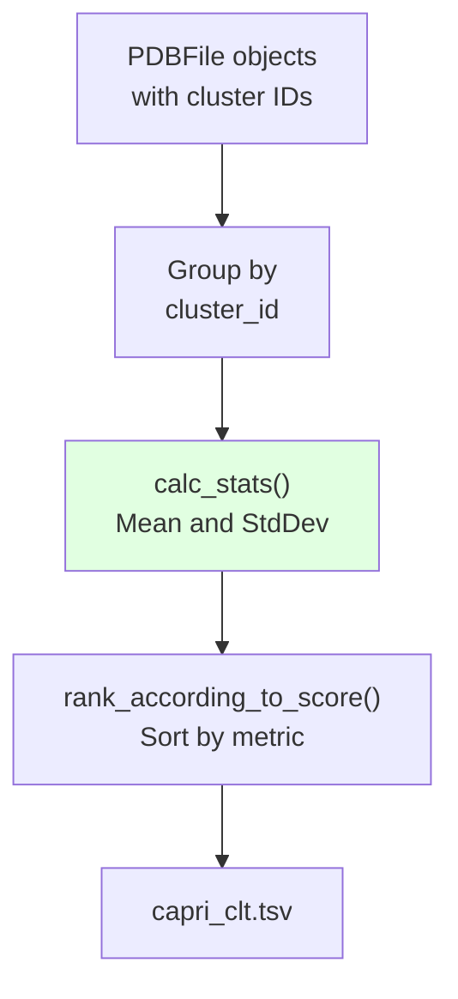
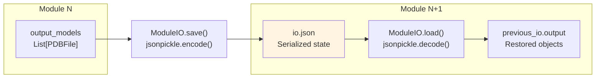
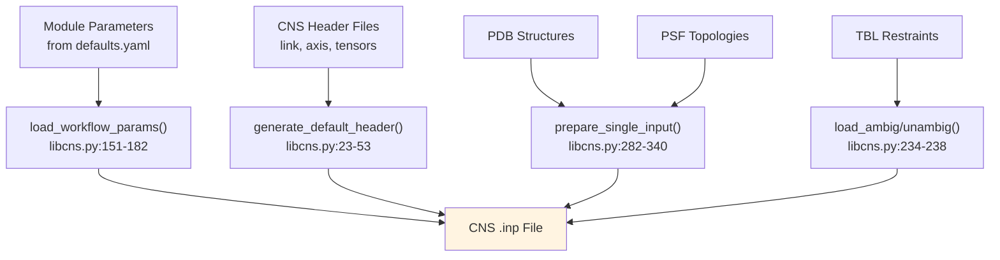
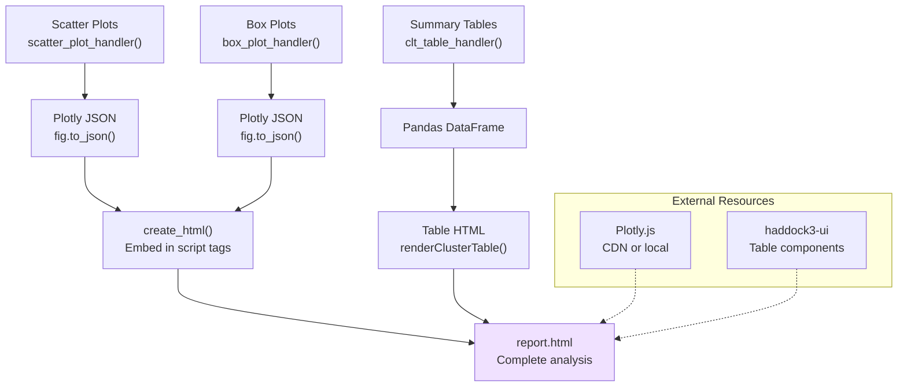
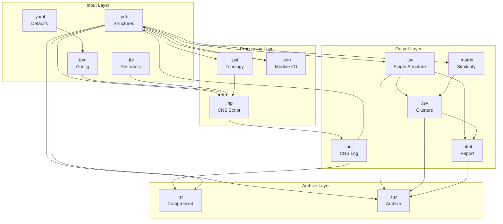

# File Formats

<details>
<summary>Relevant source files</summary>

The following files were used as context for generating this wiki page:

- [integration_tests/test_caprieval.py](integration_tests/test_caprieval.py)
- [src/haddock/clis/cli_analyse.py](src/haddock/clis/cli_analyse.py)
- [src/haddock/core/cns_paths.py](src/haddock/core/cns_paths.py)
- [src/haddock/core/supported_molecules.py](src/haddock/core/supported_molecules.py)
- [src/haddock/core/typing.py](src/haddock/core/typing.py)
- [src/haddock/gear/preprocessing.py](src/haddock/gear/preprocessing.py)
- [src/haddock/libs/libalign.py](src/haddock/libs/libalign.py)
- [src/haddock/libs/libcns.py](src/haddock/libs/libcns.py)
- [src/haddock/libs/libfunc.py](src/haddock/libs/libfunc.py)
- [src/haddock/libs/libontology.py](src/haddock/libs/libontology.py)
- [src/haddock/libs/libpdb.py](src/haddock/libs/libpdb.py)
- [src/haddock/libs/libplots.py](src/haddock/libs/libplots.py)
- [src/haddock/libs/libsubprocess.py](src/haddock/libs/libsubprocess.py)
- [src/haddock/modules/analysis/caprieval/__init__.py](src/haddock/modules/analysis/caprieval/__init__.py)
- [src/haddock/modules/analysis/caprieval/capri.py](src/haddock/modules/analysis/caprieval/capri.py)
- [src/haddock/modules/analysis/caprieval/defaults.yaml](src/haddock/modules/analysis/caprieval/defaults.yaml)
- [src/haddock/modules/base_cns_module.py](src/haddock/modules/base_cns_module.py)
- [tests/data/broken.pdb](tests/data/broken.pdb)
- [tests/data/capri_ss_-cluster.tsv](tests/data/capri_ss_-cluster.tsv)
- [tests/data/corrected.pdb](tests/data/corrected.pdb)
- [tests/data/residues.top](tests/data/residues.top)
- [tests/golden_data/capri_clt_example.tsv](tests/golden_data/capri_clt_example.tsv)
- [tests/golden_data/capri_ss_example.tsv](tests/golden_data/capri_ss_example.tsv)
- [tests/test_cli_analyse.py](tests/test_cli_analyse.py)
- [tests/test_cns_paths.py](tests/test_cns_paths.py)
- [tests/test_core_supported_molecules.py](tests/test_core_supported_molecules.py)
- [tests/test_gear_preprocessing.py](tests/test_gear_preprocessing.py)
- [tests/test_libalign.py](tests/test_libalign.py)
- [tests/test_libplots.py](tests/test_libplots.py)
- [tests/test_module_caprieval.py](tests/test_module_caprieval.py)

</details>


This page documents all file formats used by HADDOCK3 for input, output, and inter-module communication. For information about configuration file structure, see [Configuration Files](#5.1). For parameter definitions within those configurations, see [Parameter System](#5.2). For restraint-specific formats and usage, see [Restraints](#5.3).

## Overview

HADDOCK3 uses multiple file formats throughout its workflow, organized by purpose:

| Category | Formats | Primary Use |
|----------|---------|-------------|
| **Molecular Structures** | PDB, PSF | Input molecules, output models, topology |
| **Restraints** | TBL | Distance restraints, hydrogen bonds |
| **Configuration** | TOML, YAML | Workflow setup, module parameters |
| **CNS Interface** | INP, OUT, SEED | CNS script generation and execution |
| **Results** | TSV, JSON | Analysis metrics, module communication |
| **Visualization** | HTML, Matrix | Interactive reports, clustering data |
| **Archives** | TGZ, GZ | Compressed structures and outputs |

Sources: [src/haddock/libs/libontology.py:20-32](), [src/haddock/libs/libpdb.py:27-42](), [src/haddock/libs/libcns.py:1-20]()

## Format Categories and Workflow Integration



**Workflow Format Transformation**: This diagram illustrates how different file formats flow through a HADDOCK3 workflow. Input formats (PDB structures, TOML configuration, TBL restraints) are processed through intermediate formats (PSF topologies, CNS scripts) to produce output formats (models, metrics, reports).

Sources: [src/haddock/libs/libontology.py:122-156](), [src/haddock/libs/libcns.py:23-53](), [src/haddock/clis/cli_analyse.py:1-22]()

---

## PDB Format (Protein Data Bank)

### Structure and Parsing

PDB files are the primary format for representing molecular structures. HADDOCK3 uses specific field slices defined in `libpdb` for parsing:

| Field | Columns | Slice | Description |
|-------|---------|-------|-------------|
| Record Name | 1-6 | `slc_record` | ATOM, HETATM, MODEL, etc. |
| Serial Number | 7-11 | `slc_serial` | Atom serial number |
| Atom Name | 13-16 | `slc_name` | Atom identifier |
| Alt Location | 17 | `slc_altloc` | Alternate location indicator |
| Residue Name | 18-20 | `slc_resname` | Three-letter residue code |
| Chain ID | 22 | `slc_chainid` | Chain identifier |
| Residue Seq | 23-26 | `slc_resseq` | Residue sequence number |
| Insertion Code | 27 | `slc_icode` | Insertion code |
| X Coordinate | 31-38 | `slc_x` | X coordinate (Å) |
| Y Coordinate | 39-46 | `slc_y` | Y coordinate (Å) |
| Z Coordinate | 47-54 | `slc_z` | Z coordinate (Å) |
| Occupancy | 55-60 | `slc_occ` | Occupancy value |
| Temperature | 61-66 | `slc_temp` | B-factor |
| Segment ID | 73-76 | `slc_segid` | Segment identifier |
| Element | 77-78 | `slc_element` | Chemical element symbol |
| Charge | 79-80 | `slc_charge` | Formal charge |

Sources: [src/haddock/libs/libpdb.py:27-42]()

### PDBFile Class Structure



**PDBFile Ontology Class**: The `PDBFile` class extends the base `Persistent` class to represent PDB structures with associated metadata including scores, clustering information, and topology references.

Sources: [src/haddock/libs/libontology.py:65-101]()

### Preprocessing Pipeline

HADDOCK3 applies 18 line-by-line corrections plus 3 whole-PDB validations to ensure PDB compatibility:

**Line-by-Line Steps** (applied sequentially):
1. `pdb_keepcoord` - Retain only coordinate records (ATOM/HETATM)
2. `pdb_tidy` (strict) - Standardize formatting
3. `pdb_element` - Add/fix element symbols
4. `pdb_selaltloc` - Select primary alternate location
5. `pdb_occ` - Set occupancy to 1.00
6. MSE → MET residue name conversion
7. HSD/HSE/HID/HIE → HIS conversions
8. `add_charges_to_ions` - Add formal charges to ions
9. `convert_ATOM_to_HETATM` - Fix record types based on residue
10. `convert_HETATM_to_ATOM` - Fix record types for standard residues
11. `pdb_fixinsert` - Handle insertion codes
12. `remove_unsupported_hetatm` - Remove unknown HETATM
13. `remove_unsupported_atom` - Remove unknown ATOM
14. `pdb_reatom` - Renumber atoms from 1
15. `pdb_tidy` - Final formatting pass
16. Strip line endings

**Whole-PDB Steps**:
1. `models_should_have_the_same_labels` - Validate MODEL consistency
2. `solve_no_chainID_no_segID` - Assign chain/segment identifiers
3. `homogenize_chains` - Ensure consistent chain definitions

**Combined-PDB Step**:
1. `correct_equal_chain_segids` - Resolve chain ID conflicts across molecules

Sources: [src/haddock/gear/preprocessing.py:326-438]()

---

## PSF Format (Protein Structure File)

### Purpose and Generation

PSF files contain molecular topology information generated by CNS during the `topoaa` module. They define:
- Atom connectivity (bonds)
- Atom types and partial charges
- Angle and dihedral definitions
- Improper terms

### TopologyFile Class

The `TopologyFile` class represents PSF files in the HADDOCK3 ontology:

```python
# From libontology.py:115-118
class TopologyFile(Persistent):
    """Represent a CNS-generated topology file."""
    def __init__(self, file_name: FilePath, path: FilePath = ".") -> None:
        super().__init__(file_name, Format.TOPOLOGY, path)
```

PSF files are associated with their corresponding PDB structures through the `PDBFile.topology` attribute.

Sources: [src/haddock/libs/libontology.py:114-118](), [src/haddock/libs/libcns.py:256-297]()

---

## TBL Format (Restraints Tables)

### Overview

TBL (table) files define distance restraints in CNS format. HADDOCK3 supports three restraint types:

| Type | Parameter Name | CNS Function | Description |
|------|---------------|--------------|-------------|
| Ambiguous | `ambig_fname` | `load_ambig` | AIR (Ambiguous Interaction Restraints) |
| Unambiguous | `unambig_fname` | `load_unambig` | Explicit distance restraints |
| Hydrogen Bonds | `hbond_fname` | `load_hbond` | H-bond restraints |

### File Structure

TBL files use CNS `assign` statements:

```
assign (segid A and resid 10 and name CA)
       (segid B and resid 25 and name CA) 2.0 2.0 0.0
```

Where:
- First parentheses: Selection for molecule 1
- Second parentheses: Selection for molecule 2
- First number: Target distance (Å)
- Second number: Lower bound offset (Å)
- Third number: Upper bound offset (Å)

### Loading in CNS Scripts



**Restraints Loading Mechanism**: TBL files are loaded into CNS scripts through `eval` statements that set CNS variables pointing to the restraint files.

Sources: [src/haddock/libs/libcns.py:234-238](), [src/haddock/gear/preprocessing.py:1-85]()

---

## TSV Format (Tab-Separated Values)

### CAPRI Single-Structure File (capri_ss.tsv)

Contains per-model CAPRI evaluation metrics:

| Column | Type | Description |
|--------|------|-------------|
| `model` | string | Relative path to PDB file |
| `md5` | string | File checksum |
| `caprieval_rank` | int | Ranking by selected metric |
| `score` | float | HADDOCK score |
| `irmsd` | float | Interface RMSD (Å) |
| `fnat` | float | Fraction of native contacts (0-1) |
| `lrmsd` | float | Ligand RMSD (Å) |
| `ilrmsd` | float | Interface-ligand RMSD (Å) |
| `dockq` | float | DockQ composite score (0-1) |
| `rmsd` | float | Global RMSD (Å) |
| `cluster_id` | int/string | Cluster identifier or "-" |
| `cluster_ranking` | int/string | Cluster rank or "-" |
| `model-cluster_ranking` | int | Rank within cluster |
| `air` | float | AIR energy term |
| `bsa` | float | Buried surface area (Ų) |
| `desolv` | float | Desolvation energy |
| `elec` | float | Electrostatic energy |
| `vdw` | float | Van der Waals energy |

**Example** (first few columns):
```
model	md5	caprieval_rank	score	irmsd	fnat	lrmsd
../01_rigidbody/rigidbody_1.pdb	abc123	1	-125.4	2.34	0.85	5.67
../01_rigidbody/rigidbody_2.pdb	def456	2	-118.2	3.12	0.78	6.23
```

Sources: [tests/golden_data/capri_ss_example.tsv:1](), [src/haddock/modules/analysis/caprieval/capri.py:867-945]()

### CAPRI Cluster File (capri_clt.tsv)

Contains cluster-level statistics (mean ± standard deviation):

| Column | Type | Description |
|--------|------|-------------|
| `cluster_rank` | int/string | Cluster ranking or "-" for unclustered |
| `cluster_id` | int/string | Cluster identifier |
| `n` | int | Number of models in cluster |
| `under_eval` | string | Whether cluster evaluated ("yes"/"no") |
| `score` | float | Mean HADDOCK score |
| `score_std` | float | Standard deviation of score |
| `irmsd` | float | Mean interface RMSD |
| `irmsd_std` | float | Standard deviation of i-RMSD |
| ... | ... | Similar mean/std pairs for all metrics |

**Generation Process**:



**Cluster Statistics Generation**: Individual model metrics are aggregated by cluster ID, computing mean and standard deviation for each metric, then ranked according to the selected sorting key.

Sources: [src/haddock/modules/analysis/caprieval/capri.py:957-1073](), [tests/golden_data/capri_clt_example.tsv:1]()

### Reading TSV Files

```python
# From libplots.py:162-181
def read_capri_table(capri_filename: FilePath, comment: str = "#") -> pd.DataFrame:
    """Read capri table with pandas."""
    capri_df = pd.read_csv(capri_filename, sep="\t", comment=comment)
    return capri_df
```

TSV files use tab delimiters and support comment lines starting with `#`.

Sources: [src/haddock/libs/libplots.py:162-181]()

---

## JSON Format (JavaScript Object Notation)

### ModuleIO Communication (io.json)

The `ModuleIO` class uses JSON to serialize module input/output state between workflow steps:



**ModuleIO JSON Serialization**: The `ModuleIO` class saves complete `PDBFile` objects including all metadata to `io.json` files, preserving state between modules.

### JSON Structure

```json
{
    "input": [
        {
            "py/object": "haddock.libs.libontology.PDBFile",
            "file_name": "rigidbody_1.pdb",
            "path": "/path/to/01_rigidbody",
            "score": -125.4,
            "md5": "abc123...",
            "topology": {
                "py/object": "haddock.libs.libontology.TopologyFile",
                "file_name": "molecule_1.psf"
            },
            "unw_energies": {
                "elec": -45.2,
                "vdw": -80.2
            },
            "clt_id": 1,
            "clt_rank": 1
        }
    ],
    "output": [...]
}
```

### Serialization Methods

```python
# From libontology.py:141-148
def save(self, path: FilePath = ".", filename: FilePath = MODULE_IO_FILE) -> Path:
    """Save Input/Output needed files by this module to disk."""
    fpath = Path(path, filename)
    with open(fpath, "w") as output_handler:
        to_save = {"input": self.input, "output": self.output}
        jsonpickle.set_encoder_options("json", sort_keys=True, indent=4)
        output_handler.write(jsonpickle.encode(to_save))
    return fpath
```

Sources: [src/haddock/libs/libontology.py:121-156](), [src/haddock/core/defaults.py]()

### Weights Parameters (weights_params.json)

Stores scoring weights from CNS modules:

```json
{
    "w_elec": 0.2,
    "w_vdw": 1.0,
    "w_desolv": 1.0,
    "w_bsa": 0.0,
    "w_air": 0.1
}
```

Generated by `save_scoring_weights()` in the `caprieval` module to document the weights used in previous CNS steps.

Sources: [src/haddock/modules/analysis/caprieval/capri.py:82-107]()

---

## CNS Script Formats (INP/OUT/SEED)

### INP Files (CNS Input Scripts)

CNS input files are dynamically generated scripts combining:
- Header section with parameter definitions
- Input structure specifications
- Restraints loading
- Protocol execution commands

### Script Generation Structure



**CNS Script Assembly**: INP files are constructed by combining workflow parameters, CNS header files, input structure declarations, and restraint file references into executable CNS scripts.

### INP File Sections

```
! Parameters
eval ($param1=value1)
eval ($param2="string_value")

! Link file
eval ($prot_link_infile="protein-allhdg5-4-noter.link")

! Input structure
structure
  @@molecule_1.psf
end
coor @@molecule_1.pdb

! Restraints
eval ($ambig_fname="ambig.tbl")
eval ($unambig_fname="unambig.tbl")

! Protocol commands
...
```

Sources: [src/haddock/libs/libcns.py:151-340]()

### Parameter Formatting

```python
# From libcns.py:185-210
def write_eval_line(param: Any, value: Any, eval_line: str = "eval (${}={})") -> str:
    """Write the CNS eval line depending on the type of `value`."""
    if isinstance(value, bool):
        value = str(value).lower()
    elif isinstance(value, str):
        value = '"' + value + '"'
    elif isinstance(value, Path):
        value = '"' + str(value) + '"'
    return eval_line.format(param, value)
```

Empty or NaN values are filtered out using `filter_empty_vars()` to avoid CNS errors.

Sources: [src/haddock/libs/libcns.py:185-210](), [src/haddock/libs/libcns.py:106-148]()

### OUT Files (CNS Output)

OUT files contain:
- CNS execution log
- Energy evaluations
- Coordinate updates
- Error messages

### SEED Files (Random Seeds)

Small text files storing the random number seed used for reproducibility:
```
12345
```

Generated automatically alongside OUT files, compressed by default.

Sources: [src/haddock/libs/libsubprocess.py:98-266]()

---

## HTML Format (Interactive Reports)

### Report Structure

HTML reports generated by `haddock3-analyse` contain:
- Interactive Plotly scatter plots (metric vs metric)
- Box plots showing cluster distributions
- Interactive tables with structure visualization
- Embedded JavaScript for interactivity

### Component Embedding



**HTML Report Assembly**: Reports combine Plotly figures (as JSON embedded in script tags), interactive tables (using haddock3-ui components), and external JavaScript libraries.

### HTML Generation

```python
# From libplots.py:1038-1067
def _generate_html_report(
        step: str,
        figures: list[Union[Figure, pd.DataFrame]],
        report_path: FilePath,
        offline: bool = False,
        ) -> str:
    """Generate an HTML report for a specific step of analysis."""
    html_report = "<!DOCTYPE html><html lang='en'>"
    html_report += _generate_html_head(step, offline)
    html_report += _generate_html_body(figures, report_path, offline=offline)
    html_report += "</html>"
    return html_report
```

### Plotly JSON Embedding

Individual plots are embedded as JSON with associated JavaScript:

```html
<div id="plot1" class="plotly-graph-div"></div>
<script id="data1" type="application/json">
{
    "data": [...],
    "layout": {...}
}
</script>
<script type="text/javascript">
    const dat1 = JSON.parse(document.getElementById("data1").text)
    Plotly.newPlot("plot1", dat1.data, dat1.layout, {responsive: true});
</script>
```

Sources: [src/haddock/libs/libplots.py:103-159](), [src/haddock/libs/libplots.py:1038-1223]()

### Table Types

**Clustered Data Table**:
```javascript
// From libplots.py:1129-1172
renderClusterTable(element, headers, clusters)
```

Headers include:
- `cluster_rank`, `cluster_id`, `n` (cluster size)
- Statistical metrics (mean ± std)
- `best1`, `best2`, `best3`, `best4` (top structures)

**Unclustered Data Table**:
```javascript
// From libplots.py:1094-1126
renderStructureTable(element, headers, structures)
```

Headers include:
- `caprieval_rank` (sorted ascending)
- `model` (structure link)
- Metric columns
- `id` (structure identifier)

Sources: [src/haddock/libs/libplots.py:1094-1172]()

### Offline Mode

When `offline=True`:
- Plotly.js is embedded in each HTML file
- haddock3-ui CSS is copied locally
- Enables viewing without internet connection

```python
# From libplots.py:979-1035
def _css_styles_for_report(offline: bool) -> str:
    """Generate custom CSS styles for an analysis report."""
    css_link = "https://cdn.jsdelivr.net/npm/@i-vresse/haddock3-ui@~0.3.0/dist/index.css"
    if offline:
        src = haddock_ui_path / 'index.css'
        shutil.copyfile(str(src), "../data/ui/index.css")
        css_link = "../../data/ui/index.css"
    return f'<link href="{css_link}" rel="stylesheet" />'
```

Sources: [src/haddock/libs/libplots.py:979-1035]()

---

## MATRIX Format (RMSD/FCC Matrices)

### Purpose

Matrix files store pairwise similarity data for clustering:
- RMSD matrices: Pairwise structure RMSD values
- FCC matrices: Fraction of common contacts values

### RMSDFile Class

```python
# From libontology.py:103-112
class RMSDFile(Persistent):
    """Represents a RMSD matrix file."""
    def __init__(self, file_name: FilePath, npairs: int, path: FilePath = ".") -> None:
        super().__init__(file_name, Format.MATRIX, path)
        self.npairs = npairs
```

The `npairs` attribute stores the number of structure pairs in the matrix.

### Binary Format

Matrix files are typically stored in binary format generated by compiled utilities:
- `contact_fcc` - Generates FCC matrices
- `fast-rmsdmatrix` - Generates RMSD matrices

These are read by clustering modules (`clustfcc`, `clustrmsd`) using NumPy:

```python
import numpy as np
matrix = np.loadtxt(matrix_file)
```

Sources: [src/haddock/libs/libontology.py:103-112]()

---

## YAML Format (Module Defaults)

### Structure

YAML files in each module's directory define parameter specifications:

```yaml
parameter_name:
  default: value
  type: boolean|integer|float|string|file|list
  title: Short description
  short: One-line explanation
  long: Detailed multi-line documentation
  group: category_name
  explevel: easy|expert|guru
  min: minimum_value  # for numeric types
  max: maximum_value  # for numeric types
  minchars: N  # for strings
  maxchars: N  # for strings
```

### Example from caprieval

```yaml
# From defaults.yaml:1-10
reference_fname:
  default: ''
  type: file
  title: Reference structure
  short: Structure to be used when calculating the CAPRI metrics.
  long: Reference structure to be used when calculating the CAPRI metrics.
    If none is defined then the lowest scoring model is selected by default.
  group: analysis
  explevel: easy
```

### Expertise Levels

| Level | Purpose | Typical User |
|-------|---------|--------------|
| `easy` | Essential parameters | All users |
| `expert` | Advanced tuning | Experienced users |
| `guru` | Internal/expert-only | Developers/experts |

Parameters are filtered by `explevel` in the generated documentation and configuration interfaces.

Sources: [src/haddock/modules/analysis/caprieval/defaults.yaml:1-195]()

---

## TOML Format (Workflow Configuration)

### Purpose

TOML files define complete HADDOCK3 workflows, specifying:
- Run directory and molecule inputs
- Module sequence with parameters
- Execution mode and resources

### Structure

```toml
# General parameters
run_dir = "run1"
ncores = 40

molecules = [
    "data/protein.pdb",
    "data/peptide.pdb"
]

# Module 1
[topoaa]
autohis = true
ligand_param_fname = "ligand.param"

# Module 2
[rigidbody]
sampling = 1000
ambig_fname = "ambig.tbl"

# Module 3
[caprieval]
reference_fname = "reference.pdb"
```

### Parsing

TOML configuration is parsed by `setup_run` and validated against module YAML defaults. See [Configuration Files](#5.1) for detailed parsing logic.

Sources: [src/haddock/gear/config.py]()

---

## Compressed Formats (GZ/TGZ)

### Automatic Compression

HADDOCK3 automatically compresses specific file types to save disk space:

| File Type | Default Compression | Function |
|-----------|-------------------|----------|
| `.out` | Yes | `CNSJob.run(compress_out=True)` |
| `.inp` | No | `CNSJob.run(compress_inp=False)` |
| `.seed` | No | `CNSJob.run(compress_seed=False)` |
| `.err` | Yes | `CNSJob.run(compress_err=True)` |
| `.pdb` | Optional | Via `haddock3-clean` |

### GZ Files (Gzip)

Individual files compressed with gzip:
```bash
structure.pdb → structure.pdb.gz
rigidbody_1.out → rigidbody_1.out.gz
```

Decompressed automatically when needed by `_unpack_gz()`.

Sources: [src/haddock/libs/libsubprocess.py:180-258](), [src/haddock/gear/clean_steps.py]()

### TGZ Archives (Tar + Gzip)

Complete analysis results can be packaged as `.tgz` archives:

```python
# From cli_analyse.py:441-507
def zip_top_ranked(
        top_ranked_mapping: dict[Path, Path],
        summary_name: str,
        gen_archive: bool,
        ) -> Optional[Path]:
    """Zip the top ranked structures."""
    # Copy structures
    for ori_fpath, new_name in top_ranked_mapping.items():
        shutil.copy(ori_fpath, new_name)
    
    if gen_archive:
        archive_was_created = archive_files_ext(".", "pdb")
        if archive_was_created:
            output_fname = Path(f"{summary_name}.tgz")
            shutil.move("pdb.tgz", output_fname)
            return output_fname
```

### Self-Contained Archives

The `--self-contained` flag in `haddock3-analyse` creates archives with copied structures for portability:
- All top-ranked models copied to archive
- Relative paths adjusted in TSV files
- Can be extracted and viewed independently of run directory

Sources: [src/haddock/clis/cli_analyse.py:441-507](), [src/haddock/libs/libio.py]()

---

## Format Relationships Summary



**Complete Format Dependency Graph**: This diagram shows how all HADDOCK3 file formats relate to each other through the workflow pipeline, from input through processing to output and archival.

Sources: [src/haddock/libs/libontology.py:20-156](), [src/haddock/libs/libcns.py:1-340](), [src/haddock/libs/libplots.py:1-1500]()

---