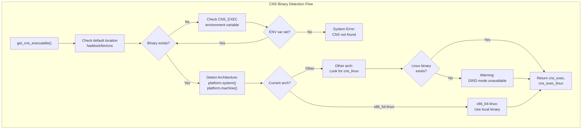
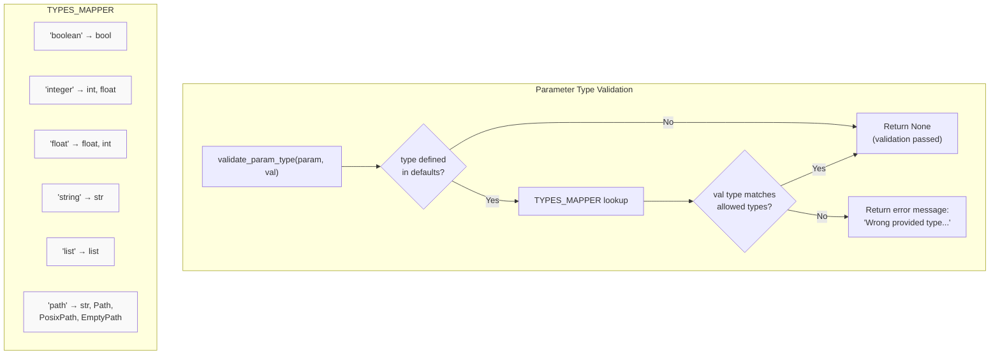
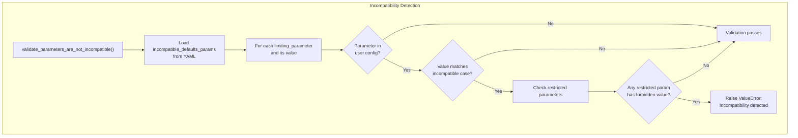
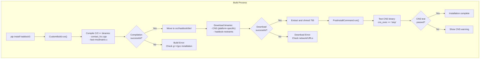
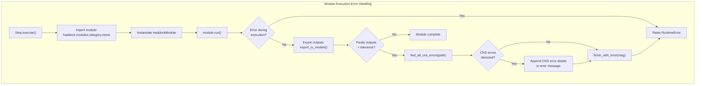
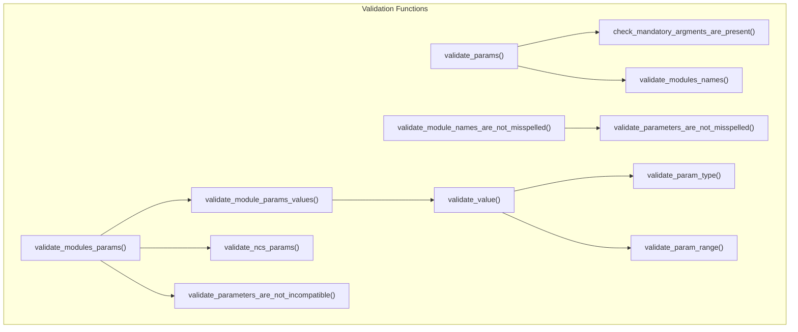

# Troubleshooting

<details>
<summary>Relevant source files</summary>

The following files were used as context for generating this wiki page:

- [DEVELOPMENT.md](DEVELOPMENT.md)
- [README.md](README.md)
- [devtools/build_defaults_rst.py](devtools/build_defaults_rst.py)
- [docs/INSTALL.md](docs/INSTALL.md)
- [docs/modules/index.rst](docs/modules/index.rst)
- [setup.py](setup.py)
- [src/haddock/__init__.py](src/haddock/__init__.py)
- [src/haddock/clis/cli.py](src/haddock/clis/cli.py)
- [src/haddock/core/defaults.py](src/haddock/core/defaults.py)
- [src/haddock/gear/config.py](src/haddock/gear/config.py)
- [src/haddock/gear/prepare_run.py](src/haddock/gear/prepare_run.py)
- [src/haddock/gear/zerofill.py](src/haddock/gear/zerofill.py)
- [src/haddock/libs/libutil.py](src/haddock/libs/libutil.py)
- [src/haddock/libs/libworkflow.py](src/haddock/libs/libworkflow.py)
- [src/haddock/modules/__init__.py](src/haddock/modules/__init__.py)
- [src/haddock/modules/_template_cat/README.md](src/haddock/modules/_template_cat/README.md)
- [src/haddock/modules/_template_cat/_template_mod/defaults.yaml](src/haddock/modules/_template_cat/_template_mod/defaults.yaml)
- [tests/test_gear_config.py](tests/test_gear_config.py)
- [tests/test_gear_prepare_run.py](tests/test_gear_prepare_run.py)
- [tests/test_gear_zerofill.py](tests/test_gear_zerofill.py)
- [tests/test_libutil.py](tests/test_libutil.py)

</details>


This page provides solutions to common issues encountered when installing, configuring, or running HADDOCK3. It covers CNS binary problems, configuration errors, dependency conflicts, and debugging techniques.

For information about:
- Installing HADDOCK3, see [Installation](#2.1)
- Configuration file syntax, see [Configuration Files](#5.1)
- Parameter definitions, see [Parameter System](#5.2)
- Running HADDOCK3 workflows, see [Command Line Interface](#2.3)

---

## CNS Binary Issues

### Problem Detection

During installation, HADDOCK3 automatically tests the CNS binary. If the test fails, you'll see a warning:

```
⚠️ WARNING: The pre-compiled CNS binary could not be executed ⚠️

This may be due to missing dependencies on your system.
Please refer to the installation instructions for troubleshooting steps:
`https://github.com/haddocking/haddock3/blob/main/docs/CNS.md`
```

**Sources:** [setup.py:232-286](), [setup.py:249-274]()

### Architecture and Platform Issues



**Diagram: CNS Binary Location and Architecture Detection**

The system checks for CNS in multiple locations and validates architecture compatibility:

| Architecture | Binary Name | Purpose |
|-------------|-------------|---------|
| `x86_64-linux` | `cns` | Local and GRID execution |
| `x86_64-darwin` | `cns` | Local macOS execution |
| `arm64-darwin` | `cns` | Apple Silicon execution |
| `aarch64-linux` | `cns` | ARM Linux execution |
| Any non-Linux | `cns_linux` | GRID execution (requires x86_64-linux binary) |

**Sources:** [src/haddock/libs/libutil.py:431-481](), [setup.py:18-32]()

### Missing System Dependencies

Common missing libraries that prevent CNS execution:

**On Linux:**
```bash
# Install required libraries
sudo apt-get install libc6 libgfortran5 libstdc++6
```

**On macOS:**
- Missing Fortran runtime libraries
- Incompatible dynamic library versions
- Gatekeeper security restrictions (for downloaded binaries)

**Solution:** Recompile CNS from source following instructions in `docs/CNS.md` (not in provided files).

**Sources:** [docs/INSTALL.md:34-38](), [DEVELOPMENT.md:103-107]()

### Replacing the CNS Binary

If the pre-compiled binary doesn't work:

1. **Locate HADDOCK3 installation:**
```bash
pip show haddock3
# Note the "Location:" field
```

2. **Replace CNS binary:**
```bash
cp <your-compiled-cns> <location>/haddock/bin/cns
chmod +x <location>/haddock/bin/cns
```

3. **Test the binary:**
```bash
<location>/haddock/bin/cns
# Type "stop" and press Enter
# Should exit without errors
```

**Sources:** [docs/INSTALL.md:39-58](), [DEVELOPMENT.md:108-127]()

---

## Configuration File Errors

### Configuration Parsing Flow

```mermaid
graph TB
    subgraph "Configuration Loading and Validation"
        A["User Config File<br/>.cfg or .toml"]
        B["load(fpath)"]
        C["loads(cfg_str)"]
        D["Regex Processing:<br/>- Normalize headers<br/>- Lowercase booleans<br/>- Add suffixes"]
        E["toml.loads(cfg)"]
        F["convert_variables_to_paths()"]
        G["Return configs dict:<br/>- raw_input<br/>- cleaned_input<br/>- loaded_cleaned_input<br/>- final_cfg"]
        H["setup_run()"]
        I["validate_module_names_are_not_misspelled()"]
        J["validate_parameters_are_not_misspelled()"]
        K["validate_modules_params()"]
        L["Module-specific validation:<br/>- validate_value()<br/>- validate_param_type()<br/>- validate_param_range()<br/>- validate_ncs_params()"]
    end
    
    A --> B
    B --> C
    C --> D
    D --> E
    E --> F
    F --> G
    G --> H
    H --> I
    I --> J
    J --> K
    K --> L
```



**Diagram: Configuration File Processing Pipeline**

**Sources:** [src/haddock/gear/config.py:116-236](), [src/haddock/gear/prepare_run.py:214-430]()

### Parameter Name Misspellings

**Error Pattern:**
```
ConfigurationError: The following parameters do not match any expected 
parameters for module 'rigidbody':
 * 'samppling_factor' did you mean 'sampling_factor'?
```

**Detection Logic:**
The system uses fuzzy matching (`difflib.get_close_matches`) to suggest corrections when parameter names don't match expected parameters.

**Sources:** [src/haddock/gear/prepare_run.py:1124-1159](), [src/haddock/gear/prepare_run.py:556-631]()

### Module Name Misspellings

**Error Pattern:**
```
ConfigurationError: Module r1g1dbod1 not found in HADDOCK3 library.
Please refer to the list of available modules at: DOCUMENTATION-LINK
```

**Valid Module Names:**
The system validates module names against `modules_category` dictionary, which maps module names to categories.

**Sources:** [src/haddock/modules/__init__.py:43-49](), [src/haddock/gear/prepare_run.py:1076-1096]()

### Type Validation Errors



**Diagram: Parameter Type Validation System**

**Common Type Errors:**

| Expected Type | Invalid Value | Valid Value |
|--------------|---------------|-------------|
| `boolean` | `1`, `0`, `""` | `true`, `false` |
| `integer` | `"10"`, `true` | `10`, `10.0` |
| `string` | `123`, `true` | `"text"`, `"123"` |
| `list` | `"item1,item2"` | `["item1", "item2"]` |

**Sources:** [src/haddock/gear/prepare_run.py:101-140](), [src/haddock/gear/prepare_run.py:689-716]()

### Range and Choice Validation Errors

**Error Pattern:**
```
ConfigurationError: Config error for parameter "sampling_factor": 
Value "150" is not in the allowed boundaries ranging from 1 to 100
```

**Validation Rules:**
- **Numeric ranges:** `min ≤ value ≤ max`
- **Choices:** `value in [choice1, choice2, ...]`
- **List length:** `minitems ≤ len(list) ≤ maxitems`
- **String length:** `minchars ≤ len(string) ≤ maxchars`

**Sources:** [src/haddock/gear/prepare_run.py:719-761]()

### NCS Parameter Validation

Non-Crystallographic Symmetry (NCS) parameters have special validation rules:

**Requirements:**
1. `ncs_sta1_X` must equal `ncs_sta2_X`
2. `ncs_end1_X` must equal `ncs_end2_X`
3. `ncs_seg1_X` must differ from `ncs_seg2_X`
4. Number of defined restraints must match `nncs`

**Error Example:**
```
ConfigurationError: Some errors were discovered in the NCS restraints definition:
Values set of `ncs_sta1_1 must be equal: we parsed `1` and `2`
Chain/Segment IDs for `ncs_seg1_1 must be different: we parsed `A` and `A`
```

**Sources:** [src/haddock/gear/prepare_run.py:764-867]()

### Parameter Incompatibility Errors

The system detects incompatible parameter combinations defined in `defaults.yaml` files:



**Diagram: Parameter Incompatibility Validation**

**Example incompatible_params structure:**
```yaml
incompatible:
  use_restraints:
    false:
      restraints_file: "*"  # Cannot specify file if not using restraints
```

**Sources:** [src/haddock/gear/prepare_run.py:1099-1177](), [src/haddock/gear/yaml2cfg.py]() (referenced but not provided)

---

## Installation and Dependency Issues

### Build System Issues



**Diagram: HADDOCK3 Build and Installation Flow**

**Sources:** [setup.py:50-296]()

### Common Compilation Errors

**Missing g++/gcc:**
```bash
# Ubuntu/Debian
sudo apt-get install build-essential gcc g++

# macOS
xcode-select --install
```

**Architecture-specific compilation flags:**
The build uses `-march=native` which may fail on some systems. If compilation fails:
1. Check [setup.py:42-46]() for compilation flags
2. Remove `-march=native` if necessary
3. Rebuild with `pip install --no-cache-dir -e .`

**Sources:** [setup.py:35-47](), [DEVELOPMENT.md:18-33]()

### Python Version Issues

HADDOCK3 requires Python 3.9-3.13:

| Python Version | Status | Notes |
|---------------|--------|-------|
| < 3.9 | ❌ Not supported | Use newer Python |
| 3.9 - 3.13 | ✅ Supported | Recommended |
| 3.14+ | ⚠️ May work | Not officially tested |

**Sources:** [README.md:26](), [DEVELOPMENT.md:14]()

### MPI Installation Issues

**Missing OpenMPI:**
```bash
# Ubuntu/Debian
sudo apt-get install openmpi-bin libopenmpi-dev

# macOS
brew install open-mpi
```

**mpi4py installation:**
```bash
# After OpenMPI is installed
pip install 'haddock3[mpi]'

# Or on macOS if pip fails:
brew install mpi4py
pip install 'haddock3[mpi]'
```

**Sources:** [docs/INSTALL.md:26-32](), [DEVELOPMENT.md:83-89]()

### OpenMM Dependencies

For the `openmm` module, additional dependencies are required:

**venv installation (Python ≥3.10):**
```bash
pip install openmm==8.2.0
pip install https://github.com/openmm/pdbfixer/archive/refs/tags/v1.10.tar.gz
```

**conda installation (Python 3.9-3.13):**
```bash
conda install -c conda-forge libstdcxx-ng
conda install -c conda-forge openmm==8.2.0 pdbfixer==1.10
```

**Sources:** [docs/INSTALL.md:110-150]()

---

## Runtime Errors

### Module Execution Failures



**Diagram: Module Error Detection and Reporting**

**Sources:** [src/haddock/modules/__init__.py:271-319](), [src/haddock/libs/libworkflow.py:142-190]()

### File Not Found Errors

**Configuration File Issues:**
```
ConfigurationError: Expected 'molecules' parameter in configuration file.
```

**Solution:** Check [Configuration Files](#5.1) for required parameters.

**Input File Validation:**
The system validates file existence and suggests similar filenames:

```python
# Example error with suggestion
ValueError: The file 'file-01.txt' does not exist, but the following 
'file_01.txt' is the closest match to the supplied 'file-01.txt', 
did you mean to open this?
```

**Sources:** [src/haddock/gear/prepare_run.py:1427-1443](), [src/haddock/modules/__init__.py:383-387]()

### Path Resolution Issues

HADDOCK3 converts certain parameters to `Path` objects automatically:

**Auto-converted parameters:**
- Parameters ending with `_fname`
- `molecules`
- `cns_exec`
- `executable`
- `run_dir`

**EmptyPath handling:**
Empty or false values are converted to `EmptyPath()` objects to distinguish from undefined parameters.

**Sources:** [src/haddock/gear/config.py:98-106](), [src/haddock/gear/config.py:239-283]()

---

## Debugging Techniques

### Log Levels

Set logging verbosity using the `--log-level` flag:

```bash
haddock3 config.cfg --log-level DEBUG
haddock3 config.cfg --log-level INFO    # Default
haddock3 config.cfg --log-level WARNING
haddock3 config.cfg --log-level ERROR
```

**Log Level Effects:**

| Level | Output Includes |
|-------|----------------|
| `DEBUG` | All messages, detailed function calls |
| `INFO` | Module progress, file operations |
| `WARNING` | Potential issues, non-critical errors |
| `ERROR` | Critical failures only |

**Sources:** [src/haddock/clis/cli.py:56-57](), [src/haddock/clis/cli.py:80-110]()

### Configuration Validation

**Test configuration without running:**
```bash
haddock3 config.cfg --setup
```

This performs all validation steps without executing the workflow:
1. Parse configuration file
2. Validate module names and parameters
3. Check file paths
4. Create run directory structure
5. Copy input files
6. Exit without running modules

**Sources:** [src/haddock/clis/cli.py:50-55](), [src/haddock/clis/cli.py:169-173]()

### Validation Function Reference



**Diagram: Validation Function Hierarchy**

| Function | Validates | Error Type |
|----------|-----------|------------|
| `check_mandatory_argments_are_present()` | Required parameters exist | `ConfigurationError` |
| `validate_modules_names()` | Module names are valid | `ConfigurationError` |
| `validate_module_names_are_not_misspelled()` | Module name spelling | `ValueError` |
| `validate_parameters_are_not_misspelled()` | Parameter name spelling | `ValueError` |
| `validate_param_type()` | Parameter data types | Returns error string |
| `validate_param_range()` | Parameter value ranges | Returns error string |
| `validate_ncs_params()` | NCS constraint rules | `ConfigurationError` |
| `validate_parameters_are_not_incompatible()` | Parameter compatibility | `ValueError` |

**Sources:** [src/haddock/gear/prepare_run.py:514-867]()

### Examining Saved Configurations

HADDOCK3 saves multiple configuration versions in `run_dir/data/configurations/`:

```
run_dir/
└── data/
    └── configurations/
        ├── raw_input.toml           # Original user input
        ├── raw_input.json
        ├── cleaned_input.toml       # Normalized format
        ├── cleaned_input.json
        ├── enhanced_haddock_params.toml  # With defaults
        ├── enhanced_haddock_params.json
        └── README.txt               # Descriptions
```

**Use cases:**
- Compare `raw_input` vs `cleaned_input` to see normalization
- Check `enhanced_haddock_params` to see all default values applied
- Verify parameter values after validation

**Sources:** [src/haddock/gear/prepare_run.py:433-511]()

### Restart and Extend Options

**Restart from a specific step:**
```bash
# Remove steps 3 onwards and restart from step 3
haddock3 config.cfg --restart 3
```

**Extend a previous run:**
```bash
# Use haddock3-copy to prepare extension
haddock3-copy run_01 run_01_extended
# Modify config to add new steps
haddock3 extended_config.cfg --extend-run run_01_extended
```

**Sources:** [src/haddock/clis/cli.py:47-48](), [src/haddock/gear/prepare_run.py:332-389]()

### Binary Path Detection

If HADDOCK3 cannot find required binaries:

**Check binary locations:**
```python
from importlib.resources import files
import haddock

bin_dir = files(haddock).joinpath("bin")
print(f"Binary directory: {bin_dir}")
print(f"CNS: {bin_dir}/cns")
print(f"contact_fcc: {bin_dir}/contact_fcc")
print(f"fast-rmsdmatrix: {bin_dir}/fast-rmsdmatrix")
print(f"haddock-restraints: {bin_dir}/haddock-restraints")
```

**Override CNS location:**
```bash
export CNS_EXEC=/path/to/your/cns
haddock3 config.cfg
```

**Sources:** [src/haddock/libs/libutil.py:431-481](), [src/haddock/core/defaults.py:12-15]()

### Common Error Patterns

| Error Message Fragment | Likely Cause | Solution |
|----------------------|--------------|----------|
| `Module ... not found` | Misspelled module name | Check module name against [Module Catalog](#9.1) |
| `parameter ... do not match` | Misspelled parameter | Check parameter names in defaults.yaml |
| `Wrong provided type` | Type mismatch | Use correct type (e.g., `true` not `"true"`) |
| `not in the allowed boundaries` | Value out of range | Check min/max in parameter documentation |
| `CNS binary could not be executed` | Missing system libraries | Install dependencies or recompile CNS |
| `File not found` | Path error | Use absolute paths or check working directory |
| `explevel ... is not expected` | Invalid defaults.yaml | Fix explevel to: easy, expert, guru, hidden |

**Sources:** [src/haddock/gear/prepare_run.py:145-867](), [src/haddock/modules/__init__.py:103-112]()