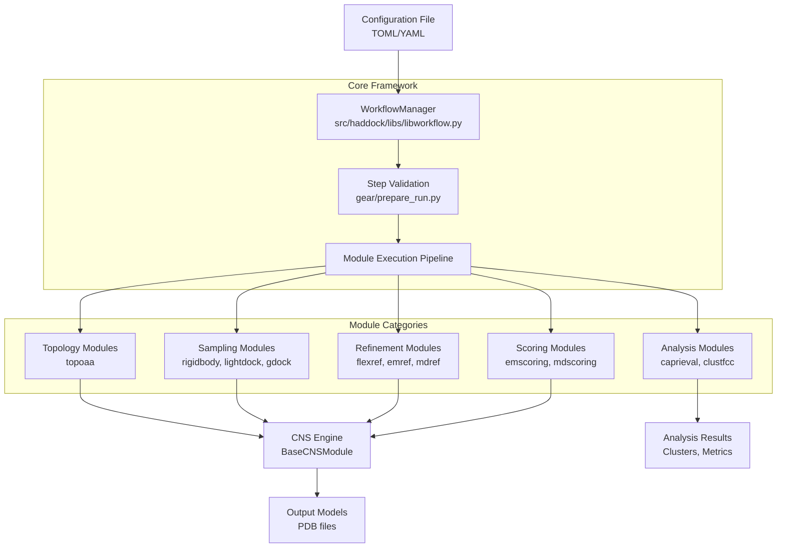

HADDOCK3 is the next-generation integrative modeling software for biomolecular interactions, representing a complete rethinking and rewriting of the HADDOCK2.X series. It implements a modular, flexible approach to molecular docking that allows users to construct custom workflows by combining specialized simulation modules.


## What is HADDOCK3?

HADDOCK (High Ambiguity Driven protein-protein DOCKing) is a widely used computational tool developed by researchers at Utrecht University in the BonvinLab for the integrative modeling of biomolecular complexes. HADDOCK3 continues this legacy with a revolutionary modular architecture that transforms the docking workflow from a rigid pipeline into a flexible, customizable system [README.md](/README.md#L9-L12).

The software supports docking of various biomolecular types including proteins, nucleic acids, peptides, carbohydrates, and small molecules, enabling researchers to model complex biomolecular interactions using experimental and bioinformatics data.

## Evolution from HADDOCK2.x

The transition from HADDOCK2.x to HADDOCK3 represents a fundamental shift in design philosophy. In HADDOCK2.x versions, users worked with a highly parameterizable yet rigid simulation pipeline composed of three fixed stages: rigid-body docking (it0), semi-flexible refinement (it1), and final refinement (itw) [docs/intro.md](/docs/intro.md#L6-L14).


HADDOCK3 breaks this constraint by modularizing the entire docking machinery. Users now have complete freedom to configure docking workflows into functional pipelines by combining different HADDOCK3 modules, adapting workflows to specific project requirements. This "puzzle-like" architecture allows users to duplicate steps within a workflow (e.g., repeating the refinement stage multiple times) and combine modules in any order [docs/intro.md](/docs/intro.md#L16-L24).

> [!TIP]
> While HADDOCK3 provides unprecedented flexibility, not all HADDOCK2.x features have been ported yet. Currently unsupported features include NMR RDC, PCS, and diffusion anisotropy restraints, cryo-EM restraints, and coarse-graining. However, any information convertible to ambiguous interaction restraints can still be used.

## Modular Architecture

HADDOCK3's core innovation is its modular plugin architecture built around a workflow execution engine. The system consists of several interconnected components that work together to process molecular structures and generate docking models.



The architecture is implemented through three main components:

1. **WorkflowManager**: Orchestrates the execution of modules, manages dependencies, and handles the flow of data between workflow steps [src/haddock/libs/libworkflow.py](/src/haddock/libs/libworkflow.py#L23-L41)

2. **Module System**: Each module is self-contained with its own parameters, default configurations, and execution logic. Modules inherit from base classes like `BaseHaddockModule` and `BaseCNSModule` for CNS-based operations [src/haddock/modules/base_cns_module.py](/src/haddock/modules/base_cns_module.py#L13-L36)

3. **Configuration System**: Validates user-provided parameters, handles default values, and manages expandable parameters that can be per-module or global [src/haddock/gear/prepare_run.py](/src/haddock/gear/prepare_run.py#L514-L527)

## Module Categories

HADDOCK3 modules are organized into five main categories based on their function in the docking workflow. There are no constraints on piping modules of different categories, enabling maximum flexibility.

| Category | Purpose | Example Modules |
|----------|---------|----------------|
| **Topology** | Generate molecular topologies and prepare input structures | `topoaa`, `topocg` |
| **Sampling** | Generate initial docking models through various algorithms | `rigidbody`, `lightdock`, `gdock` |
| **Refinement** | Improve model quality through energy minimization and dynamics | `flexref`, `emref`, `mdref` |
| **Scoring** | Evaluate and score models using energy functions | `emscoring`, `mdscoring`, `prodigyligand`, `prodigyprotein` |
| **Analysis** | Process results, cluster models, and calculate metrics | `caprieval`, `clustfcc`, `clustrmsd`, `alascan`, `contactmap` |

Sources: [docs/intro.md](/docs/intro.md#L35-L73), [src/haddock/modules/__init__.py](/src/haddock/modules/__init__.py#L40-L48)


## How HADDOCK3 Works

A typical HADDOCK3 workflow begins with a configuration file that defines the sequence of modules to execute. Here's a simplified example that reproduces the classic HADDOCK2.x rigid-body workflow:

```toml
run_dir = "run1-protein-protein"
ncores = 40
mode = "local"

# molecules to be docked
molecules = [
    "data/e2aP_1F3G.pdb",
    "data/hpr_ensemble.pdb"
]

[topoaa]

[rigidbody]
ambig_fname = "data/e2a-hpr_air.tbl"

[seletop]

[flexref]
ambig_fname = "data/e2a-hpr_air.tbl"

[emref]
ambig_fname = "data/e2a-hpr_air.tbl"

[clustfcc]

[caprieval]
```

Sources: [docs/intro.md](/docs/intro.md#L75-L103)

The workflow execution follows this pattern:

1. **Configuration Parsing**: The `setup_run` function reads and validates the configuration file, checking for mandatory parameters and valid module names [src/haddock/gear/prepare_run.py](/src/haddock/gear/prepare_run.py#L214-L217)

2. **Directory Structure**: A run directory is created with organized subdirectories for each workflow step (e.g., `1_topoaa`, `2_rigidbody`, etc.) [src/haddock/core/defaults.py](/src/haddock/core/defaults.py#L22-L25)

3. **Sequential Execution**: Modules execute in the defined order, with each module receiving output from the previous step as input. Module inputs and outputs are tracked through `io.json` files [src/haddock/core/defaults.py](/src/haddock/core/defaults.py#L27-L28)

4. **CNS Integration**: For modules requiring computational chemistry calculations, CNS (Crystallography & NMR System) scripts are generated and executed with appropriate parameters [src/haddock/modules/base_cns_module.py](/src/haddock/modules/base_cns_module.py#L51-L72)

5. **Results Collection**: Each module generates output files (typically PDB structures) that are passed to subsequent modules for further processing

## Key Features

### Flexible Workflow Design

Unlike rigid pipelines, HADDOCK3 allows you to:
- **Duplicate steps**: Run refinement multiple times with different parameters
- **Skip stages**: Omit unnecessary steps for specific scenarios
- **Custom order**: Arrange modules in any sequence that makes sense for your project
- **Third-party integration**: Use external docking tools like LightDock and GDock within HADDOCK3 workflows

### Comprehensive Parameter Control

Each module has extensive parameter sets defined in YAML files with:
- Default values for typical use cases
- Type validation (integer, float, boolean, string, file)
- Range constraints where applicable
- Expertise levels (easy, expert, guru) to guide users
- Detailed descriptions of each parameter's purpose [src/haddock/modules/sampling/rigidbody/defaults.yaml](/src/haddock/modules/sampling/rigidbody/defaults.yaml#L1-L21)

### Parallel Execution Support

HADDOCK3 supports multiple execution modes:
- **Local mode**: Run on a single machine with multiple cores
- **MPI mode**: Distributed execution across multiple nodes using OpenMPI
- **HPC mode**: Integration with job schedulers for cluster computing [docs/INSTALL.md](/docs/INSTALL.md#L1-L22)

### Restraint-Driven Docking

HADDOCK3's strength lies in its ability to incorporate various types of experimental and bioinformatics data:
- **Ambiguous Interaction Restraints (AIRs)**: Define active and passive residues for guided docking
- **Unambiguous distance restraints**: Precise distance constraints
- **Hydrogen bond restraints**: Guide interaction formation
- **Center-of-mass restraints**: Enable ab initio docking without experimental data [src/haddock/modules/sampling/rigidbody/defaults.yaml](/src/haddock/modules/sampling/rigidbody/defaults.yaml#L32-L52)

## Installation and Quick Start

HADDOCK3 is designed for easy installation:

```bash
# Basic installation
pip install haddock3

# With MPI support
pip install 'haddock3[mpi]'
```

The software requires Python 3.9-3.13 and automatically handles dependencies including Biopython, NumPy, SciPy, and other essential libraries [pyproject.toml](/pyproject.toml#L1-L21).

> [!TIP]
> For the best experience, consider installing related utilities from the BonvinLab ecosystem: `haddock-restraints` for generating restraints, `haddock-runner` for large-scale simulations, and `haddock-tools` for various utility scripts.

## Getting Started

To begin using HADDOCK3:

1. **Install the software** following the [Installation Guide](3-installation-guide)
2. **Explore examples** in the `examples/` directory to see different docking scenarios
3. **Review documentation** for module-specific parameters using `haddock3-cfg -m <module_name>`
4. **Configure your workflow** by creating a TOML configuration file
5. **Run the simulation** with `haddock3 <config-file.toml>`

## Next Steps

Now that you understand HADDOCK3's modular architecture and capabilities, we recommend continuing with:

- **[Quick Start](2-quick-start)**: Get hands-on experience with a basic docking run
- **[Installation Guide](3-installation-guide)**: Detailed setup instructions for different environments
- **[HADDOCK3 Architecture and Design Philosophy](6-haddock3-architecture-and-design-philosophy)**: Deep dive into the technical architecture
- **[Workflow Engine and Execution Model](7-workflow-engine-and-execution-model)**: Understanding how workflows are orchestrated

The modular nature of HADDOCK3 opens up possibilities for specialized applications including protein-protein docking, protein-ligand interactions, antibody-antigen complexes, and more. Explore the specialized documentation sections to learn about workflows tailored to your specific research needs.